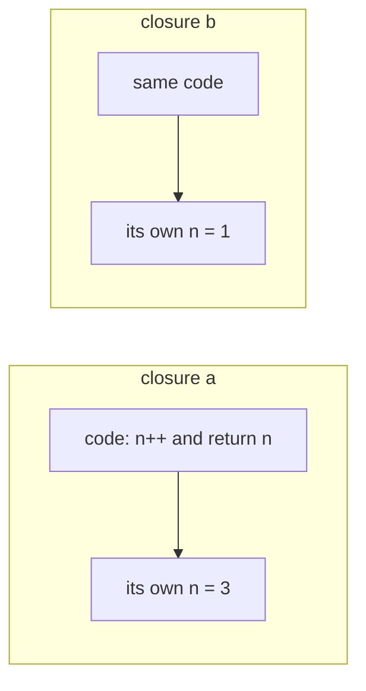

# Closures, defer and call by value

> **Before this lesson:** read [Declaring and calling functions](#/lesson/go/go-functions-basics). You need to know how to declare functions, that functions are values, what an anonymous function is, and how blocks and scope work ([Blocks, shadowing and if](#/lesson/go/go-blocks-shadowing)).

## In plain words

This lesson explains three behaviours of Go functions that beginners find surprising until they see the simple rule behind each.

**Closures.** Imagine giving a friend a note that says "the spare key is under the blue flowerpot". The note is small, but it lets your friend reach something that stays at your house. A **closure** is a function that carries a note like that: it was created inside another function and keeps access to that function's variables, even after the outer function has finished.

**defer.** When you enter a room you might say to yourself "on my way out, switch off the light". You make the promise at the moment you switch the light on, and you keep it when you leave, whichever door you use. Go's `defer` statement is that promise: "run this call when the current function is about to return". It is how Go programs make sure files get closed and locks get released on every exit path.

**Call by value.** When a colleague asks for a document, you can hand over a **photocopy**. They can scribble on it freely; your original is unaffected. Go always hands functions photocopies of the arguments. The twist is that some photocopies contain an *address* (a slice, a map, a pointer), and scribbling at that address does change the shared thing.

Why this matters for a job: `defer` is in nearly every function that touches a file, a network connection, a lock or a database transaction. Closures are how HTTP middleware and callbacks work. "Is Go pass-by-value or pass-by-reference?" and "in what order do deferred calls run, and when are their arguments evaluated?" are interview staples.

**Compared with Python.** Python has closures too (with the `nonlocal` keyword needed to assign to a captured variable; Go needs no keyword). For cleanup Python uses `with` blocks and `try/finally`; Go uses `defer`. Python passes object references, so a function can mutate a list or object you pass in; Go copies the value, and whether the callee can affect the caller depends on what was copied.

## Closures

### A function that remembers

Start with the smallest closure:

```go
package main

import "fmt"

func main() {
	count := 0
	increment := func() {
		count++ // uses a variable from the surrounding function
	}

	increment()
	increment()
	fmt.Println(count)
}
```

```text
2
```

The anonymous function assigned to `increment` has no variable called `count` of its own. It uses the one from `main`. A function that uses variables declared outside its own body, in an enclosing function, is a **closure**, and those variables are said to be **captured**.

The capture is of the **variable itself**, not a snapshot of its value. The closure and `main` share one `count`; changes made by either are seen by both.

### Outliving the function that created it

The more interesting case is when the inner function is returned and the outer function ends:

```go
package main

import "fmt"

func newCounter() func() int {
	n := 0
	return func() int {
		n++
		return n
	}
}

func main() {
	a := newCounter()
	b := newCounter()
	fmt.Println(a(), a(), a())
	fmt.Println(b())
}
```

```text
1 2 3
1
```

Step by step:

- `newCounter` declares a local variable `n` and returns an anonymous function that increments and returns it. The result type `func() int` says "I return a function that takes nothing and returns an int".
- Normally a local variable disappears when its function returns. Here the returned closure still needs `n`, so Go keeps `n` alive for as long as the closure exists. (The compiler notices this and stores `n` on the heap; see [escape analysis](#/lesson/go/go-pointers-gc).)
- Each call to `newCounter` creates a **new** `n`. So `a` and `b` have separate counters: `a` reaches 3 while `b` starts at 1.



A closure is therefore two things bundled together: code, plus the variables that code captured. It gives you a small piece of private state without defining a type.

### What closures are used for

**Adapting a function to a required shape.** `slices.SortFunc` wants a function of two elements. If the sort order depends on some outside setting, a closure can carry that setting in:

```go
descending := true
slices.SortFunc(nums, func(a, b int) int {
	if descending { // captured from outside
		return cmp.Compare(b, a)
	}
	return cmp.Compare(a, b)
})
```

**Building specialised functions.**

```go
func multiplier(factor int) func(int) int {
	return func(x int) int { return x * factor }
}

double := multiplier(2)
triple := multiplier(3)
fmt.Println(double(10), triple(10)) // 20 30
```

**Wrapping behaviour around another function**, the basis of middleware in web servers:

```go
func logged(name string, f func(int) int) func(int) int {
	return func(x int) int {
		fmt.Println("calling", name, "with", x)
		return f(x)
	}
}
```

**Limiting scope.** A helper needed in only one function can be an anonymous function declared inside it, invisible to the rest of the package.

### The capture-by-variable consequence

Because the variable is shared, a closure sees later changes:

```go
msg := "first"
show := func() { fmt.Println(msg) }
msg = "second"
show()
```

```text
second
```

If you want the value frozen at creation time, pass it as a parameter or copy it into a new variable first.

## defer

### The basic behaviour

```go
package main

import "fmt"

func main() {
	fmt.Println("start")
	defer fmt.Println("deferred 1")
	defer fmt.Println("deferred 2")
	fmt.Println("end")
}
```

```text
start
end
deferred 2
deferred 1
```

`defer` takes a function call and postpones it until the surrounding function returns. Two rules are visible:

1. Deferred calls run **after** the rest of the function body.
2. Several deferred calls run in **last-in, first-out** order: the most recently deferred runs first. Think of a stack of plates; you take from the top.

The reverse order is deliberate. Resources are usually acquired in a sequence where later ones depend on earlier ones (open a database connection, then start a transaction), so they should be released in the opposite sequence.

### The real use: cleanup that cannot be forgotten

```go
package main

import (
	"fmt"
	"os"
)

func firstBytes(path string, n int) ([]byte, error) {
	f, err := os.Open(path)
	if err != nil {
		return nil, err
	}
	defer f.Close() // runs however the function exits from here on

	buf := make([]byte, n)
	got, err := f.Read(buf)
	if err != nil {
		return nil, err // f.Close() still runs
	}
	return buf[:got], nil // f.Close() still runs
}

func main() {
	data, err := firstBytes("go.mod", 6)
	fmt.Println(string(data), err)
}
```

```text
module <nil>
```

`os.Open` returns an open file and an error. An open file is a limited operating-system resource that must be handed back with `Close`. The `defer f.Close()` line sits directly after the successful open, so the "acquire" and the "release" are side by side in the source. The function has two later exits, and neither needs to remember the close. Deferred calls also run when a function is ended by a panic.

Note the order: check the error **first**, then defer. If `Open` failed, `f` is nil and there is nothing to close.

### Rule 3: arguments are evaluated immediately

The call is postponed; its **arguments are computed at the `defer` statement**.

```go
package main

import "fmt"

func main() {
	x := 1
	defer fmt.Println("argument:", x)               // x is evaluated now: 1
	defer func() { fmt.Println("closure:", x) }()   // x is read when it runs
	x = 2
}
```

```text
closure: 2
argument: 1
```

The first `defer` records the call `fmt.Println("argument:", 1)`; the number 1 is fixed. The second defers a closure with no arguments; when it finally runs it reads the captured variable `x`, which by then is 2. (The closure line prints first because of last-in, first-out.) The trailing `()` after the function literal is required: `defer` needs a call, not a function value.

### Rule 4: deferred closures can change named results

A `return` statement with a value does two things in order: it stores the value in the result, then runs the deferred calls, and only then does the function hand the result back. If the result has a name, a deferred closure can read and change it in between.

```go
package main

import "fmt"

func double(n int) (result int) {
	defer func() {
		result *= 2
	}()
	return n // step 1: result = n; step 2: deferred call doubles it
}

func main() {
	fmt.Println(double(5))
}
```

```text
10
```

The serious use of this is error handling in cleanup. A database transaction must be committed on success and rolled back on failure:

```go
func transfer(db *sql.DB) (err error) {
	tx, err := db.Begin()
	if err != nil {
		return err
	}
	defer func() {
		if err != nil {
			tx.Rollback() // something failed: undo
			return
		}
		err = tx.Commit() // all good: commit, and report a commit failure
	}()

	// ... statements that may set err and return it ...
	return nil
}
```

Because `err` is a named result, the deferred closure sees the final error value whatever exit path was taken.

### Try it: a defer machine

This simulation models a function as a list of statements with a defer stack. Edit the program and predict the output; the rules are those of the practice problem [defer: order and argument timing](#/problem/go-defer-order).

```python-run
def run(stmts):
    env, stack, printed = {"result": 0}, [], []
    for st in stmts:
        op = st[0]
        if op == "set":
            env[st[1]] = st[2]
        elif op == "defer_print":            # defer fmt.Println(x): value captured NOW
            stack.append(("value", env.get(st[1], 0)))
        elif op == "defer_closure":          # defer func(){ fmt.Println(x) }(): read LATER
            stack.append(("read", st[1]))
        elif op == "defer_add":              # defer func(){ x += d }()
            stack.append(("add", st[1], st[2]))
        elif op == "return":
            env["result"] = env.get(st[1], 0)
            break
    while stack:                             # last in, first out
        d = stack.pop()
        if d[0] == "value":
            printed.append(f"printed captured value {d[1]}")
        elif d[0] == "read":
            printed.append(f"printed current {d[1]} = {env.get(d[1], 0)}")
        else:
            env[d[1]] = env.get(d[1], 0) + d[2]
            printed.append(f"{d[1]} += {d[2]}")
    return printed, env["result"]

log, returned = run([
    ("set", "x", 1),
    ("defer_print", "x"),
    ("defer_closure", "x"),
    ("defer_add", "result", 100),
    ("set", "x", 2),
    ("return", "x"),
])
for line in log:
    print(line)
print("function returns", returned)
```

The function says `return x` with `x == 2`, yet the caller receives 102, because the deferred addition ran after the result was set.

### defer inside loops

Deferred calls run when the **function** returns, not when the loop pass ends. This loop keeps every file open until the whole function finishes:

```go
for _, path := range paths {
	f, err := os.Open(path)
	if err != nil {
		return err
	}
	defer f.Close() // all of these pile up until the function returns
	process(f)
}
```

With thousands of paths the program can run out of file handles. Move the body into its own function, so that each pass has its own exit point:

```go
for _, path := range paths {
	if err := processOne(path); err != nil { // opens, defers Close, processes
		return err
	}
}
```

## Call by value

**Go passes every argument by value.** The function receives its own copy; assigning to a parameter never changes the caller's variable. This single rule, combined with what each type contains, explains everything.

```go
package main

import "fmt"

type Person struct {
	Name string
	Age  int
}

func birthday(p Person)          { p.Age++ }           // changes the copy
func setScore(m map[string]int)  { m["score"] = 10 }    // writes through the copied map reference
func touch(s []int)              { s[0] = 99; s = append(s, 4) }
func reset(n int)                { n = 0 }

func main() {
	p := Person{"Ana", 30}
	birthday(p)
	fmt.Println(p)

	m := map[string]int{}
	setScore(m)
	fmt.Println(m)

	s := []int{1, 2, 3}
	touch(s)
	fmt.Println(s)

	n := 7
	reset(n)
	fmt.Println(n)
}
```

```text
{Ana 30}
map[score:10]
[99 2 3]
7
```

All four functions received copies. The outcomes differ because of what was copied:

| Argument type | What the copy contains | Can the function affect the caller? |
|---|---|---|
| `int`, `float64`, `bool`, `string` | the value itself | no |
| struct, array | all the fields / elements | no |
| map | a reference to the shared hash table | yes: adding, changing, deleting keys |
| slice | pointer, length, capacity | elements yes; length and capacity no |
| pointer (next module) | an address | yes: whatever lives at that address |
| function, channel | a reference | yes, in their own ways |

So `birthday` aged a photocopy of Ana. `setScore` copied a map reference and wrote into the one shared table. `touch` copied a slice header: `s[0] = 99` reached the shared backing array, while the `append` changed only the local header, so the caller still sees length 3. `reset` zeroed its own copy of 7.

To let `birthday` change the caller's struct you pass its address, a **pointer**. That is the subject of the next module, and you now know why it is needed.

> [!NOTE]
> People sometimes say that maps and slices are "passed by reference". The precise statement is: they are passed by value like everything else, and the value happens to contain a pointer. The distinction explains why `append` inside a function does not lengthen the caller's slice.

## Pitfalls

> [!WARNING]
> `defer f.Close()` placed **before** checking the error from `os.Open` will call `Close` on a nil file when the open fails. Always check the error first.

- **Expecting `defer` to run at the end of a block or loop pass.** It runs at function exit.
- **Assuming a deferred call's arguments are evaluated late.** They are evaluated at the `defer` line. Wrap in a closure for late reading.
- **Forgetting the `()`** after a deferred function literal.
- **Ignoring the error returned by a deferred `Close` on a file you wrote to.** A failed close can mean lost data; capture it through a named result.
- **A closure that modifies a captured variable from several goroutines** without synchronisation: a data race.
- **Believing a struct argument is shared.** It is copied; changes are lost unless you return the struct or pass a pointer.
- **Capturing a loop variable in pre-1.22 code**, where all closures shared it.

> [!TIP]
> Write the `defer` on the line immediately after the resource is successfully acquired: open → check error → defer close. Reviewers scan for exactly this three-line shape, and its absence is the first thing they question.

> [!INTERVIEW]
> **"What does this print?"** `func f() (r int) { defer func() { r += 10 }(); return 1 }` prints 11 when called. `return 1` assigns 1 to the named result `r`; the deferred closure then adds 10; the function returns 11. With an unnamed result (`func f() int { r := 1; defer func() { r += 10 }(); return r }`) the answer is 1, because the return value was already copied out of `r` before the deferred call changed the local variable. State the three rules: LIFO order, arguments evaluated at the defer statement, deferred functions run after the return value is set and before the function hands control back.

## Cheat sheet

| Topic | Rule |
|---|---|
| Closure | a function plus the outer variables it uses |
| Capture | by variable (shared), not by value |
| Each call of the outer function | creates fresh captured variables |
| `defer call(args)` | runs when the enclosing function returns |
| Several defers | last in, first out |
| Defer arguments | evaluated at the `defer` statement |
| Deferred closure | reads variables at run time; can modify named results |
| Defer and panic | deferred calls still run |
| Defer in a loop | accumulates until the function ends; extract a function |
| Argument passing | always a copy |
| Map / slice argument | the copy shares the table / backing array |
| Struct / array argument | fully copied |

## Summary

- A **closure** is a function that uses variables from an enclosing function. It captures the variables themselves and keeps them alive as long as it exists.
- Closures provide private state, specialise or wrap other functions, and adapt functions to required signatures.
- **`defer`** schedules a call for function exit. Deferred calls run in reverse order, their arguments are fixed at the `defer` statement, and they run even on early returns and panics.
- A deferred closure runs after the return value is stored and can modify **named** results.
- Go is **call by value** without exception. Whether a function can affect its caller depends on whether the copied value contains a reference (maps, slices, pointers) or the data itself (numbers, strings, structs, arrays).

## Glossary

- **Call by value**: passing a copy of each argument to the function.
- **Capture**: a closure's hold on a variable from an enclosing function.
- **Closure**: a function together with the outer variables it refers to.
- **defer**: statement that postpones a call until the surrounding function returns.
- **LIFO (last in, first out)**: the most recently added item is handled first, like a stack of plates.
- **Middleware**: a function that wraps another to add behaviour before or after it.
- **Named result**: a result variable declared in the function signature.
- **Resource**: something limited that must be released after use: a file, a lock, a connection.

```quiz
[
  {"q": "What does this print? `func gen() func() int { n := 10; return func() int { n++; return n } }` then `f := gen(); g := gen(); f(); f(); fmt.Println(f(), g())`",
   "options": ["`13 11`", "`13 14`", "`11 11`", "`12 11`"],
   "answer": 0,
   "explain": "Each call to gen creates a separate n. f is called three times in total (11, 12, 13); g once (11)."},
  {"q": "What does this program print? `func main() { defer fmt.Print(\"A\"); defer fmt.Print(\"B\"); fmt.Print(\"C\") }`",
   "options": ["`ABC`", "`CAB`", "`CBA`", "`BAC`"],
   "answer": 2,
   "explain": "The body prints C first. Deferred calls then run in last-in, first-out order: B, then A."},
  {"q": "What does this print? `x := 5; defer fmt.Println(x); x = 50` (inside main)",
   "options": ["`50`", "`5`", "`0`", "Nothing"],
   "answer": 1,
   "explain": "Arguments of a deferred call are evaluated when the defer statement executes. The value 5 is stored with the call."},
  {"q": "What does this print? `x := 5; defer func() { fmt.Println(x) }(); x = 50` (inside main)",
   "options": ["`50`", "`5`", "`0`", "Compile error"],
   "answer": 0,
   "explain": "The closure has no arguments; it reads the captured variable x when it runs at function exit, by which time x is 50."},
  {"q": "What does `f()` return? `func f() (r int) { defer func() { r *= 3 }(); return 4 }`",
   "options": ["`4`", "`12`", "`0`", "`7`"],
   "answer": 1,
   "explain": "`return 4` sets the named result r to 4, the deferred closure multiplies it by 3, and 12 is returned."},
  {"q": "What does this print? `type T struct{ N int }; func inc(t T) { t.N++ }` then `v := T{1}; inc(v); fmt.Println(v.N)`",
   "options": ["`2`", "`1`", "`0`", "Compile error"],
   "answer": 1,
   "explain": "Structs are copied when passed. The function incremented its own copy; the caller's value is unchanged."},
  {"q": "A function opens 10,000 files in a `for` loop and writes `defer f.Close()` inside the loop. What is the problem?",
   "options": ["`defer` is not allowed in loops", "The files close in the wrong order", "No file is closed until the function returns, so the program may run out of file handles", "Each file is closed twice"],
   "answer": 2,
   "explain": "Deferred calls run at function exit, not at the end of each iteration. Move the loop body into a function so each file is closed promptly."},
  {"q": "Which statement about argument passing in Go is correct?",
   "options": ["Slices and maps are passed by reference, everything else by value", "Everything is passed by value; a slice or map value contains a pointer to shared data", "Everything is passed by reference", "Structs are passed by reference when they are large"],
   "answer": 1,
   "explain": "There is only call by value. The copy of a slice header or map reference still points at the same underlying data, which is why element changes are visible to the caller."}
]
```

> **Source:** Bodner, *Learning Go* 2e, ch. 5 (topic coverage; wording and examples are original). Official references: https://go.dev/ref/spec#Function_literals, https://go.dev/ref/spec#Defer_statements, https://go.dev/blog/defer-panic-and-recover, https://go.dev/doc/effective_go#defer, https://go.dev/doc/faq#pass_by_value
