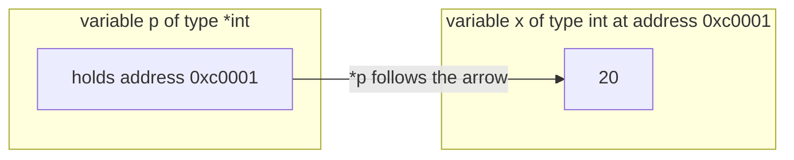

# Pointers, nil and mutability

> **Before this lesson:** read [Closures, defer and call by value](#/lesson/go/go-closures-defer), in particular the rule that Go passes every argument as a copy. You should also know structs ([Maps and structs](#/lesson/go/go-maps-structs)).

## In plain words

Computer memory is like a very long street of numbered houses. Every variable lives in one house, and the house number is its **address**. Up to now you have always referred to a variable by name and received what is inside the house.

A **pointer** is a value that holds a house number instead of ordinary data. It is a slip of paper saying "the thing you want is at number 42". With that slip you can walk to house 42 and look inside, or change what is there. If you hand a copy of the slip to a friend, your friend can visit the same house; you have not copied the house, only its address.

That is the whole idea, and it solves the problem left open in the previous lesson. Go gives functions photocopies of their arguments, so a function cannot change the caller's variable. But if the argument is a slip with the variable's address, the function can go to that address and change the original.

Why this matters for a job: every non-trivial Go program uses pointers, for methods that modify their object, for optional values, for sharing large data without copying. The most common run-time crash in Go programs is `nil pointer dereference`, following a slip of paper that has no address on it. Knowing when to use a pointer and when a plain value is better is a standard interview topic.

**Compared with Python.** In Python every variable is already a reference to an object, and you cannot choose otherwise: `b = a` makes two names for one object. In Go the default is the opposite: `b := a` makes an independent copy, and you ask for sharing explicitly by taking an address. **Compared with C**, Go's pointers are tame: there is no pointer arithmetic (you cannot add 1 to a pointer to reach the next house), and the memory a pointer refers to is never freed while the pointer exists, so there are no dangling pointers.

## Two operators: & and *

```go
package main

import "fmt"

func main() {
	x := 10
	p := &x // p holds the address of x

	fmt.Println(*p) // read the value at that address
	*p = 20         // write through the pointer
	fmt.Println(x)

	fmt.Println(p == &x)
	fmt.Printf("%T\n", p)
}
```

```text
10
20
true
*int
```

Line by line:

- `&x` is the **address-of** operator. It produces a pointer to `x`.
- `p := &x` stores that pointer. The type of `p` is `*int`, read "pointer to int". The verb `%T` prints a value's type.
- `*p` is the **dereference** operator (also called indirection): "go to the address in `p` and use what is there". `fmt.Println(*p)` reads 10.
- `*p = 20` stores 20 at that address. Since the address is `x`'s, `x` is now 20, although no statement mentions `x` on the left of an `=`.
- Two pointers are equal when they hold the same address.

The asterisk has two jobs, which confuses newcomers: in a **type** (`*int`) it means "pointer to"; in an **expression** (`*p`) it means "follow the pointer".

If you print a pointer itself (`fmt.Println(p)`) you see a hexadecimal number such as `0xc000012345`. The exact number differs on every run and is never something to rely on.



### Try it: a tiny memory model

The simulation keeps memory as a table from address to value and shows what each Go statement does to it.

```python-run
memory = {}          # address -> value
names = {}           # variable name -> address
next_addr = [100]

def declare(name, value):
    addr = next_addr[0]; next_addr[0] += 8
    names[name] = addr
    memory[addr] = value
    return addr

def show(step):
    cells = ", ".join(f"{n}@{a}={memory[a]!r}" for n, a in names.items())
    print(f"{step:<34} | {cells}")

declare("x", 10);                 show("x := 10")
declare("p", names["x"]);         show("p := &x      (p stores x's address)")
print(f"{'':<34} | *p reads memory[{memory[names['p']]}] -> {memory[memory[names['p']]]}")
memory[memory[names["p"]]] = 20;  show("*p = 20      (write at that address)")
declare("q", memory[names["p"]]); show("q := p       (copy the ADDRESS)")
memory[memory[names["q"]]] = 30;  show("*q = 30      (same house again)")
declare("y", memory[names["x"]]); show("y := x       (copy the VALUE)")
memory[names["y"]] = 99;          show("y = 99       (x is not affected)")
```

Follow the columns: `p` and `q` both contain 100, the address of `x`, so writing through either changes `x`. `y` got a copy of the value and lives at its own address.

## The zero value of a pointer is nil

A pointer variable that has not been given an address holds `nil`, meaning "points at nothing".

```go
package main

import "fmt"

func main() {
	var p *int
	fmt.Println(p == nil)
	fmt.Println(*p)
}
```

```text
true
panic: runtime error: invalid memory address or nil pointer dereference
[signal SIGSEGV: segmentation violation ...]
```

Declaring and comparing a nil pointer is fine. **Dereferencing** it stops the program: there is no house to visit. This panic is the Go equivalent of Python's `AttributeError: 'NoneType' object has no attribute ...`. The defence is the same: before following a pointer that might be nil, check it.

```go
if p != nil {
	fmt.Println(*p)
}
```

## Getting a pointer

There are three ordinary ways to obtain one.

```go
package main

import "fmt"

type Person struct {
	Name string
	Age  int
}

func main() {
	// 1. Address of an existing variable
	n := 5
	p1 := &n

	// 2. Address of a struct literal: create the value and take its address at once
	p2 := &Person{Name: "Ana", Age: 30}

	// 3. new(T): allocate a zero value of T and return its address
	p3 := new(int)

	fmt.Println(*p1, *p2, *p3)
	fmt.Println(p2.Name) // shorthand for (*p2).Name
}
```

```text
5 {Ana 30} 0
Ana
```

- Form 2, `&Person{...}`, is by far the most common way to create a struct you intend to share.
- `new(int)` gives a pointer to a fresh zero. It is used occasionally; most code prefers `&T{}` for structs.
- **Field access through a pointer needs no asterisk.** `p2.Name` is automatically understood as `(*p2).Name`. Go has no separate `->` operator as C does.

One limitation: you cannot take the address of a literal or a constant. `&5` and `&"text"` do not compile, because a literal has no house of its own. Store the value in a variable first, or use a small helper:

```go
func ptr[T any](v T) *T { return &v } // v is a variable, so it has an address

age := ptr(30)       // *int pointing at 30
name := ptr("Robin") // *string
```

(`[T any]` makes the helper work for every type; that syntax is explained in the [generics module](#/lesson/go/go-generics-basics). Since Go 1.26 the built-in `new` also accepts a value, so `new(30)` does the same job.)

## Pointers make arguments mutable

Here is the problem from the previous lesson and its solution, side by side.

```go
package main

import "fmt"

type Person struct {
	Name string
	Age  int
}

func birthdayCopy(p Person) {
	p.Age++ // changes the function's own copy
}

func birthday(p *Person) {
	p.Age++ // goes to the caller's Person and changes it
}

func main() {
	ana := Person{"Ana", 30}

	birthdayCopy(ana)
	fmt.Println(ana)

	birthday(&ana)
	fmt.Println(ana)
}
```

```text
{Ana 30}
{Ana 31}
```

`birthday` takes a `*Person`. The call `birthday(&ana)` passes the address of `ana`. The pointer itself is still passed **by value**, so the function has its own copy of the address; but a copy of an address leads to the same house.

This has a consequence worth seeing once. Assigning a new address to the parameter changes only the function's copy of the slip:

```go
func replace(p *Person) {
	p = &Person{"Zed", 1} // repoints the LOCAL copy of the pointer; caller unaffected
}

func overwrite(p *Person) {
	*p = Person{"Zed", 1} // writes a whole new Person into the caller's variable
}

func main() {
	ana := Person{"Ana", 30}
	replace(&ana)
	fmt.Println(ana)
	overwrite(&ana)
	fmt.Println(ana)
}
```

```text
{Ana 30}
{Zed 1}
```

Rule: **to change what the caller sees, dereference** (`*p = ...` or `p.Field = ...`). Assigning to `p` itself is invisible outside.

## A pointer signals "this may be changed"

In Go, the type of a parameter tells the reader something:

- `func show(p Person)`: the function gets a copy. It cannot affect the caller's value. Safe to call without thinking.
- `func update(p *Person)`: the function may modify the caller's value.

Other languages need keywords such as `const` or `final` to promise immutability. Go's approach is the reverse: values are immune by default, and a pointer is the visible sign of possible mutation. That is why experienced Go programmers **prefer plain values** and reach for pointers only with a reason.

### Reasons to use a pointer

1. **The function must modify the caller's value.** (Most often as a method with a pointer receiver; see [Defined types, methods and embedding](#/lesson/go/go-types-methods).)
2. **You need to express "no value".** A plain `int` cannot be absent; its zero value 0 is a real number. A `*int` can be `nil`.
3. **The value must not be copied**, for example a struct containing a lock, or one that represents a unique resource such as an open file or a database handle.
4. **The value is very large** and copying it repeatedly is measurably costly (the next lesson quantifies this; it matters less often than people think).

### Reasons to prefer a value

- Small structs (a point, a colour, a time, a few fields) are cheap to copy.
- Values cannot be nil, so there is no nil check and no nil panic.
- Values cannot be changed behind your back by another part of the program.
- Values often avoid heap allocation, reducing work for the garbage collector.

### Returning a value or a pointer?

A function that produces a new thing can return either:

```go
func NewPoint(x, y int) Point { return Point{x, y} }             // small, value-like
func NewServer(addr string) *Server { return &Server{addr: addr} } // identity, mutable, shared
```

Returning the address of a local variable is perfectly safe in Go, unlike in C. The compiler sees that the value must outlive the function and arranges for it to stay alive (details in the next lesson).

To report "not found", prefer a second result over a nil pointer: `func Find(id int) (User, bool)` or `(User, error)` forces the caller to look at the flag, while `func Find(id int) *User` invites a forgotten nil check.

## nil as "absent": optional fields

Consider data arriving as JSON where a number may be missing. With a plain `int` you cannot distinguish "0" from "not sent". A pointer field can:

```go
package main

import "fmt"

type Profile struct {
	Name string
	Age  *int // nil means "not provided"
}

func describe(p Profile) string {
	if p.Age == nil {
		return p.Name + ": age unknown"
	}
	return fmt.Sprintf("%s: %d years", p.Name, *p.Age)
}

func main() {
	zero := 0
	fmt.Println(describe(Profile{Name: "Baby", Age: &zero}))
	fmt.Println(describe(Profile{Name: "Ghost"}))
}
```

```text
Baby: 0 years
Ghost: age unknown
```

The first profile has an age of 0; the second has no age. Use this technique at the edges of a program (JSON, database rows that may be NULL) and convert to plain values inside when you can, because every pointer field is a future nil check.

## Pointers to pointers, slices and maps

You will rarely need more than one level. Passing a `*[]int` or a `*map[K]V` is unusual: a map already refers to shared data, and for a slice the idiomatic way to let a function change its length is to **return** the new slice, as `append` does. A pointer to a slice appears in a few special cases, such as functions that decode into a caller-provided variable (`json.Unmarshal(data, &items)`).

That call illustrates a general pattern: a function that must fill in a variable of a type it does not know in advance takes a pointer to it. Passing the variable itself would give the function a useless copy; `go vet` warns about `json.Unmarshal(data, items)`.

## Pitfalls

> [!WARNING]
> **Dereferencing nil.** `var u *User; fmt.Println(u.Name)` panics. It happens most with pointers returned from functions that can fail (`u, err := find(id)`): check `err` before touching `u`.

- **Assigning to a pointer parameter and expecting the caller to see it.** Dereference instead.
- **Using pointers "for performance" by reflex.** For small values, copying is cheaper than chasing a pointer and allocating on the heap. Measure first.
- **Taking the address of a literal.** Not allowed; use a variable, a helper, or `&T{}` for structs.
- **Comparing pointers when you mean to compare contents.** `p1 == p2` is true only when both hold the same address. Compare `*p1 == *p2` for equal values.
- **Pointer fields in structs you copy.** `b := a` copies the pointer, so both structs share the pointed-to value.
- **Forgetting that a method or function may store your pointer** and modify the value later. If you hand out a pointer, you have shared the data.

> [!TIP]
> Reading order for Go types helps: read `*[]map[string]*User` from left to right as "pointer to a slice of maps from string to pointer to User". The type always spells out the structure in the order you would traverse it.

> [!INTERVIEW]
> **"When should a function take a pointer rather than a value?"** When it must mutate the argument; when nil is a meaningful input; when the type must not be copied (it contains a mutex or represents a unique resource); or when the struct is large enough that copying shows up in profiles. Otherwise pass values: they cannot be nil, cannot be mutated remotely, and frequently stay on the stack. Add that Go has no pointer arithmetic and that returning `&local` is safe because escape analysis moves the variable to the heap.

## Cheat sheet

| Syntax | Meaning |
|---|---|
| `*T` (in a type) | pointer to a `T` |
| `&x` | address of variable `x` |
| `*p` (in an expression) | the value `p` points to |
| `*p = v` | store `v` where `p` points |
| `p.Field` | field of the pointed-to struct (automatic dereference) |
| `var p *T` | nil pointer |
| `&T{...}` | new struct value, pointer to it |
| `new(T)` | pointer to a new zero `T` |
| `p == nil` | does it point at nothing? |
| `p == q` | same address? |
| `func f(p *T)` | `f` may modify the caller's `T` |

## Summary

- A **pointer** holds the address of a value. `&x` takes an address; `*p` follows it.
- The zero value of a pointer is **nil**; dereferencing nil panics.
- Go still passes pointers by value, but a copied address refers to the same variable, so a function can modify the caller's data through it. Reassigning the pointer parameter itself has no outside effect.
- Pointers signal mutability and enable "absent" values; plain values are simpler and safer and should be the default.
- Create shared structs with `&T{...}`. Returning a pointer to a local is safe.
- Go has no pointer arithmetic and never frees memory that is still referenced.

## Glossary

- **Address**: the location of a value in memory.
- **Address-of operator**: `&`, which yields a pointer to its operand.
- **Dereference (indirection)**: following a pointer to its value, written `*p`.
- **Mutable / immutable**: can / cannot be changed.
- **nil**: the zero value of pointers (and of slices, maps, channels, functions, interfaces); "refers to nothing".
- **nil pointer dereference**: the panic caused by following a nil pointer.
- **Pointer**: a value that holds an address.
- **Pointer arithmetic**: computing new addresses by adding to a pointer; not available in Go.
- **Pointer type**: `*T`, the type of pointers to values of type `T`.

```quiz
[
  {"q": "What does this print? `a := 1; p := &a; *p = 5; fmt.Println(a)`",
   "options": ["`1`", "`5`", "An address such as `0xc000...`", "Compile error"],
   "answer": 1,
   "explain": "`p` holds the address of `a`. Writing through `*p` stores 5 in `a` itself."},
  {"q": "What does this print? `a := 1; b := a; p := &a; *p = 9; fmt.Println(a, b)`",
   "options": ["`9 9`", "`1 1`", "`9 1`", "`1 9`"],
   "answer": 2,
   "explain": "`b := a` copied the value 1 into a separate variable. The pointer refers to `a` only, so `a` becomes 9 and `b` stays 1."},
  {"q": "What happens? `var p *int; fmt.Println(*p)`",
   "options": ["Prints `0`", "Prints `nil`", "Compile error", "Run-time panic: nil pointer dereference"],
   "answer": 3,
   "explain": "`p` is nil. Following a nil pointer is a run-time panic. Printing `p` itself (without the asterisk) would print `<nil>`."},
  {"q": "What does this print? `func set(p *int) { p = nil }` then `x := 3; q := &x; set(q); fmt.Println(q == nil, x)`",
   "options": ["`true 3`", "`false 3`", "`true 0`", "It panics"],
   "answer": 1,
   "explain": "The pointer is passed by value. Assigning nil to the parameter changes only the function's copy; the caller's `q` and `x` are untouched."},
  {"q": "What does this print? `type T struct{ N int }; func bump(t *T) { t.N++ }` then `v := T{1}; bump(&v); bump(&v); fmt.Println(v.N)`",
   "options": ["`1`", "`2`", "`3`", "Compile error: must write `(*t).N++`"],
   "answer": 2,
   "explain": "The function receives the address of `v`, and `t.N` automatically dereferences. Two calls raise N from 1 to 3."},
  {"q": "Which expression does NOT compile?",
   "options": ["`p := &Person{Name: \"A\"}`", "`p := new(int)`", "`p := &42`", "`x := 42; p := &x`"],
   "answer": 2,
   "explain": "A literal has no address. Take the address of a variable, or use a composite literal such as `&Person{...}`."},
  {"q": "Why might a struct field be declared as `*int` instead of `int`?",
   "options": ["Pointers use less memory than ints", "To distinguish 'not provided' (nil) from a real zero", "Because struct fields must be pointers", "To make the field read-only"],
   "answer": 1,
   "explain": "An int always has a value, and 0 is indistinguishable from absent. A nil pointer represents absence, which is useful for optional JSON or database fields."},
  {"q": "Two pointers `p` and `q` point to different variables that both hold 7. What are `p == q` and `*p == *q`?",
   "options": ["`true` and `true`", "`false` and `true`", "`false` and `false`", "`true` and `false`"],
   "answer": 1,
   "explain": "Pointer equality compares addresses, which differ. Dereferencing compares the stored values, both 7."}
]
```

> **Source:** Bodner, *Learning Go* 2e, ch. 6 (topic coverage; wording and examples are original). Official references: https://go.dev/ref/spec#Pointer_types, https://go.dev/ref/spec#Address_operators, https://go.dev/tour/moretypes/1, https://go.dev/doc/faq#pointers, https://go.dev/doc/effective_go#allocation_new
