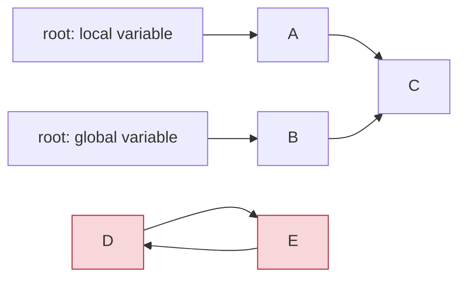
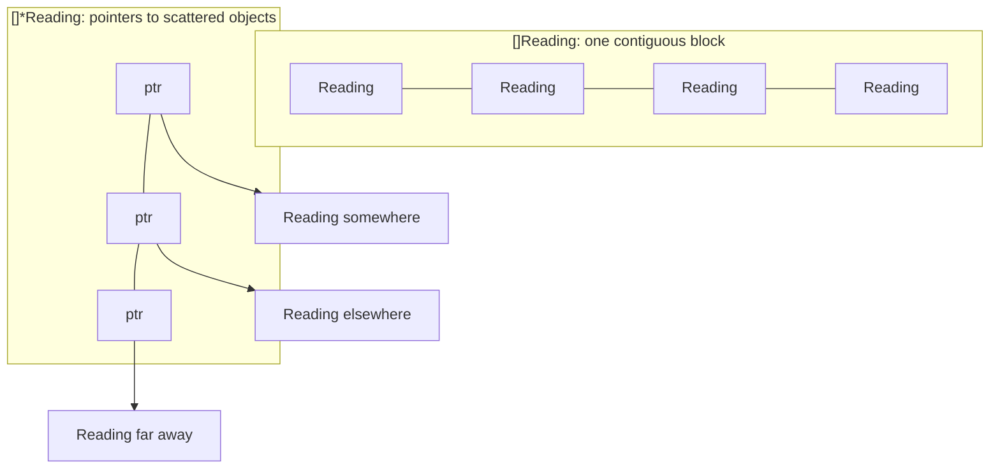

# Pointers, performance and the garbage collector

> **Before this lesson:** read [Pointers, nil and mutability](#/lesson/go/go-pointers-basics). You should know what an address is, what `&` and `*` do, and that slices and maps contain references ([Slicing, aliasing and copy](#/lesson/go/go-slicing-aliasing)).

## In plain words

A running program needs memory for its data, and it has two places to put it.

Picture a **desk** and a **warehouse**. The desk is right in front of you. Putting a paper on it and taking it away costs nothing, but the desk is cleared completely every time you finish a task. The warehouse is large and things can stay there as long as you like, but each item must be logged in, and someone has to walk the aisles from time to time to find and throw away items nobody needs any more.

- The desk is the **stack**: memory for a function's local variables, released automatically the instant the function returns.
- The warehouse is the **heap**: memory for data that must outlive the function that created it.
- The person walking the aisles is the **garbage collector** (GC): a part of the Go runtime that finds heap memory no longer reachable by the program and makes it available again.

You never choose stack or heap yourself in Go. The compiler decides, by a process called **escape analysis**: if a value might still be referenced after its function returns, it "escapes" to the heap. Pointers are the main reason values escape, and every escaped value is work for the garbage collector later. That is the link between pointers and performance.

Why this matters for a job: Go services are expected to be fast and to use memory predictably. When one is not, the cause is very often "too many small heap allocations", and the fix requires knowing why values escape. Interviewers ask "what is escape analysis?", "stack versus heap?" and "how does Go's garbage collector work?" for backend roles.

**Compared with Python.** In Python every object, even a small integer in a list, lives on the heap, and memory is reclaimed mainly by **reference counting** (each object counts how many references point at it and is freed when the count hits zero), with a backup collector for cycles. Go keeps many values off the heap entirely, lays struct fields out contiguously, and uses a **tracing** collector that works out reachability periodically instead of counting.

## Stack and heap

### The stack

Every function call gets a **stack frame**, a block of memory for its parameters and local variables. Frames are placed one after another; a call adds a frame and a return removes it. Allocating on the stack is nothing more than moving a marker, and freeing is moving it back. No bookkeeping, no garbage collector.

Two conditions must hold for a value to live in a frame:

1. its size is known when the program is compiled;
2. nothing refers to it after the function returns.

(Each goroutine, Go's lightweight thread, has its own stack. It starts at a few kilobytes and grows automatically when needed, so deep recursion does not require tuning.)

### The heap

Everything else goes on the heap. A heap allocation has to find a free block of the right size, and the block stays until the garbage collector determines that nothing references it. Both steps cost time. The heap is also less friendly to the processor's **cache**, a small amount of very fast memory that holds recently used data: values allocated at different moments end up scattered, and jumping between scattered addresses is far slower than walking through neighbours.

## Escape analysis

Consider two functions that both take the address of a local variable.

```go
package main

import "fmt"

func stays() int {
	x := 42
	p := &x
	return *p // only the VALUE leaves the function
}

func escapes() *int {
	y := 42
	return &y // the ADDRESS leaves the function
}

func main() {
	a := stays()
	b := escapes()
	fmt.Println(a, *b)
}
```

```text
42 42
```

In `stays`, the pointer `p` is used and discarded before the function returns; `x` can live in the frame. In `escapes`, the caller receives the address of `y`. If `y` were in the frame it would be gone the moment `escapes` returned. In C that is a serious bug. In Go the compiler notices and places `y` on the heap instead. The program is correct either way; what differs is the cost.

You can ask the compiler to show its decisions with the flag `-gcflags=-m`:

```text
$ go build -gcflags=-m .
./main.go:12:2: moved to heap: y
./main.go:19:13: ... argument does not escape
./main.go:19:14: a escapes to heap
./main.go:19:17: *b escapes to heap
```

(The real output also contains lines about inlining; they are left out here.) The first line is the decision described above. The last two lines show a second, very common cause of escaping: values passed to `fmt.Println` are converted to an interface and the compiler cannot prove what happens to them, so it plays safe.

### What typically makes a value escape

- **Returning a pointer** to it, or storing a pointer to it in something that escapes (a struct on the heap, a global variable, a slice or map).
- **Sending a pointer on a channel** or capturing the variable in a closure that outlives the function (including `go func() { ... }()`).
- **Passing it to an interface-typed parameter**, as with `fmt.Println(x)`.
- **A size unknown at compile time**: `make([]int, n)` with a variable `n`.
- **Very large values**: the compiler puts big arrays and structs on the heap to keep stacks small.

What does **not** make a value escape: taking its address and passing the pointer *down* to a function that only uses it during the call. The frame of the caller is still alive for the whole call, so the pointer is safe.

```go
func fill(p *[64]byte) { p[0] = 1 }

func work() byte {
	var buf [64]byte
	fill(&buf) // buf stays on work's stack
	return buf[0]
}
```

The rule of thumb: **pointers passed down the call stack are cheap; pointers passed up (returned) or stored for later cause heap allocation.** Practise the reasoning in [Escape analysis by rules](#/problem/go-escape-analysis).

> [!NOTE]
> Escape analysis is an optimisation, not part of the language definition. The compiler's decisions change between Go versions and with inlining. Never write code that depends on where a value lives; use the knowledge to interpret profiles and benchmarks.

## Is passing a pointer faster than passing a value?

The instinct "copying is slow, so pass a pointer" is wrong for small data.

- Passing a pointer costs the same regardless of the struct's size: one machine word (8 bytes on a 64-bit machine).
- Passing a struct by value copies its bytes, which is very fast for anything that fits in a few machine words, and the copy lives on the stack.
- **Returning** a pointer usually forces a heap allocation, which costs far more than copying a small struct, and adds garbage-collector work later.

So for small structs (roughly up to a few dozen bytes, such as a point, a pair of numbers, a `time.Time`), values win in both directions. For structs of many kilobytes, pointers win. In between, measure with a benchmark ([Fuzzing, benchmarks, stubs and httptest](#/lesson/go/go-fuzz-bench-httptest)) before deciding. Choose pointer or value first by **meaning** (does the function mutate? is nil meaningful? must it not be copied?) and only then by speed.

## The garbage collector

### What "garbage" means

A heap value is **reachable** if the program can still get to it by starting from a **root** (a global variable, or a local variable or parameter on some goroutine's stack) and following pointers. Anything unreachable can never be used again: it is **garbage**.

Go's collector is a **tracing** collector of the **mark-and-sweep** kind:

1. **Mark.** Start at the roots and follow every pointer, marking each value reached. Then follow the pointers inside those values, and so on, until no new values are found.
2. **Sweep.** Every heap block that was not marked is free memory again.



In the picture, A, B and C are reachable. D and E point at each other but nothing reachable points at them, so both are garbage. A tracing collector handles such cycles naturally; pure reference counting does not, because D and E each keep the other's count at one.

### Try it: mark and sweep by hand

Edit the object graph or the roots and run the collector.

```python-run
heap = {            # object -> objects it points to
    "A": ["C"],
    "B": ["C"],
    "C": [],
    "D": ["E"],
    "E": ["D"],     # D and E form an unreachable cycle
    "F": [],
}
roots = ["A", "B"]  # try removing "B", or adding "D"

def mark(heap, roots):
    marked, work = set(), list(roots)
    steps = 0
    while work:
        obj = work.pop()
        if obj in marked:
            continue
        marked.add(obj)
        steps += 1
        work.extend(heap[obj])
    return marked, steps

marked, steps = mark(heap, roots)
print("reachable (kept):", sorted(marked))
print("garbage (swept) :", sorted(set(heap) - marked))
print("objects visited while marking:", steps)
print()
print("Note: marking cost depends on the number of LIVE objects and the")
print("pointers between them, not on the amount of garbage.")
```

The last line is the practical insight. The collector's work is proportional to how many live objects there are and how many pointers it must follow. A slice of a million plain structs is one object with nothing to chase; a slice of a million pointers to separately allocated structs is a million and one objects.

### How Go's collector behaves

A few properties, stated at the level you need for design decisions and interviews:

- **Concurrent.** Most marking happens while your program keeps running, on spare CPU capacity. The program is paused completely ("stop the world") only for very short moments at the start and end of a cycle, typically well under a millisecond. Go optimises for **low latency** (short pauses) over maximum throughput.
- **Tri-colour marking.** Conceptually each object is white (not yet seen), grey (seen, its pointers not yet followed) or black (done). Marking moves objects from white to grey to black; whatever is still white at the end is garbage. A small piece of code called a **write barrier** runs when your program modifies pointers during marking, so that the collector does not miss anything.
- **Non-moving.** Objects are never relocated, so a pointer's address stays valid for the object's lifetime.
- **Not generational.** Many collectors (Java's, .NET's) separate young objects from old ones. Go does not; it relies on escape analysis to keep short-lived values on the stack, where they never become garbage in the first place.

### Two tuning knobs

- **`GOGC`** (default 100) sets how much the heap may grow before the next collection starts. 100 means "collect when the heap has grown by 100% since the last collection", that is, when it has doubled relative to the live data. A larger value means fewer collections and more memory; a smaller value means the opposite.
- **`GOMEMLIMIT`** sets a soft cap on the total memory the Go runtime uses. As the cap approaches, the collector works harder. It is the right setting for programs running in containers with a fixed memory allowance.

Both are environment variables (for example `GOMEMLIMIT=512MiB ./server`) and can also be set from code via `runtime/debug`. Most programs never change them.

## Writing code the collector likes

The goal is not zero allocations; it is to avoid pointless ones in the parts of the program that run most often.

**Prefer slices of values to slices of pointers.**

```go
type Reading struct {
	Sensor int32
	Value  float32
}

flat := make([]Reading, 1_000_000)    // ONE allocation; data is contiguous
boxed := make([]*Reading, 1_000_000)  // a million pointers ...
for i := range boxed {
	boxed[i] = &Reading{}             // ... and a million more allocations
}
```

`flat` is a single block of 8 megabytes that the processor reads in order, and the garbage collector sees one object containing no pointers. `boxed` is a block of pointers plus a million scattered objects; reading them hops around memory and the collector must visit each one.



**Let the caller supply the buffer.** Compare two ways to design a read function:

```go
func ReadNew(f *os.File) ([]byte, error)        // allocates a new slice on every call
func (f *File) Read(p []byte) (n int, err error) // fills a buffer the caller owns
```

The second is the shape of the standard library's `io.Reader`. A loop can create one buffer and reuse it for every read, so reading a gigabyte file produces almost no garbage:

```go
buf := make([]byte, 32*1024)
for {
	n, err := f.Read(buf) // reuses the same 32 KB every time
	process(buf[:n])
	if err != nil {
		break
	}
}
```

**Size things up front.** `make([]T, 0, n)` and `make(map[K]V, n)` avoid repeated growth and copying. `strings.Builder` avoids a new string per concatenation.

**Measure before optimising.** `go test -bench . -benchmem` reports allocations per operation, and the profiler (`go tool pprof`) shows where they come from. Readable code first; change it only where measurements show a problem.

## Pitfalls

- **"Pointers are always faster."** For small structs, values are faster and create less garbage.
- **Returning pointers from constructors of tiny value types** out of habit.
- **Trying to control stack versus heap in source code.** You cannot; `new` and `&T{}` may still end up on the stack, and a plain `var` may end up on the heap.
- **A long-lived reference to a small part of a big object** (a sub-slice of a large buffer, one field of a huge struct) keeps the whole thing alive.
- **Setting `GOGC` very high in a container** without `GOMEMLIMIT`, then being killed by the operating system for using too much memory.
- **Optimising without a benchmark.** Escape decisions surprise even experts.

> [!TIP]
> When a benchmark shows unexpected allocations, run `go build -gcflags=-m ./yourpkg 2>&1 | grep "escapes\|moved to heap"`. Each line names a value and the place it was created; with `-gcflags='-m -m'` the compiler also explains why.

> [!INTERVIEW]
> **"Explain escape analysis."** It is a compile-time analysis that decides whether a variable can live in its function's stack frame or must be allocated on the heap. A variable escapes when a reference to it may outlive the frame: its address is returned, stored in a heap object or global, captured by a closure or goroutine that outlives the call, or passed through an interface the compiler cannot see through; also when its size is unknown or too large. Stack allocation is nearly free and needs no GC; heap allocation costs allocation time plus later marking. Then describe the GC in one breath: concurrent, tri-colour mark-and-sweep, non-moving, non-generational, tuned for sub-millisecond pauses, controlled by `GOGC` and `GOMEMLIMIT`.

## Cheat sheet

| Question | Answer |
|---|---|
| Where do locals go by default? | the stack frame of their function |
| When does a value go to the heap? | when it may outlive the function, has unknown size, or is very large |
| How do I see the decisions? | `go build -gcflags=-m` |
| Is `return &local` safe? | yes; the value is moved to the heap |
| Pointer down the stack | usually no escape |
| Pointer up the stack (returned / stored) | escapes |
| GC algorithm | concurrent tri-colour mark and sweep |
| What drives GC cost? | number of live heap objects and pointers |
| Main knobs | `GOGC` (default 100), `GOMEMLIMIT` |
| Cheapest improvements | pre-size slices and maps, reuse buffers, slices of values |
| Measuring | `go test -bench . -benchmem`, `go tool pprof` |

## Summary

- Local values live on the **stack** when their size is known and nothing references them after the function returns; otherwise they live on the **heap**.
- **Escape analysis** makes that decision at compile time. Returning or storing a pointer, capturing in a long-lived closure, and converting to an interface are the usual causes of escape.
- Stack allocation is almost free. Heap allocation costs time now and garbage-collection work later.
- Go's **garbage collector** traces from roots, marks reachable objects and sweeps the rest. It runs concurrently with the program and aims for very short pauses.
- For small data, pass and return values. Use pointers for meaning (mutation, absence, identity) and for large data.
- Reduce garbage with contiguous slices of values, caller-supplied buffers and pre-sized containers, and verify with measurements.

## Glossary

- **Allocation**: reserving memory for a value.
- **Cache (CPU cache)**: small, very fast memory holding recently used data; rewards data that is close together.
- **Escape analysis**: the compiler's decision whether a value can stay on the stack.
- **Garbage**: heap memory that is no longer reachable.
- **Garbage collector (GC)**: the runtime component that reclaims garbage.
- **Heap**: memory for values that outlive a single function call.
- **Mark and sweep**: a collection method that marks reachable objects, then frees the unmarked ones.
- **Reachable**: can be reached from a root by following pointers.
- **Reference counting**: freeing an object when its count of references reaches zero (Python's main method).
- **Root**: a starting point for marking, such as a global or a variable on a stack.
- **Stack / stack frame**: per-goroutine memory for function calls / the portion belonging to one call.
- **Stop the world**: a brief pause of all goroutines during garbage collection.
- **Write barrier**: code that keeps the collector informed when pointers change during marking.

```quiz
[
  {"q": "Which function forces its local variable onto the heap?",
   "options": ["`func a() int { x := 1; return x }`", "`func b() *int { x := 1; return &x }`", "`func c() int { x := 1; p := &x; return *p }`", "`func d() { x := 1; _ = x }`"],
   "answer": 1,
   "explain": "Only `b` lets a reference to `x` outlive the call. In `c` the pointer is used and dropped before returning, so `x` can stay in the frame."},
  {"q": "How do you ask the Go compiler to print its escape-analysis decisions?",
   "options": ["`go vet -escape`", "`go build -gcflags=-m`", "`go run -heap`", "`go env ESCAPE`"],
   "answer": 1,
   "explain": "`-gcflags=-m` passes `-m` to the compiler, which reports lines such as `moved to heap: x` and `does not escape`."},
  {"q": "A function receives `p *Config` from its caller, reads two fields and returns. Does the caller's `Config` variable have to be on the heap because of this call?",
   "options": ["Yes, any use of `&` forces heap allocation", "No: a pointer passed down to a callee that does not retain it does not make the value escape", "Yes, because pointers cannot refer to the stack", "Only if Config is larger than 64 bytes"],
   "answer": 1,
   "explain": "The caller's frame outlives the call, so the pointer stays valid. Escape happens when the pointer is returned or stored somewhere longer-lived."},
  {"q": "Which objects does a mark-and-sweep collector free?",
   "options": ["Objects whose reference count is zero", "The oldest objects", "Objects not reachable from any root", "Objects larger than a threshold"],
   "answer": 2,
   "explain": "Marking follows pointers from roots; everything unmarked afterwards is unreachable and is swept. Unreachable cycles are freed too."},
  {"q": "Objects D and E point to each other, and nothing else points to either. What happens in Go?",
   "options": ["They leak forever because each keeps the other alive", "Both are collected: neither is reachable from a root", "Only D is collected", "The program panics"],
   "answer": 1,
   "explain": "A tracing collector cares about reachability from roots, not about incoming references. Cycles are no problem."},
  {"q": "For iterating over a million small structs, which layout is usually faster and lighter on the garbage collector?",
   "options": ["`[]*Reading`, because pointers are small", "`[]Reading`, one contiguous allocation with no pointers to chase", "`map[int]*Reading`", "They are identical"],
   "answer": 1,
   "explain": "A slice of values is a single block that the CPU reads sequentially and the GC treats as one object. A slice of pointers means a million extra objects scattered in memory."},
  {"q": "What does `GOGC=100` (the default) mean?",
   "options": ["Collect every 100 milliseconds", "Use at most 100 MB of heap", "Start a collection when the heap has grown 100% over the live heap after the previous collection", "Use 100% of one CPU for collection"],
   "answer": 2,
   "explain": "GOGC is a growth percentage. At 100, a new cycle starts roughly when the heap has doubled since the last one. `GOMEMLIMIT` is the separate setting for a memory cap."},
  {"q": "Why does `io.Reader` have the signature `Read(p []byte) (n int, err error)` instead of returning a new slice?",
   "options": ["Go functions cannot return slices", "So the caller can reuse one buffer across many reads, avoiding an allocation per call", "Because byte slices are immutable", "To make the function variadic"],
   "answer": 1,
   "explain": "Letting the caller own the buffer keeps allocation out of the hot path and gives the garbage collector almost nothing to do."}
]
```

> **Source:** Bodner, *Learning Go* 2e, ch. 6 (topic coverage; wording and examples are original). Official references: https://go.dev/doc/gc-guide, https://go.dev/doc/faq#stack_or_heap, https://pkg.go.dev/runtime/debug#SetGCPercent, https://go.dev/blog/ismmkeynote, https://pkg.go.dev/cmd/compile
