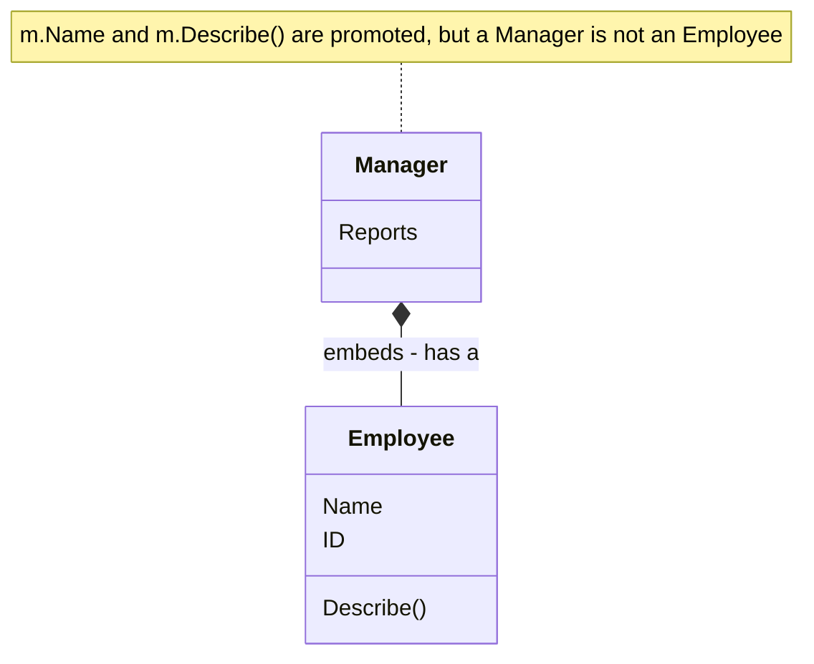

# Defined types, methods and embedding

> **Before this lesson:** you need structs ([Maps and structs](#/lesson/go/go-maps-structs)), functions ([Declaring and calling functions](#/lesson/go/go-functions-basics)) and pointers ([Pointers, nil and mutability](#/lesson/go/go-pointers-basics)). Python classes are used for comparison; knowing them is helpful, not required.

## In plain words

So far data and the functions that work on it have been separate: a struct here, a function taking that struct there. Most programs become clearer when the two are tied together, so that you can ask a value to do something: `account.Deposit(50)`, `shape.Area()`, `order.Total()`.

Go provides three tools for this, and none of them is a "class".

1. **Defined types.** You can give a new name to any existing kind of data and get a brand-new type. A `Celsius` and a `Fahrenheit` can both be numbers underneath, yet the compiler will refuse to mix them. Think of labelled jars: sugar and salt look alike, and the labels stop you from confusing them.
2. **Methods.** A **method** is a function attached to a type. It is called with a dot on a value of that type.
3. **Embedding.** A struct can contain another type in a way that makes the inner type's fields and methods usable directly on the outer one. This is **composition**: building a bigger thing out of smaller parts, the way a car *has an* engine. It is deliberately not **inheritance**, where a car would be declared to *be a kind of* engine.

Why this matters for a job: every Go codebase is organised around types with methods. Choosing between a value receiver and a pointer receiver is a decision you make for every type you write, and getting it wrong produces bugs that compile. Interviewers ask about receivers, about `iota`-based enumerations, and about why embedding is not inheritance.

**Compared with Python.** A Python class bundles data, methods and inheritance. In Go, any named type can have methods (a number, a slice, a function type, not only structs); the receiver is written explicitly in front of the method name where Python has `self` as the first parameter; and there is no class hierarchy at all.

## Defined types

The `type` keyword creates a new named type from an existing one:

```go
package main

import "fmt"

type Celsius float64
type Fahrenheit float64

func toFahrenheit(c Celsius) Fahrenheit {
	return Fahrenheit(c*9/5 + 32)
}

func main() {
	boiling := Celsius(100)
	fmt.Println(toFahrenheit(boiling))

	var f Fahrenheit = 50
	// fmt.Println(boiling + f)  // compile error: mismatched types Celsius and Fahrenheit
	fmt.Println(boiling + Celsius(f))
}
```

```text
212
150
```

`Celsius` and `Fahrenheit` are two distinct types. Each has `float64` as its **underlying type**, the built-in shape it is made from, so arithmetic works on them, and you can convert between them explicitly with `Celsius(f)`. What you cannot do is mix them by accident. The last line compiles because of the explicit conversion; it is also physically meaningless, which shows that the conversion is you taking responsibility.

The struct declarations you have been writing are the same mechanism: `type Person struct { ... }` defines the type `Person` whose underlying type is that struct.

A defined type can be based on anything:

```go
type Score int
type Team []string
type HandlerFunc func(string) error
type Inventory map[string]int
```

**Do not confuse a defined type with an alias.** `type Meters = float64` (with an equals sign) declares an **alias**: a second name for the very same type, with no separation at all. Aliases exist mainly to help move types between packages during large refactorings. In everyday code you want a defined type, without the `=`.

## Methods

A method is declared like a function, with one extra part between `func` and the name: the **receiver**, which says which type the method belongs to.

```go
package main

import "fmt"

type Rect struct {
	Width, Height float64
}

func (r Rect) Area() float64 {
	return r.Width * r.Height
}

func main() {
	room := Rect{4, 3}
	fmt.Println(room.Area())
}
```

```text
12
```

`(r Rect)` is the receiver: `r` is the name by which the method refers to the value it was called on, and `Rect` is the type. By convention the receiver name is a short abbreviation of the type (`r` for `Rect`, `c` for `Counter`), never `this` or `self`. In the call `room.Area()`, `room` is copied into `r`.

Rules that differ from other languages:

- Methods are declared **outside** the type, anywhere in the **same package** as the type. You cannot add methods to a type from another package, including built-in types such as `int`. (Define your own type based on it instead.)
- Method names cannot be overloaded: one name per type.
- A type's fields and methods share one namespace: a struct cannot have a field and a method with the same name.

### Value receivers and pointer receivers

The receiver is a parameter like any other, so the call-by-value rule applies. A method with a **value receiver** works on a copy. To modify the original, the method needs a **pointer receiver**.

```go
package main

import "fmt"

type Counter struct {
	n int
}

func (c Counter) Value() int { // value receiver: reads only
	return c.n
}

func (c Counter) BrokenInc() { // value receiver: increments a COPY
	c.n++
}

func (c *Counter) Inc() { // pointer receiver: increments the original
	c.n++
}

func main() {
	var c Counter
	c.BrokenInc()
	fmt.Println(c.Value())

	c.Inc()
	c.Inc()
	fmt.Println(c.Value())
}
```

```text
0
2
```

`BrokenInc` compiles and does nothing useful: it increments its private copy, which is thrown away on return. `Inc` receives the address of `c` and changes the real counter.

Notice the call `c.Inc()`. `c` is a `Counter`, not a `*Counter`, yet the call works. When you call a pointer-receiver method on a variable, Go rewrites it as `(&c).Inc()` for you. The reverse convenience exists too: with `p := &c`, the call `p.Value()` is rewritten as `(*p).Value()`. This sugar is why you rarely type `&` or `*` around method calls.

### Which receiver should a method have?

| Use a pointer receiver when … | Use a value receiver when … |
|---|---|
| the method modifies the receiver | the method only reads |
| the type contains something that must not be copied (a mutex, a file handle) | the type is small and behaves like a plain value (a point, a money amount, `time.Time`) |
| the struct is large | the type is a map, function or channel, or a slice you do not reslice |
| **any other method** of the type has a pointer receiver | **all** methods can be value receivers |

The last row is the consistency rule: if one method needs a pointer receiver, give them all pointer receivers. Mixing them leads to confusion about which calls copy and, as the next lesson shows, about which interfaces the type satisfies. In practice most struct types that have any state-changing method end up with pointer receivers throughout.

### Methods can handle a nil receiver

A pointer-receiver method can be called on a nil pointer. The call itself is fine; a panic happens only if the method dereferences the nil.

```go
package main

import "fmt"

type Node struct {
	val  int
	next *Node
}

func (n *Node) Len() int {
	if n == nil { // the empty list
		return 0
	}
	return 1 + n.next.Len()
}

func main() {
	var empty *Node
	fmt.Println(empty.Len())

	list := &Node{1, &Node{2, &Node{3, nil}}}
	fmt.Println(list.Len())
}
```

```text
0
3
```

This lets a nil pointer stand for "empty" without special cases at every call site. Use it when nil has a natural meaning; otherwise let a nil receiver panic so that the bug is found.

### Methods are functions too

A method can be turned into an ordinary function value. `room.Area` (no parentheses) is a **method value**: a function with `room` already bound. `Rect.Area` is a **method expression**: a function whose first parameter is the receiver.

```go
room := Rect{4, 3}
area := room.Area       // func() float64, remembers room
fmt.Println(area())     // 12
f := Rect.Area          // func(Rect) float64
fmt.Println(f(Rect{2, 5})) // 10
```

Method values are handy for passing "this object's method" as a callback.

## Enumerations: a defined type, iota and a String method

Go has no `enum` keyword. The idiom combines three things you have now seen: a defined integer type, a `const` block with `iota` ([Declarations and constants](#/lesson/go/go-declarations-const)), and a method named `String`.

```go
package main

import "fmt"

type Status int

const (
	Pending Status = iota // 0
	Active                // 1
	Closed                // 2
)

func (s Status) String() string {
	switch s {
	case Pending:
		return "Pending"
	case Active:
		return "Active"
	case Closed:
		return "Closed"
	default:
		return fmt.Sprintf("Status(%d)", int(s))
	}
}

func main() {
	s := Active
	fmt.Println(s)
	fmt.Printf("%d %v %s\n", s, Closed, Status(9))
}
```

```text
Active
1 Closed Status(9)
```

Giving the constants the type `Status` means a function that takes a `Status` cannot be handed an arbitrary `int` variable. The `String` method is special to the `fmt` package: any type with a method `String() string` is printed using it (this is the `fmt.Stringer` interface, explained in the next lesson). `%d` still shows the number.

Two cautions. The compiler does not check that a `Status` holds one of the declared values; `Status(9)` is legal, hence the `default` branch. And an untyped constant such as the literal `3` can still be passed where a `Status` is expected. In real projects the `String` method is usually generated with the `stringer` tool ([embed, go generate and cross-compilation](#/lesson/go/go-embed-generate-cross)).

## Embedding: composition with promotion

Suppose a `Manager` has everything an `Employee` has, plus a list of reports. You could give `Manager` a named field `Emp Employee` and write `m.Emp.Name` everywhere. **Embedding** removes that repetition: list the type **without a field name**.

```go
package main

import "fmt"

type Employee struct {
	Name string
	ID   int
}

func (e Employee) Describe() string {
	return fmt.Sprintf("%s (#%d)", e.Name, e.ID)
}

type Manager struct {
	Employee // embedded: no field name
	Reports  []string
}

func main() {
	m := Manager{
		Employee: Employee{Name: "Robin", ID: 7},
		Reports:  []string{"Nami", "Usopp"},
	}
	fmt.Println(m.Name)          // promoted field
	fmt.Println(m.Describe())    // promoted method
	fmt.Println(m.Employee.Name) // the long way still works
}
```

```text
Robin
Robin (#7)
Robin
```

The fields and methods of the embedded `Employee` are **promoted**: they can be used on a `Manager` as if they were declared there. Under the hood the struct has a field whose name is the type's name, `Employee`, which is why the literal says `Employee: Employee{...}` and why `m.Employee.Name` works.

If the outer type declares a field or method with the same name as a promoted one, the outer one wins (it is shallower) and the inner one remains reachable through the explicit path. If two embedded types at the same depth both provide a name, using that name directly is a compile error (`ambiguous selector`), and you must spell out which one you mean. The exact rule is practised in [Struct embedding: which field or method is selected?](#/problem/go-embed-promotion).

### Embedding is not inheritance

Two things that inheritance would give you do **not** happen.

**1. A Manager is not an Employee.** You cannot pass a `Manager` where an `Employee` is required:

```go
var e Employee = m          // compile error: cannot use m (variable of type Manager) as Employee value
var e2 Employee = m.Employee // fine: take the part explicitly
```

**2. The inner type does not know about the outer type.** When a promoted method calls another method, it calls the inner type's version, even if the outer type defined one with the same name.

```go
package main

import "fmt"

type Base struct{}

func (Base) Name() string    { return "base" }
func (b Base) Hello() string { return "hello from " + b.Name() }

type Derived struct{ Base }

func (Derived) Name() string { return "derived" }

func main() {
	d := Derived{}
	fmt.Println(d.Name())
	fmt.Println(d.Hello())
}
```

```text
derived
hello from base
```

`d.Hello()` is promoted from `Base`. Inside it, the receiver `b` is the `Base` part, so `b.Name()` is `Base.Name`. In Python or Java, where `Derived` would inherit from `Base`, the same program prints "hello from derived", because method lookup starts again at the object's real class (this is called **dynamic dispatch**). Go has that behaviour only through interfaces, the subject of the next lesson.

### Try it: inheritance next to embedding

The first half is ordinary Python inheritance. The second half models Go's embedding: the outer object holds the inner one and forwards calls it does not define.

```python-run
# --- Python inheritance: lookup restarts at the object's real class ---
class Base:
    def name(self):  return "base"
    def hello(self): return "hello from " + self.name()

class Derived(Base):
    def name(self):  return "derived"

print("inheritance :", Derived().hello())

# --- Go-style embedding: the outer value CONTAINS a Base and forwards to it ---
class GoBase:
    def name(self):  return "base"
    def hello(self): return "hello from " + self.name()   # self is the GoBase part

class GoDerived:
    def __init__(self):
        self.Base = GoBase()            # the embedded field, named after its type
    def name(self):
        return "derived"
    def __getattr__(self, attr):        # promotion: unknown names go to the embedded value
        return getattr(self.Base, attr)

d = GoDerived()
print("embedding   :", d.hello())
print("d.name()    :", d.name())
print("d.Base.name():", d.Base.name())
```

Same method bodies, different answers. With embedding, `hello` runs with the inner value as its receiver and never sees the outer `name`.



## Methods or functions?

Use a **method** when the logic belongs to one type and depends on its state: `(c *Counter) Inc()`. Use a plain **function** when the logic depends only on its inputs, involves several types equally, or is a constructor: `func NewServer(addr string) *Server`. A method is, in the end, a function whose first argument is written before its name; choose the form that reads best at the call site.

## Pitfalls

> [!WARNING]
> A method with a **value receiver** that assigns to a field compiles, runs and changes nothing the caller can see. If a method is meant to modify its receiver, the receiver must be a pointer.

- **Mixing value and pointer receivers** on one type.
- **Copying a struct that has pointer-receiver methods and a mutex or similar inside.** `go vet` reports copied locks.
- **Expecting embedding to behave like inheritance**: no substitution, no dynamic dispatch.
- **Using an alias (`type A = B`) when you wanted a distinct type.**
- **Forgetting the `default` case in an enum's `String` method**, so unknown values print as an empty string.
- **Calling a method on a nil pointer** when the method dereferences the receiver.
- **Trying to add a method to `int` or to a type from another package.**

> [!TIP]
> Design types so that the zero value is ready to use. `var c Counter` works with no constructor because `n` starts at 0. The standard library does this throughout (`sync.Mutex`, `bytes.Buffer`, `strings.Builder`), and it makes your types easy to embed in others.

> [!INTERVIEW]
> **"Value receiver or pointer receiver?"** Pointer if the method mutates the receiver, if the type must not be copied (contains a mutex or similar), or if it is large; and for consistency, if any method uses a pointer receiver they all should. Value receivers suit small immutable value types. Go inserts `&` or `*` automatically at call sites when the variable is addressable, but the method *sets* still differ: `T` has only the value-receiver methods, `*T` has both, which matters for interface satisfaction. **"Is embedding inheritance?"** No: it is composition with promoted fields and methods; the outer type is not a subtype, and promoted methods run with the inner value as receiver.

## Cheat sheet

| Goal | Syntax |
|---|---|
| New distinct type | `type Celsius float64` |
| Alias (same type, second name) | `type Meters = float64` |
| Convert | `Celsius(x)` |
| Value-receiver method | `func (r Rect) Area() float64` |
| Pointer-receiver method | `func (c *Counter) Inc()` |
| Call | `v.Method()` (Go adds `&`/`*` for you) |
| Method as a value | `f := v.Method` |
| Enumeration | `type Status int` + `const ( A Status = iota; B )` |
| Custom printing | `func (s Status) String() string` |
| Embed | `type Manager struct { Employee; ... }` |
| Use promoted member | `m.Name`, `m.Describe()` |
| Reach the embedded value | `m.Employee` |

## Summary

- `type Name Underlying` creates a distinct type; values convert explicitly and do not mix implicitly.
- A **method** is a function with a receiver, declared in the same package as its type. Any defined type can have methods.
- **Value receivers** get a copy; **pointer receivers** can modify the original. Keep receivers consistent within a type.
- Pointer-receiver methods may be called on nil pointers and can treat nil as a valid state.
- Enumerations are a defined integer type with `iota` constants and a `String` method.
- **Embedding** promotes the inner type's fields and methods to the outer type. It is composition, not inheritance: no subtype relation and no dynamic dispatch back to the outer type.

## Glossary

- **Alias**: a second name for an existing type (`type A = B`).
- **Composition**: building types by including other types as parts.
- **Defined type**: a new, distinct type created with `type Name Underlying`.
- **Dynamic dispatch**: choosing which method to run based on the value's actual type at run time.
- **Embedding**: including a type in a struct without a field name, promoting its members.
- **Inheritance**: a class-based mechanism where a subtype automatically is-a supertype; absent from Go.
- **Method**: a function bound to a type through a receiver.
- **Method value / method expression**: `v.M` (receiver bound) / `T.M` (receiver as first parameter).
- **Promotion**: making an embedded type's fields and methods accessible on the outer type.
- **Receiver**: the value a method is called on; declared before the method name.
- **Underlying type**: the built-in or literal type a defined type is based on.

```quiz
[
  {"q": "What does this print? `type C struct{ n int }; func (c C) Inc() { c.n++ }` then `var c C; c.Inc(); c.Inc(); fmt.Println(c.n)`",
   "options": ["`2`", "`0`", "`1`", "Compile error"],
   "answer": 1,
   "explain": "The receiver is a value, so each call increments a copy. The original `c.n` stays 0. A pointer receiver `(c *C)` is needed."},
  {"q": "With `func (c *C) Inc() { c.n++ }` and `var c C`, is the call `c.Inc()` legal?",
   "options": ["No, you must write `(&c).Inc()`", "Yes: Go automatically takes the address of the addressable variable `c`", "Only if `c` was created with `new`", "Yes, but it increments a copy"],
   "answer": 1,
   "explain": "For an addressable variable Go rewrites `c.Inc()` as `(&c).Inc()`. The original is modified."},
  {"q": "`type Celsius float64; type Fahrenheit float64; var c Celsius = 10; var f Fahrenheit = 50`. What happens with `c + f`?",
   "options": ["`60`", "Compile error: mismatched types", "`60.0` of type float64", "Run-time panic"],
   "answer": 1,
   "explain": "Defined types are distinct even with the same underlying type. Convert one explicitly, for example `c + Celsius(f)`."},
  {"q": "What does this print? `type S int; const ( A S = iota; B; C ); func (s S) String() string { return [...]string{\"a\", \"b\", \"c\"}[s] }` then `fmt.Println(B)`",
   "options": ["`1`", "`b`", "`B`", "`S(1)`"],
   "answer": 1,
   "explain": "B is 1 of type S. Println uses the type's String method, which indexes the array and returns `b`."},
  {"q": "`type Inner struct{}; func (Inner) Who() string { return \"inner\" }; func (i Inner) Greet() string { return \"hi \" + i.Who() }; type Outer struct{ Inner }; func (Outer) Who() string { return \"outer\" }`. What does `Outer{}.Greet()` return?",
   "options": ["`hi outer`", "`hi inner`", "Compile error: ambiguous", "`hi `"],
   "answer": 1,
   "explain": "Greet is promoted from Inner and runs with the Inner value as receiver, so `i.Who()` is Inner's method. Embedding has no dynamic dispatch to the outer type."},
  {"q": "`type Manager struct { Employee; Level int }`. Which statement is true?",
   "options": ["A Manager can be assigned to a variable of type Employee", "`m.Name` works if Employee has a field Name, but a Manager is not usable where an Employee is required", "Manager inherits Employee's private state and overrides it", "Embedding requires a pointer"],
   "answer": 1,
   "explain": "Promotion gives access to the embedded fields and methods. There is no subtype relationship; pass `m.Employee` when an Employee is needed."},
  {"q": "What does this print? `type N struct{ next *N }; func (n *N) Count() int { if n == nil { return 0 }; return 1 + n.next.Count() }` then `var p *N; fmt.Println(p.Count())`",
   "options": ["It panics: nil pointer dereference", "`0`", "`1`", "Compile error"],
   "answer": 1,
   "explain": "Calling a pointer-receiver method on a nil pointer is allowed. The method checks for nil before touching any field and returns 0."},
  {"q": "A type has five methods; one of them must modify the receiver. What receivers should the methods have?",
   "options": ["Pointer for the one that modifies, value for the rest", "All value receivers", "All pointer receivers, for consistency", "It makes no difference"],
   "answer": 2,
   "explain": "The convention is that if any method needs a pointer receiver, all methods use one. It avoids accidental copies and keeps the method set predictable."}
]
```

> **Source:** Bodner, *Learning Go* 2e, ch. 7 (topic coverage; wording and examples are original). Official references: https://go.dev/ref/spec#Type_definitions, https://go.dev/ref/spec#Method_declarations, https://go.dev/ref/spec#Struct_types, https://go.dev/doc/effective_go#embedding, https://go.dev/doc/faq#methods_on_values_or_pointers
