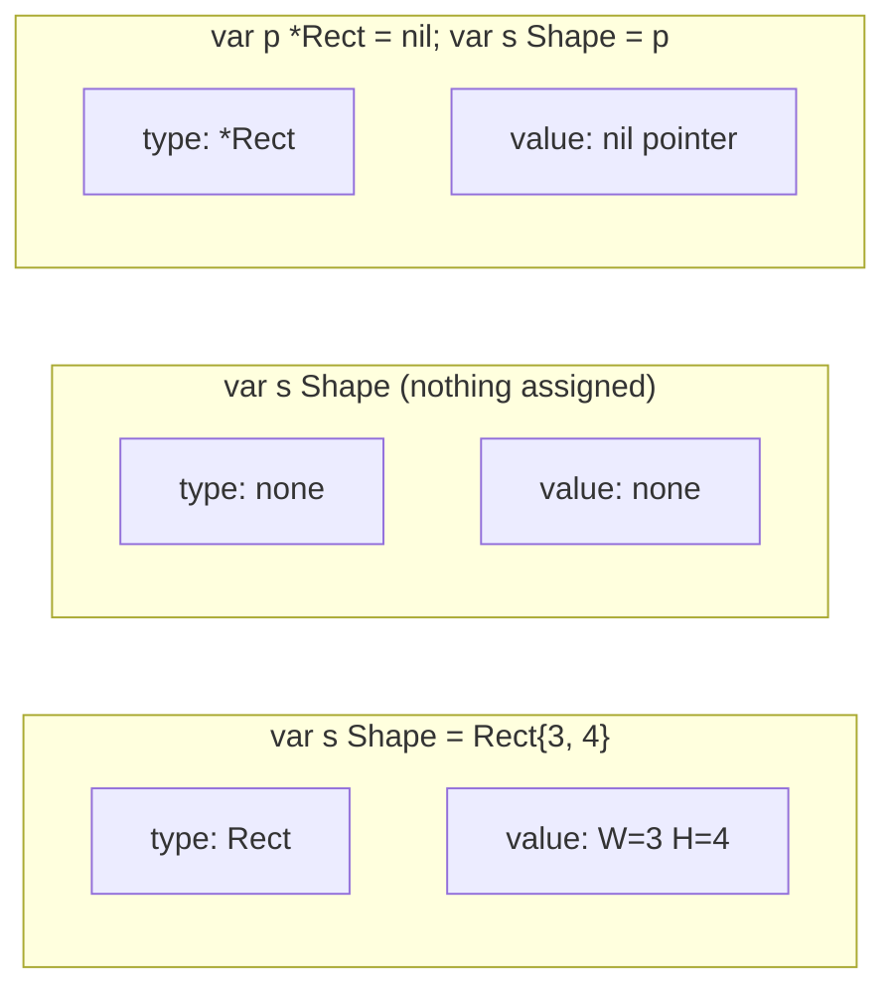

# Interfaces, any, assertions and the nil trap

> **Before this lesson:** read [Defined types, methods and embedding](#/lesson/go/go-types-methods). You must be comfortable with methods and with the difference between value receivers and pointer receivers, and you need pointers and `nil` from [Pointers, nil and mutability](#/lesson/go/go-pointers-basics).

## In plain words

A wall socket does not care what you plug into it. A lamp, a phone charger and a vacuum cleaner all work, because each has a plug of the agreed shape. The socket states a requirement ("two pins, this far apart") and anything that meets it fits. Nobody had to register the lamp with the socket's manufacturer.

In Go, an **interface** is that requirement, written as a list of methods. Any type that has those methods fits the interface automatically. A function that asks for the interface can then work with every such type, including types written years later by someone else.

Compare two ways to write a function that saves data:

- `func Save(f *os.File, data []byte)` works with files and nothing else.
- `func Save(w io.Writer, data []byte)` works with anything that has a `Write` method: a file, a network connection, an in-memory buffer, a compressor, a test double.

The second is more useful and easier to test, at no cost. That is why interfaces are considered the most important feature of Go's type system.

Why this matters for a job: interfaces are how Go code is decoupled and tested, and the standard library is built on a handful of tiny ones (`io.Reader`, `io.Writer`, `error`, `fmt.Stringer`). Interviewers ask how interfaces are satisfied, what an interface value contains, and, almost without fail, why an interface holding a nil pointer is not equal to nil.

**Compared with Python.** Python's "duck typing" says: if it has a `quack` method, call it and see. Nothing is checked until the line runs. Go gives you the same freedom (no `implements` declaration) with a compile-time check: if the type lacks a required method, the program does not build. Compared with Java, where a class must name the interfaces it implements, Go's satisfaction is **implicit**: the type and the interface need not know about each other.

## Declaring and satisfying an interface

```go
package main

import (
	"fmt"
	"math"
)

type Shape interface {
	Area() float64
}

type Rect struct{ W, H float64 }

func (r Rect) Area() float64 { return r.W * r.H }

type Circle struct{ R float64 }

func (c Circle) Area() float64 { return math.Pi * c.R * c.R }

func totalArea(shapes []Shape) float64 {
	sum := 0.0
	for _, s := range shapes {
		sum += s.Area()
	}
	return sum
}

func main() {
	shapes := []Shape{Rect{3, 4}, Circle{1}}
	for _, s := range shapes {
		fmt.Printf("%T %.2f\n", s, s.Area())
	}
	fmt.Printf("%.2f\n", totalArea(shapes))
}
```

```text
main.Rect 12.00
main.Circle 3.14
15.14
```

Line by line:

- `type Shape interface { Area() float64 }` declares an interface type with one required method. The list of methods is called the interface's **method set**.
- `Rect` and `Circle` each have a method `Area() float64`. Neither mentions `Shape`. That is enough: both **satisfy** (implement) `Shape`.
- `[]Shape{Rect{3, 4}, Circle{1}}` is a slice whose elements are of the interface type. It can hold values of different concrete types side by side.
- `s.Area()` calls whichever `Area` belongs to the value currently inside `s`. This choice at run time is **dynamic dispatch**.
- `%T` prints the type of the value inside the interface; `%.2f` prints a float with two decimals.

A **concrete type** is an ordinary type such as `Rect` that describes actual data. An interface type describes behaviour only. You cannot create a value "of type Shape" by itself; a `Shape` variable always holds a value of some concrete type, or nothing.

If a type is missing a method, the compiler tells you at the point where you try to use it as the interface:

```text
cannot use Triangle{} (value of type Triangle) as Shape value in variable declaration:
    Triangle does not implement Shape (missing method Area)
```

By convention, one-method interfaces are named after the method plus "er": `Reader`, `Writer`, `Stringer`, `Closer`.

## What an interface value contains

An interface value is a pair of two machine words:

1. the **dynamic type**: which concrete type is stored;
2. the **dynamic value**: the stored value (or a pointer to it).



The middle box is the zero value of an interface: both parts empty. Only that state is `nil`. Calling a method on a nil interface panics, because there is no type to say which method to run:

```go
var s Shape
fmt.Println(s == nil) // true
s.Area()              // panic: runtime error: invalid memory address or nil pointer dereference
```

Keep the third box in mind. It is the "nil trap" discussed below.

## Method sets decide what satisfies an interface

Recall that a type can have value-receiver and pointer-receiver methods. For interface satisfaction the rule is:

- the method set of `T` contains only its **value-receiver** methods;
- the method set of `*T` contains **both** kinds.

```go
package main

import "fmt"

type Incrementer interface {
	Inc()
}

type Counter struct{ n int }

func (c *Counter) Inc() { c.n++ } // pointer receiver

func main() {
	var a Incrementer = &Counter{} // ok: *Counter has Inc
	a.Inc()
	fmt.Println(a.(*Counter).n)

	// var b Incrementer = Counter{}
	// compile error: Counter does not implement Incrementer (method Inc has pointer receiver)
}
```

```text
1
```

Why the asymmetry? A pointer-receiver method needs an address to modify. The value stored inside an interface is a private copy with no address the program can use, so a plain `Counter` in an interface could not sensibly run `Inc`. The compiler therefore refuses. In the other direction there is no problem: from a pointer you can always reach the value.

The practical rule: **if a type's methods have pointer receivers, store a pointer (`&T{}`) in the interface.** The automatic `&` that Go inserts for method calls on variables does not apply here. Test yourself with [Method sets and interface satisfaction](#/problem/go-method-sets).

## The empty interface and any

An interface with no methods is satisfied by every type, because every type has at least zero methods. It is written `interface{}`, and since Go 1.18 has the built-in alias **`any`**.

```go
var v any
v = 42
v = "hello"
v = []int{1, 2}
fmt.Println(v)
```

A variable of type `any` can hold anything, which sounds like Python's untyped variables. The catch is that you can do almost nothing with it directly: no arithmetic, no indexing, no method calls, since the compiler knows nothing about what is inside. `any` is the right tool at the edges of a program, where the shape of data is not known in advance (decoding arbitrary JSON, `fmt.Println(a ...any)`). Inside your program, prefer specific types or small interfaces; if you find `any` spreading, something is wrong with the design.

## Getting the concrete value back

### Type assertions

A **type assertion** asks an interface value "do you hold a value of this type?" and extracts it.

```go
package main

import "fmt"

func main() {
	var v any = "hello"

	s := v.(string) // single-result form: panics if wrong
	fmt.Println(s, len(s))

	n, ok := v.(int) // comma-ok form: never panics
	fmt.Println(n, ok)

	if str, ok := v.(string); ok {
		fmt.Println("it is a string:", str)
	}

	_ = v.(int) // wrong type, single-result form
}
```

```text
hello 5
0 false
it is a string: hello
panic: interface conversion: interface {} is string, not int
```

- `v.(string)` yields the stored string, now with static type `string`, so `len(s)` compiles.
- `v.(int)` in the two-result form reports `false` and gives the zero value.
- The single-result form with a wrong type **panics**. Use it only when a wrong type would be a programming error; otherwise use comma-ok.

A type assertion differs from a conversion. A conversion `float64(i)` changes a value into another type and is checked at compile time. An assertion `v.(T)` reveals the type already inside an interface and is checked at run time.

You can also assert to another **interface** type, asking "does the value inside also have these methods?":

```go
if st, ok := v.(fmt.Stringer); ok {
	fmt.Println(st.String())
}
```

The standard library uses this to offer optional fast paths: accept a small interface, then check whether the value happens to support more.

### Type switches

When several types are possible, a **type switch** is clearer than a chain of assertions:

```go
package main

import "fmt"

func describe(v any) string {
	switch x := v.(type) {
	case nil:
		return "nil"
	case int:
		return fmt.Sprintf("int, doubled: %d", x*2)
	case string:
		return fmt.Sprintf("string of length %d", len(x))
	case []int:
		return fmt.Sprintf("slice with %d ints", len(x))
	case error:
		return "an error: " + x.Error()
	default:
		return fmt.Sprintf("something else: %T", x)
	}
}

func main() {
	fmt.Println(describe(21))
	fmt.Println(describe("go"))
	fmt.Println(describe(nil))
	fmt.Println(describe([]int{1, 2, 3}))
	fmt.Println(describe(3.5))
}
```

```text
int, doubled: 42
string of length 2
nil
slice with 3 ints
something else: float64
```

`switch x := v.(type)` is special syntax valid only here. In each `case`, `x` has the type named by that case, so `x*2` compiles in the `int` branch and `len(x)` in the `string` branch. Cases are tried top to bottom; a case may name an interface (`error`), which matches any value satisfying it. In `default`, `x` keeps the original interface type.

Heavy use of type switches on your own types suggests that a method on an interface would be better: let each type say how it behaves, instead of one function knowing every type.

## The nil trap

Here is the most famous surprise in Go.

```go
package main

import "fmt"

type MyErr struct{}

func (e *MyErr) Error() string { return "something broke" }

func run(fail bool) error {
	var p *MyErr // nil pointer
	if fail {
		p = &MyErr{}
	}
	return p // converts *MyErr to the interface type error
}

func main() {
	err := run(false)
	fmt.Println(err == nil)
	fmt.Printf("%T\n", err)
}
```

```text
false
*main.MyErr
```

`error` is a built-in interface with one method, `Error() string`. The function returns `p`, a nil pointer of type `*MyErr`. Converting it to `error` produces the pair **(type `*MyErr`, value nil)**. The type part is filled in, so the interface is **not nil**. The caller's `if err != nil` check concludes that an error occurred, although the code meant "no error".

An interface is nil only when both parts are empty. A box labelled `*MyErr` with nothing inside is still a labelled box.

### Try it: interface values as pairs

```python-run
class Iface:
    def __init__(self, dyn_type=None, value=None):
        self.dyn_type, self.value = dyn_type, value
    def is_nil(self):
        return self.dyn_type is None          # ONLY the type part decides
    def __repr__(self):
        return f"(type={self.dyn_type}, value={self.value})"

def to_iface(pointer_type, pointer_value):
    """Assigning a typed pointer to an interface always records the type."""
    return Iface(pointer_type, pointer_value)

never_assigned = Iface()
nil_pointer_inside = to_iface("*MyErr", None)
real_error = to_iface("*MyErr", "0xc000010000")

for name, i in [("var err error", never_assigned),
                ("err = (*MyErr)(nil)", nil_pointer_inside),
                ("err = &MyErr{}", real_error)]:
    print(f"{name:<22} {str(i):<38} err == nil ? {i.is_nil()}")
```

The middle row is the trap. Work through more cases in [The nil interface puzzle](#/problem/go-nil-interface).

### How to avoid it

1. **Return the literal `nil` on the success path.** Never return a typed pointer variable that happens to be nil.
2. **Declare variables with the interface type**, not the concrete pointer type: `var err error`, not `var err *MyErr`.

```go
func run(fail bool) error {
	if fail {
		return &MyErr{}
	}
	return nil // an untyped nil becomes a true nil interface
}
```

The same trap exists for any interface, not only `error`: passing a nil `*bytes.Buffer` to a function that takes an `io.Writer` and checks `w != nil` behaves the same way.

## Comparing interface values

Two interface values are equal with `==` when their dynamic types are identical and their dynamic values are equal. This works for any comparable concrete type. If the dynamic type is **not** comparable (a slice, a map, a function), the comparison compiles and **panics at run time**:

```go
var a, b any = []int{1}, []int{1}
fmt.Println(a == b) // panic: runtime error: comparing uncomparable type []int
```

The same applies when interface values are used as map keys.

## Interfaces from the standard library you will meet first

| Interface | Method(s) | What satisfies it |
|---|---|---|
| `error` | `Error() string` | every error value |
| `fmt.Stringer` | `String() string` | types with custom text form |
| `io.Reader` | `Read(p []byte) (n int, err error)` | files, network connections, buffers, `strings.NewReader` |
| `io.Writer` | `Write(p []byte) (n int, err error)` | files, connections, buffers, `os.Stdout` |
| `io.Closer` | `Close() error` | anything that must be released |
| `sort.Interface` | `Len`, `Less`, `Swap` | custom sortable collections |

Interfaces can be combined by embedding, the same idea as struct embedding: `io.ReadCloser` is declared as `interface { Reader; Closer }` and requires the methods of both.

## Pitfalls

> [!WARNING]
> Returning a nil pointer of a concrete type through an interface result (most often `error`) yields a non-nil interface. The caller's `!= nil` check then takes the wrong branch. Return a bare `nil`.

- **Storing a value where a pointer is needed**: `T` does not have the pointer-receiver methods.
- **Single-result type assertion on untrusted data.** It panics on mismatch; use comma-ok.
- **Using `any` everywhere** and losing the compiler's help.
- **Comparing interfaces that may hold slices or maps.** Run-time panic.
- **Pointer to an interface (`*io.Writer`).** Almost always a mistake: an interface value is already small and may hold a pointer; pass the interface itself.
- **Believing an interface is "a reference to the object".** Assigning a struct value to an interface stores a copy; later changes to the original variable are not seen through the interface.

> [!TIP]
> To make the compiler verify that a type satisfies an interface, even if no code assigns one to the other yet, add a line such as `var _ Shape = Rect{}` or `var _ io.Writer = (*MyWriter)(nil)` at package level. It costs nothing at run time and fails the build if a method is missing.

> [!INTERVIEW]
> **"Why is an interface holding a nil pointer not equal to nil?"** An interface value is a (dynamic type, dynamic value) pair and is nil only when both are unset. Assigning a nil `*T` sets the type word to `*T` and the value word to nil, so the comparison with nil is false. It bites when a function returns a concrete nil pointer as `error`. Fix: return literal `nil`, and declare result variables with the interface type. Follow-ups to expect: method sets (`T` versus `*T`), implicit satisfaction, the difference between type assertion and conversion, and what `any` is.

## Cheat sheet

| Goal | Syntax |
|---|---|
| Declare | `type Shape interface { Area() float64 }` |
| Satisfy | give the type every listed method; no keyword |
| Combine | `type ReadWriter interface { Reader; Writer }` |
| Anything | `any` (same as `interface{}`) |
| Extract, may panic | `s := v.(string)` |
| Extract safely | `s, ok := v.(string)` |
| Branch on type | `switch x := v.(type) { case int: ... }` |
| Print dynamic type | `fmt.Printf("%T", v)` |
| Compile-time check | `var _ Shape = Rect{}` |
| Method set of `T` | value-receiver methods |
| Method set of `*T` | value- and pointer-receiver methods |
| Nil interface | type and value both unset |

## Summary

- An **interface** lists methods. Any type with those methods satisfies it implicitly, checked at compile time.
- An interface value is a **(dynamic type, dynamic value)** pair; method calls dispatch on the dynamic type.
- `T` has only value-receiver methods in its method set; `*T` has all. Store a pointer when methods have pointer receivers.
- `any` accepts every type and offers no operations; use **type assertions** (prefer comma-ok) or a **type switch** to get the concrete value back.
- An interface is nil only if both parts are unset. A nil pointer stored in an interface makes it non-nil; return literal `nil`.
- Comparing interfaces whose dynamic types are not comparable panics.

## Glossary

- **any**: alias of the empty interface `interface{}`; holds a value of any type.
- **Concrete type**: a non-interface type that describes actual data.
- **Duck typing**: using a value based on the methods it has, not on a declared relationship.
- **Dynamic type / dynamic value**: the concrete type and value currently stored in an interface.
- **Empty interface**: an interface with no methods.
- **Implicit satisfaction**: a type implements an interface by having its methods, with no declaration.
- **Interface**: a type defined by a set of method signatures.
- **Method set**: the methods available on a type for the purpose of interface satisfaction.
- **Type assertion**: `v.(T)`, extracting a value of type `T` from an interface.
- **Type switch**: `switch x := v.(type)`, branching on the dynamic type.

```quiz
[
  {"q": "What must a type do to satisfy `type Speaker interface { Speak() string }`?",
   "options": ["Declare `implements Speaker`", "Embed Speaker", "Have a method `Speak() string`", "Be registered with `interface.Register`"],
   "answer": 2,
   "explain": "Satisfaction is implicit: having the methods is all it takes. The compiler checks when the type is used as the interface."},
  {"q": "`type T struct{}; func (t *T) M() {}; type I interface{ M() }`. Which line compiles?",
   "options": ["`var i I = T{}`", "`var i I = &T{}`", "Both", "Neither"],
   "answer": 1,
   "explain": "M has a pointer receiver, so only `*T` has it in its method set. `T{}` fails with: T does not implement I (method M has pointer receiver)."},
  {"q": "What does this print? `var v any = 7; s, ok := v.(string); fmt.Printf(\"%q %v\\n\", s, ok)`",
   "options": ["`\"7\" true`", "`\"\" false`", "It panics", "`\"7\" false`"],
   "answer": 1,
   "explain": "The comma-ok form never panics. On a mismatch it yields the zero value of the asserted type (empty string) and false."},
  {"q": "What happens? `var v any = 7; s := v.(string)`",
   "options": ["`s` is `\"7\"`", "`s` is `\"\"`", "Compile error", "Run-time panic: interface conversion"],
   "answer": 3,
   "explain": "The single-result assertion panics when the dynamic type differs: interface {} is int, not string."},
  {"q": "What does this print? `type E struct{}; func (*E) Error() string { return \"x\" }; func f() error { var p *E; return p }` then `fmt.Println(f() == nil)`",
   "options": ["`true`", "`false`", "It panics", "Compile error"],
   "answer": 1,
   "explain": "The returned interface holds (type *E, value nil). Because the type part is set, it is not equal to nil."},
  {"q": "What does this print? `func kind(v any) string { switch v.(type) { case int: return \"int\"; case string: return \"string\"; default: return \"other\" } }` then `fmt.Println(kind(2.5), kind(\"a\"))`",
   "options": ["`int string`", "`other string`", "`float string`", "`other other`"],
   "answer": 1,
   "explain": "2.5 is a float64, which matches no case, so default applies. The string matches the string case."},
  {"q": "What is true about a variable `var x any = 10`?",
   "options": ["`x + 1` compiles and gives 11", "`x + 1` does not compile; you must first assert `x.(int)`", "x is automatically converted to float64", "x cannot be reassigned to a string"],
   "answer": 1,
   "explain": "The compiler knows nothing about the contents of an `any`. Arithmetic needs the concrete type: `x.(int) + 1`. An `any` variable can later hold a value of a different type."},
  {"q": "What happens? `var a, b any = []int{1}, []int{1}; fmt.Println(a == b)`",
   "options": ["Prints `true`", "Prints `false`", "Compile error", "Run-time panic: comparing uncomparable type []int"],
   "answer": 3,
   "explain": "Interface comparison is allowed by the compiler, but when the dynamic type is not comparable (slices, maps, functions) it panics at run time."}
]
```

> **Source:** Bodner, *Learning Go* 2e, ch. 7 (topic coverage; wording and examples are original). Official references: https://go.dev/ref/spec#Interface_types, https://go.dev/ref/spec#Method_sets, https://go.dev/ref/spec#Type_assertions, https://go.dev/doc/faq#nil_error, https://go.dev/blog/laws-of-reflection
