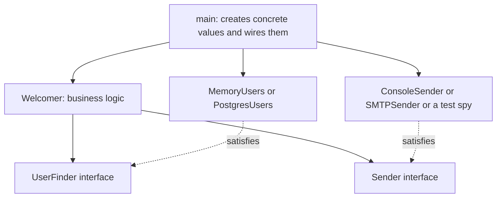

# Interface design and dependency injection

> **Before this lesson:** read [Interfaces, any, assertions and the nil trap](#/lesson/go/go-interfaces). You need to know how a type satisfies an interface, what method sets are, and how embedding works ([Defined types, methods and embedding](#/lesson/go/go-types-methods)).

## In plain words

Knowing the syntax of interfaces is one thing; knowing where to put them is what makes a codebase pleasant or painful. This lesson is about that second skill.

Think of a restaurant kitchen. The chef needs "someone who delivers vegetables every morning". The chef does not need to know which farm, which truck or which driver. If the kitchen were built around one specific farm, the restaurant would close the day that farm had a bad harvest. Because it is built around the *requirement*, the supplier can be swapped: a different farm, a wholesaler, or for a rehearsal dinner, a box of plastic vegetables.

Two ideas are in that picture:

- **The requirement is written by the one who needs it.** The chef states what the kitchen needs. The farm does not publish a catalogue of everything it could possibly do and force the chef to accept all of it. In Go terms: the code that *uses* a dependency declares a small interface listing the methods it actually calls.
- **The supplier is handed in from outside.** The chef does not go and build a farm; the restaurant owner arranges a supplier and introduces them. Handing a component the things it depends on, instead of letting it create them, is called **dependency injection** (DI).

Why this matters for a job: this is how production Go services are structured so that business logic can be tested without a real database, mail server or payment provider. "How do you do dependency injection in Go?" and "what does *accept interfaces, return structs* mean?" are routine design questions in interviews.

**Compared with Python.** Python tests often replace dependencies by **monkeypatching** (overwriting a function or attribute at run time). Go is compiled and statically typed, so there is nothing to overwrite; you design the seam in advance with an interface. Compared with Java or C#, where DI usually means a framework with annotations and a container, Go's DI is ordinary code: constructors that take parameters.

## A function that depends on behaviour, not on a type

Start with the smallest useful case. This function writes a line of text somewhere:

```go
package main

import (
	"bytes"
	"fmt"
	"io"
	"os"
)

func report(w io.Writer, name string, items int) {
	fmt.Fprintf(w, "%s: %d items\n", name, items)
}

func main() {
	report(os.Stdout, "cart", 3) // write to the terminal

	var buf bytes.Buffer
	report(&buf, "wishlist", 5) // write into memory
	fmt.Print("captured: ", buf.String())
}
```

```text
cart: 3 items
captured: wishlist: 5 items
```

`io.Writer` is a one-method interface from the standard library: `Write(p []byte) (n int, err error)`. `fmt.Fprintf` is `Printf` with a destination. `os.Stdout` (the terminal) is a writer; `*bytes.Buffer` (a growable chunk of memory) is a writer; so are files, network connections and HTTP responses.

Because `report` asks for the behaviour and not for "the terminal", the same function serves production and tests. A test passes a buffer and inspects what was written. No terminal is involved.

## Guideline 1: accept interfaces, return structs

This short phrase is the most quoted piece of Go design advice.

**Accept interfaces.** A function's parameters should demand as little as possible. If it only calls `Write`, ask for an `io.Writer`, not for a `*os.File`. The caller then has the widest choice of what to pass.

**Return structs** (concrete types). A function that creates something should return the real type, such as `*Server` or `*bytes.Buffer`, not an interface. The caller receives everything the type can do and can assign the result to whatever narrower interface they like. Returning an interface hides capabilities for no benefit, and adding a method to that interface later would break every other implementation of it.

The standing exception is `error`: functions return the `error` interface because callers must be able to handle any kind of failure.

## Guideline 2: the consumer defines the interface

In Java the type that provides a service usually declares the interface it implements. In Go the reverse is idiomatic, and implicit satisfaction is what makes it possible: **declare the interface in the package that uses it**, listing only the methods that package needs.

Suppose a database package offers a rich type:

```go
// package store
type UserStore struct{ /* connection pool ... */ }

func (s *UserStore) Find(id int) (User, error)  { /* ... */ }
func (s *UserStore) Save(u User) error          { /* ... */ }
func (s *UserStore) Delete(id int) error        { /* ... */ }
func (s *UserStore) List(limit int) ([]User, error) { /* ... */ }
```

A component that only looks users up should not be tied to all four methods. It declares what it needs:

```go
// package welcome
type UserFinder interface {
	Find(id int) (User, error)
}
```

`*store.UserStore` satisfies `welcome.UserFinder` without knowing that the interface exists. A test double needs one method, not four. And the `welcome` package does not even need to import `store`.

## Guideline 3: keep interfaces small

The Go proverb is "the bigger the interface, the weaker the abstraction". An interface with one or two methods has many possible implementations and is easy to fake. An interface with fifteen methods has, in practice, one implementation, and every test double must write fifteen methods. If a function needs two capabilities, compose two small interfaces by embedding:

```go
type ReadCloser interface {
	io.Reader
	io.Closer
}
```

## A complete example with dependency injection

The feature: send a welcome message to a user. It needs to look the user up and to send a message. Both are **dependencies**, things this code needs but does not want to build or know in detail.

```go
package main

import (
	"errors"
	"fmt"
	"strings"
)

type User struct {
	ID    int
	Email string
}

// ---- interfaces declared by the consumer ----

type UserFinder interface {
	Find(id int) (User, error)
}

type Sender interface {
	Send(to, body string) error
}

// ---- the component with injected dependencies ----

type Welcomer struct {
	users UserFinder
	mail  Sender
}

func NewWelcomer(users UserFinder, mail Sender) *Welcomer {
	return &Welcomer{users: users, mail: mail}
}

func (w *Welcomer) Welcome(id int) error {
	u, err := w.users.Find(id)
	if err != nil {
		return fmt.Errorf("welcome user %d: %w", id, err)
	}
	return w.mail.Send(u.Email, "Welcome aboard!")
}

// ---- concrete implementations ----

type MemoryUsers map[int]User

func (m MemoryUsers) Find(id int) (User, error) {
	u, ok := m[id]
	if !ok {
		return User{}, errors.New("user not found")
	}
	return u, nil
}

type ConsoleSender struct{}

func (ConsoleSender) Send(to, body string) error {
	fmt.Printf("to %s: %s\n", to, body)
	return nil
}

// ---- wiring: the only place that knows the concrete types ----

func main() {
	users := MemoryUsers{1: {ID: 1, Email: "nami@example.com"}}
	w := NewWelcomer(users, ConsoleSender{})

	fmt.Println(w.Welcome(1))
	fmt.Println(w.Welcome(2))

	var sent []string
	spy := SenderFunc(func(to, body string) error {
		sent = append(sent, strings.ToUpper(to))
		return nil
	})
	NewWelcomer(users, spy).Welcome(1)
	fmt.Println(sent)
}

// SenderFunc lets a plain function act as a Sender.
type SenderFunc func(to, body string) error

func (f SenderFunc) Send(to, body string) error { return f(to, body) }
```

```text
to nami@example.com: Welcome aboard!
<nil>
welcome user 2: user not found
[NAMI@EXAMPLE.COM]
```

Walk through the parts:

- `Welcomer` holds two fields of **interface** type. It has no idea whether users come from memory, PostgreSQL or a web API, or whether messages go to a console, an email service or a queue.
- `NewWelcomer` is a **constructor**: an ordinary function that builds the value. The dependencies arrive as parameters. That is the injection; there is nothing more to it.
- `Welcome` contains the actual logic and uses only the interface methods. `fmt.Errorf` with `%w` adds context to an error ([Errors are values](#/lesson/go/go-errors-values)).
- `MemoryUsers` (a map type with a method) and `ConsoleSender` (an empty struct with a method) are simple implementations.
- `main` is the **composition root**: the one place that creates concrete values and connects them. Everything below `main` receives what it needs.



The arrows from the logic point only at interfaces. Swapping an implementation changes one line in `main` and nothing else.

### Function types as implementations

The last part of the program shows a trick borrowed from the standard library. `SenderFunc` is a defined **function type** with a method `Send` that calls the function itself. Any function with the right signature can therefore be converted into a `Sender` on the spot: `SenderFunc(func(to, body string) error { ... })`.

That is how the "spy" in `main` was created without declaring a struct: a closure that records the recipient in a slice. The standard library's `http.HandlerFunc` is exactly this pattern, which is why you can register a plain function as an HTTP handler ([A REST service](#/lesson/go/go-rest-service)).

When should a dependency be a function parameter and when an interface? If it is a single operation with no related state, a function type is lighter. If there are several related operations, or the dependency has its own state and lifecycle, use an interface.

### Try it: swapping dependencies

The same structure in Python, where the "interfaces" are only conventions. Change which sender is injected and observe that `Welcomer` never changes.

```python-run
class Welcomer:
    def __init__(self, users, mail):          # dependencies are handed in
        self.users, self.mail = users, mail
    def welcome(self, user_id):
        email = self.users.find(user_id)
        if email is None:
            return f"welcome user {user_id}: user not found"
        self.mail.send(email, "Welcome aboard!")
        return None

class MemoryUsers:
    def __init__(self, data): self.data = data
    def find(self, user_id): return self.data.get(user_id)

class ConsoleSender:
    def send(self, to, body): print(f"  [console] to {to}: {body}")

class SpySender:                               # a test double that records calls
    def __init__(self): self.calls = []
    def send(self, to, body): self.calls.append((to, body))

class FailingUsers:                            # a stub that simulates an outage
    def find(self, user_id): return None

users = MemoryUsers({1: "nami@example.com"})

print("production wiring:")
print("  result:", Welcomer(users, ConsoleSender()).welcome(1))

print("test wiring with a spy:")
spy = SpySender()
Welcomer(users, spy).welcome(1)
print("  recorded calls:", spy.calls)

print("test wiring with a failing store:")
print("  result:", Welcomer(FailingUsers(), spy).welcome(1))
print("  spy still has", len(spy.calls), "call(s): no message was sent on failure")
```

In Go the compiler additionally guarantees that every injected value really has the required methods.

## Wrapping with embedded interfaces

An interface can be embedded in a struct. The struct then holds a value of that interface and has all its methods promoted. Override one method and you have a **decorator**: a wrapper that adds behaviour and forwards the rest.

```go
type CountingSender struct {
	Sender // embedded interface: holds the real sender
	Count  int
}

func (c *CountingSender) Send(to, body string) error {
	c.Count++                       // added behaviour
	return c.Sender.Send(to, body)  // delegate to the wrapped sender
}

func main() {
	counter := &CountingSender{Sender: ConsoleSender{}}
	w := NewWelcomer(MemoryUsers{1: {1, "a@example.com"}}, counter)
	w.Welcome(1)
	w.Welcome(1)
	fmt.Println(counter.Count)
}
```

```text
to a@example.com: Welcome aboard!
to a@example.com: Welcome aboard!
2
```

`*CountingSender` satisfies `Sender` (it has `Send`), so it slots in wherever a `Sender` is expected. Logging, metrics, retries, caching and rate limiting are all commonly added this way, without touching the wrapped type.

The same technique gives quick test doubles for large interfaces: embed the interface in a struct, implement only the two methods the test uses, and leave the rest. The embedded interface value is nil, so calling an unimplemented method panics, which is acceptable in a test because it shows immediately that the code used something unexpected.

## Do not create interfaces too early

Interfaces have a cost: an extra hop when reading the code ("which implementation is this?") and a small run-time cost for the indirect call. Introducing one "in case we need it later" is called **interface pollution**. Guidelines:

- Write the concrete type first. Introduce an interface when a second implementation appears, or when a test needs to substitute something slow or external (database, network, clock, random numbers).
- Do not put an interface in front of plain data or pure calculations.
- A one-method interface declared next to its only caller is fine; a large "service" interface copied from the struct's method list usually adds nothing.

Because satisfaction is implicit, adding an interface later requires no change to the implementing type. That is exactly why you can afford to wait.

## DI frameworks

For most services, wiring by hand in `main` is a few dozen lines and is the clearest option: you can read top to bottom how the program is assembled, and the compiler checks it. Tools exist for very large programs (Google's `wire` generates the wiring code; Uber's `fx` builds it at run time), and they solve a scale problem most projects do not have. Start by hand.

## Pitfalls

> [!WARNING]
> A constructor that returns an **interface** type and is given a nil concrete pointer produces the nil-interface trap from the previous lesson. Returning concrete types from constructors avoids it.

- **Declaring the interface next to the implementation** and making consumers depend on the provider's package.
- **Giant interfaces** that mirror a struct's full method list.
- **Returning interfaces** from constructors by reflex.
- **Global variables for dependencies** (a package-level `var db *sql.DB`). They hide what a function needs, make parallel tests interfere with each other, and cannot be swapped per test.
- **Creating dependencies inside the logic** (`store := NewPostgresStore()` in the middle of a method). The logic then cannot be tested without PostgreSQL.
- **Forgetting to set an injected field.** A nil interface field panics on first use; validate in the constructor if the caller might pass nil.

> [!TIP]
> Typical things to inject even in small programs: the **clock** (`func() time.Time`) so tests can control "now", the **random source**, the **HTTP client**, and the **logger**. Code that reads the real clock directly is hard to test around midnight, month ends and timeouts.

> [!INTERVIEW]
> **"How is dependency injection done in Go?"** Without a framework: a component declares small interfaces for what it needs (consumer-defined), holds them as fields, and receives implementations through a constructor function. `main` acts as the composition root that builds concrete types and passes them in. Tests pass fakes or stubs that satisfy the same interfaces. Mention "accept interfaces, return structs", implicit satisfaction (so interfaces can be added later without touching implementations), and function types such as `http.HandlerFunc` as a lightweight alternative for single-method dependencies.

## Cheat sheet

| Principle | In practice |
|---|---|
| Accept interfaces | parameter types are the smallest interface that works (`io.Writer`, your own one-method interface) |
| Return structs | constructors return `*Thing`, not an interface (except `error`) |
| Consumer defines the interface | declare it in the package that calls the methods |
| Keep interfaces small | one to three methods; compose with embedding |
| Inject through constructors | `func NewX(dep1 I1, dep2 I2) *X` |
| Wire in `main` | the composition root knows the concrete types |
| Single-method dependency | consider a function type with an adapter method |
| Add behaviour | embed the interface in a struct and override a method |
| Wait | add an interface when a second implementation or a test needs it |

## Summary

- Design functions around the **behaviour** they need. Small interface parameters make code reusable and testable.
- **Accept interfaces, return structs.** Consumers declare the interfaces; providers return concrete types.
- **Dependency injection** in Go is plain code: interface-typed fields, a constructor that receives the implementations, and a `main` that wires them.
- A function type with a method lets ordinary functions satisfy one-method interfaces.
- Embedding an interface in a struct creates decorators and quick test doubles.
- Introduce interfaces when there is a real need; implicit satisfaction makes it cheap to add them later.

## Glossary

- **Composition root**: the place (usually `main`) where concrete dependencies are created and connected.
- **Constructor**: a function, conventionally named `NewX`, that builds and returns a value.
- **Decorator**: a wrapper that satisfies the same interface as the thing it wraps and adds behaviour.
- **Dependency**: something a piece of code needs in order to work, such as a database or a mail sender.
- **Dependency injection (DI)**: supplying dependencies from outside instead of creating them inside.
- **Fake / stub / spy**: test doubles; a simplified working implementation / one returning canned answers / one that records how it was called.
- **Interface pollution**: adding interfaces that have no second implementation and no testing purpose.
- **Monkeypatching**: replacing code at run time, common in Python tests; not available in Go.
- **Seam**: a point in a program where one implementation can be exchanged for another.

```quiz
[
  {"q": "What does 'accept interfaces, return structs' recommend?",
   "options": ["Every function should take `any` and return `any`", "Parameters should be small interfaces; constructors and factories should return concrete types", "Structs should never be passed to functions", "Interfaces should be returned so callers cannot see the fields"],
   "answer": 1,
   "explain": "Narrow interface parameters give callers freedom; concrete return types give callers full capability and avoid freezing an interface too early."},
  {"q": "Where is the idiomatic place to declare an interface in Go?",
   "options": ["In the package that implements it", "In the package that uses it, listing only the methods it calls", "In a shared `interfaces` package", "In `main`"],
   "answer": 1,
   "explain": "Because satisfaction is implicit, the consumer can define exactly what it needs and the provider need not know. This keeps interfaces small and removes a package dependency."},
  {"q": "What does this print? `func out(w io.Writer) { fmt.Fprint(w, \"hi\") }` then `var b bytes.Buffer; out(&b); out(&b); fmt.Println(b.Len())`",
   "options": ["`2`", "`4`", "`0`", "Compile error: bytes.Buffer is not an io.Writer"],
   "answer": 1,
   "explain": "`*bytes.Buffer` has a Write method, so `&b` is an io.Writer. Two writes of two bytes each leave 4 bytes in the buffer."},
  {"q": "In the Welcomer example, what is 'injected'?",
   "options": ["The User struct", "The implementations of UserFinder and Sender, passed to the constructor", "The `main` function", "The error returned by Welcome"],
   "answer": 1,
   "explain": "Dependency injection means the component receives its collaborators from outside, here through `NewWelcomer(users, mail)`."},
  {"q": "`type SenderFunc func(to, body string) error` with `func (f SenderFunc) Send(to, body string) error { return f(to, body) }`. What is the purpose?",
   "options": ["To make functions comparable", "To let an ordinary function or closure satisfy the Sender interface", "To make Send variadic", "To avoid heap allocation"],
   "answer": 1,
   "explain": "The adapter gives a function type a method, so any function with that signature can be converted to the type and used where the interface is required, as `http.HandlerFunc` does."},
  {"q": "A struct embeds an interface: `type Counting struct { Sender; N int }` and defines its own `Send` that increments N and calls `c.Sender.Send`. What pattern is this?",
   "options": ["Inheritance", "A decorator (wrapper) that adds behaviour and delegates", "A singleton", "A type switch"],
   "answer": 1,
   "explain": "The struct satisfies Sender, wraps another Sender and adds counting. Logging, metrics and retries are added the same way."},
  {"q": "Why are package-level global variables a poor way to provide dependencies?",
   "options": ["Globals are slower than locals", "They hide what a function depends on and cannot be replaced independently per test", "Go forbids global variables", "They are always nil"],
   "answer": 1,
   "explain": "With globals, signatures no longer show dependencies and tests that swap the global interfere with each other. Constructor injection makes dependencies explicit."},
  {"q": "When should you introduce an interface for a type that currently has one implementation?",
   "options": ["Always, before writing the struct", "When a second implementation appears or a test needs to substitute it", "Never", "Only if the struct has more than ten methods"],
   "answer": 1,
   "explain": "Interfaces add indirection. Since satisfaction is implicit, one can be added later without changing the implementation, so wait for a real need."}
]
```

> **Source:** Bodner, *Learning Go* 2e, ch. 7 (topic coverage; wording and examples are original). Official references: https://go.dev/doc/effective_go#interfaces, https://go.dev/wiki/CodeReviewComments#interfaces, https://pkg.go.dev/io#Writer, https://pkg.go.dev/net/http#HandlerFunc, https://go.dev/blog/wire
