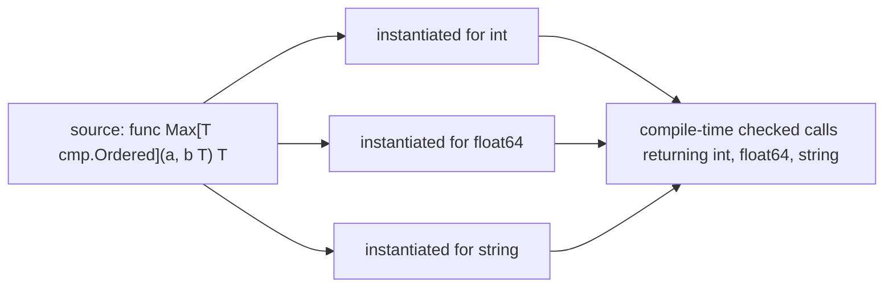

# Type parameters and generic functions

> **Before this lesson:** you need functions as values ([Declaring and calling functions](#/lesson/go/go-functions-basics)), slices and maps (composite types module), methods ([Defined types, methods and embedding](#/lesson/go/go-types-methods)) and interfaces ([Interfaces, any, assertions and the nil trap](#/lesson/go/go-interfaces)).

## In plain words

Imagine a cookie cutter. The cutter fixes the **shape**; you choose the **dough**: gingerbread, shortbread, sugar dough. One tool, many kinds of cookie, and every cookie from one batch is the same kind all the way through.

A **generic** function or type is a cookie cutter for code. You write the logic once, leaving a blank where a type would normally go, and the blank is filled in for each use. The blank is called a **type parameter**. A function "largest of two values" is written once with a blank `T`, and then works for two integers, two floats or two strings. Crucially, the compiler still checks every use: if you say the values are integers, you get an integer back, not a vague "something".

Go lived without generics for its first twelve years. They arrived in Go 1.18 (2022), designed to be small and conservative. This lesson covers how to write and call generic functions and types. The next covers constraints in depth and when generics are the wrong tool.

Why this matters for a job: the standard library's `slices`, `maps` and `cmp` packages are generic, so you call generic code daily. Writing a small generic helper or container is a common interview exercise, and "when would you use generics instead of an interface?" is a standard design question.

**Compared with Python.** Python functions accept any type because nothing is checked until the code runs; a function `largest(a, b)` works for whatever supports `>`, and fails at run time for whatever does not. Python's `TypeVar` and `list[T]` hints describe generics for external checkers, and the interpreter ignores them. In Go the type parameter is real: checked at compile time and enforced.

## The problem generics solve

Without generics, a function that returns the larger of two numbers must commit to one type:

```go
func MaxInt(a, b int) int {
	if a > b {
		return a
	}
	return b
}

func MaxFloat(a, b float64) float64 {
	if a > b {
		return a
	}
	return b
}
```

The bodies are identical; only the types differ. For every further type you copy and rename again.

The old escape route was `any`:

```go
func MaxAny(a, b any) any { /* type switch on every supported type ... */ }
```

This loses on three counts: the function must inspect types at run time, the caller gets back an `any` and must assert the type, and a mistake such as mixing a string with an int is discovered only when the program runs.

## A first generic function

```go
package main

import (
	"cmp"
	"fmt"
)

func Max[T cmp.Ordered](a, b T) T {
	if a > b {
		return a
	}
	return b
}

func main() {
	fmt.Println(Max(3, 7))
	fmt.Println(Max(2.5, 1.0))
	fmt.Println(Max("go", "rust"))
}
```

```text
7
2.5
rust
```

Read the first line of the function piece by piece:

- `Max` is the name.
- `[T cmp.Ordered]` is the **type parameter list**, in square brackets between the name and the ordinary parameters. It declares one type parameter named `T`.
- `cmp.Ordered` is the **constraint** on `T`: it restricts which types may fill the blank. `cmp.Ordered` (from the standard library) means "any type that supports `<`, `>`, `<=`, `>=`": the integer types, the floating-point types and strings. The constraint is what makes `a > b` legal inside the body.
- `(a, b T) T` is the ordinary signature, using `T` as a type: two parameters of the same type `T`, and a result of that type.

At each call the compiler works out what `T` is from the arguments: `int` for `Max(3, 7)`, `float64` for `Max(2.5, 1.0)`, `string` for `Max("go", "rust")`. This is **type inference**. The result has that precise type, so `Max(3, 7) + 1` compiles without any assertion.

By convention type parameters have short capitalised names: `T` for a general type, `K` and `V` for map keys and values, `E` for elements.

## Type inference and explicit type arguments

You can also state the type yourself. The type you supply is a **type argument**, and supplying it is called **instantiation**:

```go
fmt.Println(Max[float64](3, 7.5)) // T is float64; the constant 3 becomes 3.0
```

Explicit type arguments are needed when the compiler cannot infer them. Two situations come up.

**The arguments disagree.**

```go
i := 3
f := 7.5
fmt.Println(Max(i, f))
```

```text
type float64 of f does not match inferred type int for T
```

`T` stands for **one** type per call. `i` says `int`, `f` says `float64`, and Go never converts implicitly. Convert one side yourself: `Max(float64(i), f)`.

**`T` appears only in the result**, so the arguments give no clue:

```go
func Zero[T any]() T {
	var z T // the zero value of whatever T is
	return z
}

n := Zero[int]()       // 0
s := Zero[string]()    // ""
// x := Zero()         // compile error: cannot infer T
```

`var z T` is the standard idiom for "the zero value of a type parameter". You cannot write `0` or `nil`, because `T` could be anything.

A generic function with its type arguments filled in is an ordinary function value:

```go
maxInt := Max[int] // func(int, int) int
fmt.Println(maxInt(4, 9))
```

### Try it: how the compiler infers T

Inference is a matching game: line up parameter types with argument types, and every occurrence of the same letter must end up as the same type. This simulation does that for simple cases.

```python-run
def infer(param_types, arg_types):
    """param_types use single capital letters for type parameters, e.g. 'T', '[]T', 'map[K]V'."""
    binding = {}
    for want, got in zip(param_types, arg_types):
        prefix = ""
        while want.startswith("[]") and got.startswith("[]"):       # peel slices together
            want, got, prefix = want[2:], got[2:], prefix + "[]"
        if len(want) == 1 and want.isupper():                        # a type parameter
            if want in binding and binding[want] != got:
                return f"error: {got} does not match inferred type {binding[want]} for {want}"
            binding[want] = got
        elif want != got:
            return f"error: cannot use {prefix}{got} as {prefix}{want}"
    missing = [p for p in ("T", "U", "K", "V") if any(p in w for w in param_types) and p not in binding]
    return binding if not missing else f"error: cannot infer {missing[0]}"

calls = [
    ("Max(a, b T)",            ["T", "T"],       ["int", "int"]),
    ("Max(a, b T)",            ["T", "T"],       ["int", "float64"]),
    ("Index(s []T, x T)",      ["[]T", "T"],     ["[]string", "string"]),
    ("Index(s []T, x T)",      ["[]T", "T"],     ["[]string", "int"]),
    ("Pair(a T, b U)",         ["T", "U"],       ["string", "bool"]),
    ("Sum(nums []T)",          ["[]T"],          ["int"]),
]
for name, params, args in calls:
    print(f"{name:<20} args {args!s:<24} -> {infer(params, args)}")
```

The second and fourth rows are the errors you will meet in practice: two arguments pulling the same letter in different directions.

## Several type parameters

A function may have more than one type parameter, each with its own constraint. The classic trio of slice helpers shows why:

```go
package main

import "fmt"

// Map applies f to every element and collects the results.
func Map[T, U any](s []T, f func(T) U) []U {
	out := make([]U, 0, len(s))
	for _, v := range s {
		out = append(out, f(v))
	}
	return out
}

// Filter keeps the elements for which keep returns true.
func Filter[T any](s []T, keep func(T) bool) []T {
	var out []T
	for _, v := range s {
		if keep(v) {
			out = append(out, v)
		}
	}
	return out
}

// Reduce folds the slice into one value, starting from initial.
func Reduce[T, A any](s []T, initial A, step func(A, T) A) A {
	acc := initial
	for _, v := range s {
		acc = step(acc, v)
	}
	return acc
}

func main() {
	words := []string{"go", "rust", "zig", "python"}

	lengths := Map(words, func(w string) int { return len(w) })
	fmt.Println(lengths)

	short := Filter(words, func(w string) bool { return len(w) <= 3 })
	fmt.Println(short)

	total := Reduce(lengths, 0, func(sum, n int) int { return sum + n })
	fmt.Println(total)
}
```

```text
[2 4 3 6]
[go zig]
15
```

- `Map[T, U any]` has two type parameters, both constrained by `any`, meaning no restriction. The input is `[]T`, the function converts a `T` into a `U`, and the output is `[]U`. In the call, `T` is inferred as `string` from the slice and `U` as `int` from the function's result.
- `Filter` needs only one type parameter because the element type does not change.
- `Reduce` has an element type `T` and an accumulator type `A`.

The constraint `any` permits every type and, in exchange, allows almost no operations on values of that type inside the function: you can assign them, pass them on and store them, but not add, compare or call methods on them. Here that is enough, since all the real work is done by the function arguments.

Python has `map`, `filter` and `functools.reduce` built in. Go's standard library deliberately does not ship `Map` and `Filter` for slices; a plain `for` loop is considered clearer in most cases. The helpers above are useful for learning and occasionally in practice.

## A constraint that allows ==

To search a slice you must compare elements. `any` does not allow `==`, because not every type supports it (slices and maps do not). The built-in constraint **`comparable`** means "types whose values can be compared with `==` and `!=`":

```go
func Index[T comparable](s []T, target T) int {
	for i, v := range s {
		if v == target {
			return i
		}
	}
	return -1
}

fmt.Println(Index([]string{"a", "b", "c"}, "c")) // 2
fmt.Println(Index([]int{4, 8}, 5))                // -1
```

`comparable` is also the constraint on map key types, so a generic function that builds a map needs it:

```go
func CountBy[T any, K comparable](s []T, key func(T) K) map[K]int {
	counts := make(map[K]int)
	for _, v := range s {
		counts[key(v)]++
	}
	return counts
}

byLength := CountBy([]string{"go", "c", "zig", "rs"}, func(w string) int { return len(w) })
fmt.Println(byLength) // map[1:1 2:2 3:1]
```

The three constraints you need most are therefore `any` (no requirement), `comparable` (supports `==`) and `cmp.Ordered` (supports `<`). The next lesson shows how to write your own.

## Generic types

Types can have type parameters too. This is how you write a container once for every element type.

```go
package main

import "fmt"

type Stack[T any] struct {
	items []T
}

func (s *Stack[T]) Push(v T) {
	s.items = append(s.items, v)
}

func (s *Stack[T]) Pop() (T, bool) {
	var zero T
	if len(s.items) == 0 {
		return zero, false
	}
	last := s.items[len(s.items)-1]
	s.items = s.items[:len(s.items)-1]
	return last, true
}

func (s *Stack[T]) Len() int { return len(s.items) }

func main() {
	var names Stack[string] // the zero value is an empty, usable stack
	names.Push("ana")
	names.Push("ben")

	v, ok := names.Pop()
	fmt.Println(v, ok, names.Len())

	var nums Stack[int]
	n, ok := nums.Pop()
	fmt.Println(n, ok)

	// names.Push(42) // compile error: cannot use 42 as string value
}
```

```text
ben true 1
0 false
```

Points to notice:

- `type Stack[T any] struct { items []T }` declares a **generic type**. `Stack` alone is not a type you can use; `Stack[string]` and `Stack[int]` are, and they are different types.
- When using a generic type you must write the type argument; inference does not apply to types in variable declarations.
- Methods repeat the type parameter in the receiver: `func (s *Stack[T]) Push(v T)`. Inside the method, `T` is whatever the stack was instantiated with.
- `Pop` returns `(T, bool)`. With an empty stack it has no real value to return, so it returns `var zero T` and `false`.
- The compiler rejects `names.Push(42)`. With a pre-generics stack of `any`, that mistake would have compiled and surfaced later as a failed type assertion.

A stack is a **last in, first out** collection: the most recently pushed item is the first popped, like a pile of plates.

### Rules for methods on generic types

- A method uses the type parameters of its receiver type. **A method cannot introduce additional type parameters of its own.** `func (s *Stack[T]) MapTo[U any](...)` does not compile. Write a package-level function instead: `func MapStack[T, U any](s *Stack[T], f func(T) U) *Stack[U]`.
- Generic types can satisfy interfaces as usual, and can be embedded.

A generic key–value type shows two type parameters on a type:

```go
type Pair[K comparable, V any] struct {
	Key K
	Val V
}

func Entries[K comparable, V any](m map[K]V) []Pair[K, V] {
	out := make([]Pair[K, V], 0, len(m))
	for k, v := range m {
		out = append(out, Pair[K, V]{k, v})
	}
	return out
}
```

## Generics you already use

Since Go 1.21 the standard library contains generic packages that replaced a lot of hand-written loops:

```go
package main

import (
	"cmp"
	"fmt"
	"maps"
	"slices"
)

func main() {
	nums := []int{5, 2, 8, 2}
	fmt.Println(slices.Contains(nums, 8), slices.Index(nums, 2), slices.Max(nums))

	sorted := slices.Sorted(slices.Values(nums))
	fmt.Println(sorted, slices.Compact(sorted))

	ages := map[string]int{"cy": 40, "ana": 31}
	keys := slices.Sorted(maps.Keys(ages))
	fmt.Println(keys)

	fmt.Println(cmp.Compare(3, 9), min(4, 1, 7), max(2.5, 1))
}
```

```text
true 1 8
[2 2 5 8] [2 5 8]
[ana cy]
-1 1 2.5
```

`slices.Compact` removes consecutive duplicates. `cmp.Compare(a, b)` returns −1, 0 or +1. The built-ins `min` and `max` are generic as well. Before writing your own helper, check whether `slices` or `maps` already has it.

## How generics are compiled, briefly

You do not need this to use generics, but interviewers sometimes ask. Go does not produce one fully separate copy of the function per type argument (as C++ templates do), nor does it box every value at run time (as Java does). It groups type arguments by their memory layout, called their **GC shape**, generates one version of the code per shape, and passes a hidden **dictionary** with the type-specific details. All pointer types share one shape. The consequence: generic code is type-safe and usually about as fast as hand-written code, though calls to methods on type parameters can be slightly slower than calls on a known concrete type.



## Pitfalls

- **Expecting inference to mix types.** One type parameter is one type per call. Convert arguments or give the type argument explicitly.
- **Using an operator the constraint does not allow.** `a + b` with `T any` fails with `operator + not defined on a (variable of type T constrained by any)`. Choose or write a constraint that permits it.
- **Returning `nil` or `0` for a `T`.** Use `var zero T`.
- **Trying to add type parameters to a method.** Not supported; use a function.
- **Writing `Stack` without type arguments** where a type is required.
- **Making everything generic.** If a function works for one concrete type, or an interface describes the need, generics add noise (next lesson).

> [!TIP]
> Write the function for one concrete type first and get it working. When a second type needs the same logic, replace the type with a parameter. Code generalised from a working example has better constraints than code designed to be generic from the start.

> [!INTERVIEW]
> **"Why did Go add generics, and what are type parameters?"** To let one implementation of a data structure or algorithm work for many types with compile-time type safety, replacing duplicated per-type code and `any`-based code with run-time assertions. A type parameter is a placeholder type declared in square brackets (`[T Constraint]`) on a function or type; the constraint is an interface that limits the permitted type arguments and thereby defines which operations are legal on `T`. Type arguments are usually inferred from the call's arguments. Mention `any`, `comparable`, `cmp.Ordered`, the zero-value idiom `var zero T`, and that methods cannot have their own type parameters.

## Cheat sheet

| Goal | Syntax |
|---|---|
| Generic function | `func Name[T Constraint](x T) T` |
| Several type parameters | `func Map[T, U any](s []T, f func(T) U) []U` |
| No restriction | `[T any]` |
| Needs `==` | `[T comparable]` |
| Needs `<` `>` | `[T cmp.Ordered]` |
| Call with inference | `Max(3, 7)` |
| Call with explicit type | `Max[float64](3, 7.5)` |
| Zero value of `T` | `var zero T` |
| Generic type | `type Stack[T any] struct { items []T }` |
| Use a generic type | `var s Stack[int]` |
| Method on generic type | `func (s *Stack[T]) Push(v T)` |
| Function value from generic | `f := Max[int]` |

## Summary

- Generics let you write a function or type once with **type parameters** and use it with many types, checked at compile time.
- Type parameters are declared in square brackets with a **constraint** that says which types are allowed and which operations may be used.
- The compiler **infers** type arguments from the call's arguments; supply them explicitly when it cannot.
- `any`, `comparable` and `cmp.Ordered` cover most needs.
- **Generic types** such as `Stack[T]` are instantiated with explicit type arguments; their methods share the type's parameters and cannot add new ones.
- The standard `slices`, `maps` and `cmp` packages are generic and should be your first stop.

## Glossary

- **comparable**: built-in constraint for types supporting `==` and `!=`.
- **Constraint**: an interface that limits which types may be used for a type parameter.
- **GC shape**: the memory layout class by which the compiler groups type arguments.
- **Generic function / generic type**: a function or type declared with type parameters.
- **Instantiation**: supplying type arguments to a generic function or type.
- **Stack (data structure)**: a last-in, first-out collection.
- **Type argument**: the actual type supplied for a type parameter, such as `int` in `Max[int]`.
- **Type inference**: the compiler deducing type arguments from the call.
- **Type parameter**: a placeholder for a type, declared in square brackets.

```quiz
[
  {"q": "In `func Max[T cmp.Ordered](a, b T) T`, what is `cmp.Ordered`?",
   "options": ["The return type", "A constraint: it limits T to types that support the ordering operators", "A default value for T", "A package-level variable"],
   "answer": 1,
   "explain": "The part after the type parameter's name is its constraint. `cmp.Ordered` admits integers, floats and strings, which is what makes `a > b` legal in the body."},
  {"q": "What does this print? `func First[T any](s []T) T { var zero T; if len(s) == 0 { return zero }; return s[0] }` then `fmt.Println(First([]string{}), First([]int{9, 8}))`",
   "options": ["`nil 9`", "` 9` (an empty string, then 9)", "It panics on the empty slice", "Compile error"],
   "answer": 1,
   "explain": "For the empty []string, T is string and the zero value is the empty string. For the second call T is int and the first element is 9. Println shows an empty string followed by a space and 9."},
  {"q": "`i := 3; f := 2.5` and `Max` as above. What happens with `Max(i, f)`?",
   "options": ["Returns 3.0", "Returns 3", "Compile error: the arguments give conflicting types for T", "Run-time panic"],
   "answer": 2,
   "explain": "T must be a single type. An int variable and a float64 variable conflict, and Go does not convert implicitly. Write `Max(float64(i), f)`."},
  {"q": "Why does `func Sum[T any](s []T) T { var t T; for _, v := range s { t += v }; return t }` fail to compile?",
   "options": ["Generic functions cannot use range", "`any` does not permit the + operator; a constraint listing numeric types is needed", "`var t T` is illegal", "The function needs two type parameters"],
   "answer": 1,
   "explain": "The constraint determines the allowed operations. `any` allows none of the arithmetic operators. A constraint such as `~int | ~float64` (next lesson) permits `+`."},
  {"q": "What does this print? `func Map[T, U any](s []T, f func(T) U) []U { var out []U; for _, v := range s { out = append(out, f(v)) }; return out }` then `fmt.Println(Map([]int{1, 2, 3}, func(n int) string { return fmt.Sprint(n * n) }))`",
   "options": ["`[1 4 9]`", "`[1 2 3]`", "`[\"1\" \"4\" \"9\"]`", "Compile error: U cannot be inferred"],
   "answer": 0,
   "explain": "T is int and U is string, inferred from the slice and the function. The result is a []string of the squares; Println prints strings without quotes: [1 4 9]."},
  {"q": "Given `type Stack[T any] struct{ items []T }`, which declaration is valid?",
   "options": ["`var s Stack`", "`var s Stack[int]`", "`var s Stack<int>`", "`var s Stack(int)`"],
   "answer": 1,
   "explain": "A generic type must be instantiated with type arguments in square brackets. `Stack` alone is not a complete type."},
  {"q": "Which method declaration on `Stack[T]` is NOT allowed?",
   "options": ["`func (s *Stack[T]) Push(v T)`", "`func (s *Stack[T]) Len() int`", "`func (s *Stack[T]) Convert[U any](f func(T) U) []U`", "`func (s Stack[T]) Peek() (T, bool)`"],
   "answer": 2,
   "explain": "Methods cannot declare their own type parameters. Write a package-level generic function that takes the stack as an argument."},
  {"q": "Which constraint must the key type parameter have in `func Group[K ???, V any](items []V, key func(V) K) map[K][]V`?",
   "options": ["`any`", "`comparable`", "`cmp.Ordered` only", "`fmt.Stringer`"],
   "answer": 1,
   "explain": "Map keys must support `==`, which is exactly what `comparable` expresses. `any` would be rejected for a map key type."}
]
```

> **Source:** Bodner, *Learning Go* 2e, ch. 8 (topic coverage; wording and examples are original). Official references: https://go.dev/doc/tutorial/generics, https://go.dev/ref/spec#Type_parameter_declarations, https://go.dev/blog/intro-generics, https://pkg.go.dev/cmp, https://pkg.go.dev/slices
