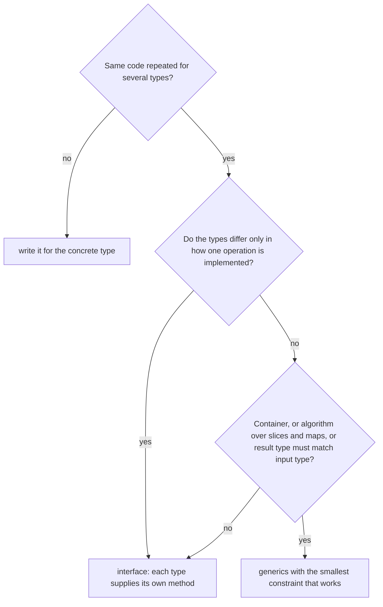

# Constraints, type sets and idiomatic generics

> **Before this lesson:** read [Type parameters and generic functions](#/lesson/go/go-generics-basics). You should be able to write `func Max[T cmp.Ordered](a, b T) T`, know what `any` and `comparable` mean as constraints, and understand defined types and underlying types from [Defined types, methods and embedding](#/lesson/go/go-types-methods).

## In plain words

In the previous lesson a generic function had a blank `T`, and a **constraint** said which types could fill the blank. Think of a job advertisement. "Anyone may apply" is the constraint `any`. "Applicants must hold a driving licence" narrows the field, and in return the employer may ask the new hire to drive. The requirement and the permitted task go together.

Constraints work the same way. The more a constraint demands of a type, the more the generic code is allowed to do with values of that type:

- `any` demands nothing, so the code may only store and pass values along;
- `comparable` demands support for `==`, so the code may compare;
- a constraint listing the number types demands arithmetic, so the code may add and multiply;
- a constraint listing a method demands that method, so the code may call it.

This lesson shows how to write constraints of your own, what the unusual symbols `|` and `~` mean, what generics in Go cannot do, and, most important in practice, how to decide between generics, interfaces and plain code.

Why this matters for a job: reading the signatures in the standard library's generic packages requires knowing this notation, and misuse of generics is a common code-review topic. Interview questions: "what does the tilde mean in a constraint?", "what is a type set?", "generics or an interface here?"

**Compared with Python.** Python's `Protocol` classes and bounded `TypeVar`s express similar ideas for static checkers, optionally. Go's constraints are mandatory and enforced, and they can demand *operators*, which Python expresses through special methods such as `__add__`.

## A constraint is an interface

A constraint is written as an interface. You already know interfaces that list methods. For use as constraints, interfaces gained a second ability: listing **types**.

```go
package main

import "fmt"

type Number interface {
	int | int64 | float64
}

func Sum[T Number](nums []T) T {
	var total T
	for _, n := range nums {
		total += n
	}
	return total
}

func main() {
	fmt.Println(Sum([]int{1, 2, 3}))
	fmt.Println(Sum([]float64{1.5, 2.5}))
}
```

```text
6
4
```

Line by line:

- `type Number interface { int | int64 | float64 }` declares a constraint. The vertical bar `|` means "or": a type satisfies `Number` if it is `int`, or `int64`, or `float64`. Such a list is called a **union**.
- `Sum[T Number]` uses it. Inside, `total += n` is legal because `+` works for **every** type in the union. The compiler allows an operation on a type parameter only if all permitted types support it.
- `var total T` starts at the zero value of whichever number type `T` is.

The set of all types that satisfy a constraint is its **type set**. The type set of `Number` has three members. The type set of `any` is every type. Thinking in type sets makes the rules simple: a type argument is allowed if it is in the set, and an operation is allowed if every member of the set supports it.

## The tilde: including types built on a type

Add a defined type and the function stops working:

```go
type Celsius float64

temps := []Celsius{20.5, 1.5}
fmt.Println(Sum(temps))
```

```text
Celsius does not satisfy Number (possibly missing ~ for float64 in Number)
```

`Celsius` is a distinct type. Its underlying type is `float64`, but it is not `float64` itself, and the union lists exact types. The compiler's hint tells you the remedy: the **tilde** `~`. Writing `~float64` means "any type whose **underlying type** is `float64`", which includes `float64` and every defined type based on it.

```go
package main

import "fmt"

type Number interface {
	~int | ~int64 | ~float64
}

func Sum[T Number](nums []T) T {
	var total T
	for _, n := range nums {
		total += n
	}
	return total
}

type Celsius float64

func main() {
	temps := []Celsius{20.5, 1.5}
	total := Sum(temps)
	fmt.Println(total)
	fmt.Printf("%T\n", total)
}
```

```text
22
main.Celsius
```

The result is a `Celsius`, not a bare `float64`: the generic function preserved the caller's type. In constraints you write for numeric code, use the tilde almost always; leaving it out excludes every user-defined numeric type for no benefit.

The standard library's `cmp.Ordered` is defined exactly in this style:

```go
type Ordered interface {
	~int | ~int8 | ~int16 | ~int32 | ~int64 |
		~uint | ~uint8 | ~uint16 | ~uint32 | ~uint64 | ~uintptr |
		~float32 | ~float64 |
		~string
}
```

For ready-made numeric constraints (`Integer`, `Float`, `Signed`, `Unsigned`), the supplementary module `golang.org/x/exp/constraints` has them; many projects copy the few lines they need.

### Try it: is this type in the type set?

This simulation applies the matching rule to a few types and constraints.

```python-run
user_types = {            # defined type -> underlying type
    "Celsius": "float64",
    "UserID":  "int",
    "Names":   "[]string",
}

def underlying(t):
    return user_types.get(t, t)

def in_type_set(t, terms):
    """terms like ['~int', 'float64']; an empty list means 'no type restriction'."""
    if not terms:
        return True
    for term in terms:
        if term.startswith("~"):
            if underlying(t) == term[1:]:
                return True
        elif t == term:
            return True
    return False

constraints = {
    "Exact   (int | float64)":    ["int", "float64"],
    "Number  (~int | ~float64)":  ["~int", "~float64"],
    "any":                         [],
}
types = ["int", "float64", "Celsius", "UserID", "string", "Names"]

print(f"{'type':<10}" + "".join(f"{name:<30}" for name in constraints))
for t in types:
    row = "".join(f"{str(in_type_set(t, terms)):<30}" for terms in constraints.values())
    print(f"{t:<10}{row}")
```

`Celsius` and `UserID` pass `Number` and fail `Exact`. The practice problem [Does this type satisfy the constraint?](#/problem/go-constraint-check) extends this with methods and embedded constraints.

## Constraints with methods, and both together

A constraint may list methods, exactly like an ordinary interface. Any ordinary interface can be used as a constraint.

```go
package main

import (
	"fmt"
	"strings"
)

type Stringer interface {
	String() string
}

func JoinAll[T Stringer](items []T, sep string) string {
	parts := make([]string, 0, len(items))
	for _, it := range items {
		parts = append(parts, it.String()) // legal: every T has String()
	}
	return strings.Join(parts, sep)
}

type ID int

func (id ID) String() string { return fmt.Sprintf("#%d", int(id)) }

func main() {
	fmt.Println(JoinAll([]ID{7, 8, 9}, ", "))
}
```

```text
#7, #8, #9
```

A constraint can also demand **both** a set of underlying types and methods. Each line of the interface is a requirement, and a type must meet all of them:

```go
type PrintableNumber interface {
	~int | ~float64 // must be built on int or float64 ...
	String() string // ... AND have this method
}
```

`ID` above satisfies it. Plain `int` does not: it has no `String` method. And constraints can embed other constraints, as interfaces embed interfaces:

```go
type OrderedStringer interface {
	cmp.Ordered
	fmt.Stringer
}
```

One restriction: an interface that contains a type list (a union or a tilde term) can be used **only as a constraint**. You cannot declare `var x Number` or a function parameter `n Number`. Interfaces with only methods work in both roles.

## A generic set

A set is a good exercise because it needs `comparable` and shows a generic type built on a map.

```go
package main

import (
	"fmt"
	"maps"
	"slices"
)

type Set[T comparable] map[T]struct{}

func NewSet[T comparable](items ...T) Set[T] {
	s := make(Set[T], len(items))
	for _, it := range items {
		s[it] = struct{}{}
	}
	return s
}

func (s Set[T]) Has(v T) bool {
	_, ok := s[v]
	return ok
}

func Union[T comparable](a, b Set[T]) Set[T] {
	out := maps.Clone(a)
	for v := range b {
		out[v] = struct{}{}
	}
	return out
}

func main() {
	a := NewSet(1, 2, 3)
	b := NewSet(3, 4)
	u := Union(a, b)
	fmt.Println(len(u), u.Has(4), u.Has(9))
	fmt.Println(slices.Sorted(maps.Keys(u)))
}
```

```text
4 true false
[1 2 3 4]
```

`Set[T]` is a defined map type whose values are empty structs (zero bytes each). `NewSet` is variadic and infers `T` from its arguments. `Union` is a function, not a method, though it could have been a method here since it adds no new type parameter.

## Generics or interfaces?

Both let one piece of code work with many types. They answer different needs.

Consider a function that only calls a method:

```go
func DescribeGeneric[T fmt.Stringer](v T) string { return "<" + v.String() + ">" }
func DescribeIface(v fmt.Stringer) string        { return "<" + v.String() + ">" }
```

These behave identically for the caller. The interface version is shorter, familiar, and is what experienced Go programmers expect. **If all you do with the value is call its methods, take the interface.**

Generics earn their place when the **relationship between types** matters:

```go
type Shape interface{ Area() float64 }

// Interface version: you get a Shape back and have lost the concrete type.
func LargestIface(shapes []Shape) Shape { /* ... */ }

// Generic version: put in []Rect, get back a Rect with its fields accessible.
func Largest[S Shape](shapes []S) S {
	var best S
	for i, s := range shapes {
		if i == 0 || s.Area() > best.Area() {
			best = s
		}
	}
	return best
}
```

With `rects := []Rect{{1, 2}, {3, 4}}`, the call `Largest(rects).W` compiles, because the result is a `Rect`. Note also that a `[]Rect` cannot be passed to `LargestIface` at all: a `[]Rect` is not a `[]Shape`, and converting requires building a new slice element by element. The generic version accepts the slice as it is.

A decision table:

| Situation | Use |
|---|---|
| A container that should hold one element type (stack, set, cache, tree) | generics |
| An algorithm over slices, maps or channels of any element type (sort, filter, reverse, merge) | generics |
| The result type must match the input type | generics |
| The same logic repeated for several numeric types | generics with a numeric constraint |
| The code only calls methods on the value | interface |
| Different types need different **implementations** of an operation | interface (each type provides its own method) |
| It works fine for one concrete type | no abstraction |

A useful summary from the Go team: do not begin by defining type parameters; begin by writing functions. If you find yourself writing the same code several times with only the types changed, that is the moment for a type parameter.

## What Go generics do not do

The design is intentionally limited. Knowing the edges saves you from fighting the compiler.

- **No type parameters on methods.** Covered in the previous lesson; use a function.
- **No specialisation.** You cannot provide a separate, faster implementation "when `T` is `string`".
- **No operator methods.** A constraint can require the built-in `<`, which only built-in types and types based on them have. You cannot define `<` for your own struct. Generic code that should work with structs takes a comparison **function** instead, which is why the library offers both `slices.Sort` (for `cmp.Ordered` types) and `slices.SortFunc` (with a comparison function for anything).
- **No variadic type parameters**: you cannot write one function that takes "any number of type parameters".
- **No direct type switch on a type parameter.** Convert to `any` first:

```go
func kind[T any](v T) string {
	switch any(v).(type) {
	case int:
		return "int"
	case string:
		return "string"
	default:
		return "other"
	}
}
```

  If you need this often, generics are probably the wrong tool for that function.
- **Field access through a constraint is not available.** A constraint cannot say "has a field named `ID`". Require a method instead.

### A note on comparable

`comparable` covers types on which `==` is defined at compile time. Since Go 1.20 interface types also satisfy `comparable`, even though comparing two interface values can panic at run time when the dynamic values are not comparable (for example slices). So `Set[any]` compiles, and inserting a slice into it panics. This compromise was made so that generic maps and sets could hold interface values.

## Performance in one paragraph

Generic code is compiled per memory-layout class, with a hidden dictionary for type details ([previous lesson](#/lesson/go/go-generics-basics)). For numeric and container code it is typically as fast as hand-written code and faster than code based on `any`, because values are not boxed into interfaces. Calling methods on a type parameter can be a little slower than calling them on a concrete type. As always, write the clear version, then benchmark if it matters.



## Pitfalls

- **Forgetting the tilde**, which shuts out defined types such as `type Celsius float64`.
- **Using a type-list constraint as an ordinary type** (`var n Number`). Not allowed.
- **Over-constraining.** If the body never compares, do not demand `comparable`; if it never orders, do not demand `cmp.Ordered`. Use the weakest constraint that compiles.
- **Wrapping an interface in a type parameter for no reason**: `func F[T io.Reader](r T)` is `func F(r io.Reader)` with extra syntax.
- **Expecting `[]Concrete` to convert to `[]Interface`.** It does not; a generic function accepts the slice directly.
- **Type-switching on `T` to give each type its own branch.** That is an interface problem in disguise.
- **Sets or map keys of interface type** holding uncomparable values: run-time panic.

> [!TIP]
> When a signature becomes hard to read because of long constraints, name the constraint (`type Number interface { ... }`) and, for function parameters, name the function type (`type Less[T any] func(a, b T) bool`). Generic code is read far more often than written.

> [!INTERVIEW]
> **"What does `~int` mean, and what is a type set?"** A constraint is an interface, and its type set is the set of types that satisfy it. A type term `int` contributes exactly the type `int`; `~int` contributes every type whose underlying type is `int`, including defined types such as `type UserID int`. Terms joined with `|` form a union. An operation is permitted on a type parameter only if every type in the constraint's type set supports it. Interfaces with type terms can only be used as constraints. **"Generics or interfaces?"** Interfaces when different types supply different behaviour through methods; generics for containers and algorithms where the element type is a parameter and should be preserved in the result.

## Cheat sheet

| Notation | Meaning |
|---|---|
| `[T any]` | every type; no operations |
| `[T comparable]` | types supporting `==`, `!=`; usable as map keys |
| `[T cmp.Ordered]` | integers, floats, strings (and types built on them); supports `<` |
| `int \| float64` | union: exactly these types |
| `~int` | any type whose underlying type is `int` |
| `interface { ~int; String() string }` | built on `int` **and** has the method |
| `interface { A; B }` | must satisfy both `A` and `B` |
| `var zero T` | zero value of the type parameter |
| `any(v).(type)` | inspect the dynamic type of a `T` |
| `slices.Sort` / `slices.SortFunc` | ordered types / anything, with a comparison function |

## Summary

- A **constraint** is an interface. Besides methods it may list types with `|` (union) and `~` (underlying type). The types it admits form its **type set**.
- Generic code may use an operation only if every type in the type set supports it; a stricter constraint permits more.
- Use `~` in type lists so that defined types are admitted; the generic function then preserves the caller's type.
- Constraints can combine type terms and methods and can embed other constraints. Interfaces with type terms cannot be used as ordinary types.
- Choose **interfaces** when code calls methods and types differ in behaviour; choose **generics** for containers, for algorithms over collections and when input and output types must match.
- Go's generics omit method type parameters, specialisation and operator definitions by design; pass functions where behaviour must vary.

## Glossary

- **Constraint**: an interface used to restrict a type parameter.
- **Core operation**: an operator or built-in permitted on a type parameter because all types in its type set support it.
- **Specialisation**: providing a different implementation for particular type arguments; not available in Go.
- **Tilde (`~T`)**: a type term matching all types whose underlying type is `T`.
- **Type set**: the set of types that satisfy a constraint.
- **Type term**: an entry such as `int` or `~string` in a constraint's type list.
- **Underlying type**: the type a defined type is built from.
- **Union**: type terms joined with `|`, meaning "any one of these".

```quiz
[
  {"q": "`type Number interface { int | float64 }` and `type Celsius float64`. Does `Celsius` satisfy `Number`?",
   "options": ["Yes, because its underlying type is float64", "No: without a tilde the term `float64` matches only the type float64 itself", "Only if Celsius has a String method", "Yes, after an automatic conversion"],
   "answer": 1,
   "explain": "Exact terms match exact types. Write `~float64` to admit every type whose underlying type is float64. The compiler's error even suggests the missing tilde."},
  {"q": "What does this print? `type N interface{ ~int | ~float64 }; func Sum[T N](s []T) T { var t T; for _, v := range s { t += v }; return t }; type Score int` then `fmt.Printf(\"%v %T\\n\", Sum([]Score{4, 5}), Sum([]Score{4, 5}))`",
   "options": ["`9 int`", "`9 main.Score`", "`9.0 float64`", "Compile error"],
   "answer": 1,
   "explain": "Score has underlying type int, so it is in the type set. T is inferred as Score, and the result keeps that type."},
  {"q": "What is the 'type set' of a constraint?",
   "options": ["The fields a struct must have", "The set of types that satisfy the constraint", "The methods of the type parameter", "The list of functions using the constraint"],
   "answer": 1,
   "explain": "A type argument is valid if it belongs to the constraint's type set, and an operation is valid on T if all types in the set support it."},
  {"q": "Given `type Number interface { ~int | ~float64 }`, which use is NOT allowed?",
   "options": ["`func Abs[T Number](x T) T`", "`type Vec[T Number] []T`", "`var x Number = 3`", "`func Sum[T Number](s []T) T`"],
   "answer": 2,
   "explain": "Interfaces containing type terms may be used only as constraints, not as the type of a variable, field or ordinary parameter."},
  {"q": "A function only calls `v.String()` on its argument. Which signature is more idiomatic?",
   "options": ["`func Show[T fmt.Stringer](v T) string`", "`func Show(v fmt.Stringer) string`", "`func Show(v any) string` with a type assertion", "`func Show[T any](v T) string`"],
   "answer": 1,
   "explain": "When the code only uses methods and the result type does not depend on the argument type, a plain interface parameter is simpler and equivalent."},
  {"q": "Why does `slices.SortFunc` exist alongside `slices.Sort`?",
   "options": ["SortFunc is faster", "`slices.Sort` needs `cmp.Ordered` elements; user-defined structs have no `<`, so they are sorted with a comparison function", "Sort is deprecated", "SortFunc sorts maps"],
   "answer": 1,
   "explain": "Go has no operator overloading, so a constraint cannot require `<` on a struct. Passing a comparison function is the general mechanism."},
  {"q": "How can generic code inspect the concrete type of a value `v` of type parameter `T`?",
   "options": ["`switch v.(type)` directly", "`switch any(v).(type)`", "`reflect.T(v)` only", "It cannot"],
   "answer": 1,
   "explain": "A type switch needs an interface value. Converting to `any` first makes it possible, though needing it often signals that an interface with methods would fit better."},
  {"q": "`func Largest[S Shape](shapes []S) S` versus `func Largest(shapes []Shape) Shape`. What is the practical advantage of the generic version?",
   "options": ["It runs in constant time", "It accepts a `[]Rect` directly and returns a `Rect`, keeping the concrete type", "It works without the Area method", "It avoids all memory allocation"],
   "answer": 1,
   "explain": "A []Rect is not a []Shape, and the interface version returns a Shape. The generic version preserves the element type for both input and output."}
]
```

> **Source:** Bodner, *Learning Go* 2e, ch. 8 (topic coverage; wording and examples are original). Official references: https://go.dev/ref/spec#Interface_types, https://go.dev/ref/spec#Type_constraints, https://go.dev/blog/when-generics, https://go.dev/blog/comparable, https://pkg.go.dev/golang.org/x/exp/constraints
