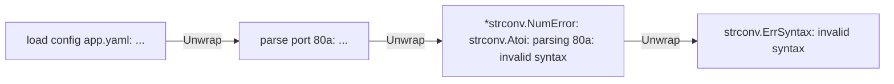

# Errors are values: creating, returning and wrapping

> **Before this lesson:** you need multiple return values ([Declaring and calling functions](#/lesson/go/go-functions-basics)), interfaces and the nil-interface trap ([Interfaces, any, assertions and the nil trap](#/lesson/go/go-interfaces)), and pointers ([Pointers, nil and mutability](#/lesson/go/go-pointers-basics)).

## In plain words

Things go wrong in every real program: a file is missing, the network drops, a user types "abc" where a number belongs. A language needs a way for the code that notices a problem to tell the code that can do something about it.

Many languages, Python among them, use **exceptions**. Think of a fire alarm: when something fails, an alarm goes off and normal work stops immediately. The alarm travels up through the building, floor by floor, until it reaches someone who has been posted to handle it. If nobody has, the building is evacuated (the program crashes). The alarm is powerful and also invisible: reading an ordinary line of code, you cannot see whether it might trigger one.

Go uses **errors as values**. Think of a delivery that comes back with a note attached: "could not deliver: nobody home". The note is an ordinary object handed to you along with the result. You read it, right there, and decide: try again, pass the note to your manager with an extra line of explanation, or give up. Nothing jumps anywhere. Every place where something can fail is visible in the code as an `if err != nil` check.

This lesson covers how to create such notes, how to return and check them, and how to **wrap** one note inside another so that the final message tells the full story. The next lesson covers how to inspect wrapped errors and what Go's rarely used alarm, `panic`, is for.

Why this matters for a job: error handling is a third of the lines in typical Go services. Reviewers judge Go code largely by its error handling: are errors checked, is context added, is the original cause preserved? Interviews ask you to explain the philosophy and to write a custom error type.

**Compared with Python.** `try: ... except ValueError as e:` separates the failing code from the handling code, possibly by many function calls. In Go the check sits directly after the call. Go code is longer as a result, and it is always clear which calls can fail and what happens when they do.

## The error type

`error` is a built-in **interface** with a single method:

```go
type error interface {
	Error() string
}
```

Anything with an `Error() string` method is an error. A function that can fail returns an `error` as its **last** result. The value `nil` means success.

```go
package main

import (
	"errors"
	"fmt"
)

func divide(a, b float64) (float64, error) {
	if b == 0 {
		return 0, errors.New("division by zero")
	}
	return a / b, nil
}

func main() {
	result, err := divide(10, 4)
	if err != nil {
		fmt.Println("failed:", err)
		return
	}
	fmt.Println(result)

	_, err = divide(1, 0)
	fmt.Println(err)
}
```

```text
2.5
division by zero
```

Line by line:

- `errors.New("division by zero")` creates an error value carrying that message.
- On failure the function returns the zero value for the real result (`0`) together with the error. On success it returns the result and `nil`.
- The caller receives both and checks `if err != nil` **before using the result**. This four-line shape is the most common pattern in Go.
- Printing an error calls its `Error` method.

Conventions for error messages: start with a lower-case letter, do not end with punctuation, and do not write "failed to" or "error:" at the start. The reason is that messages are joined with others into one line, as you will see.

## Three ways to make an error

### 1. errors.New: a fixed message

Shown above. Use it when there is nothing to add but the text.

### 2. fmt.Errorf: a formatted message

```go
func withdraw(balance, amount int) (int, error) {
	if amount > balance {
		return balance, fmt.Errorf("insufficient funds: have %d, need %d", balance, amount)
	}
	return balance - amount, nil
}
```

`fmt.Errorf` works like `fmt.Sprintf` and returns an error. Use it to include the values that explain the failure.

### 3. A custom error type: structured details

When the caller may need the details as data, not only as text, define a type with an `Error` method:

```go
type RangeError struct {
	Value, Min, Max int
}

func (e *RangeError) Error() string {
	return fmt.Sprintf("value %d out of range [%d, %d]", e.Value, e.Min, e.Max)
}
```

Any code that receives this error can, after identifying it (next lesson), read `e.Value`, `e.Min` and `e.Max` instead of parsing the message. The convention is a pointer receiver and returning `&RangeError{...}`.

## Sentinel errors: named values to compare against

Sometimes the caller needs to recognise one specific, expected condition, such as "not found" or "end of input". For this, packages declare an error **once**, as a package-level variable, and return that same value every time. Such a variable is called a **sentinel error**, and by convention its name starts with `Err`.

```go
var ErrEmpty = errors.New("empty input")
```

The standard library has many: `io.EOF` (no more data to read), `sql.ErrNoRows`, `fs.ErrNotExist`, `context.Canceled`. Callers compare against the variable; the mechanics are in the next lesson.

Sentinel errors are part of a package's public promise, so declare them sparingly, for conditions callers will really branch on.

## Putting the three together

```go
package main

import (
	"errors"
	"fmt"
	"strconv"
)

var ErrEmpty = errors.New("empty input")

type RangeError struct {
	Value, Min, Max int
}

func (e *RangeError) Error() string {
	return fmt.Sprintf("value %d out of range [%d, %d]", e.Value, e.Min, e.Max)
}

func parseAge(s string) (int, error) {
	if s == "" {
		return 0, ErrEmpty
	}
	n, err := strconv.Atoi(s)
	if err != nil {
		return 0, fmt.Errorf("parse age %q: %w", s, err)
	}
	if n < 0 || n > 150 {
		return 0, &RangeError{Value: n, Min: 0, Max: 150}
	}
	return n, nil
}

func main() {
	for _, input := range []string{"42", "", "abc", "200"} {
		age, err := parseAge(input)
		if err != nil {
			fmt.Println("error:", err)
			continue
		}
		fmt.Println("age:", age)
	}
}
```

```text
age: 42
error: empty input
error: parse age "abc": strconv.Atoi: parsing "abc": invalid syntax
error: value 200 out of range [0, 150]
```

Four inputs, four different paths: success, a sentinel error, a wrapped error from another package, and a custom error type. The third line of output shows why messages are lower-case fragments: two layers were joined with a colon into one readable sentence. The `%w` in that `fmt.Errorf` call is the subject of the rest of this lesson.

## Wrapping: adding context without losing the cause

An error created deep inside a program is usually too bare by the time it reaches the top. Compare two log lines for the same failure:

```text
invalid syntax
start server: load config "app.yaml": parse port "80a": strconv.Atoi: parsing "80a": invalid syntax
```

The second tells you where to look. Each function on the way up added a few words saying what **it** was trying to do. This is **wrapping**: creating a new error that contains an explanation plus the original error inside it.

The tool is `fmt.Errorf` with the special verb **`%w`**:

```go
package main

import (
	"errors"
	"fmt"
	"strconv"
)

func parsePort(s string) (int, error) {
	n, err := strconv.Atoi(s)
	if err != nil {
		return 0, fmt.Errorf("parse port %q: %w", s, err)
	}
	return n, nil
}

func loadConfig(name, portText string) (int, error) {
	port, err := parsePort(portText)
	if err != nil {
		return 0, fmt.Errorf("load config %q: %w", name, err)
	}
	return port, nil
}

func main() {
	_, err := loadConfig("app.yaml", "80a")
	fmt.Println(err)

	inner := errors.Unwrap(err)
	fmt.Println(inner)
	fmt.Println(errors.Unwrap(inner))
}
```

```text
load config "app.yaml": parse port "80a": strconv.Atoi: parsing "80a": invalid syntax
parse port "80a": strconv.Atoi: parsing "80a": invalid syntax
strconv.Atoi: parsing "80a": invalid syntax
```

`%w` does two things. It inserts the inner error's text into the message, as `%v` would. And it stores the inner error itself inside the new one, so that it can be retrieved. `errors.Unwrap(err)` returns the error directly inside, or `nil` if there is none. The result is an **error chain**:



You will rarely call `errors.Unwrap` yourself. The functions `errors.Is` and `errors.As` (next lesson) walk the whole chain for you. What matters now is the habit: **when you return an error you received, wrap it with `%w` and a short description of what you were doing.**

### %w versus %v

`fmt.Errorf("...: %v", err)` produces the same text and **breaks the chain**: the original error becomes mere characters in a string, and no code further up can identify it. Use `%v` deliberately, when you want to hide an internal detail from callers (for example, so that they do not start depending on which database driver you use). Otherwise use `%w`.

### How a custom type wraps

A custom error type takes part in wrapping by providing an `Unwrap` method that returns the error it contains:

```go
type QueryError struct {
	Query string
	Err   error
}

func (e *QueryError) Error() string { return "query " + e.Query + ": " + e.Err.Error() }
func (e *QueryError) Unwrap() error { return e.Err }
```

`fmt.Errorf` with `%w` builds a small internal type that has such a method for you.

### Try it: build and walk a chain

The simulation models wrapping the way Go does: each error keeps its own message and a reference to the error inside.

```python-run
class Err:
    def __init__(self, msg, inner=None):
        self.msg, self.inner = msg, inner
    def error(self):                      # like Error()
        return self.msg if self.inner is None else f"{self.msg}: {self.inner.error()}"
    def unwrap(self):                     # like errors.Unwrap
        return self.inner

ErrNotFound = Err("record not found")     # a sentinel: one shared value

def find_user(user_id):
    return ErrNotFound                                          # deepest layer

def load_profile(user_id):
    err = find_user(user_id)
    return Err(f"load profile {user_id}", err)                 # fmt.Errorf("...: %w", err)

def handle_request(user_id):
    err = load_profile(user_id)
    return Err("GET /profile", err)

top = handle_request(7)
print("message :", top.error())
print("chain   :")
e, depth = top, 0
while e is not None:
    marker = "  <- the sentinel itself" if e is ErrNotFound else ""
    print(f"   {'  ' * depth}{e.msg!r}{marker}")
    e, depth = e.unwrap(), depth + 1

flattened = Err("GET /profile: " + load_profile(7).error())     # like %v: text only
print("with %v :", flattened.error(), "| inner error kept?", flattened.unwrap() is not None)
```

The message is identical in both cases, but the `%v`-style error has no inner error to walk to. Explore deeper trees, including joined errors, in [Error wrapping: Is, As, Unwrap and messages](#/problem/go-error-chain).

## Several errors at once

Sometimes more than one thing fails and you want to report all of them, for instance when validating a form. `errors.Join` combines errors into one:

```go
package main

import (
	"errors"
	"fmt"
)

func validate(name string, age int) error {
	var errs []error
	if name == "" {
		errs = append(errs, errors.New("name is required"))
	}
	if age < 0 {
		errs = append(errs, errors.New("age must not be negative"))
	}
	return errors.Join(errs...) // nil if errs is empty
}

func main() {
	fmt.Println(validate("Ana", 30))
	fmt.Println(validate("", -1))
}
```

```text
<nil>
name is required
age must not be negative
```

`errors.Join` returns `nil` when given no non-nil errors, so the function reads naturally. The joined error prints each message on its own line, and `errors.Is`/`errors.As` look inside all of them. `fmt.Errorf` also accepts several `%w` verbs in one call.

## Handling errors well

**Check every error.** Ignoring one with `_` hides failures until they cause confusing symptoms elsewhere. The rare legitimate cases (a best-effort cleanup) deserve a comment saying why.

**Handle an error once.** Either deal with it (retry, fall back to a default, log it and continue) or return it to your caller with context. Doing both, logging *and* returning, makes the same failure appear several times in the logs, once per layer.

**Add context that the caller does not have.** A good wrap message says what this function was doing and with which input: `fmt.Errorf("read user %d: %w", id, err)`. Do not repeat what the inner error already says.

**Return early.** Keep the successful path un-indented:

```go
func process(path string) error {
	data, err := os.ReadFile(path)
	if err != nil {
		return fmt.Errorf("process %s: %w", path, err)
	}
	cfg, err := parse(data)
	if err != nil {
		return fmt.Errorf("process %s: %w", path, err)
	}
	return apply(cfg)
}
```

Note `data, err :=` followed by `cfg, err :=`. The second `:=` is legal because `cfg` is new; `err` is reused, since both are in the same block ([Blocks, shadowing and if](#/lesson/go/go-blocks-shadowing)).

**Wrap once with defer when every exit gets the same context.** With a named result:

```go
func process(path string) (err error) {
	defer func() {
		if err != nil {
			err = fmt.Errorf("process %s: %w", path, err)
		}
	}()
	// ... several steps, each ending in a plain `return err`
}
```

**Do not return typed nil pointers as errors.** Declare the result as `error` and return a literal `nil` on success, or you fall into the nil-interface trap from the interfaces lesson.

## Why Go chose this

The designers wanted failure paths to be as visible and as carefully written as success paths. With exceptions, any call might leave the function early, and nothing in the source says so. With error values, control flow is exactly what you read, the compiler forces you to at least receive the error (an unused variable is a compile error), and adding context at each level is natural. The price is repetition. Most Go programmers come to see `if err != nil` the way pilots see checklists: tedious, and the reason things work.

## Pitfalls

> [!WARNING]
> Using a result before checking the error. In `f, err := os.Open(name)`, if `err` is non-nil then `f` is nil, and the next line that touches `f` panics. Always check first.

- **Dropping errors with `_`.**
- **`%v` where `%w` was intended**, cutting the chain.
- **Logging and returning the same error.**
- **Comparing error text** (`err.Error() == "not found"`). Messages change; compare values or types.
- **Capitalised or punctuated messages** that read badly when joined.
- **Returning a concrete nil pointer as `error`.**
- **Shadowing `err` in a nested block** and returning the outer, still-nil one.
- **Wrapping without adding information** (`fmt.Errorf("error: %w", err)`).

> [!TIP]
> When a function has several steps that can fail in similar ways, make the wrap message name the **step**, not the function: `"open index"`, `"decode header"`, `"write block 12"`. The chain of function names is implied by the sequence of wraps; the step is what you need at 3 a.m.

> [!INTERVIEW]
> **"How does error handling in Go differ from exceptions?"** Errors are ordinary values of the interface type `error`, returned as the last result and checked explicitly with `if err != nil`. There is no automatic stack unwinding; each caller decides to handle or to return the error, usually wrapping it with `fmt.Errorf("context: %w", err)` so that the message gains context while the original cause stays inspectable through `errors.Is` and `errors.As`. Ways to create errors: `errors.New`, `fmt.Errorf`, sentinel variables such as `io.EOF`, and custom types with an `Error` method (plus `Unwrap` when they wrap). `panic` exists for programmer errors and unrecoverable states, not for ordinary failures.

## Cheat sheet

| Need | Code |
|---|---|
| Fixed-message error | `errors.New("message")` |
| Formatted error | `fmt.Errorf("read %s: bad header", name)` |
| Wrap with context | `fmt.Errorf("read %s: %w", name, err)` |
| Hide the cause | `fmt.Errorf("read %s: %v", name, err)` |
| Sentinel | `var ErrNotFound = errors.New("not found")` |
| Custom type | `type E struct{...}` + `func (e *E) Error() string` |
| Custom type that wraps | add `func (e *E) Unwrap() error` |
| Inner error | `errors.Unwrap(err)` |
| Combine several | `errors.Join(err1, err2)` |
| Standard check | `if err != nil { return ..., fmt.Errorf("...: %w", err) }` |
| Success | return `nil` as the error |

## Summary

- `error` is an interface with one method, `Error() string`. Functions return it last; `nil` means success.
- Create errors with `errors.New`, `fmt.Errorf`, package-level **sentinel** variables, or **custom types** that carry structured details.
- Check errors immediately after the call and before using other results.
- **Wrap** with `%w` to add context while keeping the original error reachable; `%v` keeps only the text.
- `errors.Join` reports several failures as one error.
- Handle each error once, add context the caller lacks, and keep messages as lower-case fragments.

## Glossary

- **Custom error type**: a user-defined type with an `Error() string` method, often carrying fields.
- **Error chain**: the sequence of errors reachable by repeated unwrapping.
- **errors.Join**: combines several errors into one.
- **Exception**: a failure signal that interrupts normal control flow and propagates up the call stack; not Go's mechanism for ordinary errors.
- **Sentinel error**: a package-level error variable representing a specific condition, such as `io.EOF`.
- **Unwrap**: retrieving the error contained in another error.
- **Wrapping**: creating an error that adds context and contains the original error.
- **`%w`**: the `fmt.Errorf` verb that wraps an error.

```quiz
[
  {"q": "What is the Go type `error`?",
   "options": ["A struct with fields Message and Code", "A built-in interface with the single method `Error() string`", "An alias for string", "A keyword like `try`"],
   "answer": 1,
   "explain": "Any type with an `Error() string` method satisfies `error`. That is why errors can be simple values, structs with details, or wrappers."},
  {"q": "What does this print? `func half(n int) (int, error) { if n%2 != 0 { return 0, errors.New(\"odd number\") }; return n / 2, nil }` then `v, err := half(7); fmt.Println(v, err)`",
   "options": ["`3 <nil>`", "`0 odd number`", "`3 odd number`", "It panics"],
   "answer": 1,
   "explain": "7 is odd, so the function returns the zero value 0 and the error. Println prints the error's message."},
  {"q": "What is the difference between `fmt.Errorf(\"load: %w\", err)` and `fmt.Errorf(\"load: %v\", err)`?",
   "options": ["None", "`%w` keeps the original error inside the new one so it can be inspected; `%v` only copies its text", "`%v` is faster and otherwise identical", "`%w` prints the error twice"],
   "answer": 1,
   "explain": "Both produce the same message. Only `%w` records the inner error, which `errors.Unwrap`, `errors.Is` and `errors.As` rely on."},
  {"q": "What does this print? `base := errors.New(\"disk full\"); err := fmt.Errorf(\"save report: %w\", base); fmt.Println(err); fmt.Println(errors.Unwrap(err) == base)`",
   "options": ["`save report` then `false`", "`save report: disk full` then `true`", "`disk full` then `true`", "`save report: disk full` then `false`"],
   "answer": 1,
   "explain": "The wrapped message joins both texts, and Unwrap returns the very same error value that was wrapped."},
  {"q": "What is a sentinel error?",
   "options": ["An error that crashes the program", "A package-level error variable such as `io.EOF` that callers compare against", "An error with a stack trace", "Any error created with fmt.Errorf"],
   "answer": 1,
   "explain": "Sentinels are declared once and returned as that same value, signalling a specific expected condition."},
  {"q": "What does `errors.Join()` with no non-nil arguments return?",
   "options": ["An empty error whose message is the empty string", "`nil`", "It panics", "A sentinel named ErrEmpty"],
   "answer": 1,
   "explain": "Join returns nil when there is nothing to report, which lets validation code return its result directly."},
  {"q": "A function logs an error and then also returns it; three callers up the stack do the same. What is the result?",
   "options": ["Better diagnostics", "The same failure is logged four times, cluttering the logs", "The error is lost", "A compile error"],
   "answer": 1,
   "explain": "Handle an error once: either log/handle it or return it with context. The top-level caller logs the fully wrapped error a single time."},
  {"q": "Why should error messages start in lower case and have no trailing punctuation?",
   "options": ["The compiler enforces it", "They are commonly joined with other messages by wrapping, forming one sentence", "Upper case is reserved for panics", "It makes them shorter"],
   "answer": 1,
   "explain": "A wrapped chain reads `load config: parse port: invalid syntax`. Capital letters and full stops in the middle would look wrong."}
]
```

> **Source:** Bodner, *Learning Go* 2e, ch. 9 (topic coverage; wording and examples are original). Official references: https://go.dev/blog/error-handling-and-go, https://go.dev/blog/go1.13-errors, https://pkg.go.dev/errors, https://pkg.go.dev/fmt#Errorf, https://go.dev/doc/effective_go#errors
