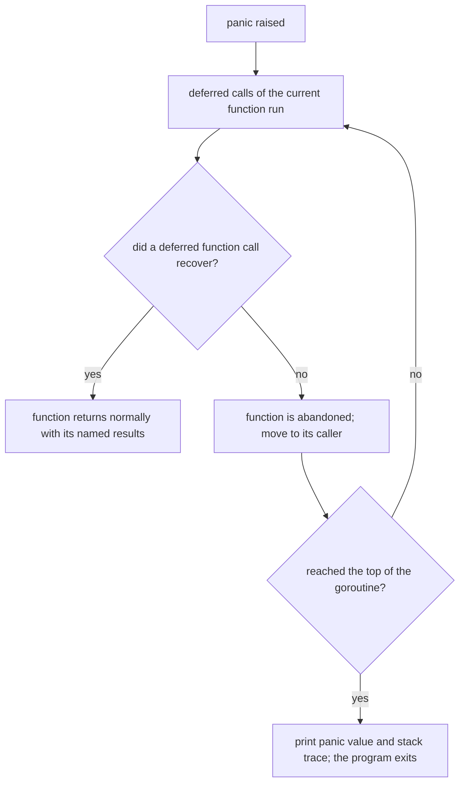

# errors.Is, errors.As, panic and recover

> **Before this lesson:** read [Errors are values: creating, returning and wrapping](#/lesson/go/go-errors-values). You need sentinel errors, custom error types and wrapping with `%w`. You also need `defer` and named results from [Closures, defer and call by value](#/lesson/go/go-closures-defer), and type assertions from [Interfaces](#/lesson/go/go-interfaces).

## In plain words

The previous lesson compared a Go error to a delivery note, and wrapping to putting that note in an envelope with an extra line written on the outside. After a few layers you hold an envelope inside an envelope inside an envelope.

Two questions come up when such a package arrives:

1. **"Is the note from the post office saying 'address not found' somewhere in here?"** You are looking for one particular, known note. In Go this is `errors.Is`.
2. **"Is there a customs form in here? If so, hand it to me, I need to read the declared value."** You are looking for a note of a certain *kind* and want its contents. In Go this is `errors.As`.

Both open all the envelopes for you.

The second half of the lesson is about `panic`. If errors are delivery notes, a **panic** is the fire alarm: normal work stops and the program starts shutting down. Go keeps the alarm for situations that should never happen in a correct program, such as indexing past the end of a slice. **`recover`** is the override switch that lets a carefully chosen place stop the shutdown, for example a web server that must not die because one request hit a bug.

Why this matters for a job: branching on "not found" versus "permission denied" versus "timeout" is everyday backend logic, and doing it with string comparison is a review-blocking mistake. Knowing when panic is appropriate, and how a server survives one, is a standard interview topic.

**Compared with Python.** `except FileNotFoundError:` matches by class anywhere up the stack; `errors.Is`/`errors.As` are Go's equivalents for values and types within a wrapped chain. Python's exceptions are Go's `panic` in mechanism (stack unwinding) but not in purpose: Python uses them for ordinary failures, Go does not.

## Why == is not enough

```go
package main

import (
	"errors"
	"fmt"
)

var ErrNotFound = errors.New("not found")

func findUser(id int) error {
	return fmt.Errorf("find user %d: %w", id, ErrNotFound)
}

func main() {
	err := findUser(7)
	fmt.Println(err)
	fmt.Println(err == ErrNotFound)
	fmt.Println(errors.Is(err, ErrNotFound))
}
```

```text
find user 7: not found
false
true
```

`findUser` wraps the sentinel to add context, which is good practice. But the returned value is now the outer wrapper, a different value from `ErrNotFound`, so `==` says `false`. `errors.Is` looks inside.

## errors.Is: is this specific error in the chain?

`errors.Is(err, target)` reports whether `err`, or any error it wraps (at any depth), **is** `target`. It unwraps repeatedly and compares each layer with `==`.

Use it for sentinel errors:

```go
package main

import (
	"errors"
	"fmt"
	"io/fs"
	"os"
)

func main() {
	_, err := os.ReadFile("no-such-file.txt")
	if errors.Is(err, fs.ErrNotExist) {
		fmt.Println("file is missing; using defaults")
	} else if err != nil {
		fmt.Println("unexpected problem:", err)
	}
}
```

```text
file is missing; using defaults
```

`os.ReadFile` returns a detailed error that wraps the sentinel `fs.ErrNotExist`. You do not need to know the wrapper's type; `errors.Is` finds the sentinel.

Rule: **wherever you would have written `err == SomeErr`, write `errors.Is(err, SomeErr)`.** The exception that proves the rule is the plain `err != nil` check, which stays as it is.

## errors.As: is there an error of this type, and may I have it?

`errors.As(err, &target)` searches the chain for the first error whose **type** matches the type of `target`. If it finds one, it stores it in `target` and returns `true`.

```go
package main

import (
	"errors"
	"fmt"
)

type ValidationError struct {
	Field  string
	Reason string
}

func (e *ValidationError) Error() string {
	return e.Field + ": " + e.Reason
}

func createUser(email string) error {
	if email == "" {
		return fmt.Errorf("create user: %w", &ValidationError{"email", "is required"})
	}
	return nil
}

func main() {
	err := createUser("")
	fmt.Println(err)

	var ve *ValidationError
	if errors.As(err, &ve) {
		fmt.Println("problem with field:", ve.Field)
	}
}
```

```text
create user: email: is required
problem with field: email
```

Step by step:

- `var ve *ValidationError` declares a variable of the type you are looking for. It starts as nil.
- `errors.As(err, &ve)` receives a **pointer to that variable**, so that it can fill it in. It walks the chain; the second layer is a `*ValidationError`, so it assigns that to `ve` and returns `true`.
- Inside the `if`, `ve` is the actual error value and its fields are accessible.

The second argument must be a non-nil pointer to a type that implements `error` (or to an interface type). Passing `ve` instead of `&ve` panics at run time, and `go vet` catches it. Since Go 1.26 there is also a generic form, `errors.AsType[*ValidationError](err)`, which returns the typed error and a boolean without the extra variable.

The standard library example from before, with details:

```go
_, err := os.Open("/root/secret.txt")
var pathErr *fs.PathError
if errors.As(err, &pathErr) {
	fmt.Println("operation:", pathErr.Op, "path:", pathErr.Path)
}
```

`*fs.PathError` records which operation failed on which path, and wraps the underlying cause.

### Is or As?

| Question | Tool | Target |
|---|---|---|
| "Did *this particular* error happen?" | `errors.Is(err, ErrX)` | a sentinel value |
| "Did *an error of this kind* happen, and what are its details?" | `errors.As(err, &v)` | a variable of the error's type |
| "Did anything go wrong?" | `err != nil` | |

Both functions also search inside errors made with `errors.Join` and with several `%w` verbs. The order is depth-first: the error itself, then each wrapped error in turn, each explored fully before the next. Practise the traversal in [Error wrapping: Is, As, Unwrap and messages](#/problem/go-error-chain).

### Customising the match

A type can define its own `Is(target error) bool` method to decide what counts as a match. `errors.Is` calls it at each layer in addition to using `==`. This is useful when errors should match by a field instead of by identity:

```go
type StatusError struct{ Code int }

func (e StatusError) Error() string { return fmt.Sprintf("status %d", e.Code) }

func (e StatusError) Is(target error) bool {
	t, ok := target.(StatusError)
	return ok && t.Code == e.Code
}

// errors.Is(fmt.Errorf("call api: %w", StatusError{404}), StatusError{404}) is true
```

Use this sparingly; most code never needs it.

## panic: when the program cannot go on

A **panic** is Go's mechanism for unrecoverable situations. The runtime raises one for programming mistakes:

- indexing a slice or array out of range;
- dereferencing a nil pointer;
- writing to a nil map;
- a failed single-result type assertion;
- integer division by zero.

Your own code can raise one with the built-in `panic(value)`.

When a panic happens, the current function stops at once. Its deferred calls run. Then the same happens in its caller, and in that caller's caller, all the way up. This is called **unwinding the stack**. When the top of the goroutine is reached, the program prints the panic value and a **stack trace** (the list of function calls that were active) and exits with a non-zero status.

```go
package main

import "fmt"

func risky() {
	defer fmt.Println("risky: deferred cleanup runs")
	var m map[string]int
	m["a"] = 1 // panics
	fmt.Println("risky: never printed")
}

func main() {
	defer fmt.Println("main: deferred cleanup runs")
	risky()
	fmt.Println("main: never printed")
}
```

```text
risky: deferred cleanup runs
main: deferred cleanup runs
panic: assignment to entry in nil map

goroutine 1 [running]:
main.risky()
	/tmp/app/main.go:8 +0x...
main.main()
	/tmp/app/main.go:14 +0x...
exit status 2
```

Both deferred calls ran, in order from the innermost function outward, and neither "never printed" line did. The trace shows where the panic was raised and how the program got there, which is what you need to fix the bug.

### When should your code panic?

Rarely. Use an `error` for anything that can legitimately happen while a correct program runs: bad input, a missing file, a network failure, a full disk. Reserve `panic` for:

- **Impossible states** that indicate a bug in the program itself: a `switch` over an enumeration reaching a case that cannot exist, an internal invariant that has been violated.
- **Failures during start-up that leave nothing sensible to do**, such as a required configuration value that is malformed. By convention, functions that panic instead of returning an error are named with a `Must` prefix: `regexp.MustCompile`, `template.Must`. They are intended for package-level variables initialised with constants, where a failure means the source code is wrong.

A library should almost never let a panic escape to its callers for conditions the callers could cause; return an error.

## recover: stopping a panic

The built-in `recover()` stops the unwinding and returns the value that was passed to `panic`. It works only when called **directly inside a deferred function**. Called anywhere else, or when there is no panic, it returns `nil`.

```go
package main

import "fmt"

func safeDivide(a, b int) (result int, err error) {
	defer func() {
		if r := recover(); r != nil {
			err = fmt.Errorf("recovered: %v", r)
		}
	}()
	return a / b, nil
}

func main() {
	fmt.Println(safeDivide(10, 2))
	fmt.Println(safeDivide(1, 0))
	fmt.Println("program continues")
}
```

```text
5 <nil>
0 recovered: runtime error: integer divide by zero
program continues
```

What happens in the second call:

1. `a / b` with `b == 0` panics. `safeDivide` stops; `return` never completes.
2. The deferred closure runs. `recover()` returns the panic value (non-nil), which stops the unwinding.
3. The closure stores an error in the **named result** `err`. The other named result, `result`, still holds its zero value.
4. `safeDivide` returns normally to `main` with `(0, error)`.

This "convert a panic into an error at a boundary" pattern is the main legitimate use of `recover`. (This particular function would be better written with an explicit `if b == 0` check; it is here to show the mechanism.)

### Try it: unwinding with deferred calls

The simulation models a call stack where each function has deferred actions and may recover.

```python-run
def run(stack, panic_in):
    """stack: list of (function name, [deferred labels], recovers?) from outermost to innermost."""
    log = []
    for name, _, _ in stack:
        log.append(f"enter {name}")
        if name == panic_in:
            break
    log.append(f"PANIC raised in {panic_in}")
    depth = [n for n, _, _ in stack].index(panic_in)
    recovered_at = None
    for i in range(depth, -1, -1):                     # unwind from the panicking frame outward
        name, defers, recovers = stack[i]
        for d in reversed(defers):                     # deferred calls run last-in, first-out
            log.append(f"  {name}: deferred {d!r} runs")
        if recovers:
            log.append(f"  {name}: recover() stops the panic; {name} returns normally")
            recovered_at = i
            break
        log.append(f"  {name}: no recover, frame is abandoned")
    if recovered_at is None:
        log.append("program crashes: panic message + stack trace, exit status 2")
    else:
        for name, _, _ in reversed(stack[:recovered_at]):
            log.append(f"resume in {name} after the call")
    return log

stack = [
    ("main",          ["close log file"],           False),
    ("handleRequest", ["write 500 response"],       True),    # try False
    ("loadProfile",   ["unlock mutex", "close db"], False),
    ("parseRecord",   [],                           False),
]
print("\n".join(run(stack, "parseRecord")))
```

Set `handleRequest`'s flag to `False` to see the panic travel all the way out. Either way, every deferred action runs. That is why `defer` is the right tool for unlocking and closing: it works on the normal path, the error path and the panic path.

### Limits of recover

- **Per goroutine.** A panic in one goroutine cannot be recovered by another. If a goroutine you started panics and has no deferred recover of its own, the **whole program** exits. (Goroutines are covered in [Goroutines and channels](#/lesson/go/go-goroutines-channels).)
- **The state may be broken.** A panic interrupts code half-way. Data structures may be in an inconsistent state; a lock would stay held unless it was released with `defer`. After recovering, the usual responsible action is to log the failure with its stack trace (`debug.Stack()` from `runtime/debug`), report failure for the current unit of work, and carry on with the next one.
- **Some failures are not panics.** `fatal error: all goroutines are asleep - deadlock!`, concurrent map writes and running out of memory terminate the process and cannot be recovered.

### Where recover belongs

At the outer boundary of a unit of work:

- An HTTP server recovers per request so that one buggy handler returns "500 Internal Server Error" instead of taking the service down. The standard `net/http` server does this itself, and most routers add a middleware that also logs the trace ([A REST service](#/lesson/go/go-rest-service)).
- A worker pool recovers per job.
- A library's public entry point may recover from its own internal panics and return an error.



## Putting it together: classify, then respond

A typical service function translates low-level errors into decisions:

```go
func statusFor(err error) int {
	var ve *ValidationError
	switch {
	case err == nil:
		return 200
	case errors.Is(err, ErrNotFound):
		return 404
	case errors.As(err, &ve):
		return 400
	case errors.Is(err, context.DeadlineExceeded):
		return 504
	default:
		return 500
	}
}
```

Each lower layer wrapped its errors with `%w`, so this one function at the top can still recognise the cause. That is the payoff of the wrapping discipline from the previous lesson.

## Pitfalls

> [!WARNING]
> Do not use `panic` and `recover` as a substitute for returning errors. Code that panics on bad input and recovers three levels up is harder to read than exceptions and loses the compiler's help. Reviewers will reject it.

- **`err == ErrX` on a possibly wrapped error.** Use `errors.Is`.
- **A type assertion `err.(*MyErr)` on a possibly wrapped error.** Use `errors.As`.
- **Passing a non-pointer to `errors.As`.** It panics; pass `&target`.
- **Calling `recover` outside a deferred function**, or in a helper called by the deferred function: it returns nil and stops nothing.
- **Recovering and silently continuing**, hiding the bug. Always log the panic value and the stack.
- **Forgetting that goroutines need their own recover.**
- **Using `log.Fatal` or `os.Exit` in library code.** They end the program without running deferred calls.

> [!TIP]
> Design your package's errors as part of its interface: export a few sentinels (`ErrNotFound`) and types (`*ValidationError`) for the conditions callers will branch on, document them, and wrap everything else. Callers then never need to parse a message.

> [!INTERVIEW]
> **"What is the difference between `errors.Is` and `errors.As`?"** `Is` checks whether any error in the chain equals a specific **value** (a sentinel), using `==` or the error's own `Is` method. `As` checks whether any error in the chain is of a specific **type** and, if so, assigns it to the target so that its fields can be read. Both traverse wrapped errors, including multi-error trees from `errors.Join`. **"When would you use panic?"** For programmer errors and impossible states, or unrecoverable start-up failures (`Must` functions); never for expected run-time failures. `recover` only works in a deferred function, only in the same goroutine, and is used at boundaries such as an HTTP request handler to turn a panic into a failed request instead of a crashed process.

## Cheat sheet

| Goal | Code |
|---|---|
| Any error? | `if err != nil` |
| Specific sentinel in chain? | `errors.Is(err, ErrNotFound)` |
| Error of a type in chain? | `var e *MyErr; if errors.As(err, &e) { use e.Field }` |
| Custom matching | `func (e MyErr) Is(target error) bool` |
| Raise a panic | `panic("message")` or `panic(fmt.Sprintf(...))` |
| Recover | `defer func() { if r := recover(); r != nil { ... } }()` |
| Panic into error | named result `err`, set it inside the deferred recover |
| Stack trace as bytes | `debug.Stack()` |
| Panic on failure at init | `regexp.MustCompile(pattern)` |

## Summary

- Wrapped errors cannot be recognised with `==` or a direct type assertion; use **`errors.Is`** for sentinel values and **`errors.As`** for error types.
- Both walk the entire chain or tree of wrapped errors.
- A **panic** stops the current function, runs deferred calls while unwinding the stack, and ends the program with a stack trace if nothing recovers.
- Panic is for bugs and impossible states; ordinary failures are returned as errors.
- **`recover`** stops a panic when called directly in a deferred function of the same goroutine. Use it at boundaries, log what happened, and convert the panic into an error or a failed request.

## Glossary

- **errors.As**: finds the first error of a given type in a chain and assigns it to a target.
- **errors.Is**: reports whether a specific error value occurs in a chain.
- **Must function**: a function that panics instead of returning an error, by convention prefixed `Must`.
- **panic**: an abrupt stop of normal execution for unrecoverable conditions.
- **recover**: built-in that stops a panic from inside a deferred function.
- **Stack trace**: the list of active function calls at the moment of a panic.
- **Unwinding**: abandoning stack frames one by one, running their deferred calls.

```quiz
[
  {"q": "What does this print? `var ErrX = errors.New(\"x\"); err := fmt.Errorf(\"ctx: %w\", ErrX); fmt.Println(err == ErrX, errors.Is(err, ErrX))`",
   "options": ["`true true`", "`false true`", "`false false`", "`true false`"],
   "answer": 1,
   "explain": "The wrapper is a different value from the sentinel, so `==` is false. `errors.Is` unwraps and finds the sentinel inside."},
  {"q": "Same code but with `%v` instead of `%w`. What does `errors.Is(err, ErrX)` return?",
   "options": ["`true`", "`false`", "It panics", "Compile error"],
   "answer": 1,
   "explain": "`%v` copies only the text. The new error does not contain the original, so there is nothing to unwrap."},
  {"q": "Which call correctly extracts a `*ValidationError` from a wrapped error `err`?",
   "options": ["`ve := err.(*ValidationError)`", "`var ve *ValidationError; ok := errors.As(err, &ve)`", "`var ve *ValidationError; ok := errors.As(err, ve)`", "`ok := errors.Is(err, ValidationError{})`"],
   "answer": 1,
   "explain": "`errors.As` needs a pointer to the target variable so it can assign the found error. A direct type assertion only inspects the outermost error and panics on mismatch."},
  {"q": "What does this program print? `func f() { defer fmt.Print(\"A\"); panic(\"boom\"); fmt.Print(\"B\") }` and `func main() { defer func() { recover(); fmt.Print(\"C\") }(); f(); fmt.Print(\"D\") }`",
   "options": ["`ABCD`", "`AC`", "`ACD`", "`A` then a crash"],
   "answer": 1,
   "explain": "f prints A from its deferred call while unwinding (B is skipped). main's deferred function recovers and prints C. main does not continue after the call to f, so D is never printed; main returns normally."},
  {"q": "Where must `recover()` be called to stop a panic?",
   "options": ["Anywhere in the same package", "Directly inside a deferred function in the panicking goroutine", "In `main` only", "In an `init` function"],
   "answer": 1,
   "explain": "recover has an effect only when called directly by a deferred function during unwinding of the same goroutine. Elsewhere it returns nil."},
  {"q": "Which situation is an appropriate use of `panic`?",
   "options": ["A user submitted an invalid email address", "A file requested by the user does not exist", "An internal invariant is violated, indicating a bug in the program", "A network request timed out"],
   "answer": 2,
   "explain": "Expected run-time failures are returned as errors. Panic is for programmer errors and impossible states."},
  {"q": "What does `safe()` return? `func safe() (err error) { defer func() { if r := recover(); r != nil { err = fmt.Errorf(\"caught: %v\", r) } }(); var s []int; _ = s[3]; return nil }`",
   "options": ["`nil`", "An error whose message begins with `caught: runtime error: index out of range`", "The program crashes", "Compile error"],
   "answer": 1,
   "explain": "Indexing an empty slice panics. The deferred function recovers and assigns to the named result, so the caller receives the error."},
  {"q": "A goroutine started with `go work()` panics, and only `main` has a deferred recover. What happens?",
   "options": ["main's recover catches it", "Only that goroutine ends; the program continues", "The whole program crashes", "The panic is ignored"],
   "answer": 2,
   "explain": "A panic unwinds only its own goroutine's stack. With no recover there, the runtime terminates the entire program."}
]
```

> **Source:** Bodner, *Learning Go* 2e, ch. 9 (topic coverage; wording and examples are original). Official references: https://pkg.go.dev/errors#Is, https://pkg.go.dev/errors#As, https://go.dev/blog/defer-panic-and-recover, https://go.dev/ref/spec#Handling_panics, https://go.dev/doc/effective_go#panic
