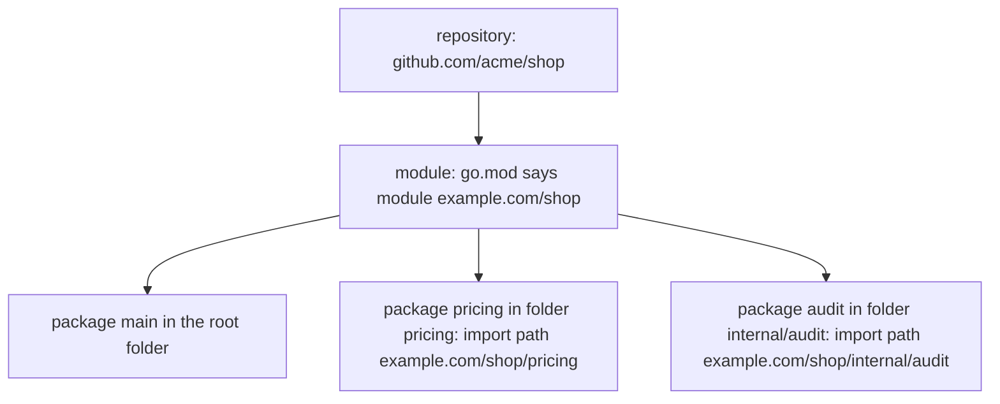

# Packages, visibility and imports

> **Before this lesson:** you have created a module with `go mod init` and used `import "fmt"` ([The toolchain and your first program](#/lesson/go/go-toolchain)). You should know functions, types and methods (modules 5 and 7). Up to now all your code lived in one file in `package main`; this lesson shows how to split it.

## In plain words

A program of fifty lines fits in one file. A program of fifty thousand lines does not, and the question becomes how to divide it so that people can find things, change one part without breaking another, and reuse parts elsewhere.

Think of a large company. It is divided into **departments**: accounting, shipping, legal. Each department has a public counter where other departments can make requests, and back offices that outsiders may not enter. Shipping can ask accounting "what does this cost?" at the counter; it cannot walk in and edit the ledgers. Because of that boundary, accounting is free to reorganise its back office without telling anyone.

In Go a department is a **package**: a folder of source files that are compiled together. The public counter is the set of **exported** names; everything else is private to the package. One company, with all its departments, is a **module**, and the place where its code is stored and versioned (for example a Git project) is a **repository**.

Go's rule for what is public is unusually simple and worth stating at once: **a name that begins with an upper-case letter is exported; a name that begins with a lower-case letter is not.** There are no `public` or `private` keywords.

Why this matters for a job: every codebase you join is organised in packages, and designing a package's exported surface is a core skill. Interviewers ask how visibility works, what `internal` does, what `init` is, and why Go forbids circular imports.

**Compared with Python.** A Python module is a file and a package is a folder (historically with `__init__.py`). Everything is importable; a leading underscore is a polite request not to touch. In Go the package is the folder, all files in it share one namespace, and privacy is enforced by the compiler.

## Repository, module, package

Three nested terms:

- A **repository** is where source code lives under version control.
- A **module** is a unit that is versioned and distributed together. Its root folder contains `go.mod`, which declares the **module path**, such as `example.com/shop`. Usually one repository holds one module.
- A **package** is one folder of `.go` files inside a module. Its **import path** is the module path plus the folder's path inside the module.



## Building a two-package program

Start with the smallest possible split. Create this layout:

```text
shop/
  go.mod
  main.go
  pricing/
    pricing.go
```

`go.mod` (created by `go mod init example.com/shop`):

```text
module example.com/shop

go 1.25
```

`pricing/pricing.go`:

```go
// Package pricing computes order totals including tax.
package pricing

// TaxPercent is the sales tax applied to every order.
const TaxPercent = 20

// Item is one line of an order.
type Item struct {
	Name  string
	Cents int
	sku   string // unexported: only package pricing can see this field
}

// Total returns the price of all items in cents, tax included.
func Total(items []Item) int {
	sum := 0
	for _, it := range items {
		sum += it.Cents
	}
	return applyTax(sum)
}

func applyTax(cents int) int { // unexported helper
	return cents + cents*TaxPercent/100
}
```

`main.go`:

```go
package main

import (
	"fmt"

	"example.com/shop/pricing"
)

func main() {
	items := []pricing.Item{
		{Name: "pen", Cents: 150},
		{Name: "ink", Cents: 350},
	}
	fmt.Println(pricing.Total(items))
	fmt.Println(pricing.TaxPercent)
}
```

```text
$ go run .
600
20
```

What each piece does:

- **The package clause.** Every file starts with `package name`. All files in one folder must use the same name. `main` is the special name for an executable; any other name makes a library package.
- **The import.** `import "example.com/shop/pricing"` uses the full import path: module path, slash, folder. There are **no relative imports** such as `"./pricing"`.
- **The qualifier.** In `main.go` the package's contents are reached through its name: `pricing.Item`, `pricing.Total`. The name used is the one in the package clause, which by convention matches the last element of the import path.
- **Exported names.** `Item`, `Total`, `TaxPercent`, and the fields `Name` and `Cents` begin with capital letters and can be used from `main`.
- **Unexported names.** `applyTax` and the field `sku` are visible only inside package `pricing`. If `main.go` tried `pricing.applyTax(100)`, the build would fail with `name applyTax not exported by package pricing`.

The standard-library imports and your own are separated by a blank line by convention; `goimports` keeps them sorted.

### Several files, one package

A package may be spread over as many files as you like. Add `pricing/discount.go`:

```go
package pricing

// Discount reduces a total by the given percentage.
func Discount(cents, percent int) int {
	return applyTax(cents) * (100 - percent) / 100 // can call applyTax: same package
}
```

Files of one package see each other's names, exported or not, with **no import between them**. The file is not a boundary in Go; the package is. Split files by topic for the reader's benefit.

### Exported fields and the zero value

Visibility applies to struct fields individually. Outside `pricing`, code can set `Name` and `Cents` but cannot mention `sku`, in a literal or with a dot. An unexported field still exists in every `Item` and holds its zero value unless code inside the package sets it. This is how packages protect invariants: export the type, keep the delicate fields private, and offer functions that set them correctly.

```go
// NewItem validates and creates an Item.
func NewItem(name string, cents int, sku string) (Item, error) {
	if cents < 0 {
		return Item{}, errors.New("price must not be negative")
	}
	return Item{Name: name, Cents: cents, sku: sku}, nil
}
```

## Naming packages

A package name appears at every use, so it is part of every name the package exports. Conventions:

- **Short, lower-case, one word**: `pricing`, `http`, `json`. No underscores, no mixedCaps.
- **A noun describing what it provides**, not a grab-bag. Names such as `util`, `common`, `helpers` and `misc` say nothing and tend to collect unrelated code.
- **Do not repeat the package name in its members.** Callers write `pricing.Total`, so `pricing.PricingTotal` stutters.
- Keep the package name equal to the folder name. The compiler does not demand it, and everybody expects it.

## Import forms

```go
import (
	"fmt"                              // ordinary import
	"math/rand"                        // used as rand.Intn: the last path element

	crand "crypto/rand"                // alias: this package is used as crand.Read
	_ "github.com/lib/pq"              // blank import: run its init code only
)
```

- **Alias.** Needed when two imported packages have the same name, as with `math/rand` and `crypto/rand`, or when a package's name differs from its path.
- **Blank import.** The underscore imports a package only for its side effects. The package's initialisation runs, and none of its names are used. The usual reason is registration: a database driver registers itself with `database/sql`; `image/png` registers a decoder.
- **Dot import** (`import . "math"`) puts all exported names into the current file's scope so that you could write `Sqrt(2)`. It makes code hard to read and is avoided outside of a few testing libraries.

An import that is not used is a compile error. This rule, strict as it feels, keeps dependency lists honest and builds fast.

## The internal directory

Capitalisation controls visibility between packages. Sometimes you want something in between: code shared by several packages of **your** module that outsiders must not depend on. The folder name `internal` provides that.

**A package whose import path contains an element named `internal` can be imported only by code located in the tree rooted at the parent of that `internal` folder.**

```text
shop/
  go.mod                       module example.com/shop
  main.go                      may import example.com/shop/internal/audit
  pricing/pricing.go           may import it too
  internal/
    audit/audit.go
```

Everything under `shop/` may import `example.com/shop/internal/audit`. Another module cannot; its build fails with `use of internal package example.com/shop/internal/audit not allowed`. The rule is enforced by the `go` command.

For a library, anything you export outside `internal` is a promise to your users. Putting helper packages under `internal` lets you change them freely.

## A typical layout for a service

There is no official project template, and small programs should stay flat. A common shape for a service of moderate size:

```text
shop/
  go.mod
  cmd/
    server/main.go        package main: builds the "server" binary
    migrate/main.go       package main: builds the "migrate" tool
  internal/
    order/                business logic
    postgres/             database access
    httpapi/              HTTP handlers
  pricing/                a package you are willing to let others import
```

- `cmd/<name>/` holds one `main` package per executable. `go build ./cmd/server` builds one of them.
- `internal/` holds everything that is private to the module, which for an application is nearly everything.
- Avoid a folder called `src`, and avoid organising by technical layer names alone (`models`, `controllers`); organise by what the code is about.

## Circular imports are forbidden

If package `a` imports `b`, then `b` may not import `a`, directly or through other packages. The build fails:

```text
package example.com/shop/order
	imports example.com/shop/billing
	imports example.com/shop/order: import cycle not allowed
```

Python tolerates import cycles (with occasional confusing errors); Go does not, on purpose. Acyclic dependencies make compilation fast, since each package is compiled once after its dependencies, and they force a layered design. When you hit a cycle, the usual cures are:

1. **Move the shared part** into a third package that both import.
2. **Depend on an interface.** If `order` needs something from `billing` and `billing` needs `order`'s types, let `order` declare a small interface and have `main` pass a `billing` implementation in ([Interface design and dependency injection](#/lesson/go/go-interface-design)).
3. **Merge the packages** if they are really one concept.

### Try it: visibility, internal and cycles

This simulation implements the three checks the toolchain performs.

```python-run
def exported(name):
    return name[:1].isupper()

def internal_ok(importer, imported):
    parts = imported.split("/")
    if "internal" not in parts:
        return True
    root = "/".join(parts[:parts.index("internal")])       # parent of the internal folder
    return importer == root or importer.startswith(root + "/")

def find_cycle(graph):
    def visit(node, path):
        if node in path:
            return path[path.index(node):] + [node]
        for nxt in graph.get(node, []):
            found = visit(nxt, path + [node])
            if found:
                return found
        return None
    for start in graph:
        cycle = visit(start, [])
        if cycle:
            return cycle
    return None

print("exported?  ", {n: exported(n) for n in ["Total", "applyTax", "Item", "sku", "_helper", "URL"]})
print()
for importer, imported in [
    ("example.com/shop",              "example.com/shop/internal/audit"),
    ("example.com/shop/pricing",      "example.com/shop/internal/audit"),
    ("example.com/other",             "example.com/shop/internal/audit"),
    ("example.com/shop/api",          "example.com/shop/pricing/internal/calc"),
    ("example.com/shop/pricing/tax",  "example.com/shop/pricing/internal/calc"),
]:
    print(f"{importer:<30} imports {imported:<42} allowed: {internal_ok(importer, imported)}")
print()
graph = {"main": ["order", "billing"], "order": ["billing"], "billing": ["money"], "money": []}
print("cycle:", find_cycle(graph))
graph["money"] = ["order"]          # money now imports order
print("cycle:", find_cycle(graph))
```

Note the fourth line: `api` is outside the `pricing` subtree, so it cannot import `pricing/internal/calc` even though both are in the same module.

## Package initialisation and init

When a program starts, before `main` runs, each package is initialised:

1. packages are initialised in dependency order, so a package's imports are ready before it;
2. within a package, package-level variables are given their values;
3. then every function named `init` in that package runs.

```go
package main

import "fmt"

var greeting = makeGreeting()

func makeGreeting() string {
	fmt.Println("1. package-level variable initialised")
	return "hello"
}

func init() {
	fmt.Println("2. init runs")
}

func main() {
	fmt.Println("3. main runs:", greeting)
}
```

```text
1. package-level variable initialised
2. init runs
3. main runs: hello
```

An `init` function takes no parameters, returns nothing and cannot be called by your code. A file may contain several.

**Use `init` sparingly.** It runs invisibly, cannot return an error and makes tests depend on hidden state. Its legitimate uses are the registration pattern behind blank imports and setting up tables that cannot fail. Prefer explicit set-up functions called from `main`, where errors can be handled.

## Documentation is part of the package

Comments placed directly before a declaration become documentation. The comment before the `package` clause documents the package as a whole and by convention begins "Package name ...".

```text
$ go doc ./pricing
package pricing // import "example.com/shop/pricing"

Package pricing computes order totals including tax.

const TaxPercent = 20
func Discount(cents, percent int) int
func Total(items []Item) int
type Item struct{ ... }
```

`go doc ./pricing.Total` shows one item. Unexported names are omitted. For a published module the same text appears on `pkg.go.dev`. Write a doc comment for every exported name; linters check for it.

## Pitfalls

> [!WARNING]
> Two files in the same folder with different `package` names do not build (`found packages a and b`). The one exception is test files, which may use `package name_test` ([Tests, tables, subtests and coverage](#/lesson/go/go-testing-basics)).

- **Lower-case names used from another package.** They are not exported.
- **Exporting everything "to be safe".** Each exported name is something you must keep stable.
- **Lower-case struct fields that other packages, including `encoding/json`, need to see.** JSON encoding silently skips unexported fields.
- **Relative import paths.** Use the full path starting with the module path.
- **Import cycles** discovered late. Sketch which package depends on which before splitting.
- **Heavy work or failure-prone work in `init`.**
- **Package names such as `util`.**
- **A variable named like an imported package** (`url := ...` with `net/url` imported), which shadows the package in that scope.

> [!TIP]
> Start with one package. Split when you can name the new package with a specific noun and describe its exported surface in a sentence. Splitting early, before the boundaries are clear, produces import cycles and packages that export everything.

> [!INTERVIEW]
> **"How does Go control visibility?"** By the first letter of an identifier: upper-case names are exported from their package, lower-case names are package-private. This applies to functions, types, variables, constants, methods and individual struct fields. The unit of privacy is the package, not the file or the type. On top of that, a package under a directory named `internal` can be imported only from within the tree rooted at `internal`'s parent, which gives module-private packages. Also be ready for: import cycles are compile errors; `init` functions run after package-level variable initialisation and before `main`; blank imports exist for side-effect registration.

## Cheat sheet

| Topic | Rule |
|---|---|
| Package | all `.go` files in one folder, same `package` clause |
| Executable | `package main` with `func main()` |
| Import path | module path + `/` + folder path |
| Use a member | `pkgname.Member` |
| Exported | name starts with an upper-case letter |
| Unexported | lower-case; visible to the whole package, all files |
| Alias import | `import alias "path"` |
| Side-effect import | `import _ "path"` |
| Module-private package | put it under `internal/` |
| Import cycle | compile error; extract, invert with an interface, or merge |
| Start-up order | imports first → package variables → `init()` → `main()` |
| Documentation | comment directly above; `go doc pkg.Name` |
| Several binaries | `cmd/<name>/main.go` each |

## Summary

- A **package** is a folder of files compiled together; a **module** is a versioned collection of packages with a `go.mod`; a **repository** stores it.
- Names starting with an **upper-case letter are exported**; all others are private to the package. Files within a package share everything.
- Import a package by its full path and refer to its members through the package name. Aliases resolve clashes; blank imports run initialisation only.
- **`internal`** directories restrict importing to the surrounding tree.
- **Import cycles** are not allowed; restructure with a shared package or an interface.
- Initialisation runs package variables, then `init` functions, then `main`. Keep `init` rare.
- Doc comments above declarations are the package's documentation.

## Glossary

- **Blank import**: `import _ "path"`, importing for side effects only.
- **Exported identifier**: a name starting with an upper-case letter, usable from other packages.
- **Import cycle**: packages that import each other, directly or indirectly; a compile error.
- **Import path**: the string that identifies a package in an `import`.
- **init function**: a function run automatically during package initialisation.
- **internal directory**: a folder whose packages can be imported only from the enclosing tree.
- **Module**: a collection of packages versioned together, defined by `go.mod`.
- **Package**: the files of one directory, sharing a name and a namespace.
- **Qualifier**: the package name written before a dot, as in `pricing.Total`.
- **Repository**: a version-controlled store of source code.

```quiz
[
  {"q": "Package `pricing` defines `func applyTax(c int) int`. Can `package main` call `pricing.applyTax(100)`?",
   "options": ["Yes, after importing pricing", "No: the name starts with a lower-case letter, so it is not exported", "Yes, if it is declared with the `public` keyword", "Only from files in the same folder as main"],
   "answer": 1,
   "explain": "Visibility is decided by the first letter. Lower-case identifiers are private to their package."},
  {"q": "Two files, `a.go` and `b.go`, are in the same folder and both say `package pricing`. How does `a.go` use an unexported function defined in `b.go`?",
   "options": ["It must import `./b`", "It calls it directly; files of one package share all names", "It cannot", "It must export the function first"],
   "answer": 1,
   "explain": "The package, not the file, is the unit of scope. No import is needed or possible between files of the same package."},
  {"q": "The module path is `example.com/shop` and the code is in the folder `internal/audit`. What is the import path?",
   "options": ["`./internal/audit`", "`audit`", "`example.com/shop/internal/audit`", "`shop/audit`"],
   "answer": 2,
   "explain": "Import paths are the module path followed by the folder path. Relative imports are not used."},
  {"q": "Which module may import `example.com/shop/internal/audit`?",
   "options": ["Any module", "Only code inside the tree rooted at `example.com/shop`", "Only `package main`", "Nobody; internal packages cannot be imported"],
   "answer": 1,
   "explain": "An `internal` package is importable only from within the directory tree whose root is the parent of the `internal` folder."},
  {"q": "What does this program print? `var x = f(); func f() int { fmt.Print(\"A\"); return 1 }; func init() { fmt.Print(\"B\") }; func main() { fmt.Print(\"C\") }`",
   "options": ["`CAB`", "`BAC`", "`ABC`", "`ACB`"],
   "answer": 2,
   "explain": "Package-level variables are initialised first (A), then init functions run (B), then main (C)."},
  {"q": "What is the purpose of `import _ \"github.com/lib/pq\"`?",
   "options": ["To import the package under the name `_`", "To run the package's initialisation (for example registering a database driver) without using its names", "To silence the unused-import error for a package you plan to use later", "To import only its exported constants"],
   "answer": 1,
   "explain": "A blank import executes the package's init code for its side effects. Using it only to silence the compiler is a misuse."},
  {"q": "Package `order` imports `billing`, and `billing` imports `order`. What happens?",
   "options": ["It works; Go resolves the cycle at run time", "The build fails: import cycle not allowed", "Only a warning from go vet", "The second import is ignored"],
   "answer": 1,
   "explain": "Go forbids circular imports. Extract shared types into a third package, depend on an interface, or merge the packages."},
  {"q": "A struct `type User struct { Name string; email string }` is defined in package `account`. From another package, which is possible?",
   "options": ["Reading and writing both fields", "Reading and writing `Name` only", "Reading `email` but not writing it", "Neither field is accessible"],
   "answer": 1,
   "explain": "Export applies per field. `Name` is exported; `email` is private to `account`, and other packages cannot mention it at all."}
]
```

> **Source:** Bodner, *Learning Go* 2e, ch. 10 (topic coverage; wording and examples are original). Official references: https://go.dev/ref/spec#Packages, https://go.dev/ref/spec#Exported_identifiers, https://go.dev/ref/spec#Package_initialization, https://go.dev/doc/modules/layout, https://go.dev/doc/go1.4#internalpackages, https://go.dev/blog/package-names
