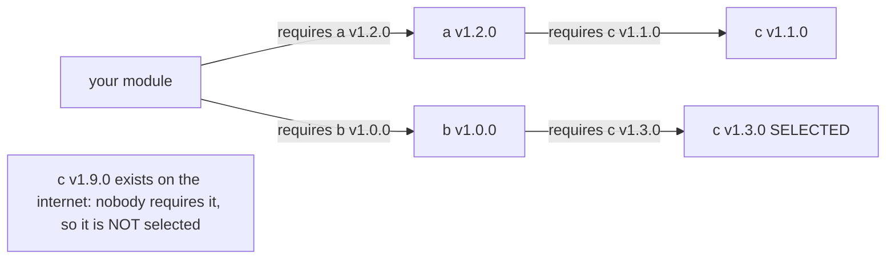

# Modules, versions and minimal version selection

> **Before this lesson:** read [Packages, visibility and imports](#/lesson/go/go-packages-imports). You should know what a module, a package and an import path are, and have created a `go.mod` with `go mod init`.

## In plain words

Almost no program is written entirely from scratch. You use code that other people published: a library to generate IDs, a database driver, a web router. Code your program needs that you did not write is a **dependency**.

Dependencies bring a coordination problem. Imagine cooking a large meal from several recipes. Recipe A says "use baking powder, at least the 2019 formula". Recipe B, which you also need, says "at least the 2021 formula". There is one tin in your kitchen. Which formula should be in it? And will you get the same meal next month, when the manufacturer has released a 2025 formula?

Go's answer has three parts:

1. Every published release of a module has a **version number** with an agreed meaning.
2. Each module writes down, in its `go.mod` file, the **minimum** version it needs of each dependency.
3. When several modules ask for different minimum versions of the same dependency, Go uses the **highest of those minimums** and nothing newer. In the kitchen: the 2021 formula. Not 2019 (too old for recipe B), and not 2025 (nobody asked for it).

Part 3 is called **minimal version selection**. Its great virtue is predictability: the same `go.mod` files always produce the same build, today and next year, with no extra lock file.

Why this matters for a job: adding, upgrading and auditing dependencies is weekly work, and broken or surprising dependency resolution is a classic source of lost days. Interview questions include "what is in `go.mod` and `go.sum`?", "how does Go choose dependency versions?" and "why does a v2 module have `/v2` in its path?"

**Compared with Python.** `pip` installs into an environment, and its resolver tends to choose the **newest** version that satisfies all constraints, so the result changes when a library publishes a release. Teams add lock files (`requirements.txt` with pins, `poetry.lock`, `uv.lock`) and virtual environments to get repeatability. In Go, repeatability is the default behaviour of the resolver, dependencies are stored per version in a shared cache, and each build picks what `go.mod` dictates.

## Adding a dependency, step by step

Start a module and use a library that generates unique identifiers.

```text
$ mkdir tickets && cd tickets
$ go mod init example.com/tickets
```

`main.go`:

```go
package main

import (
	"fmt"

	"github.com/google/uuid"
)

func main() {
	id := uuid.NewString()
	fmt.Println(len(id), id[8] == '-')
}
```

Building now fails, because the module does not yet require that library:

```text
$ go run .
main.go:6:2: no required module provides package github.com/google/uuid; to add it:
	go get github.com/google/uuid
```

Do as the message says:

```text
$ go get github.com/google/uuid
go: added github.com/google/uuid v1.6.0
$ go run .
36 true
```

`go get` found the module, picked its latest release, downloaded it, and recorded it. (A UUID is 36 characters with hyphens at fixed positions, which is what the program checks; the ID itself is random.)

Look at what changed. `go.mod`:

```text
module example.com/tickets

go 1.25

require github.com/google/uuid v1.6.0
```

And a new file, `go.sum`:

```text
github.com/google/uuid v1.6.0 h1:<44 characters of hash>=
github.com/google/uuid v1.6.0/go.mod h1:<44 characters of hash>=
```

- **`go.mod`** says *what you require*: this module, at least this version.
- **`go.sum`** stores **checksums** (cryptographic fingerprints) of the exact content of each downloaded module version. On every later download, on any machine, the `go` command compares the content against these fingerprints and refuses to build if they differ. This guarantees that nobody, including the library's author, can silently change what `v1.6.0` contains.

**Commit both files to version control.** Together they pin your build.

## What a version number means

Go modules use **semantic versioning** (often shortened to *semver*). A version is written `vMAJOR.MINOR.PATCH`, for example `v1.6.0`.

| Part | Increases when | Promise to users |
|---|---|---|
| PATCH (`v1.6.0` → `v1.6.1`) | bugs are fixed | nothing you use changes shape |
| MINOR (`v1.6.1` → `v1.7.0`) | features are added | existing code keeps working |
| MAJOR (`v1.7.0` → `v2.0.0`) | something is removed or changed incompatibly | existing code may break |

Two special cases:

- **Major version 0** (`v0.4.2`) means "still unstable": no compatibility promise at all.
- A **pre-release** has a suffix such as `v1.7.0-rc.1` and sorts before `v1.7.0`.

A version is published by pushing a **tag** with that name to the module's repository. If you depend on a commit that has no tag, Go invents a **pseudo-version** that encodes the time and commit, such as `v0.0.0-20240115093000-abcdef123456`.

The whole system rests on a social contract, sometimes called the **import compatibility rule**: within one major version, newer releases must be backward compatible. That is what makes it safe for Go to move you forward to a higher minor version when another dependency requires it.

## Minimal version selection

Your module's dependencies have dependencies of their own, forming a graph. Several paths may lead to the same module with different version requirements. The algorithm that settles them, **minimal version selection** (MVS), is:

1. Start from your module's `require` lines.
2. Follow each requirement to that module version's own `go.mod`, and so on, visiting everything reachable.
3. For each module, select the **highest version that any `go.mod` in the graph requires**.



`a` needs `c` at least `v1.1.0`; `b` needs at least `v1.3.0`. Go selects `c v1.3.0`: the smallest version that satisfies everybody. The existence of `c v1.9.0` is irrelevant until some `go.mod` asks for it.

The list of selected versions is the **build list**. See yours with `go list -m all`.

### Try it: compute a build list

```python-run
def build_list(root_requirements, graph):
    def key(version):                                 # "v1.10.0" -> (1, 10, 0)
        return tuple(int(part) for part in version[1:].split("."))
    best, seen, todo = {}, set(), list(root_requirements)
    while todo:
        node = todo.pop()
        if node in seen:
            continue
        seen.add(node)
        module, version = node.split("@")
        if module not in best or key(version) > key(best[module]):
            best[module] = version
        todo.extend(graph.get(node, []))              # follow that version's own requirements
    return sorted(f"{m}@{v}" for m, v in best.items())

graph = {
    "a@v1.2.0": ["c@v1.1.0"],
    "b@v1.0.0": ["c@v1.3.0"],
    "c@v1.3.0": ["d@v0.9.0"],
    "c@v1.9.0": ["d@v2.0.0"],       # published, but not required by anyone yet
}
print("build list   :", build_list(["a@v1.2.0", "b@v1.0.0"], graph))

# Now YOU ask for a newer c in your own go.mod:
print("after upgrade:", build_list(["a@v1.2.0", "b@v1.0.0", "c@v1.9.0"], graph))
```

Note two things. Versions are compared numerically, part by part, so `v1.10.0` is newer than `v1.9.0`. And nothing changes until a `go.mod` is edited: upgrades are always an explicit act by someone. Work through larger graphs in [Minimal version selection](#/problem/go-mvs).

### Why "minimal" is a good idea

- **Reproducible.** The result depends only on the `go.mod` files, which are fixed for each published version. No lock file is needed.
- **Predictable.** A release published by a dependency's author five minutes ago cannot enter your build by itself.
- **Fast and simple.** It is a graph walk with a maximum, with no backtracking search and no "unsatisfiable constraints" errors.

The cost: you do not get fixes automatically. You must choose to upgrade.

## Upgrading, downgrading and tidying

| Command | Effect |
|---|---|
| `go get example.com/lib@v1.4.2` | require exactly that version (up or down) |
| `go get example.com/lib@latest` | the newest release |
| `go get -u ./...` | newest minor/patch of everything your code imports |
| `go get -u=patch ./...` | newest patch releases only |
| `go get example.com/lib@none` | stop requiring it |
| `go mod tidy` | add what the code imports and is missing; remove what is no longer used; fix `go.sum` |
| `go list -m all` | show the build list |
| `go list -m -u all` | show which modules have updates |
| `go mod why -m example.com/lib` | explain why a module is needed |
| `go mod graph` | print every requirement edge |
| `go mod download` | fetch everything into the cache |
| `go mod verify` | check cached modules against their checksums |

Run **`go mod tidy`** before every commit that touches imports. It keeps `go.mod` and `go.sum` in line with the source code.

After tidying you will see lines marked `// indirect`:

```text
require (
	github.com/google/uuid v1.6.0
	golang.org/x/sys v0.21.0 // indirect
)
```

An **indirect** requirement is a module your code does not import directly but that one of your dependencies needs. They are listed so that the full build list can be read from your `go.mod` alone.

## Major versions get a new import path

Suppose a library must make a breaking change and release `v2.0.0`. Some of your dependencies will keep using v1 for a long time; others will move to v2. Under ordinary MVS only one version of a module can be in a build, and v1 users would break.

Go resolves this with **semantic import versioning**: starting at major version 2, the major version is part of the module path.

```text
module github.com/acme/render/v2     <- go.mod of the v2 line
```

```go
import (
	"github.com/acme/render"        // the v1 line
	renderv2 "github.com/acme/render/v2" // the v2 line: a different import path
)
```

Because the paths differ, v1 and v2 are, to the toolchain, **two different modules**. Both can be in one build, each selected independently, and code is upgraded package by package. The suffix is only `/v2`, `/v3`, …; versions 0 and 1 have none. Practise the bookkeeping in [Semantic versions and import paths](#/problem/go-import-path-version).

For library authors the message is: breaking changes are expensive for everyone, so avoid them. Add new functions next to old ones, deprecate with a comment, and go to v2 only when you must.

## Where modules come from

By default the `go` command does not download from GitHub or other code hosts directly. It asks a **module proxy**, a server that stores copies of public module versions. The default is `proxy.golang.org`, run by Google.

- A proxy is fast and keeps serving a version even if the original repository is deleted.
- A **checksum database** (`sum.golang.org`) holds the fingerprint of every public module version. The first time you download a version, its checksum is checked against that database, so a compromised proxy or host cannot hand you altered code.

Three settings (view with `go env`) control this:

| Variable | Purpose | Typical value |
|---|---|---|
| `GOPROXY` | where to fetch modules | `https://proxy.golang.org,direct` |
| `GOSUMDB` | which checksum database to consult | `sum.golang.org` |
| `GOPRIVATE` | path patterns to fetch directly and not look up publicly | `github.com/yourcompany/*` |

Set `GOPRIVATE` for your organisation's private repositories; otherwise their names are sent to the public services and the downloads fail. Companies often run their own proxy.

Downloaded modules live in the **module cache** (`go env GOMODCACHE`), shared by all projects and read-only.

### Vendoring

`go mod vendor` copies all dependencies into a `vendor` folder inside your module, and builds then use that copy. Some organisations do this so that builds need no network and every change to third-party code shows up in code review. With a reliable proxy it is optional. If you vendor, re-run the command after every dependency change.

## Editing go.mod for special cases

Besides `module`, `go` and `require`, a `go.mod` may contain:

```text
replace example.com/lib => ../lib            // use a local copy instead
replace example.com/lib => example.com/fork/lib v1.4.3
exclude example.com/lib v1.4.1                // never select this version
retract v1.5.0 // published by mistake; do not use
toolchain go1.25.4                            // suggested toolchain for working on this module
```

- **`replace`** substitutes a module with another version, a fork, or a folder on disk. It applies only when your module is the main module; replaces in your dependencies are ignored. Leaving a local-path `replace` in a published module breaks it for others.
- **`exclude`** removes one version from consideration.
- **`retract`** is written by a module's own author to mark released versions as faulty. The `go` command then avoids them for `@latest` and warns users who have them.

## The `go` and `toolchain` lines in detail

Two lines near the top of `go.mod` decide which Go release builds your module. They look alike and are easy to confuse.

```text
module example.com/app

go 1.22.1

toolchain go1.24.3
```

**The `go` line is the minimum.** It states the oldest Go release that can build this module, and it also fixes the **language version**: which language features and behaviours the compiler allows for your code. (Loop variables, for instance, changed meaning in Go 1.22, and the `go` line decides which meaning your module gets.) Before Go 1.21 this line was only advice; a too-old compiler would try anyway and fail with confusing errors. Since Go 1.21 it is binding: a `go` command older than the line refuses to build, or fetches a newer toolchain. A module's `go` line must also be at least as new as the `go` line of every module it depends on, so adding a dependency can raise yours. If the line is missing, the module is treated as written for Go 1.16.

**The `toolchain` line is a suggestion.** It names a specific toolchain release to use *when working on this module*, which may be newer than the minimum. It was introduced in **Go 1.21**, together with automatic toolchain switching. Leave it out and Go behaves as if it equalled the `go` line. The `toolchain` line only matters in the main module (the one you are building); lines in your dependencies' `go.mod` files are not used to choose your toolchain, though their `go` lines still count towards the minimum.

**Who picks the final toolchain?** The environment variable `GOTOOLCHAIN` does. Its default in standard installs is `auto`: use the installed toolchain unless the `go` or `toolchain` line asks for something newer, in which case download that release and run it (it is cached, and downloads are checksum-verified). Other settings:

| `GOTOOLCHAIN` | Effect |
|---|---|
| `local` | never switch; always use the installed toolchain, and fail if the module needs newer |
| `auto` | default; switch up when the module requires it |
| `go1.24.3` | always use exactly that release |
| `go1.22.1+auto` | start from that release, but switch up if needed |
| `path` | switch only to toolchains already on your `PATH`, never download |

**Changing the lines.** Edit by hand, or let the tool do it so both lines stay consistent:

```bash
$ go get go@1.23.0              # raise the minimum version
$ go get toolchain@go1.24.3     # set the suggested toolchain
$ go get toolchain@none         # remove the toolchain line
$ go env GOTOOLCHAIN            # see which policy is active
```

**Choosing values in practice.** Set the `go` line to the *oldest* release your code and its users really need, because raising it forces everyone who imports your module to upgrade. Use the `toolchain` line, or your CI's Go version, for the newer release you actually build and test with. A library should keep `go` low; an application can keep it current. If you work offline or in a locked-down build environment, set `GOTOOLCHAIN=local` so that nothing is silently downloaded.

> [!NOTE]
> The summary above follows the official Go toolchain documentation (go.dev/doc/toolchain) as of Go 1.24 and 1.25. Details such as default values and the exact format `go mod init` writes have changed between releases, so check `go help mod` and the documentation for your version.

## Workspaces: several modules at once

Suppose you are changing a library and the application that uses it at the same time, and both are separate modules on your disk. A `replace` in the application's `go.mod` works, but it is easy to commit by accident. A **workspace** does the same thing without touching any `go.mod`:

```text
$ ls
app/  lib/
$ go work init ./app ./lib
$ cat go.work
go 1.25

use (
	./app
	./lib
)
```

While `go.work` is present in a parent folder, builds use the local `lib` whenever `app` imports it. The file is personal to your machine; in most projects it is **not** committed. Before publishing, tag the library, then update the application's requirement with `go get`.

## Publishing your own module

1. Put the code in a repository whose location matches the module path (`module github.com/you/thing`).
2. Add a licence file; without one, others cannot legally use the code and `pkg.go.dev` will not display its documentation.
3. Make sure `go vet ./...` and `go test ./...` pass and `go mod tidy` leaves no changes.
4. Tag a version and push the tag: `git tag v0.1.0 && git push origin v0.1.0`.

There is no upload step and no central registry account. Anyone can now `go get github.com/you/thing@v0.1.0`; the proxy fetches it on first request. **A published version is permanent.** If it is bad, release a fixed version and `retract` the bad one; never move or delete a tag, because checksums recorded by others would no longer match.

## Pitfalls

> [!WARNING]
> Never edit the module cache, and never delete `go.sum` to "fix" a checksum mismatch. A mismatch means the content of a version differs from what was recorded earlier, which is exactly the situation the file exists to detect.

- **Not committing `go.sum`.**
- **Forgetting `go mod tidy`**, leaving unused or missing requirements.
- **Expecting newer versions to appear by themselves.** MVS never upgrades unprompted; check with `go list -m -u all`.
- **Importing a v2+ module without the `/vN` suffix**, which silently gives you the v1 line or an error.
- **A local `replace` left in a pushed commit.**
- **Private repositories without `GOPRIVATE`.**
- **Re-tagging a published version.**
- **Depending on a `v0` module and assuming stability.**

> [!TIP]
> To find out why a surprising module or version is in your build: `go mod why -m <module>` shows a chain of imports that needs it, and `go mod graph | grep <module>` shows who requires which version. For known security problems in the versions you use, run `govulncheck ./...` ([vet, staticcheck, golangci-lint and govulncheck](#/lesson/go/go-quality-tools)).

> [!INTERVIEW]
> **"How does Go choose dependency versions?"** With minimal version selection: it collects the requirements from the main module's `go.mod` and, transitively, from the `go.mod` of every required module version, and for each module selects the highest version mentioned, which is the minimum version satisfying all requirements. It never chooses a newer release that nobody required, so builds are reproducible from `go.mod` files alone; `go.sum` adds integrity by recording content hashes. Different major versions (v2+) have different module paths (`/v2`), so they are different modules and can coexist. Mention `go mod tidy`, the proxy and checksum database, `replace`, and workspaces.

## Cheat sheet

| Item | Meaning |
|---|---|
| `go.mod` | module path, Go version, required modules and versions |
| `go.sum` | checksums of module contents; commit it |
| `vMAJOR.MINOR.PATCH` | breaking / feature / fix |
| `v0.x.y` | no compatibility promise |
| `// indirect` | needed by a dependency, not imported by you |
| MVS | per module: the highest version any `go.mod` requires |
| `/v2` in the path | major version 2+ is a separate module |
| `go get m@v` | set a requirement |
| `go mod tidy` | synchronise `go.mod`/`go.sum` with the code |
| `go list -m all` | the build list |
| `GOPROXY` / `GOSUMDB` / `GOPRIVATE` | download source / integrity check / private paths |
| `replace` | substitute a module (main module only) |
| `go.work` | local multi-module workspace |
| Publish | push a `vX.Y.Z` tag |

## Summary

- A module declares its dependencies and their minimum versions in **`go.mod`**; **`go.sum`** fixes their exact content with checksums.
- Versions follow **semantic versioning**; within a major version, releases must stay backward compatible.
- **Minimal version selection** chooses, for each module, the highest version required anywhere in the dependency graph, and never anything newer. Builds are reproducible without a lock file.
- Major versions 2 and above include **`/vN`** in the module path and count as separate modules.
- Modules are fetched through a **proxy** and verified against a **checksum database**; configure `GOPRIVATE` for private code.
- `go get` changes requirements; `go mod tidy` cleans up; `replace` and **workspaces** help with local development.
- Publishing is tagging. Published versions are permanent; retract mistakes.

## Glossary

- **Build list**: the final set of module versions used for a build.
- **Checksum**: a cryptographic fingerprint of content, used to detect any change.
- **Dependency**: code your program needs that lives in another module.
- **Indirect dependency**: a dependency of your dependency.
- **Minimal version selection (MVS)**: Go's algorithm for choosing versions.
- **Module proxy**: a server that stores and serves module versions.
- **Pseudo-version**: an automatically generated version for an untagged commit.
- **Retract**: a directive marking published versions as not to be used.
- **Semantic import versioning**: including `/vN` in the path for major version N ≥ 2.
- **Semantic versioning**: the `MAJOR.MINOR.PATCH` scheme and its compatibility meaning.
- **Tag**: a named marker on a commit in version control, used to publish a version.
- **Vendoring**: keeping copies of dependencies inside your own repository.
- **Workspace**: a `go.work` file that lets several local modules be developed together.
- **`go` line**: the `go.mod` line giving the minimum Go release for the module and fixing its language version.
- **`toolchain` line**: the `go.mod` line (Go 1.21 and later) suggesting a specific toolchain release for working on the module.
- **Language version**: which language features and behaviours the compiler applies to a module, set by its `go` line.
- **`GOTOOLCHAIN`**: the environment setting that decides whether the `go` command may switch to, or download, another toolchain.

```quiz
[
  {"q": "What is recorded in `go.sum`?",
   "options": ["The list of packages your code imports", "Cryptographic checksums of the module versions used, to detect altered content", "The compiled object files", "The newest available version of each dependency"],
   "answer": 1,
   "explain": "`go.sum` pins content: each line is a hash of a module version (or its go.mod). The go command verifies downloads against it."},
  {"q": "Your module requires `a v1.2.0` and `b v1.0.0`. `a v1.2.0` requires `c v1.1.0`; `b v1.0.0` requires `c v1.4.0`. The newest release of `c` is `v1.8.0`. Which version of `c` is used?",
   "options": ["`v1.1.0`", "`v1.4.0`", "`v1.8.0`", "The build fails with a conflict"],
   "answer": 1,
   "explain": "MVS selects the highest version that any go.mod in the graph requires: v1.4.0. The newer v1.8.0 is not chosen because nobody asked for it."},
  {"q": "Under MVS, when does a newly published version of a dependency enter your build?",
   "options": ["Immediately, on the next build", "After 24 hours", "Only when some go.mod in your dependency graph is changed to require it", "Never"],
   "answer": 2,
   "explain": "The result depends only on go.mod files. You upgrade explicitly with `go get`, or it comes in when a dependency you upgrade requires it."},
  {"q": "A library releases a breaking change as v2.0.0. What must its module path look like?",
   "options": ["Unchanged", "It must end with `/v2`", "It must start with `v2.`", "It must be renamed to `lib2`"],
   "answer": 1,
   "explain": "Semantic import versioning: major versions 2 and above carry `/vN` in the module path, making them distinct modules that can coexist with v1."},
  {"q": "What does `go mod tidy` do?",
   "options": ["Formats go.mod only", "Adds missing requirements, removes unused ones and updates go.sum to match the source code", "Upgrades every dependency to the latest version", "Deletes the module cache"],
   "answer": 1,
   "explain": "It reconciles go.mod and go.sum with what the code actually imports. It does not upgrade versions beyond what is needed."},
  {"q": "A requirement line ends with `// indirect`. What does that mean?",
   "options": ["The module is optional", "Your code does not import it directly; a dependency needs it", "It is fetched without the proxy", "It is deprecated"],
   "answer": 1,
   "explain": "Indirect requirements are transitive dependencies recorded so that the complete build list is visible in your go.mod."},
  {"q": "Which version is newer according to Go?",
   "options": ["`v1.9.0` is newer than `v1.10.0`", "`v1.10.0` is newer than `v1.9.0`", "They are equal", "It cannot be compared"],
   "answer": 1,
   "explain": "Version parts are compared as numbers: minor 10 is greater than minor 9. Comparing as text would give the wrong answer."},
  {"q": "You are editing a library and an application that uses it, both checked out locally. What is the cleanest way to make the application build against your local library?",
   "options": ["Copy the library's files into the application", "Create a `go.work` workspace that uses both modules", "Delete the library from go.sum", "Set GOPROXY=off"],
   "answer": 1,
   "explain": "A workspace redirects imports to the local modules without modifying either go.mod. A `replace` directive also works but is easy to commit by mistake."},
  {"q": "go.mod says `go 1.23` and you have Go 1.21 installed with the default GOTOOLCHAIN. What happens?",
   "options": ["The build is attempted anyway and may fail oddly", "The go command downloads a newer toolchain and uses it", "The go line is rewritten to 1.21", "Nothing: the go line is only a comment"],
   "answer": 1,
   "explain": "Since Go 1.21 the go line is a real minimum, and with GOTOOLCHAIN=auto (the default) the command fetches the required toolchain. With GOTOOLCHAIN=local it would refuse instead."},
  {"q": "Which statement about the toolchain line is correct?",
   "options": ["It sets the minimum Go version for importers", "It names a suggested toolchain release for working on the module and exists since Go 1.21", "It replaces the module line", "It lists the vendored packages"],
   "answer": 1,
   "explain": "The minimum is the go line. The toolchain line is a recommendation about which release to run, introduced together with automatic toolchain switching in Go 1.21."}
]
```

> **Source:** Bodner, *Learning Go* 2e, ch. 10 (topic coverage; wording and examples are original). Official references: https://go.dev/ref/mod, https://go.dev/doc/modules/managing-dependencies, https://research.swtch.com/vgo-mvs, https://go.dev/doc/modules/version-numbers, https://go.dev/doc/tutorial/workspaces, https://go.dev/doc/modules/publishing
