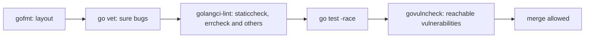

# vet, staticcheck, golangci-lint and govulncheck

> **Before this lesson:** read [go fmt, go vet and the daily workflow](#/lesson/go/go-fmt-vet) for the basics of `go vet`, and [Modules, versions and minimal version selection](#/lesson/go/go-modules-versioning) for dependencies. Examples use errors ([Errors are values](#/lesson/go/go-errors-values)) and `defer`.

## In plain words

Before a book is printed, several people read it, each looking for something different. A spell-checker catches typos. A copy editor catches clumsy sentences. A fact-checker catches claims that are wrong. A lawyer checks that nothing in it will get the publisher sued. None of them writes the book, and none of them can prove the book is good, but each removes a class of mistake cheaply, before readers see it.

Software has the same kind of helpers. They read your **source code** without running it and report problems. Reading code without executing it is called **static analysis**, and a tool that does it to find questionable code is called a **linter** (the name comes from an old Unix program, `lint`, that picked "fluff" out of C programs).

This lesson introduces four tools that Go teams run on every change:

| Tool | Role in the analogy | Finds |
|---|---|---|
| `go vet` | spell-checker | code that is almost certainly a bug |
| `staticcheck` | copy editor | bugs, dead code, simplifications, style |
| `golangci-lint` | the editor-in-chief | runs dozens of linters together with one configuration |
| `govulncheck` | lawyer | known security holes in the dependencies you actually call |

Why this matters for a job: these checks are part of the pipeline on nearly every professional Go project, and a change that fails them is not merged. Knowing what each reports, and how to read and act on a finding, is day-one knowledge. Interviewers ask "how do you keep code quality high in a Go project?" and expect these names.

**Compared with Python.** The Python counterparts are `ruff`/`flake8`/`pylint` for linting, `mypy`/`pyright` for type checking and `pip-audit` for vulnerabilities. In Go the compiler already does the type checking, so linters concentrate on logic mistakes and style.

## Why the compiler is not enough

The compiler answers one question: is this a legal Go program? Many legal programs are wrong. Here is one file that compiles cleanly and contains five problems.

```go
package main

import (
	"errors"
	"fmt"
	"os"
)

func load(path string) ([]byte, error) {
	f, err := os.Open(path)
	defer f.Close() // (1) defer before checking the error
	if err != nil {
		return nil, errors.New("Could not open file.") // (2) capitalised, punctuated message
	}
	buf := make([]byte, 100)
	n, err := f.Read(buf) // (3) this err is never checked
	return buf[:n], nil
}

func main() {
	data, _ := load("config.txt")
	ready := len(data) > 0
	if ready == true { // (4) comparison with a boolean constant
		fmt.Printf("loaded %d bytes\n", data) // (5) %d with a []byte
	}
}
```

`go build` says nothing. Now run the tools.

## go vet

`go vet` ships with Go and reports only what it is very sure about.

```text
$ go vet ./...
./main.go:24:3: fmt.Printf format %d has arg data of wrong type []byte
```

It caught problem (5): the verb and the argument do not match. Vet's checks, called **analyzers**, include:

| Analyzer | Catches |
|---|---|
| `printf` | format verbs that do not match their arguments |
| `copylocks` | a `sync.Mutex` (or a struct containing one) copied by value |
| `lostcancel` | a `context` cancel function that is never called |
| `unusedresult` | ignoring the result of functions such as `fmt.Sprintf` |
| `structtag` | malformed struct tags such as `json: "name"` |
| `unreachable` | statements that can never run |
| `nilfunc`, `bools`, `assign` | comparisons and assignments that are pointless |
| `httpresponse` | using an HTTP response before checking the error |
| `loopclosure`, `waitgroup` | concurrency mistakes inside loops |
| `tests` | wrongly named test functions |

Vet is tuned for **no false alarms**. A **false positive** is a report about code that is fine; if a tool produces many, people stop reading its output. The flip side is that vet stays silent about problems (1) to (4).

## staticcheck

`staticcheck` is the most respected third-party analyzer for Go. Install and run it:

```text
$ go install honnef.co/go/tools/cmd/staticcheck@latest
$ staticcheck ./...
main.go:11:2: should check returned error before deferring f.Close() (SA5001)
main.go:13:26: error strings should not be capitalized (ST1005)
main.go:13:26: error strings should not end with punctuation or newlines (ST1005)
main.go:16:5: this value of err is never used (SA4006)
main.go:23:5: should omit comparison to bool constant, can be simplified to ready (S1002)
```

Each line has a location, a message and a **check code** in parentheses. The prefix of the code tells you the category:

| Prefix | Category | Example |
|---|---|---|
| `SA` | static analysis: likely bugs and performance issues | `SA4006` a value is assigned and never read |
| `S` | simplifications | `S1002` omit `== true` |
| `ST` | style | `ST1005` error string conventions |
| `U` | unused code | `U1000` function is never used |
| `QF` | quick fixes an editor can apply | |

Look at what each finding means for the example:

- **SA5001** is a real bug. If `os.Open` fails, `f` is nil, and the deferred `f.Close()` is called on a nil file. The fix is to check `err` first, then `defer`.
- **SA4006** is a real bug. The read error is silently dropped; a failed read returns garbage as if it were data.
- **ST1005** follows the convention from the errors lesson: messages are lower-case fragments because they get joined.
- **S1002** is cosmetic: `if ready {` says the same thing.

You can look up any code with `staticcheck -explain SA5001`, which prints the reasoning and an example.

The corrected function:

```go
func load(path string) ([]byte, error) {
	f, err := os.Open(path)
	if err != nil {
		return nil, fmt.Errorf("open %s: %w", path, err)
	}
	defer f.Close()

	buf := make([]byte, 100)
	n, err := f.Read(buf)
	if err != nil {
		return nil, fmt.Errorf("read %s: %w", path, err)
	}
	return buf[:n], nil
}
```

One more thing neither tool flagged by default: `data, _ := load(...)` in `main` discards the error on purpose with `_`. A linter called `errcheck` reports calls whose error result is not even received; an explicit `_` is treated as a decision you made. Reviewers will still ask about it.

## golangci-lint: many linters, one command

Dozens of Go linters exist, each good at one thing. Installing, configuring and running them separately would be tedious and slow. **golangci-lint** is a runner that bundles them: it parses your code once, runs the selected linters in parallel, merges their reports and caches results.

Install it from the project's release page or with your package manager (the project advises against `go install` for it, because it pins specific versions of every bundled linter). Then:

```text
$ golangci-lint run ./...
main.go:11:15: Error return value of `f.Close` is not checked (errcheck)
main.go:16:5: ineffectual assignment to err (ineffassign)
main.go:11:2: SA5001: should check returned error before deferring f.Close() (staticcheck)
...
```

The name in parentheses is the linter that produced the finding. Configuration lives in a file named `.golangci.yml` at the root of the repository, so that everybody and the CI server use the same rules:

```yaml
version: "2"

linters:
  enable:
    - errcheck      # unchecked error results
    - govet         # the go vet analyzers
    - staticcheck   # staticcheck's SA, S, ST checks
    - ineffassign   # assignments whose value is never used
    - unused        # unused constants, variables, functions, types
    - misspell      # common spelling mistakes in comments and strings
    - bodyclose     # HTTP response bodies that are never closed
    - gosec         # common security problems

run:
  timeout: 3m
```

Advice for adopting it:

- **Start small.** The defaults (a handful of high-value linters, including the five listed first above) are a good beginning. Add a linter when it would have caught a bug you had.
- **Do not enable everything.** Some linters contradict each other, and some are matters of taste. A wall of low-value findings trains the team to ignore the tool.
- **On an existing codebase, check only new code** at first (`--new-from-rev=main`), then pay down the old findings gradually.
- **Suppress a specific finding** with a comment directly above or on the line, and always say why:

```go
//nolint:errcheck // best-effort cleanup; the response is already written
defer resp.Body.Close()
```

A `//nolint` without a reason is a smell that reviewers pick up.

## revive: a configurable style linter

**revive** is a linter focused on **style and readability** rather than on bugs. It is the practical successor to **golint**, the original Go style checker, which is deprecated and no longer maintained. Where golint had a fixed list of opinions and no switches, revive lets you choose which rules run, how severe each is, and what they are allowed to ignore. It is fast and also runs as one of the linters inside golangci-lint.

```text
$ go install github.com/mgechev/revive@latest
$ revive ./...
shapes/area.go:8:1: exported function Area should have comment or be unexported
shapes/area.go:14:20: parameter 'scale' seems to be unused, consider removing or renaming it as _
```

Each line is `file:line:column: message`, the same shape as other tools in this lesson. The first message comes from the `exported` rule, which expects every name visible outside the package to have a doc comment beginning with its own name. The second comes from `unused-parameter`, which spots a parameter the function never reads.

A configuration file, conventionally `revive.toml`, selects the rules. Rules are listed as TOML sections; only the sections you list are applied, so you choose the strictness:

```toml
ignoreGeneratedHeader = true   # skip files marked as generated
severity = "warning"
confidence = 0.8               # drop findings revive is less than 80% sure of

[rule.exported]
[rule.var-naming]
[rule.indent-error-flow]
[rule.unused-parameter]
```

Run it with `revive -config revive.toml ./...`. A few rule names worth knowing: `var-naming` (names follow Go conventions, such as `userID` not `userId`), `indent-error-flow` (prefer returning early instead of `else` after a `return`), `package-comments` and `blank-imports`.

**When to pick it.** If you already use golangci-lint, turn on its `revive` linter instead of running a separate command, and keep the rules in the same `.golangci.yml`. The advice from earlier applies: start with a handful of rules your team agrees on, because style findings are matters of taste and a long list of them teaches people to ignore the tool. Note that `gofmt` already settles layout, `go vet` and staticcheck look for bugs, so revive's job is the naming and documentation conventions in between.

## govulncheck: known vulnerabilities

Your program contains other people's code, and other people's code has security bugs. When one is discovered and fixed, it is recorded in the **Go vulnerability database** (`vuln.go.dev`), maintained by the Go security team, with the affected versions and the affected functions.

`govulncheck` compares your module against that database:

```text
$ go install golang.org/x/vuln/cmd/govulncheck@latest
$ govulncheck ./...
=== Symbol Results ===

Vulnerability #1: GO-2024-XXXX
    Excessive memory use when parsing crafted input in example.com/parser
  More info: https://pkg.go.dev/vuln/GO-2024-XXXX
  Module: example.com/parser
    Found in: example.com/parser@v1.3.0
    Fixed in: example.com/parser@v1.3.2
    Example traces found:
      #1: main.go:27:20: tickets.main calls parser.Decode

Your code is affected by 1 vulnerability from 1 module.
This scan also found 2 vulnerabilities in modules you require, but your code
doesn't appear to call these vulnerabilities.
```

The important word is **calls**. Most scanners report every vulnerable version found in your dependency list. `govulncheck` goes further: it builds a **call graph** (which function can call which) of your program and reports a vulnerability prominently only when your code can actually reach the affected function. The last two lines show the difference: two more vulnerable modules are present, but nothing you call touches the broken parts, so they are mentioned without alarm.

The fix is almost always an upgrade: `go get example.com/parser@v1.3.2`, then `go mod tidy`, test, and run the tool again. It also checks the standard library of the Go version you build with, so keeping the toolchain current matters.

### Try it: reachability decides what matters

The simulation below is a miniature `govulncheck`: a call graph, a list of vulnerable functions, and a search from `main`.

```python-run
calls = {                                  # caller -> functions it calls
    "main.main":            ["api.Serve", "report.Render"],
    "api.Serve":            ["parser.Decode", "auth.Check"],
    "report.Render":        ["tmpl.Execute"],
    "parser.Decode":        ["parser.readHeader"],
    "parser.DecodeLegacy":  ["parser.unsafeExpand"],     # exists, but nobody calls it
    "auth.Check":           [],
    "tmpl.Execute":         [],
    "parser.readHeader":    [],
    "parser.unsafeExpand":  [],
    "zip.Extract":          ["zip.writePath"],           # in a required module, never used
    "zip.writePath":        [],
}
vulnerable = {
    "parser.readHeader":   "GO-0001  crash on truncated header",
    "parser.unsafeExpand": "GO-0002  memory exhaustion",
    "zip.writePath":       "GO-0003  path traversal",
}

def reachable_from(start):
    seen, todo, parent = set(), [start], {start: None}
    while todo:
        fn = todo.pop()
        if fn in seen:
            continue
        seen.add(fn)
        for callee in calls.get(fn, []):
            parent.setdefault(callee, fn)
            todo.append(callee)
    return seen, parent

seen, parent = reachable_from("main.main")
for fn, advisory in vulnerable.items():
    if fn in seen:
        trace, cur = [], fn
        while cur is not None:
            trace.append(cur)
            cur = parent[cur]
        print(f"AFFECTED   {advisory}\n           trace: {' -> '.join(reversed(trace))}")
    else:
        print(f"not called {advisory}   ({fn} is present but unreachable)")
```

Add `"parser.DecodeLegacy"` to the list under `"api.Serve"` and run again: the second advisory becomes a real finding. Upgrading is still the right long-term move for unreachable ones, but the tool tells you which to fix today.

## Keeping tool versions under control

Tools installed with `go install ...@latest` land in your personal Go `bin` folder, and each developer may end up with a different version, reporting different findings. Two remedies:

- **Pin the version** in scripts and CI: `go install honnef.co/go/tools/cmd/staticcheck@2025.1`.
- **Record tools in `go.mod`** (Go 1.24 and later). The command `go get -tool honnef.co/go/tools/cmd/staticcheck` adds a `tool` line to `go.mod`; everyone then runs the same version with `go tool staticcheck ./...`.

```text
tool honnef.co/go/tools/cmd/staticcheck
```

## One pipeline, locally and in CI

Put the checks in order from fastest to slowest and stop at the first failure:

```text
test -z "$(gofmt -l .)"
go vet ./...
golangci-lint run ./...
go test -race ./...
govulncheck ./...
```



Run the same commands from a Makefile target on your machine so that failures show up before you push. Editors run `gopls` continuously, and `gopls` includes vet's analyzers and many of staticcheck's, so most findings appear as underlines while you type.

`govulncheck` deserves a second schedule as well: new vulnerabilities are published for code that has not changed, so run it nightly on the main branch, not only on new commits.

## How to treat findings

- **Understand before you silence.** A finding you do not understand is the most valuable kind. Look up the check's documentation.
- **Fix the cause, not the symptom.** Assigning an unused error to `_` to quiet a linter turns a visible problem into a hidden one.
- **A clean report is not proof of correctness.** Static analysis finds patterns. It does not know what your program is supposed to do; tests do that.
- **Linters complement review.** They free human reviewers from commenting on mechanical issues so they can think about design and behaviour.

## Pitfalls

> [!WARNING]
> Scattering `//nolint` comments, or disabling a linter for the whole project, to get a green build quickly. Each suppression should name the linter and give a reason; otherwise the tool has been turned into decoration.

- **Running only `go vet` and assuming unchecked errors would be caught.** That is `errcheck`'s job.
- **Enabling every available linter** and drowning in noise.
- **Different tool versions on laptops and CI**, so that findings appear only on the server.
- **Treating style findings as bugs, or bugs as style.** Learn the categories.
- **Ignoring `govulncheck`'s "not called" notes forever.** Code changes, and tomorrow you may call that function.
- **Scanning only at release time.** Vulnerabilities are announced on their own calendar.

> [!TIP]
> When you join a project, read its `.golangci.yml` and its Makefile first. Together they are an executable description of the team's standards, and running `make lint` before your first push avoids an embarrassing red build.

> [!INTERVIEW]
> **"What tools do you use to keep a Go codebase healthy?"** `gofmt`/`goimports` for layout; `go vet` for high-confidence bug patterns (printf mismatches, copied locks, lost context cancels); `staticcheck` for deeper bug detection, dead code and simplifications; `golangci-lint` to run those plus `errcheck`, `ineffassign`, `gosec` and others from one versioned config in CI; `go test -race` for data races; and `govulncheck`, which uses the Go vulnerability database and call-graph analysis to report only vulnerabilities in functions the program can reach. Add that tool versions are pinned (for example with `tool` directives in `go.mod`) and that suppressions require a stated reason.

## Cheat sheet

| Goal | Command |
|---|---|
| Built-in checks | `go vet ./...` |
| Install staticcheck | `go install honnef.co/go/tools/cmd/staticcheck@latest` |
| Run staticcheck | `staticcheck ./...` |
| Explain a check | `staticcheck -explain SA4006` |
| Run the linter bundle | `golangci-lint run ./...` |
| Only findings in new code | `golangci-lint run --new-from-rev=main` |
| Suppress one finding | `//nolint:lintername // reason` |
| Scan for vulnerabilities | `govulncheck ./...` |
| Fix a vulnerable dependency | `go get module@fixedversion && go mod tidy` |
| Pin a tool in go.mod | `go get -tool path/to/tool`, run with `go tool name` |

## Summary

- **Static analysis** examines source code without running it. **Linters** use it to report likely bugs, dead code and style issues.
- **`go vet`** is built in and conservative: few checks, almost no false positives.
- **`staticcheck`** goes deeper and labels findings by category (`SA` bugs, `S` simplifications, `ST` style, `U` unused).
- **`golangci-lint`** runs many linters with a single shared configuration and is the usual CI entry point.
- **`govulncheck`** reports known vulnerabilities, distinguishing those your code can actually call from those merely present.
- Pin tool versions, run the same pipeline locally and in CI, and never suppress a finding without understanding it.

## Glossary

- **Analyzer / check**: one rule implemented by a static-analysis tool.
- **Call graph**: a map of which functions can call which.
- **CI (continuous integration)**: automated building and checking of every change.
- **False positive**: a report about code that is in fact correct.
- **Linter**: a tool that reports suspicious or non-idiomatic code.
- **Reachability**: whether a function can be called, directly or indirectly, starting from the program's entry point.
- **Static analysis**: examining code without executing it.
- **Suppression**: a comment such as `//nolint` that tells a linter to skip a finding.
- **Vulnerability database**: a curated list of known security defects with affected versions.
- **golint**: the original, now deprecated Go style checker.
- **revive**: a fast, configurable style linter that succeeds golint.
- **Rule (linter)**: one named check, such as `exported` or `unused-parameter`, that can be switched on or off.

```quiz
[
  {"q": "What does 'static analysis' mean?",
   "options": ["Measuring a program's speed while it runs", "Examining source code without executing it", "Testing with fixed input data", "Compiling without optimisation"],
   "answer": 1,
   "explain": "Static tools read the code (and its types) to find problems. Tests and profilers are dynamic: they run the program."},
  {"q": "A file contains `f, err := os.Open(p); defer f.Close(); if err != nil { return err }`. Which statement is correct?",
   "options": ["The compiler rejects it", "It compiles, and staticcheck reports that the error should be checked before deferring Close", "It is correct as written", "go fmt fixes it"],
   "answer": 1,
   "explain": "It is legal Go, so the compiler accepts it. If Open fails, `f` is nil when Close runs. staticcheck's SA5001 flags exactly this order."},
  {"q": "In the staticcheck finding `this value of err is never used (SA4006)`, what does the `SA` prefix indicate?",
   "options": ["A style suggestion", "A static-analysis check for a likely bug", "A simplification", "Unused code"],
   "answer": 1,
   "explain": "`SA` checks target correctness and performance problems. `S` is simplifications, `ST` style, `U` unused code."},
  {"q": "What is the main purpose of golangci-lint?",
   "options": ["To replace the Go compiler", "To run many linters efficiently from one configuration file", "To format code", "To download dependencies"],
   "answer": 1,
   "explain": "It is a runner that bundles linters such as staticcheck, errcheck and govet, shares parsing work between them and reads `.golangci.yml`."},
  {"q": "Your project requires a module version with a known vulnerability in function `Extract`, but your code never calls `Extract`, directly or indirectly. What does govulncheck do?",
   "options": ["Fails with the same severity as a called vulnerability", "Reports it as present but not called by your code", "Says nothing at all", "Upgrades the module automatically"],
   "answer": 1,
   "explain": "govulncheck uses call-graph analysis. Unreachable vulnerable code is listed in an informational note, separate from the findings that affect you."},
  {"q": "Which of these does plain `go vet` report?",
   "options": ["An error result that is never checked", "`fmt.Printf(\"%d\", \"text\")`", "A function that is never called", "A misspelled word in a comment"],
   "answer": 1,
   "explain": "The printf analyzer is part of vet. Unchecked errors need errcheck, unused functions need `unused`/staticcheck, spelling needs misspell."},
  {"q": "What is the recommended way to silence a single linter finding that you have judged acceptable?",
   "options": ["Disable the linter for the repository", "Add `//nolint:lintername // reason` on that line", "Rename the variable to `_`", "Delete the CI step"],
   "answer": 1,
   "explain": "A targeted suppression with the linter's name and a reason keeps the decision visible and limits its scope."},
  {"q": "Why should govulncheck also run on a schedule, not only when code changes?",
   "options": ["It is slow", "New vulnerabilities are disclosed for dependency versions you already use, even when your code has not changed", "It needs to warm up a cache", "The database is deleted daily"],
   "answer": 1,
   "explain": "The vulnerability database grows over time. Unchanged code can become known-vulnerable overnight, so periodic scans are needed."},
  {"q": "What is revive's main difference from the old golint?",
   "options": ["It compiles code", "It is configurable: you choose which rules run, their severity and confidence", "It finds data races", "It only works inside CI"],
   "answer": 1,
   "explain": "golint had a fixed set of opinions and is deprecated. revive reads a config file such as revive.toml and applies only the rules you list."}
]
```

> **Source:** Bodner, *Learning Go* 2e, ch. 11 (topic coverage; wording and examples are original). Official references: https://pkg.go.dev/cmd/vet, https://staticcheck.dev/docs/checks, https://golangci-lint.run/, https://go.dev/doc/security/vuln/, https://pkg.go.dev/golang.org/x/vuln/cmd/govulncheck, https://go.dev/doc/modules/managing-dependencies#tools
