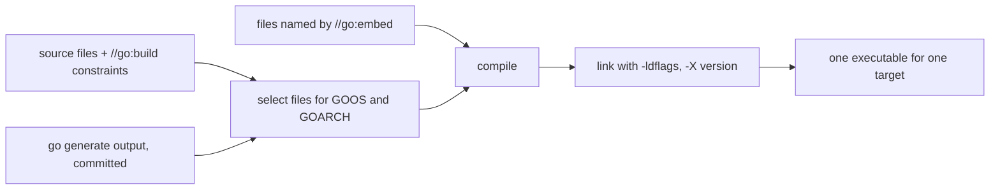

# embed, go generate and cross-compilation

> **Before this lesson:** you should be able to build a program with `go build` ([The toolchain and your first program](#/lesson/go/go-toolchain)), understand packages and `go.mod` ([Packages, visibility and imports](#/lesson/go/go-packages-imports)), and know defined types with `iota` and `String` methods ([Defined types, methods and embedding](#/lesson/go/go-types-methods)).

## In plain words

One of Go's selling points is that a finished program is a single file you can copy to a server and run. Three features of the toolchain make that promise hold in the real world, where programs also need web pages, templates, repetitive boilerplate code, and builds for several kinds of computer.

- **embed** packs other files (text, images, HTML) *inside* the executable. Think of a board game that comes with the rule book glued into the lid: you can never lose the rules, because they are part of the box.
- **go generate** runs programs that write Go source code for you. Think of a mail merge: you maintain a short list, and a tool produces the hundred repetitive letters. You write the list; the machine writes the boring part.
- **Cross-compilation** builds an executable for a different kind of computer than the one you are sitting at. Think of a printing shop that can print a book in another alphabet without anyone in the shop being able to read it. Your Windows laptop can produce a program for a Linux server with an ARM processor.

Along the way you will meet **build constraints**, the rules that decide which source files are included for which target, and learn how to stamp a version number into a binary.

Why this matters for a job: shipping a service means producing a binary for the production platform (usually Linux) from a developer machine or a build server, often with static files and a version string inside. These are the tools that do it. Interviewers ask "how would you ship the HTML templates with the binary?" and "how do you build for Linux from a Mac?"

**Compared with Python.** A Python project ships source files plus data files, located at run time with `importlib.resources`, and runs anywhere an interpreter and the dependencies are installed. Code generation exists but is rare. Go moves all of this to build time: data goes into the binary, generated code is committed, and each target platform gets its own executable.

## embed: files inside the binary

### The simplest case

Create a text file next to your Go file:

```text
motd.txt:
Welcome aboard.
```

```go
package main

import (
	_ "embed"
	"fmt"
	"strings"
)

//go:embed motd.txt
var motd string

func main() {
	fmt.Println(strings.TrimSpace(motd))
	fmt.Println(len(motd) > 0)
}
```

```text
Welcome aboard.
true
```

Line by line:

- `import _ "embed"` is required. The blank import is enough when you only use the directive and none of the package's names.
- `//go:embed motd.txt` is a **directive**: a specially formatted comment that the compiler acts upon. There is **no space** between `//` and `go:`. It must sit directly above a variable declaration.
- `var motd string` receives the file's content. At build time the compiler reads `motd.txt` and stores its bytes in the executable; at run time the variable is already filled.

Now delete `motd.txt` and run the *built executable*: it still prints the message. The text is part of the program.

The variable can have one of three types:

| Type | Use for |
|---|---|
| `string` | one text file |
| `[]byte` | one binary file (an image, a certificate) |
| `embed.FS` | many files and folders, as a read-only file system |

### Many files: embed.FS

```go
package main

import (
	"embed"
	"fmt"
	"io/fs"
)

//go:embed templates/*.html static
var assets embed.FS

func main() {
	page, err := assets.ReadFile("templates/index.html")
	if err != nil {
		fmt.Println("error:", err)
		return
	}
	fmt.Println(len(page) > 0)

	entries, _ := fs.ReadDir(assets, "static")
	for _, e := range entries {
		fmt.Println(e.Name(), e.IsDir())
	}
}
```

With a project containing `templates/index.html`, `static/app.css` and `static/img/logo.png`, the output is:

```text
true
app.css false
img true
```

- The directive lists **patterns** separated by spaces. `templates/*.html` matches the HTML files in `templates`; `static` names a folder, which includes everything beneath it.
- `embed.FS` implements the standard `fs.FS` interface, so anything that accepts a file system accepts it: `template.ParseFS(assets, "templates/*.html")` loads templates, and `http.FileServerFS(assets)` serves the files over HTTP. Your web server needs no folder of assets on disk.
- Paths inside an `embed.FS` always use forward slashes, on every operating system.

Rules to remember:

1. The directive works only on **package-level** variables, not on variables declared inside a function.
2. Patterns are relative to the folder of the source file and **cannot leave the module** or contain `..`.
3. When a folder is embedded, files whose names start with `.` or `_` are skipped. Prefix the pattern with `all:` (`//go:embed all:static`) to include them.
4. A pattern that matches nothing is a build error, so a missing file is noticed at build time, not in production.

Typical uses: HTML templates and static web assets, database migration scripts, default configuration, licence texts and test fixtures.

Embedding has a cost: the files make the binary larger and cannot be changed without rebuilding. For content that operators must edit, read from disk instead.

## go generate: programs that write Go

Some code is necessary and mechanical. The `String` method for an enumeration is the standard example: it must list every constant, and it must be updated whenever a constant is added. Humans forget; tools do not.

### The mechanism

`go generate` scans your source files for comments of the form

```go
//go:generate command arguments...
```

and runs each command, in the folder of that file. That is all it does. It is **never run automatically** by `go build` or `go test`; you run it when the inputs change, and you **commit the generated files**, so that people who only build your code need none of the generator tools.

### A worked example with stringer

Install the generator once:

```text
$ go install golang.org/x/tools/cmd/stringer@latest
```

`level.go`:

```go
package main

import "fmt"

//go:generate stringer -type=Level

type Level int

const (
	Debug Level = iota
	Info
	Warn
	Error
)

func main() {
	fmt.Println(Warn, Level(1))
	fmt.Printf("%d %v\n", Error, Level(9))
}
```

Without the generated file, the program would print numbers. Run the generator:

```text
$ go generate ./...
$ ls
go.mod  level.go  level_string.go
$ go run .
Warn Info
3 Level(9)
```

`stringer` read the constants of type `Level` and wrote `level_string.go`, which contains a `String()` method. The file begins with this line:

```go
// Code generated by "stringer -type=Level"; DO NOT EDIT.
```

That exact shape of comment is a convention that tools recognise: linters skip such files, and reviewers know not to edit them by hand. If you add a constant `Fatal`, run `go generate ./...` again and commit the updated file.

### What else is generated

| Generator | Produces |
|---|---|
| `stringer` | `String()` methods for integer constants |
| `protoc` with the Go plugin | types and client/server code from Protocol Buffers definitions |
| `sqlc` | type-safe Go functions from SQL queries |
| `mockgen`, `moq` | test doubles from interfaces |
| `oapi-codegen` | HTTP clients and servers from an OpenAPI description |

Good practice:

- Keep the `//go:generate` line next to the code it concerns.
- Record generator versions (a `tool` directive in `go.mod`, as in the [previous lesson](#/lesson/go/go-quality-tools)), so that two people regenerating get identical files.
- Have CI run `go generate ./...` and fail if `git diff` shows changes. That catches stale generated code.

## Cross-compilation

### Two environment variables

Recall `GOOS` (operating system) and `GOARCH` (processor architecture) from the first lesson. Setting them for one command makes the compiler produce an executable for that target:

```text
$ GOOS=linux GOARCH=arm64 go build -o bin/app-linux-arm64 .
$ GOOS=windows GOARCH=amd64 go build -o bin/app.exe .
$ GOOS=darwin GOARCH=arm64 go build -o bin/app-mac .
$ file bin/app-linux-arm64
bin/app-linux-arm64: ELF 64-bit LSB executable, ARM aarch64, statically linked, ...
```

The syntax `NAME=value command` sets a variable for that one command in Unix shells. In Windows PowerShell write `$env:GOOS = "linux"; $env:GOARCH = "arm64"; go build -o bin/app .` and remember that the variables stay set for the rest of the session.

No extra compilers or toolkits were installed. The Go toolchain contains code generators for every supported platform. List them all:

```text
$ go tool dist list
aix/ppc64
android/arm64
darwin/amd64
darwin/arm64
linux/amd64
linux/arm64
windows/amd64
...
```

Common targets:

| Target | `GOOS` | `GOARCH` |
|---|---|---|
| Most cloud servers | `linux` | `amd64` |
| ARM cloud servers (AWS Graviton), Raspberry Pi 4/5 | `linux` | `arm64` |
| Windows PCs | `windows` | `amd64` |
| Intel Macs | `darwin` | `amd64` |
| Apple-silicon Macs | `darwin` | `arm64` |
| WebAssembly in a browser | `js` | `wasm` |

You cannot **run** the result on your machine if the target differs; copy it to the right kind of computer (or container) to test it.

### Static binaries and cgo

A Go program that uses only Go code is **statically linked**: everything it needs is inside the file. The exception is **cgo**, the mechanism for calling C code ([unsafe and cgo](#/lesson/go/go-unsafe-cgo)). A few standard packages (`net`, `os/user`) can use C libraries of the system when cgo is available. Cross-compiling with cgo needs a C compiler for the target, which is painful. Setting `CGO_ENABLED=0` forces pure-Go implementations:

```text
$ CGO_ENABLED=0 GOOS=linux GOARCH=amd64 go build -o bin/app .
```

This is the standard command for building a service that will run in a minimal container image ([Postgres, configuration, graceful shutdown and Docker](#/lesson/go/go-db-shutdown-docker)). When cross-compiling, cgo is disabled by default.

### Smaller and reproducible builds

```text
$ go build -trimpath -ldflags="-s -w" -o bin/app .
```

- `-ldflags` passes options to the **linker**, the final build stage that assembles the executable. `-s -w` omits the symbol table and debugging information, typically shrinking the file by a quarter. Stack traces in panics still work.
- `-trimpath` removes the folder names of your machine from the binary, so that the same source builds to the same bytes anywhere.

## Build constraints: choosing files per target

Sometimes code must differ per platform: a path separator, a system call, a terminal feature. Go's approach is to put the variants in **separate files** and include only the matching ones. A rule that says when a file is compiled is a **build constraint** (also called a build tag). There are two ways to state one.

**1. In the file name.** A name ending in `_GOOS.go`, `_GOARCH.go` or `_GOOS_GOARCH.go` is compiled only for that target:

```text
paths_windows.go      only when GOOS=windows
paths_linux.go        only when GOOS=linux
fast_amd64.go         only when GOARCH=amd64
sys_linux_arm64.go    only when GOOS=linux and GOARCH=arm64
```

**2. In a `//go:build` line** at the top of the file, before the `package` clause and followed by a blank line:

```go
//go:build linux || darwin

package paths

func ConfigDir() string { return "/etc/myapp" }
```

```go
//go:build windows

package paths

func ConfigDir() string { return `C:\ProgramData\myapp` }
```

The expression uses `&&` (and), `||` (or), `!` (not) and parentheses. Besides OS and architecture names, useful tags include `unix` (any Unix-like system), `cgo`, and version tags such as `go1.22`.

You can also invent your own tags and switch them on with `-tags`:

```go
//go:build integration

package store_test
// slow tests that need a real database
```

```text
$ go test ./...                      # skips the file
$ go test -tags=integration ./...    # includes it
```

Each variant must define the same functions, so that the rest of the program compiles whichever file is chosen. `go vet` and `go build` only check the files selected for the current target; build for the others in CI to keep them from rotting.

### Try it: which files are compiled?

The simulation applies both mechanisms to a small package for several targets. The full rule set is in the practice problem [Build constraints: is this file compiled?](#/problem/go-build-constraint).

```python-run
import re

KNOWN_OS = {"linux", "windows", "darwin", "freebsd", "js"}
KNOWN_ARCH = {"amd64", "arm64", "wasm"}

def name_ok(filename, goos, goarch):
    parts = filename[:-3].split("_")[1:]                # ignore everything before the first _
    if len(parts) >= 2 and parts[-2] in KNOWN_OS and parts[-1] in KNOWN_ARCH:
        return parts[-2] == goos and parts[-1] == goarch
    if parts and parts[-1] in KNOWN_OS:
        return parts[-1] == goos
    if parts and parts[-1] in KNOWN_ARCH:
        return parts[-1] == goarch
    return True

def expr_ok(expr, tags):
    if expr is None:
        return True
    py = re.sub(r"[A-Za-z0-9_.]+", lambda m: str(m.group(0) in tags), expr)
    return eval(py.replace("&&", " and ").replace("||", " or ").replace("!", " not "))

files = [                                # (file name, //go:build expression or None)
    ("paths.go",            None),
    ("paths_windows.go",    None),
    ("paths_unix.go",       "linux || darwin"),
    ("simd_amd64.go",       None),
    ("simd_generic.go",     "!amd64"),
    ("db_integration.go",   "integration && !windows"),
]

for goos, goarch, extra in [("linux", "amd64", []), ("windows", "amd64", ["integration"]),
                            ("darwin", "arm64", ["integration"])]:
    tags = {goos, goarch, *extra}
    chosen = [f for f, expr in files if name_ok(f, goos, goarch) and expr_ok(expr, tags)]
    print(f"{goos}/{goarch} tags={extra}:")
    print("   ", ", ".join(chosen))
```

Check the result against your own reasoning. `paths_unix.go` is selected by its `//go:build` line, not by its name: `unix` is not an operating-system name that the file-name rule recognises.

## Stamping a version into the binary

Operators need to know which build is running. Two techniques:

**Set a variable at link time.** Declare a package-level string and overwrite it with `-ldflags -X`:

```go
package main

import "fmt"

var version = "dev" // replaced by the build

func main() {
	fmt.Println("version:", version)
}
```

```text
$ go run .
version: dev
$ go build -ldflags="-X main.version=1.4.2" -o app . && ./app
version: 1.4.2
```

`-X package.variable=value` sets a string variable. Build scripts usually take the value from the version-control tag.

**Read what the toolchain records by itself.** Every binary built from a module contains its dependency list and, when built inside a Git checkout, the commit and time:

```text
$ go version -m ./app
./app: go1.25.4
	path	example.com/tickets
	mod	example.com/tickets	v1.4.2
	dep	github.com/google/uuid	v1.6.0
	build	vcs.revision=3f2a9c1...
	build	vcs.time=2026-05-02T10:11:12Z
```

The same information is available inside the program through `debug.ReadBuildInfo()` in the package `runtime/debug`.



## Pitfalls

> [!WARNING]
> Directives are comments with an exact format. `// go:embed file` (with a space) or `//go:generate` placed in the middle of a declaration is treated as an ordinary comment and silently does nothing. `go vet` reports some malformed directives; check that the feature actually took effect.

- **Forgetting `import _ "embed"`** when using only the directive.
- **Embedding from outside the module** or with `..`: not allowed.
- **Hidden files missing** from an embedded folder; use the `all:` prefix.
- **Expecting `go build` to run generators.** It never does. Stale generated code is a real bug source; check it in CI.
- **Editing generated files by hand.** The next generation overwrites your change.
- **Testing only on your own platform** when you ship for another. At least compile for every target in CI (`GOOS=windows go build ./...`).
- **Environment variables left set** in a PowerShell or shell session, so later builds target the wrong platform.
- **A `//go:build` line without the blank line after it**, or placed below the `package` clause: it is ignored.
- **Secrets passed with `-X` or embedded.** Anything in the binary can be read by whoever has the file.

> [!TIP]
> A release build command worth memorising: `CGO_ENABLED=0 GOOS=linux GOARCH=amd64 go build -trimpath -ldflags="-s -w -X main.version=$(git describe --tags)" -o bin/app ./cmd/app`. It produces a small, static, reproducible Linux binary that knows its own version.

> [!INTERVIEW]
> **"How do you ship static assets with a Go service?"** With the `embed` package: a `//go:embed` directive above a package-level `string`, `[]byte` or `embed.FS` variable makes the compiler include the files in the binary; `embed.FS` implements `fs.FS`, so templates and `http.FileServerFS` can read from it. **"How do you build for another platform?"** Set `GOOS` and `GOARCH` (for example `linux`/`arm64`) for `go build`; the toolchain cross-compiles natively. Use `CGO_ENABLED=0` for a fully static binary. Platform-specific code lives in files selected by name suffix or `//go:build` constraints. Mention `go generate` (explicit, output committed) and `-ldflags "-X main.version=..."`.

## Cheat sheet

| Goal | How |
|---|---|
| Embed one text file | `//go:embed file.txt` above `var s string` (import `_ "embed"`) |
| Embed binary data | `//go:embed logo.png` above `var b []byte` |
| Embed a tree | `//go:embed templates static` above `var fsys embed.FS` |
| Include dot/underscore files | `//go:embed all:dir` |
| Declare a generator | `//go:generate tool args` |
| Run generators | `go generate ./...` |
| List targets | `go tool dist list` |
| Cross-compile | `GOOS=linux GOARCH=arm64 go build -o out .` |
| Static build | `CGO_ENABLED=0 go build` |
| Smaller binary | `-ldflags="-s -w"` |
| Reproducible paths | `-trimpath` |
| Platform file by name | `name_linux.go`, `name_arm64.go`, `name_linux_arm64.go` |
| Platform file by constraint | `//go:build linux && !cgo` |
| Custom tag | `//go:build integration` + `go test -tags=integration` |
| Set version string | `-ldflags="-X main.version=1.2.3"` |
| Inspect a binary | `go version -m ./app` |

## Summary

- **`embed`** copies files into the executable at build time, into a `string`, a `[]byte` or an `embed.FS`, so a program can ship with its templates and assets as one file.
- **`go generate`** runs commands named in `//go:generate` comments. It is run by hand, and its output is committed.
- **Cross-compilation** needs only `GOOS` and `GOARCH`; `CGO_ENABLED=0` yields a static binary.
- **Build constraints**, by file-name suffix or `//go:build` expression, choose which files are compiled for a target or tag.
- Linker flags shrink binaries and inject version strings; the toolchain also records module and version-control information in every binary.

## Glossary

- **Build constraint (build tag)**: a condition that decides whether a file is compiled.
- **cgo**: the mechanism for calling C code from Go.
- **Code generation**: producing source code with a program instead of writing it by hand.
- **Cross-compilation**: building an executable for a platform other than the one doing the build.
- **Directive**: a comment with a fixed form, such as `//go:embed`, that tools act upon.
- **embed.FS**: a read-only file system holding embedded files.
- **Linker**: the build stage that combines compiled code into an executable.
- **`-ldflags`**: options passed to the linker.
- **Static linking**: including all required code in the executable, with no external libraries needed at run time.
- **Target**: the operating system and architecture a build is for.

```quiz
[
  {"q": "What does `//go:embed config.yaml` above `var cfg []byte` do?",
   "options": ["Reads the file from disk each time the program starts", "Copies the file's bytes into the executable at build time", "Downloads the file from the module proxy", "Creates the file if it is missing"],
   "answer": 1,
   "explain": "The compiler reads the file while building and stores its content in the binary. At run time no file is needed."},
  {"q": "A program embeds a file and is built. The source file is then deleted from disk. What happens when the existing executable runs?",
   "options": ["It fails with file not found", "It works: the content is inside the executable", "It prints an empty string", "It panics at start-up"],
   "answer": 1,
   "explain": "Embedded content is part of the binary. Only a rebuild would notice that the file is gone (and fail)."},
  {"q": "When does `go generate` run?",
   "options": ["Automatically before every `go build`", "Automatically before `go test`", "Only when you run `go generate` yourself", "At program start-up"],
   "answer": 2,
   "explain": "Generation is an explicit, separate step. That is why the generated files are committed to the repository."},
  {"q": "Which command builds a Linux ARM64 executable from a Windows or macOS machine?",
   "options": ["`go build --target=linux-arm64`", "`GOOS=linux GOARCH=arm64 go build`", "`go cross linux arm64`", "It is impossible without a Linux machine"],
   "answer": 1,
   "explain": "Setting the two environment variables is all that is needed; the Go toolchain includes back ends for all supported targets."},
  {"q": "A package has `net_linux.go`, `net_windows.go` and `net.go`. Which files are compiled with `GOOS=windows`?",
   "options": ["All three", "`net.go` and `net_windows.go`", "Only `net_windows.go`", "Only `net.go`"],
   "answer": 1,
   "explain": "A `_GOOS` suffix restricts a file to that operating system. `net.go` has no suffix and is always included; `net_linux.go` is skipped."},
  {"q": "A file starts with `//go:build linux && !cgo`. When is it compiled?",
   "options": ["On Linux, only when cgo is disabled", "On Linux or when cgo is disabled", "Never", "On every platform except Linux"],
   "answer": 0,
   "explain": "`&&` requires both conditions: the target is Linux and the `cgo` tag is not set."},
  {"q": "What does this print after `go build -ldflags=\"-X main.version=2.0.1\"`? Program: `var version = \"dev\"; func main() { fmt.Println(version) }`",
   "options": ["`dev`", "`2.0.1`", "`main.version=2.0.1`", "Compile error"],
   "answer": 1,
   "explain": "The linker flag `-X` overwrites the initial value of a package-level string variable in the finished binary."},
  {"q": "Why is `CGO_ENABLED=0` commonly used for builds that go into minimal containers?",
   "options": ["It makes the program run faster", "It produces a statically linked binary that needs no C libraries from the system", "It enables cross-compilation of C code", "It removes the garbage collector"],
   "answer": 1,
   "explain": "Without cgo, the standard library uses pure-Go implementations, so the executable has no dynamic dependencies and runs even in an empty image."}
]
```

> **Source:** Bodner, *Learning Go* 2e, ch. 11 (topic coverage; wording and examples are original). Official references: https://pkg.go.dev/embed, https://go.dev/blog/generate, https://pkg.go.dev/cmd/go#hdr-Build_constraints, https://go.dev/doc/install/source#environment, https://pkg.go.dev/cmd/link, https://pkg.go.dev/golang.org/x/tools/cmd/stringer
