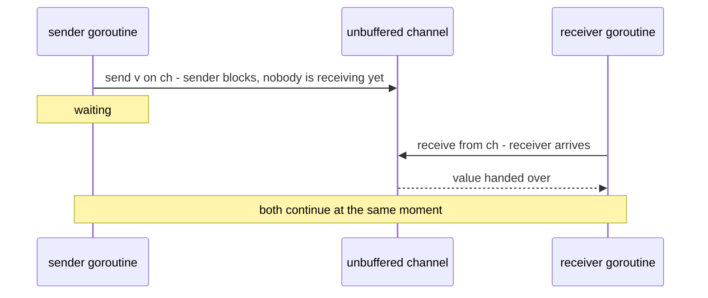

# Goroutines and channels

> **Before this lesson:** you need functions and closures ([Closures, defer and call by value](#/lesson/go/go-closures-defer)), `for ... range` ([for, switch and goto](#/lesson/go/go-for-switch)) and the idea of a zero value. No previous experience with threads or asynchronous code is assumed.

## In plain words

Up to now every program you wrote did one thing at a time, top to bottom. Real programs often have several things in progress at once: a web server talks to thousands of visitors, a downloader fetches ten files, a chat program listens to the keyboard and to the network.

Picture a restaurant kitchen. A cook who can only follow one recipe from start to finish, staring at the oven while a cake bakes for forty minutes, would serve very few meals. A good cook puts the cake in, chops vegetables while it bakes, stirs a sauce in between. That is **concurrency**: having several tasks in progress and switching between them sensibly. If the kitchen also has four cooks working at the same instant, that is **parallelism**: several tasks literally executing at the same moment. Concurrency is about how the work is *organised*; parallelism is about how many hands are *executing* it.

Go has two built-in tools for concurrent programs:

- A **goroutine** is a function that runs independently of the function that started it, like handing a task to another cook. Starting one costs one keyword: `go`.
- A **channel** is the kitchen's pass-through hatch: a place where one cook hands a finished plate to another. One goroutine puts a value in, another takes it out, and the hand-over is safe without either of them needing to know what the other is doing.

A slogan from Go's designers summarises the approach: *do not communicate by sharing memory; share memory by communicating.* Instead of several goroutines poking at the same variable (and corrupting it), they pass values to each other through channels.

Why this matters for a job: concurrency is the reason many companies choose Go, and it is the topic that separates junior from senior Go interviews. You will be asked to explain goroutines, buffered versus unbuffered channels, and to predict whether a short program prints, blocks forever or crashes.

**Compared with Python.** Python offers threads (limited by the global interpreter lock, so only one thread runs Python code at a time in the standard interpreter), processes (heavy) and `asyncio` (which requires marking functions `async` and calls `await` all the way up). Goroutines are cheaper than threads, run on all CPU cores, and need no special function colour: any ordinary function can be started as a goroutine, and ordinary blocking-style code is what you write.

## Goroutines

### Starting one

Put the keyword `go` in front of a function call:

```go
package main

import (
	"fmt"
	"time"
)

func say(msg string) {
	fmt.Println(msg)
}

func main() {
	go say("from the goroutine")
	fmt.Println("from main")
	time.Sleep(100 * time.Millisecond) // crude wait; see below
}
```

A typical output is:

```text
from main
from the goroutine
```

`go say(...)` starts `say` running as a new goroutine and **returns immediately**; `main` does not wait for it. The two then proceed independently, and the order of the two lines is **not guaranteed**. The **scheduler**, the part of the Go runtime that decides which goroutine runs when, may pick either first.

Delete the `time.Sleep` line and run it again. Most of the time you will see only `from main`. The rule behind that:

> **When `main` returns, the program ends. All other goroutines are stopped wherever they are, without notice.**

`time.Sleep` here is a placeholder that makes the example work by luck: nobody knows how long to sleep. Waiting properly is what channels (this lesson) and `sync.WaitGroup` ([next but one](#/lesson/go/go-sync-primitives)) are for.

A few facts about goroutines:

- `main` itself runs in a goroutine, the **main goroutine**.
- Any function call can follow `go`, including an anonymous function: `go func() { ... }()`. Note the final `()`, which calls it.
- A value returned by a function started with `go` is discarded. To get a result back, send it on a channel.
- Arguments are evaluated at the `go` statement, in the calling goroutine, like the arguments of `defer`.

### Why goroutines are cheap

An operating-system **thread** is the classic unit of concurrent execution. Each one reserves a large block of memory for its stack (often a megabyte or more) and switching between threads involves the operating system. A program with ten thousand threads is in trouble.

A goroutine is managed by the Go runtime, not by the operating system. It starts with a stack of about two kilobytes that grows on demand, and the runtime multiplexes many goroutines onto a small number of threads, typically one per CPU core. Switching between goroutines is quick because it happens inside the program. Programs with hundreds of thousands of goroutines are normal. (How the scheduler does this is explained in [Runtime questions](#/lesson/go/go-interview-runtime).)

The practical consequence: in Go you can afford to start a goroutine per connection, per request or per task, and write each one as plain sequential code.

## Channels

### Creating, sending, receiving

A channel is created with `make` and has an element type. The arrow `<-` is both the send and the receive operator; the arrow points in the direction the data moves.

```go
package main

import "fmt"

func main() {
	ch := make(chan string) // a channel that carries strings

	go func() {
		ch <- "ping" // send: put a value into the channel
	}()

	msg := <-ch // receive: take a value out
	fmt.Println(msg)
}
```

```text
ping
```

This program needs no `Sleep`. The receive `<-ch` in `main` **blocks**, meaning the main goroutine pauses, until a value is available. The goroutine sends, `main` wakes up with the value, prints it and exits. The channel carried the data and did the waiting.

### Unbuffered channels are a handshake

`make(chan string)` creates an **unbuffered** channel: it has no storage at all. A send can complete only when a receiver is ready at the same moment, and a receive can complete only when a sender is ready. Whichever side arrives first waits for the other. The meeting of the two is called a **rendezvous**.



So an unbuffered channel does two jobs: it **transfers a value** and it **synchronises** two goroutines. After a send on an unbuffered channel returns, the sender knows the value has been received.

### Collecting results from several goroutines

```go
package main

import "fmt"

func square(n int, out chan<- int) {
	out <- n * n
}

func main() {
	out := make(chan int)
	nums := []int{2, 3, 4}

	for _, n := range nums {
		go square(n, out)
	}

	sum := 0
	for range nums { // receive exactly as many values as goroutines started
		sum += <-out
	}
	fmt.Println(sum)
}
```

```text
29
```

Three goroutines compute in an order nobody controls and each sends one result. `main` receives three times. The individual values may arrive as 4, 9, 16 or in any other order, but their sum is always 29. A well-designed concurrent program gives the same answer regardless of scheduling.

The parameter type `chan<- int` is a **send-only** channel: inside `square` the compiler allows sending and forbids receiving. The mirror image, `<-chan int`, is **receive-only**. A normal two-way channel converts to either automatically when passed. Use directional types in function signatures; they document who does what and turn misuse into a compile error.

### Buffered channels

A channel can be given a **buffer**, a queue of fixed size, with a second argument to `make`:

```go
package main

import "fmt"

func main() {
	ch := make(chan int, 2) // room for two values

	ch <- 1 // does not block: the buffer has space
	ch <- 2 // does not block
	fmt.Println(len(ch), cap(ch))

	fmt.Println(<-ch, <-ch) // values come out in the order they went in
}
```

```text
2 2
1 2
```

With a **buffered** channel:

- a send blocks only when the buffer is **full**;
- a receive blocks only when the buffer is **empty**;
- values are delivered first in, first out;
- `len(ch)` is the number of values waiting and `cap(ch)` the buffer size.

Notice that this example has no second goroutine. With an unbuffered channel the first `ch <- 1` would block forever, since nobody is receiving.

**Unbuffered or buffered?** Start with unbuffered; the handshake is easy to reason about. Add a buffer when you have a specific reason: you know exactly how many values will be sent (for example one result per started goroutine, so that senders never block), or you want to absorb short bursts. A buffer does not fix a consumer that is slower than its producer on average; it only delays the moment the producer must wait. That waiting is useful and has a name, backpressure, which the next lesson covers.

### Try it: watch sends and receives block

The simulation runs two "goroutines" as scripted steps over one channel, taking turns. Change `CAPACITY` between 0, 1 and 3 and compare when the producer has to wait.

```python-run
CAPACITY = 0          # 0 = unbuffered; try 1 and 3

producer = [("send", v) for v in (1, 2, 3)] + [("done", None)]
consumer = [("work", None), ("recv", None), ("work", None), ("recv", None), ("recv", None)]

buf, p, c, tick = [], 0, 0, 0
while p < len(producer) - 1 or c < len(consumer):
    tick += 1
    notes = []
    # consumer's turn
    if c < len(consumer):
        op = consumer[c][0]
        if op == "work":
            notes.append("consumer: busy elsewhere"); c += 1
        elif buf:
            notes.append(f"consumer: received {buf.pop(0)} from the buffer"); c += 1
        elif CAPACITY == 0 and p < len(producer) - 1:
            notes.append(f"consumer: received {producer[p][1]} by direct hand-off"); c += 1; p += 1
        else:
            notes.append("consumer: BLOCKED on receive (nothing to take)")
    # producer's turn
    if p < len(producer) - 1:
        v = producer[p][1]
        if len(buf) < CAPACITY:
            buf.append(v); p += 1
            notes.append(f"producer: sent {v} into the buffer {buf}")
        else:
            notes.append(f"producer: BLOCKED sending {v} ({'no receiver ready' if CAPACITY == 0 else 'buffer full'})")
    print(f"tick {tick}: " + " | ".join(notes))
    if tick > 20:
        break
print("all values delivered")
```

With capacity 0 the producer is blocked whenever the consumer is busy. With capacity 3 the producer finishes all its sends early and moves on. The full rules, with deadlock detection, are in the practice problem [Channel simulator](#/problem/go-channel-sim).

## Closing a channel and ranging over it

A sender can declare "no more values will come" by **closing** the channel with the built-in `close(ch)`. Receivers can then tell that the stream has ended.

```go
package main

import "fmt"

func produce(n int) <-chan int {
	ch := make(chan int)
	go func() {
		defer close(ch) // when the loop is done, close
		for i := 1; i <= n; i++ {
			ch <- i
		}
	}()
	return ch
}

func main() {
	for v := range produce(3) { // receives until the channel is closed and empty
		fmt.Println(v)
	}

	done := make(chan int, 1)
	done <- 7
	close(done)
	v, ok := <-done
	fmt.Println(v, ok) // a buffered value is still delivered after close
	v, ok = <-done
	fmt.Println(v, ok) // closed and drained: zero value, ok == false
}
```

```text
1
2
3
7 true
0 false
```

What to take from this program:

- `produce` creates a channel, starts a goroutine that fills it, and returns the channel as receive-only. Returning a channel from a function that owns the sending goroutine is a very common shape.
- `for v := range ch` receives values one after another and ends when the channel is **closed and empty**. Without the `close`, the loop would wait forever after the third value.
- Receiving from a closed channel never blocks. Values still in the buffer are delivered first; after that every receive returns the element type's **zero value** immediately. The two-result form `v, ok := <-ch` sets `ok` to `false` in that case, which is how you tell a real `0` from "closed".

Rules for closing:

1. **Only the sender closes.** A receiver cannot know whether more sends are coming.
2. **Sending on a closed channel panics.** So does closing a channel twice.
3. **Closing is optional.** A channel that is no longer referenced is garbage-collected whether or not it was closed. Close when receivers need the signal, typically because they `range` over the channel.
4. With several senders, none of them may close on its own; coordinate with a `sync.WaitGroup` and close once all are done (shown in the [patterns lesson](#/lesson/go/go-select-patterns)).

## The complete behaviour table

A channel variable that was declared and never made is `nil`. Here is what every operation does in every state. This table is worth knowing by heart.

| Operation | nil channel | open, unbuffered | open, buffered | closed |
|---|---|---|---|---|
| send `ch <- v` | blocks forever | blocks until a receiver is ready | blocks only if the buffer is full | **panics** |
| receive `<-ch` | blocks forever | blocks until a sender is ready | blocks only if the buffer is empty | returns remaining values, then zero value with `ok == false`, never blocks |
| `close(ch)` | **panics** | closes | closes; buffered values remain readable | **panics** |

## Deadlock: everyone is waiting

If every goroutine is blocked, nothing can ever happen again. The Go runtime detects this situation and stops the program:

```go
package main

func main() {
	ch := make(chan int)
	ch <- 1 // nobody will ever receive
}
```

```text
fatal error: all goroutines are asleep - deadlock!

goroutine 1 [chan send]:
main.main()
	/tmp/app/main.go:5 +0x...
exit status 2
```

The main goroutine waits to send on an unbuffered channel, and no other goroutine exists to receive. This is a **deadlock**. The message names what each goroutine was doing (`chan send`). The detector only fires when *all* goroutines are stuck; if one unrelated goroutine is still running, a stuck goroutine goes unnoticed and becomes a leak ([Deadlocks, leaks and the race detector](#/lesson/go/go-deadlocks-leaks)).

## Pitfalls

> [!WARNING]
> Starting goroutines and letting `main` return without waiting for them. The program exits and the work is silently lost. Always have a way to know that the goroutines you started have finished.

- **Assuming an order** between goroutines. Unless a channel operation or another synchronisation forces it, there is none.
- **Sending on an unbuffered channel with no receiver** (or receiving with no sender): the goroutine blocks forever.
- **Closing from the receiving side, closing twice, or sending after close**: panics.
- **Forgetting to close** a channel that someone ranges over: the loop never ends.
- **Using a buffer to hide a design problem.** If a program only works with `make(chan T, 1000)`, the underlying issue is still there.
- **Sharing a variable between goroutines without synchronisation.** Two goroutines writing the same variable is a **data race**; results are unpredictable. Pass values over channels or protect the variable with a mutex.
- **`time.Sleep` as synchronisation.** It works on your machine and fails under load.

> [!TIP]
> Give every channel a clear owner: the goroutine (or function) that creates it, sends on it and closes it. Everyone else only receives. When ownership is that clear, most channel bugs cannot occur.

> [!INTERVIEW]
> **"What is the difference between an unbuffered and a buffered channel?"** An unbuffered channel has no capacity: a send blocks until another goroutine receives, so the operation is a synchronous hand-off and also a synchronisation point. A buffered channel of capacity n lets up to n sends complete without a receiver; sends block only when the buffer is full and receives only when it is empty. Follow-ups: receiving from a closed channel returns the zero value with `ok == false` after buffered values are drained; sending on a closed channel or closing twice panics; operations on a nil channel block forever; when all goroutines are blocked the runtime reports a deadlock. Also expect "concurrency versus parallelism": structure versus simultaneous execution.

## Cheat sheet

| Goal | Code |
|---|---|
| Start a goroutine | `go f(x)` or `go func() { ... }()` |
| Unbuffered channel | `ch := make(chan T)` |
| Buffered channel | `ch := make(chan T, n)` |
| Send | `ch <- v` |
| Receive | `v := <-ch` |
| Receive and detect close | `v, ok := <-ch` |
| Close (sender only) | `close(ch)` |
| Receive until closed | `for v := range ch { }` |
| Send-only parameter | `func f(out chan<- T)` |
| Receive-only parameter / result | `func f(in <-chan T)`, `func g() <-chan T` |
| Items waiting / capacity | `len(ch)`, `cap(ch)` |

## Summary

- **Concurrency** is structuring a program as independently running tasks; **parallelism** is executing several at the same instant. Go supports both.
- A **goroutine** is a cheap, runtime-managed thread of execution started with `go`. The program ends when `main` returns, whatever other goroutines are doing.
- A **channel** transfers values between goroutines. **Unbuffered** channels make sender and receiver meet; **buffered** channels queue up to their capacity.
- The sender may **close** a channel; receivers then drain remaining values and see `ok == false`. `for range` over a channel ends at close.
- Sending on a closed channel, closing twice and closing nil panic; nil channels block forever.
- If all goroutines are blocked, the runtime reports a **deadlock**.

## Glossary

- **Block**: to pause a goroutine until some condition is met.
- **Buffered channel**: a channel with a queue of fixed capacity.
- **Channel**: a typed conduit for passing values between goroutines.
- **Concurrency**: having several tasks in progress, interleaved or simultaneous.
- **Data race**: unsynchronised access to the same variable by several goroutines, at least one writing.
- **Deadlock**: a state in which goroutines wait for each other forever.
- **Goroutine**: a function executing independently, managed by the Go runtime.
- **Main goroutine**: the goroutine that runs `main`; its return ends the program.
- **Parallelism**: several tasks executing at the same instant on different CPU cores.
- **Rendezvous**: the simultaneous meeting of a sender and a receiver on an unbuffered channel.
- **Scheduler**: the runtime component that decides which goroutine runs on which thread.
- **Thread**: an operating-system unit of execution; heavier than a goroutine.
- **Unbuffered channel**: a channel with no capacity.

```quiz
[
  {"q": "What does this program most likely print? `func main() { go fmt.Println(\"A\"); fmt.Println(\"B\") }`",
   "options": ["Always `A` then `B`", "Always `B` then `A`", "Usually only `B`, because main returns before the goroutine gets to run", "It deadlocks"],
   "answer": 2,
   "explain": "Nothing makes main wait. When main returns the program exits, and the other goroutine is discarded, usually before it printed."},
  {"q": "What does this print? `ch := make(chan int); go func() { ch <- 5 }(); fmt.Println(<-ch + 1)`",
   "options": ["`5`", "`6`", "Nothing: main exits first", "It deadlocks"],
   "answer": 1,
   "explain": "The receive in main blocks until the goroutine sends 5. Then 5 + 1 is printed. The channel provides the waiting."},
  {"q": "What happens? `func main() { ch := make(chan int); ch <- 1; fmt.Println(<-ch) }`",
   "options": ["Prints `1`", "Prints `0`", "fatal error: all goroutines are asleep - deadlock!", "Compile error"],
   "answer": 2,
   "explain": "The send on an unbuffered channel waits for a receiver, but the only goroutine is the one sending. It never reaches the receive."},
  {"q": "Same program but with `ch := make(chan int, 1)`. What happens?",
   "options": ["Prints `1`", "Deadlock", "Panic", "Prints `0`"],
   "answer": 0,
   "explain": "A buffer of one lets the send complete without a receiver. The following receive takes the value from the buffer."},
  {"q": "What does this print? `ch := make(chan int, 2); ch <- 4; close(ch); a, ok1 := <-ch; b, ok2 := <-ch; fmt.Println(a, ok1, b, ok2)`",
   "options": ["`4 true 0 false`", "`4 false 0 false`", "`0 false 0 false`", "It panics on the second receive"],
   "answer": 0,
   "explain": "Values buffered before close are still delivered (4, true). After the buffer is drained, receives return the zero value with ok false, without blocking."},
  {"q": "Which operation panics?",
   "options": ["Receiving from a closed channel", "Sending on a closed channel", "Receiving from a nil channel", "Calling len on a channel"],
   "answer": 1,
   "explain": "Sending on a closed channel panics, as do closing twice and closing nil. Receiving from closed returns zero values; operations on nil block forever."},
  {"q": "Who should close a channel?",
   "options": ["Whichever goroutine finishes first", "The receiver, when it has enough", "The sender, when no more values will be sent", "Nobody; channels must never be closed"],
   "answer": 2,
   "explain": "Only the sending side knows that no more values are coming. A receiver closing could make a later send panic."},
  {"q": "What does `func worker(jobs <-chan int, results chan<- int)` tell you?",
   "options": ["Both channels can be used in both directions", "worker may only receive from jobs and only send to results", "jobs is buffered and results is unbuffered", "worker closes both channels"],
   "answer": 1,
   "explain": "`<-chan T` is receive-only and `chan<- T` is send-only. The compiler rejects operations in the wrong direction."}
]
```

> **Source:** Bodner, *Learning Go* 2e, ch. 12 (topic coverage; wording and examples are original). Official references: https://go.dev/ref/spec#Go_statements, https://go.dev/ref/spec#Channel_types, https://go.dev/doc/effective_go#concurrency, https://go.dev/tour/concurrency/1, https://go.dev/blog/waza-talk
