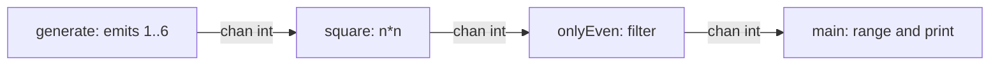
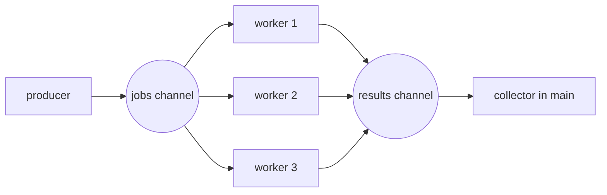

# select and concurrency patterns

> **Before this lesson:** read [Goroutines and channels](#/lesson/go/go-goroutines-channels). You must know how to start a goroutine, send and receive on buffered and unbuffered channels, close a channel and range over it. `sync.WaitGroup` appears in two examples and is explained where it is used; its full treatment is in the [next lesson](#/lesson/go/go-sync-primitives).

## In plain words

In the previous lesson a goroutine could wait on **one** channel at a time. Real programs need to wait on several things at once: "give me the next job, **or** stop if the shutdown signal arrives, **or** give up if nothing happens for five seconds".

Think of a receptionist with three phones on the desk. Staring at one phone while another rings would be poor service. The receptionist watches all three and answers whichever rings first. If two ring together, one is picked, with no favourite. If the receptionist has other work, a quick glance tells whether any phone is ringing, and if none is, the other work continues.

Go's **`select`** statement is that receptionist: it waits on several channel operations and proceeds with the first one that can happen.

The second half of the lesson shows the standard ways goroutines and channels are arranged to get work done, the **concurrency patterns** every Go programmer recognises: stopping goroutines with a done channel, timeouts, pipelines, fan-out and fan-in, worker pools, and backpressure. Think of them as kitchen layouts: an assembly line, several cooks sharing one order queue, a limit on how many pans can be on the stove.

Why this matters for a job: nearly all concurrent Go code is a combination of these few patterns. Recognising them makes unfamiliar code readable, and interviewers routinely ask candidates to write a worker pool or a pipeline with clean shutdown.

**Compared with Python.** `select` resembles `asyncio.wait(..., return_when=FIRST_COMPLETED)`, and a worker pool resembles `concurrent.futures.ThreadPoolExecutor` or tasks reading from an `asyncio.Queue`. In Go these are assembled from the language's own parts.

## select

### The basic form

A `select` looks like a `switch`, but every `case` is a channel send or receive:

```go
package main

import "fmt"

func main() {
	a := make(chan string, 1)
	b := make(chan string, 1)
	a <- "message on a"

	select {
	case m := <-a:
		fmt.Println("got", m)
	case m := <-b:
		fmt.Println("got", m)
	}
}
```

```text
got message on a
```

How `select` decides:

1. It looks at every case and determines which operations could proceed **right now** without blocking. Here only the receive from `a` can, because `a` holds a value and `b` is empty.
2. If exactly one case is ready, it runs that case.
3. If **several** are ready, it picks one of them **at random**, with equal probability. There is no top-to-bottom priority.
4. If **none** is ready, the whole `select` blocks until one becomes ready.

Rule 3 surprises people coming from `switch`. It is deliberate: if the first ready case always won, a busy channel listed first could starve the others for ever.

### default: do not wait

Adding a `default` case changes rule 4: if no case is ready, `default` runs immediately. That gives a **non-blocking** operation.

```go
ch := make(chan int, 1)

select {
case v := <-ch:
	fmt.Println("received", v)
default:
	fmt.Println("nothing ready")
}

select {
case ch <- 42:
	fmt.Println("sent")
default:
	fmt.Println("buffer full, value dropped")
}
```

```text
nothing ready
sent
```

The first `select` tries to receive and, finding the channel empty, takes `default`. The second tries to send; the buffer has room, so the send happens. This "try, and move on if it would block" form is how you drop work on overload instead of piling it up.

Be careful with `default` inside a loop: `for { select { ... default: } }` never waits, so it spins at full CPU speed. Use `default` only when there is something else worth doing.

### nil channels switch a case off

Operations on a nil channel block forever, so inside a `select` a case with a nil channel is **never chosen**. Setting a channel variable to `nil` is the standard way to disable a case, for instance after that channel has been closed:

```go
for a != nil || b != nil {
	select {
	case v, ok := <-a:
		if !ok {
			a = nil // a is finished: stop selecting on it
			continue
		}
		fmt.Println("a:", v)
	case v, ok := <-b:
		if !ok {
			b = nil
			continue
		}
		fmt.Println("b:", v)
	}
}
```

Without this, a closed channel would be "ready" on every pass (receiving from a closed channel never blocks) and the loop would spin. Test the rules in [select with ready channels](#/problem/go-select-sim).

## Pattern 1: the done channel

A goroutine that loops forever needs a way to be told to stop; otherwise it lives until the program ends, which is a **goroutine leak** in a long-running service. The classic signal is a channel that is **closed** to say "everybody stop". Closing works as a broadcast because a receive from a closed channel succeeds immediately, for every goroutine waiting on it, any number of times.

```go
package main

import "fmt"

func counter(done <-chan struct{}) <-chan int {
	out := make(chan int)
	go func() {
		defer close(out)
		for i := 0; ; i++ {
			select {
			case out <- i: // someone took the value: go on
			case <-done: // told to stop
				return
			}
		}
	}()
	return out
}

func main() {
	done := make(chan struct{})
	nums := counter(done)

	fmt.Println(<-nums, <-nums, <-nums)
	close(done) // tell the goroutine to stop
}
```

```text
0 1 2
```

Line by line:

- `chan struct{}` is a channel of empty structs. `struct{}` occupies no memory; the type says "this channel carries a signal, not data".
- Inside the goroutine, each pass of the loop is a `select` with two cases: send the next number, or notice that `done` is closed.
- While `main` keeps receiving, the first case fires. After `main` stops receiving, the send would block for ever, but `close(done)` makes the second case ready, and the goroutine returns, closing `out` on the way.

This "infinite loop around a `select` with a stop case" is called the **for-select loop**, and it is the skeleton of most long-lived goroutines. In modern code the done channel usually comes from a `context.Context` (`ctx.Done()`), which adds deadlines and a standard way to pass the signal through function calls. Contexts have [their own module](#/lesson/go/go-context-cancel); the mechanism underneath is exactly this.

## Pattern 2: timeouts

`time.After(d)` returns a channel on which one value arrives after duration `d`. Put it in a `select` and you have a timeout:

```go
package main

import (
	"fmt"
	"time"
)

func slowAnswer() <-chan string {
	out := make(chan string, 1) // buffer of 1: the sender never blocks, even if nobody waits
	go func() {
		time.Sleep(200 * time.Millisecond)
		out <- "42"
	}()
	return out
}

func main() {
	select {
	case ans := <-slowAnswer():
		fmt.Println("answer:", ans)
	case <-time.After(50 * time.Millisecond):
		fmt.Println("timed out")
	}
}
```

```text
timed out
```

The answer needs 200 ms and the timer fires after 50 ms, so the second case wins. Notice the buffer of size one in `slowAnswer`. After the timeout nobody will ever receive from `out`; with an unbuffered channel the goroutine would block on its send for ever and leak. The buffer lets it complete the send and exit.

## Pattern 3: the pipeline

A **pipeline** is a chain of **stages**. Each stage is a goroutine (or several) that receives values from an input channel, does one job, and sends results to an output channel. Stages are connected like sections of pipe, or like stations on an assembly line.

```go
package main

import "fmt"

func generate(nums ...int) <-chan int {
	out := make(chan int)
	go func() {
		defer close(out)
		for _, n := range nums {
			out <- n
		}
	}()
	return out
}

func square(in <-chan int) <-chan int {
	out := make(chan int)
	go func() {
		defer close(out)
		for n := range in {
			out <- n * n
		}
	}()
	return out
}

func onlyEven(in <-chan int) <-chan int {
	out := make(chan int)
	go func() {
		defer close(out)
		for n := range in {
			if n%2 == 0 {
				out <- n
			}
		}
	}()
	return out
}

func main() {
	for v := range onlyEven(square(generate(1, 2, 3, 4, 5, 6))) {
		fmt.Println(v)
	}
}
```

```text
4
16
36
```

Every stage has the same shape: take a receive-only channel, return a receive-only channel, start a goroutine that ranges over the input, and `defer close(out)`. Closing cascades down the line: when `generate` finishes and closes its channel, `square`'s loop ends and it closes its own, and so on until the loop in `main` ends. Stages can be rearranged and reused because they agree on nothing except the element type.



### Backpressure

All three channels above are unbuffered. If `main` is slow to take a value, `onlyEven` blocks on its send; then it stops receiving, so `square` blocks; then `generate` blocks. The slowness of the last stage travels backwards and slows the first. This is **backpressure**, and it is a feature: the producer cannot outrun the consumer, so memory use stays bounded without any extra code.

A buffer between two stages lets the earlier one run ahead by that many items, which smooths out uneven work. It does not raise the long-run rate; the slowest stage still decides that.

### Try it: where does the time go?

The simulation computes when each item leaves a two-stage pipeline and how long the first stage sat blocked. Change the stage times and the buffer capacity.

```python-run
def pipeline(n_items, times, caps):
    m = len(times)
    start = [[0] * n_items for _ in range(m)]
    depart = [[0] * n_items for _ in range(m)]
    blocked = [0] * m
    for k in range(n_items):
        for i in range(m):
            arrive = depart[i - 1][k] if i > 0 else 0
            prev = depart[i][k - 1] if k > 0 else 0
            s = max(arrive, prev)
            fin = s + times[i]
            start[i][k] = s
            if i == m - 1:
                d = fin
            else:
                c = caps[i]
                if c == 0:
                    d = max(fin, depart[i + 1][k - 1]) if k > 0 else fin
                elif k - c >= 0:
                    d = max(fin, start[i + 1][k - c])
                else:
                    d = fin
            depart[i][k] = d
            blocked[i] += d - fin
    return depart[m - 1], blocked

for cap in (0, 1, 4):
    done, blocked = pipeline(6, [1, 3], [cap])      # fast producer, slow consumer
    print(f"buffer {cap}: items finish at {done}, producer blocked for {blocked[0]} time units")
print()
done, blocked = pipeline(6, [3, 1], [0])            # slow producer, fast consumer
print(f"slow producer: items finish at {done}, producer blocked for {blocked[0]}")
```

With a fast producer and a slow consumer, the finish times are the same for every buffer size; only the producer's blocked time changes. The model behind this is the practice problem [Pipeline with backpressure](#/problem/go-pipeline-backpressure).

## Pattern 4: fan-out, fan-in and the worker pool

When one stage is the bottleneck and its work items are independent, run **several copies** of that stage reading from the same input channel. Distributing work over several goroutines is **fan-out**. Merging their results into one channel is **fan-in**. A fixed number of such goroutines is a **worker pool**.

```go
package main

import (
	"fmt"
	"sync"
)

func worker(jobs <-chan int, results chan<- int, wg *sync.WaitGroup) {
	defer wg.Done() // tell the WaitGroup this worker has finished
	for j := range jobs {
		results <- j * j
	}
}

func main() {
	jobs := make(chan int)
	results := make(chan int)

	var wg sync.WaitGroup
	for w := 0; w < 3; w++ { // fan-out: three workers share one jobs channel
		wg.Add(1)
		go worker(jobs, results, &wg)
	}

	go func() { // producer
		for i := 1; i <= 5; i++ {
			jobs <- i
		}
		close(jobs) // no more jobs: the workers' range loops end
	}()

	go func() { // closer
		wg.Wait()      // wait until every worker has returned
		close(results) // then it is safe to close the shared results channel
	}()

	sum := 0
	for r := range results { // fan-in: one loop collects from all workers
		sum += r
	}
	fmt.Println(sum)
}
```

```text
55
```

There are six goroutines here, each with one responsibility:

- **Three workers** receive from `jobs`. Each value sent on a channel is delivered to exactly **one** receiver, so the workers share the jobs without any further coordination.
- **The producer** sends five jobs and closes `jobs`.
- **The closer** solves a specific problem: `results` has three senders, so no single worker may close it. A `sync.WaitGroup` counts running workers (`Add(1)` before starting each, `Done()` when each finishes, `Wait()` blocks until the count is zero). Only when all workers are done is `results` closed.
- **`main`** ranges over `results` until it is closed.

Which worker handles which job, and the order of results, vary from run to run. The sum of squares 1 + 4 + 9 + 16 + 25 = 55 does not. If you need results in input order, send the index along with each job and place results into a slice by index. The scheduling behaviour of pools is the subject of the problem [Worker pool schedule](#/problem/go-worker-pool).



### How many workers?

For work that waits on something external (network calls, disk), the right number is whatever the external system can take, often tens or hundreds. For work that computes, more workers than CPU cores (`runtime.NumCPU()`) gains nothing. The point of a pool is the **limit**: starting one goroutine per item is fine for a hundred items and disastrous for ten million requests against a database that accepts fifty connections.

## Pattern 5: a semaphore from a buffered channel

Sometimes you do want one goroutine per item, but with a cap on how many are active at once. A buffered channel of capacity `n` works as a counting **semaphore**: sending takes a slot, receiving frees it, and a send blocks when all `n` slots are taken.

```go
sem := make(chan struct{}, 2) // at most 2 at a time
var wg sync.WaitGroup

for _, url := range urls {
	wg.Add(1)
	go func() {
		defer wg.Done()
		sem <- struct{}{}        // acquire a slot (blocks if both are taken)
		defer func() { <-sem }() // release it
		fetch(url)
	}()
}
wg.Wait()
```

The standard library's extended packages offer the same idea with more features: `errgroup.Group` with `SetLimit(n)` (next lesson) and `golang.org/x/sync/semaphore`.

## Choosing a pattern

| Situation | Pattern |
|---|---|
| A goroutine must be stoppable | for-select with a done channel or `ctx.Done()` |
| An operation must not wait too long | `select` with `time.After` or a context deadline |
| Steps that transform a stream one after another | pipeline |
| One slow step with independent items | fan-out to N workers, fan-in the results |
| Many tasks, limited capacity downstream | worker pool or semaphore |
| Producer faster than consumer | unbuffered or small buffers: let backpressure work; or drop with `select`/`default` |

## Pitfalls

> [!WARNING]
> Every goroutine you start must have a way to end. Before writing `go`, answer: what makes this goroutine return? If the answer is "the channel it reads is closed" or "done is closed", check that this really happens on every path, including errors and timeouts.

- **Expecting `select` cases to be tried in order.** Ready cases are chosen at random.
- **`default` in a tight loop**, burning a CPU core.
- **Forgetting that a closed channel is always ready to receive**, causing a spinning loop; set it to nil.
- **Closing a channel that has several senders from one of them.** Use a WaitGroup and a separate closer.
- **Leaking the sender after a timeout** because its channel is unbuffered and nobody receives any more.
- **`time.After` inside a hot loop.** Each call creates a timer; for repeated timeouts reuse a `time.Timer` or use a context.
- **Unbounded fan-out**: one goroutine per incoming item with no limit.
- **Large buffers used as a fix** for a slow consumer.

> [!TIP]
> Write each stage or worker as a function that takes its input channel(s) as `<-chan T`, returns or takes its output as a channel it alone closes, and accepts a done channel or context. Functions built to that convention compose without surprises.

> [!INTERVIEW]
> **"How does `select` choose a case?"** It evaluates all channel operands, then: if one or more cases can proceed, it picks one uniformly at random; if none can and there is a `default`, it runs `default`; otherwise it blocks until some case is ready. A nil channel's case is never ready; a closed channel is always ready to receive. **"Implement a worker pool."** N goroutines range over a shared jobs channel and send to a results channel; the producer closes `jobs`; a WaitGroup tracks workers and a separate goroutine closes `results` after `wg.Wait()`; the collector ranges over `results`. Mention cancellation via context and that unbuffered channels give backpressure.

## Cheat sheet

| Goal | Code |
|---|---|
| Wait on several channels | `select { case v := <-a: ... case b <- x: ... }` |
| Do not block | add `default:` |
| Timeout | `case <-time.After(d):` |
| Stop signal | `done := make(chan struct{})`, `close(done)`, `case <-done: return` |
| Disable a case | set its channel variable to `nil` |
| Long-lived goroutine | `for { select { case ...: case <-done: return } }` |
| Pipeline stage | `func stage(in <-chan T) <-chan U` with `defer close(out)` |
| Fan-out | several goroutines `range` over the same channel |
| Fan-in with many senders | `go func() { wg.Wait(); close(out) }()` |
| Limit concurrency | `sem := make(chan struct{}, n)`; `sem <- struct{}{}` … `<-sem` |

## Summary

- **`select`** waits on several channel operations. Among ready cases it chooses at random; with `default` it never blocks; without ready cases and without `default` it blocks.
- Nil channels disable cases; closed channels are always ready to receive.
- A **done channel**, closed to broadcast "stop", ends for-select loops and prevents leaks. `context` packages this up.
- **Timeouts** are a `select` between the result and `time.After`.
- A **pipeline** chains stages connected by channels; closing propagates completion downstream and blocking propagates **backpressure** upstream.
- **Fan-out/fan-in** and **worker pools** spread independent work over a bounded number of goroutines; a WaitGroup decides when the shared output may be closed.
- A buffered channel doubles as a **semaphore** to cap concurrency.

## Glossary

- **Backpressure**: a slow consumer causing its producers to wait, limiting the flow.
- **Done channel**: a channel closed to signal goroutines to stop.
- **Fan-in**: merging several channels or senders into one stream.
- **Fan-out**: several goroutines receiving from one channel to share work.
- **for-select loop**: an infinite `for` containing a `select`, the usual body of a long-lived goroutine.
- **Goroutine leak**: a goroutine that can never finish and so holds memory for ever.
- **Non-blocking operation**: a send or receive attempted with `select` and `default`.
- **Pipeline**: a series of stages connected by channels.
- **select**: statement that waits on multiple channel operations.
- **Semaphore**: a counter limiting how many goroutines may be in a section at once.
- **Stage**: one step of a pipeline.
- **Worker pool**: a fixed number of goroutines processing jobs from a shared channel.

```quiz
[
  {"q": "Two cases of a `select` are ready at the same time. Which one runs?",
   "options": ["The first in source order", "The last in source order", "One chosen at random", "Both, in order"],
   "answer": 2,
   "explain": "Go picks uniformly at random among the ready cases so that no channel can starve the others."},
  {"q": "What does this print? `ch := make(chan int); select { case v := <-ch: fmt.Println(v); default: fmt.Println(\"none\") }`",
   "options": ["`0`", "`none`", "It deadlocks", "It panics"],
   "answer": 1,
   "explain": "No value can be received from the empty unbuffered channel, so no case is ready and `default` runs immediately."},
  {"q": "Same code without the `default` case, in a program with only the main goroutine. What happens?",
   "options": ["Prints `0`", "Prints `none`", "fatal error: all goroutines are asleep - deadlock!", "It exits silently"],
   "answer": 2,
   "explain": "Without `default`, select blocks until a case is ready. Nothing will ever send, and the only goroutine is asleep, so the runtime reports a deadlock."},
  {"q": "Why is closing a `done` channel a good way to stop many goroutines at once?",
   "options": ["Closing sends one value to each goroutine in turn", "A receive on a closed channel succeeds immediately for every receiver, any number of times", "Closing kills the goroutines", "It panics every receiver"],
   "answer": 1,
   "explain": "A send would wake only one receiver. A close makes `<-done` ready for all current and future receivers, which works as a broadcast."},
  {"q": "In a `select`, what is the effect of a case whose channel variable is nil?",
   "options": ["It panics", "It is always chosen", "It is never chosen", "It behaves like default"],
   "answer": 2,
   "explain": "Operations on a nil channel block forever, so that case can never be ready. Setting a channel to nil is how a case is switched off."},
  {"q": "What does this pipeline print? `gen` emits 1, 2, 3; `double` sends n*2 for each; `main` does `for v := range double(gen()) { fmt.Print(v, \" \") }`",
   "options": ["`1 2 3 `", "`2 4 6 `", "`6 4 2 `", "The order is random"],
   "answer": 1,
   "explain": "With one goroutine per stage, order is preserved: each value passes through in sequence and is doubled."},
  {"q": "A results channel has three worker goroutines sending to it. Who should close it?",
   "options": ["The first worker to finish", "Each worker when it finishes", "A separate goroutine, after waiting (with a WaitGroup) for all workers to finish", "The receiver"],
   "answer": 2,
   "explain": "If one worker closed it, the others would panic on their next send. Wait for all senders, then close exactly once."},
  {"q": "A fast producer feeds a slow consumer through an unbuffered channel. What happens to the producer?",
   "options": ["It overflows the channel and loses data", "It blocks on each send until the consumer is ready, slowing down to the consumer's pace", "It panics", "Values are stored in an unlimited queue"],
   "answer": 1,
   "explain": "That is backpressure. The producer cannot run ahead, so memory stays bounded. Buffers only let it run ahead by their capacity."}
]
```

> **Source:** Bodner, *Learning Go* 2e, ch. 12 (topic coverage; wording and examples are original). Official references: https://go.dev/ref/spec#Select_statements, https://go.dev/blog/pipelines, https://go.dev/blog/concurrency-timeouts, https://go.dev/talks/2012/concurrency.slide, https://pkg.go.dev/time#After
