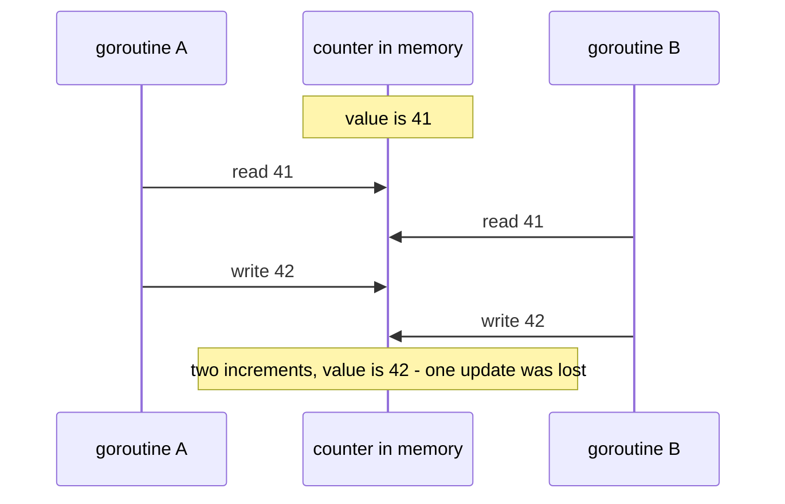

# WaitGroup, Mutex, Once, atomics and errgroup

> **Before this lesson:** read [Goroutines and channels](#/lesson/go/go-goroutines-channels) and [select and concurrency patterns](#/lesson/go/go-select-patterns). You also need pointers and pointer receivers ([Pointers, nil and mutability](#/lesson/go/go-pointers-basics), [Defined types, methods and embedding](#/lesson/go/go-types-methods)) and `defer`.

## In plain words

Channels move values between goroutines. Sometimes the problem is different: several goroutines need to use **the same piece of data**, such as a counter, a cache or a list of connected users.

Imagine a shared whiteboard showing "tickets left: 10". Two clerks each read the number at the same moment, each see 10, each sell a ticket, and each write 9. Two tickets were sold and the board says 9. Nobody did anything unreasonable; the mistake is that reading, calculating and writing were not done as one uninterrupted step. This kind of bug is called a **race condition**, and when it concerns unsynchronised access to memory it is a **data race**.

The fix in an office is a rule: "only the person holding the marker may touch the board". There is one marker. If someone else has it, you wait. In programming, the marker is a **mutex**.

The standard-library package `sync` holds the tools for these situations. This lesson covers five:

| Tool | Everyday picture | Purpose |
|---|---|---|
| `sync.WaitGroup` | a tour guide counting heads before the bus leaves | wait for a group of goroutines to finish |
| `sync.Mutex` / `sync.RWMutex` | the single marker for the whiteboard | let only one goroutine at a time touch shared data |
| `sync.Once` | "the first person in switches on the lights" | run initialisation exactly once |
| `sync/atomic` | a turnstile counter that clicks in one indivisible motion | simple lock-free updates to a single value |
| `errgroup` | a group project where one failure stops everybody | wait for goroutines and collect the first error |

Why this matters for a job: races are the hardest bugs in concurrent software because they appear rarely, vanish under a debugger and corrupt data silently. Knowing which tool to reach for, and "mutex or channel?", is asked in every Go interview that touches concurrency.

**Compared with Python.** Python has `threading.Lock`, and its global interpreter lock makes single bytecode operations appear atomic, which hides many races without removing them (`counter += 1` is still several steps). Go runs goroutines truly in parallel, so unsynchronised sharing breaks sooner and more visibly.

## WaitGroup: waiting for goroutines

A `sync.WaitGroup` is a counter with three methods:

- `Add(n)` raises the counter by `n`: "n more goroutines to wait for";
- `Done()` lowers it by one: "I have finished";
- `Wait()` blocks until the counter is zero.

```go
package main

import (
	"fmt"
	"sync"
)

func main() {
	var wg sync.WaitGroup
	results := make([]int, 5)

	for i := range results {
		wg.Add(1) // in the parent, before starting the goroutine
		go func() {
			defer wg.Done() // runs when the goroutine returns, however it returns
			results[i] = i * i
		}()
	}

	wg.Wait() // blocks until all five have called Done
	fmt.Println(results)
}
```

```text
[0 1 4 9 16]
```

Line by line:

- `var wg sync.WaitGroup` needs no initialisation; the zero value is ready.
- `wg.Add(1)` is called **before** the `go` statement, in the goroutine that will later wait. If it were inside the new goroutine, `Wait` could run before any `Add` had happened and return at once.
- `defer wg.Done()` as the first line of the goroutine guarantees the count is lowered even on an early return or a panic.
- Each goroutine writes a **different** element of the slice, so they do not conflict. Distinct elements of a slice are distinct variables.

Since Go 1.25 the pair `Add(1)` and `defer Done()` is available as one call: `wg.Go(func() { ... })`.

Misuse is punished at run time: if `Done` is called more often than `Add` allowed, the program panics with `sync: negative WaitGroup counter`; if `Done` is forgotten, `Wait` never returns. Practise both in [WaitGroup counter checker](#/problem/go-waitgroup-validate).

**Never copy a WaitGroup** (or any type from `sync`) after first use. Pass a pointer, `*sync.WaitGroup`, to functions; a copy would have its own separate counter. `go vet` reports this mistake.

## A data race, observed

Now let the goroutines share one variable.

```go
package main

import (
	"fmt"
	"sync"
)

func main() {
	var wg sync.WaitGroup
	counter := 0

	for i := 0; i < 1000; i++ {
		wg.Add(1)
		go func() {
			defer wg.Done()
			counter++ // read, add one, write back: three steps
		}()
	}

	wg.Wait()
	fmt.Println(counter)
}
```

A typical run on a multi-core machine:

```text
947
```

Run it again and you get a different number, sometimes 1000, usually less. `counter++` is not one step. The processor reads the value, adds one and writes the result. Two goroutines can interleave like this:



This is a **lost update**. Go's memory model goes further and says that a program with a data race has no guaranteed behaviour at all. The tool that finds races is the **race detector**: `go run -race .` prints `WARNING: DATA RACE` with the two conflicting accesses ([Deadlocks, leaks and the race detector](#/lesson/go/go-deadlocks-leaks)).

### Try it: count the possible outcomes

Two goroutines each perform `counter++` twice. The simulation tries every possible interleaving of their read and write steps and reports which final values can occur.

```python-run
from itertools import permutations

def outcomes(increments_per_goroutine, goroutines=2):
    # each increment is two steps: R (read into a private register) and W (write register + 1)
    steps = []
    for g in range(goroutines):
        for k in range(increments_per_goroutine):
            steps += [(g, k, "R"), (g, k, "W")]
    results = {}
    seen = set()
    for order in permutations(range(len(steps))):
        seq = [steps[i] for i in order]
        # keep only orders where each goroutine's own steps stay in program order
        ok = all(seq.index((g, k, "R")) < seq.index((g, k, "W")) for g, k, _ in steps) and \
             all(seq.index((g, k, "W")) < seq.index((g, k + 1, "R"))
                 for g in range(goroutines) for k in range(increments_per_goroutine - 1))
        if not ok or tuple(seq) in seen:
            continue
        seen.add(tuple(seq))
        counter, reg = 0, {}
        for g, k, op in seq:
            if op == "R":
                reg[g] = counter
            else:
                counter = reg[g] + 1
        results[counter] = results.get(counter, 0) + 1
    return results

res = outcomes(2)
total = sum(res.values())
print("4 increments in total. Final values over all", total, "interleavings:")
for value in sorted(res):
    print(f"   counter = {value}: {res[value]:>3} interleavings ({100 * res[value] / total:.0f}%)")
```

Only a minority of orderings give the correct 4. A mutex removes every interleaving in which the read and the write of one increment are separated.

## Mutex: one goroutine at a time

A `sync.Mutex` (short for **mutual exclusion**) has two methods. `Lock()` acquires it; if another goroutine holds it, the caller blocks until it is released. `Unlock()` releases it. The code between the two is a **critical section**: at most one goroutine can be inside.

```go
package main

import (
	"fmt"
	"sync"
)

func main() {
	var wg sync.WaitGroup
	var mu sync.Mutex
	counter := 0

	for i := 0; i < 1000; i++ {
		wg.Add(1)
		go func() {
			defer wg.Done()
			mu.Lock()
			counter++ // only one goroutine at a time is here
			mu.Unlock()
		}()
	}

	wg.Wait()
	fmt.Println(counter)
}
```

```text
1000
```

Always 1000. The mutex does not make the goroutines take turns in any particular order; it guarantees that their critical sections never overlap.

### The idiomatic shape: a struct that owns its lock

In real code a mutex lives next to the data it protects, inside a struct, and the methods do the locking so that callers cannot forget:

```go
package main

import (
	"fmt"
	"sync"
)

type Scoreboard struct {
	mu     sync.Mutex // protects scores
	scores map[string]int
}

func NewScoreboard() *Scoreboard {
	return &Scoreboard{scores: make(map[string]int)}
}

func (s *Scoreboard) Add(team string, points int) {
	s.mu.Lock()
	defer s.mu.Unlock()
	s.scores[team] += points
}

func (s *Scoreboard) Get(team string) int {
	s.mu.Lock()
	defer s.mu.Unlock()
	return s.scores[team]
}

func main() {
	board := NewScoreboard()
	var wg sync.WaitGroup
	for i := 0; i < 100; i++ {
		wg.Add(2)
		go func() { defer wg.Done(); board.Add("red", 2) }()
		go func() { defer wg.Done(); board.Add("blue", 1) }()
	}
	wg.Wait()
	fmt.Println(board.Get("red"), board.Get("blue"))
}
```

```text
200 100
```

Conventions visible here:

- The mutex field is declared **directly above** the fields it guards, with a comment saying so.
- `defer s.mu.Unlock()` immediately after `Lock()` releases the lock on every return path, including a panic.
- Methods have **pointer receivers**. A value receiver would copy the struct, mutex included, and each call would lock its own private copy.
- The map is unexported. The only way to reach it is through methods that lock. A plain map written by two goroutines at once would crash the program with `fatal error: concurrent map writes`.

Rules for mutexes:

1. **Keep critical sections short.** Do not hold a lock while doing slow work such as network calls.
2. **Go's mutex is not re-entrant.** A goroutine that calls `Lock` while already holding the same mutex blocks for ever. Do not call one locking method from another; split out an unexported helper that assumes the lock is held.
3. **Lock around every access**, reads included. Reading while another goroutine writes is a data race too.

### RWMutex: many readers or one writer

When data is read far more often than it is changed, a `sync.RWMutex` lets readers proceed together:

- `RLock()` / `RUnlock()`: a **read lock**. Any number of goroutines may hold it at once.
- `Lock()` / `Unlock()`: the **write lock**. Exclusive: no other reader or writer.

```go
type Cache struct {
	mu   sync.RWMutex
	data map[string]string
}

func (c *Cache) Get(key string) (string, bool) {
	c.mu.RLock()
	defer c.mu.RUnlock()
	v, ok := c.data[key]
	return v, ok
}

func (c *Cache) Set(key, value string) {
	c.mu.Lock()
	defer c.mu.Unlock()
	c.data[key] = value
}
```

A waiting writer blocks new readers, so writers are not starved. An `RWMutex` has more bookkeeping than a `Mutex`; it pays off only with many concurrent readers and critical sections that are not tiny. Start with `Mutex` and switch if a benchmark shows contention. The queueing behaviour is modelled in [Mutex and RWMutex contention timeline](#/problem/go-mutex-timeline).

## Once: exactly one initialisation

Some set-up must happen one time only, lazily, and possibly triggered by many goroutines at once: loading configuration, opening a connection pool.

```go
package main

import (
	"fmt"
	"sync"
)

var (
	once   sync.Once
	config map[string]string
)

func loadConfig() {
	fmt.Println("loading configuration (expensive)")
	config = map[string]string{"env": "prod"}
}

func Env() string {
	once.Do(loadConfig) // runs loadConfig the first time only
	return config["env"]
}

func main() {
	var wg sync.WaitGroup
	for i := 0; i < 3; i++ {
		wg.Add(1)
		go func() { defer wg.Done(); _ = Env() }()
	}
	wg.Wait()
	fmt.Println(Env())
}
```

```text
loading configuration (expensive)
prod
```

`once.Do(f)` calls `f` if and only if this `Once` has never completed a `Do`. If several goroutines arrive together, one runs `f` and the others wait until it has finished, so all of them see the initialised data.

Since Go 1.21 there are friendlier wrappers. `sync.OnceValue` turns a function into one that computes its result once and returns the cached value afterwards:

```go
var loadEnv = sync.OnceValue(func() string {
	fmt.Println("loading")
	return "prod"
})
// loadEnv() prints "loading" on the first call only and always returns "prod"
```

## Atomics: single-value updates without a lock

For one number or one flag, a mutex is more than you need. The package `sync/atomic` offers types whose operations are **atomic**: each completes as one indivisible step that no other goroutine can observe half-done.

```go
package main

import (
	"fmt"
	"sync"
	"sync/atomic"
)

func main() {
	var wg sync.WaitGroup
	var hits atomic.Int64

	for i := 0; i < 1000; i++ {
		wg.Add(1)
		go func() {
			defer wg.Done()
			hits.Add(1)
		}()
	}

	wg.Wait()
	fmt.Println(hits.Load())
}
```

```text
1000
```

The typed values (`atomic.Int32`, `atomic.Int64`, `atomic.Uint64`, `atomic.Bool`, `atomic.Pointer[T]`) have methods `Load`, `Store`, `Add`, `Swap` and `CompareAndSwap`. The last one, "set to `new` only if the current value is still `old`", is the building block of lock-free algorithms.

Use atomics for counters, flags and metrics. As soon as **two** values must change together (a balance and a transaction count), atomics cannot help, because each operation is atomic by itself and the pair is not. Use a mutex.

## errgroup: wait, and stop at the first error

`WaitGroup` waits; it does not know about errors. The common need "run these tasks concurrently; if any fails, cancel the rest and tell me the first error" is covered by `errgroup`, from the supplementary module `golang.org/x/sync` (add it with `go get golang.org/x/sync`).

```go
package main

import (
	"context"
	"errors"
	"fmt"
	"time"

	"golang.org/x/sync/errgroup"
)

func fetch(ctx context.Context, name string, fail bool) error {
	select {
	case <-time.After(50 * time.Millisecond): // pretend to work
	case <-ctx.Done(): // another task failed: stop early
		return ctx.Err()
	}
	if fail {
		return errors.New(name + ": service unavailable")
	}
	return nil
}

func main() {
	g, ctx := errgroup.WithContext(context.Background())

	g.Go(func() error { return fetch(ctx, "users", false) })
	g.Go(func() error { return fetch(ctx, "orders", true) })
	g.Go(func() error { return fetch(ctx, "stock", false) })

	if err := g.Wait(); err != nil {
		fmt.Println("failed:", err)
		return
	}
	fmt.Println("all done")
}
```

```text
failed: orders: service unavailable
```

- `errgroup.WithContext` returns a group and a **context**, an object that carries a cancellation signal ([context module](#/lesson/go/go-context-cancel)).
- `g.Go(f)` starts `f` in a goroutine and counts it, like `wg.Go`.
- `g.Wait()` blocks until all functions have returned and yields the **first non-nil error**.
- When any function returns an error, the context is cancelled; well-behaved tasks notice through `ctx.Done()` and stop.
- `g.SetLimit(n)` caps how many goroutines run at once, giving a worker pool in one line.

## Mutex or channel?

Both make concurrent code safe. They express different ideas.

| Use a **channel** when … | Use a **mutex** when … |
|---|---|
| you pass ownership of data from one goroutine to another | several goroutines access the same state in place |
| you distribute work or collect results | you guard a cache, a counter, a map, a struct's fields |
| you signal an event (done, cancel, ready) | the operation is "read or update this, briefly" |
| you coordinate the *flow* of a program | you protect the *internals* of a type |

A quick test: if you are tempted to build a goroutine whose only job is to own a map and answer requests over channels, a struct with a mutex is simpler. If you are tempted to write a queue protected by a mutex plus a condition variable, a channel is simpler. Neither is more "Go"; choose the one that makes the code easiest to verify.

## Pitfalls

> [!WARNING]
> **Copying a struct that contains a mutex.** Passing it by value, using a value receiver, or ranging over a slice of such structs with a value variable creates a copy with its own lock, and the protection silently disappears. Use pointers. `go vet` reports "passes lock by value".

- **`wg.Add` inside the goroutine** instead of before it.
- **Forgetting `Done`** (deadlock) or calling it twice (panic).
- **Locking only writes.** Unsynchronised reads are races.
- **Locking the same mutex twice in one goroutine**, usually by calling a locking method from another locking method.
- **Returning a reference to protected data**: `func (c *Cache) All() map[string]string { return c.data }` hands the unguarded map to the caller. Return a copy.
- **Holding a lock during I/O** or while sending on a channel.
- **Acquiring two mutexes in different orders** in different goroutines: a deadlock ([next lesson](#/lesson/go/go-deadlocks-leaks)).
- **Atomics for multi-step invariants.**
- **A plain map shared across goroutines.** Guard it with a mutex, or use `sync.Map` for the special cases it is designed for (keys written once and read many times).

> [!TIP]
> Decide for every piece of shared state which mutex guards it, and write that in a comment next to the field (`mu sync.Mutex // protects items and total`). When you later read a method, you can check in seconds whether it locks what it touches.

> [!INTERVIEW]
> **"Mutex or channel?"** Channels transfer data and coordinate goroutines; mutexes protect state that several goroutines access in place. Use a mutex for caches, counters and struct internals; use channels for work distribution, pipelines, results and signalling. **"What is a data race and how do you find one?"** Two goroutines access the same variable concurrently, at least one writes, with no synchronisation; behaviour is undefined. Detect with `go test -race`. Fix with a mutex, an atomic, or by confining the data to one goroutine and communicating over channels. Know `WaitGroup` (`Add` before `go`, `defer Done`), `RWMutex` (many readers or one writer), `sync.Once`, and `errgroup` (first error cancels the rest).

## Cheat sheet

| Need | Tool | Key calls |
|---|---|---|
| Wait for goroutines | `sync.WaitGroup` | `Add(1)` before `go`; `defer Done()`; `Wait()`; or `wg.Go(f)` |
| Exclusive access | `sync.Mutex` | `Lock()`; `defer Unlock()` |
| Many readers, few writers | `sync.RWMutex` | `RLock()/RUnlock()`; `Lock()/Unlock()` |
| One-time initialisation | `sync.Once`, `sync.OnceValue` | `once.Do(f)` |
| Single counter or flag | `atomic.Int64`, `atomic.Bool` | `Add`, `Load`, `Store`, `CompareAndSwap` |
| Wait and propagate first error | `errgroup.Group` | `g.Go(f)`; `g.Wait()`; `g.SetLimit(n)` |
| Find races | race detector | `go test -race ./...` |

## Summary

- A **data race** is unsynchronised concurrent access to a variable with at least one write. Even `counter++` loses updates.
- **`WaitGroup`** counts goroutines: `Add` before starting, `Done` when finished, `Wait` to block until zero.
- **`Mutex`** allows one goroutine at a time into a critical section; keep it inside the struct it protects, lock in methods with pointer receivers, and `defer` the unlock. **`RWMutex`** admits many readers or one writer.
- **`Once`** runs initialisation exactly once, safely.
- **Atomics** make operations on a single value indivisible; they do not protect relationships between values.
- **`errgroup`** waits for a set of goroutines, returns the first error and cancels the rest through a context.
- Channels coordinate and transfer; mutexes protect shared state.

## Glossary

- **Atomic operation**: one that completes as a single indivisible step.
- **Contention**: goroutines waiting for a lock held by another.
- **Critical section**: code that must not be executed by more than one goroutine at a time.
- **Data race**: concurrent unsynchronised access to the same memory, with at least one write.
- **errgroup**: a helper that runs goroutines, waits for them and reports the first error.
- **Lost update**: a write that overwrites another concurrent write based on a stale read.
- **Mutex**: a mutual-exclusion lock.
- **Race condition**: a bug whose outcome depends on the timing of concurrent events.
- **Read lock / write lock**: shared / exclusive modes of an `RWMutex`.
- **Re-entrant lock**: a lock the same thread may acquire repeatedly; Go's mutex is not one.
- **WaitGroup**: a counter used to wait for a collection of goroutines.

```quiz
[
  {"q": "Where should `wg.Add(1)` be called?",
   "options": ["Inside the new goroutine, as its first statement", "In the launching goroutine, before the `go` statement", "After `wg.Wait()`", "It does not matter"],
   "answer": 1,
   "explain": "If Add ran inside the goroutine, Wait could execute before any Add and return immediately. Call Add before starting the goroutine."},
  {"q": "1000 goroutines each run `counter++` on a shared int with no synchronisation. What is printed after all finish?",
   "options": ["Always 1000", "Always 0", "Some number up to 1000; it varies between runs", "The program does not compile"],
   "answer": 2,
   "explain": "`counter++` is a read, an add and a write. Interleavings lose updates, so the result is unpredictable. It is a data race."},
  {"q": "What does this print? `var mu sync.Mutex; n := 0; var wg sync.WaitGroup; for i := 0; i < 50; i++ { wg.Add(1); go func() { defer wg.Done(); mu.Lock(); n += 2; mu.Unlock() }() }; wg.Wait(); fmt.Println(n)`",
   "options": ["`50`", "`100`", "A value between 2 and 100", "It deadlocks"],
   "answer": 1,
   "explain": "The mutex makes each `n += 2` exclusive, so all 50 updates are applied: 100."},
  {"q": "A method is declared `func (c Counter) Inc() { c.mu.Lock(); c.n++; c.mu.Unlock() }` where Counter contains a sync.Mutex. What is wrong?",
   "options": ["Nothing", "The value receiver copies the struct, so each call locks and increments a private copy", "Mutexes cannot be struct fields", "Lock must be deferred"],
   "answer": 1,
   "explain": "With a value receiver both the counter and its mutex are copies. Nothing is protected and nothing is updated. Use a pointer receiver; go vet flags the copied lock."},
  {"q": "What does this print? `var once sync.Once; for i := 0; i < 3; i++ { once.Do(func() { fmt.Print(\"x\") }) }`",
   "options": ["`xxx`", "`x`", "Nothing", "It panics on the second call"],
   "answer": 1,
   "explain": "`Do` runs the function only the first time for a given Once; later calls return without calling it."},
  {"q": "With a `sync.RWMutex`, which combination can hold the lock at the same time?",
   "options": ["Two writers", "One writer and one reader", "Several readers", "Any number of readers and writers"],
   "answer": 2,
   "explain": "RLock is shared among readers. Lock (the write lock) is exclusive against both readers and other writers."},
  {"q": "When is an atomic type NOT sufficient?",
   "options": ["For a request counter", "For a boolean 'shutting down' flag", "When two related variables must be updated together consistently", "For a gauge read by a metrics endpoint"],
   "answer": 2,
   "explain": "Each atomic operation is indivisible only for its own value. An invariant spanning two values needs a mutex around both updates."},
  {"q": "What does `errgroup`'s `g.Wait()` return when two of five goroutines return errors?",
   "options": ["nil", "Both errors joined", "The first non-nil error returned by any of the goroutines", "It panics"],
   "answer": 2,
   "explain": "Wait blocks until all functions have returned and yields the first error recorded. With `WithContext`, that first error also cancels the group's context."}
]
```

> **Source:** Bodner, *Learning Go* 2e, ch. 12 (topic coverage; wording and examples are original). Official references: https://pkg.go.dev/sync, https://pkg.go.dev/sync/atomic, https://pkg.go.dev/golang.org/x/sync/errgroup, https://go.dev/ref/mem, https://go.dev/wiki/MutexOrChannel
