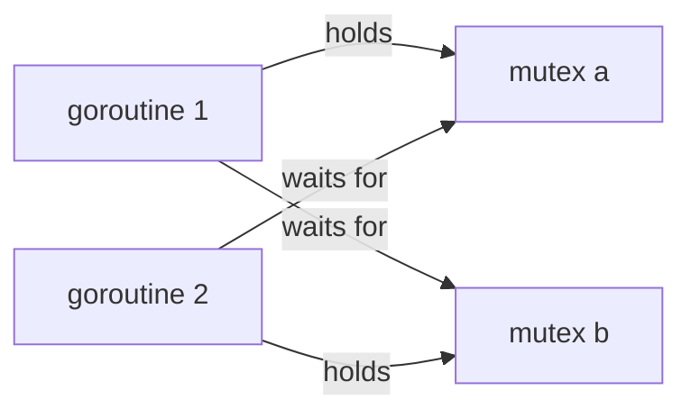

# Deadlocks, leaks and the race detector

> **Before this lesson:** read the three earlier lessons of this module: [Goroutines and channels](#/lesson/go/go-goroutines-channels), [select and concurrency patterns](#/lesson/go/go-select-patterns) and [WaitGroup, Mutex, Once, atomics and errgroup](#/lesson/go/go-sync-primitives). This lesson is about what goes wrong with those tools and how to find it.

## In plain words

Concurrent programs fail in three characteristic ways. Each has an everyday picture.

**Deadlock.** Two cars meet on a bridge wide enough for one. Each driver waits for the other to reverse. Neither does. Nothing is broken, nobody made an illegal move, and no progress will ever be made. In a program, a **deadlock** is a set of goroutines each waiting for something that only another waiting goroutine could provide.

**Leak.** Someone is told "wait by the phone until I call" and the caller forgets. The person waits for ever, occupying a room. One forgotten person does not matter; a thousand fill the building. A **goroutine leak** is a goroutine that is blocked (or looping) with no way to ever finish. It holds memory until the program ends, and a service that leaks a goroutine per request will eventually fall over.

**Data race.** Two people edit the same paragraph of a shared document at the same moment without seeing each other's cursor. The result is a mixture that neither intended. A **data race** is two goroutines touching the same variable at the same time, at least one of them writing, with nothing to coordinate them.

The good news: Go ships with tools that expose two of the three. The runtime detects total deadlocks, and the **race detector** finds data races while your tests run. Leaks need a little discipline and a couple of inspection tools.

Why this matters for a job: these are the bugs behind "the service freezes once a week" and "memory grows until the container is killed". Being able to name the failure, reproduce it and apply the standard fix is what teams mean by "comfortable with concurrency". Interviews include "find the bug" snippets that are almost always one of the cases below.

**Compared with Python.** Deadlocks and leaked threads exist in Python too, without built-in detection. The global interpreter lock hides many data races in Python programs; Go has no such lock, so it provides a detector instead.

## Deadlocks

### Total deadlock: the runtime tells you

When **every** goroutine is blocked, the runtime stops the program:

```text
fatal error: all goroutines are asleep - deadlock!
```

Below that line it prints each goroutine with what it is waiting for, in square brackets: `[chan send]`, `[chan receive]`, `[select]`, `[sync.Mutex.Lock]`, `[sync.WaitGroup.Wait]`. Read those labels first; they usually name the cause.

Here are the classic ways to get there.

**1. Unbuffered send with no receiver.**

```go
func main() {
	ch := make(chan int)
	ch <- 1 // [chan send]: nobody receives
	fmt.Println(<-ch)
}
```

**2. Ranging over a channel that is never closed.**

```go
func main() {
	ch := make(chan int)
	go func() {
		for i := 0; i < 3; i++ {
			ch <- i
		}
		// missing: close(ch)
	}()
	for v := range ch { // receives 0, 1, 2 and then waits for ever: [chan receive]
		fmt.Println(v)
	}
}
```

The program prints `0`, `1`, `2` and then dies with the deadlock message. The sender has finished; the receiver does not know.

**3. A WaitGroup that never reaches zero.**

```go
var wg sync.WaitGroup
wg.Add(2)
go func() { defer wg.Done(); work() }()
// second goroutine was never started
wg.Wait() // [sync.WaitGroup.Wait] for ever
```

**4. Waiting for results before starting to receive them.**

```go
func main() {
	results := make(chan int) // unbuffered
	var wg sync.WaitGroup
	for i := 0; i < 3; i++ {
		wg.Add(1)
		go func() {
			defer wg.Done()
			results <- i * i // blocks: main is not receiving yet
		}()
	}
	wg.Wait() // main waits for workers; workers wait for main
	close(results)
	for r := range results {
		fmt.Println(r)
	}
}
```

Each side is waiting for the other to move first. The fix from the patterns lesson: do the `wg.Wait(); close(results)` in a separate goroutine so that `main` can start receiving, or make the channel buffered with room for every result.

### Lock-ordering deadlock

Mutexes produce the bridge situation directly:

```go
package main

import (
	"fmt"
	"sync"
	"time"
)

func main() {
	var a, b sync.Mutex
	var wg sync.WaitGroup
	wg.Add(2)

	go func() {
		defer wg.Done()
		a.Lock()
		time.Sleep(10 * time.Millisecond) // widen the window so the bug always shows
		b.Lock()                          // waits for the other goroutine to release b
		fmt.Println("first has both")
		b.Unlock()
		a.Unlock()
	}()

	go func() {
		defer wg.Done()
		b.Lock()
		time.Sleep(10 * time.Millisecond)
		a.Lock() // waits for the other goroutine to release a
		fmt.Println("second has both")
		a.Unlock()
		b.Unlock()
	}()

	wg.Wait()
}
```

```text
fatal error: all goroutines are asleep - deadlock!

goroutine 1 [sync.WaitGroup.Wait]:
...
goroutine 18 [sync.Mutex.Lock]:
...
goroutine 19 [sync.Mutex.Lock]:
...
```

The first goroutine holds `a` and wants `b`; the second holds `b` and wants `a`. This is a **circular wait**.



Four conditions must all hold for a deadlock of this kind: a resource can be held by only one party; a party holds one resource while waiting for another; a resource cannot be taken away by force; and there is a cycle of waiting. Remove any one and deadlock is impossible. In practice you remove the cycle:

**Always acquire multiple locks in the same global order.** If every piece of code that needs both `a` and `b` locks `a` first, the cycle cannot form. For objects of the same kind (two bank accounts), order by a stable key such as the ID. Better still, design so that no code needs two locks at once.

### Partial deadlock: nobody tells you

The runtime's detector fires only when **all** goroutines are asleep. A real server always has something else running: a goroutine listening for connections, a timer, a signal handler. If two request handlers deadlock on each other there, the program keeps running, those two requests hang for ever, and no message is printed. A partial deadlock looks like a leak, which is the next topic.

### Try it: find the cycle

A deadlock is a cycle in the "who waits for whom" graph. The simulation takes, for each goroutine, what it holds and what it wants, builds that graph and searches for a cycle.

```python-run
def find_deadlock(goroutines):
    """goroutines: name -> (set of locks held, lock wanted or None)"""
    owner = {lock: g for g, (held, _) in goroutines.items() for lock in held}
    waits_for = {}                                  # goroutine -> goroutine it waits on
    for g, (_, wanted) in goroutines.items():
        if wanted is not None and wanted in owner and owner[wanted] != g:
            waits_for[g] = owner[wanted]
    for start in goroutines:
        path, cur = [], start
        while cur in waits_for and cur not in path:
            path.append(cur)
            cur = waits_for[cur]
        if cur in path:                             # came back to someone on the path
            return path[path.index(cur):] + [cur]
    return None

scenarios = {
    "opposite lock order": {"transferAB": ({"A"}, "B"), "transferBA": ({"B"}, "A")},
    "same lock order":     {"transferAB": ({"A"}, "B"), "transferAB2": (set(), "A")},
    "three-way ring":      {"g1": ({"X"}, "Y"), "g2": ({"Y"}, "Z"), "g3": ({"Z"}, "X"), "g4": (set(), "X")},
}
for name, state in scenarios.items():
    cycle = find_deadlock(state)
    print(f"{name:<22}", "DEADLOCK: " + " -> ".join(cycle) if cycle else "no deadlock (someone can still proceed)")
```

In the second scenario one goroutine waits, but the lock's holder is not waiting for it, so the wait will end. Waiting is normal; a *cycle* of waiting is fatal.

## Goroutine leaks

A goroutine is not garbage-collected while it is blocked. If nothing will ever unblock it, it stays until the process exits, together with everything it references.

### The usual causes

**1. A sender nobody listens to any more.** This one is in a lot of production code:

```go
func fastest(urls []string) string {
	ch := make(chan string) // unbuffered
	for _, u := range urls {
		go func() { ch <- fetch(u) }()
	}
	return <-ch // take the first answer and leave
}
```

With five URLs, one goroutine delivers its result and the function returns. The other four finish fetching and then block on `ch <- ...` for ever. Fix: give the channel room for every answer, `make(chan string, len(urls))`, so each send completes; or pass a context and have the others stop.

**2. A receiver waiting on a channel that is never closed or sent to.**

```go
func startLogger(lines <-chan string) {
	go func() {
		for l := range lines { // ends only when lines is closed
			write(l)
		}
	}()
}
```

If the owner of `lines` forgets to close it on shutdown, this goroutine never returns.

**3. A loop with no exit.**

```go
go func() {
	for {
		refreshCache()
		time.Sleep(time.Minute)
	}
}()
```

It can never be stopped. Give it a done channel or a context and `select` on it.

**4. A timeout that abandons the worker**, as in the timeout example of the patterns lesson when the result channel is unbuffered.

### Seeing a leak

```go
package main

import (
	"fmt"
	"runtime"
	"time"
)

func leaky() {
	ch := make(chan int)
	go func() {
		ch <- 1 // nobody will ever receive
	}()
}

func main() {
	fmt.Println("before:", runtime.NumGoroutine())
	for i := 0; i < 100; i++ {
		leaky()
	}
	time.Sleep(50 * time.Millisecond)
	fmt.Println("after: ", runtime.NumGoroutine())
}
```

```text
before: 1
after:  101
```

`runtime.NumGoroutine()` returns the number of goroutines that currently exist. A hundred calls left a hundred goroutines stuck. Changing the channel to `make(chan int, 1)` brings the second number back to 1.

Tools for finding leaks in real programs:

- **Watch the goroutine count** as a metric. A count that climbs with traffic and never comes down is a leak.
- **The goroutine profile.** A program that imports `net/http/pprof` exposes `/debug/pprof/goroutine?debug=2`, which lists every goroutine with its stack. Thousands of goroutines parked at the same line show you where.
- **In tests**, the `go.uber.org/goleak` package fails a test if goroutines are still running when it ends.
- **`go vet`** catches one specific cause: a context's cancel function that is never called (`lostcancel`).

### The rule that prevents leaks

> Never start a goroutine without knowing how it will stop.

For every `go` statement be able to answer: what event makes this goroutine return, and is that event certain to happen on every path, including errors, timeouts and shutdown? The reliable answers are "its input channel is closed by its owner" and "its context is cancelled".

## Data races and the race detector

### What counts as a race

A **data race** occurs when:

1. two or more goroutines access the same variable (the same memory location),
2. at least one access is a write,
3. and no synchronisation orders the accesses.

All three are needed. Two goroutines only reading is fine. Two goroutines writing different variables, or different elements of a slice, is fine. Accesses separated by a mutex, a channel operation or a `WaitGroup` wait are ordered and therefore fine.

The Go **memory model** expresses this through the relation **happens-before**. Certain events are guaranteed to be ordered: a send on a channel happens before the corresponding receive completes; an `Unlock` happens before the next `Lock` of the same mutex returns; the `go` statement happens before the new goroutine starts; a goroutine's `wg.Done()` happens before `wg.Wait()` returns. If one access to a variable happens-before the other through a chain of such events, there is no race. If neither is ordered before the other, there is.

Races are not limited to counters:

```go
var cfg *Config // shared

go func() { cfg = loadConfig() }()   // write
go func() { fmt.Println(cfg.Name) }() // read: may see nil, the old value or the new one
```

```go
m := map[string]int{}
go func() { m["a"] = 1 }()
go func() { m["b"] = 2 }() // concurrent map writes: the runtime crashes the program
```

### The race detector

Go's toolchain can build a program with extra instrumentation that watches every memory access and reports unsynchronised pairs. Turn it on with `-race`:

```text
$ go test -race ./...
$ go run -race .
$ go build -race -o app-race .
```

Take the lost-update program from the previous lesson and run it with `-race`:

```text
==================
WARNING: DATA RACE
Read at 0x00c000012345 by goroutine 8:
  main.main.func1()
      /tmp/app/main.go:16 +0x44

Previous write at 0x00c000012345 by goroutine 7:
  main.main.func1()
      /tmp/app/main.go:16 +0x56

Goroutine 8 (running) created at:
  main.main()
      /tmp/app/main.go:14 +0x84

Goroutine 7 (finished) created at:
  main.main()
      /tmp/app/main.go:14 +0x84
==================
983
Found 1 data race(s)
exit status 66
```

How to read a report:

- The first two blocks are the **two conflicting accesses**: which goroutine, read or write, and the exact source line (both at line 16, the `counter++`).
- The next two blocks say **where each of those goroutines was started**.
- The program still printed a result, then exited with status 66 because a race was found.

That is everything needed to fix it: you know the variable, both places that touch it, and who started the goroutines.

### What the detector can and cannot do

- **No false positives.** If it reports a race, the race is real, even when the program "always works".
- **It only sees what runs.** It observes actual executions; a race in a code path your tests never exercise is not reported. Good test coverage of concurrent code, with real concurrency in the tests, is what makes the detector effective.
- **It costs.** A race-enabled binary typically uses five to ten times the memory and runs several times slower. Use it in tests and CI and in staging, not for normal production binaries.
- **It needs cgo** on most platforms and so a C toolchain on the build machine.

Make `go test -race ./...` part of the pipeline. It is the single most valuable habit for concurrent Go.

### Fixing a race

Pick one:

| Fix | When |
|---|---|
| **Do not share.** Give each goroutine its own copy, or pass the value over a channel | always the first thing to consider |
| **Mutex** around every access | shared state with several fields or steps |
| **Atomic** type | a single counter, flag or pointer |
| **Confine** the data to one goroutine that others talk to via channels | when one owner is natural (an event loop) |
| **Initialise before starting goroutines**, then only read | configuration and lookup tables |

## Timers and tickers

Two small sources of trouble from the `time` package:

- A `time.Ticker` keeps firing until stopped. Always `defer ticker.Stop()` after creating one.
- `time.After(d)` inside a loop creates a new timer on every pass. Since Go 1.23 unused timers are garbage-collected promptly, so this no longer piles up memory as it did, but a reused `time.Timer` or a context deadline is still the cleaner choice in hot loops.

## When to use concurrency at all

Concurrency makes programs harder to reason about. It is worth it when:

- the work **waits** on something external (network, disk, other services), so that waiting can overlap;
- independent computations can use **several CPU cores** and the work per item is substantial;
- the program has naturally independent activities (serving requests, listening for signals, periodic jobs).

It is not worth it for quick in-memory operations: starting goroutines and passing values over channels costs more than adding two numbers. Write the sequential version first, measure, and add concurrency where it pays. Keep it out of your package's public interface when you can: expose ordinary functions and let callers decide what to run concurrently.

## A checklist for concurrent code

1. For every goroutine: what makes it stop? Is that guaranteed on all paths?
2. For every channel: who owns it, who closes it, and can a sender block for ever?
3. For every shared variable: which mutex or mechanism guards it, on reads as well as writes?
4. Is there any place that holds two locks? Is the order always the same?
5. Does anything block (I/O, channel send) while holding a lock?
6. Do the tests exercise the concurrent paths, and do they run with `-race`?

## Pitfalls

> [!WARNING]
> "It passed a thousand runs on my laptop" proves nothing about a race or a deadlock. Timing bugs depend on the number of cores, the load and luck. Trust the race detector and reasoning about ownership, not repeated manual runs.

- **Believing the deadlock detector will always fire.** It reports only total deadlocks.
- **Fixing a race by adding `time.Sleep`.** It moves the timing; the race remains.
- **Running `-race` only locally**, never in CI.
- **Ignoring a race report because the result "looks right".**
- **Abandoning goroutines after a timeout or early return.**
- **Unstopped tickers and loops without a cancellation path.**
- **Inconsistent lock order** across functions.

> [!TIP]
> When a service hangs, capture a goroutine dump before restarting it: send the process `SIGQUIT` (Ctrl+\ in a terminal) or fetch `/debug/pprof/goroutine?debug=2`. The dump shows where every goroutine is blocked and often makes the cycle obvious in a minute.

> [!INTERVIEW]
> **"What is a goroutine leak and how do you prevent it?"** A goroutine that can never terminate, typically blocked on a channel send or receive that will never complete, or looping without a stop condition. It retains its stack and everything reachable from it. Prevent by giving every goroutine a guaranteed exit: close input channels, select on `ctx.Done()`, size result channels so abandoned senders can finish, stop tickers. Detect with `runtime.NumGoroutine`, pprof goroutine profiles and `goleak` in tests. **"How do you detect data races?"** With the race detector (`go test -race`), which instruments memory accesses and reports conflicting unsynchronised pairs with stack traces; it has no false positives but only finds races on executed paths. **"How do you avoid deadlocks with multiple mutexes?"** A fixed global lock order, or avoiding holding more than one lock.

## Cheat sheet

| Symptom | Likely cause | Fix |
|---|---|---|
| `all goroutines are asleep - deadlock!` | send/receive with no partner, missing `close`, WaitGroup mismatch | check the `[...]` state of each goroutine in the dump |
| Some requests hang, program otherwise alive | partial deadlock, lock-order cycle | consistent lock order; goroutine dump |
| Goroutine count grows over time | leak: abandoned sender or receiver, loop without exit | buffered result channel, context cancellation, `close` |
| Wrong numbers, rare crashes, `concurrent map writes` | data race | mutex, atomic, or do not share |
| `WARNING: DATA RACE` | reported by `-race` | read both stacks; synchronise that variable |
| Command | `go test -race ./...` | run in CI on every change |
| Inspect | `runtime.NumGoroutine()`, `/debug/pprof/goroutine?debug=2` | |

## Summary

- A **deadlock** is a cycle of goroutines waiting on each other. The runtime reports it only when every goroutine is blocked; partial deadlocks are silent.
- Typical causes: channel operations without a partner, a missing `close`, a WaitGroup that never reaches zero, and mutexes acquired in opposite orders. Fix lock deadlocks with a single global lock order.
- A **goroutine leak** is a goroutine that can never finish. Every `go` statement needs a guaranteed stop condition; use closing, contexts and adequately buffered result channels.
- A **data race** is unsynchronised concurrent access with at least one write. The **race detector** (`-race`) finds races that occur during execution, with no false positives; run it in tests and CI.
- Use concurrency where work waits or can use several cores, and keep ownership of channels, goroutines and shared data explicit.

## Glossary

- **Circular wait**: a cycle in which each party waits for a resource held by the next.
- **Data race**: concurrent access to the same memory without synchronisation, with at least one write.
- **Deadlock**: goroutines blocked for ever, each waiting for another.
- **Goroutine dump**: a listing of all goroutines with their stacks and blocking state.
- **Goroutine leak**: a goroutine that will never terminate.
- **Happens-before**: the ordering relation of the Go memory model that determines whether two accesses race.
- **Lock ordering**: acquiring multiple locks in one agreed order to prevent cycles.
- **Memory model**: the specification of when one goroutine is guaranteed to observe another's writes.
- **Partial deadlock**: a deadlock among some goroutines while others keep running.
- **pprof**: Go's profiling tool and data format; includes a goroutine profile.
- **Race detector**: the `-race` instrumentation that reports data races at run time.

```quiz
[
  {"q": "What does this program do? `func main() { ch := make(chan int); go func() { ch <- 1; ch <- 2 }(); for v := range ch { fmt.Println(v) } }`",
   "options": ["Prints 1 and 2 and exits normally", "Prints 1 and 2, then crashes with a deadlock error", "Prints nothing", "Panics: send on closed channel"],
   "answer": 1,
   "explain": "The channel is never closed, so after two values the range keeps waiting. The sender has finished; all goroutines are asleep and the runtime reports a deadlock."},
  {"q": "Goroutine X locks mutex A then B. Goroutine Y locks B then A. What can happen?",
   "options": ["Nothing; mutexes are fair", "A deadlock: X holds A and waits for B while Y holds B and waits for A", "A data race", "A panic"],
   "answer": 1,
   "explain": "Opposite acquisition orders allow a circular wait. Making both goroutines lock A before B removes the possibility."},
  {"q": "When does the runtime print `all goroutines are asleep - deadlock!`?",
   "options": ["Whenever two goroutines wait on each other", "Only when every goroutine in the program is blocked", "After a goroutine has been blocked for 60 seconds", "Only when a mutex is involved"],
   "answer": 1,
   "explain": "The detector is global. In a server with other active goroutines, a deadlock among a few goroutines goes unreported and looks like hanging requests."},
  {"q": "`func first(urls []string) string { ch := make(chan string); for _, u := range urls { go func() { ch <- fetch(u) }() }; return <-ch }` is called with 5 URLs. How many goroutines are leaked per call?",
   "options": ["0", "1", "4", "5"],
   "answer": 2,
   "explain": "One goroutine hands over its result. The other four block for ever on the unbuffered send. A buffer of len(urls) lets them all finish."},
  {"q": "Which situation is a data race?",
   "options": ["Two goroutines read the same variable", "Two goroutines write different elements of the same slice", "One goroutine writes a variable while another reads it, with no synchronisation", "A goroutine writes a variable, then sends on a channel; the receiver reads the variable after receiving"],
   "answer": 2,
   "explain": "A race needs a shared location, at least one write and no ordering. In the last option the channel operation orders the write before the read."},
  {"q": "What does the race detector guarantee about its reports?",
   "options": ["It finds every race in the program", "Every reported race is real, but races on code paths that did not execute are not found", "It may report false positives", "It works without running the program"],
   "answer": 1,
   "explain": "The detector is dynamic: it observes executions. It has no false positives and can miss races that the run did not trigger."},
  {"q": "What does this print (approximately)? A function starts a goroutine that sends on an unbuffered channel nobody reads, and it is called 50 times; then `fmt.Println(runtime.NumGoroutine())` runs in main.",
   "options": ["`1`", "`50`", "`51`", "`0`"],
   "answer": 2,
   "explain": "Each call leaves one goroutine blocked on its send. Fifty leaked goroutines plus the main goroutine make 51."},
  {"q": "Which fix for a data race is NOT valid?",
   "options": ["Protect all accesses with a mutex", "Use an atomic type for a single counter", "Insert `time.Sleep` so the goroutines do not overlap", "Stop sharing: pass the value over a channel"],
   "answer": 2,
   "explain": "Sleeping only changes timing; no ordering is guaranteed and the race remains. The other three establish real synchronisation or remove the sharing."}
]
```

> **Source:** Bodner, *Learning Go* 2e, ch. 12 (topic coverage; wording and examples are original). Official references: https://go.dev/ref/mem, https://go.dev/doc/articles/race_detector, https://go.dev/blog/race-detector, https://pkg.go.dev/runtime#NumGoroutine, https://pkg.go.dev/net/http/pprof, https://go.dev/doc/go1.23#timer-changes
