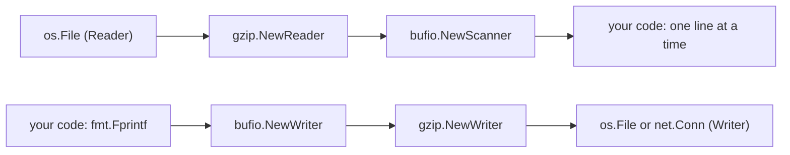

# io, bufio and time

> **Before this lesson:** you need interfaces ([Interfaces, any, assertions and the nil trap](#/lesson/go/go-interfaces), [Interface design and dependency injection](#/lesson/go/go-interface-design)), slices of bytes ([Strings, runes and bytes](#/lesson/go/go-strings-runes)), error handling with sentinels ([errors.Is](#/lesson/go/go-errors-is-as-panic)) and `defer`. The ticker section uses channels from [Goroutines and channels](#/lesson/go/go-goroutines-channels).

## In plain words

The **standard library** is the large set of packages installed with Go. You have used `fmt`, `strings`, `errors` and `sync`. This module tours the packages that almost every service relies on, starting with two families.

**Input and output (`io`).** Think of plumbing. A tap, a garden hose and a fire hydrant are very different objects, yet anything with a standard thread can be screwed onto any of them. Because the connection is standard, you can combine parts freely: tap → filter → hose → sprinkler. Go's `io` package defines two such standard connections:

- a **Reader** is anything you can pull bytes out of (a file, a network connection, a string, a compressed stream);
- a **Writer** is anything you can push bytes into (a file, a connection, the terminal, a buffer in memory).

Code written against these two connections works with all of them, and adapters (compress, count, buffer, limit, split) can be chained like pipe fittings.

**Time (`time`).** Programs need two different ideas of time, and mixing them causes bugs. An **instant** is a point on the timeline ("14 March 2026 at 09:30 in Lima"). A **duration** is a length of time ("90 minutes"). Go has a type for each, plus timers and tickers that deliver events on channels.

Why this matters for a job: reading request bodies, writing responses, streaming files, logging, timeouts, timestamps, retries with delays: every backend task touches these packages. "Explain `io.Reader`" is a favourite interview question because the answer shows whether you understand how Go composes small interfaces.

**Compared with Python.** Python has file-like objects with `read()` and `write()` by convention, and `with open(...)` for cleanup. Go makes the convention a compile-checked interface and uses `defer f.Close()`. For time, Python's `datetime` and `timedelta` correspond to `time.Time` and `time.Duration`; formatting is where Go differs most, as you will see.

## io.Reader

The whole interface is one method:

```go
type Reader interface {
	Read(p []byte) (n int, err error)
}
```

The contract: the caller supplies a byte slice `p`. `Read` fills it with **up to** `len(p)` bytes and returns how many it wrote, `n`. When there is nothing more, it returns the sentinel error `io.EOF` ("end of file", used for the end of any stream).

Watch it work on the simplest reader, one that reads from a string:

```go
package main

import (
	"fmt"
	"io"
	"strings"
)

func main() {
	r := strings.NewReader("Hello, Reader!")
	buf := make([]byte, 5) // a small buffer, to force several reads

	for {
		n, err := r.Read(buf)
		fmt.Printf("n=%d err=%v data=%q\n", n, err, buf[:n])
		if err == io.EOF {
			break
		}
	}
}
```

```text
n=5 err=<nil> data="Hello"
n=5 err=<nil> data=", Rea"
n=4 err=<nil> data="der!"
n=0 err=EOF data=""
```

Line by line:

- `strings.NewReader` wraps a string in a type that has a `Read` method.
- `buf` is the caller's buffer, reused on every pass. (This design keeps allocation out of the read loop; see [Pointers, performance and the garbage collector](#/lesson/go/go-pointers-gc).)
- Each `Read` returns how many bytes it placed in `buf`. **Only `buf[:n]` is valid data**; the rest of the buffer holds leftovers from an earlier read.
- The third read returns 4 bytes, fewer than the buffer holds. A short read is normal and does not mean the end.
- The end is signalled by `io.EOF`. It is not a failure; it is how a stream says "finished".

The rules a correct read loop must respect:

1. Process the `n` bytes **before** looking at the error. A reader is allowed to return data and `io.EOF` in the same call.
2. `n < len(p)` does not mean end of stream.
3. Any error other than `io.EOF` is a real failure.

You will rarely write this loop yourself, because helper functions do it correctly:

| Helper | What it does |
|---|---|
| `io.ReadAll(r)` | reads everything into one `[]byte` (only for inputs you know are small) |
| `io.Copy(dst, src)` | streams from a reader to a writer in chunks, without loading it all |
| `io.ReadFull(r, buf)` | reads exactly `len(buf)` bytes or returns an error |
| `bufio.Scanner` | splits a reader into lines or words |

### Try it: short reads and the end of the stream

The simulated reader hands out data in pieces of unpredictable size, as a network connection does.

```python-run
class ChunkyReader:
    """Delivers data in the given piece sizes, like a network connection."""
    def __init__(self, data, pieces):
        self.data, self.pieces, self.pos = data, list(pieces), 0
    def read(self, buf_size):
        if self.pos >= len(self.data):
            return b"", "EOF"
        want = min(buf_size, self.pieces.pop(0) if self.pieces else buf_size)
        chunk = self.data[self.pos:self.pos + want]
        self.pos += len(chunk)
        return chunk, None

def read_all(reader, buf_size):
    out, calls = b"", 0
    while True:
        chunk, err = reader.read(buf_size)
        calls += 1
        print(f"   Read(buf of {buf_size}) -> n={len(chunk)} err={err} data={chunk!r}")
        out += chunk                      # use the n bytes FIRST ...
        if err == "EOF":                  # ... then look at the error
            return out, calls

data = b"GET /index.html HTTP/1.1"
print("network delivering 3, 9, 1 and then the rest:")
result, calls = read_all(ChunkyReader(data, [3, 9, 1]), 8)
print("reassembled:", result, "in", calls, "calls")

print("\nWRONG assumption: one Read returns the whole message")
first, _ = ChunkyReader(data, [3, 9, 1]).read(64)
print("   got only:", first)
```

The last lines show the classic networking bug: assuming one `Read` returns one complete message. It returns whatever happened to be available.

## io.Writer

```go
type Writer interface {
	Write(p []byte) (n int, err error)
}
```

`Write` sends the bytes of `p` and returns how many were accepted. If `n < len(p)` it must return a non-nil error. You usually write through helpers: `fmt.Fprintf(w, ...)`, `fmt.Fprintln(w, ...)`, `io.WriteString(w, s)` and `io.Copy`.

`os.Stdout`, the terminal's output, is a writer. `fmt.Println(x)` is shorthand for `fmt.Fprintln(os.Stdout, x)`.

## Composing readers and writers

Because everything agrees on these two interfaces, pieces can be stacked. Each adapter takes a Reader or Writer and returns a new one that adds behaviour.

```go
package main

import (
	"bytes"
	"compress/gzip"
	"fmt"
	"io"
	"os"
	"strings"
)

func main() {
	// 1. One write, two destinations
	var copyOfLog bytes.Buffer
	w := io.MultiWriter(os.Stdout, &copyOfLog)
	fmt.Fprintln(w, "logged twice")
	fmt.Println(copyOfLog.Len())

	// 2. Compress while writing, decompress while reading
	var compressed bytes.Buffer
	zw := gzip.NewWriter(&compressed)            // wraps a Writer
	io.WriteString(zw, strings.Repeat("go ", 1000)) // 3000 bytes of very repetitive text
	zw.Close()                                   // flushes the remaining compressed data
	fmt.Println(compressed.Len() < 3000)

	zr, err := gzip.NewReader(&compressed) // wraps a Reader
	if err != nil {
		fmt.Println(err)
		return
	}
	plain, _ := io.ReadAll(zr)
	fmt.Println(len(plain))

	// 3. Read at most N bytes from any reader
	limited := io.LimitReader(strings.NewReader("abcdefghij"), 4)
	first, _ := io.ReadAll(limited)
	fmt.Println(string(first))
}
```

```text
logged twice
13
true
3000
abcd
```

- `bytes.Buffer` is a growable chunk of memory that is both a Reader and a Writer; it is the standard tool for capturing output in tests. Its methods have pointer receivers, hence `&copyOfLog`.
- `io.MultiWriter` returns a writer that duplicates every write to all its targets. The line went to the terminal and into the buffer (12 characters plus the newline = 13 bytes).
- `gzip.NewWriter(&compressed)` returns a writer that compresses whatever you write and passes the result on. The code that writes does not know compression is happening.
- `io.LimitReader` stops after a given number of bytes. Servers use it to refuse oversized uploads.



Other useful adapters: `io.TeeReader(r, w)` (reads from `r` and copies everything read to `w`), `io.MultiReader` (concatenates readers), `io.Pipe` (connects a writer to a reader in memory), `io.Discard` (a writer that throws data away).

## Files

```go
package main

import (
	"bufio"
	"fmt"
	"os"
	"strings"
)

func main() {
	// Whole-file helpers for small files
	if err := os.WriteFile("notes.txt", []byte("one two\nthree four five\n"), 0o644); err != nil {
		fmt.Println("write failed:", err)
		return
	}
	data, err := os.ReadFile("notes.txt")
	if err != nil {
		fmt.Println("read failed:", err)
		return
	}
	fmt.Println(len(data))

	// Streaming, line by line, for files of any size
	f, err := os.Open("notes.txt")
	if err != nil {
		fmt.Println("open failed:", err)
		return
	}
	defer f.Close()

	sc := bufio.NewScanner(f)
	for sc.Scan() {
		line := sc.Text()
		fmt.Println(len(strings.Fields(line)), line)
	}
	if err := sc.Err(); err != nil {
		fmt.Println("scan failed:", err)
	}
}
```

```text
24
2 one two
3 three four five
```

- `os.WriteFile` and `os.ReadFile` handle a whole file in one call. `0o644` is the file's permission bits in octal (owner may read and write, others may read).
- `os.Open` opens for reading and returns an `*os.File`, which is a Reader, a Writer and a **Closer** (`Close() error`). `defer f.Close()` right after the error check releases the operating-system handle.
- `os.Create(name)` creates or truncates a file for writing. `os.OpenFile` gives full control (append, permissions).

### bufio: buffering

Reading or writing a few bytes at a time directly on a file or socket is slow, because every call goes to the operating system. The `bufio` package wraps a Reader or Writer with an in-memory **buffer** so that the operating system is asked for large chunks.

- **`bufio.Scanner`** reads a stream piece by piece. `sc.Scan()` advances to the next piece and returns `false` at the end; `sc.Text()` is the current piece without its line ending. By default it splits on lines; `sc.Split(bufio.ScanWords)` splits on words. **After the loop, check `sc.Err()`**: `Scan` returns `false` both at the end and on an error. One limit: a single line may be at most 64 KB unless you enlarge the buffer with `sc.Buffer(...)`.
- **`bufio.NewWriter(w)`** collects small writes and sends them on in blocks. **You must call `Flush()` at the end**, or the last block stays in memory and never reaches the file:

```go
bw := bufio.NewWriter(f)
defer bw.Flush() // runs before the deferred f.Close(), because defers run last-in, first-out
fmt.Fprintf(bw, "line %d\n", 1)
```

## time: instants and durations

### Duration

A `time.Duration` is a length of time, stored as a whole number of nanoseconds (billionths of a second). The package provides constants to build readable values:

```go
package main

import (
	"fmt"
	"time"
)

func main() {
	d := 90 * time.Minute
	fmt.Println(d, d.Hours(), d.Seconds())

	timeout := 2*time.Second + 500*time.Millisecond
	fmt.Println(timeout, timeout.Milliseconds())

	parsed, err := time.ParseDuration("1h15m")
	fmt.Println(parsed, err)
}
```

```text
1h30m0s 1.5 5400
2.5s 2500
1h15m0s <nil>
```

Always write durations as a number times a unit: `5 * time.Second`. A bare number is nanoseconds, so `time.Sleep(5)` sleeps for five billionths of a second, a well-known beginner mistake. To use an `int` variable, convert it: `time.Duration(n) * time.Second`.

### Time

A `time.Time` is an instant, with nanosecond precision and an attached location (time zone).

```go
package main

import (
	"fmt"
	"time"
)

func main() {
	t := time.Date(2026, time.March, 14, 9, 30, 0, 0, time.UTC)

	fmt.Println(t.Format("2006-01-02 15:04"))
	fmt.Println(t.Format(time.RFC3339))
	fmt.Println(t.Weekday(), t.YearDay())

	later := t.Add(36 * time.Hour)
	fmt.Println(later.Format("Mon Jan 2 3:04PM"))
	fmt.Println(later.Sub(t), later.After(t), t.Equal(later))

	tokyo, err := time.LoadLocation("Asia/Tokyo")
	if err == nil {
		fmt.Println(t.In(tokyo).Format("15:04 MST"))
	}
}
```

```text
2026-03-14 09:30
2026-03-14T09:30:00Z
Saturday 73
Sun Mar 15 9:30PM
36h0m0s true false
18:30 JST
```

- `time.Date(...)` builds a specific instant; `time.Now()` returns the current one.
- `Add` moves an instant by a duration; `Sub` gives the duration between two instants; `Before`, `After` and `Equal` compare.
- `t.In(loc)` shows the same instant on another zone's clock: 09:30 in UTC is 18:30 in Tokyo.

### Formatting: the reference time

Most languages format dates with codes such as `%Y-%m-%d`. Go uses an **example** instead. You write how one specific moment, the **reference time**, should look, and Go formats other times the same way. The reference time is:

```text
Mon Jan 2 15:04:05 MST 2006        (which is 01/02 03:04:05PM '06 -0700)
```

Its parts count upward: month 1, day 2, hour 3 (PM, so 15), minute 4, second 5, year 6, zone −7. To get a layout, write the reference time in the shape you want:

| You want | Layout string |
|---|---|
| `2026-03-14` | `"2006-01-02"` |
| `14/03/2026` | `"02/01/2006"` |
| `09:30:00` | `"15:04:05"` |
| `9:30 AM` | `"3:04 PM"` |
| `Sat, 14 Mar 2026` | `"Mon, 02 Jan 2006"` |
| with milliseconds | `"15:04:05.000"` |

The layout must use exactly these reference numbers. `"2026-03-14"` as a layout produces nonsense, because `2026` is not the reference year. For data exchanged between systems, use the predefined `time.RFC3339` (`2006-01-02T15:04:05Z07:00`), the standard timestamp format in JSON APIs.

Parsing uses the same layouts in reverse:

```go
p, err := time.Parse("2006-01-02", "2026-12-25")
fmt.Println(p.Month(), p.Day(), err)

_, err = time.Parse("2006-01-02", "25/12/2026")
fmt.Println(err != nil)
```

```text
December 25 <nil>
true
```

`time.Parse` assumes UTC when the text carries no zone; `time.ParseInLocation` lets you say otherwise.

### Comparing and measuring

Two rules:

**Compare instants with `Equal`, not `==`.** A `time.Time` holds a location and other internal fields; two values can represent the same instant and still differ under `==`.

**Measure elapsed time with `time.Since`.**

```go
start := time.Now()
doWork()
elapsed := time.Since(start) // same as time.Now().Sub(start)
```

`time.Now()` records two clocks: the **wall clock** (the date and time people read, which can jump when the system clock is corrected) and a **monotonic clock** (which only ever moves forward). `Sub` and `Since` use the monotonic reading when both values have one, so measurements are immune to clock adjustments.

Store and transmit times in UTC and convert to a local zone only for display.

## Timers and tickers

The `time` package delivers time-based events on channels, which is why they combine with `select`.

| Call | Gives you | Use |
|---|---|---|
| `time.Sleep(d)` | nothing; pauses the goroutine | simple delays |
| `time.After(d)` | a channel that receives once after `d` | timeouts in `select` |
| `time.NewTimer(d)` | a `*Timer` with channel `C`; can `Stop` and `Reset` | reusable or cancellable one-shot |
| `time.AfterFunc(d, f)` | runs `f` in its own goroutine after `d` | delayed callback |
| `time.NewTicker(d)` | a `*Ticker` whose channel `C` receives every `d` | periodic work |

```go
package main

import (
	"fmt"
	"time"
)

func main() {
	ticker := time.NewTicker(100 * time.Millisecond)
	defer ticker.Stop() // release it when done

	deadline := time.After(350 * time.Millisecond)
	count := 0
	for {
		select {
		case <-ticker.C:
			count++
			fmt.Println("tick", count)
		case <-deadline:
			fmt.Println("stopping after", count, "ticks")
			return
		}
	}
}
```

```text
tick 1
tick 2
tick 3
stopping after 3 ticks
```

Ticks arrive at 100, 200 and 300 ms; the deadline fires at 350 ms.

A ticker's channel holds **at most one** pending tick. If your loop is slow, missed ticks are dropped, not queued. A ticker therefore gives "no more often than every `d`", which makes it a basic rate limiter:

```go
limiter := time.NewTicker(200 * time.Millisecond) // at most 5 per second
defer limiter.Stop()
for _, req := range requests {
	<-limiter.C
	go handle(req)
}
```

### Try it: what a slow consumer sees

```python-run
def ticker_starts(period, requests):
    """requests: (arrival, service) pairs handled one after another, each waiting for a tick."""
    taken, free, rows = 0, 0, []
    for arrival, service in requests:
        ready = max(arrival, free)
        next_tick = (taken // period + 1) * period      # first tick strictly after the last one taken
        start = max(ready, next_tick)
        waited_for_tick = start > ready
        rows.append((arrival, ready, start, "waited for tick" if waited_for_tick else "tick was already buffered"))
        taken, free = start, start + service
    dropped = rows[-1][2] // period - len(rows) if rows else 0
    return rows, dropped

rows, dropped = ticker_starts(10, [(0, 1), (0, 35), (0, 1), (0, 1)])
print("period 10; request = (arrival, service time)")
for arrival, ready, start, note in rows:
    print(f"   ready at {ready:>3} -> starts at {start:>3}   ({note})")
print("ticks dropped while the worker was busy:", dropped)
```

After the slow request (35 time units) one tick is waiting in the channel and the next request starts immediately; the ticks that fired in between are gone. The same model is the practice problem [Rate limiting with time.Ticker](#/problem/go-ticker-rate-limiter). For production rate limiting with bursts, use `golang.org/x/time/rate`.

## Pitfalls

> [!WARNING]
> Using the whole buffer after `Read` instead of `buf[:n]`, or treating one `Read` as one complete message. Both work in a quick local test and corrupt data on a real network.

- **Treating `io.EOF` as a failure**, or ignoring the bytes returned together with it.
- **`io.ReadAll` on unbounded input** (an upload, a network stream): memory exhaustion. Stream with `io.Copy`, or cap with `io.LimitReader`.
- **Forgetting `Close`** on files and response bodies; forgetting **`Flush`** on a `bufio.Writer` or `Close` on a `gzip.Writer`.
- **Not checking `sc.Err()`** after a `Scanner` loop; lines longer than 64 KB.
- **`time.Sleep(5)`** meaning five nanoseconds.
- **A layout with the wrong reference numbers** (`"YYYY-MM-DD"`, `"2026-01-01"`).
- **Comparing times with `==`**; storing local times without a zone.
- **A ticker that is never stopped.**
- **Measuring durations with wall-clock arithmetic on parsed or stored times**, which lack the monotonic reading.

> [!TIP]
> When you write a function that consumes or produces data, take an `io.Reader` or `io.Writer` parameter instead of a file name or a `[]byte`. The function then works with files, network connections, compressed streams and, in tests, with `strings.NewReader` and `bytes.Buffer`.

> [!INTERVIEW]
> **"Explain `io.Reader`."** A one-method interface, `Read(p []byte) (n int, err error)`: the caller provides the buffer, the reader fills up to `len(p)` bytes, returns the count, and signals the end with `io.EOF`. Short reads are normal; data may be returned together with an error; callers must use `p[:n]`. The caller-supplied buffer avoids an allocation per read. Because so many types implement it (files, sockets, buffers, decompressors, HTTP bodies) and adapters wrap one reader in another, I/O code composes like pipes. **"How does time formatting work in Go?"** With a layout written as the reference time `Mon Jan 2 15:04:05 MST 2006`; also mention `Duration` being nanoseconds, `Equal` for comparison and the monotonic clock behind `time.Since`.

## Cheat sheet

| Task | Code |
|---|---|
| Read a small file | `data, err := os.ReadFile(name)` |
| Write a small file | `os.WriteFile(name, data, 0o644)` |
| Open / create | `f, err := os.Open(name)` / `os.Create(name)`; `defer f.Close()` |
| Read lines | `sc := bufio.NewScanner(r); for sc.Scan() { sc.Text() }; sc.Err()` |
| Copy a stream | `io.Copy(dst, src)` |
| Read everything | `io.ReadAll(r)` (small inputs only) |
| Reader from a string / bytes | `strings.NewReader(s)` / `bytes.NewReader(b)` |
| In-memory writer | `var buf bytes.Buffer` |
| Buffered writer | `bw := bufio.NewWriter(w); defer bw.Flush()` |
| Now / elapsed | `time.Now()` / `time.Since(start)` |
| Duration | `3 * time.Second`, `time.Duration(n) * time.Millisecond` |
| Format / parse | `t.Format("2006-01-02 15:04:05")` / `time.Parse(layout, s)` |
| Standard timestamp | `time.RFC3339` |
| Arithmetic | `t.Add(d)`, `t2.Sub(t1)`, `t.Before(u)`, `t.Equal(u)` |
| Timeout in select | `case <-time.After(d):` |
| Periodic | `tk := time.NewTicker(d); defer tk.Stop(); <-tk.C` |

## Summary

- **`io.Reader`** and **`io.Writer`** are one-method interfaces that every source and sink of bytes implements. Read loops must use `buf[:n]`, accept short reads and stop at `io.EOF`.
- Adapters wrap readers and writers to add buffering, compression, limiting and duplication, and can be chained.
- Use `os.ReadFile`/`os.WriteFile` for small files and `os.Open` with `bufio.Scanner` or `io.Copy` for streams. Close what you open and flush what you buffer.
- **`time.Duration`** is a span in nanoseconds; **`time.Time`** is an instant with a location. Format and parse with layouts based on the reference time `2006-01-02 15:04:05`.
- Compare instants with `Equal`, measure with `time.Since`, keep stored times in UTC.
- Timers and tickers deliver events on channels; a ticker buffers at most one tick and must be stopped.

## Glossary

- **Buffer**: memory that temporarily holds data on its way somewhere.
- **Closer**: a type with `Close() error`, releasing a resource.
- **Duration**: a length of time; `time.Duration`, counted in nanoseconds.
- **EOF**: end of file; the sentinel `io.EOF` marking the end of any stream.
- **Flush**: forcing buffered data to be written out.
- **Layout**: a string showing how the reference time should be formatted.
- **Monotonic clock**: a clock that only moves forward, used for measuring elapsed time.
- **Reader / Writer**: a source / destination of bytes, defined by `Read` / `Write`.
- **Reference time**: `Mon Jan 2 15:04:05 MST 2006`, the model for Go time layouts.
- **Short read**: a `Read` that returns fewer bytes than the buffer can hold.
- **Stream**: data processed piece by piece instead of all at once.
- **Ticker / Timer**: a source of repeated / single time events on a channel.
- **Wall clock**: the ordinary date-and-time clock, which can be adjusted.

```quiz
[
  {"q": "What does `Read(p []byte) (n int, err error)` promise about `n`?",
   "options": ["`n` always equals `len(p)` unless the stream has ended", "`n` is between 0 and `len(p)`; fewer bytes than requested is normal", "`n` is the total size of the stream", "`n` is always at least 1"],
   "answer": 1,
   "explain": "A reader returns whatever is available, up to the buffer size. Callers must use `p[:n]` and keep reading until `io.EOF`."},
  {"q": "What does this print? `r := strings.NewReader(\"abcdef\"); buf := make([]byte, 4); n1, _ := r.Read(buf); n2, _ := r.Read(buf); fmt.Println(n1, n2, string(buf[:n2]))`",
   "options": ["`4 2 ef`", "`4 4 efcd`", "`6 0 `", "`4 2 abcd`"],
   "answer": 0,
   "explain": "The first read fills the buffer with `abcd`. The second returns the remaining two bytes `ef` at the start of the buffer; only `buf[:2]` is valid."},
  {"q": "A program writes through `bw := bufio.NewWriter(file)` and exits without calling `bw.Flush()`. What is the likely result?",
   "options": ["Nothing; Flush is optional", "The last part of the output is missing from the file", "The file is deleted", "A compile error"],
   "answer": 1,
   "explain": "A buffered writer holds data in memory until its buffer fills or Flush is called. Without the final Flush the tail of the output never reaches the underlying writer."},
  {"q": "Which layout formats a time as `2026-03-14`?",
   "options": ["`\"YYYY-MM-DD\"`", "`\"%Y-%m-%d\"`", "`\"2006-01-02\"`", "`\"2026-03-14\"`"],
   "answer": 2,
   "explain": "Go layouts are written as the reference time Mon Jan 2 15:04:05 2006. Year is 2006, month 01, day 02."},
  {"q": "What does `time.Sleep(3)` do?",
   "options": ["Sleeps for 3 seconds", "Sleeps for 3 milliseconds", "Sleeps for 3 nanoseconds", "Does not compile"],
   "answer": 2,
   "explain": "A Duration is a count of nanoseconds, and an untyped constant 3 becomes Duration(3). Write `3 * time.Second`."},
  {"q": "What does this print? `d := 150 * time.Minute; fmt.Println(d, d.Hours())`",
   "options": ["`150m0s 2.5`", "`2h30m0s 2.5`", "`2.5h 2`", "`9000s 150`"],
   "answer": 1,
   "explain": "Durations print in hours, minutes and seconds: 2h30m0s. `Hours()` returns the value as a float64: 2.5."},
  {"q": "Why should two `time.Time` values be compared with `t.Equal(u)` instead of `t == u`?",
   "options": ["`==` does not compile for structs", "`==` also compares the location and internal clock fields, so the same instant can compare unequal", "`Equal` is faster", "`==` compares only the date"],
   "answer": 1,
   "explain": "Two Time values for the same instant in different zones, or with and without a monotonic reading, differ under `==`. `Equal` compares the instant."},
  {"q": "A ticker fires every 10 ms, but the loop reading `ticker.C` is blocked for 55 ms. How many ticks are waiting when it returns?",
   "options": ["5", "1", "0", "55"],
   "answer": 1,
   "explain": "The ticker's channel has a buffer of one. While the reader is busy, one tick is kept and the rest are dropped."}
]
```

> **Source:** Bodner, *Learning Go* 2e, ch. 13 (topic coverage; wording and examples are original). Official references: https://pkg.go.dev/io, https://pkg.go.dev/bufio, https://pkg.go.dev/os, https://pkg.go.dev/time, https://go.dev/blog/pipelines, https://pkg.go.dev/time#pkg-constants
