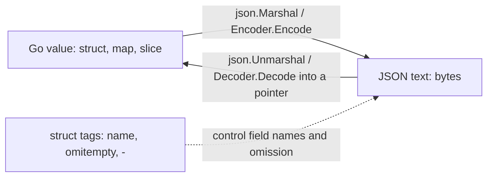

# encoding/json

> **Before this lesson:** you need structs, maps and slices (composite types module), pointers and `nil` ([Pointers, nil and mutability](#/lesson/go/go-pointers-basics)), exported versus unexported names ([Packages, visibility and imports](#/lesson/go/go-packages-imports)), `any` and type assertions ([Interfaces](#/lesson/go/go-interfaces)) and readers and writers ([io, bufio and time](#/lesson/go/go-io-time)).

## In plain words

Programs written in different languages, running on different machines, need a shared way to write data down so that one can send it and another can read it. The most common format for this on the web is **JSON** (JavaScript Object Notation): plain text that looks like this.

```text
{"id": 7, "name": "Ana", "tags": ["admin", "beta"], "active": true, "manager": null}
```

JSON has only a few building blocks: **objects** in braces (names paired with values), **arrays** in brackets (ordered lists), strings in double quotes, numbers, `true`, `false` and `null`.

Think of sending furniture by post. You cannot post an assembled wardrobe, so you take it apart, pack the pieces flat with a parts list, and the recipient rebuilds it from the list. Turning a live Go value into JSON text is the flat-packing; it is called **marshalling** (or encoding, or serialising). Rebuilding a Go value from JSON text is **unmarshalling** (decoding, deserialising).

The package `encoding/json` does both. Its central design question is how the names in the JSON text are matched to the fields of your Go structs. The answer is **struct tags**: short annotations on fields.

Why this matters for a job: a backend service is, in large part, JSON in and JSON out. The rules about exported fields, tags, `omitempty`, missing values and number types cause real bugs, and interviewers love them: "why is this field missing from my JSON?" has the same answer every time.

**Compared with Python.** `json.loads` turns JSON into dictionaries and lists, and you look fields up by string key at run time. Go can do that too (decoding into `map[string]any`), but the idiomatic approach is to decode straight into typed structs, so that the shape of the data is checked and documented by the type. This is closer to Python's `pydantic` or dataclass-based decoding than to bare dictionaries.

## Marshalling: Go value to JSON

Start with a struct with no annotations:

```go
package main

import (
	"encoding/json"
	"fmt"
)

type Point struct {
	X int
	Y int
	label string
}

func main() {
	p := Point{X: 3, Y: 4, label: "home"}
	data, err := json.Marshal(p)
	if err != nil {
		fmt.Println("error:", err)
		return
	}
	fmt.Println(string(data))
}
```

```text
{"X":3,"Y":4}
```

- `json.Marshal` takes any value and returns `[]byte` (the JSON text) and an error.
- The output is compact: no spaces or line breaks. Convert to `string` to print it.
- Each **exported** field became a JSON name with the same spelling.
- The field `label` is **missing**. It starts with a lower-case letter, so it is unexported, and the `json` package, being a different package, cannot see it. **Unexported fields are never marshalled or unmarshalled.** This is the answer to "why is my field missing?" nine times out of ten.

### Struct tags: choosing the JSON names

JSON APIs conventionally use lower-case names such as `user_id` or `userId`, which cannot be Go field names for exported fields. A **struct tag** bridges the gap. It is a string literal in backquotes placed after the field's type:

```go
package main

import (
	"encoding/json"
	"fmt"
	"time"
)

type User struct {
	ID        int       `json:"id"`
	Name      string    `json:"name"`
	Email     string    `json:"email,omitempty"`
	Password  string    `json:"-"`
	Tags      []string  `json:"tags"`
	CreatedAt time.Time `json:"created_at"`
}

func main() {
	u := User{
		ID:        7,
		Name:      "Ana",
		Password:  "secret",
		CreatedAt: time.Date(2026, time.March, 14, 9, 30, 0, 0, time.UTC),
	}
	data, _ := json.Marshal(u)
	fmt.Println(string(data))

	pretty, _ := json.MarshalIndent(u, "", "  ")
	fmt.Println(string(pretty))
}
```

```text
{"id":7,"name":"Ana","tags":null,"created_at":"2026-03-14T09:30:00Z"}
{
  "id": 7,
  "name": "Ana",
  "tags": null,
  "created_at": "2026-03-14T09:30:00Z"
}
```

Field by field:

- `` `json:"id"` `` sets the JSON name to `id`.
- `` `json:"email,omitempty"` `` adds the option **`omitempty`**: leave the field out when it holds an "empty" value. `Email` is `""`, so it does not appear.
- `` `json:"-"` `` means "never include this field". Use it for secrets and internal data.
- `Tags` is a nil slice, and a nil slice marshals as **`null`**. An empty non-nil slice (`[]string{}`) marshals as `[]`. Front-end code often cares about this difference; initialise the slice if clients expect an array.
- `time.Time` marshals as a string in RFC 3339 format.
- `json.MarshalIndent` produces the human-readable layout; the last argument is the indentation.

The tag format is strict: `json:"name,option"` with **no space** after the colon. A malformed tag is silently ignored, and the field falls back to its Go name. `go vet` reports such tags.

### What omitempty considers empty

| Type | Omitted when |
|---|---|
| number | `0` |
| string | `""` |
| bool | `false` |
| pointer, interface | `nil` |
| slice, map | `nil` **or** length 0 |
| struct | **never** |

Two consequences:

1. `omitempty` cannot tell "the value is zero" from "there is no value". An account balance of `0` with `omitempty` disappears from the output. When zero is meaningful, either leave `omitempty` off or use a **pointer** field (`*int`): nil means absent, a pointer to 0 means zero.
2. A struct field is never omitted by `omitempty`, including `time.Time{}`. Go 1.24 added the option **`omitzero`**, which omits any field holding its zero value, structs included.

Another option, `string`, writes a number or boolean inside quotes (`json:"id,string"` gives `"id":"7"`); it exists for clients, such as JavaScript, that cannot represent 64-bit integers exactly.

### Try it: predict the output

A compact model of these rules. Edit the fields and predict the JSON before running; the complete rule set is the practice problem [JSON marshalling rules for struct tags](#/problem/go-json-tags).

```python-run
import json

def marshal(fields):
    """fields: (GoName, tag, value). A nested struct is ('struct', [fields])."""
    def is_struct(v): return isinstance(v, tuple) and v and v[0] == "struct"
    def empty(v):
        if v is None or v is False: return True
        if is_struct(v) or isinstance(v, bool): return False
        if isinstance(v, int): return v == 0
        return len(v) == 0
    def enc(v):
        if is_struct(v): return marshal(v[1])
        if isinstance(v, dict): return "{" + ",".join(json.dumps(k) + ":" + enc(v[k]) for k in sorted(v)) + "}"
        if isinstance(v, list): return "[" + ",".join(enc(x) for x in v) + "]"
        return json.dumps(v)
    parts = []
    for name, tag, value in fields:
        if not name[0].isupper():       # unexported: invisible to encoding/json
            continue
        if tag == "-":
            continue
        pieces = tag.split(",")
        key, opts = pieces[0] or name, pieces[1:]
        if "omitempty" in opts and empty(value):
            continue
        parts.append(json.dumps(key) + ":" + enc(value))
    return "{" + ",".join(parts) + "}"

user = [
    ("ID",       "id",                  7),
    ("Name",     "",                    "Ana"),          # no tag: Go name is used
    ("password", "pw",                  "secret"),       # unexported: skipped despite the tag
    ("Balance",  "balance,omitempty",   0),              # zero + omitempty: vanishes
    ("Tags",     "tags",                None),           # nil slice -> null
    ("Roles",    "roles,omitempty",     []),             # empty + omitempty: vanishes
    ("Address",  "address,omitempty",   ("struct", [("City", "city,omitempty", "")])),  # struct: never empty
    ("Labels",   "labels",              {"b": "2", "a": "1"}),                          # map keys are sorted
]
print(marshal(user))
```

Note the `address` entry: the struct itself is kept even though its only field was omitted, giving `"address":{}`.

## Unmarshalling: JSON to Go value

```go
package main

import (
	"encoding/json"
	"fmt"
)

type Product struct {
	SKU   string  `json:"sku"`
	Price float64 `json:"price"`
	Stock int     `json:"stock"`
	Notes *string `json:"notes"`
}

func main() {
	input := []byte(`{"sku": "A1", "price": 9.5, "colour": "red"}`)

	var p Product
	if err := json.Unmarshal(input, &p); err != nil {
		fmt.Println("error:", err)
		return
	}
	fmt.Printf("%+v\n", p)

	err := json.Unmarshal([]byte(`{"sku": "B2", "price": "cheap"}`), &p)
	fmt.Println(err)
}
```

```text
{SKU:A1 Price:9.5 Stock:0 Notes:<nil>}
json: cannot unmarshal string into Go struct field Product.price of type float64
```

- `json.Unmarshal(data, &p)` needs a **pointer** to the destination, so that it can fill it in. Passing `p` instead of `&p` returns an error (and `go vet` warns).
- The JSON name `colour` matches no field. By default **unknown names are ignored**, silently.
- The JSON has no `stock`. **Missing names leave the field untouched**: here it keeps its zero value 0. You cannot tell from the struct whether the sender wrote `"stock": 0` or nothing at all. As with marshalling, a pointer field solves this: `Notes` stays `nil` because the input had no `notes`.
- The second call shows a type mismatch: the text `"cheap"` cannot become a `float64`. The error names the field. Fields decoded before the error keep their new values, so do not use a struct after a failed unmarshal.

Matching of names is **case-insensitive** on input (`"SKU"`, `"Sku"` and `"sku"` all fill the field), with exact matches preferred. Do not rely on that; send what the tags say.

### How JSON types map to Go types

| JSON | Into a typed field | Into `any` |
|---|---|---|
| object | struct or `map[string]T` | `map[string]any` |
| array | slice or array | `[]any` |
| string | `string` (also `time.Time`, `[]byte` as base64) | `string` |
| number | any numeric type | **`float64`** |
| `true` / `false` | `bool` | `bool` |
| `null` | nil for pointers, slices, maps, interfaces; ignored for other types | `nil` |

### Decoding when you do not know the shape

When the structure is not known in advance, decode into `any` (or `map[string]any`) and inspect it with type assertions:

```go
package main

import (
	"encoding/json"
	"fmt"
)

func main() {
	var data any
	err := json.Unmarshal([]byte(`{"n": 1, "list": [1, "two", null], "ok": true}`), &data)
	if err != nil {
		fmt.Println(err)
		return
	}
	m := data.(map[string]any)
	fmt.Printf("%T %T %T\n", m["n"], m["list"], m["ok"])

	n := m["n"].(float64) // every JSON number arrives as float64
	fmt.Println(n + 1)
}
```

```text
float64 []interface {} bool
2
```

Two things to notice. `[]interface {}` is how `%T` prints `[]any`. And the number `1` became a **`float64`**, because JSON does not distinguish integers from fractions and `float64` is the safe default. Large integer IDs lose precision this way (a `float64` holds integers exactly only up to 2^53). Prefer typed structs; if you must decode generically, call `decoder.UseNumber()` to receive numbers as `json.Number` strings.

A middle path is `json.RawMessage`, a `[]byte` that holds a piece of JSON undecoded. Use it for a field whose shape depends on another field: decode the envelope first, look at the `type` field, then unmarshal the raw part into the right struct.

## Streams: Encoder and Decoder

`Marshal` and `Unmarshal` work on byte slices in memory. When JSON comes from or goes to a **Reader or Writer** (a file, an HTTP request body, a network connection) use the streaming types, which avoid holding the whole text twice.

```go
package main

import (
	"encoding/json"
	"errors"
	"fmt"
	"io"
	"os"
	"strings"
)

type Event struct {
	Kind string `json:"kind"`
	N    int    `json:"n"`
}

func main() {
	// Encoder: writes JSON, followed by a newline, to any io.Writer
	enc := json.NewEncoder(os.Stdout)
	enc.Encode(Event{"start", 1})
	enc.Encode(Event{"stop", 2})

	// Decoder: reads a sequence of JSON values from any io.Reader
	input := strings.NewReader(`{"kind":"a","n":1} {"kind":"b","n":2}`)
	dec := json.NewDecoder(input)
	for {
		var e Event
		err := dec.Decode(&e)
		if errors.Is(err, io.EOF) {
			break
		}
		if err != nil {
			fmt.Println("bad input:", err)
			return
		}
		fmt.Println(e.Kind, e.N)
	}
}
```

```text
{"kind":"start","n":1}
{"kind":"stop","n":2}
a 1
b 2
```

In an HTTP handler this is the normal form: `json.NewDecoder(r.Body).Decode(&req)` to read the request and `json.NewEncoder(w).Encode(resp)` to write the response ([net/http and log/slog](#/lesson/go/go-http-slog)).

For an API that should reject misspelt fields, switch off the "ignore unknown names" default:

```go
dec := json.NewDecoder(r.Body)
dec.DisallowUnknownFields()
if err := dec.Decode(&req); err != nil { /* 400 Bad Request */ }
```

## Nested and embedded structs

A struct field of struct type becomes a nested object. An **embedded** struct (no field name) is flattened: its fields appear at the same level as the outer struct's.

```go
type Audit struct {
	CreatedBy string `json:"created_by"`
}

type Address struct {
	City string `json:"city"`
}

type Customer struct {
	Audit            // embedded: fields are promoted into the same JSON object
	Name    string  `json:"name"`
	Address Address `json:"address"` // named field: nested object
}

// json.Marshal(Customer{Audit{"sys"}, "Ana", Address{"Lima"}}) produces:
// {"created_by":"sys","name":"Ana","address":{"city":"Lima"}}
```

Maps marshal as objects with their keys **sorted**, which makes output deterministic even though map iteration order is random.

## Custom encoding

When the default representation is wrong for a type, give the type its own methods. `encoding/json` checks for two interfaces:

```go
type Marshaler interface   { MarshalJSON() ([]byte, error) }
type Unmarshaler interface { UnmarshalJSON([]byte) error }
```

Example: an enumeration that should travel as a readable string, not a number.

```go
package main

import (
	"encoding/json"
	"fmt"
)

type Level int

const (
	Low Level = iota
	High
)

var levelNames = map[Level]string{Low: "low", High: "high"}

func (l Level) MarshalJSON() ([]byte, error) {
	name, ok := levelNames[l]
	if !ok {
		return nil, fmt.Errorf("unknown level %d", int(l))
	}
	return json.Marshal(name) // produce a JSON string, with quotes and escaping done properly
}

func (l *Level) UnmarshalJSON(data []byte) error {
	var name string
	if err := json.Unmarshal(data, &name); err != nil {
		return err
	}
	for level, n := range levelNames {
		if n == name {
			*l = level
			return nil
		}
	}
	return fmt.Errorf("unknown level %q", name)
}

type Alert struct {
	Msg   string `json:"msg"`
	Level Level  `json:"level"`
}

func main() {
	out, _ := json.Marshal(Alert{"disk almost full", High})
	fmt.Println(string(out))

	var a Alert
	err := json.Unmarshal([]byte(`{"msg":"ok","level":"low"}`), &a)
	fmt.Println(a.Level == Low, err)

	err = json.Unmarshal([]byte(`{"msg":"?","level":"extreme"}`), &a)
	fmt.Println(err)
}
```

```text
{"msg":"disk almost full","level":"high"}
true <nil>
unknown level "extreme"
```

`MarshalJSON` has a value receiver so that it works for both `Level` and `*Level`. `UnmarshalJSON` must have a **pointer receiver**, because it has to modify the value. Inside both methods, use `json.Marshal`/`json.Unmarshal` on a plain type; never build JSON by string concatenation, which gets quoting wrong.



## Validation is your job

`encoding/json` checks syntax and types. It does not check meaning: required fields, ranges, formats. After decoding, validate explicitly:

```go
if req.Email == "" {
	return errors.New("email is required")
}
if req.Quantity < 1 {
	return errors.New("quantity must be at least 1")
}
```

Keep the struct that mirrors the wire format (with tags, pointer fields for optional values) separate from the types your business logic uses, and convert between them at the edge. Then a change to the API does not ripple through the whole program.

## A note on json/v2

A redesigned package, `encoding/json/v2`, has been developed to fix long-standing quirks (case-insensitive matching, nil slices as `null`, performance). At the time of writing it is available as an experiment in recent Go releases and is not yet the default. Everything in this lesson describes the stable `encoding/json`, which will remain supported.

## Pitfalls

> [!WARNING]
> A struct with lower-case field names marshals to `{}` and unmarshals to all zeros, without any error. Fields must be exported for `encoding/json` to see them; use tags to get lower-case JSON names.

- **Malformed tags**: a space after the colon, or `json:name` without quotes. The tag is ignored.
- **Passing a non-pointer to `Unmarshal` or `Decode`.**
- **Relying on `omitempty` to distinguish zero from absent.** Use pointers (or `omitzero` for struct values).
- **Nil slice becomes `null`**, surprising clients that expect `[]`.
- **Numbers decoded into `any` are `float64`**; large IDs lose precision.
- **Ignoring the error from `Decode`**, then working with a half-filled struct.
- **Assuming unknown fields are rejected.** They are ignored unless you call `DisallowUnknownFields`.
- **Reading a request body twice.** A body is a stream; once decoded it is consumed.
- **`UnmarshalJSON` with a value receiver**: it modifies a copy and has no effect.
- **Exposing internal structs directly as API responses**, leaking fields and coupling the API to the database schema.

> [!TIP]
> When JSON output looks wrong, print the value with `fmt.Printf("%+v\n", v)` before marshalling and the text with `fmt.Println(string(data))` after. Seeing both sides makes it clear whether the data or the tags are at fault. For input, the error from `Unmarshal` names the offending field; wrap it and return it to the client as a 400 response.

> [!INTERVIEW]
> **"Why is a field missing from my JSON output?"** Either it is unexported (lower-case name), or it has the tag `json:"-"`, or it has `omitempty` and holds an empty value (0, "", false, nil, empty slice or map). **"How do you represent an optional field?"** With a pointer type, so nil means absent and a pointer to the zero value means explicitly zero. **"What type do JSON numbers get in `map[string]any`?"** `float64`, unless the decoder uses `UseNumber`. Also know: `Unmarshal` needs a pointer; unknown fields are ignored by default; missing fields keep their existing value; custom types implement `MarshalJSON`/`UnmarshalJSON`; `Encoder`/`Decoder` work on streams.

## Cheat sheet

| Goal | Code |
|---|---|
| Value → JSON bytes | `data, err := json.Marshal(v)` |
| Pretty-print | `json.MarshalIndent(v, "", "  ")` |
| JSON bytes → value | `err := json.Unmarshal(data, &v)` |
| Write to a stream | `json.NewEncoder(w).Encode(v)` |
| Read from a stream | `json.NewDecoder(r).Decode(&v)` |
| Rename a field | `` `json:"user_name"` `` |
| Skip when empty | `` `json:"note,omitempty"` `` |
| Skip when zero (incl. structs) | `` `json:"at,omitzero"` `` |
| Never include | `` `json:"-"` `` |
| Number as string | `` `json:"id,string"` `` |
| Optional value | field type `*T` |
| Reject unknown fields | `dec.DisallowUnknownFields()` |
| Delay decoding | field type `json.RawMessage` |
| Custom format | methods `MarshalJSON` (value receiver), `UnmarshalJSON` (pointer receiver) |

## Summary

- **Marshalling** turns Go values into JSON text; **unmarshalling** fills Go values from JSON text and needs a pointer.
- Only **exported** fields take part. **Struct tags** set the JSON name and options such as `omitempty` and `-`.
- `omitempty` drops zero numbers, empty strings, false, nil and empty collections, but never structs. Use pointer fields to distinguish "absent" from "zero".
- Unknown JSON names are ignored and missing ones leave fields unchanged, unless you opt into stricter decoding.
- Decoding into `any` yields `map[string]any`, `[]any`, `string`, `bool`, `nil` and **`float64`** for all numbers.
- Use `Encoder` and `Decoder` with readers and writers; implement `MarshalJSON`/`UnmarshalJSON` for custom representations; validate after decoding.

## Glossary

- **Decoder / Encoder**: streaming JSON reader / writer bound to an `io.Reader` / `io.Writer`.
- **JSON**: a text format for structured data built from objects, arrays, strings, numbers, booleans and null.
- **Marshal (encode, serialise)**: convert an in-memory value to its transport form.
- **omitempty**: tag option that omits a field holding an empty value.
- **RawMessage**: a byte slice holding undecoded JSON.
- **Struct tag**: a string attached to a struct field, read by libraries through reflection.
- **Unmarshal (decode, deserialise)**: rebuild an in-memory value from its transport form.
- **Validation**: checking that decoded data makes sense for the application.

```quiz
[
  {"q": "What does this print? `type T struct { Name string; age int }` then `b, _ := json.Marshal(T{\"Ana\", 30}); fmt.Println(string(b))`",
   "options": ["`{\"Name\":\"Ana\",\"age\":30}`", "`{\"Name\":\"Ana\"}`", "`{\"name\":\"Ana\"}`", "`{}`"],
   "answer": 1,
   "explain": "Only exported fields are marshalled, and without a tag the JSON name is the Go field name. The unexported `age` is skipped."},
  {"q": "A struct T has field N int with tag json:\"n,omitempty\" and field S string with tag json:\"s\". What does marshalling the zero value `T{}` produce?",
   "options": ["`{\"n\":0,\"s\":\"\"}`", "`{\"s\":\"\"}`", "`{}`", "`{\"n\":0}`"],
   "answer": 1,
   "explain": "`n` is zero and has omitempty, so it is left out. `s` has no omitempty, so its empty string is written."},
  {"q": "A struct field Tags of type []string with tag json:\"tags\" is left unset (nil). What appears in the JSON?",
   "options": ["`\"tags\":[]`", "`\"tags\":null`", "The field is omitted", "`\"tags\":\"\"`"],
   "answer": 1,
   "explain": "A nil slice marshals as null. Initialise it (`[]string{}`) to get an empty array, or add omitempty to drop it."},
  {"q": "A struct v has int fields A (tag json:\"a\") and B (tag json:\"b\"). The JSON text {\"a\": 5, \"c\": 9} is unmarshalled into &v. What does `fmt.Println(v.A, v.B, err)` print?",
   "options": ["`5 0 <nil>`", "`5 9 <nil>`", "`0 0` and an unknown-field error", "`5 0` and an error about the missing field b"],
   "answer": 0,
   "explain": "Unknown names (`c`) are ignored and missing names (`b`) leave the field at its current value, zero. No error is reported by default."},
  {"q": "The JSON text {\"count\": 3} is unmarshalled into a variable `m` of type `map[string]any`. What is the dynamic type of `m[\"count\"]`?",
   "options": ["`int`", "`int64`", "`float64`", "`json.Number`"],
   "answer": 2,
   "explain": "When decoding into an interface value, every JSON number becomes a float64 unless the decoder is configured with UseNumber."},
  {"q": "Why should an optional numeric field be declared as `*int` in the decoding struct?",
   "options": ["Pointers decode faster", "So that `nil` can represent 'not sent', distinct from an explicit 0", "Because int fields cannot be unmarshalled", "To allow negative numbers"],
   "answer": 1,
   "explain": "A plain int is 0 both when the client sent 0 and when it sent nothing. A pointer stays nil when the name is absent."},
  {"q": "`json.Unmarshal(data, v)` is called with a struct value `v` instead of `&v`. What happens?",
   "options": ["It fills a copy and returns nil", "It returns an error because the destination is not a pointer", "It panics", "It works as expected"],
   "answer": 1,
   "explain": "Unmarshal needs a non-nil pointer to store results; otherwise it returns an InvalidUnmarshalError. go vet also flags the call."},
  {"q": "Which receivers should the custom JSON methods of a type `Level` have?",
   "options": ["Both on `*Level`", "`MarshalJSON` on `Level` (value), `UnmarshalJSON` on `*Level` (pointer)", "Both on `Level`", "`MarshalJSON` on `*Level`, `UnmarshalJSON` on `Level`"],
   "answer": 1,
   "explain": "Unmarshalling must modify the value, so it needs a pointer receiver. A value receiver for marshalling makes it work for both values and pointers."}
]
```

> **Source:** Bodner, *Learning Go* 2e, ch. 13 (topic coverage; wording and examples are original). Official references: https://pkg.go.dev/encoding/json, https://go.dev/blog/json, https://go.dev/doc/go1.24#encodingjsonpkgencodingjson, https://www.rfc-editor.org/rfc/rfc8259, https://go.dev/blog/jsonv2-exp
