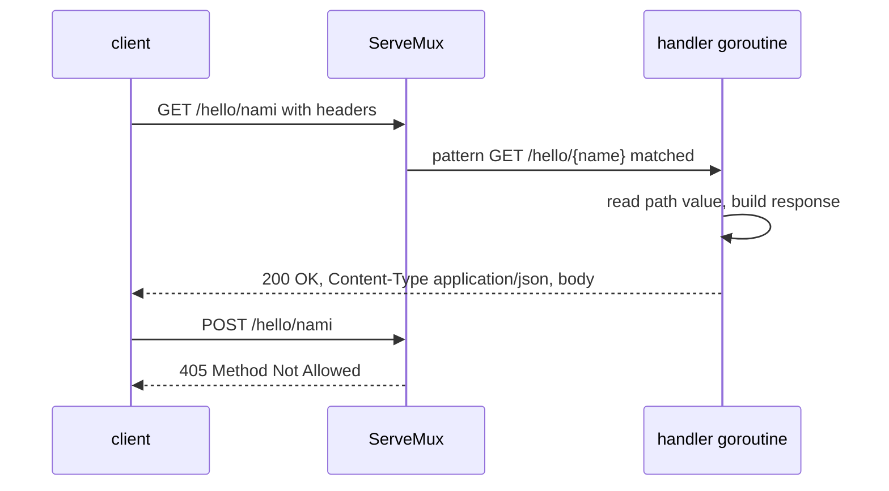

# net/http and log/slog

> **Before this lesson:** you need interfaces and function types as implementations ([Interface design and dependency injection](#/lesson/go/go-interface-design)), readers and writers ([io, bufio and time](#/lesson/go/go-io-time)), JSON ([encoding/json](#/lesson/go/go-json)), error handling, and a first idea of goroutines ([Goroutines and channels](#/lesson/go/go-goroutines-channels)). No web experience is assumed.

## In plain words

When you open a web page or an app loads your messages, two programs talk. One asks: the **client**. One answers: the **server**. The language they speak is **HTTP** (Hypertext Transfer Protocol).

A restaurant is a fair picture. A customer (client) hands the waiter an order slip: what they want and for which table. The kitchen (server) prepares it and the waiter returns with a plate and a short verdict: "here you are", "we don't serve that", "the kitchen is on fire". One order, one answer.

- The order slip is an HTTP **request**: a **method** saying what kind of action (`GET` to read, `POST` to create, `PUT`/`PATCH` to change, `DELETE` to remove), a **path** saying which thing (`/users/42`), some **headers** (labelled notes such as the format of the data) and an optional **body** (the data itself).
- The answer is an HTTP **response**: a three-digit **status code** (200 fine, 404 not found, 500 the server failed), headers, and a body.

Go's standard library contains a complete, production-quality HTTP client and server in the package **`net/http`**. Many companies run services on it directly, without a web framework.

The second topic is **logging**: the diary a service writes while it runs. When something fails at 3 a.m., the log is what you read. **`log/slog`** writes **structured** logs: instead of free-form sentences, each entry is a set of named fields that machines can search and filter.

Why this matters for a job: writing HTTP handlers and calling other services over HTTP is the daily work of a backend developer. Interviewers ask what a handler is, how routing works, why the default client is dangerous, and how you would log a request.

**Compared with Python.** Python needs third-party packages for serious work: `requests` or `httpx` as a client, Flask or FastAPI plus a separate server process for serving. In Go both sides are in the standard library, and the server handles each request in its own goroutine with no extra configuration.

## A first server

```go
package main

import (
	"fmt"
	"log"
	"net/http"
)

func hello(w http.ResponseWriter, r *http.Request) {
	fmt.Fprintln(w, "hello from Go")
}

func main() {
	http.HandleFunc("/hello", hello)
	log.Println("listening on :8080")
	log.Fatal(http.ListenAndServe(":8080", nil))
}
```

Run it, then in another terminal:

```text
$ curl -i http://localhost:8080/hello
HTTP/1.1 200 OK
Content-Type: text/plain; charset=utf-8
Content-Length: 14

hello from Go
```

(`curl` is a command-line HTTP client; `-i` also shows the status line and headers.)

Line by line:

- `hello` is a **handler function**. Its two parameters are always the same. `w http.ResponseWriter` is where you write the response; it is an `io.Writer`, which is why `fmt.Fprintln(w, ...)` works. `r *http.Request` describes the incoming request.
- `http.HandleFunc("/hello", hello)` registers the function for the path `/hello`.
- `http.ListenAndServe(":8080", nil)` opens network **port** 8080 (a numbered door on the machine) and serves requests until the program is stopped. It only returns if something goes wrong, so its result is passed to `log.Fatal`, which prints the error and exits.

You did not write a status code, so the server sent `200 OK`.

## The Handler interface

Everything in the server side of `net/http` rests on one interface:

```go
type Handler interface {
	ServeHTTP(w http.ResponseWriter, r *http.Request)
}
```

Anything with that method can answer requests. Plain functions qualify through an adapter you met in the dependency-injection lesson: `http.HandlerFunc` is a function type that has a `ServeHTTP` method calling itself. `http.HandleFunc(path, f)` applies the adapter for you.

Because the interface is so small, handlers compose. A router is a handler that picks another handler. A middleware is a function that takes a handler and returns a handler with extra behaviour ([A REST service](#/lesson/go/go-rest-service)).

## Routing with ServeMux

A **router** (also called a **multiplexer**, or mux) looks at each request and decides which handler should receive it. The standard one is `http.ServeMux`. Since Go 1.22 its patterns can include the HTTP method and **wildcards** for variable path segments.

The next program builds a small JSON API and exercises it **without opening a network port**, using the `httptest` package, so its output is exact and repeatable.

```go
package main

import (
	"encoding/json"
	"fmt"
	"net/http"
	"net/http/httptest"
	"strings"
)

type greeting struct {
	Message string `json:"message"`
}

func greet(w http.ResponseWriter, r *http.Request) {
	name := r.PathValue("name") // the part of the path matched by {name}
	w.Header().Set("Content-Type", "application/json")
	json.NewEncoder(w).Encode(greeting{Message: "hello, " + name})
}

func health(w http.ResponseWriter, r *http.Request) {
	fmt.Fprintln(w, "ok")
}

func main() {
	mux := http.NewServeMux()
	mux.HandleFunc("GET /hello/{name}", greet)
	mux.HandleFunc("GET /health", health)

	tests := []struct{ method, path string }{
		{"GET", "/hello/nami"},
		{"POST", "/hello/nami"},
		{"GET", "/nope"},
	}
	for _, t := range tests {
		rec := httptest.NewRecorder() // a fake ResponseWriter that records what the handler does
		req := httptest.NewRequest(t.method, t.path, nil)
		mux.ServeHTTP(rec, req)
		fmt.Println(t.method, t.path, "->", rec.Code, strings.TrimSpace(rec.Body.String()))
	}
}
```

```text
GET /hello/nami -> 200 {"message":"hello, nami"}
POST /hello/nami -> 405 Method Not Allowed
GET /nope -> 404 404 page not found
```

What happened:

- `http.NewServeMux()` creates your own router. (The first example used a hidden global one; a mux you create yourself is easier to test and avoids surprises from other packages registering routes.)
- The pattern `"GET /hello/{name}"` means: method GET, path `/hello/` followed by exactly one more segment, captured under the name `name`. `r.PathValue("name")` retrieves it.
- The mux answered the second request itself with **405 Method Not Allowed**: the path matched a pattern, but not for `POST`.
- The third request matched nothing: **404 Not Found**.

Pattern rules worth knowing:

| Pattern | Matches |
|---|---|
| `GET /users` | exactly `/users`, GET (and HEAD) only |
| `/users` | exactly `/users`, any method |
| `GET /users/{id}` | `/users/42`, `/users/abc`; one segment |
| `GET /files/{path...}` | `/files/a/b/c`; the rest of the path |
| `GET /static/` | everything under `/static/` (a trailing slash means "this whole subtree") |
| `GET /{$}` | exactly `/` and nothing else |

When several patterns match, **the most specific wins**, regardless of the order of registration: `/users/me` beats `/users/{id}` for the path `/users/me`. Two patterns that overlap with neither being more specific cause a panic at registration time, so conflicts are found at start-up.

### Try it: how the mux picks a handler

A small model of the matching rule for single-segment wildcards.

```python-run
def match(pattern, method, path):
    """Return (specificity, captured values) or None. Specificity = number of literal segments."""
    p_method, _, p_path = pattern.rpartition(" ")
    if p_method and p_method != method:
        return None
    want, got = p_path.strip("/").split("/"), path.strip("/").split("/")
    if len(want) != len(got):
        return None
    values, literals = {}, 0
    for w, g in zip(want, got):
        if w.startswith("{") and w.endswith("}"):
            values[w[1:-1]] = g
        elif w == g:
            literals += 1
        else:
            return None
    return literals, values

def route(patterns, method, path):
    hits = [(match(p, method, path), p) for p in patterns]
    hits = [(m, p) for m, p in hits if m is not None]
    if hits:
        (literals, values), pattern = max(hits, key=lambda h: h[0][0])
        return f"200 via {pattern!r} {values or ''}"
    path_only = [p for p in patterns if match(p.rpartition(' ')[2], '', path) is not None]
    return "405 Method Not Allowed" if path_only else "404 Not Found"

patterns = ["GET /users/{id}", "GET /users/me", "POST /users", "GET /users/{id}/orders/{order}"]
for method, path in [("GET", "/users/42"), ("GET", "/users/me"), ("DELETE", "/users/42"),
                     ("POST", "/users"), ("GET", "/users/7/orders/3"), ("GET", "/teams")]:
    print(f"{method:<6} {path:<22} -> {route(patterns, method, path)}")
```

`/users/me` goes to the literal pattern although `{id}` would also match, and a known path with the wrong method produces 405, not 404.

## Reading the request

Everything about the incoming request is in `*http.Request`:

| What | How |
|---|---|
| Method | `r.Method` |
| Path | `r.URL.Path` |
| Path wildcard | `r.PathValue("id")` |
| Query string `?page=2&sort=asc` | `r.URL.Query().Get("page")` |
| Header | `r.Header.Get("Authorization")` |
| Body | `r.Body`, an `io.ReadCloser` |
| Cancellation and deadline | `r.Context()` |

Values from the path and the query are **strings**. Convert and validate them (`strconv.Atoi`), and answer 400 if they are wrong.

Reading a JSON body:

```go
type createUser struct {
	Name  string `json:"name"`
	Email string `json:"email"`
}

func create(w http.ResponseWriter, r *http.Request) {
	r.Body = http.MaxBytesReader(w, r.Body, 1<<20) // refuse bodies over 1 MB

	var in createUser
	if err := json.NewDecoder(r.Body).Decode(&in); err != nil {
		http.Error(w, "invalid JSON body", http.StatusBadRequest)
		return
	}
	if in.Name == "" {
		http.Error(w, "name is required", http.StatusBadRequest)
		return
	}

	w.Header().Set("Content-Type", "application/json")
	w.WriteHeader(http.StatusCreated) // 201
	json.NewEncoder(w).Encode(map[string]string{"name": in.Name})
}
```

`http.Error(w, message, code)` writes a plain-text error response. The `return` after it matters: calling `http.Error` does not stop the function.

## Writing the response: order matters

A response is sent in a fixed sequence: status line, headers, body. The `ResponseWriter` enforces this:

1. **Set headers** with `w.Header().Set(...)`.
2. **Write the status** with `w.WriteHeader(code)`. Optional; the first `Write` sends 200 if you have not.
3. **Write the body** with `w.Write`, `fmt.Fprint(w, ...)` or an encoder.

Once the status has gone out, headers can no longer change, and calling `WriteHeader` a second time only logs `http: superfluous response.WriteHeader call`. A typical mistake is to start writing the body and then discover an error; the client has already been told 200. Do the work that can fail first, then write.

Use the named constants (`http.StatusOK`, `http.StatusNotFound`) instead of bare numbers. The status families:

| Range | Meaning | Common ones |
|---|---|---|
| 2xx | success | 200 OK, 201 Created, 204 No Content |
| 3xx | redirection | 301, 302, 304 |
| 4xx | the client's request is wrong | 400 Bad Request, 401 Unauthorized, 403 Forbidden, 404 Not Found, 409 Conflict, 429 Too Many Requests |
| 5xx | the server failed | 500 Internal Server Error, 502, 503, 504 |

## Every request runs in its own goroutine

The server starts a goroutine for each incoming connection and runs your handler there. A slow request does not block the others. The consequence: **handlers run concurrently**, so any data shared between requests (a cache, a counter, a map of sessions) must be protected with a mutex or other synchronisation ([WaitGroup, Mutex, Once, atomics and errgroup](#/lesson/go/go-sync-primitives)). A panic in a handler is recovered by the server, which logs it and closes that one connection; the process survives.

## A server configured for production

`http.ListenAndServe` uses a server with **no timeouts**. A client that connects and then sends nothing can hold a connection, and its memory, indefinitely. For real services, build an `http.Server` and set limits:

```go
srv := &http.Server{
	Addr:              ":8080",
	Handler:           mux,
	ReadHeaderTimeout: 5 * time.Second,  // time allowed to send the request headers
	ReadTimeout:       15 * time.Second, // time allowed to send the whole request
	WriteTimeout:      30 * time.Second, // time allowed to write the response
	IdleTimeout:       120 * time.Second, // how long an idle keep-alive connection is kept
}
log.Fatal(srv.ListenAndServe())
```

Shutting such a server down without cutting off requests in progress is covered in [Postgres, configuration, graceful shutdown and Docker](#/lesson/go/go-db-shutdown-docker).

## Flushing and deadlines: `http.ResponseController`

Two things the plain `ResponseWriter` cannot do on its own are **streaming** (sending part of a response now and the rest later) and **per-request time limits** (different from the one-size `WriteTimeout` on the server). Since Go 1.20 the standard library offers `http.ResponseController` for both.

**Why a response is normally held back.** When your handler calls `w.Write`, the bytes usually go into a **buffer**, a holding area in memory, and are sent in larger pieces for efficiency. That is fine for a normal page but wrong for a progress report or a live feed, where the client should see each line the moment it exists. **Flushing** means pushing the buffered bytes to the client immediately.

```go
func countdown(w http.ResponseWriter, r *http.Request) {
	rc := http.NewResponseController(w)
	w.Header().Set("Content-Type", "text/plain; charset=utf-8")

	for i := 3; i >= 1; i-- {
		fmt.Fprintf(w, "%d...\n", i)
		if err := rc.Flush(); err != nil { // send what we have right now
			return // the client is gone, or flushing is unsupported
		}
		select {
		case <-time.After(time.Second):
		case <-r.Context().Done(): // stop early if the client disconnects
			return
		}
	}
	fmt.Fprintln(w, "liftoff")
}
```

- `http.NewResponseController(w)` wraps the writer; it does not copy anything and needs no cleanup.
- `rc.Flush()` returns an error instead of panicking. If the underlying connection cannot flush, the error satisfies `errors.Is(err, http.ErrNotSupported)`.
- Before Go 1.20 the idiom was a type assertion, `f, ok := w.(http.Flusher)`. That breaks as soon as a middleware wraps the writer in a type that forgot to pass `Flush` along. `ResponseController` also works through wrappers that provide an `Unwrap() http.ResponseWriter` method, which is why it is the recommended way.
- A streamed response has no known length, so the server sends it in chunks; see the HTTP/1.1 chunked encoding in the networking track.

**Deadlines for one request.** A **deadline** is a fixed moment by which an operation must finish. The `http.Server` fields shown earlier set one policy for every request. But a file-download endpoint legitimately needs longer than a health check. The controller lets one handler change its own limits:

```go
func export(w http.ResponseWriter, r *http.Request) {
	rc := http.NewResponseController(w)

	// Allow this slow handler two minutes to finish writing,
	// even though the server-wide WriteTimeout is 30 seconds.
	if err := rc.SetWriteDeadline(time.Now().Add(2 * time.Minute)); err != nil {
		http.Error(w, "cannot extend deadline", http.StatusInternalServerError)
		return
	}
	streamBigReport(w)
}
```

- `SetWriteDeadline` and `SetReadDeadline` take an absolute `time.Time`, not a duration, so you add the duration to `time.Now()` yourself.
- A zero `time.Time{}` removes the deadline for that request. Use it sparingly: it also removes your protection against clients that never read.
- The server-wide timeouts remain the sensible default; override them only in the handlers that need it.
- The controller has more methods, for example `Hijack` to take over the raw connection and `EnableFullDuplex` (Go 1.21) to let a handler keep reading the request body after it has started writing. Check the package documentation before relying on them.

> [!WARNING]
> Flushing sends the status line and headers too. After the first `Flush` you can no longer change the status code, which is the same rule as the one in "Writing the response: order matters".

## The client

Making a request is as short as `http.Get(url)`, and that short form is a trap: it uses `http.DefaultClient`, which has **no timeout**. If the remote server stops responding, your goroutine waits for ever. Create a client with a timeout and reuse it.

The program below starts a temporary test server and calls it, so it runs anywhere:

```go
package main

import (
	"context"
	"encoding/json"
	"fmt"
	"net/http"
	"net/http/httptest"
	"time"
)

type quote struct {
	Text string `json:"text"`
}

func fetchQuote(ctx context.Context, client *http.Client, url string) (quote, error) {
	req, err := http.NewRequestWithContext(ctx, http.MethodGet, url, nil)
	if err != nil {
		return quote{}, fmt.Errorf("build request: %w", err)
	}
	req.Header.Set("Accept", "application/json")

	resp, err := client.Do(req)
	if err != nil {
		return quote{}, fmt.Errorf("call quote service: %w", err)
	}
	defer resp.Body.Close() // always close the body

	if resp.StatusCode != http.StatusOK {
		return quote{}, fmt.Errorf("quote service: unexpected status %d", resp.StatusCode)
	}

	var q quote
	if err := json.NewDecoder(resp.Body).Decode(&q); err != nil {
		return quote{}, fmt.Errorf("decode quote: %w", err)
	}
	return q, nil
}

func main() {
	srv := httptest.NewServer(http.HandlerFunc(func(w http.ResponseWriter, r *http.Request) {
		if r.URL.Path != "/quote" {
			http.NotFound(w, r)
			return
		}
		json.NewEncoder(w).Encode(quote{Text: "simplicity is complicated"})
	}))
	defer srv.Close()

	client := &http.Client{Timeout: 5 * time.Second}

	q, err := fetchQuote(context.Background(), client, srv.URL+"/quote")
	fmt.Println(q.Text, err)

	_, err = fetchQuote(context.Background(), client, srv.URL+"/missing")
	fmt.Println(err)
}
```

```text
simplicity is complicated <nil>
quote service: unexpected status 404
```

The four rules of client code, all visible above:

1. **Use your own `http.Client` with a `Timeout`**, created once and shared. A client keeps a pool of open connections; creating one per request throws that away.
2. **Attach a context** with `http.NewRequestWithContext`, so the call is cancelled when the caller gives up ([context module](#/lesson/go/go-context-cancel)).
3. **Close the response body** with `defer resp.Body.Close()` after checking the error. An unclosed body leaks the connection.
4. **Check the status code.** `client.Do` returns an error only when no response was obtained at all (network failure, timeout). A 404 or a 500 is a successful round trip with `err == nil`.

To send JSON, marshal it and pass a reader as the body:

```go
payload, _ := json.Marshal(createUser{Name: "Ana"})
req, _ := http.NewRequestWithContext(ctx, http.MethodPost, url, bytes.NewReader(payload))
req.Header.Set("Content-Type", "application/json")
```



## Structured logging with slog

### Why structure

A traditional log line is a sentence:

```text
2026/03/14 09:30:00 user 42 placed order 1042 for 59.90 EUR
```

A person can read it. A program that wants "all orders above 50 from user 42" must take the sentence apart with fragile text matching. A **structured** log entry is a set of **key–value pairs**:

```text
{"time":"2026-03-14T09:30:00Z","level":"INFO","msg":"order placed","user_id":42,"order_id":1042,"total":59.9}
```

Log systems index every field, and that question becomes a simple filter. `log/slog`, in the standard library since Go 1.21, produces such entries.

### Using it

```go
package main

import (
	"errors"
	"log/slog"
	"os"
)

func main() {
	logger := slog.New(slog.NewJSONHandler(os.Stdout, &slog.HandlerOptions{Level: slog.LevelDebug}))

	logger.Info("order placed", "user_id", 42, "order_id", 1042, "total", 59.9)
	logger.Debug("cache lookup", "key", "user:42", "hit", true)
	logger.Error("payment failed", "order_id", 1042, "err", errors.New("card declined"))

	reqLogger := logger.With("request_id", "abc-123") // fields added to every entry
	reqLogger.Warn("slow response", slog.Duration("elapsed", 1500000000))
}
```

Output (the `time` values will be the current time on your machine):

```text
{"time":"2026-03-14T09:30:00.000000000Z","level":"INFO","msg":"order placed","user_id":42,"order_id":1042,"total":59.9}
{"time":"2026-03-14T09:30:00.000100000Z","level":"DEBUG","msg":"cache lookup","key":"user:42","hit":true}
{"time":"2026-03-14T09:30:00.000200000Z","level":"ERROR","msg":"payment failed","order_id":1042,"err":"card declined"}
{"time":"2026-03-14T09:30:00.000300000Z","level":"WARN","msg":"slow response","request_id":"abc-123","elapsed":1500000000}
```

The pieces:

- A **`Logger`** is what you call. A **`Handler`** decides the output format and destination. `slog.NewJSONHandler(w, opts)` writes one JSON object per line to any `io.Writer`; `slog.NewTextHandler` writes `key=value` text, pleasant during development.
- Each call has a **message** (a constant phrase describing the event) followed by alternating keys and values. Keep variable data out of the message and in the fields: `"order placed", "order_id", id`, not `fmt.Sprintf("order %d placed", id)`. Constant messages can be searched and counted.
- There are four **levels**, in rising severity: `Debug`, `Info`, `Warn`, `Error`. The handler's `Level` option sets the minimum that is written; the default is `Info`, so `Debug` calls are dropped unless you lower it.
- `logger.With(...)` returns a new logger that adds the given fields to every entry. Create one per request with the request ID, and every line about that request can be found.
- Typed helpers such as `slog.Int`, `slog.String`, `slog.Duration` and `slog.Any` build key–value pairs explicitly. They avoid the main hazard of the loose form, a missing value, which shows up in the output as `!BADKEY`.

`slog.SetDefault(logger)` makes your logger the one used by the package-level functions `slog.Info(...)` and by the older `log` package. In larger programs, pass the logger to components as a dependency instead of relying on the global.

### What to log

- One entry per request at the edge: method, path, status, duration, request ID.
- Errors once, where they are handled, with the fully wrapped error.
- State changes that matter to the business.
- Never secrets: passwords, tokens, full card numbers, personal data you are not allowed to keep.

## Pitfalls

> [!WARNING]
> `http.Get`, `http.Post` and `http.DefaultClient` have no timeout. One unresponsive dependency can hang every request that calls it and exhaust the service. Always use an `http.Client` with `Timeout`, a request context, or both.

- **Not closing `resp.Body`**, leaking connections; or closing it before checking `err` (when `err != nil`, `resp` is nil).
- **Treating a non-2xx response as an error value.** `err` is nil for a 500; check `resp.StatusCode`.
- **Forgetting `return` after `http.Error`**, so the handler continues and writes a second response.
- **Setting headers after writing the body or the status.** They are ignored.
- **Unprotected shared state in handlers.** Handlers run concurrently.
- **Trusting path, query or body values** without validating and converting them.
- **Reading an unbounded request body** into memory; use `http.MaxBytesReader`.
- **`ListenAndServe` with the default server in production**: no timeouts.
- **Formatting data into the log message** instead of fields; **logging secrets**.
- **Odd number of arguments to a slog call**, producing `!BADKEY`. `go vet` checks this.

> [!TIP]
> Test handlers the way the routing example does: `httptest.NewRecorder()` plus `httptest.NewRequest(...)`, call `ServeHTTP`, inspect `rec.Code` and `rec.Body`. No port, no network, and the test runs in microseconds. For client code, `httptest.NewServer` gives you a real local server with a URL.

> [!INTERVIEW]
> **"What is an `http.Handler`?"** An interface with one method, `ServeHTTP(http.ResponseWriter, *http.Request)`. Functions become handlers through the `http.HandlerFunc` adapter. A `ServeMux` is itself a handler that dispatches by pattern; since Go 1.22 patterns may include a method and wildcards like `{id}`, read with `r.PathValue`, and the most specific pattern wins. Each request is served in its own goroutine, so shared state needs synchronisation. **"What is wrong with `http.Get(url)`?"** The default client has no timeout; use a configured client, pass a context, close the body and check the status code. **"Why structured logging?"** Key–value entries can be indexed and queried; `slog` provides levels, handlers for text or JSON, and `With` for per-request fields.

## Cheat sheet

| Goal | Code |
|---|---|
| Router | `mux := http.NewServeMux()` |
| Register | `mux.HandleFunc("GET /items/{id}", h)` |
| Handler signature | `func(w http.ResponseWriter, r *http.Request)` |
| Path / query value | `r.PathValue("id")` / `r.URL.Query().Get("q")` |
| Decode JSON body | `json.NewDecoder(r.Body).Decode(&in)` |
| Set header, status, body | `w.Header().Set(k, v)`; `w.WriteHeader(code)`; `json.NewEncoder(w).Encode(out)` |
| Error response | `http.Error(w, "msg", http.StatusBadRequest); return` |
| Start a server | `srv := &http.Server{Addr: ":8080", Handler: mux, ...timeouts}; srv.ListenAndServe()` |
| Client | `client := &http.Client{Timeout: 10 * time.Second}` |
| Request with context | `http.NewRequestWithContext(ctx, method, url, body)` then `client.Do(req)` |
| After a response | `defer resp.Body.Close()`; check `resp.StatusCode` |
| Test a handler | `httptest.NewRecorder()`, `httptest.NewRequest(...)` |
| JSON logger | `slog.New(slog.NewJSONHandler(os.Stdout, nil))` |
| Log | `logger.Info("msg", "key", value)` |
| Per-request fields | `logger.With("request_id", id)` |

## Summary

- HTTP is request and response: method, path, headers and body in; status code, headers and body out.
- A **handler** implements `ServeHTTP(w, r)`. `ServeMux` routes by pattern with optional method and `{wildcards}`; the most specific pattern wins.
- Write responses in order: headers, status, body. Handlers run concurrently, one goroutine per request.
- Configure an `http.Server` with timeouts for production.
- On the client side: your own `http.Client` with a timeout, a context on the request, close the body, check the status code.
- **`slog`** writes structured, levelled logs as key–value pairs; keep messages constant and put data in fields.

## Glossary

- **Body**: the data part of a request or response.
- **Client / server**: the program that sends requests / the program that answers them.
- **Handler**: code that answers an HTTP request; in Go, a value implementing `http.Handler`.
- **Header**: a named piece of metadata on a request or response.
- **HTTP**: the request–response protocol of the web.
- **Log level**: the severity of a log entry: debug, info, warn, error.
- **Method**: the kind of action requested: `GET`, `POST`, `PUT`, `PATCH`, `DELETE`.
- **Multiplexer (mux, router)**: the component that selects a handler for each request.
- **Port**: a numbered endpoint on a machine where a server listens.
- **Status code**: the three-digit outcome of a response.
- **Structured logging**: logging events as key–value fields.
- **Wildcard**: a `{name}` segment in a route pattern that matches variable text.
- **Buffer**: a holding area in memory where bytes wait before being sent or processed.
- **Deadline**: a fixed moment by which an operation must have finished.
- **Flush**: push buffered output to the client immediately.
- **`http.ResponseController`**: a helper (Go 1.20 and later) for flushing, deadlines and other connection-level controls of one response.
- **Streaming response**: a response sent in parts over time instead of all at once.

```quiz
[
  {"q": "What is the signature of an HTTP handler function in Go?",
   "options": ["`func(r http.Request) http.Response`", "`func(w http.ResponseWriter, r *http.Request)`", "`func(ctx context.Context) error`", "`func(path string) string`"],
   "answer": 1,
   "explain": "A handler receives a ResponseWriter to write the answer and a pointer to the Request describing what was asked. It returns nothing."},
  {"q": "A mux has only `mux.HandleFunc(\"GET /items/{id}\", h)`. What status does `POST /items/5` receive?",
   "options": ["200", "404 Not Found", "405 Method Not Allowed", "500"],
   "answer": 2,
   "explain": "The path matches a registered pattern but not for that method, so the mux replies 405. A path that matches nothing gets 404."},
  {"q": "Patterns `GET /users/{id}` and `GET /users/me` are both registered. Which handles `GET /users/me`?",
   "options": ["Whichever was registered first", "`GET /users/{id}`", "`GET /users/me`, because the most specific pattern wins", "The registration panics"],
   "answer": 2,
   "explain": "ServeMux prefers the more specific pattern regardless of registration order. A literal segment is more specific than a wildcard."},
  {"q": "A handler does `fmt.Fprint(w, \"partial\")` and then `w.WriteHeader(http.StatusInternalServerError)`. What does the client receive?",
   "options": ["Status 500", "Status 200; the later WriteHeader is ignored", "No response", "Status 500 with an empty body"],
   "answer": 1,
   "explain": "The first write sends the status line with 200. A status cannot be changed after it has been sent; the second call only logs a warning."},
  {"q": "`resp, err := client.Do(req)` returns `err == nil` and the remote server answered 500. Which is true?",
   "options": ["`err` should have been non-nil", "The call succeeded as a round trip; you must check `resp.StatusCode` yourself", "`resp` is nil", "The body is already closed"],
   "answer": 1,
   "explain": "An error is returned only when no response was obtained. HTTP error statuses arrive as normal responses."},
  {"q": "Why is `http.Get(url)` risky in a service?",
   "options": ["It cannot follow redirects", "It uses the default client, which has no timeout and can block for ever", "It does not support HTTPS", "It always leaks memory"],
   "answer": 1,
   "explain": "Without a timeout or context, a stalled remote server hangs the calling goroutine indefinitely. Use `&http.Client{Timeout: ...}`."},
  {"q": "Two requests arrive at the same moment for a handler that does `visits++` on a package-level variable. What is the problem?",
   "options": ["None; requests are processed one at a time", "A data race: each request runs in its own goroutine", "The second request gets 503", "The variable is reset for each request"],
   "answer": 1,
   "explain": "The server runs handlers concurrently. Shared state needs a mutex or an atomic."},
  {"q": "Which slog call follows the structured-logging convention?",
   "options": ["`logger.Info(fmt.Sprintf(\"user %d logged in\", id))`", "`logger.Info(\"user logged in\", \"user_id\", id)`", "`logger.Info(\"user logged in\", id)`", "`logger.Info(id)`"],
   "answer": 1,
   "explain": "The message is a constant phrase and the variable data goes into key-value fields, so entries can be filtered by `user_id`. The third option has a value without a key."},
  {"q": "Your handler writes progress lines but the browser only shows them at the end. What do you add after each write?",
   "options": ["`w.WriteHeader(200)`", "`http.NewResponseController(w).Flush()`", "`time.Sleep`", "`r.Body.Close()`"],
   "answer": 1,
   "explain": "Output is buffered. Flush pushes it to the client at once. NewResponseController is the Go 1.20+ way and keeps working when middleware wraps the writer."},
  {"q": "The server has WriteTimeout 30s, but one export handler needs longer. What is the narrowest fix?",
   "options": ["Remove WriteTimeout for the whole server", "Call `rc.SetWriteDeadline(time.Now().Add(2*time.Minute))` inside that handler", "Call `rc.SetWriteDeadline(2*time.Minute)`", "Use a goroutine"],
   "answer": 1,
   "explain": "The deadline is an absolute time, so you add the duration to time.Now(). Only that request is affected; the other endpoints keep the safer global limit."}
]
```

> **Source:** Bodner, *Learning Go* 2e, ch. 13 (topic coverage; wording and examples are original). Official references: https://pkg.go.dev/net/http, https://go.dev/blog/routing-enhancements, https://pkg.go.dev/net/http/httptest, https://pkg.go.dev/log/slog, https://go.dev/blog/slog, https://go.dev/doc/articles/wiki/
