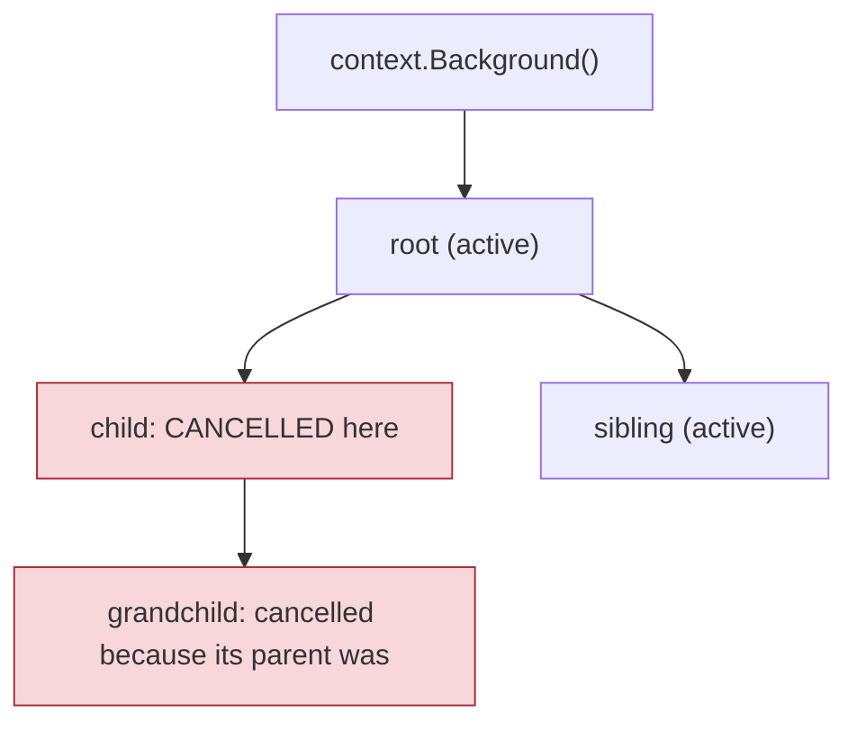

# Context: cancellation and its tree

> **Before this lesson:** you need goroutines, channels, `select` and the done-channel pattern ([Goroutines and channels](#/lesson/go/go-goroutines-channels), [select and concurrency patterns](#/lesson/go/go-select-patterns)), interfaces ([Interfaces](#/lesson/go/go-interfaces)), `defer`, and a first look at HTTP handlers ([net/http and log/slog](#/lesson/go/go-http-slog)).

## In plain words

Imagine you phone a shop and ask whether they have a certain book. The assistant puts you on hold, calls the warehouse, and the warehouse worker goes off to search the shelves. Then you hang up. If nobody tells the assistant and the warehouse worker, they both keep working on a question nobody is waiting for. In a busy shop, that wasted effort adds up until real customers cannot be served.

Servers face this constantly. A request arrives; to answer it the server queries a database, calls two other services, and maybe starts a few goroutines. If the user closes the browser tab, or the request has already taken too long, all of that work should stop.

Go's tool for passing the message "stop, the result is no longer wanted" through every layer of a program is the **context**. A `context.Context` is a small object that travels with a request, from function to function, and carries three things:

1. a **cancellation signal** ("stop now");
2. an optional **deadline** ("stop at this time at the latest");
3. a few **request-scoped values** (such as a request ID).

This lesson covers the first: cancellation and how it spreads. The next lesson covers deadlines and values.

Why this matters for a job: almost every function in a Go service that does I/O takes a `ctx context.Context` as its first parameter. Database drivers, HTTP clients and cloud libraries all expect one. Not handling cancellation is a leading cause of goroutine leaks and of services that collapse under load. Interviewers ask what a context is for, how cancellation propagates and why you must call `cancel`.

**Compared with Python.** In `asyncio`, a task can be cancelled from outside and a `CancelledError` is raised inside it at the next `await`. Go has no way to stop a goroutine from outside. Cancellation is **cooperative**: the context announces that work should stop, and the code doing the work must look at the context and return.

## The Context interface

A context is a value of this interface type:

```go
type Context interface {
	Done() <-chan struct{}       // a channel that is closed when work should stop
	Err() error                  // nil while active; afterwards, why it stopped
	Deadline() (time.Time, bool) // when it will stop by itself, if a deadline is set
	Value(key any) any           // request-scoped data
}
```

You already know the heart of it. `Done()` returns a **done channel**, exactly the pattern from the concurrency lessons: closed to broadcast "stop". The context package standardises that channel and adds a way to hand it down through function calls.

## Creating and cancelling

You never implement `Context` yourself. You start from a root and derive new contexts from it.

```go
package main

import (
	"context"
	"fmt"
)

func main() {
	ctx, cancel := context.WithCancel(context.Background())

	fmt.Println(ctx.Err()) // still active

	cancel() // announce: stop

	<-ctx.Done() // returns immediately: the channel is closed
	fmt.Println(ctx.Err())

	cancel() // calling it again is harmless
}
```

```text
<nil>
context canceled
```

Line by line:

- `context.Background()` returns the **root context**: never cancelled, no deadline, no values. It is the starting point in `main`, in tests and at the top of a request.
- `context.WithCancel(parent)` returns a **new** context derived from the parent, plus a function conventionally named `cancel`.
- While the context is active, `ctx.Err()` is `nil` and `ctx.Done()` is an open channel, so receiving from it would block.
- Calling `cancel()` closes the done channel. From then on `ctx.Err()` returns the sentinel `context.Canceled`, whose text is `context canceled`.
- `cancel` may be called many times and from any goroutine; only the first call has an effect.

A context is **immutable** from the point of view of the code that receives it: a function given a `ctx` can watch it and derive children from it, and cannot cancel it. Only the holder of the `cancel` function can. That separation is deliberate. The party that starts work decides when it stops.

There is also `context.TODO()`, identical to `Background()` in behaviour. It is a marker for "I do not have the right context here yet", to be replaced during refactoring.

## Work that listens for cancellation

Cancellation does nothing unless the working code checks. There are two ways to check.

**In a `select`,** next to the channel operation the goroutine would otherwise block on:

```go
package main

import (
	"context"
	"fmt"
)

func numbers(ctx context.Context) <-chan int {
	out := make(chan int)
	go func() {
		defer close(out)
		for i := 0; ; i++ {
			select {
			case out <- i: // a receiver took the value
			case <-ctx.Done(): // told to stop
				return
			}
		}
	}()
	return out
}

func main() {
	ctx, cancel := context.WithCancel(context.Background())

	ch := numbers(ctx)
	fmt.Println(<-ch, <-ch, <-ch)

	cancel()
	_, open := <-ch // wait until the goroutine has closed its channel
	for open {
		_, open = <-ch
	}
	fmt.Println("generator stopped:", ctx.Err())
}
```

```text
0 1 2
generator stopped: context canceled
```

Without the `ctx.Done()` case, the goroutine would block for ever on its fourth send after `main` stopped receiving: a leak. With it, `cancel()` wakes the goroutine and it returns, closing `out`. The last lines of `main` drain the channel until it reports closed, to be sure the goroutine has finished before printing.

**Between steps of a loop,** when the code is computing and not blocked on a channel:

```go
func process(ctx context.Context, items []Item) error {
	for _, it := range items {
		if err := ctx.Err(); err != nil {
			return err // stop before starting the next item
		}
		handle(it)
	}
	return nil
}
```

`ctx.Err()` is cheap. Check it between units of work, not inside the tightest inner loop.

**By passing it on.** Most of the time you neither select nor check: you pass `ctx` to the functions you call (`db.QueryContext(ctx, ...)`, `client.Do(req.WithContext(ctx))`, `time`-based waits written with `select`), and they return early with an error when it is cancelled. Your job is to return that error.

## The context tree

Each call to `WithCancel` (and its relatives) creates a **child** of the context it was given. Children can have children. The result is a tree, with `Background()` at the root.

The rule that makes contexts work:

> **Cancelling a context cancels all contexts derived from it. Cancellation flows down the tree, never up.**

```go
package main

import (
	"context"
	"fmt"
)

func main() {
	root, cancelRoot := context.WithCancel(context.Background())
	defer cancelRoot()
	child, cancelChild := context.WithCancel(root)
	defer cancelChild()
	grandchild, cancelGrandchild := context.WithCancel(child)
	defer cancelGrandchild()
	sibling, cancelSibling := context.WithCancel(root)
	defer cancelSibling()

	cancelChild()

	fmt.Println("root:      ", root.Err())
	fmt.Println("child:     ", child.Err())
	fmt.Println("grandchild:", grandchild.Err())
	fmt.Println("sibling:   ", sibling.Err())
}
```

```text
root:       <nil>
child:      context canceled
grandchild: context canceled
sibling:    <nil>
```

Cancelling `child` reached `grandchild`, which was derived from it. It did not touch `root` above it or `sibling` beside it.



This matches how a server is organised. An incoming request gets a context. The handler derives a child for a database call and another for a call to a second service. If the request is cancelled, both calls stop. If the handler decides one of them is taking too long and cancels that child alone, the other call and the request itself carry on.

### Try it: cancel a node and watch it spread

Build any tree and cancel any nodes; the simulation reports who is cancelled and from where. The practice problem [Context cancellation through a tree](#/problem/go-context-tree) adds deadlines and timestamps.

```python-run
parent = {            # child -> parent
    "request":       "background",
    "db-query":      "request",
    "auth-call":     "request",
    "token-refresh": "auth-call",
    "audit-log":     "background",      # deliberately NOT under the request
}
cancelled_directly = {"request"}        # try {"auth-call"} or {"db-query", "audit-log"}

def status(node):
    path, cur = [], node
    while cur is not None:
        path.append(cur)
        if cur in cancelled_directly:
            origin = "its own cancel()" if cur == node else f"ancestor {cur!r}"
            return f"CANCELLED  (by {origin})"
        cur = parent.get(cur)
    return "active"

def depth(node):
    return 0 if node not in parent else 1 + depth(parent[node])

for node in ["background"] + list(parent):
    print(f"{'    ' * depth(node)}{node:<16} {status(node)}")
```

With `{"request"}` cancelled, everything derived from the request stops and `audit-log`, attached to the background context, keeps running. That is how you let a small piece of work outlive the request that triggered it, on purpose.

## Always call cancel

`WithCancel` (and the deadline variants in the next lesson) register the child with its parent so that the parent can cancel it later. That registration takes memory and, for deadline contexts, a timer. It is released when the child is cancelled or when the parent is. If the parent lives a long time and you never call `cancel`, the registrations pile up: a leak.

The rule is therefore mechanical:

```go
ctx, cancel := context.WithCancel(parent)
defer cancel() // release resources when this function returns, whatever happens
```

Write the `defer` on the line after the context is created. It does no harm if the work has already finished. `go vet` has an analyzer, `lostcancel`, that reports code paths on which a cancel function is never called.

## Conventions for using context

These conventions are followed by the standard library and by every serious Go codebase, and tools check several of them.

1. **`ctx` is the first parameter** of any function that may block or do I/O, and it is named `ctx`:

   ```go
   func (s *Store) FindUser(ctx context.Context, id int) (User, error)
   ```

2. **Do not store a context in a struct field.** Pass it explicitly to each call. A context belongs to one operation, not to an object that outlives it. (A struct that *represents* a single request is the rare exception.)
3. **Never pass a nil context.** Use `context.TODO()` if you have nothing better.
4. **Derive, do not replace.** When you need a context inside a function that received one, derive from the one you were given (`context.WithCancel(ctx)`), so that cancellation from above still reaches your work. Starting again from `context.Background()` in the middle of a call chain cuts the tree.
5. **Return `ctx.Err()`** (possibly wrapped) when you stop because of cancellation, so callers can recognise it with `errors.Is(err, context.Canceled)`.

## Context in an HTTP server

The `net/http` server creates a context for every request and cancels it when the client disconnects or when the handler returns. You obtain it with `r.Context()` and pass it down.

```go
func (h *Handler) report(w http.ResponseWriter, r *http.Request) {
	ctx := r.Context() // cancelled if the client goes away

	rows, err := h.db.QueryContext(ctx, "SELECT ...") // the database driver watches ctx
	if err != nil {
		if errors.Is(err, context.Canceled) {
			return // nobody is listening; nothing to send
		}
		http.Error(w, "internal error", http.StatusInternalServerError)
		return
	}
	defer rows.Close()
	// ...
}
```

In the shop analogy: when the caller hangs up, the server cancels the request's context, the query is told to stop, and the database stops searching the shelves.

On the client side, attach a context to an outgoing request with `http.NewRequestWithContext(ctx, ...)`. If `ctx` is cancelled while the request is in flight, the connection is closed and `client.Do` returns an error that wraps `context.Canceled`.

## Starting goroutines under a context

A function that starts goroutines should make sure they end when the context does, and should wait for them before returning:

```go
func fetchAll(ctx context.Context, urls []string) ([]string, error) {
	ctx, cancel := context.WithCancel(ctx)
	defer cancel() // stops any goroutines still running when we return early

	results := make(chan string, len(urls)) // buffered: senders never block
	errs := make(chan error, len(urls))

	for _, u := range urls {
		go func() {
			body, err := fetch(ctx, u) // fetch honours ctx
			if err != nil {
				errs <- err
				return
			}
			results <- body
		}()
	}

	var out []string
	for range urls {
		select {
		case b := <-results:
			out = append(out, b)
		case err := <-errs:
			return nil, err // the deferred cancel tells the others to stop
		case <-ctx.Done():
			return nil, ctx.Err()
		}
	}
	return out, nil
}
```

The deferred `cancel` is what makes the early return clean: remaining fetches see their context cancelled and stop. This is the hand-written version of what `errgroup.WithContext` does for you ([sync primitives lesson](#/lesson/go/go-sync-primitives)).

## Knowing why: cancellation causes

`ctx.Err()` only ever says `context.Canceled` or `context.DeadlineExceeded`. Since Go 1.20 you can attach a specific reason:

```go
package main

import (
	"context"
	"errors"
	"fmt"
)

func main() {
	ctx, cancel := context.WithCancelCause(context.Background())
	cancel(errors.New("upstream connection closed"))

	fmt.Println(ctx.Err())
	fmt.Println(context.Cause(ctx))
}
```

```text
context canceled
upstream connection closed
```

`context.Cause(ctx)` returns the error given to `cancel`, also for contexts derived from `ctx`. Two more helpers from recent versions:

- `context.AfterFunc(ctx, f)` (Go 1.21) arranges for `f` to run in its own goroutine once `ctx` is done, for example to close a connection that a blocked read is waiting on.
- `context.WithoutCancel(parent)` (Go 1.21) returns a context that keeps the parent's values and is **not** cancelled when the parent is. Use it for work that must finish after the request ends, such as writing an audit record.

## Pitfalls

> [!WARNING]
> Cancellation is a request, not a force. A goroutine that never looks at `ctx.Done()` or `ctx.Err()`, and never calls anything that does, keeps running after its context is cancelled. Passing a context to a function that ignores it achieves nothing.

- **Forgetting `defer cancel()`**: leaked registrations and timers.
- **Using `context.Background()` deep inside request handling**, detaching the work from the request.
- **Storing contexts in structs** or in global variables.
- **Checking the context only at the start** of a long operation, never during it.
- **Treating `context.Canceled` as an ordinary failure**: logging it as an error, counting it in failure metrics, retrying. The caller went away; stop quietly.
- **Reusing a request's context for background work** started from a handler: when the handler returns, the context is cancelled and the background work dies. Use `context.WithoutCancel` or a context owned by the application.
- **Holding on to `ctx` after the function returns** (in a goroutine that outlives the call) and being surprised when it is cancelled.

> [!TIP]
> When adding context support to old code, work from the bottom up: first the functions that do I/O (give them a `ctx` parameter and pass it to the driver or client), then their callers, until you reach the handler or `main`. Use `context.TODO()` as a temporary argument at each boundary you have not converted yet; searching for `TODO()` shows what is left.

> [!INTERVIEW]
> **"What is `context.Context` for?"** Carrying cancellation signals, deadlines and request-scoped values across API boundaries and goroutines. Contexts form a tree: derived with `WithCancel`, `WithTimeout`, `WithDeadline`, `WithValue`; cancelling a parent cancels all descendants and never the reverse. Code observes cancellation through `ctx.Done()` (a channel closed on cancel, used in `select`) and `ctx.Err()` (`context.Canceled` or `context.DeadlineExceeded`). Cancellation is cooperative. Always `defer cancel()` to release resources; pass `ctx` as the first parameter; do not store it in structs. In HTTP servers `r.Context()` is cancelled when the client disconnects or the handler returns.

## Cheat sheet

| Goal | Code |
|---|---|
| Root context | `context.Background()` |
| Placeholder | `context.TODO()` |
| Cancellable child | `ctx, cancel := context.WithCancel(parent); defer cancel()` |
| Cancel | `cancel()` |
| Wait for cancellation | `<-ctx.Done()` |
| In a select | `case <-ctx.Done(): return ctx.Err()` |
| Check between steps | `if err := ctx.Err(); err != nil { return err }` |
| Was it cancellation? | `errors.Is(err, context.Canceled)` |
| Cancel with a reason | `context.WithCancelCause`, read with `context.Cause(ctx)` |
| Request's context | `r.Context()` |
| Outgoing HTTP call | `http.NewRequestWithContext(ctx, ...)` |
| Outlive the parent | `context.WithoutCancel(ctx)` |
| Signature convention | `func Do(ctx context.Context, args...) error` |

## Summary

- A **context** carries a cancellation signal (and deadlines and values) through a chain of calls and across goroutines.
- `context.Background()` is the root; `WithCancel` derives a child and returns the `cancel` function that stops it.
- Contexts form a **tree**. Cancelling a node cancels its whole subtree; parents and siblings are unaffected.
- Cancellation is **cooperative**: code must select on `ctx.Done()`, check `ctx.Err()`, or pass the context to functions that do.
- Always `defer cancel()`. Pass `ctx` as the first parameter, never nil, never stored in a struct, and derive from the context you were given.
- HTTP servers provide a per-request context that is cancelled when the client leaves.

## Glossary

- **Cancellation**: the signal that work should stop because its result is no longer needed.
- **Cancel function**: the function returned with a derived context; calling it cancels that context and its descendants.
- **Cause**: an optional error describing why a context was cancelled.
- **Child / parent context**: a context derived from another / the one it was derived from.
- **Context**: a value carrying cancellation, a deadline and request-scoped values.
- **Cooperative cancellation**: cancellation that takes effect only when the working code checks for it.
- **Done channel**: the channel returned by `ctx.Done()`, closed on cancellation.
- **Request-scoped**: belonging to one request and discarded when it ends.
- **Root context**: `context.Background()`, the top of every context tree.

```quiz
[
  {"q": "What does this print? `ctx, cancel := context.WithCancel(context.Background()); fmt.Println(ctx.Err()); cancel(); fmt.Println(ctx.Err())`",
   "options": ["`<nil>` then `<nil>`", "`<nil>` then `context canceled`", "`context canceled` twice", "It blocks for ever"],
   "answer": 1,
   "explain": "Err is nil while the context is active. After cancel it returns the sentinel context.Canceled."},
  {"q": "Context B is derived from A, and C from B. `cancelB()` is called. Which contexts are cancelled?",
   "options": ["Only B", "A, B and C", "B and C", "B and A"],
   "answer": 2,
   "explain": "Cancellation flows down the tree to descendants (C) and never up to the parent (A)."},
  {"q": "A goroutine runs `for { compute() }` and was handed a `ctx` that it never looks at. What happens when the context is cancelled?",
   "options": ["The runtime stops the goroutine", "The goroutine panics", "Nothing: the goroutine keeps running", "compute() returns an error"],
   "answer": 2,
   "explain": "Cancellation is cooperative. Code must check `ctx.Done()` or `ctx.Err()`, or call functions that do."},
  {"q": "Why should you write `defer cancel()` right after `ctx, cancel := context.WithCancel(parent)`?",
   "options": ["Otherwise the code does not compile", "To release the resources tied to the child context when the function returns", "To cancel the parent", "It makes the context faster"],
   "answer": 1,
   "explain": "A derived context is registered with its parent (and may hold a timer). Calling cancel frees that. go vet's lostcancel analyzer reports missing calls."},
  {"q": "Where does `ctx` conventionally appear in a function signature?",
   "options": ["As the last parameter", "As a field of the receiver struct", "As the first parameter, named ctx", "As a global variable"],
   "answer": 2,
   "explain": "The convention is `func F(ctx context.Context, ...)`. Contexts are passed per call, not stored."},
  {"q": "In an HTTP handler, when is `r.Context()` cancelled?",
   "options": ["Never", "When the client disconnects or the handler returns", "After exactly 30 seconds", "Only when the server shuts down"],
   "answer": 1,
   "explain": "The server ties the request context to the connection and to the handler's lifetime, so downstream work can stop when the answer is no longer needed."},
  {"q": "What does this print? `ctx, cancel := context.WithCancelCause(context.Background()); cancel(errors.New(\"quota exceeded\")); fmt.Println(ctx.Err(), \"|\", context.Cause(ctx))`",
   "options": ["`quota exceeded | quota exceeded`", "`context canceled | quota exceeded`", "`context canceled | context canceled`", "`<nil> | quota exceeded`"],
   "answer": 1,
   "explain": "Err always reports the generic sentinel. Cause returns the specific error passed to the cancel function."},
  {"q": "A handler starts `go sendEmail(r.Context(), msg)` and returns immediately. What is the likely problem?",
   "options": ["Emails are sent twice", "The request context is cancelled when the handler returns, so the send may be aborted", "It does not compile", "The goroutine blocks the handler"],
   "answer": 1,
   "explain": "Work meant to outlive a request must not use the request's cancellable context. Use `context.WithoutCancel(r.Context())` or an application-level context."}
]
```

> **Source:** Bodner, *Learning Go* 2e, ch. 14 (topic coverage; wording and examples are original). Official references: https://pkg.go.dev/context, https://go.dev/blog/context, https://go.dev/blog/context-and-structs, https://go.dev/doc/go1.21#contextpkgcontext, https://pkg.go.dev/net/http#Request.Context
