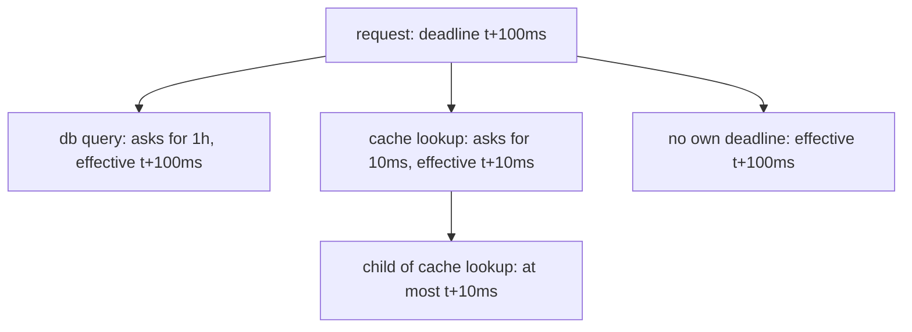
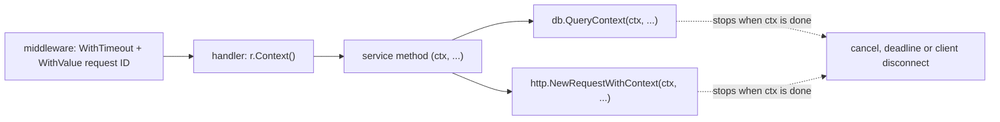

# Deadlines, timeouts and context values

> **Before this lesson:** read [Context: cancellation and its tree](#/lesson/go/go-context-cancel). You need `context.WithCancel`, `ctx.Done()`, `ctx.Err()`, the rule that cancellation flows down the tree, and `defer cancel()`. Durations and instants come from [io, bufio and time](#/lesson/go/go-io-time); type assertions from [Interfaces](#/lesson/go/go-interfaces).

## In plain words

The previous lesson dealt with someone deciding to cancel. Often nobody decides; time runs out.

Think of ordering food for delivery with the promise "at your door within 30 minutes". The restaurant has that whole budget. It hands the courier the bag after 20 minutes, so the courier has 10 left, however long the courier would like. Nobody further down the chain can extend the promise made at the top; each step works with what is left.

A context **deadline** is that promise: an instant after which the context cancels itself. A **timeout** is the same thing expressed as a length of time from now. Because contexts form a tree, a deadline set at the top limits everything below, and a child may shorten its own allowance but never lengthen it.

The second half of the lesson is about the third thing a context can carry: **values**. Think of the label on a parcel: order number, sender. Every person who handles the parcel can read the label without it being part of the parcel's contents. Context values are for that kind of travelling information, such as a request ID, and for very little else.

Why this matters for a job: timeouts are the most important defence a service has. Without them one slow dependency makes every request wait, connections pile up and the whole system stalls. Interviewers ask how you would enforce a time limit on a request, what happens to child deadlines, and what should and should not go into context values.

**Compared with Python.** `asyncio.timeout(5)` or `asyncio.wait_for(coro, 5)` limit one awaited operation. Python's `contextvars` carry request-scoped data implicitly. In Go both the deadline and the values travel in the one `ctx` argument that is passed explicitly from call to call.

## Timeouts and deadlines

Two functions create a context that cancels itself:

- `context.WithTimeout(parent, d)`: done after duration `d` from now;
- `context.WithDeadline(parent, t)`: done at instant `t`.

`WithTimeout(parent, d)` is shorthand for `WithDeadline(parent, time.Now().Add(d))`. Both return a `cancel` function, and both follow the tree rule from the last lesson.

```go
package main

import (
	"context"
	"fmt"
	"time"
)

func main() {
	ctx, cancel := context.WithTimeout(context.Background(), 50*time.Millisecond)
	defer cancel()

	select {
	case <-time.After(200 * time.Millisecond): // the "work" needs 200 ms
		fmt.Println("work finished")
	case <-ctx.Done(): // the budget is 50 ms
		fmt.Println("gave up:", ctx.Err())
	}
}
```

```text
gave up: context deadline exceeded
```

Line by line:

- The context will be done 50 ms after it is created.
- `defer cancel()` is still required. If the work finishes early, `cancel` releases the timer straight away instead of leaving it to run out.
- The `select` waits for whichever comes first. The deadline wins, and `ctx.Err()` now returns the sentinel `context.DeadlineExceeded`, with the text `context deadline exceeded`.

So a context can end with one of two errors:

| `ctx.Err()` | Meaning | Test |
|---|---|---|
| `context.Canceled` | someone called `cancel` | `errors.Is(err, context.Canceled)` |
| `context.DeadlineExceeded` | the deadline passed | `errors.Is(err, context.DeadlineExceeded)` |

They usually call for different reactions. `Canceled` means the caller left; stop quietly. `DeadlineExceeded` means something was too slow; that is worth a log entry, a metric and often a "504 Gateway Timeout" or "503 Service Unavailable" response.

### A reusable shape: an operation that respects its context

Any blocking operation can be written so that it gives up when its context does:

```go
package main

import (
	"context"
	"errors"
	"fmt"
	"time"
)

// query pretends to be a database call that needs `cost` to complete.
func query(ctx context.Context, name string, cost time.Duration) (string, error) {
	select {
	case <-time.After(cost):
		return name + " rows", nil
	case <-ctx.Done():
		return "", fmt.Errorf("query %s: %w", name, ctx.Err())
	}
}

func main() {
	ctx, cancel := context.WithTimeout(context.Background(), 100*time.Millisecond)
	defer cancel()

	fmt.Println(query(ctx, "users", 20*time.Millisecond))

	_, err := query(ctx, "orders", 500*time.Millisecond)
	fmt.Println(err)
	fmt.Println(errors.Is(err, context.DeadlineExceeded))
}
```

```text
users rows <nil>
query orders: context deadline exceeded
true
```

One context, with one budget of 100 ms, was passed to two calls in sequence. The first used about 20 ms. The second had roughly 80 ms left, needed 500, and was cut off. The error is wrapped with `%w`, so the caller can still identify the cause with `errors.Is`.

This is how a deadline acts as a **budget for a whole request**: every step draws from the same allowance without anyone doing arithmetic.

## Deadlines and the tree

A derived context can never outlast its parent. The combined rule:

> A context's **effective deadline** is the earliest deadline among itself and all its ancestors.

```go
package main

import (
	"context"
	"fmt"
	"time"
)

func main() {
	parent, cancelParent := context.WithTimeout(context.Background(), 100*time.Millisecond)
	defer cancelParent()

	generous, cancel1 := context.WithTimeout(parent, time.Hour) // asks for more than the parent has
	defer cancel1()
	strict, cancel2 := context.WithTimeout(parent, 10*time.Millisecond) // asks for less
	defer cancel2()

	dp, _ := parent.Deadline()
	dg, _ := generous.Deadline()
	ds, _ := strict.Deadline()
	fmt.Println("generous has the parent's deadline:", dg.Equal(dp))
	fmt.Println("strict ends before the parent:     ", ds.Before(dp))

	_, has := context.Background().Deadline()
	fmt.Println("background has a deadline:         ", has)
}
```

```text
generous has the parent's deadline: true
strict ends before the parent:      true
background has a deadline:          false
```

- `ctx.Deadline()` returns the effective deadline and `true`, or `false` when none applies.
- Asking for an hour under a parent with 100 ms yields a context that still ends when the parent does.
- Asking for 10 ms yields a shorter allowance for that subtree only.



A function can inspect the remaining budget and decide not to start something that cannot finish:

```go
if deadline, ok := ctx.Deadline(); ok && time.Until(deadline) < 50*time.Millisecond {
	return errors.New("not enough time left to call the pricing service")
}
```

### Try it: budgets flowing down

The simulation computes effective deadlines and the moment each context ends, with the reason.

```python-run
nodes = [            # (name, parent, own deadline or None), parents listed first
    ("request",   None,      100),
    ("db",        "request", 150),    # wants longer than its parent allows
    ("cache",     "request", 30),
    ("render",    "request", None),
    ("cache-get", "cache",   None),
]
cancels = {"render": 70}              # explicit cancel() calls: name -> time

state = {}
print(f"{'context':<12}{'effective deadline':<20}{'done at':<9}reason")
for name, parent, own in nodes:
    p_done, p_reason, p_deadline = state.get(parent, (None, None, None))
    deadlines = [d for d in (own, p_deadline) if d is not None]
    effective = min(deadlines) if deadlines else None
    candidates = []
    if p_done is not None:
        candidates.append((p_done, 0, p_reason))                  # inherit the parent's reason
    if name in cancels:
        candidates.append((cancels[name], 1, "context canceled"))
    if own is not None:
        candidates.append((own, 2, "context deadline exceeded"))
    done, _, reason = min(candidates) if candidates else (None, None, None)
    state[name] = (done, reason, effective)
    print(f"{name:<12}{str(effective):<20}{str(done):<9}{reason}")
```

`db` asked for 150 and ends at 100 with the parent's reason. `render` is cancelled explicitly at 70. `cache-get` has no deadline of its own and ends at 30 with its parent. Vary the numbers, then try the full version in [Context cancellation through a tree](#/problem/go-context-tree).

## Where to put timeouts in a service

A time limit belongs wherever your program waits for something it does not control.

**Per incoming request.** Give each request an overall budget, in a middleware, so that every handler inherits it:

```go
func withTimeout(d time.Duration, next http.Handler) http.Handler {
	return http.HandlerFunc(func(w http.ResponseWriter, r *http.Request) {
		ctx, cancel := context.WithTimeout(r.Context(), d)
		defer cancel()
		next.ServeHTTP(w, r.WithContext(ctx)) // hand the handler a request carrying the new context
	})
}
```

`r.WithContext(ctx)` returns a copy of the request with the derived context. The handler and everything it calls now see the deadline. (The standard library also offers `http.TimeoutHandler`, which additionally writes a 503 response when the time is up.)

**Per outgoing call.** A dependency deserves a tighter limit than the whole request, so that one slow call cannot use up the budget:

```go
func (c *PriceClient) Get(ctx context.Context, sku string) (Price, error) {
	ctx, cancel := context.WithTimeout(ctx, 300*time.Millisecond)
	defer cancel()

	req, err := http.NewRequestWithContext(ctx, http.MethodGet, c.base+"/price/"+sku, nil)
	if err != nil {
		return Price{}, err
	}
	resp, err := c.http.Do(req)
	// ...
}
```

Because the new context derives from the caller's, the call ends at whichever comes first: its own 300 ms or the request's overall deadline.

**Per database query.** `database/sql` has context-aware methods: `QueryContext`, `ExecContext`, `BeginTx`. When the context ends, the driver cancels the query on the server.

**Choosing the numbers.** Base timeouts on measurements: a common starting point is a little above the 99th-percentile latency of the dependency (the time within which 99% of calls complete). A timeout that is too short fails healthy requests; one that is too long does not protect you. And remember that the caller of *your* service has a timeout too. Finishing after it has given up is wasted work.

**Retries.** If you retry failed calls, retry within the same overall context, so that the total stays inside the budget, and wait a little longer between attempts each time (this is called **exponential backoff**).

## Context values

### The mechanism

`context.WithValue(parent, key, value)` returns a child context that carries one key–value pair. `ctx.Value(key)` looks the key up, first in the context itself and then in each ancestor up to the root, and returns the value or `nil`.

```go
package main

import (
	"context"
	"fmt"
)

type ctxKey int // an unexported type: no other package can create this key

const requestIDKey ctxKey = iota

// WithRequestID returns a context carrying the request ID.
func WithRequestID(ctx context.Context, id string) context.Context {
	return context.WithValue(ctx, requestIDKey, id)
}

// RequestID extracts the request ID, if present.
func RequestID(ctx context.Context) (string, bool) {
	id, ok := ctx.Value(requestIDKey).(string)
	return id, ok
}

func handle(ctx context.Context) {
	if id, ok := RequestID(ctx); ok {
		fmt.Println("handling request", id)
	} else {
		fmt.Println("handling request with no ID")
	}
}

func main() {
	ctx := WithRequestID(context.Background(), "req-42")
	handle(ctx)

	child, cancel := context.WithCancel(ctx) // derived contexts see the parent's values
	defer cancel()
	handle(child)

	inner := WithRequestID(child, "req-42/retry-1") // same key lower down hides the outer value there
	handle(inner)
	handle(ctx) // the original is unchanged

	handle(context.Background())
}
```

```text
handling request req-42
handling request req-42
handling request req-42/retry-1
handling request req-42
handling request with no ID
```

What the program shows:

- A value set on a context is visible in all contexts **derived from it**. It is not visible to parents or siblings.
- Setting the same key further down **hides** the outer value for that subtree only. Contexts are immutable; nothing was overwritten.
- `ctx.Value` returns `any`, so the accessor performs a type assertion in comma-ok form and returns a clean `(string, bool)`.

### The three conventions for keys

1. **Define your own unexported key type** (`type ctxKey int`). Keys are compared by type *and* value. If two packages both used the string `"id"` as a key they would collide; with private types they cannot.
2. **Keep the key unexported** and offer two functions: one to store (`WithRequestID`) and one to read (`RequestID`). Callers never touch `WithValue` or type assertions.
3. **The reader returns a `bool` or a sensible default** for the case where the value is absent. Never assume it is there.

`go vet` warns when a built-in type such as `string` is used directly as a context key.

### What belongs in a context, and what does not

Context values are untyped, invisible in function signatures and looked up at run time. Those are exactly the properties the rest of Go avoids, so use values sparingly.

| Good uses: data about *this request* that crosses layers | Bad uses |
|---|---|
| request or correlation ID | database handles, loggers used as hidden dependencies, configuration |
| trace and span identifiers for distributed tracing | optional function parameters |
| the authenticated user or tenant, set by middleware | anything the function cannot work without |
| the locale chosen for the request | data that changes during the request |

A test for any candidate: **if the value were missing, would the function still be correct?** A missing request ID makes logs less useful, and the function still works: fine. A missing database connection makes it crash: that is a dependency and belongs in a struct field or a parameter ([Interface design and dependency injection](#/lesson/go/go-interface-design)).

### A typical use: request IDs in logs

```go
func requestID(next http.Handler) http.Handler {
	return http.HandlerFunc(func(w http.ResponseWriter, r *http.Request) {
		id := r.Header.Get("X-Request-ID")
		if id == "" {
			id = newID()
		}
		ctx := WithRequestID(r.Context(), id)
		w.Header().Set("X-Request-ID", id)
		next.ServeHTTP(w, r.WithContext(ctx))
	})
}

func (s *Store) FindUser(ctx context.Context, userID int) (User, error) {
	id, _ := RequestID(ctx)
	s.log.InfoContext(ctx, "finding user", "request_id", id, "user_id", userID)
	// ...
}
```

The middleware attaches the ID once. Three layers down, the storage code can include it in a log entry without every function in between having a `requestID` parameter. `slog`'s `InfoContext` passes the context to the log handler, and a custom handler can add such fields to every entry automatically.

Value lookup walks up the chain of contexts one step per `WithValue` call. That is fast for a handful of values and a reason not to store dozens.

## One context, three jobs



The same `ctx` argument tells every layer when to stop (cancellation), by when it must stop (deadline) and which request it is working for (values).

## Pitfalls

> [!WARNING]
> A call without a timeout is a promise to wait for ever. Every network call, database query and wait on a channel in request-handling code should be bounded by a context with a deadline, set either on the call or inherited from the request.

- **Forgetting `defer cancel()`** on `WithTimeout`/`WithDeadline`: the timer lives until it fires.
- **Expecting a child to extend the parent's deadline.** It cannot.
- **Creating the timeout from `context.Background()` inside a handler**, which ignores client disconnects and the request's own budget. Derive from `r.Context()`.
- **Swallowing the difference between `Canceled` and `DeadlineExceeded`.**
- **One huge timeout "to be safe".** It protects nothing.
- **String keys for context values**, or exported keys.
- **Using context values as a hidden parameter bag** for dependencies and options.
- **Assuming a value is present** and asserting without comma-ok: a panic when it is absent.
- **Doing slow work after the deadline** to "finish anyway". The caller has left.

> [!TIP]
> In tests, pass `context.Background()` for the normal path, and add at least one test per I/O function with an already-cancelled context (`ctx, cancel := context.WithCancel(...); cancel()`) to confirm that it returns promptly with an error wrapping `context.Canceled`. Since Go 1.24, `t.Context()` gives each test a context that is cancelled when the test ends.

> [!INTERVIEW]
> **"How do you enforce a time limit on an operation?"** Derive a context with `context.WithTimeout(parent, d)` or `WithDeadline`, `defer cancel()`, and pass it to every blocking call (HTTP via `NewRequestWithContext`, SQL via `QueryContext`, own code via `select` on `ctx.Done()`). When time is up `ctx.Err()` is `context.DeadlineExceeded`. A child's effective deadline is the earliest among itself and its ancestors, so a request-level timeout bounds everything beneath it and inner calls can only tighten it. **"What goes in context values?"** Request-scoped metadata that crosses API boundaries (request ID, trace IDs, authenticated principal), keyed by an unexported custom type with typed accessor functions; never dependencies or optional parameters.

## Cheat sheet

| Goal | Code |
|---|---|
| Limit by duration | `ctx, cancel := context.WithTimeout(parent, 2*time.Second); defer cancel()` |
| Limit by instant | `ctx, cancel := context.WithDeadline(parent, t); defer cancel()` |
| Remaining budget | `d, ok := ctx.Deadline(); time.Until(d)` |
| Why did it end? | `errors.Is(err, context.DeadlineExceeded)` / `context.Canceled` |
| Wait or give up | `select { case <-work: case <-ctx.Done(): return ctx.Err() }` |
| New context on a request | `r = r.WithContext(ctx)` |
| HTTP call with limit | `http.NewRequestWithContext(ctx, ...)` |
| SQL with limit | `db.QueryContext(ctx, query, args...)` |
| Key type | `type ctxKey int; const userKey ctxKey = iota` |
| Store a value | `context.WithValue(ctx, userKey, u)` (inside a `WithUser` helper) |
| Read a value | `u, ok := ctx.Value(userKey).(User)` (inside a `UserFrom` helper) |

## Summary

- `WithTimeout` and `WithDeadline` create contexts that cancel themselves; `ctx.Err()` then returns `context.DeadlineExceeded`.
- A context's effective deadline is the **earliest** in its ancestry: children can shorten, never extend. One deadline at the top is a budget for the whole request.
- Put timeouts on every wait for an external party: per request, per outgoing call, per query. Derive them from the context you were given and always `defer cancel()`.
- **Context values** carry request-scoped metadata down the tree. Use an unexported key type and accessor functions, and handle absence.
- Values are for information *about* the request, not for dependencies or parameters the function needs.

## Glossary

- **Budget**: the time a request has left before its deadline.
- **Deadline**: the instant at which a context becomes done by itself.
- **DeadlineExceeded**: the error reported by a context whose deadline has passed.
- **Effective deadline**: the earliest deadline among a context and its ancestors.
- **Exponential backoff**: waiting progressively longer between retries.
- **Key type**: a private type used for context keys so that packages cannot collide.
- **Percentile latency**: the time within which a given percentage of requests complete (p99: 99%).
- **Request-scoped value**: data attached to one request's context, such as a request ID.
- **Timeout**: a deadline expressed as a duration from now.

```quiz
[
  {"q": "What does this print? `ctx, cancel := context.WithTimeout(context.Background(), 10*time.Millisecond); defer cancel(); <-ctx.Done(); fmt.Println(ctx.Err())`",
   "options": ["`context canceled`", "`context deadline exceeded`", "`<nil>`", "It blocks for ever"],
   "answer": 1,
   "explain": "Nobody calls cancel before the timer fires, so the context ends by its deadline and Err returns context.DeadlineExceeded."},
  {"q": "A parent context expires in 100 ms. A child is created with `context.WithTimeout(parent, 5*time.Second)`. When is the child done?",
   "options": ["After 5 seconds", "After 100 ms", "After 5.1 seconds", "Never"],
   "answer": 1,
   "explain": "A child cannot outlive its parent. Its effective deadline is the earliest in its ancestry: 100 ms."},
  {"q": "Same parent (100 ms); the child is created with `WithTimeout(parent, 20*time.Millisecond)`. Which is true?",
   "options": ["The parent now also ends after 20 ms", "The child ends after 20 ms and the parent is unaffected", "The child ends after 100 ms", "Creating it panics"],
   "answer": 1,
   "explain": "A child may tighten its own deadline. Cancellation and deadlines flow downward only."},
  {"q": "Why is `defer cancel()` still needed with `WithTimeout`, given the context cancels itself?",
   "options": ["It is not needed", "To release the timer and registration promptly when the work finishes before the deadline", "To extend the deadline", "To cancel the parent"],
   "answer": 1,
   "explain": "Without cancel, resources are held until the deadline passes. Calling it early is harmless and frees them immediately."},
  {"q": "What does this print? `type k int; ctx := context.WithValue(context.Background(), k(1), \"a\"); child := context.WithValue(ctx, k(1), \"b\"); fmt.Println(ctx.Value(k(1)), child.Value(k(1)), ctx.Value(k(2)))`",
   "options": ["`b b <nil>`", "`a b <nil>`", "`a a <nil>`", "`a b a`"],
   "answer": 1,
   "explain": "The child hides the key for itself only; the parent is immutable. An unknown key returns nil."},
  {"q": "Which is an appropriate context value?",
   "options": ["The database connection pool", "A request ID used for log correlation", "The function's required page-size parameter", "The application's configuration struct"],
   "answer": 1,
   "explain": "Values are for request-scoped metadata that crosses layers. Dependencies and parameters should be explicit fields or arguments."},
  {"q": "Why should a context key be of an unexported custom type rather than a string?",
   "options": ["Strings are slower", "To prevent collisions between packages that might choose the same string", "Strings cannot be used as keys", "To make the value immutable"],
   "answer": 1,
   "explain": "Keys match by type and value. A private type guarantees that no other package can construct an equal key."},
  {"q": "A function receives `ctx` and must call a slow service with a 300 ms limit. What is the correct way to create the limit?",
   "options": ["`context.WithTimeout(context.Background(), 300*time.Millisecond)`", "`context.WithTimeout(ctx, 300*time.Millisecond)`", "`time.Sleep(300 * time.Millisecond)`", "`context.TODO()`"],
   "answer": 1,
   "explain": "Deriving from the received context keeps the caller's cancellation and deadline in force as well. Starting from Background would detach the call from the request."}
]
```

> **Source:** Bodner, *Learning Go* 2e, ch. 14 (topic coverage; wording and examples are original). Official references: https://pkg.go.dev/context#WithTimeout, https://pkg.go.dev/context#WithValue, https://go.dev/blog/context, https://pkg.go.dev/net/http#TimeoutHandler, https://pkg.go.dev/database/sql#DB.QueryContext
