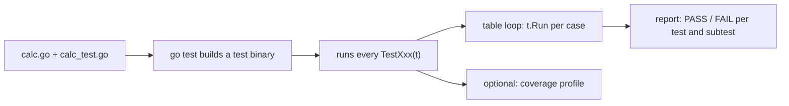

# Tests, tables, subtests and coverage

> **Before this lesson:** you need functions with multiple returns and errors ([Declaring and calling functions](#/lesson/go/go-functions-basics), [Errors are values](#/lesson/go/go-errors-values)), slices of structs and anonymous structs ([Maps and structs](#/lesson/go/go-maps-structs)), closures ([Closures, defer and call by value](#/lesson/go/go-closures-defer)) and packages ([Packages, visibility and imports](#/lesson/go/go-packages-imports)).

## In plain words

How do you know your code works? Running it once and looking at the output tells you it worked that time, for that input. Next week you change something nearby, and nobody re-checks.

A **test** is a small program that calls your code with chosen inputs and checks the results automatically. Think of the pre-flight checklist a pilot runs before every take-off: the same checks, every time, in seconds, so that no step depends on memory or mood. A collection of tests is a safety net under every future change. When a change breaks something, a test fails within seconds and tells you what broke.

Go treats testing as part of the language's standard equipment. There is no framework to choose and install:

- tests are ordinary Go functions in files whose names end in `_test.go`;
- the package `testing` from the standard library provides what they need;
- the command `go test` finds and runs them.

This lesson covers writing tests, the **table-driven** style that Go programmers use almost everywhere, **subtests**, set-up and clean-up, and measuring how much of your code the tests exercise (**coverage**). The next lesson covers fuzzing, benchmarks and testing code that talks to the outside world.

Why this matters for a job: professional code is delivered with tests, and code review covers them as closely as the code. Interview exercises are often judged by whether you wrote tests and whether you thought of the edge cases. "Write a table-driven test for this function" is a standard request.

**Compared with Python.** `pytest` discovers `test_*.py` files and uses plain `assert`; `unittest` uses classes and `assertEqual`. Go has no assertion functions in the standard library: a test compares values with ordinary `if` statements and reports a failure by calling a method on `t`. Parametrised tests (`@pytest.mark.parametrize`) correspond to Go's table tests.

## A first test

Take a small package:

```go
// file: calc/calc.go
package calc

import "errors"

// ErrDivideByZero is returned when the divisor is zero.
var ErrDivideByZero = errors.New("divide by zero")

// Divide returns a divided by b.
func Divide(a, b float64) (float64, error) {
	if b == 0 {
		return 0, ErrDivideByZero
	}
	return a / b, nil
}
```

The test goes in the **same folder**, in a file ending in `_test.go`:

```go
// file: calc/calc_test.go
package calc

import "testing"

func TestDivide(t *testing.T) {
	got, err := Divide(10, 4)
	if err != nil {
		t.Fatalf("Divide(10, 4) returned unexpected error: %v", err)
	}
	want := 2.5
	if got != want {
		t.Errorf("Divide(10, 4) = %v, want %v", got, want)
	}
}
```

Run it:

```text
$ go test ./calc
ok  	example.com/shop/calc	0.004s
```

The rules that make this work:

- **The file name ends in `_test.go`.** Such files are compiled only by `go test`, never into your program.
- **The function name starts with `Test`**, followed by a name beginning with an upper-case letter, and it takes exactly one parameter, `t *testing.T`.
- **A test passes if it returns without reporting a failure.** There is nothing to return.
- The test is in `package calc`, so it can call everything in the package, exported or not.

### Reporting a failure

`t` offers two families of methods:

| Method | Effect |
|---|---|
| `t.Error(args...)`, `t.Errorf(format, args...)` | mark the test as failed and **keep going** |
| `t.Fatal(args...)`, `t.Fatalf(format, args...)` | mark the test as failed and **stop this test function** now |
| `t.Log`, `t.Logf` | print information, shown only for failing tests or with `-v` |
| `t.Skip(reason)` | stop and mark the test as skipped |

Use `Fatal` when continuing makes no sense, for example when set-up failed or when an unexpected error means the result is not worth inspecting. Use `Error` otherwise, so that one run reports every problem.

### Writing a useful failure message

Change the expected value to 3 and run again:

```text
$ go test ./calc
--- FAIL: TestDivide (0.00s)
    calc_test.go:12: Divide(10, 4) = 2.5, want 3
FAIL
FAIL	example.com/shop/calc	0.004s
```

The message follows the convention used throughout Go: **`F(input) = got, want expected`**. Someone reading only this line knows which call failed, what it produced and what was expected. The variable names `got` and `want` are equally conventional. A message such as "wrong result" forces the reader to open the test and add print statements.

## Table-driven tests

One input proves little. `Divide` should be tried with negative numbers, zero as the dividend, zero as the divisor, fractions. Copying the test body five times would be tedious and hard to maintain. Go's idiom is the **table-driven test**: put the cases in a slice, and loop.

```go
package calc

import (
	"errors"
	"testing"
)

func TestDivide(t *testing.T) {
	tests := []struct {
		name    string
		a, b    float64
		want    float64
		wantErr error
	}{
		{name: "simple", a: 10, b: 4, want: 2.5},
		{name: "negative divisor", a: 9, b: -3, want: -3},
		{name: "zero dividend", a: 0, b: 5, want: 0},
		{name: "fraction", a: 1, b: 8, want: 0.125},
		{name: "divide by zero", a: 1, b: 0, wantErr: ErrDivideByZero},
	}

	for _, tc := range tests {
		t.Run(tc.name, func(t *testing.T) {
			got, err := Divide(tc.a, tc.b)

			if !errors.Is(err, tc.wantErr) {
				t.Fatalf("Divide(%v, %v) error = %v, want %v", tc.a, tc.b, err, tc.wantErr)
			}
			if got != tc.want {
				t.Errorf("Divide(%v, %v) = %v, want %v", tc.a, tc.b, got, tc.want)
			}
		})
	}
}
```

```text
$ go test -v ./calc
=== RUN   TestDivide
=== RUN   TestDivide/simple
=== RUN   TestDivide/negative_divisor
=== RUN   TestDivide/zero_dividend
=== RUN   TestDivide/fraction
=== RUN   TestDivide/divide_by_zero
--- PASS: TestDivide (0.00s)
    --- PASS: TestDivide/simple (0.00s)
    --- PASS: TestDivide/negative_divisor (0.00s)
    --- PASS: TestDivide/zero_dividend (0.00s)
    --- PASS: TestDivide/fraction (0.00s)
    --- PASS: TestDivide/divide_by_zero (0.00s)
PASS
ok  	example.com/shop/calc	0.005s
```

Read the structure piece by piece:

- `tests` is a slice of an **anonymous struct**. Each element is one case: a name, the inputs, and the expected outputs. Fields left out take their zero value, so the first four cases expect a nil error.
- The loop variable is conventionally `tc` ("test case") or `tt`.
- `t.Run(name, func(t *testing.T) { ... })` runs the body as a **subtest** with its own name, its own pass/fail status and its own `t`.
- `errors.Is(err, tc.wantErr)` handles both situations in one check: when no error is wanted, `tc.wantErr` is nil and the check passes only if `err` is nil too.
- `-v` (verbose) prints every test and subtest; without it you see only failures and the summary.

The benefits: adding a case is one line; all cases share one, well-reviewed piece of checking logic; and the table reads as a specification of the function's behaviour.

### Subtests

Subtests give you three things.

**Each case reports separately.** A `t.Fatal` inside a subtest stops that subtest only; the loop continues with the next case.

**Cases can be selected by name.** The flag `-run` takes a pattern, and a slash separates test and subtest:

```text
$ go test -run TestDivide ./calc                      # one test function
$ go test -run 'TestDivide/divide_by_zero' ./calc     # one case
$ go test -run 'TestDivide/zero' ./calc               # every case whose name contains "zero"
```

Notice `divide_by_zero`: in names, **spaces are replaced by underscores**, and if two subtests have the same name the later ones get a suffix such as `#01`. Those are the names you type after `-run`.

**Cases can run in parallel** by calling `t.Parallel()` first thing in the subtest body. Parallel subtests are paused until the surrounding test function's own code has finished, then run together. Use it for slow, independent cases; it also helps the race detector find problems.

### Try it: a miniature test runner

The simulation runs a table of cases against a function and prints a report in `go test -v` style, including the name rewriting.

```python-run
def divide(a, b):
    if b == 0:
        return 0, "divide by zero"
    return a / b, None

table = [                                   # (name, a, b, want, want_err)
    ("simple", 10, 4, 2.5, None),
    ("negative divisor", 9, -3, -3, None),
    ("zero dividend", 0, 5, 0, None),
    ("divide by zero", 1, 0, 0, "divide by zero"),
    ("wrong on purpose", 1, 3, 0.33, None),  # floats: this expectation is too naive
    ("simple", 8, 2, 4, None),               # duplicate name
]

def run_table(test_name, table, fn):
    lines, failed, seen = [], False, {}
    for name, a, b, want, want_err in table:
        sub = name.replace(" ", "_")
        n = seen.get(sub, 0); seen[sub] = n + 1
        if n:
            sub = f"{sub}#{n:02d}"
        got, err = fn(a, b)
        problems = []
        if err != want_err:
            problems.append(f"divide({a}, {b}) error = {err}, want {want_err}")
        elif got != want:
            problems.append(f"divide({a}, {b}) = {got}, want {want}")
        status = "FAIL" if problems else "PASS"
        failed = failed or bool(problems)
        lines.append(f"    --- {status}: {test_name}/{sub}")
        lines += [f"        {p}" for p in problems]
    return [f"--- {'FAIL' if failed else 'PASS'}: {test_name}"] + lines + ["FAIL" if failed else "PASS"]

print("\n".join(run_table("TestDivide", table, divide)))
```

One case fails, and so the parent and the whole run fail. The failing case is also a lesson: `1/3` is not `0.33`, and exact comparison of floating-point results is fragile; compare with a tolerance. The reporting rules are the subject of the problem [Table-test report in go test -v style](#/problem/go-table-test-summary).

## Comparing complex values

`==` works for numbers, strings, booleans and structs of comparable fields. It does not compile for slices and maps. Options:

- `slices.Equal(got, want)` and `maps.Equal(got, want)` for flat slices and maps.
- `reflect.DeepEqual(got, want)` from the standard library compares any two values in depth, but its failure tells you only "not equal".
- The widely used module `github.com/google/go-cmp/cmp` returns a readable **diff**:

```go
if diff := cmp.Diff(want, got); diff != "" {
	t.Errorf("ParseOrder() mismatch (-want +got):\n%s", diff)
}
```

```text
ParseOrder() mismatch (-want +got):
  calc.Order{
  	ID:    7,
- 	Total: 1500,
+ 	Total: 1050,
  }
```

Lines starting with `-` show what was wanted, `+` what was produced.

## Helpers, set-up and clean-up

### Helper functions

When several tests repeat the same check or preparation, move it into a function that takes `t`. Call **`t.Helper()`** as its first statement, so that a failure is reported at the line of the *caller*, not inside the helper:

```go
func mustParse(t *testing.T, input string) Order {
	t.Helper()
	o, err := ParseOrder(input)
	if err != nil {
		t.Fatalf("ParseOrder(%q) failed: %v", input, err)
	}
	return o
}
```

### Cleaning up with t.Cleanup

A test that creates something (a file, a server, a database row) must remove it afterwards, even when the test fails. `t.Cleanup(f)` registers a function to run when the test and all its subtests have finished. Clean-ups run in last-in, first-out order, like `defer`, and they work from inside helpers, where `defer` would run too early.

```go
func newTestStore(t *testing.T) *Store {
	t.Helper()
	dir := t.TempDir() // a fresh directory, deleted automatically after the test
	s, err := Open(filepath.Join(dir, "data.db"))
	if err != nil {
		t.Fatalf("open store: %v", err)
	}
	t.Cleanup(func() { s.Close() })
	return s
}
```

Useful built-in helpers of this kind:

| Call | Does |
|---|---|
| `t.TempDir()` | creates a temporary directory, removed after the test |
| `t.Setenv(key, value)` | sets an environment variable and restores the old value afterwards |
| `t.Context()` | (Go 1.24+) a context cancelled when the test ends |

### Set-up for a whole package: TestMain

If a package's tests need something expensive exactly once (starting a database container, say), define `TestMain`. It replaces the default entry point of the test binary:

```go
func TestMain(m *testing.M) {
	// set up shared state here
	code := m.Run() // runs all the tests in the package
	// tear down here
	os.Exit(code)
}
```

Use it rarely. State shared by all tests makes them depend on each other; per-test set-up with `t.Cleanup` is the better default.

### Test data files

`go test` runs with the package's folder as the working directory, and the `go` tool ignores any directory named `testdata` when building. Put input files there and open them with a relative path: `os.ReadFile("testdata/order.json")`.

## Testing only the public surface

A test file in the same folder may declare a different package name: the package's name plus `_test`.

```go
package calc_test // an external test package

import (
	"testing"

	"example.com/shop/calc"
)

func TestDividePublicAPI(t *testing.T) {
	got, _ := calc.Divide(9, 3)
	if got != 3 {
		t.Errorf("calc.Divide(9, 3) = %v, want 3", got)
	}
}
```

Such a test sees only exported names, exactly like your users. This **black-box** style checks that the public API is usable and keeps tests from depending on internals that you may want to change. Tests in the package itself (**white-box**) can reach unexported functions. Both kinds may live side by side in one folder.

## Runnable examples

A function named `Example...` in a test file is both documentation and a test. `go test` runs it and compares what it prints with the comment at the end:

```go
func ExampleDivide() {
	q, _ := calc.Divide(10, 4)
	fmt.Println(q)
	// Output: 2.5
}
```

The example appears in the package's documentation on `pkg.go.dev`, and it cannot go out of date without the tests failing.

## Coverage

**Coverage** measures which statements of your code were executed while the tests ran.

```text
$ go test -cover ./calc
ok  	example.com/shop/calc	0.004s	coverage: 100.0% of statements

$ go test -coverprofile=cover.out ./...
$ go tool cover -func=cover.out
example.com/shop/calc/calc.go:9:	Divide		100.0%
total:					(statements)	100.0%
$ go tool cover -html=cover.out        # opens a browser: covered lines green, missed lines red
```

The HTML view is the useful one. Red lines are code no test has ever run, very often error-handling branches.

Read coverage numbers with care:

- **Low coverage is informative.** Untested code is unverified code.
- **High coverage proves little.** A line can be executed by a test that checks nothing about its result. 100% coverage with weak checks is worse than 70% with careful ones.
- Chasing a fixed percentage leads to tests written to satisfy the counter. Aim to cover behaviour: every documented case, every error path, every boundary.

## How go test runs

- `go test` (no arguments) tests the package in the current folder; `go test ./...` tests the whole module.
- Each package's tests are built into a separate program. Packages run in parallel with each other; within a package, tests run one after another unless they call `t.Parallel()`.
- **Results are cached.** If neither the code nor the test inputs changed, the output shows `(cached)` and nothing is re-run. Force a real run with `-count=1`.
- Common flags:

| Flag | Meaning |
|---|---|
| `-v` | print every test |
| `-run Pattern` | only tests (and subtests) matching the pattern |
| `-count=1` | disable the cache; `-count=5` runs each test five times |
| `-race` | enable the race detector |
| `-cover` | print coverage |
| `-short` | sets `testing.Short()` to true, so slow tests can skip themselves |
| `-failfast` | stop at the first failing test |
| `-timeout 30s` | fail if the package takes longer (default 10 minutes) |



## What makes a good test

- **It checks behaviour, not implementation.** Test what the function promises; then you can rewrite the inside freely.
- **It is deterministic.** No dependence on the current time, random numbers, the network or the order of map iteration. Inject those ([next lesson](#/lesson/go/go-fuzz-bench-httptest)).
- **It is independent.** Tests must pass alone and in any order.
- **It covers the edges.** Empty input, one element, the largest and smallest values, duplicates, invalid input, and every error the function can return.
- **Its failure message is enough** to understand the problem without opening the file.

## Pitfalls

> [!WARNING]
> A test that cannot fail is worse than no test, because it gives false confidence. After writing a test, break the code on purpose (or change the expected value) once and confirm that the test goes red.

- **File not ending in `_test.go`, or function not matching `TestXxx(t *testing.T)`**: silently not run. `go vet` reports malformed test names.
- **`t.Fatal` from a goroutine other than the test's own.** It must be called from the test goroutine; use `t.Error` and return, or send the result back on a channel.
- **Comparing floats with `==`**, or slices and maps with `==` (does not compile).
- **Shared mutable state between tests**, especially package-level variables.
- **Forgetting `t.Helper()`**, so failures point into the helper.
- **Tests that depend on execution order.**
- **Being fooled by `(cached)`** when a test depends on something outside the code, such as a file elsewhere or a running service.
- **Treating the coverage percentage as the goal.**

> [!TIP]
> When you fix a bug, first write a test that reproduces it and watch it fail, then fix the code and watch it pass. The test documents the bug and guards against its return; this is called a **regression test**.

> [!INTERVIEW]
> **"How do you write tests in Go?"** Test functions `TestXxx(t *testing.T)` in `_test.go` files, run with `go test`. Failures are reported with `t.Errorf` (continue) or `t.Fatalf` (stop), with messages of the form `F(in) = got, want`. The idiomatic structure is a **table-driven test**: a slice of anonymous structs with a name, inputs and expected outputs, looped over with `t.Run` so each case is a named subtest that can be selected with `-run Test/case`, fails independently and can call `t.Parallel()`. Mention `t.Helper`, `t.Cleanup`, `t.TempDir`, external `_test` packages for black-box tests, `-race`, `-cover` and its limits, and that results are cached.

## Cheat sheet

| Goal | Code or command |
|---|---|
| Test file | `name_test.go` in the package's folder |
| Test function | `func TestName(t *testing.T)` |
| Fail and continue / stop | `t.Errorf(...)` / `t.Fatalf(...)` |
| Message style | `"Divide(%v, %v) = %v, want %v"` |
| Table | `tests := []struct{ name string; in int; want int }{ ... }` |
| Subtest | `t.Run(tc.name, func(t *testing.T) { ... })` |
| Parallel subtest | `t.Parallel()` as the first line |
| Helper | `t.Helper()` as the first line |
| Clean-up | `t.Cleanup(func() { ... })` |
| Temp directory / env var | `t.TempDir()` / `t.Setenv(k, v)` |
| Black-box test | `package calc_test` |
| Compare structures | `cmp.Diff(want, got)`, `slices.Equal`, `reflect.DeepEqual` |
| Run everything | `go test ./...` |
| Verbose, one case | `go test -v -run 'TestDivide/zero' ./calc` |
| No cache | `go test -count=1 ./...` |
| Coverage | `go test -cover ./...`; `-coverprofile=c.out`; `go tool cover -html=c.out` |

## Summary

- Tests are functions `TestXxx(t *testing.T)` in `_test.go` files, run by `go test`. No framework is needed.
- Report failures with `t.Errorf` or `t.Fatalf` and messages that state the call, the result and the expectation.
- **Table-driven tests** keep the cases as data and the checking logic in one place; **subtests** via `t.Run` name each case, isolate failures and allow selection and parallelism.
- `t.Helper`, `t.Cleanup`, `t.TempDir` and `TestMain` organise set-up and clean-up.
- External test packages (`package x_test`) test the public API only.
- **Coverage** shows which statements ran; use it to find untested code, not as proof of quality.

## Glossary

- **Black-box / white-box test**: a test using only the public API / one with access to internals.
- **Coverage**: the share of statements executed by the tests.
- **Deterministic**: giving the same result on every run.
- **Regression test**: a test added to make sure a fixed bug stays fixed.
- **Subtest**: a named test run inside another with `t.Run`.
- **Table-driven test**: a test that loops over a slice of cases.
- **Test case**: one set of inputs with its expected outcome.
- **Test helper**: a function used by tests, marked with `t.Helper()`.
- **`testing.T`**: the type through which a test reports results and manages its lifetime.

```quiz
[
  {"q": "Which function will `go test` run?",
   "options": ["`func testAdd(t *testing.T)` in `add_test.go`", "`func TestAdd(t *testing.T)` in `add_test.go`", "`func TestAdd(t *testing.T)` in `add.go`", "`func TestAdd() bool` in `add_test.go`"],
   "answer": 1,
   "explain": "The file must end in `_test.go`, the name must start with `Test` followed by an upper-case letter, and the signature must be `(t *testing.T)`."},
  {"q": "What is the difference between `t.Errorf` and `t.Fatalf`?",
   "options": ["Errorf prints, Fatalf does not", "Both mark the test failed; Fatalf also stops the current test function immediately", "Fatalf exits the whole test program", "Errorf only works in subtests"],
   "answer": 1,
   "explain": "Errorf records the failure and continues, so further checks still run. Fatalf stops that test (or subtest), which is right when continuing is pointless."},
  {"q": "A table test calls `t.Run(\"empty input\", ...)`. How do you run only that case of `TestParse`?",
   "options": ["`go test -run \"TestParse empty input\"`", "`go test -run 'TestParse/empty_input'`", "`go test -case empty`", "`go test TestParse.empty`"],
   "answer": 1,
   "explain": "Subtest names are joined to the parent with a slash, and spaces in names become underscores."},
  {"q": "In a table test with five subtests, the third calls `t.Fatal`. What happens to the fourth and fifth?",
   "options": ["They are skipped", "They still run; Fatal stops only the subtest that called it", "The whole package stops", "They are marked failed too"],
   "answer": 1,
   "explain": "Each `t.Run` body has its own `t`. A fatal failure ends that subtest; the loop continues, and the parent is marked failed."},
  {"q": "Why call `t.Helper()` at the top of a test helper function?",
   "options": ["It makes the helper run in parallel", "So failures are reported at the caller's line instead of inside the helper", "It registers a clean-up", "It is required for the helper to compile"],
   "answer": 1,
   "explain": "Without it every failure points at the same line in the helper, hiding which test call failed."},
  {"q": "A test file starts with `package calc_test`. What can it access from package `calc`?",
   "options": ["Everything, exported or not", "Only exported names, after importing calc", "Nothing", "Only functions, not types"],
   "answer": 1,
   "explain": "The `_test` suffix makes it an external package. It tests the public API as a real user would."},
  {"q": "`go test -cover` reports 100% for a package. What does that guarantee?",
   "options": ["The code has no bugs", "Every statement was executed by some test; nothing about whether results were checked", "Every input was tried", "The tests are deterministic"],
   "answer": 1,
   "explain": "Coverage counts executed statements. A test can execute code without asserting anything about it."},
  {"q": "You run `go test ./...` twice without changing anything and see `(cached)`. How do you force the tests to execute again?",
   "options": ["`go test -fresh`", "`go test -count=1 ./...`", "`go clean` is the only way", "It is impossible"],
   "answer": 1,
   "explain": "Successful results are cached per package. `-count=1` is the idiomatic way to bypass the cache."}
]
```

> **Source:** Bodner, *Learning Go* 2e, ch. 15 (topic coverage; wording and examples are original). Official references: https://pkg.go.dev/testing, https://go.dev/doc/tutorial/add-a-test, https://go.dev/wiki/TableDrivenTests, https://go.dev/blog/subtests, https://go.dev/blog/cover, https://pkg.go.dev/github.com/google/go-cmp/cmp
