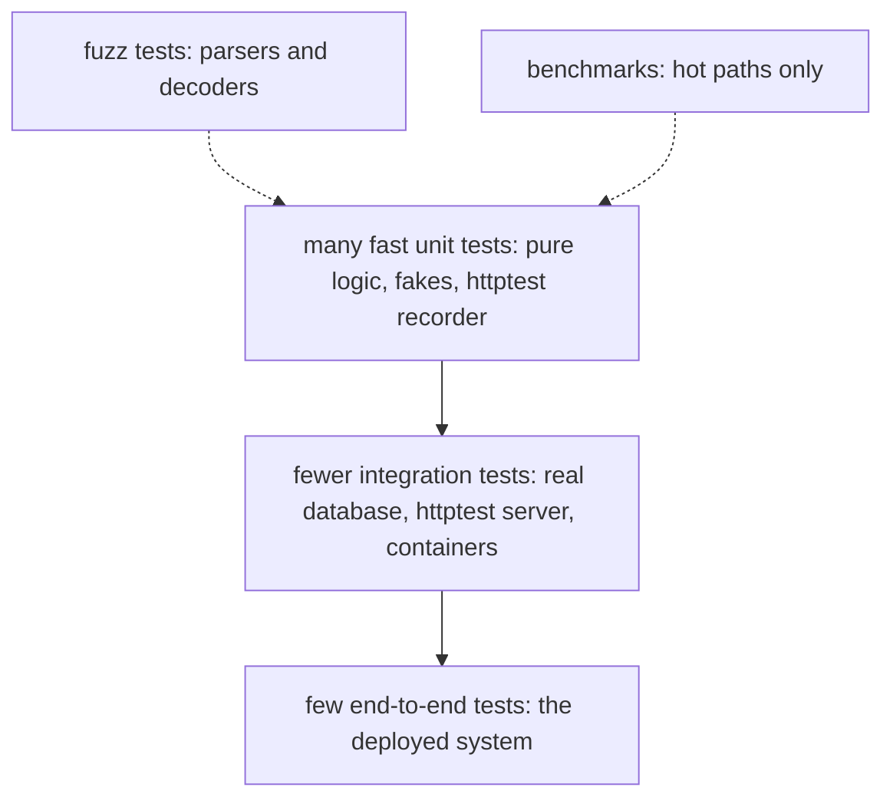

# Fuzzing, benchmarks, stubs and httptest

> **Before this lesson:** read [Tests, tables, subtests and coverage](#/lesson/go/go-testing-basics). You also need interfaces and dependency injection ([Interface design and dependency injection](#/lesson/go/go-interface-design)), HTTP handlers and clients ([net/http and log/slog](#/lesson/go/go-http-slog)) and the idea of a data race ([Deadlocks, leaks and the race detector](#/lesson/go/go-deadlocks-leaks)).

## In plain words

The previous lesson tested small functions that take values and return values. Real code is messier in four ways, and Go's testing tools have an answer for each.

1. **Code that depends on the outside world**: a database, a payment provider, the clock. A flight simulator lets a pilot practise an engine failure without breaking an engine. In tests, you replace the real dependency with a stand-in you control, called a **stub** or **fake**.
2. **Code that speaks HTTP.** You do not want tests to open real network connections to real servers. The package **`httptest`** provides a pretend response recorder and a real-but-local test server.
3. **Inputs you did not think of.** You test the cases that occur to you; bugs live in the ones that do not. **Fuzzing** is like letting a toddler loose on a keyboard: the machine generates huge numbers of odd inputs and watches for crashes and broken promises.
4. **Speed.** "It feels fast" is not a measurement. A **benchmark** runs a piece of code many times under a stopwatch and reports the time and memory per operation.

Why this matters for a job: most production code is glue between systems, and the ability to test that glue without the systems is what makes a codebase safe to change. Interviewers ask "how would you test this handler?" and "how would you test code that calls another service?", and expect `httptest` and interface-based stubs in the answer. Benchmark output is how performance claims are settled in code review.

**Compared with Python.** `unittest.mock.patch` replaces objects at run time; Go has no patching and uses interfaces passed in from outside. `hypothesis` is the counterpart of fuzzing, `pytest-benchmark` of benchmarks, and `responses`/`httpx` mocking of `httptest`. In Go all four are in the standard toolchain.

## Stubs and fakes

Recall the design from the dependency-injection lesson: a component declares small interfaces for what it needs and receives implementations through its constructor.

```go
// file: signup/signup.go
package signup

import (
	"context"
	"errors"
	"fmt"
	"time"
)

type User struct {
	Email     string
	CreatedAt time.Time
}

type UserStore interface {
	Exists(ctx context.Context, email string) (bool, error)
	Save(ctx context.Context, u User) error
}

var ErrDuplicate = errors.New("email already registered")

type Service struct {
	store UserStore
	now   func() time.Time // the clock is a dependency too
}

func NewService(store UserStore, now func() time.Time) *Service {
	return &Service{store: store, now: now}
}

func (s *Service) Register(ctx context.Context, email string) (User, error) {
	exists, err := s.store.Exists(ctx, email)
	if err != nil {
		return User{}, fmt.Errorf("check %s: %w", email, err)
	}
	if exists {
		return User{}, ErrDuplicate
	}
	u := User{Email: email, CreatedAt: s.now()}
	if err := s.store.Save(ctx, u); err != nil {
		return User{}, fmt.Errorf("save %s: %w", email, err)
	}
	return u, nil
}
```

The real `UserStore` talks to PostgreSQL. The test uses a **fake**: a simple working implementation held in memory.

```go
// file: signup/signup_test.go
package signup

import (
	"context"
	"errors"
	"testing"
	"time"
)

type fakeStore struct {
	users   map[string]User
	saveErr error // set this to make Save fail
}

func (f *fakeStore) Exists(ctx context.Context, email string) (bool, error) {
	_, ok := f.users[email]
	return ok, nil
}

func (f *fakeStore) Save(ctx context.Context, u User) error {
	if f.saveErr != nil {
		return f.saveErr
	}
	f.users[u.Email] = u
	return nil
}

func TestRegister(t *testing.T) {
	fixed := time.Date(2026, time.March, 14, 9, 30, 0, 0, time.UTC)
	clock := func() time.Time { return fixed }
	errDisk := errors.New("disk full")

	tests := []struct {
		name     string
		existing []string
		saveErr  error
		email    string
		wantErr  error
	}{
		{name: "new user", email: "nami@example.com"},
		{name: "duplicate", existing: []string{"nami@example.com"}, email: "nami@example.com", wantErr: ErrDuplicate},
		{name: "store failure", saveErr: errDisk, email: "zoro@example.com", wantErr: errDisk},
	}

	for _, tc := range tests {
		t.Run(tc.name, func(t *testing.T) {
			store := &fakeStore{users: map[string]User{}, saveErr: tc.saveErr}
			for _, e := range tc.existing {
				store.users[e] = User{Email: e}
			}
			svc := NewService(store, clock)

			got, err := svc.Register(context.Background(), tc.email)

			if !errors.Is(err, tc.wantErr) {
				t.Fatalf("Register(%q) error = %v, want %v", tc.email, err, tc.wantErr)
			}
			if tc.wantErr != nil {
				return
			}
			if !got.CreatedAt.Equal(fixed) {
				t.Errorf("CreatedAt = %v, want %v", got.CreatedAt, fixed)
			}
			if _, saved := store.users[tc.email]; !saved {
				t.Errorf("user %q was not saved", tc.email)
			}
		})
	}
}
```

```text
$ go test -v ./signup
=== RUN   TestRegister
=== RUN   TestRegister/new_user
=== RUN   TestRegister/duplicate
=== RUN   TestRegister/store_failure
--- PASS: TestRegister (0.00s)
    --- PASS: TestRegister/new_user (0.00s)
    --- PASS: TestRegister/duplicate (0.00s)
    --- PASS: TestRegister/store_failure (0.00s)
PASS
```

What makes this work:

- `fakeStore` satisfies `UserStore` because it has the two methods; nothing else is required.
- The field `saveErr` lets a test **inject a failure** that would be very hard to produce with a real database. The "store failure" case checks that `Register` passes the error on, wrapped so that `errors.Is` still finds it.
- **Time is injected.** The service calls `s.now()` instead of `time.Now()`. The test supplies a clock that always returns the same instant, so `CreatedAt` can be checked exactly. In production `main` passes `time.Now`.

Vocabulary you will hear, loosely used:

| Term | Meaning |
|---|---|
| **stub** | returns canned answers |
| **fake** | a simplified working implementation (the in-memory store above) |
| **spy** | records how it was called, for later inspection |
| **mock** | a stand-in with built-in expectations about calls, often generated by a tool |

Prefer hand-written fakes and stubs for small interfaces; they are plain code and easy to read. Generated mocks (`mockgen`, `moq`) help with large interfaces, at the price of tests that describe *how* the code calls its dependencies instead of *what* it achieves.

For single-method dependencies a function type is the lightest stub, as with the clock above.

## Testing HTTP with httptest

### Handlers: the response recorder

A handler is a function of a `ResponseWriter` and a `Request`. To test one you need neither a network nor a server: construct a request, pass a recorder, inspect the recording.

```go
package api

import (
	"encoding/json"
	"net/http"
	"net/http/httptest"
	"strings"
	"testing"
)

func health(w http.ResponseWriter, r *http.Request) {
	w.Header().Set("Content-Type", "application/json")
	json.NewEncoder(w).Encode(map[string]string{"status": "ok"})
}

func echoName(w http.ResponseWriter, r *http.Request) {
	var in struct {
		Name string `json:"name"`
	}
	if err := json.NewDecoder(r.Body).Decode(&in); err != nil || in.Name == "" {
		http.Error(w, "name is required", http.StatusBadRequest)
		return
	}
	w.WriteHeader(http.StatusCreated)
	json.NewEncoder(w).Encode(map[string]string{"hello": in.Name})
}

func TestHandlers(t *testing.T) {
	mux := http.NewServeMux()
	mux.HandleFunc("GET /health", health)
	mux.HandleFunc("POST /names", echoName)

	tests := []struct {
		name       string
		method     string
		path       string
		body       string
		wantStatus int
		wantBody   string
	}{
		{"health", "GET", "/health", "", 200, `{"status":"ok"}`},
		{"create", "POST", "/names", `{"name":"Robin"}`, 201, `{"hello":"Robin"}`},
		{"missing name", "POST", "/names", `{}`, 400, "name is required"},
		{"bad json", "POST", "/names", `{"name":`, 400, "name is required"},
		{"wrong method", "DELETE", "/names", "", 405, "Method Not Allowed"},
	}
	for _, tc := range tests {
		t.Run(tc.name, func(t *testing.T) {
			req := httptest.NewRequest(tc.method, tc.path, strings.NewReader(tc.body))
			rec := httptest.NewRecorder()

			mux.ServeHTTP(rec, req)

			if rec.Code != tc.wantStatus {
				t.Errorf("status = %d, want %d", rec.Code, tc.wantStatus)
			}
			if got := strings.TrimSpace(rec.Body.String()); got != tc.wantBody {
				t.Errorf("body = %q, want %q", got, tc.wantBody)
			}
		})
	}
}
```

- `httptest.NewRequest(method, target, body)` builds a request as a server would receive it. The body is any `io.Reader`.
- `httptest.NewRecorder()` returns a `ResponseWriter` that stores the status, headers and body in memory. After the call, `rec.Code`, `rec.Header()` and `rec.Body` hold what the client would have received.
- Calling `mux.ServeHTTP` instead of the handler directly also tests the routing, as the 405 case shows.

Tests of this kind run in microseconds and need no free port.

### Clients: a local test server

For code that **makes** HTTP requests, start a throwaway server on the local machine and point the client at it:

```go
func TestFetchQuote(t *testing.T) {
	var gotPath, gotAccept string
	srv := httptest.NewServer(http.HandlerFunc(func(w http.ResponseWriter, r *http.Request) {
		gotPath, gotAccept = r.URL.Path, r.Header.Get("Accept") // spy on the request
		if r.URL.Path == "/broken" {
			http.Error(w, "boom", http.StatusInternalServerError)
			return
		}
		w.Write([]byte(`{"text":"less is more"}`))
	}))
	t.Cleanup(srv.Close)

	client := &http.Client{Timeout: time.Second}

	q, err := fetchQuote(context.Background(), client, srv.URL+"/quote")
	if err != nil {
		t.Fatalf("fetchQuote returned error: %v", err)
	}
	if q.Text != "less is more" {
		t.Errorf("Text = %q, want %q", q.Text, "less is more")
	}
	if gotPath != "/quote" || gotAccept != "application/json" {
		t.Errorf("request had path %q and Accept %q", gotPath, gotAccept)
	}

	if _, err := fetchQuote(context.Background(), client, srv.URL+"/broken"); err == nil {
		t.Error("fetchQuote on a 500 response returned nil error, want an error")
	}
}
```

`httptest.NewServer` listens on a random free local port and gives you its address in `srv.URL`. Your client code runs unchanged: real connection, real HTTP, a server whose behaviour you script. This is where you test the unpleasant cases: error statuses, malformed JSON, slow responses (sleep in the handler to trigger the client's timeout). The code under test must accept the base URL (and ideally the client) as parameters; a hard-coded URL cannot be tested.

## Fuzzing

Table tests check the inputs you thought of. **Fuzzing** has the machine invent inputs. You provide a few examples, called the **seed corpus**, and a **property**: something that must hold for *every* input. The fuzzing engine mutates the seeds, favouring mutations that reach new code paths, and reports any input that makes the test fail or panic.

Here is a function with a bug that ordinary tests can easily miss:

```go
// Reverse returns s with its characters in reverse order.
func Reverse(s string) string {
	b := []byte(s)
	for i, j := 0, len(b)-1; i < j; i, j = i+1, j-1 {
		b[i], b[j] = b[j], b[i]
	}
	return string(b)
}
```

A fuzz test:

```go
func FuzzReverse(f *testing.F) {
	for _, seed := range []string{"", "a", "hello", "racecar"} {
		f.Add(seed) // seed corpus
	}
	f.Fuzz(func(t *testing.T, s string) {
		twice := Reverse(Reverse(s))
		if twice != s {
			t.Errorf("Reverse(Reverse(%q)) = %q, want the original", s, twice)
		}
		if utf8.ValidString(s) && !utf8.ValidString(Reverse(s)) {
			t.Errorf("Reverse(%q) produced invalid UTF-8: %q", s, Reverse(s))
		}
	})
}
```

The rules: the name starts with `Fuzz`, the parameter is `*testing.F`, `f.Add` registers seeds, and `f.Fuzz` receives a function whose parameters after `t` are the fuzzed inputs (strings, byte slices, numbers and booleans are supported).

Run normally, a fuzz test executes only the seeds, like a table test:

```text
$ go test -run FuzzReverse
PASS
```

All four seeds pass. Now let the engine generate inputs:

```text
$ go test -fuzz=FuzzReverse -fuzztime=10s
fuzz: elapsed: 0s, gathering baseline coverage: 0/4 completed
fuzz: elapsed: 0s, gathering baseline coverage: 4/4 completed, now fuzzing with 8 workers
--- FAIL: FuzzReverse (0.02s)
    --- FAIL: FuzzReverse (0.00s)
        reverse_test.go:21: Reverse("é") produced invalid UTF-8: "\xa9\xc3"

    Failing input written to testdata/fuzz/FuzzReverse/3f2a9c81d0b7e6aa
    To re-run:
    go test -run=FuzzReverse/3f2a9c81d0b7e6aa
FAIL
```

Within a fraction of a second the fuzzer tried a non-ASCII character and found the bug: reversing **bytes** breaks multi-byte characters ([Strings, runes and bytes](#/lesson/go/go-strings-runes)). Three things then happen:

1. The failing input is saved in `testdata/fuzz/FuzzReverse/`. **Commit that file.** From now on plain `go test` replays it, so the bug has a permanent regression test.
2. You fix the function (reverse a `[]rune`).
3. You fuzz again, because one fix often reveals the next problem.

### What properties can you check?

You do not know the expected output for a random input, so fuzz tests check relationships:

| Property | Example |
|---|---|
| **Round trip** | `Decode(Encode(x)) == x`; reversing twice gives the original |
| **No crash** | a parser returns an error for bad input and never panics |
| **Invariant** | a sorted result is ordered and has the same length as the input |
| **Agreement** | a fast implementation gives the same answer as a slow obvious one |
| **Idempotence** | normalising twice equals normalising once |

Fuzzing is most valuable for code that handles **untrusted input**: parsers, decoders, validators, anything reading files or network data.

### Try it: random inputs find what tables miss

A miniature fuzzer for the buggy byte-reversal. It mutates seed inputs at random and checks the two properties.

```python-run
import random

def reverse_bytes(s):                     # the buggy implementation
    return s.encode("utf-8")[::-1].decode("utf-8", errors="surrogateescape")

def is_valid_utf8(s):
    try:
        s.encode("utf-8")
        return True
    except UnicodeEncodeError:
        return False

def property_holds(s):
    return is_valid_utf8(reverse_bytes(s))

ALPHABET = "abc xyz019_-é世🙂"

def mutate(s, rng):
    op = rng.choice(["insert", "delete", "replace"])
    pos = rng.randrange(len(s) + 1)
    if op == "insert" or not s:
        return s[:pos] + rng.choice(ALPHABET) + s[pos:]
    pos = min(pos, len(s) - 1)
    if op == "delete":
        return s[:pos] + s[pos + 1:]
    return s[:pos] + rng.choice(ALPHABET) + s[pos + 1:]

seeds = ["", "a", "hello", "racecar"]
print("seed corpus passes:", all(property_holds(s) for s in seeds))

rng = random.Random(7)
corpus, tried = list(seeds), 0
while True:
    candidate = mutate(rng.choice(corpus), rng)
    tried += 1
    if not property_holds(candidate):
        print(f"FAILING INPUT after {tried} tries: {candidate!r}")
        break
    corpus.append(candidate)
```

The hand-picked seeds all pass. A few random mutations later, an input with a non-ASCII character breaks the property.

## Benchmarks

A benchmark measures how long an operation takes and how much memory it allocates.

```go
package text

import (
	"strings"
	"testing"
)

func joinConcat(words []string) string {
	s := ""
	for _, w := range words {
		s += w + " "
	}
	return s
}

func joinBuilder(words []string) string {
	var sb strings.Builder
	for _, w := range words {
		sb.WriteString(w)
		sb.WriteByte(' ')
	}
	return sb.String()
}

var words = strings.Fields(strings.Repeat("gopher ", 1000))

func BenchmarkJoinConcat(b *testing.B) {
	for b.Loop() {
		joinConcat(words)
	}
}

func BenchmarkJoinBuilder(b *testing.B) {
	for b.Loop() {
		joinBuilder(words)
	}
}
```

Benchmarks do not run with plain `go test`. Ask for them with `-bench` and a pattern (`.` matches all), and add `-benchmem` for memory figures:

```text
$ go test -bench=. -benchmem
goos: linux
goarch: amd64
pkg: example.com/shop/text
cpu: AMD Ryzen 7 5800X 8-Core Processor
BenchmarkJoinConcat-16     	    1100	   1079000 ns/op	 3712000 B/op	    1000 allocs/op
BenchmarkJoinBuilder-16    	  120000	      9800 ns/op	   24560 B/op	      12 allocs/op
PASS
```

(Your numbers will differ; the proportions are what matters.)

Reading a result line:

| Column | Meaning |
|---|---|
| `BenchmarkJoinConcat-16` | name, and the number of CPU cores available (`GOMAXPROCS`) |
| `1100` | how many times the loop body ran |
| `1079000 ns/op` | average time per iteration, in nanoseconds (about 1 ms here) |
| `3712000 B/op` | bytes allocated on the heap per iteration |
| `1000 allocs/op` | number of heap allocations per iteration |

The builder version is roughly a hundred times faster and allocates twelve times instead of a thousand, which confirms the advice from the strings lesson with evidence.

How the loop works: `for b.Loop() { ... }` (Go 1.24 and later) runs the body as many times as needed for a stable measurement, at least about a second, and excludes any set-up written before the loop from the timing. In older code you will see the equivalent `for i := 0; i < b.N; i++ { ... }`, where the framework chooses `b.N`; with that form, call `b.ResetTimer()` after expensive set-up.

### Benchmarking honestly

- **Compare, do not admire.** A single number means little. Benchmark the old and the new version on the same machine.
- **Repeat and use statistics.** Run with `-count=10` and feed both outputs to the tool `benchstat` (from `golang.org/x/perf`), which reports the difference and whether it is larger than the noise.
- **Use realistic inputs**, including sizes. An algorithm that wins on 10 elements may lose on 10,000.
- **Beware of dead-code elimination.** If the result of the benchmarked call is unused, the compiler may remove the call and you measure nothing. `b.Loop()` guards against this; with the `b.N` style, assign the result to a package-level variable.
- **Benchmark what matters.** Find the slow part with the profiler first (`go test -cpuprofile cpu.out -bench .`, then `go tool pprof cpu.out`). Optimising code that accounts for 1% of the run time gains nothing.

## The race detector in tests

Tests are the best place to run the race detector, because they exercise many code paths quickly:

```text
$ go test -race ./...
```

A test that starts several goroutines calling the same object is a cheap and effective race test:

```go
func TestCounterConcurrent(t *testing.T) {
	var c Counter
	var wg sync.WaitGroup
	for i := 0; i < 100; i++ {
		wg.Add(1)
		go func() {
			defer wg.Done()
			c.Inc()
		}()
	}
	wg.Wait()
	if got := c.Value(); got != 100 {
		t.Errorf("Value() = %d, want 100", got)
	}
}
```

Without `-race` this may pass by luck even if `Counter` is unsynchronised. With `-race` the unsynchronised version fails reliably with a report. For code that depends on timers, the package `testing/synctest` (stable since Go 1.25) runs goroutines inside a "bubble" with a fake clock, so that time-based tests finish instantly and deterministically.

## Integration tests

A **unit test** checks one piece in isolation, with fakes for its neighbours. An **integration test** checks that the pieces really work together: your SQL against a real PostgreSQL, your client against the real API. They are slower and need the outside system, so teams separate them from the fast tests. Three common switches:

```go
func TestStoreRoundTrip(t *testing.T) {
	if testing.Short() {
		t.Skip("skipping integration test in -short mode")
	}
	dsn := os.Getenv("TEST_DATABASE_URL")
	if dsn == "" {
		t.Skip("TEST_DATABASE_URL not set")
	}
	// ... test against the real database ...
}
```

- `go test -short ./...` skips tests that check `testing.Short()`.
- An **environment variable** enables tests that need a service.
- A **build tag** (`//go:build integration`, run with `-tags=integration`) keeps such files out of normal builds ([embed, go generate and cross-compilation](#/lesson/go/go-embed-generate-cross)).

Libraries such as `testcontainers-go` start real databases in containers for the duration of a test.



## Pitfalls

> [!WARNING]
> Tests that reach real external services (a live API, a shared database) are slow, fail for reasons unrelated to your change and cannot run offline. Keep them out of the default `go test ./...` run and behind an explicit switch.

- **Calling `time.Now()`, `rand` or `os.Getenv` directly in logic**, making it untestable. Inject them.
- **Mocks that mirror the implementation line by line**: every refactoring breaks the tests although behaviour is unchanged.
- **Forgetting `srv.Close()`** on a test server, or testing a client with a hard-coded URL.
- **Not committing the fuzzer's saved failing inputs.**
- **Fuzz properties that are too weak** ("does not panic" when you could check a round trip).
- **Benchmarking with set-up inside the loop**, or with a result the compiler can discard.
- **Drawing conclusions from one benchmark run** on a busy laptop.
- **Running `-race` only occasionally.**

> [!TIP]
> When code is hard to test, treat that as design feedback. The usual cause is a hidden dependency: a global, a direct call to `time.Now`, a client constructed inside the function. Turning it into a parameter or an interface field makes the code testable and, almost always, clearer.

> [!INTERVIEW]
> **"How do you test an HTTP handler?"** Build a request with `httptest.NewRequest`, pass an `httptest.NewRecorder()` as the `ResponseWriter`, call the handler or the mux, and assert on `rec.Code`, headers and body; put the cases in a table. **"How do you test code that calls another service?"** Inject the dependency: either an interface with a hand-written fake, or keep the real HTTP client and point it at an `httptest.NewServer` whose handler returns scripted responses, including failures and delays. **"What is fuzzing?"** Coverage-guided generation of inputs from a seed corpus, checking properties such as round trips and absence of panics; failing inputs are saved under `testdata/fuzz` as regression cases. **"How do you read a benchmark?"** `ns/op`, `B/op`, `allocs/op` with `-benchmem`; compare versions with `benchstat`.

## Cheat sheet

| Goal | Code or command |
|---|---|
| Fake a dependency | a small struct implementing the consumer's interface |
| Stub a single function | a field of function type, e.g. `now func() time.Time` |
| Test a handler | `rec := httptest.NewRecorder(); h.ServeHTTP(rec, httptest.NewRequest(m, path, body))` |
| Test a client | `srv := httptest.NewServer(handler); t.Cleanup(srv.Close)`; use `srv.URL` |
| Fuzz test | `func FuzzX(f *testing.F) { f.Add(seed); f.Fuzz(func(t *testing.T, in string) { ... }) }` |
| Run the fuzzer | `go test -fuzz=FuzzX -fuzztime=30s` |
| Benchmark | `func BenchmarkX(b *testing.B) { for b.Loop() { work() } }` |
| Run benchmarks | `go test -bench=. -benchmem` |
| Compare benchmarks | `go test -bench=. -count=10 > new.txt; benchstat old.txt new.txt` |
| Profile | `go test -bench=X -cpuprofile cpu.out; go tool pprof cpu.out` |
| Races | `go test -race ./...` |
| Skip slow tests | `if testing.Short() { t.Skip(...) }` with `go test -short` |

## Summary

- Replace outside dependencies with **stubs and fakes** that satisfy the same small interfaces; inject clocks and other sources of non-determinism.
- **`httptest.NewRecorder`** tests handlers without a network; **`httptest.NewServer`** gives client code a real local server with scripted behaviour.
- **Fuzzing** generates inputs to check properties you state; failures are saved as permanent regression inputs.
- **Benchmarks** report time and allocations per operation; compare versions, repeat runs, and profile before optimising.
- Run tests with **`-race`**, and separate slow **integration tests** from fast unit tests with `-short`, environment variables or build tags.

## Glossary

- **Benchmark**: a test that measures the time and memory an operation uses.
- **Corpus**: the collection of inputs a fuzzer starts from and grows.
- **Fake**: a simplified, working stand-in for a dependency.
- **Fuzzing**: automated testing with generated inputs.
- **Integration test**: a test of several components, or of real external systems, together.
- **Mock**: a stand-in that verifies how it is called.
- **ns/op**: nanoseconds per operation, the time column of benchmark output.
- **Property**: a statement that must hold for every input.
- **Seed**: an example input given to the fuzzer.
- **Spy**: a stand-in that records calls for inspection.
- **Stub**: a stand-in that returns predetermined answers.
- **Unit test**: a test of one piece of code in isolation.

```quiz
[
  {"q": "A service calls `time.Now()` directly to stamp records. Why is that a problem for testing, and what is the usual fix?",
   "options": ["`time.Now` is slow; cache it", "The result changes on every run, so the stamp cannot be asserted; inject a clock function such as `now func() time.Time`", "`time.Now` panics in tests", "Nothing is wrong"],
   "answer": 1,
   "explain": "Non-determinism makes exact assertions impossible. Injecting the clock lets a test supply a fixed instant, while production passes `time.Now`."},
  {"q": "What does `httptest.NewRecorder()` give you?",
   "options": ["A real server on a random port", "An in-memory `http.ResponseWriter` whose status, headers and body you can inspect after calling a handler", "A proxy that records real traffic", "A client with a timeout"],
   "answer": 1,
   "explain": "The recorder captures what the handler writes. Combined with `httptest.NewRequest` it tests handlers with no network."},
  {"q": "You need to test a function that performs an HTTP GET against a base URL. Which tool fits best?",
   "options": ["`httptest.NewRecorder`", "`httptest.NewServer` with a handler that returns scripted responses, passing `srv.URL` to the function", "A real request to the production API", "`t.TempDir`"],
   "answer": 1,
   "explain": "NewServer starts a real local HTTP server. The client code runs unchanged and you control every response, including errors and delays."},
  {"q": "A fuzz test finds a failing input. What should you do with the file written to `testdata/fuzz/...`?",
   "options": ["Delete it", "Commit it, so plain `go test` replays the input as a regression test", "Move it to /tmp", "Rename the fuzz test"],
   "answer": 1,
   "explain": "Saved inputs become part of the seed corpus and run on every `go test`, preventing the bug from returning unnoticed."},
  {"q": "Which is a suitable property for fuzzing a pair of functions `Encode` and `Decode`?",
   "options": ["`Encode(x)` equals a hard-coded string", "`Decode(Encode(x))` equals `x` for every x", "`Encode` takes less than 1 ms", "`Decode` is called exactly once"],
   "answer": 1,
   "explain": "Fuzzers generate inputs whose expected output is unknown, so tests assert relationships such as round trips, invariants and absence of panics."},
  {"q": "In the benchmark line `BenchmarkJoin-8  120000  9800 ns/op  24560 B/op  12 allocs/op`, what does `9800 ns/op` mean?",
   "options": ["The whole benchmark took 9800 ns", "Each iteration of the loop took 9800 nanoseconds on average", "9800 operations ran per nanosecond", "9800 bytes were allocated"],
   "answer": 1,
   "explain": "ns/op is average time per iteration. The first number (120000) is the iteration count; B/op and allocs/op describe heap allocation per iteration."},
  {"q": "How do you run the benchmarks of a package?",
   "options": ["`go test`", "`go test -bench=. -benchmem`", "`go bench`", "`go run -bench`"],
   "answer": 1,
   "explain": "Benchmarks run only when `-bench` is given a pattern. `-benchmem` adds allocation statistics."},
  {"q": "A test spawns 100 goroutines calling `c.Inc()` on an unsynchronised counter and usually passes. How do you make the bug show reliably?",
   "options": ["Increase to 1000 goroutines", "Run with `go test -race`", "Add `time.Sleep`", "Use `t.Parallel()`"],
   "answer": 1,
   "explain": "The race detector reports the conflicting accesses whenever they occur without synchronisation, regardless of whether the final count happens to be right."}
]
```

> **Source:** Bodner, *Learning Go* 2e, ch. 15 (topic coverage; wording and examples are original). Official references: https://go.dev/doc/tutorial/fuzz, https://go.dev/security/fuzz/, https://pkg.go.dev/testing#hdr-Benchmarks, https://pkg.go.dev/net/http/httptest, https://pkg.go.dev/golang.org/x/perf/cmd/benchstat, https://go.dev/blog/synctest
