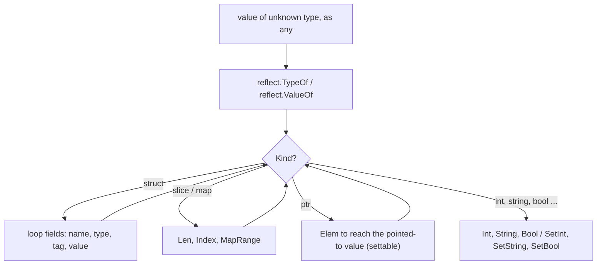

# Reflection

> **Before this lesson:** you need structs and struct tags ([Maps and structs](#/lesson/go/go-maps-structs), [encoding/json](#/lesson/go/go-json)), defined types and underlying types ([Defined types, methods and embedding](#/lesson/go/go-types-methods)), interfaces and `any` ([Interfaces](#/lesson/go/go-interfaces)), pointers ([Pointers, nil and mutability](#/lesson/go/go-pointers-basics)) and generics ([Type parameters and generic functions](#/lesson/go/go-generics-basics)).

## In plain words

The last module of the book has the old map-maker's warning as its title: *here be dragons*. It covers three features that let you step outside the safety of Go's type system. They exist because some jobs cannot be done without them, and they are dangerous for the same reason. This lesson covers the first, **reflection**. The next covers `unsafe` and cgo.

All the Go you have written so far has one thing in common: when you wrote the code, you knew the types. `u.Name` works because the compiler knows `u` is a `User` and that a `User` has a field `Name`.

Now think of the people who wrote `encoding/json`. Their function must turn *your* struct into JSON, a struct that did not exist when they wrote the library. They cannot write `u.Name`. They need to ask, while the program is running: "what kind of thing was I given? If it is a struct, how many fields does it have, what are they called, what are their types and tags, what values do they hold?"

Imagine a customs officer opening a sealed crate with no paperwork. With the right tools the officer can still work out what is inside: weigh it, count the items, read the labels on each. **Reflection** gives a program those tools: the ability to examine, and even modify, values whose types are only known at run time. The tools live in the package `reflect`.

Why this matters for a job: you will rarely write reflection yourself, and you use it every day through libraries: JSON and other encoders, database mappers, validators, dependency-injection containers, test comparison helpers. Understanding it explains their rules (why fields must be exported, why you pass a pointer to `Unmarshal`) and their costs. Interviewers ask what reflection is, when it is justified and what the alternatives are.

**Compared with Python.** Python is reflective all the time: `type(x)`, `getattr(obj, name)`, `obj.__dict__` are ordinary operations, because every object carries its description around and nothing is checked in advance. In Go, static typing is the default and reflection is a separate, explicit tool that you pick up when needed and put down again.

## Type, Kind and Value

The `reflect` package has three central ideas.

- A **`reflect.Type`** describes a type: its name, its fields, its methods. Get one with `reflect.TypeOf(x)`.
- A **`reflect.Value`** holds a value together with its type, in a form you can inspect and manipulate. Get one with `reflect.ValueOf(x)`.
- A **`reflect.Kind`** says which fundamental *category* a type belongs to: `Int`, `String`, `Struct`, `Slice`, `Map`, `Ptr`, `Func` and so on. There is a fixed, small list of kinds.

Both functions take a parameter of type `any`. That is the link to what you already know: an interface value stores a (type, value) pair, and reflection is the way to open that pair up.

```go
package main

import (
	"fmt"
	"reflect"
)

type Celsius float64

func main() {
	temp := Celsius(21.5)

	t := reflect.TypeOf(temp)
	fmt.Println(t, t.Name(), t.Kind())

	v := reflect.ValueOf(temp)
	fmt.Println(v.Type(), v.Kind(), v.Float())

	for _, x := range []any{42, "hi", []int{1}, map[string]bool{}, &temp, nil} {
		if x == nil {
			fmt.Println("nil interface: no type at all")
			continue
		}
		fmt.Println(reflect.TypeOf(x), "-> kind", reflect.TypeOf(x).Kind())
	}
}
```

```text
main.Celsius Celsius float64
main.Celsius float64 21.5
int -> kind int
string -> kind string
[]int -> kind slice
map[string]bool -> kind map
*main.Celsius -> kind ptr
nil interface: no type at all
```

The first two lines show the difference between type and kind:

- The **type** is `main.Celsius`, the type you defined.
- The **kind** is `float64`, the category of its underlying type.

There are endlessly many types and only a couple of dozen kinds. Code that handles "any value" switches on the **kind**, since it cannot list every possible type. Once you know the kind is `Float64`, you may call `v.Float()` to get the number out.

## Inspecting a struct

This is the bread and butter of reflective libraries.

```go
package main

import (
	"fmt"
	"reflect"
)

type User struct {
	Name  string `json:"name" validate:"required"`
	Age   int    `json:"age"`
	email string
}

func main() {
	u := User{Name: "Ana", Age: 30, email: "ana@example.com"}

	t := reflect.TypeOf(u)
	v := reflect.ValueOf(u)
	fmt.Println(t.Name(), t.Kind(), t.NumField())

	for i := 0; i < t.NumField(); i++ {
		field := t.Field(i) // a reflect.StructField: the description of field i
		fmt.Println(field.Name, field.Type, field.IsExported(), field.Tag.Get("json"))
		if field.IsExported() {
			fmt.Println("   value:", v.Field(i).Interface())
		}
	}

	if tag, ok := t.Field(0).Tag.Lookup("validate"); ok {
		fmt.Println("validate tag on Name:", tag)
	}
}
```

```text
User struct 3
Name string true name
   value: Ana
Age int true age
   value: 30
email string false 
validate tag on Name: required
```

Line by line:

- `t.NumField()` and `t.Field(i)` walk the fields **in declaration order**.
- A `StructField` has the field's `Name`, its `Type` and its `Tag`.
- `field.Tag.Get("json")` returns the part of the tag for that key, or an empty string. `Tag.Lookup` also says whether the key was present. The tag's conventional format, `key:"value" key2:"value2"`, is parsed by these methods, which is why a stray space breaks a tag silently. You can implement that parser yourself in [Parse a struct tag like reflect.StructTag](#/problem/go-struct-tag-parse).
- `v.Field(i)` is the field's value as a `reflect.Value`. `Interface()` converts a `reflect.Value` back into an ordinary `any`.
- For the unexported field `email`, reflection can see that it exists and what its type is, but calling `Interface()` on its value **panics**. Reflection respects visibility. This is the mechanism behind "JSON ignores lower-case fields".

Now you can read the JSON package's behaviour as a small algorithm: take `reflect.TypeOf`, loop over the fields, skip the unexported ones, read the `json` tag for the name and options, get each value, and switch on its kind to write it out.

### Try it: reading tags the way reflect does

```python-run
def parse_tag(tag):
    """Follows the conventions of reflect.StructTag: key:"value" pairs separated by spaces."""
    found, i = {}, 0
    while i < len(tag):
        while i < len(tag) and tag[i] == " ":
            i += 1
        j = i
        while j < len(tag) and tag[j] > " " and tag[j] not in ':"':
            j += 1
        if j == i or tag[j:j + 2] != ':"':
            break                                   # malformed: stop, keep what we have
        k = j + 2
        while k < len(tag) and tag[k] != '"':
            k += 2 if tag[k] == "\\" else 1
        if k >= len(tag):
            break
        found.setdefault(tag[i:j], tag[j + 2:k])
        i = k + 1
    return found

fields = [
    ("Name",  'json:"name,omitempty" validate:"required,min=2"'),
    ("Email", 'json: "email"'),                     # space after the colon: malformed
    ("Age",   'json:"age" db:"user_age"'),
    ("Note",  ''),
]
for name, tag in fields:
    parsed = parse_tag(tag)
    json_name = parsed.get("json", "").split(",")[0] or name
    print(f"{name:<6} tag={tag!r:<52} parsed={parsed}  -> JSON key {json_name!r}")
```

The `Email` field falls back to its Go name because its tag could not be parsed. `go vet` reports such tags.

## Changing values through reflection

Reading is half of it. Decoders must also **store** values into your variables. Here the call-by-value rule matters.

```go
package main

import (
	"fmt"
	"reflect"
)

func main() {
	x := 10

	v := reflect.ValueOf(x) // a copy of x went into the interface
	fmt.Println(v.CanSet())

	p := reflect.ValueOf(&x) // a pointer to x
	e := p.Elem()            // the variable the pointer points to
	fmt.Println(p.Kind(), e.Kind(), e.CanSet())

	e.SetInt(42)
	fmt.Println(x)
}
```

```text
false
ptr int true
42
```

- `reflect.ValueOf(x)` receives a **copy** of `x`. Changing the copy would be useless, so the package forbids it: `CanSet()` is `false`, and calling `SetInt` would panic with `reflect.Value.SetInt using unaddressable value`.
- Passing `&x` gives reflection the address. `Elem()` follows the pointer to the real variable, which is **settable**.

This is the reason every decoding function, `json.Unmarshal`, `rows.Scan`, `fmt.Sscan`, requires a pointer.

### A worked example: filling a struct from a map

The function below copies configuration values from a `map[string]string` into any struct, guided by a `cfg` tag. It is a miniature of what configuration and decoding libraries do.

```go
package main

import (
	"errors"
	"fmt"
	"reflect"
	"strconv"
)

type Config struct {
	Host  string `cfg:"host"`
	Port  int    `cfg:"port"`
	Debug bool   `cfg:"debug"`
	Extra string // no tag: left alone
}

func fill(dst any, values map[string]string) error {
	v := reflect.ValueOf(dst)
	if v.Kind() != reflect.Ptr || v.IsNil() || v.Elem().Kind() != reflect.Struct {
		return errors.New("fill: dst must be a non-nil pointer to a struct")
	}
	v = v.Elem()
	t := v.Type()

	for i := 0; i < t.NumField(); i++ {
		key, ok := t.Field(i).Tag.Lookup("cfg")
		if !ok {
			continue
		}
		raw, ok := values[key]
		if !ok {
			continue
		}
		field := v.Field(i)
		switch field.Kind() {
		case reflect.String:
			field.SetString(raw)
		case reflect.Int, reflect.Int64:
			n, err := strconv.ParseInt(raw, 10, 64)
			if err != nil {
				return fmt.Errorf("fill %s: %w", key, err)
			}
			field.SetInt(n)
		case reflect.Bool:
			b, err := strconv.ParseBool(raw)
			if err != nil {
				return fmt.Errorf("fill %s: %w", key, err)
			}
			field.SetBool(b)
		default:
			return fmt.Errorf("fill %s: unsupported kind %s", key, field.Kind())
		}
	}
	return nil
}

func main() {
	var cfg Config
	err := fill(&cfg, map[string]string{"host": "localhost", "port": "8080", "debug": "true"})
	fmt.Printf("%+v %v\n", cfg, err)

	fmt.Println(fill(cfg, nil))
	fmt.Println(fill(&cfg, map[string]string{"port": "eighty"}))
}
```

```text
{Host:localhost Port:8080 Debug:true Extra:} <nil>
fill: dst must be a non-nil pointer to a struct
fill port: strconv.ParseInt: parsing "eighty": invalid syntax
```

The shape is typical of reflective code:

1. **Validate what was passed**, with kinds, and return an error instead of letting a later call panic.
2. **Reach the struct** with `Elem()`.
3. **Loop over the fields**, reading the tag.
4. **Switch on the kind** of each field and use the matching setter.

Notice how much checking is needed for a task that the compiler would normally verify. That is the trade.

## Other capabilities, briefly

- **Creating values.** `reflect.New(t)` allocates a new zero value of type `t` and returns a pointer to it as a `Value`; `reflect.MakeSlice`, `reflect.MakeMap` and `reflect.Append` build collections. Decoders use these to create the elements of a slice they are filling.
- **Maps and slices.** `v.Len()`, `v.Index(i)`, `v.MapKeys()`, `v.MapIndex(k)`, `v.SetMapIndex(k, val)`, and `v.MapRange()` for iteration.
- **Methods and functions.** `t.NumMethod()`, `v.MethodByName("Save")`, and `v.Call(args)` to invoke a function value. Test frameworks and RPC libraries use this.
- **Nil checks.** `v.IsNil()` (for pointers, maps, slices, channels, functions, interfaces) and `v.IsZero()`.
- **Deep comparison.** `reflect.DeepEqual(a, b)` compares two values recursively and is common in tests.

## The price of reflection

Reflection gives up the three things static typing bought you.

**1. Mistakes move from compile time to run time.** Most methods of `reflect.Value` **panic** when used on the wrong kind:

```go
reflect.ValueOf("text").Int()
// panic: reflect: call of reflect.Value.Int on string Value
```

The compiler cannot help. Every reflective function needs careful kind checks and thorough tests, including tests with wrong input.

**2. It is slow.** Looking up fields by walking type descriptions, boxing values into interfaces and checking kinds at every step cost time and memory. A field access through reflection can be tens of times slower than a direct one. Libraries cache what they learn about each type to soften this, and the fastest encoders avoid reflection altogether by generating code.

**3. It is hard to read.** `v.Elem().Field(i).SetInt(n)` says little about intent compared with `cfg.Port = n`. Tools such as "find all uses of this field" do not see through it.

A proverb from Go's designers says it compactly: *clear is better than clever; reflection is never clear.*

## Alternatives to try first

| Need | Prefer |
|---|---|
| One algorithm for several known types | **generics** ([module 8](#/lesson/go/go-generics-basics)) |
| Different types that each know how to do something | an **interface** with a method |
| A fixed handful of types | a **type switch** |
| Boilerplate per type (encoders, mocks, `String` methods) | **code generation** with `go generate` ([embed, go generate and cross-compilation](#/lesson/go/go-embed-generate-cross)) |
| Truly arbitrary types supplied by callers, driven by struct fields or tags | **reflection** |

The last row describes libraries that work on *other people's* types: serialisation (JSON, YAML, database rows), validation by tags, command-line flag binding, generic pretty-printers. If you are writing application code that knows its own types, you almost certainly do not need reflection.

A concrete comparison. Before generics, a function to check membership in any slice needed reflection:

```go
func containsReflect(slice any, item any) bool {
	s := reflect.ValueOf(slice)
	for i := 0; i < s.Len(); i++ { // panics if slice is not a slice
		if reflect.DeepEqual(s.Index(i).Interface(), item) {
			return true
		}
	}
	return false
}
```

With generics it is safer, faster and shorter:

```go
func contains[T comparable](slice []T, item T) bool {
	for _, v := range slice {
		if v == item {
			return true
		}
	}
	return false
}
```

Passing a non-slice, or an item of the wrong type, is now a compile error instead of a panic or a silent `false`.



## Pitfalls

> [!WARNING]
> Reflection turns compile errors into run-time panics. A reflective function that has not been tested with the wrong kinds of input (a non-pointer, a nil pointer, a struct with an unsupported field type) will panic in production the first time a caller passes one.

- **Passing a value where a pointer is needed**, then calling a setter: panic about an unaddressable value. Check `CanSet()`.
- **Forgetting `Elem()`** and treating a pointer `Value` as the struct.
- **Calling `Interface()` on an unexported field**: panic.
- **Confusing type and kind.** `type ID int` has kind `Int`; comparing the type with `reflect.TypeOf(0)` is false.
- **`reflect.ValueOf(nil)`** yields the zero `Value`; most methods on it panic. Check `v.IsValid()`.
- **`reflect.DeepEqual` surprises**: a nil slice and an empty slice are *not* deeply equal; neither are values of different types that print the same.
- **Reaching for reflection where generics or an interface would do.**
- **Reflecting in a hot loop** without caching per-type information.

> [!TIP]
> If you must write reflective code, keep it in one small package with a narrow, ordinary-looking API (a function taking `any` and returning an `error`), validate the argument's kind at the top, and never let `reflect.Value` appear in the signatures other code sees.

> [!INTERVIEW]
> **"What is reflection and when would you use it?"** The ability to inspect and manipulate values and types at run time through the `reflect` package: `TypeOf` gives the type description, `ValueOf` a manipulable value, and `Kind` the underlying category used to branch. It is how `encoding/json`, ORMs and validators work on arbitrary user types: iterate struct fields, read tags, get or set values (setting requires a pointer and `Elem()`, hence `Unmarshal(&v)`). Costs: errors surface as run-time panics, it is markedly slower than direct code, and it is hard to read. Prefer generics for type-parametric algorithms, interfaces for behaviour, and code generation for boilerplate; use reflection when the types are not known until run time.

## Cheat sheet

| Goal | Code |
|---|---|
| Describe a type | `t := reflect.TypeOf(x)` |
| Wrap a value | `v := reflect.ValueOf(x)` |
| Category | `v.Kind() == reflect.Struct` |
| Back to `any` | `v.Interface()` |
| Number of fields / field i | `t.NumField()`, `t.Field(i)`, `v.Field(i)` |
| Field by name | `t.FieldByName("Name")`, `v.FieldByName("Name")` |
| Tag value | `t.Field(i).Tag.Get("json")`, `.Tag.Lookup("json")` |
| Follow a pointer | `v.Elem()` |
| May I set it? | `v.CanSet()` |
| Set | `v.SetInt(n)`, `v.SetString(s)`, `v.SetBool(b)`, `v.Set(other)` |
| New value of a type | `reflect.New(t)` (a pointer) |
| Slice / map | `v.Len()`, `v.Index(i)`, `v.MapRange()` |
| Call a function | `v.Call([]reflect.Value{...})` |
| Deep comparison | `reflect.DeepEqual(a, b)` |

## Summary

- **Reflection** lets a program examine and modify values whose types are not known at compile time. It is how general-purpose libraries handle your types.
- `reflect.TypeOf` gives a **Type**, `reflect.ValueOf` a **Value**; the **Kind** is the category of the underlying type, and reflective code branches on it.
- Struct fields can be listed with their names, types, tags and values. Unexported fields are visible but their values are not accessible.
- To modify something, pass a **pointer** and call `Elem()`; only addressable values are settable.
- Reflection replaces compile-time checks with run-time panics, runs slowly and reads badly. Prefer generics, interfaces, type switches or code generation, and keep reflection for code that must work with arbitrary types.

## Glossary

- **Addressable / settable**: a value reflection is allowed to modify because it refers to a real variable.
- **Elem**: the method that goes from a pointer (or interface) `Value` to what it refers to.
- **Kind**: the fundamental category of a type: struct, slice, int and so on.
- **Reflection**: examining or modifying types and values at run time.
- **`reflect.Type`**: a run-time description of a type.
- **`reflect.Value`**: a run-time handle on a value.
- **`StructField`**: the description of one struct field, including its tag.
- **Struct tag**: a string of metadata attached to a field, read through reflection.

```quiz
[
  {"q": "`type Celsius float64`. What do `reflect.TypeOf(Celsius(1)).Name()` and `.Kind()` return?",
   "options": ["`float64` and `float64`", "`Celsius` and `float64`", "`Celsius` and `Celsius`", "`float64` and `Celsius`"],
   "answer": 1,
   "explain": "The type is the defined type Celsius. The kind is the category of its underlying type, float64."},
  {"q": "What does this print? `x := 5; v := reflect.ValueOf(x); fmt.Println(v.CanSet())`",
   "options": ["`true`", "`false`", "It panics", "Compile error"],
   "answer": 1,
   "explain": "`ValueOf(x)` holds a copy of x. A copy is not addressable, so it cannot be set."},
  {"q": "What does this print? `x := 5; reflect.ValueOf(&x).Elem().SetInt(9); fmt.Println(x)`",
   "options": ["`5`", "`9`", "It panics: unaddressable value", "`0`"],
   "answer": 1,
   "explain": "Passing the pointer and calling Elem reaches the real variable, which is settable. This is why decoders need a pointer."},
  {"q": "Why does `encoding/json` skip struct fields that start with a lower-case letter?",
   "options": ["A naming convention it enforces", "It uses reflection, which cannot access the values of unexported fields from another package", "Lower-case fields are stored elsewhere", "They are optimised away"],
   "answer": 1,
   "explain": "Reflection can see that unexported fields exist, but reading or setting them from outside the package panics, so the library skips them."},
  {"q": "What happens when this runs? `reflect.ValueOf(\"hello\").Int()`",
   "options": ["Returns 0", "Returns 5", "Compile error", "Run-time panic"],
   "answer": 3,
   "explain": "Value methods check the kind at run time. Calling Int on a string Value panics; the compiler cannot catch it."},
  {"q": "A struct field is declared ``Port int `cfg:\"port\" json:\"p\"` ``. What does `field.Tag.Get(\"json\")` return?",
   "options": ["`port`", "`p`", "`cfg:\"port\" json:\"p\"`", "An empty string"],
   "answer": 1,
   "explain": "The tag holds several key:\"value\" pairs. Get returns the value for the requested key."},
  {"q": "You need a function `Max` that works for ints, floats and strings. Which tool is most appropriate?",
   "options": ["Reflection with a switch on Kind", "Generics with a `cmp.Ordered` constraint", "`unsafe`", "A struct tag"],
   "answer": 1,
   "explain": "The algorithm is the same for a known family of types. Generics give compile-time checking and good performance; reflection would add run-time risk and cost."},
  {"q": "Which is a legitimate reason to use reflection?",
   "options": ["Accessing a field of a struct type defined in your own package", "Writing a library that validates arbitrary user structs based on field tags", "Making a loop faster", "Avoiding a type conversion"],
   "answer": 1,
   "explain": "Reflection is for code that must handle types it cannot know in advance. With known types, direct access is clearer, safer and faster."}
]
```

> **Source:** Bodner, *Learning Go* 2e, ch. 16 (topic coverage; wording and examples are original). Official references: https://pkg.go.dev/reflect, https://go.dev/blog/laws-of-reflection, https://go.dev/ref/spec#Struct_types, https://go-proverbs.github.io/
