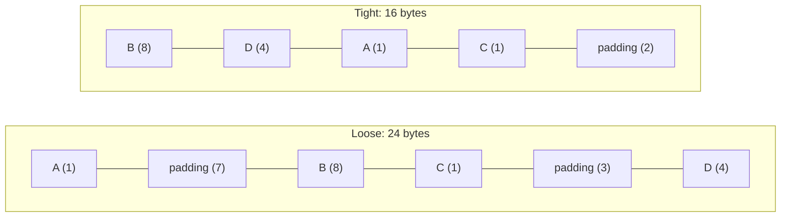
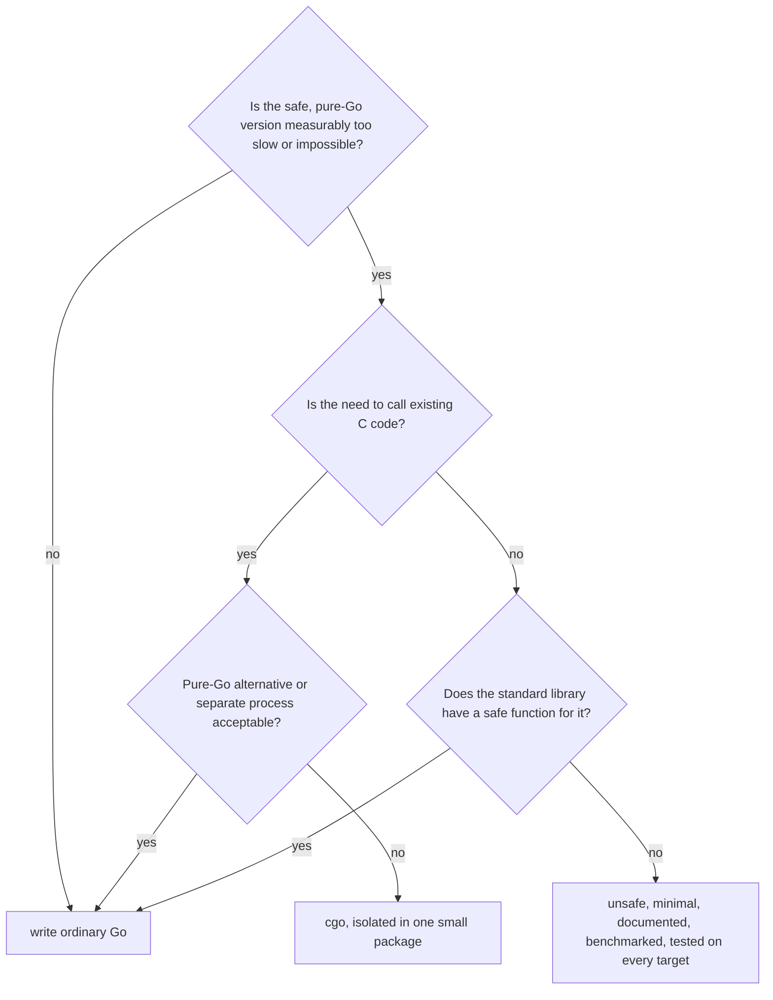

# unsafe and cgo

> **Before this lesson:** read [Reflection](#/lesson/go/go-reflection). You need pointers ([Pointers, nil and mutability](#/lesson/go/go-pointers-basics)), stack, heap and the garbage collector ([Pointers, performance and the garbage collector](#/lesson/go/go-pointers-gc)), the layout of strings and slices ([Arrays and slices](#/lesson/go/go-arrays-slices), [Strings, runes and bytes](#/lesson/go/go-strings-runes)), and cross-compilation ([embed, go generate and cross-compilation](#/lesson/go/go-embed-generate-cross)). No knowledge of C is assumed.

## In plain words

Go protects you. You cannot read past the end of a slice, treat a number as a pointer, keep using memory after it was freed, or change a string. Those protections are why whole categories of security bugs that plague C programs are rare in Go.

A building has fire doors and locked utility rooms for the same reason. Nearly everyone should stay out of the room with the high-voltage switchgear. Electricians, though, need a key, because some jobs can only be done in there.

This lesson is about the two keys Go provides.

- The package **`unsafe`** lets you look at and manipulate raw memory: the actual bytes behind a value, with the type system switched off.
- **cgo** lets a Go program call code written in **C**, the decades-old language in which operating systems and countless libraries are written.

Both remove safety guarantees, both tie your program to details that may change, and both make it harder to build. You will seldom write either. You should still understand them: to read low-level code, to judge libraries that use them, and to answer for the costs when someone proposes them.

Why this matters for a job: struct layout and padding come up in performance work and in interviews ("how big is this struct, and can you make it smaller?"). Many popular packages wrap C libraries through cgo (SQLite, image codecs, some cryptography), and knowing what that implies for builds and deployment prevents unpleasant surprises.

**Compared with Python.** Python's `ctypes`, `cffi` and C extension modules play the role of cgo, and the scientific stack (NumPy and friends) depends on C code heavily, because pure Python is slow. Go is fast enough that most programs never need C, so cgo is the exception.

## The unsafe package

### Three questions about layout

The first group of `unsafe` functions is harmless. They report how values are arranged in memory.

- `unsafe.Sizeof(x)`: how many bytes `x` occupies.
- `unsafe.Alignof(x)`: the **alignment** of `x`, explained below.
- `unsafe.Offsetof(s.f)`: how many bytes from the start of struct `s` the field `f` begins.

```go
package main

import (
	"fmt"
	"unsafe"
)

func main() {
	var i32 int32
	var i64 int64
	var s string
	var sl []int
	var p *int
	var e any

	fmt.Println(unsafe.Sizeof(i32), unsafe.Sizeof(i64), unsafe.Sizeof(p))
	fmt.Println(unsafe.Sizeof(s), unsafe.Sizeof(sl), unsafe.Sizeof(e))
}
```

On a 64-bit machine:

```text
4 8 8
16 24 16
```

The second line confirms what earlier lessons described: a string is two machine words (pointer and length, 16 bytes), a slice is three (pointer, length, capacity, 24 bytes), and an interface value is two (type and value, 16 bytes). `Sizeof` reports the header only, not the data it points to: a string of a million characters still reports 16.

### Alignment and padding

Processors read memory most efficiently when a value's address is a multiple of its size: an 8-byte integer at an address divisible by 8, a 4-byte one at an address divisible by 4. That requirement is the type's **alignment**. To satisfy it inside a struct, the compiler inserts unused bytes, called **padding**, between fields, and at the end so that the struct's total size is a multiple of its largest alignment.

Fields are laid out in the order you declare them, so **the order changes the size**:

```go
package main

import (
	"fmt"
	"unsafe"
)

type Loose struct {
	A bool  // 1 byte
	B int64 // 8 bytes
	C bool  // 1 byte
	D int32 // 4 bytes
}

type Tight struct {
	B int64
	D int32
	A bool
	C bool
}

func main() {
	fmt.Println(unsafe.Sizeof(Loose{}), unsafe.Sizeof(Tight{}))

	var l Loose
	fmt.Println(unsafe.Offsetof(l.A), unsafe.Offsetof(l.B), unsafe.Offsetof(l.C), unsafe.Offsetof(l.D))
}
```

```text
24 16
0 8 16 20
```

Both structs hold the same 14 bytes of data. `Loose` takes 24 bytes and `Tight` takes 16.



In `Loose`, `B` must start at a multiple of 8, so seven bytes after `A` are wasted; `D` must start at a multiple of 4, wasting three after `C`. Ordering fields **from largest alignment to smallest** removes most padding.

Does it matter? For a single struct, no. For a slice of ten million of them it is the difference between 240 MB and 160 MB, and more elements fit in the processor's cache. Do this only for types that exist in very large numbers, and prefer a readable field order otherwise. The linter `fieldalignment` (part of `golang.org/x/tools`) reports structs that could be smaller.

### Try it: compute a struct's layout

Enter any field list and the simulation places the fields and counts the padding, using the sizes of a 64-bit platform.

```python-run
SIZES = {"bool": 1, "int8": 1, "uint8": 1, "int16": 2, "int32": 4, "float32": 4,
         "int64": 8, "float64": 8, "int": 8, "pointer": 8, "string": 16, "slice": 24, "interface": 16}
ALIGN = {**{k: min(v, 8) for k, v in SIZES.items()}, "string": 8, "slice": 8, "interface": 8}

def layout(fields):
    offset, rows, max_align = 0, [], 1
    for name, typ in fields:
        a = ALIGN[typ]
        pad = (-offset) % a                       # bytes needed to reach a multiple of a
        if pad:
            rows.append((offset, pad, "(padding)"))
        offset += pad
        rows.append((offset, SIZES[typ], f"{name} {typ}"))
        offset += SIZES[typ]
        max_align = max(max_align, a)
    tail = (-offset) % max_align
    if tail:
        rows.append((offset, tail, "(padding)"))
    return rows, offset + tail

def show(title, fields):
    rows, size = layout(fields)
    wasted = sum(n for _, n, what in rows if what == "(padding)")
    print(f"{title}: {size} bytes, {wasted} of them padding")
    for off, n, what in rows:
        print(f"   offset {off:>2}  size {n:>2}  {what}")

fields = [("Active", "bool"), ("ID", "int64"), ("Level", "int8"), ("Score", "float32"),
          ("Name", "string"), ("Flag", "bool")]
show("as declared", fields)
show("largest alignment first", sorted(fields, key=lambda f: -ALIGN[f[1]]))
```

Reordering saves a full machine word here. Add a field or two and check your prediction.

### unsafe.Pointer: switching the type system off

The dangerous part of the package is the type **`unsafe.Pointer`**. It is a pointer with no element type, and it has two special powers:

1. any `*T` can be converted to `unsafe.Pointer`, and an `unsafe.Pointer` to any `*U`;
2. an `unsafe.Pointer` can be converted to a `uintptr` (an integer big enough to hold an address) and back, which allows arithmetic on addresses.

Power 1 lets you reinterpret the same bytes as a different type:

```go
package main

import (
	"fmt"
	"math"
	"unsafe"
)

func main() {
	f := 1.0
	bits := *(*uint64)(unsafe.Pointer(&f)) // read the 8 bytes of the float as an unsigned integer
	fmt.Printf("%#x\n", bits)
	fmt.Printf("%#x\n", math.Float64bits(f)) // the safe way to get the same answer
}
```

```text
0x3ff0000000000000
0x3ff0000000000000
```

Read the expression from the inside out: `&f` is a `*float64`; `unsafe.Pointer(&f)` drops the type; `(*uint64)(...)` claims the address holds a `uint64`; the leading `*` reads it. No bytes were converted. The same 64 bits were looked at through a different lens. The compiler checks nothing here: had you written `*uint16` or a struct type of the wrong size, it would compile equally well and read nonsense, or memory that belongs to something else.

As the second line shows, the standard library usually has a safe function for the legitimate need.

### Zero-copy strings and byte slices

Converting between `string` and `[]byte` copies the data, to keep strings immutable. In extremely hot code, people avoid the copy with `unsafe` helpers added in Go 1.20:

```go
package main

import (
	"fmt"
	"unsafe"
)

func main() {
	b := []byte("hello")
	s := unsafe.String(unsafe.SliceData(b), len(b)) // a string that SHARES b's memory
	fmt.Println(s)

	b[0] = 'j' // change the bytes ...
	fmt.Println(s) // ... and the "immutable" string has changed
}
```

```text
hello
jello
```

The program created a string and then changed it, which the language says cannot happen. Any code holding that string, a map using it as a key for instance, may now misbehave in ways that are extremely hard to trace. The technique is correct only if you can guarantee that the bytes are never modified again for as long as the string exists. That guarantee is yours to keep; nothing checks it.

### Why unsafe is unsafe

- **No type checking and no bounds checking.** A wrong size or offset reads or overwrites unrelated memory. Symptoms appear later and elsewhere.
- **The garbage collector does not follow a `uintptr`.** An address stored in an integer does not keep the object alive, and the runtime may move a goroutine's stack. The rules for when a `uintptr` may be converted back to a pointer are narrow (in essence: in the same expression). `go vet` has an `unsafeptr` analyzer for the common violations.
- **No compatibility promise.** The Go 1 guarantee does not cover programs that depend on memory layout. An upgrade of the compiler may change the layout of a runtime structure you peeked into.
- **Not portable.** Sizes, alignment and byte order differ between architectures.

Where `unsafe` is legitimately used: inside the runtime and standard library, in packages that talk to the operating system or hardware, in high-performance serialisation, and at the boundary with C. In application code, treat every appearance as something that needs a comment explaining why it is correct and a benchmark proving it is needed.

## cgo: calling C from Go

### What it is

A great deal of valuable software exists as C libraries: database engines, codecs, numerical routines, device drivers. **cgo** is the part of the Go toolchain that lets a Go file call C functions and use C types.

You enable it by importing a pseudo-package named `"C"`. The comment **immediately above** that import is not a comment to cgo: it is C code, called the **preamble**.

```go
package main

/*
#include <stdlib.h>
#include <string.h>

static int add(int a, int b) {
    return a + b;
}
*/
import "C"

import (
	"fmt"
	"unsafe"
)

func main() {
	sum := C.add(2, 3) // call the C function; the result is a C.int
	fmt.Println(int(sum))

	cs := C.CString("gopher")        // copy the Go string into memory owned by C
	defer C.free(unsafe.Pointer(cs)) // C memory must be freed by hand
	fmt.Println(int(C.strlen(cs)))
}
```

```text
5
6
```

What is going on:

- The preamble includes two standard C headers and defines a small C function `add`.
- `import "C"` must follow the preamble with **no blank line in between**, and stands alone, apart from other imports.
- `C.add(2, 3)` calls the C function. C's types are available as `C.int`, `C.double`, `C.size_t` and so on. They are distinct from Go's types, so results are converted explicitly: `int(sum)`.
- A Go string cannot be handed to C directly; C expects a pointer to bytes ending in a zero byte. `C.CString` allocates such a copy **in C's memory**, outside the reach of Go's garbage collector. You must release it with `C.free`, or the memory is lost for the life of the process. This is manual memory management, with all the bugs that come with it.
- `unsafe.Pointer` appears because `C.free` takes C's untyped pointer.

To build this you need a C compiler (such as `gcc` or `clang`) installed, and `CGO_ENABLED=1`.

### What cgo costs

Go's designers have a blunt saying: *cgo is not Go.* Using it gives up much of what makes Go pleasant.

| You lose | Why |
|---|---|
| **Easy cross-compilation** | you now need a C compiler and C libraries for every target platform |
| **Fast builds** | C code is compiled by a separate, slower compiler |
| **A single static binary** | the result often depends on shared C libraries that must exist on the target machine |
| **Memory safety** | C code can corrupt memory, and the garbage collector does not manage what C allocates |
| **Cheap calls** | each call from Go into C switches stacks and coordinates with the scheduler; it costs far more than a Go function call, so calling a tiny C function in a loop can be slower than pure Go |
| **Cheap goroutines** | a goroutine blocked in a C call occupies a whole operating-system thread |
| **Tooling** | the race detector, profiler and debuggers see less inside C code |

There are also strict rules about passing pointers: C may not keep a pointer to Go-managed memory after the call returns, because the garbage collector cannot see C's references.

### When cgo is the right choice

- A mature C library does something that would take years to reimplement and verify (a database engine, a video codec, certified cryptography).
- You must talk to an operating-system interface or hardware vendor library that is available only as C.

Before choosing it, look for alternatives:

1. **A pure-Go implementation.** For most needs one exists (there are pure-Go PostgreSQL drivers, a pure-Go port of SQLite, image and compression packages in the standard library).
2. **A separate process.** Run the C program as its own process and talk to it over a pipe or a network socket. You keep a pure-Go binary and isolate crashes.
3. **WebAssembly.** Some projects compile the C library to WebAssembly and run it inside a pure-Go runtime.

If you do use cgo, hide it. Put all the `C.` code in one small package that exposes a normal Go API, so that the rest of the program neither imports `"C"` nor handles C memory.

You can check whether your own build involves cgo:

```text
$ go list -f '{{.ImportPath}} {{.CgoFiles}}' ./...
$ CGO_ENABLED=0 go build ./...      # fails loudly if something really needs cgo
```

The second command is a good CI check for a project that intends to stay pure Go.

## A decision guide



## Pitfalls

> [!WARNING]
> Code using `unsafe` or cgo can corrupt memory silently. The failure often appears far from its cause: a crash in the garbage collector minutes later, or wrong data in an unrelated variable. Neither the compiler nor ordinary tests will point to the faulty line.

- **Storing a `uintptr` and converting it back to a pointer later.** The object may have been freed or moved.
- **Reinterpreting memory as a type of a different size or layout.**
- **Mutating bytes that back a string** created with `unsafe.String`.
- **Depending on the internal layout of runtime or library types.** It changes between releases.
- **Assuming sizes are the same on every platform** (`int` and pointers are 4 bytes on 32-bit targets).
- **Reordering struct fields for size when the struct is rare**, at the cost of readability.
- **Forgetting `C.free`** for memory from `C.CString` or `C.malloc`: a leak the garbage collector cannot fix.
- **A blank line between the cgo preamble and `import "C"`**: the C code is ignored and every `C.` name is undefined.
- **Adding a cgo dependency without noticing**, and discovering in the deployment pipeline that cross-compilation and the minimal container image no longer work.
- **Calling small C functions in tight loops**, paying the call overhead millions of times.

> [!TIP]
> Before adopting a dependency, run `go list -deps -f '{{if .CgoFiles}}{{.ImportPath}}{{end}}' ./...` in a scratch module that imports it. An empty result means no cgo anywhere beneath it. If something appears, you now know what you are agreeing to.

> [!INTERVIEW]
> **"What is the `unsafe` package for?"** Bypassing the type system: `unsafe.Pointer` converts between arbitrary pointer types and to and from `uintptr`; `Sizeof`, `Alignof` and `Offsetof` report layout. Used for systems programming, zero-copy conversions and C interop. Risks: no type or bounds checks, interaction with the garbage collector (a `uintptr` is not a reference), no Go 1 compatibility guarantee, non-portability. **"Why can reordering struct fields shrink a struct?"** Fields are aligned to their size, and padding fills the gaps; sorting fields from largest to smallest alignment minimises padding. **"What are the downsides of cgo?"** Slower builds, harder cross-compilation, loss of static binaries, expensive Go-to-C calls, threads tied up by blocking C calls, manual memory management and weaker tooling. Prefer pure Go or a separate process.

## Cheat sheet

| Item | Meaning |
|---|---|
| `unsafe.Sizeof(x)` | bytes occupied by `x` (headers only for strings, slices, interfaces) |
| `unsafe.Alignof(x)` | required alignment of `x` |
| `unsafe.Offsetof(s.f)` | offset of field `f` in struct `s` |
| Sizes on 64-bit | pointer 8, `int` 8, string 16, slice 24, interface 16 |
| Smaller structs | order fields from largest to smallest alignment |
| `unsafe.Pointer(p)` | untyped pointer; converts to any `*T` |
| `(*T)(unsafe.Pointer(p))` | reinterpret memory as `T` |
| `unsafe.String(ptr, n)`, `unsafe.Slice(ptr, n)` | build a string / slice over existing memory, no copy |
| `import "C"` after a comment | enables cgo; the comment is C code |
| `C.CString(s)` / `C.GoString(cs)` | Go string → C memory (must `C.free`) / C string → Go string (copied) |
| `CGO_ENABLED=0` | build without cgo; pure-Go, static |
| Checks | `go vet` (`unsafeptr`), `fieldalignment`, `go list -f '{{.CgoFiles}}'` |

## Summary

- `unsafe` reports memory layout and, through `unsafe.Pointer`, lets code reinterpret raw memory without type or bounds checks.
- Struct fields are **aligned**, with **padding** between and after them; ordering fields by decreasing alignment reduces a struct's size, which matters only at large scale.
- Zero-copy tricks break the immutability of strings unless you guarantee the bytes never change.
- Programs using `unsafe` are outside the compatibility promise and can corrupt memory silently.
- **cgo** calls C code via `import "C"` and a C preamble. It brings manual memory management, slower and more complicated builds, costly calls and the loss of easy cross-compilation and static binaries.
- Prefer safe standard-library functions, pure-Go libraries or a separate process. When the dragons are unavoidable, confine them to one small, well-tested package.

## Glossary

- **Alignment**: the requirement that a value's address be a multiple of a given number of bytes.
- **C**: a low-level programming language with manual memory management, in which most operating systems are written.
- **cgo**: the Go tool and mechanism for calling C code.
- **Machine word**: the natural unit of data for a processor; 8 bytes on 64-bit systems.
- **Padding**: unused bytes inserted to satisfy alignment.
- **Preamble**: the comment before `import "C"`, containing C declarations and code.
- **Reinterpretation**: treating the same bytes as a value of another type.
- **`uintptr`**: an integer type large enough to hold a memory address; not a reference for the garbage collector.
- **`unsafe.Pointer`**: a pointer type that can be converted to and from any other pointer type.
- **Zero-copy**: sharing memory between representations instead of copying it.

```quiz
[
  {"q": "On a 64-bit machine, what does `unsafe.Sizeof(s)` report for a string `s` holding one million characters?",
   "options": ["1,000,000", "16", "8", "1,000,016"],
   "answer": 1,
   "explain": "Sizeof reports the string header: a pointer and a length, two 8-byte words. The character data lives elsewhere."},
  {"q": "`type A struct { X bool; Y int64; Z bool }`. What is `unsafe.Sizeof(A{})` on a 64-bit machine?",
   "options": ["10", "16", "24", "17"],
   "answer": 2,
   "explain": "X at offset 0, then 7 bytes of padding so Y starts at 8; Z at 16; then 7 bytes of trailing padding to make the size a multiple of 8: 24."},
  {"q": "How can the struct from the previous question be made smaller without removing fields?",
   "options": ["It cannot", "Declare Y first, then X and Z: 16 bytes", "Use pointers for the bools", "Add a `//go:pack` directive"],
   "answer": 1,
   "explain": "With the 8-byte field first, the two bools share the next word: 8 + 1 + 1 + 6 bytes padding = 16. Order by decreasing alignment."},
  {"q": "What does this print? `b := []byte(\"cat\"); s := unsafe.String(unsafe.SliceData(b), len(b)); b[0] = 'b'; fmt.Println(s)`",
   "options": ["`cat`", "`bat`", "It panics", "Compile error: strings are immutable"],
   "answer": 1,
   "explain": "The string shares the slice's memory with no copy, so modifying the bytes changes the supposedly immutable string. That is why the technique is dangerous."},
  {"q": "Why is storing an address in a `uintptr` variable and converting it back to a pointer later incorrect?",
   "options": ["uintptr is too small", "The garbage collector does not treat a uintptr as a reference, so the object may be freed or moved in the meantime", "The compiler rejects it", "uintptr values are read-only"],
   "answer": 1,
   "explain": "Only real pointers keep objects alive and are updated when stacks move. An integer holding an address is invisible to the runtime."},
  {"q": "In a cgo file, what is the comment directly above `import \"C\"`?",
   "options": ["Documentation only", "C code (the preamble) that cgo compiles and makes available under `C.`", "A build constraint", "A go:generate directive"],
   "answer": 1,
   "explain": "The preamble holds includes, declarations and small C functions. A blank line between it and the import breaks the association."},
  {"q": "A Go program calls `cs := C.CString(name)` in a loop and never calls `C.free`. What happens?",
   "options": ["The garbage collector frees the memory", "Memory leaks: C allocations are not managed by Go's garbage collector", "The program does not compile", "The strings are reused automatically"],
   "answer": 1,
   "explain": "CString allocates with C's allocator. Only an explicit `C.free(unsafe.Pointer(cs))` releases it."},
  {"q": "Which is NOT a typical cost of adopting cgo?",
   "options": ["Cross-compilation needs a C toolchain for each target", "Calls from Go to C are much more expensive than Go calls", "The program can no longer use goroutines", "The binary may depend on shared C libraries"],
   "answer": 2,
   "explain": "Goroutines still work, although one blocked inside a C call ties up an operating-system thread. The other three are real costs."}
]
```

> **Source:** Bodner, *Learning Go* 2e, ch. 16 (topic coverage; wording and examples are original). Official references: https://pkg.go.dev/unsafe, https://go.dev/ref/spec#Size_and_alignment_guarantees, https://pkg.go.dev/cmd/cgo, https://go.dev/blog/cgo, https://go.dev/wiki/cgo, https://go-proverbs.github.io/
