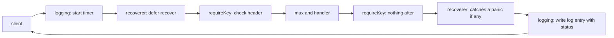

# A REST service: routing, handlers and middleware

> **Before this lesson:** read [net/http and log/slog](#/lesson/go/go-http-slog) (handlers, `ServeMux`, status codes, `httptest`), [encoding/json](#/lesson/go/go-json), [Interface design and dependency injection](#/lesson/go/go-interface-design), [WaitGroup, Mutex, Once, atomics and errgroup](#/lesson/go/go-sync-primitives) and the two context lessons. This module is not from the book; it assembles what you have learned into the kind of program Go developers are paid to write.

## In plain words

Most backend jobs come down to building and maintaining **services**: programs that sit on a server, wait for requests over HTTP, do something with data, and answer. A phone app showing your to-do list is talking to such a service.

The most common style for these conversations is called **REST**. The idea is simple. The service manages **resources**, which are things with identities: tasks, users, orders. Each resource has an address (a URL path such as `/tasks/7`), and the HTTP method says what to do with it: read it, create one, change it, delete it. Requests and responses carry JSON.

Think of a library desk. "Show me the catalogue" (list), "show me this book's card" (read one), "add this new book" (create), "correct the card" (update), "remove this book" (delete). Same desk, a handful of standard actions, applied to identified items.

Around the desk there are procedures that apply to **every** visitor, whatever they ask: sign the visitor log, check their membership card, and make sure that if a librarian faints, someone still tells the visitor "sorry, please come back later". In a web service these wrap-around procedures are called **middleware**.

This lesson builds a complete small service for tasks, step by step: the data type, storage behind an interface, handlers, JSON helpers, error mapping and middleware. The next lesson replaces the in-memory storage with PostgreSQL and makes the service deployable.

Why this matters for a job: this is the exercise. Take-home assignments and live interviews for Go backend roles are, more often than not, "build a small REST API". Reviewers look for exactly the structure shown here: thin handlers, storage behind an interface, consistent errors, middleware, tests.

**Compared with Python.** FastAPI and Flask register routes with decorators and convert JSON to objects for you, with a lot happening behind the scenes. In Go the same steps are written out explicitly with the standard library. There is more code to read, and no hidden behaviour.

> [!NOTE]
> The practice problems in this track are of two kinds. Problems that model Go's rules run in your browser. Problems marked as real Go are compiled and judged on a server, and **you must be logged in** to run those.

## REST conventions in one table

| Action | Method and path | Request body | Success status | Response body |
|---|---|---|---|---|
| List | `GET /tasks` | none | 200 OK | array of tasks |
| Read one | `GET /tasks/{id}` | none | 200 OK | the task |
| Create | `POST /tasks` | the new task's fields | 201 Created | the created task |
| Replace | `PUT /tasks/{id}` | all fields | 200 OK | the updated task |
| Change part | `PATCH /tasks/{id}` | the fields to change | 200 OK | the updated task |
| Delete | `DELETE /tasks/{id}` | none | 204 No Content | empty |

And the failures: **400** when the request is malformed, **404** when the resource does not exist, **401/403** for missing or insufficient permission, **409** for conflicts, **500** when the server itself failed. Clients rely on these codes, so use them consistently.

## Step 1: the data and the storage interface

```go
package main

import (
	"context"
	"errors"
	"sort"
	"sync"
)

// Task is the resource this service manages.
type Task struct {
	ID    int    `json:"id"`
	Title string `json:"title"`
	Done  bool   `json:"done"`
}

// ErrNotFound is returned when a task does not exist.
var ErrNotFound = errors.New("task not found")

// TaskStore is what the HTTP layer needs from storage.
type TaskStore interface {
	List(ctx context.Context) ([]Task, error)
	Get(ctx context.Context, id int) (Task, error)
	Create(ctx context.Context, title string) (Task, error)
	Delete(ctx context.Context, id int) error
}

// memStore keeps tasks in memory. Safe for concurrent use.
type memStore struct {
	mu     sync.Mutex // protects nextID and tasks
	nextID int
	tasks  map[int]Task
}

func newMemStore() *memStore {
	return &memStore{nextID: 1, tasks: make(map[int]Task)}
}

func (s *memStore) List(ctx context.Context) ([]Task, error) {
	s.mu.Lock()
	defer s.mu.Unlock()
	out := make([]Task, 0, len(s.tasks)) // non-nil, so it encodes as [] when empty
	for _, t := range s.tasks {
		out = append(out, t)
	}
	sort.Slice(out, func(i, j int) bool { return out[i].ID < out[j].ID })
	return out, nil
}

func (s *memStore) Get(ctx context.Context, id int) (Task, error) {
	s.mu.Lock()
	defer s.mu.Unlock()
	t, ok := s.tasks[id]
	if !ok {
		return Task{}, ErrNotFound
	}
	return t, nil
}

func (s *memStore) Create(ctx context.Context, title string) (Task, error) {
	s.mu.Lock()
	defer s.mu.Unlock()
	t := Task{ID: s.nextID, Title: title}
	s.tasks[t.ID] = t
	s.nextID++
	return t, nil
}

func (s *memStore) Delete(ctx context.Context, id int) error {
	s.mu.Lock()
	defer s.mu.Unlock()
	if _, ok := s.tasks[id]; !ok {
		return ErrNotFound
	}
	delete(s.tasks, id)
	return nil
}
```

The decisions here are the ones from earlier lessons, applied:

- `TaskStore` is an **interface declared by the consumer** (the HTTP layer). Today it is satisfied by a map; in the next lesson, by PostgreSQL, without touching a handler.
- Every method takes a `context.Context` first, although the in-memory version ignores it. The database version will need it, and the signature should not change.
- The map is guarded by a **mutex** because the HTTP server runs each request in its own goroutine.
- `List` sorts by ID (map order is random) and returns a non-nil slice so that an empty list is `[]` in JSON, not `null`.
- "Not found" is a **sentinel error** that the HTTP layer can recognise with `errors.Is`.

## Step 2: helpers for JSON responses

Every handler writes JSON and many write errors. Two small helpers keep that consistent.

```go
func writeJSON(w http.ResponseWriter, status int, v any) {
	w.Header().Set("Content-Type", "application/json")
	w.WriteHeader(status)
	if err := json.NewEncoder(w).Encode(v); err != nil {
		slog.Error("write response", "err", err)
	}
}

func writeError(w http.ResponseWriter, status int, msg string) {
	writeJSON(w, status, map[string]string{"error": msg})
}
```

Recall the order rule: headers, then status, then body. With these helpers, errors are JSON too (`{"error":"..."}`), so a client can always parse the body the same way.

## Step 3: the handlers

Handlers are methods on a struct that holds the dependencies.

```go
type API struct {
	store TaskStore
	log   *slog.Logger
}

func (a *API) list(w http.ResponseWriter, r *http.Request) {
	tasks, err := a.store.List(r.Context())
	if err != nil {
		a.fail(w, r, err)
		return
	}
	writeJSON(w, http.StatusOK, tasks)
}

func (a *API) get(w http.ResponseWriter, r *http.Request) {
	id, err := strconv.Atoi(r.PathValue("id"))
	if err != nil {
		writeError(w, http.StatusBadRequest, "id must be a number")
		return
	}
	task, err := a.store.Get(r.Context(), id)
	if err != nil {
		a.fail(w, r, err)
		return
	}
	writeJSON(w, http.StatusOK, task)
}

func (a *API) create(w http.ResponseWriter, r *http.Request) {
	var in struct {
		Title string `json:"title"`
	}
	r.Body = http.MaxBytesReader(w, r.Body, 1<<20) // at most 1 MB
	if err := json.NewDecoder(r.Body).Decode(&in); err != nil {
		writeError(w, http.StatusBadRequest, "body must be valid JSON")
		return
	}
	if strings.TrimSpace(in.Title) == "" {
		writeError(w, http.StatusBadRequest, "title is required")
		return
	}
	task, err := a.store.Create(r.Context(), in.Title)
	if err != nil {
		a.fail(w, r, err)
		return
	}
	writeJSON(w, http.StatusCreated, task)
}

func (a *API) remove(w http.ResponseWriter, r *http.Request) {
	id, err := strconv.Atoi(r.PathValue("id"))
	if err != nil {
		writeError(w, http.StatusBadRequest, "id must be a number")
		return
	}
	if err := a.store.Delete(r.Context(), id); err != nil {
		a.fail(w, r, err)
		return
	}
	w.WriteHeader(http.StatusNoContent)
}

// fail maps a storage error to an HTTP response.
func (a *API) fail(w http.ResponseWriter, r *http.Request, err error) {
	switch {
	case errors.Is(err, ErrNotFound):
		writeError(w, http.StatusNotFound, "task not found")
	default:
		a.log.Error("request failed", "method", r.Method, "path", r.URL.Path, "err", err)
		writeError(w, http.StatusInternalServerError, "internal error")
	}
}
```

Every handler has the same three-part shape, and you should be able to recite it:

1. **Decode and validate the input**: path values, query parameters, body. Anything wrong is the client's fault: answer 400 and `return`.
2. **Call the business or storage layer**, passing `r.Context()`.
3. **Encode the output**, or map the error to a status.

Things worth noticing:

- The request struct for `create` is a small anonymous type with exactly the fields a client may send. It is not the `Task` type; a client must not be able to choose its own `id`.
- `fail` is the **single place** where errors become status codes. Unknown errors are logged with details and reported to the client as a generic 500. Never send internal error text (SQL, file paths, stack traces) to clients; it helps attackers and nobody else.
- Handlers contain no storage logic and no SQL. They translate between HTTP and the store. Thin handlers are easy to test and stay correct when storage changes.

## Step 4: middleware

A **middleware** is a function that takes a handler and returns a new handler which does something before and/or after calling the original:

```go
type Middleware func(http.Handler) http.Handler
```

Three that every service has:

```go
// statusRecorder remembers the status code a handler wrote.
type statusRecorder struct {
	http.ResponseWriter // embedded: all other methods are promoted
	status              int
}

func (rec *statusRecorder) WriteHeader(code int) {
	rec.status = code
	rec.ResponseWriter.WriteHeader(code)
}

// logging writes one structured log entry per request.
func logging(log *slog.Logger) Middleware {
	return func(next http.Handler) http.Handler {
		return http.HandlerFunc(func(w http.ResponseWriter, r *http.Request) {
			start := time.Now()
			rec := &statusRecorder{ResponseWriter: w, status: http.StatusOK}

			next.ServeHTTP(rec, r) // run the rest of the chain

			log.Info("request",
				"method", r.Method, "path", r.URL.Path,
				"status", rec.status, "duration_ms", time.Since(start).Milliseconds())
		})
	}
}

// recoverer turns a panic in a handler into a 500 response.
func recoverer(log *slog.Logger) Middleware {
	return func(next http.Handler) http.Handler {
		return http.HandlerFunc(func(w http.ResponseWriter, r *http.Request) {
			defer func() {
				if v := recover(); v != nil {
					log.Error("panic in handler", "panic", v, "stack", string(debug.Stack()))
					writeError(w, http.StatusInternalServerError, "internal error")
				}
			}()
			next.ServeHTTP(w, r)
		})
	}
}

// requireKey rejects requests without the expected API key.
func requireKey(key string) Middleware {
	return func(next http.Handler) http.Handler {
		return http.HandlerFunc(func(w http.ResponseWriter, r *http.Request) {
			if r.Header.Get("X-API-Key") != key {
				writeError(w, http.StatusUnauthorized, "missing or invalid API key")
				return // short-circuit: the inner handlers never run
			}
			next.ServeHTTP(w, r)
		})
	}
}
```

Each is a closure three levels deep, which looks odd the first time. Read it from the outside in: a function that takes configuration (`log`, `key`) returns a `Middleware`; the middleware takes the next handler and returns a handler; that handler is the code that runs per request.

- `logging` needs the status code, which the `ResponseWriter` does not expose. The `statusRecorder` **embeds** the real writer and overrides one method, the decorator technique from the interface-design lesson.
- `recoverer` uses `defer` and `recover` at the request boundary, the legitimate use of `recover` described in the errors module.
- `requireKey` shows **short-circuiting**: a middleware may answer itself and not call `next`.

### Chaining and order

```go
// chain applies middlewares so that the FIRST one listed is the outermost.
func chain(h http.Handler, mws ...Middleware) http.Handler {
	for i := len(mws) - 1; i >= 0; i-- {
		h = mws[i](h)
	}
	return h
}
```

`chain(mux, logging(log), recoverer(log), requireKey(key))` produces `logging(recoverer(requireKey(mux)))`. A request passes through the layers from the outside in, and the response travels back out:



Order matters. Logging is outermost so that it records **every** request, including those rejected by authentication and those that panicked (it sees the 500 written by the recoverer). If `recoverer` were outside `logging`, a panic would skip the log entry.

### Try it: the onion in motion

```python-run
def serve(middlewares, handler, headers):
    events = []
    class Panic(Exception): pass
    def call(i):
        if i == len(middlewares):
            events.append("handler")
            if handler == "panic":
                raise Panic()
            return 200
        kind = middlewares[i]
        if kind == "logging":
            events.append("logging: start")
            try:
                status = call(i + 1)
            except Panic:
                events.append("logging: SKIPPED (panic flew past)")
                raise
            events.append(f"logging: wrote entry with status {status}")
            return status
        if kind == "recoverer":
            try:
                return call(i + 1)
            except Panic:
                events.append("recoverer: caught panic, responded 500")
                return 500
        if kind == "auth":
            if "X-API-Key" not in headers:
                events.append("auth: rejected with 401")
                return 401
            return call(i + 1)
    try:
        status = call(0)
    except Panic:
        events.append("server: connection dropped, nothing logged")
        status = "crash"
    return events, status

for title, mws, handler, headers in [
    ("good order, valid key",    ["logging", "recoverer", "auth"], "ok",    ["X-API-Key"]),
    ("good order, missing key",  ["logging", "recoverer", "auth"], "ok",    []),
    ("good order, handler panics", ["logging", "recoverer", "auth"], "panic", ["X-API-Key"]),
    ("BAD order, handler panics",  ["recoverer", "logging", "auth"], "panic", ["X-API-Key"]),
]:
    events, status = serve(mws, handler, headers)
    print(f"{title} -> {status}")
    for e in events:
        print("     ", e)
```

In the last scenario the panic passes through the logging layer before it is caught, and the request leaves no log entry. The practice problem [HTTP middleware chain order](#/problem/go-middleware-chain) explores more combinations.

## Step 5: wiring and trying it out

```go
func (a *API) Routes() http.Handler {
	mux := http.NewServeMux()
	mux.HandleFunc("GET /tasks", a.list)
	mux.HandleFunc("POST /tasks", a.create)
	mux.HandleFunc("GET /tasks/{id}", a.get)
	mux.HandleFunc("DELETE /tasks/{id}", a.remove)
	return chain(mux, logging(a.log), recoverer(a.log))
}

func main() {
	logger := slog.New(slog.NewJSONHandler(io.Discard, nil)) // silent for this demonstration
	api := &API{store: newMemStore(), log: logger}
	handler := api.Routes()

	calls := []struct{ method, path, body string }{
		{"POST", "/tasks", `{"title":"learn Go"}`},
		{"POST", "/tasks", `{"title":"  "}`},
		{"GET", "/tasks", ""},
		{"GET", "/tasks/1", ""},
		{"GET", "/tasks/abc", ""},
		{"GET", "/tasks/99", ""},
		{"DELETE", "/tasks/1", ""},
		{"GET", "/tasks", ""},
	}
	for _, c := range calls {
		rec := httptest.NewRecorder()
		handler.ServeHTTP(rec, httptest.NewRequest(c.method, c.path, strings.NewReader(c.body)))
		fmt.Println(c.method, c.path, "->", rec.Code, strings.TrimSpace(rec.Body.String()))
	}
}
```

Put the five steps into one file with the imports they need (`context`, `encoding/json`, `errors`, `fmt`, `io`, `log/slog`, `net/http`, `net/http/httptest`, `runtime/debug`, `sort`, `strconv`, `strings`, `sync`, `time`) and run it:

```text
POST /tasks -> 201 {"id":1,"title":"learn Go","done":false}
POST /tasks -> 400 {"error":"title is required"}
GET /tasks -> 200 [{"id":1,"title":"learn Go","done":false}]
GET /tasks/1 -> 200 {"id":1,"title":"learn Go","done":false}
GET /tasks/abc -> 400 {"error":"id must be a number"}
GET /tasks/99 -> 404 {"error":"task not found"}
DELETE /tasks/1 -> 204
GET /tasks -> 200 []
```

Every row of the conventions table behaves as a client would expect, and the demonstration used no network. In a real program `main` would end with an `http.Server` listening on a port (next lesson), and the calls above would live in a table-driven test with a fake store.

## Do you need a router library?

For a long time the standard `ServeMux` could not match methods or path variables, so everybody used a third-party router. Since Go 1.22 the standard mux covers the common needs, and it is a fine default.

Routers such as **chi** (`github.com/go-chi/chi/v5`) remain popular because they add conveniences while staying compatible with `net/http`: handlers and middleware keep the standard signatures, so everything in this lesson works unchanged.

```go
r := chi.NewRouter()
r.Use(middleware.RequestID, middleware.Logger, middleware.Recoverer) // first listed = outermost

r.Route("/tasks", func(r chi.Router) {
	r.Get("/", api.list)
	r.Post("/", api.create)
	r.Route("/{id}", func(r chi.Router) {
		r.Use(requireKey(key)) // middleware for this group only
		r.Get("/", api.get)
		r.Delete("/", api.remove)
	})
})
// inside a handler: id := chi.URLParam(r, "id")
```

What chi gives you is **route groups** with their own middleware, sub-routers and a library of ready-made middleware. Full frameworks such as Gin, Echo and Fiber go further and use their own handler signatures; they are productive, and they tie your handlers to the framework. A reasonable rule: start with the standard library, add chi when grouping gets awkward.

## Organising a growing service

One file is right for a demonstration. For a real service, split by responsibility, following the layout from the packages lesson:

```text
tasks/
  cmd/server/main.go        wiring: config, logger, store, routes, server
  internal/task/            Task type, TaskStore interface, business rules, errors
  internal/httpapi/         handlers, JSON helpers, middleware, Routes()
  internal/postgres/        the PostgreSQL implementation of TaskStore
  internal/memory/          the in-memory implementation (used by tests)
```

Dependencies point inward: `httpapi` and `postgres` both import `task`; `task` imports neither. `main` knows everyone and connects them.

## Pitfalls

> [!WARNING]
> Never send internal error details to the client. A response such as `{"error":"pq: relation \"tasks\" does not exist"}` reveals your database and schema. Log the real error on the server and return a generic message with status 500.

- **Forgetting `return` after writing an error**, so the handler continues and writes a second body.
- **Handlers full of storage or business logic.** They become untestable without HTTP. Keep them thin.
- **Decoding the request directly into the stored type**, letting clients set fields such as `id` or `is_admin`.
- **Unbounded request bodies**; use `http.MaxBytesReader`.
- **`null` instead of `[]` for empty lists.**
- **Shared maps without a mutex.**
- **Wrong middleware order**: recovery outside logging, authentication after an expensive step.
- **A middleware that forgets to call `next.ServeHTTP`**, or calls it twice.
- **Returning 200 with an error message in the body.** Clients and monitoring trust the status code.
- **Using `r.Context()` for work that must continue after the response.**

> [!TIP]
> Write the handler tests first, as a table of `(method, path, body, want status, want body)` rows against a fake store. The table is the API's specification, it runs in milliseconds, and it will catch most regressions for the life of the service.

> [!INTERVIEW]
> **"How would you structure a REST service in Go?"** A domain package with the types, errors and a small storage interface; an HTTP package whose handlers are methods on a struct holding dependencies; each handler decodes and validates input (400 on failure), calls the store with `r.Context()`, and encodes JSON or maps errors to statuses in one place (`errors.Is(err, ErrNotFound)` → 404, unknown → logged 500). Cross-cutting concerns are **middleware**, functions `func(http.Handler) http.Handler`, chained so that logging is outermost, then panic recovery, then authentication. Routing with the Go 1.22 `ServeMux` (`"GET /tasks/{id}"`, `r.PathValue`) or chi for groups. `main` wires concrete implementations. Tests use `httptest` and a fake store.

## Cheat sheet

| Piece | Shape |
|---|---|
| Resource type | struct with `json` tags |
| Storage boundary | small interface, `ctx` first, sentinel errors |
| Handler | `func (a *API) name(w http.ResponseWriter, r *http.Request)` |
| Handler steps | decode + validate → call store → encode or map error |
| JSON response | `writeJSON(w, status, v)` |
| Error response | `writeError(w, status, "message")` then `return` |
| Error mapping | one function: `errors.Is` / `errors.As` → status |
| Middleware type | `func(http.Handler) http.Handler` |
| Capture status | wrapper struct embedding `http.ResponseWriter`, overriding `WriteHeader` |
| Chain | first listed outermost: logging, recovery, auth |
| Routes | `mux.HandleFunc("GET /tasks/{id}", a.get)` |
| Create | 201 + body; delete: 204, no body |
| Test | `httptest.NewRecorder()` + `httptest.NewRequest(...)` |

## Summary

- A REST service exposes **resources** at URL paths and uses HTTP methods and status codes with their conventional meanings.
- Put storage behind a small, consumer-defined **interface** with context-first methods and sentinel errors; protect in-memory state with a mutex.
- Keep **handlers thin**: decode and validate, call the next layer, encode. Centralise JSON writing and the mapping from errors to status codes, and never leak internal error text.
- **Middleware** wraps handlers to add logging, panic recovery, authentication and similar concerns; the order of the chain decides what each layer sees.
- The standard `ServeMux` handles methods and path variables; chi adds grouping while keeping standard signatures.
- Wire everything in `main`, and test with `httptest` against a fake store.

## Glossary

- **API (application programming interface)**: the set of operations a service offers to other programs.
- **CRUD**: create, read, update, delete; the four basic operations on stored data.
- **Endpoint**: one method-and-path combination that a service answers.
- **Middleware**: a wrapper around a handler that adds behaviour for every request passing through it.
- **Resource**: an identifiable thing managed by a service, such as a task.
- **REST**: an architectural style using HTTP methods, paths and status codes to operate on resources.
- **Route group**: a set of routes sharing a path prefix and middleware.
- **Short-circuit**: a middleware answering a request itself without calling the next handler.
- **Thin handler**: a handler limited to translating between HTTP and the layer beneath.

```quiz
[
  {"q": "Which status code should `POST /tasks` return when a task is created successfully?",
   "options": ["200 OK", "201 Created", "204 No Content", "302 Found"],
   "answer": 1,
   "explain": "201 signals that a new resource was created. 200 is for successful reads and updates; 204 is for success with no body, as after a delete."},
  {"q": "What is the type of a middleware in the standard-library style?",
   "options": ["`func(w http.ResponseWriter, r *http.Request)`", "`func(http.Handler) http.Handler`", "`func(error) int`", "`interface{ Use() }`"],
   "answer": 1,
   "explain": "A middleware takes the next handler and returns a new handler that wraps it."},
  {"q": "With `chain(mux, logging, recoverer, auth)` making the first listed outermost, a handler panics. What is logged and returned?",
   "options": ["Nothing is logged; the connection drops", "recoverer responds 500 and logging records a request with status 500", "auth responds 401", "logging records status 200"],
   "answer": 1,
   "explain": "The panic is caught by recoverer, which is inside logging. Control returns normally to the logging layer, which sees the 500."},
  {"q": "A request with no API key reaches `chain(mux, logging, auth)`. What happens?",
   "options": ["The handler runs and then auth rejects", "auth writes 401 and does not call the next handler; logging still records the request", "Nothing is logged", "The mux returns 404"],
   "answer": 1,
   "explain": "A middleware can short-circuit by not calling `next`. Layers outside it, such as logging, still complete normally."},
  {"q": "Why does the `create` handler decode into a small struct with only `Title` instead of into `Task`?",
   "options": ["Decoding into Task is slower", "So clients cannot set fields they must not control, such as the ID", "Task cannot be decoded", "To avoid importing encoding/json"],
   "answer": 1,
   "explain": "The request type lists exactly what a client may supply. Server-controlled fields are assigned by the server."},
  {"q": "A storage method returns `fmt.Errorf(\"get task %d: %w\", id, ErrNotFound)`. How should the HTTP layer decide to answer 404?",
   "options": ["`err == ErrNotFound`", "`strings.Contains(err.Error(), \"not found\")`", "`errors.Is(err, ErrNotFound)`", "It cannot"],
   "answer": 2,
   "explain": "`errors.Is` looks through the wrapping. Direct comparison fails on a wrapped error, and matching text is fragile."},
  {"q": "The store's `List` returns a nil slice when there are no tasks. What does the client receive from `writeJSON(w, 200, tasks)`?",
   "options": ["`[]`", "`null`", "An empty body", "A 404"],
   "answer": 1,
   "explain": "A nil slice encodes as null. Return a non-nil empty slice (`make([]Task, 0)`) so clients receive an empty array."},
  {"q": "Why must the in-memory store use a mutex?",
   "options": ["Maps are slow without one", "The HTTP server serves requests in separate goroutines, so the map is accessed concurrently", "To satisfy the TaskStore interface", "Because of the context parameter"],
   "answer": 1,
   "explain": "Concurrent writes to a map are a data race and crash the program. Each request runs in its own goroutine."}
]
```

> **Source:** original material for this guide (not from the book), building on Bodner, *Learning Go* 2e, ch. 7, 9, 13 and 14 for the underlying features. Official references: https://pkg.go.dev/net/http#ServeMux, https://go.dev/blog/routing-enhancements, https://pkg.go.dev/net/http/httptest, https://pkg.go.dev/github.com/go-chi/chi/v5, https://go.dev/doc/modules/layout
