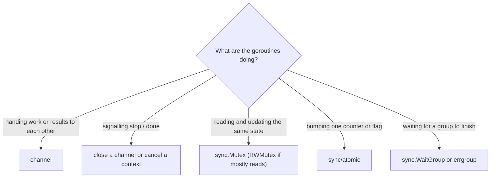

# Language puzzles: slices, maps, nil and channels

> **Before this lesson:** this is a review lesson. It assumes the whole track, and each puzzle links back to the lesson that explains the feature. If a puzzle surprises you, follow its link, reread that lesson, and come back.

## In plain words

A Go interview usually has a part where the interviewer shows ten lines of code and asks: "What does this print?" The code is short, it compiles, and it does something other than what a quick reading suggests.

These questions are not trivia. Each one tests whether you carry the right **mental model** of a feature: the picture in your head of what the machine is doing. A driving examiner who asks "what happens if you brake hard on ice?" is checking for the same thing. People with the right model answer calmly; people who memorised rules guess.

There are perhaps a dozen models that cover nearly all such puzzles:

1. A slice is a small header (pointer, length, capacity) over a shared array.
2. Everything is passed by value; some values contain pointers.
3. A map is a reference to a hash table, iterates in random order, and must be created before writing.
4. An interface is a (type, value) pair and is nil only when both are empty.
5. `defer` evaluates arguments immediately, runs last-in first-out, and runs after the return value is set.
6. A closure captures variables, not values.
7. A string is bytes; `range` yields runes.
8. An unbuffered channel is a handshake; a closed channel always yields zero values; a nil channel blocks for ever.

This lesson walks through the puzzles one model at a time. For each: read the code, **write down your prediction**, then read the answer. Predicting first is what makes the practice work.

Why this matters for a job: besides passing the interview, these are the exact bugs you will be asked to find in code review during your first months.

**Compared with Python.** Almost every puzzle below has a different answer in Python, because Python slices copy, Python variables are references, dictionaries keep insertion order and `None` is a single thing. If Python is your first language, these are the places where your instincts need adjusting.

> [!NOTE]
> Many of the practice problems attached to this track are judged by compiling real Go on a server. You need to be **logged in** to run those; the browser-only problems work without an account.

## Model 1: slices are headers over shared arrays

Lessons: [Arrays and slices](#/lesson/go/go-arrays-slices), [Slicing, aliasing and copy](#/lesson/go/go-slicing-aliasing).

### Puzzle 1: array or slice?

```go
func changeArray(a [3]int) { a[0] = 99 }
func changeSlice(s []int)  { s[0] = 99 }

func main() {
	arr := [3]int{1, 2, 3}
	sl := []int{1, 2, 3}
	changeArray(arr)
	changeSlice(sl)
	fmt.Println(arr, sl)
}
```

```text
[1 2 3] [99 2 3]
```

**Why.** `[3]int` is an array: the function receives a copy of all three elements. `[]int` is a slice: the function receives a copy of the header, which points at the same backing array, so the write is visible to the caller. One character in the type (`3`) changes the answer.

### Puzzle 2: two appends from the same slice

```go
a := make([]int, 3, 4) // [0 0 0], one spare slot
b := append(a, 1)
c := append(a, 2)
fmt.Println(b, c)
```

```text
[0 0 0 2] [0 0 0 2]
```

**Why.** `a` has length 3 and capacity 4. The first `append` has room, so it writes `1` into the spare slot of the shared array and returns a header of length 4. The second `append` starts again from `a` (still length 3), finds the same room, and writes `2` into the **same slot**. `b` and `c` are two headers over one array.

With `make([]int, 3, 3)` there would be no room; each `append` would allocate its own array and the output would be `[0 0 0 1] [0 0 0 2]`. An interviewer will ask for both.

### Puzzle 3: append inside a function

```go
func add(s []int) { s = append(s, 4) }

func main() {
	s := []int{1, 2, 3}
	add(s)
	fmt.Println(s, len(s))
}
```

```text
[1 2 3] 3
```

**Why.** `append` returns a new header, and the function stored it in its own local copy. The caller's header still says length 3. A function that changes a slice's length must return the slice.

### Puzzle 4: slicing a slice

```go
s := []int{1, 2, 3, 4, 5}
t := s[1:3]
fmt.Println(t, len(t), cap(t))
t = append(t, 99)
fmt.Println(s)
```

```text
[2 3] 2 4
[1 2 3 99 5]
```

**Why.** `s[1:3]` has length 2 and capacity `5 - 1 = 4`. Appending within capacity overwrites `s[3]`. The defence is the full slice expression `s[1:3:3]`, which caps the capacity so that `append` must copy.

### Try it: check your model

Model the three numbers and the shared array, and the puzzles answer themselves. Change the capacity in `make` or the slice bounds and predict before running.

```python-run
class Slice:
    def __init__(self, arr, off, length, cap):
        self.arr, self.off, self.len, self.cap = arr, off, length, cap
    def __repr__(self):
        return f"{self.arr[self.off:self.off + self.len]} len={self.len} cap={self.cap}"

def make(length, cap):
    return Slice([0] * cap, 0, length, cap)

def append(s, v):
    if s.len < s.cap:                        # room: write into the shared array
        s.arr[s.off + s.len] = v
        return Slice(s.arr, s.off, s.len + 1, s.cap)
    new_cap = max(1, 2 * s.cap)              # no room: copy to a new array
    arr = s.arr[s.off:s.off + s.len] + [v] + [0] * (new_cap - s.len - 1)
    return Slice(arr, 0, s.len + 1, new_cap)

def reslice(s, lo, hi):
    return Slice(s.arr, s.off + lo, hi - lo, s.cap - lo)

print("Puzzle 2")
a = make(3, 4)                               # try make(3, 3)
b = append(a, 1)
c = append(a, 2)
print("  b =", b, "\n  c =", c, "\n  same array?", b.arr is c.arr)

print("Puzzle 4")
s = make(5, 5); s.arr[:] = [1, 2, 3, 4, 5]
t = reslice(s, 1, 3)
print("  t =", t)
t = append(t, 99)
print("  s =", s)
```

## Model 2: maps

Lesson: [Maps and structs](#/lesson/go/go-maps-structs).

### Puzzle 5: iteration order

```go
m := map[string]int{"a": 1, "b": 2, "c": 3}
for k, v := range m {
	fmt.Println(k, v)
}
fmt.Println(m)
```

**Answer.** The three lines from the loop appear in an **unspecified order that can change from run to run**. The last line is always `map[a:1 b:2 c:3]`.

**Why.** Go randomises map iteration on purpose. The `fmt` package sorts keys when it prints a whole map. The correct interview answer is "the order is not defined; to get a stable order, collect the keys and sort them".

### Puzzle 6: the nil map

```go
var m map[string]int
fmt.Println(m["x"], len(m))
m["x"] = 1
fmt.Println("done")
```

```text
0 0
panic: assignment to entry in nil map
```

**Why.** Reading from a nil map behaves like reading from an empty one. Writing needs a hash table that does not exist. Initialise with `make(map[string]int)` or a literal.

### Puzzle 7: is the key there?

```go
m := map[string]int{"zero": 0}
a := m["zero"]
b := m["missing"]
_, ok := m["missing"]
fmt.Println(a, b, ok)
```

```text
0 0 false
```

**Why.** A missing key yields the zero value. Only the comma-ok form distinguishes "present with value 0" from "absent".

## Model 3: nil and interfaces

Lessons: [Interfaces, any, assertions and the nil trap](#/lesson/go/go-interfaces), [Pointers, nil and mutability](#/lesson/go/go-pointers-basics).

### Puzzle 8: the error that is not nil

```go
type MyErr struct{}

func (*MyErr) Error() string { return "failed" }

func do() error {
	var e *MyErr // nil pointer
	return e
}

func main() {
	err := do()
	fmt.Println(err == nil)
}
```

```text
false
```

**Why.** The returned interface value is the pair (type `*MyErr`, value nil). An interface equals nil only if its type part is empty too. Fix: `return nil` explicitly, and declare such variables as `error`.

### Puzzle 9: calling a method on a nil pointer

```go
type Tree struct{ left, right *Tree }

func (t *Tree) Size() int {
	if t == nil {
		return 0
	}
	return 1 + t.left.Size() + t.right.Size()
}

func main() {
	var t *Tree
	fmt.Println(t.Size())
	fmt.Println((&Tree{left: &Tree{}}).Size())
}
```

```text
0
2
```

**Why.** Calling a pointer-receiver method on a nil pointer is legal. A panic happens only when a nil pointer is **dereferenced**; this method checks first.

## Model 4: defer and closures

Lesson: [Closures, defer and call by value](#/lesson/go/go-closures-defer).

### Puzzle 10: order and argument timing

```go
func main() {
	for i := 0; i < 3; i++ {
		defer fmt.Print(i, " ")
	}
	x := 10
	defer fmt.Println("x =", x)
	x = 20
}
```

```text
x = 10
2 1 0 
```

**Why.** Deferred calls run last-in, first-out, so the `Println` (deferred last) runs first. Its argument `x` was evaluated at the `defer` statement, when `x` was 10. Then the three `Print` calls run in reverse order, each with the value of `i` captured when it was deferred.

### Puzzle 11: defer and the return value

```go
func a() int {
	n := 1
	defer func() { n++ }()
	return n
}

func b() (n int) {
	n = 1
	defer func() { n++ }()
	return n
}

func main() {
	fmt.Println(a(), b())
}
```

```text
1 2
```

**Why.** `return n` first copies the value into the function's result, then runs deferred functions. In `a` the result is an unnamed slot; the closure later increments the local `n`, which nobody reads any more. In `b` the result **is** the variable `n`, so the closure changes what the caller receives.

### Puzzle 12: closures in a loop

```go
var fns []func() int
for i := 0; i < 3; i++ {
	fns = append(fns, func() int { return i * i })
}
for _, f := range fns {
	fmt.Print(f(), " ")
}
```

**Answer.** With Go 1.22 or later: `0 1 4 `. With a `go.mod` declaring an older version: `9 9 9 `.

**Why.** A closure captures the variable. Since Go 1.22 each iteration has its own `i`; before, all three closures shared one `i`, which was 3 after the loop. Give both answers and say which version changed it.

## Model 5: strings

Lesson: [Strings, runes and bytes](#/lesson/go/go-strings-runes).

### Puzzle 13: lengths

```go
s := "aé世"
fmt.Println(len(s), len([]rune(s)))
for i, r := range s {
	fmt.Print(i, ":", string(r), " ")
}
fmt.Println()
fmt.Println(s[1])
```

```text
6 3
0:a 1:é 3:世 
195
```

**Why.** `len` counts bytes: `a` is 1, `é` is 2, `世` is 3. Converting to `[]rune` counts characters. `range` yields the starting byte index of each rune (0, 1, 3). Indexing gives a single byte, here the first byte of `é`.

## Model 6: structs, comparison and copies

### Puzzle 14: what can be compared?

```go
type P struct{ X, Y int }

a, b := P{1, 2}, P{1, 2}
fmt.Println(a == b)

pa, pb := &P{1, 2}, &P{1, 2}
fmt.Println(pa == pb, *pa == *pb)

// s1, s2 := []int{1}, []int{1}
// fmt.Println(s1 == s2)
```

```text
true
false true
```

**Why.** Structs with comparable fields compare field by field. Pointers compare addresses, and these are two different allocations. The commented lines do not compile: `invalid operation: s1 == s2 (slice can only be compared to nil)`. Use `slices.Equal`.

### Puzzle 15: range gives copies

```go
type Item struct{ Qty int }

items := []Item{{1}, {2}}
for _, it := range items {
	it.Qty *= 10
}
fmt.Println(items)

for i := range items {
	items[i].Qty *= 10
}
fmt.Println(items)
```

```text
[{1} {2}]
[{10} {20}]
```

**Why.** The loop variable `it` is a copy of each element. Index into the slice to modify it.

## Model 7: channels

Lessons: [Goroutines and channels](#/lesson/go/go-goroutines-channels), [select and concurrency patterns](#/lesson/go/go-select-patterns), [Deadlocks, leaks and the race detector](#/lesson/go/go-deadlocks-leaks).

### Puzzle 16: send with nobody listening

```go
func main() {
	ch := make(chan int)
	ch <- 1
	fmt.Println(<-ch)
}
```

```text
fatal error: all goroutines are asleep - deadlock!
```

**Why.** A send on an unbuffered channel blocks until a receiver is ready. The only goroutine is the one sending, so it never reaches the receive. With `make(chan int, 1)` the program prints `1`.

### Puzzle 17: closed channels

```go
ch := make(chan int, 2)
ch <- 1
ch <- 2
close(ch)

for v := range ch {
	fmt.Print(v, " ")
}
v, ok := <-ch
fmt.Println(v, ok)
```

```text
1 2 0 false
```

**Why.** Closing does not discard buffered values; `range` drains them and then ends. A further receive returns the zero value at once with `ok == false`.

### Puzzle 18: the three states

What does each line do, taken separately?

```go
var nilCh chan int
closed := make(chan int); close(closed)

<-nilCh        // (a)
nilCh <- 1     // (b)
<-closed       // (c)
closed <- 1    // (d)
close(closed)  // (e)
close(nilCh)   // (f)
```

| Line | Result |
|---|---|
| (a) receive from nil | blocks for ever |
| (b) send to nil | blocks for ever |
| (c) receive from closed | returns `0` immediately |
| (d) send to closed | **panic**: send on closed channel |
| (e) close a closed channel | **panic**: close of closed channel |
| (f) close a nil channel | **panic**: close of nil channel |

Know this table by heart.

### Puzzle 19: select with default

```go
ch := make(chan int)
select {
case v := <-ch:
	fmt.Println("got", v)
default:
	fmt.Println("nothing ready")
}
```

```text
nothing ready
```

**Why.** No case can proceed, and `default` exists, so it runs immediately. Without `default` this program would deadlock. If several cases are ready at once, one is chosen at random, never "the first".

### Puzzle 20: who prints, and in what order?

```go
func main() {
	data := make(chan int)
	done := make(chan struct{})

	go func() {
		for v := range data {
			fmt.Print(v, " ")
		}
		close(done)
	}()

	for i := 1; i <= 3; i++ {
		data <- i
	}
	close(data)
	<-done
	fmt.Println("end")
}
```

```text
1 2 3 end
```

**Why.** This output is guaranteed. One goroutine receives, so values are printed in the order sent. `close(data)` ends the `range` loop. `<-done` makes `main` wait until the goroutine has printed everything. Remove `<-done` and "end" may appear before the 3, or the 3 may not appear at all, because `main` could return first.

### Puzzle 21: the goroutines that never ran

```go
func main() {
	for i := 0; i < 3; i++ {
		go fmt.Println(i)
	}
}
```

**Answer.** Usually nothing is printed. Occasionally some of the numbers appear, in any order.

**Why.** `main` returns straight after starting the goroutines and the program ends. Nothing waits for them. The fix is a `sync.WaitGroup`.

### Puzzle 22: the copied WaitGroup

```go
func work(wg sync.WaitGroup) { // passed by value
	defer wg.Done()
}

func main() {
	var wg sync.WaitGroup
	wg.Add(1)
	go work(wg)
	wg.Wait()
	fmt.Println("finished")
}
```

```text
fatal error: all goroutines are asleep - deadlock!
```

**Why.** `work` receives a **copy** of the WaitGroup and calls `Done` on the copy. The original counter stays at 1 and `Wait` blocks for ever. Pass `*sync.WaitGroup`. `go vet` reports this as a lock passed by value.

## Model 8: scope

Lesson: [Blocks, shadowing and if](#/lesson/go/go-blocks-shadowing).

### Puzzle 23: the shadowed error

```go
func find(ok bool) (int, error) {
	if ok {
		return 7, nil
	}
	return 0, errors.New("not found")
}

func main() {
	var result int
	var err error
	if true {
		result, err := find(false)
		_ = result
		_ = err
	}
	fmt.Println(result, err)
}
```

```text
0 <nil>
```

**Why.** Inside the `if` block, `:=` declares **new** variables `result` and `err` that shadow the outer ones. The failure never reaches the outer `err`. Use `=` to assign to the existing variables.

## Mutex or channel?

This is asked as an open question. A complete answer:

- Use a **mutex** to protect state that several goroutines read and modify in place: a counter, a cache, a map, the fields of a struct. It is simpler and faster for that job.
- Use a **channel** to pass data or ownership between goroutines, to distribute work, to collect results and to signal events such as "done".
- Neither is more idiomatic. The slogan "share memory by communicating" describes a design tendency, not a ban on mutexes; the standard library uses both.
- Whichever you choose, verify with `go test -race`.



## How to answer a "what does it print" question

1. **Name the feature being tested** before computing anything: "this is slice aliasing", "this is defer argument timing".
2. **Trace the state explicitly**: for slices, write pointer/len/cap; for defers, write the stack; for goroutines, say which operation blocks on which.
3. **State the output, then the reason in one sentence.**
4. **Offer the fix or the variant**: "with capacity 3 it would be different", "since 1.22 this prints 0 1 2".
5. If the result is not deterministic, say so. "The order is unspecified" is a correct and complete answer, and recognising it is the point of the question.

## Pitfalls

> [!WARNING]
> The most common way to fail these questions is answering from another language's rules: assuming a slice expression copies (Python), that a struct assignment shares (Java), that a `switch` falls through (C), or that map order is insertion order (Python 3.7+).

- **Forgetting the capacity** when reasoning about `append`.
- **Saying "maps and slices are passed by reference".** They are passed by value; the value contains a pointer. The imprecise phrase leads to the wrong answer for Puzzle 3.
- **Claiming a definite order for map iteration or for unsynchronised goroutines.**
- **Treating a nil pointer inside an interface as a nil interface.**
- **Confusing a nil channel (blocks for ever) with a closed channel (always ready).**
- **Not mentioning Go 1.22** for loop-variable questions.
- **Guessing instead of tracing.** Interviewers reward visible reasoning even when the final answer has a slip.

> [!TIP]
> Make your own puzzle cards. For each model, write a five-line program, predict the output on paper, then run it at `https://go.dev/play/`. Being wrong in private a few times is the fastest way to fix a mental model.

> [!INTERVIEW]
> **A compact checklist to say out loud.** Slices: header of pointer, length, capacity; `append` writes in place when capacity allows, otherwise copies. Arrays: values, copied. Maps: reference to a hash table, random iteration order, nil map readable not writable, comma-ok for presence. Interfaces: (type, value) pair, nil only if both unset. Defer: arguments evaluated at the statement, LIFO, runs after the result is assigned, can modify named results. Closures: capture variables; per-iteration loop variables since 1.22. Strings: immutable bytes, `len` in bytes, `range` in runes. Channels: unbuffered is a rendezvous; closed yields zero values with `ok == false`; nil blocks; send-on-closed and double close panic; `select` picks randomly among ready cases.

## Cheat sheet

| Question | Short answer |
|---|---|
| Array passed to a function | copied in full |
| Slice passed to a function | header copied; elements shared; length changes not visible |
| `append` with spare capacity | writes into the shared array |
| `append` without capacity | new array; no longer shared |
| `s[lo:hi]` | shares memory; cap = `cap(s) - lo` |
| Map iteration | unspecified, randomised order |
| Write to a nil map | panic |
| `m[k]` for a missing key | zero value; use `v, ok := m[k]` |
| Interface holding a nil pointer `== nil` | false |
| Method call on a nil pointer | allowed until it dereferences |
| Deferred call arguments | evaluated at `defer` |
| Deferred call order | last in, first out |
| Deferred closure and named result | can change the returned value |
| Loop variable captured by closures | per iteration since Go 1.22 |
| `len(string)` | bytes |
| Unbuffered send, no receiver | blocks; deadlock if nobody ever receives |
| Receive from a closed channel | zero value, `ok == false` |
| Send on a closed channel, double close | panic |
| Nil channel | send and receive block for ever |
| `select` with several ready cases | random choice |
| Copying a `sync.Mutex` / `WaitGroup` | bug; pass a pointer |

## Summary

- "What does it print?" questions test mental models. Eight models cover nearly all of them: slice headers, call by value, maps, interface pairs, defer, closures, strings as bytes, and channel states.
- For slices, track pointer, length and capacity; capacity decides whether `append` shares or copies.
- Maps iterate in random order; nil maps accept reads only.
- An interface is nil only when both its type and value are unset.
- Deferred arguments are fixed early, calls run in reverse, and named results can be changed after `return`.
- Unbuffered channels need both parties; closed channels never block receivers; nil channels block for ever; some outcomes are not deterministic, and saying so is the right answer.

## Glossary

- **Aliasing**: two names referring to the same memory.
- **Comma-ok**: the two-result form that reports presence or success.
- **Deadlock**: goroutines waiting on each other for ever.
- **Deterministic**: producing the same result on every run.
- **Mental model**: your internal picture of how a feature behaves.
- **Named result**: a result variable declared in the function signature.
- **Rendezvous**: sender and receiver meeting on an unbuffered channel.
- **Shadowing**: an inner declaration hiding an outer variable of the same name.
- **Zero value**: the default value of a type.

```quiz
[
  {"q": "What does this print? `a := []int{1, 2, 3}; b := a; b[0] = 9; c := [3]int{1, 2, 3}; d := c; d[0] = 9; fmt.Println(a[0], c[0])`",
   "options": ["`9 9`", "`1 1`", "`9 1`", "`1 9`"],
   "answer": 2,
   "explain": "`a` is a slice: `b := a` copies the header and shares the array. `c` is an array: `d := c` copies all elements."},
  {"q": "What does this print? `s := make([]int, 2, 2); t := append(s, 5); t[0] = 7; fmt.Println(s[0])`",
   "options": ["`7`", "`0`", "`5`", "It panics"],
   "answer": 1,
   "explain": "Length equals capacity, so append allocates a new array. `t` no longer shares memory with `s`, and `s[0]` stays 0."},
  {"q": "What does this print? `func f() (x int) { defer func() { x += 5 }(); return 1 }` then `fmt.Println(f())`",
   "options": ["`1`", "`5`", "`6`", "`0`"],
   "answer": 2,
   "explain": "`return 1` sets the named result x to 1; the deferred closure then adds 5; the caller receives 6."},
  {"q": "What does this print? `var p *int; var i any = p; fmt.Println(p == nil, i == nil)`",
   "options": ["`true true`", "`true false`", "`false false`", "`false true`"],
   "answer": 1,
   "explain": "The pointer is nil. The interface holds (type *int, value nil); its type part is set, so it is not nil."},
  {"q": "What happens? `ch := make(chan int); close(ch); v, ok := <-ch; fmt.Println(v, ok); ch <- 1`",
   "options": ["Prints `0 false`, then panics: send on closed channel", "Prints `0 false`, then blocks for ever", "Deadlocks immediately", "Prints `0 true`, then exits"],
   "answer": 0,
   "explain": "Receiving from a closed channel returns the zero value with ok false. Sending on a closed channel panics."},
  {"q": "What does this print? `s := \"héy\"; n := 0; for range s { n++ }; fmt.Println(len(s), n)`",
   "options": ["`3 3`", "`4 3`", "`4 4`", "`3 4`"],
   "answer": 1,
   "explain": "`é` takes two bytes, so len is 4. `range` iterates over runes, of which there are 3."},
  {"q": "What can you say about the output of `m := map[int]string{1: \"a\", 2: \"b\", 3: \"c\"}; for k := range m { fmt.Print(k) }`?",
   "options": ["Always `123`", "Always `321`", "The three digits in an unspecified order that may differ between runs", "It does not compile"],
   "answer": 2,
   "explain": "Map iteration order is deliberately randomised. Sort the keys if you need a stable order."},
  {"q": "What does this print? `var mu sync.Mutex; n := 0; var wg sync.WaitGroup; for i := 0; i < 10; i++ { wg.Add(1); go func() { defer wg.Done(); mu.Lock(); n++; mu.Unlock() }() }; wg.Wait(); fmt.Println(n)`",
   "options": ["A number between 1 and 10", "`10`", "`0`", "It deadlocks"],
   "answer": 1,
   "explain": "The WaitGroup makes main wait for all ten goroutines and the mutex makes each increment exclusive, so the result is always 10."}
]
```

> **Source:** original review material for this guide, drawing on the topics of Bodner, *Learning Go* 2e, ch. 3-7 and 12. Official references: https://go.dev/ref/spec, https://go.dev/doc/effective_go, https://go.dev/doc/faq, https://go.dev/blog/slices-intro, https://go.dev/blog/loopvar-preview, https://go.dev/wiki/CommonMistakes
