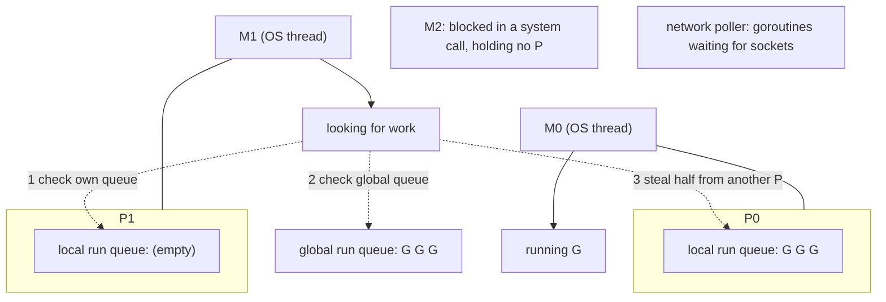

# Runtime questions: scheduler, escape analysis and GC

> **Before this lesson:** you need goroutines and channels ([Goroutines and channels](#/lesson/go/go-goroutines-channels)), mutexes ([WaitGroup, Mutex, Once, atomics and errgroup](#/lesson/go/go-sync-primitives)), stack, heap, escape analysis and the garbage collector ([Pointers, performance and the garbage collector](#/lesson/go/go-pointers-gc)), and interfaces as (type, value) pairs ([Interfaces](#/lesson/go/go-interfaces)). This lesson goes one level below the language, to the machinery that runs it.

## In plain words

Every Go program contains a hidden second program: the **runtime**. It is linked into your executable and works behind the scenes. It starts and schedules goroutines, grows their stacks, hands out memory, collects garbage and implements channels and maps. You never call most of it directly, and it shapes how your program behaves.

Senior interviews ask about the runtime for a practical reason. When a service is slow, uses too much memory or stalls under load, the explanation is usually found here, and an engineer who knows how the machinery works can diagnose in minutes what others guess at for days.

The centrepiece is the **scheduler**. Picture a large restaurant kitchen:

- there are hundreds of **orders** waiting to be cooked: these are goroutines;
- there are a handful of **cooks**: these are operating-system threads, the things that actually execute instructions;
- there are a fixed number of **cooking stations**, each with its own rail of order tickets: a cook must stand at a station to cook.

A cook with an empty rail does not stand idle while a colleague's rail overflows; they walk over and take half of the colleague's tickets. If a cook must leave the kitchen to wait for a delivery, another cook takes over the station so that it never goes unused.

Go's scheduler is that kitchen. Its three parts have one-letter names, **G**, **M** and **P**, and "explain the G-M-P model" is among the most common senior Go interview questions.

**Compared with Python.** CPython has the global interpreter lock (GIL): one thread executes Python code at a time, so threads give concurrency without parallelism for CPU work. (Free-threaded builds exist from Python 3.13 but are not yet the default.) Go has no such lock: goroutines run in parallel on all cores, multiplexed onto threads by the scheduler described here.

## The scheduler: G, M and P

| Letter | Stands for | What it is |
|---|---|---|
| **G** | goroutine | a function in progress: its stack, its position in the code, its state |
| **M** | machine | an operating-system thread, which really executes code on a CPU core |
| **P** | processor | a scheduling context: a permission slip to run Go code, with a **local run queue** of runnable goroutines |

The rule that ties them together: **an M must hold a P to run Go code, and it runs one G at a time.**

The number of Ps is `GOMAXPROCS`, by default the number of CPU cores available to the process (since Go 1.25 it also respects container CPU limits). That number is therefore the maximum count of goroutines executing Go code at the same instant. There can be millions of Gs and more Ms than Ps, but only `GOMAXPROCS` goroutines run Go code at once.



### Why the P exists

An early version of Go had only Gs and Ms with a single global queue protected by a lock. Every scheduling decision on every core fought over that lock. The P was introduced so that each core has its **own** queue, reachable without locking in the common case. A goroutine also tends to stay on the P that last ran it, which keeps its data warm in that core's cache.

### Where a goroutine goes

- `go f()` creates a G and puts it on the **local run queue of the current P**. (The newest G gets a special "run next" slot, so a goroutine that is started and immediately awaited runs promptly.)
- A local queue holds up to 256 Gs. If it overflows, half of it is moved to the **global run queue**.
- When a P needs something to run, it looks, in order: its own local queue; the global queue; the network poller, for goroutines whose I/O is ready; and finally the queues of other Ps.
- To prevent goroutines in the global queue from starving while local queues stay busy, a P checks the global queue first once in every 61 scheduling rounds.

### Work stealing

A P with nothing to run picks another P at random and **steals half** of its local queue. That balances load automatically: no central dispatcher is needed, and idle cores find work quickly.

### Try it: a small scheduler

The simulation runs goroutines with different amounts of work on a few Ps, with local queues, a global queue, the periodic global check and work stealing. It is the model used in the practice problem [G-M-P scheduler with work stealing](#/problem/go-gmp-scheduler).

```python-run
def gmp(local, global_q, quantum, global_every):
    local = [[list(g) for g in q] for q in local]
    glob = [list(g) for g in global_q]
    n, trace, rnd = len(local), [], 0
    while glob or any(local):
        rnd += 1
        running, notes = [], []
        for p in range(n):
            g = None
            if rnd % global_every == 0 and glob:
                g = glob.pop(0); notes.append(f"P{p} takes G{g[0]} from the global queue (fairness check)")
            elif local[p]:
                g = local[p].pop(0)
            elif glob:
                g = glob.pop(0); notes.append(f"P{p} takes G{g[0]} from the global queue")
            else:
                victim = max(range(n), key=lambda v: (len(local[v]), -v))
                if local[victim]:
                    k = (len(local[victim]) + 1) // 2
                    stolen, local[victim] = local[victim][:k], local[victim][k:]
                    g = stolen[0]; local[p].extend(stolen[1:])
                    notes.append(f"P{p} steals {k} from P{victim}: {['G%d' % s[0] for s in stolen]}")
            running.append(g)
        row = []
        for p, g in enumerate(running):
            if g is None:
                row.append("idle"); continue
            row.append(f"G{g[0]}")
            g[1] -= quantum
            if g[1] > 0:
                local[p].append(g)          # preempted: back of the local queue
        trace.append((row, notes))
    return trace

# P0 starts with six goroutines; P1 and P2 start empty; two more wait in the global queue
start = [[[1, 2], [2, 1], [3, 3], [4, 1], [5, 2], [6, 1]], [], []]
for i, (row, notes) in enumerate(gmp(start, [[7, 1], [8, 1]], quantum=1, global_every=4), 1):
    print(f"round {i}: " + "  ".join(f"P{p}={g:<4}" for p, g in enumerate(row)))
    for note in notes:
        print("          " + note)
```

In the first rounds the empty Ps take from the global queue and then steal from P0; after that all three stay busy. Try starting everything on P0 with an empty global queue, or setting `global_every` to 1.

### Blocking: three different cases

What happens when a goroutine cannot continue depends on why.

**1. Blocking on a channel, mutex, `time.Sleep` or `select`.** The goroutine is **parked**: marked as waiting and taken off the run queue. The M does not block; it picks the next G from the P's queue at once. When the awaited event happens, the goroutine is made runnable again and put on a queue. Parking and unparking cost well under a microsecond and involve no operating-system call. This is why channels and goroutines are cheap.

**2. Network I/O.** Go's network calls look blocking to your code, yet underneath they use the operating system's event-notification facility (epoll on Linux, kqueue on macOS and BSD, IOCP on Windows) through the runtime's **network poller**. A goroutine waiting on a socket is parked, and one mechanism watches all sockets together. Ten thousand idle connections need ten thousand parked goroutines and almost no threads.

**3. A blocking system call or cgo call** (reading a regular file, calling into C). Here the thread itself is stuck inside the operating system. The runtime **detaches the P** from that M and gives it to another M (creating one if necessary), so the P's other goroutines keep running. When the call returns, the first M tries to get a P back; failing that, its goroutine goes onto the global queue and the M goes to sleep. This is why a program can have more threads than `GOMAXPROCS`.

### Preemption

A goroutine that never blocks must not hog its P. Since Go 1.14 the runtime uses **asynchronous preemption**: a background monitor thread called **sysmon** notices a goroutine that has run for more than about 10 milliseconds and interrupts it, so that it is rescheduled. Before 1.14, a tight loop without function calls could monopolise a core and even stall garbage collection. Sysmon is also the part that retakes Ps from threads stuck in system calls.

### Goroutine stacks

Each goroutine starts with a small stack, around 2 KB. When a function call needs more room, the runtime allocates a stack twice as large, **copies** the old one over and fixes up pointers into it. Stacks can also shrink during garbage collection. The fact that stacks move is one reason Go does not let you do arithmetic on pointers.

An OS thread, by contrast, reserves its stack up front (commonly 1 to 8 MB of address space). That difference in memory, plus scheduling in user space, is why hundreds of thousands of goroutines are practical.

## Escape analysis, revisited

The compiler decides at build time whether each value lives on a goroutine's **stack** (freed automatically when the function returns) or on the **heap** (freed later by the garbage collector). A value **escapes** to the heap when the compiler cannot prove that it will not be referenced after its function returns.

Common causes:

| Code | Escapes? | Why |
|---|---|---|
| `x := 1; return x` | no | the value is copied out |
| `x := 1; return &x` | yes | the address outlives the frame |
| `p := &x; use(*p)` locally | no | the pointer does not leave |
| passing `&x` down to a function that does not keep it | no | the caller's frame is still alive |
| storing a pointer in a global, a heap object, a channel or a long-lived closure | yes | reachable after return |
| `fmt.Println(x)` | usually yes | converted to an interface the compiler cannot see through |
| `make([]int, n)` with `n` unknown at compile time | yes | size not known |
| very large local arrays | yes | too big for the stack |

Inspect the decisions with `go build -gcflags=-m`. The interview-ready summary: *stack allocation is nearly free and creates no garbage; heap allocation costs time now and collector work later; returning pointers and converting to interfaces are the usual triggers; never rely on a particular decision because it is an optimisation that changes between versions.* The reasoning is practised in [Escape analysis by rules](#/problem/go-escape-analysis).

## The garbage collector, revisited

**What kind is it?** A **concurrent, tri-colour, mark-and-sweep** collector. It is **non-moving** (objects keep their addresses) and **non-generational** (it does not separate young objects from old).

**How does a cycle run?**

1. **Mark setup** (a very short stop-the-world pause): turn on the **write barrier** and prepare.
2. **Concurrent mark**: collector goroutines, using about a quarter of the available CPU, trace from the **roots** (global variables and every goroutine's stack) and mark everything reachable, while your program keeps running. If your program allocates faster than the marking progresses, allocating goroutines are made to help; this is called **mark assist** and shows up as latency in allocation-heavy code.
3. **Mark termination** (another very short pause): finish and switch the barrier off.
4. **Concurrent sweep**: unmarked memory is reclaimed gradually, as new allocations need it.

**What is tri-colour marking?** Every object is conceptually **white** (not yet seen), **grey** (seen, its pointers not yet followed) or **black** (seen and fully scanned). Marking repeatedly takes a grey object, greys the white objects it points to, and blackens it. When no grey objects remain, the white ones are unreachable.

**Why a write barrier?** Your program changes pointers while marking is in progress. Without a safeguard it could hide a white object behind an already-black one, and the collector would free something still in use. The write barrier is a small piece of code run on pointer writes during marking that tells the collector about such changes.

**When does a cycle start?** When the heap has grown by `GOGC` percent over the live heap left by the previous cycle. With the default `GOGC=100`, that is when it has doubled. `GOMEMLIMIT` sets a soft cap on total memory; the collector runs more often as the cap approaches.

**What does it cost, and how do you reduce it?** The work is proportional to the amount of **live** data and the number of pointers in it, not to the amount of garbage. To help: allocate less in hot paths (pre-size slices and maps, reuse buffers, `sync.Pool` for short-lived objects), prefer values and contiguous slices over many small pointer-linked objects, and measure with `-benchmem`, `GODEBUG=gctrace=1` and the heap profile in `pprof`.

Recent releases keep improving the implementation (Go 1.25 introduced an experimental redesigned marker, "Green Tea", aimed at better memory locality). The concepts above have been stable for years, and they are what interviewers ask about.

## What a few built-in types are made of

Knowing the shape of these values answers a surprising number of questions.

| Type | Layout | Consequence |
|---|---|---|
| string | pointer + length (2 words) | cheap to pass; substrings share memory; immutable |
| slice | pointer + length + capacity (3 words) | copying shares the array |
| interface | type word + data word (2 words) | nil only when both are zero; non-pointer values are usually boxed on the heap |
| map variable | pointer to a hash-table header | assignments share one table |
| channel variable | pointer to a channel structure | assignments share one channel |
| pointer | 1 word | |

**Channels.** A channel is a heap object containing a lock, a circular buffer (for buffered channels), and two queues of parked goroutines: senders waiting and receivers waiting. A send first looks for a waiting receiver and, if there is one, copies the value **directly** to it and makes it runnable. Otherwise it places the value in the buffer if there is room, and otherwise parks the sender. A receive mirrors this. That is the whole of the behaviour table you learned earlier, implemented with one mutex.

**Maps.** A map is a hash table. Up to Go 1.23 it used buckets of eight entries with overflow chains and grew incrementally; since Go 1.24 it is based on the **Swiss table** design, which is faster and more compact. Either way: lookups are constant time on average, iteration starts from a random position, growth moves entries, which is why you cannot take the address of a map element, and maps are not safe for concurrent writes.

**Interfaces and method calls.** Calling a method through an interface looks up a function pointer in a per-type table and calls it indirectly. This costs a few nanoseconds more than a direct call and, more importantly, usually prevents the compiler from **inlining** the call (copying the function's body into the caller). In nearly all code this is irrelevant; in the innermost loop of a hot path it can matter.

## Diagnosing a running program

| Question | Tool |
|---|---|
| Where does CPU time go? | `go test -cpuprofile` or `net/http/pprof` at `/debug/pprof/profile`, viewed with `go tool pprof` |
| What allocates? | heap profile `/debug/pprof/heap`; `go test -benchmem` |
| What are the goroutines doing? | `/debug/pprof/goroutine?debug=2`; `SIGQUIT` dump |
| How often does GC run, and for how long? | `GODEBUG=gctrace=1` |
| How is the scheduler doing? | `GODEBUG=schedtrace=1000` prints queue lengths and thread counts every second |
| Detailed timeline of scheduling, GC and blocking | `go test -trace`, viewed with `go tool trace` |
| How many cores and goroutines? | `runtime.GOMAXPROCS(0)`, `runtime.NumCPU()`, `runtime.NumGoroutine()` |

## Worked interview answers

**"How do goroutines differ from threads?"** Goroutines are scheduled by the Go runtime in user space onto a small set of OS threads (an M:N scheduler). They start with about 2 KB of growable stack instead of megabytes, and creating or switching one takes a fraction of a microsecond with no system call. Blocking on channels or network I/O parks the goroutine without blocking a thread. A program can therefore run hundreds of thousands of them.

**"Explain the G-M-P model."** G is a goroutine, M an OS thread, P a logical processor holding a local run queue; there are `GOMAXPROCS` Ps, and an M needs a P to run Go code. New goroutines go to the current P's local queue; overflow goes to the global queue. An idle P takes work from its local queue, then the global queue, then the network poller, then steals half of another P's queue. When an M blocks in a system call its P is handed to another M. Long-running goroutines are preempted asynchronously (since 1.14) after about 10 ms by sysmon.

**"What happens when a goroutine does blocking network I/O?"** The runtime registers the socket with the network poller (epoll, kqueue or IOCP) and parks the goroutine. The thread runs other goroutines. When the socket is ready, the goroutine becomes runnable again. Blocking-style code, event-driven performance.

**"What is `GOMAXPROCS`?"** The number of Ps, so the number of OS threads that may execute Go code simultaneously. It defaults to the available CPU count and, since Go 1.25, takes container CPU limits into account. Threads blocked in system calls do not count against it.

**"Does Go have a GIL?"** No. Goroutines execute in parallel on multiple cores. The price is that shared data must be synchronised explicitly, which is what the race detector helps verify.

**"How does the GC achieve short pauses?"** By doing almost all marking and sweeping concurrently with the program, pausing only briefly to start and finish marking; a write barrier keeps the concurrent marking correct. It trades some throughput and CPU for latency.

**"What would you look at if a Go service's latency degraded under load?"** Goroutine count and a goroutine profile (leaks, lock contention), the CPU profile, allocation rate and GC frequency (`gctrace`, heap profile), mutex and block profiles, connection-pool limits and downstream timeouts, and whether `GOMAXPROCS` matches the CPU the container is really given.

## Pitfalls

> [!WARNING]
> Do not design application code around scheduler details such as queue lengths, the 10 ms preemption interval or which goroutine runs next. They are implementation details that change between releases. Correct programs rely only on explicit synchronisation.

- **"Goroutines are threads."** They are multiplexed onto threads.
- **"`GOMAXPROCS` limits the number of goroutines"** or "of threads". It limits threads *running Go code* simultaneously.
- **Assuming goroutines run in the order they were started.**
- **Calling `runtime.Gosched()` or `time.Sleep` to "fix" a race.** Use synchronisation.
- **"The GC stops the world for the whole collection."** Only two brief phases do.
- **"More garbage means slower GC."** Cost follows live data and pointers.
- **Tuning `GOGC` before measuring**, or before reducing allocations.
- **Heavy cgo or blocking file I/O from thousands of goroutines**, creating thousands of threads.
- **Explaining escape analysis as something you control with `new` or `&`.** The compiler decides.

> [!TIP]
> Draw the G-M-P picture when answering: three boxes for Ps with their queues, threads attached, a global queue above. Then walk one goroutine through its life: created on a local queue, run, parked on a channel, made runnable, stolen by another P. A drawn walkthrough shows understanding far better than a recited definition.

> [!INTERVIEW]
> **The one-minute runtime summary.** Go multiplexes goroutines (G) onto OS threads (M) using `GOMAXPROCS` logical processors (P), each with a local run queue; idle Ps steal half of another's queue; blocking system calls hand the P to another thread; network I/O parks goroutines on a poller; long runs are preempted after about 10 ms. Goroutine stacks start around 2 KB and grow by copying. The compiler's escape analysis places values on the stack when it can prove they do not outlive the function, otherwise on the heap. The garbage collector is concurrent, tri-colour mark-and-sweep, non-moving and non-generational, with sub-millisecond pauses, paced by `GOGC` and capped by `GOMEMLIMIT`; its cost scales with live pointers, so reducing allocations is the main lever.

## Cheat sheet

| Term | One-line meaning |
|---|---|
| G | goroutine: stack + program position + state |
| M | OS thread |
| P | logical processor with a local run queue; count = `GOMAXPROCS` |
| Local run queue | per-P queue, up to 256 Gs |
| Global run queue | shared overflow queue, checked periodically for fairness |
| Work stealing | an idle P takes half of another P's queue |
| Parking | suspending a goroutine without blocking its thread |
| Network poller | epoll/kqueue/IOCP integration that parks goroutines on sockets |
| Syscall hand-off | a P leaves a thread stuck in a system call |
| sysmon | monitor thread: preemption and retaking Ps |
| Preemption | interrupting a goroutine after about 10 ms |
| Stack | starts near 2 KB, grows by copying |
| Escape analysis | compile-time stack-or-heap decision; `-gcflags=-m` |
| GC | concurrent tri-colour mark and sweep |
| Write barrier | keeps concurrent marking correct |
| `GOGC` / `GOMEMLIMIT` | heap growth trigger / soft memory cap |
| Profiles | `pprof`: cpu, heap, goroutine, mutex, block; `go tool trace` |

## Summary

- The **runtime** inside every Go binary schedules goroutines, manages memory and implements channels and maps.
- The scheduler uses **G** (goroutines), **M** (threads) and **P** (processors with local run queues). `GOMAXPROCS` Ps bound parallel execution of Go code; **work stealing** balances load; system calls hand off the P; network I/O parks goroutines on a poller; long-running goroutines are **preempted**.
- Goroutines are cheap because their stacks are small and growable and because scheduling happens in user space.
- **Escape analysis** keeps values on the stack when it can; pointers that outlive a function and interface conversions send values to the heap.
- The **garbage collector** is concurrent tri-colour mark-and-sweep with very short pauses; its cost follows live data, and allocation discipline is the main way to help it.
- Strings, slices, interfaces, maps and channels are small headers or pointers to runtime structures, which explains their copying and nil behaviour.

## Glossary

- **Inlining**: replacing a function call with the function's body at compile time.
- **Local / global run queue**: a per-P queue of runnable goroutines / the shared one.
- **M:N scheduling**: multiplexing M goroutines onto N threads.
- **Mark assist**: allocating goroutines helping the collector when allocation outpaces marking.
- **Network poller**: the runtime component that waits for I/O readiness on many sockets at once.
- **Parking**: taking a goroutine off the run queues until an event wakes it.
- **Preemption**: forcibly pausing a running goroutine so that others can run.
- **Runtime**: the support code inside every Go executable.
- **Swiss table**: the hash-table design used by Go maps since version 1.24.
- **sysmon**: the runtime's background monitoring thread.
- **System call**: a request from a program to the operating system kernel.
- **Tri-colour marking**: the white/grey/black bookkeeping of the mark phase.
- **Work stealing**: an idle processor taking runnable goroutines from a busy one.
- **Write barrier**: code run on pointer writes during marking to keep the collector informed.

```quiz
[
  {"q": "In the G-M-P model, what is a P?",
   "options": ["A physical CPU core", "A logical processor: a scheduling context with a local run queue that an M must hold to run Go code", "A goroutine waiting on a channel", "The garbage collector's worker thread"],
   "answer": 1,
   "explain": "P is the permission to run Go code plus a queue of runnable goroutines. The number of Ps is GOMAXPROCS."},
  {"q": "What does `GOMAXPROCS` limit?",
   "options": ["The total number of goroutines", "The total number of OS threads", "The number of threads executing Go code at the same time", "The size of the heap"],
   "answer": 2,
   "explain": "It is the number of Ps. Threads blocked in system calls do not hold a P, so a process can have more threads than GOMAXPROCS."},
  {"q": "A P's local run queue is empty and so is the global queue. What does it do?",
   "options": ["Its thread exits", "It steals half of the runnable goroutines from another P's local queue", "It waits until its own queue is refilled", "It triggers a garbage collection"],
   "answer": 1,
   "explain": "Work stealing balances load between processors without a central dispatcher. The network poller is also checked for ready goroutines."},
  {"q": "A goroutine blocks receiving from an empty channel. What happens to the OS thread it was running on?",
   "options": ["The thread blocks too", "The goroutine is parked and the thread runs another goroutine from the P's queue", "The thread is destroyed", "The program deadlocks"],
   "answer": 1,
   "explain": "Channel operations park the goroutine inside the runtime; no system call is made and the thread stays productive."},
  {"q": "A goroutine makes a blocking system call that takes 5 seconds. How does the scheduler keep the P useful?",
   "options": ["It cannot; the P is stuck", "It detaches the P from the blocked thread and hands it to another thread", "It kills the goroutine", "It increases GOMAXPROCS"],
   "answer": 1,
   "explain": "The P is handed off so its other goroutines keep running. When the call returns, the goroutine needs a P again."},
  {"q": "Which statement about Go's garbage collector is correct?",
   "options": ["It is generational and compacting", "It stops the world for the whole mark phase", "It is a concurrent tri-colour mark-and-sweep collector with brief pauses at the start and end of marking", "It uses reference counting"],
   "answer": 2,
   "explain": "Most marking and all sweeping run concurrently with the program. A write barrier keeps concurrent marking correct. It neither moves objects nor separates generations."},
  {"q": "Which code most likely causes `x` to be allocated on the heap?",
   "options": ["`x := 5; return x`", "`x := 5; p := &x; return *p`", "`x := 5; return &x`", "`x := 5; _ = x`"],
   "answer": 2,
   "explain": "Returning the address lets the value outlive the function's frame, so escape analysis moves it to the heap."},
  {"q": "Why can a Go program run hundreds of thousands of goroutines when the same number of OS threads would be impractical?",
   "options": ["Goroutines never use a stack", "Each goroutine starts with a stack of a few kilobytes that grows on demand, and switching between goroutines happens in user space", "The operating system gives Go special treatment", "Goroutines share one stack"],
   "answer": 1,
   "explain": "Small growable stacks keep memory use low, and user-space scheduling avoids system calls for creation and switching."}
]
```

> **Source:** original review material for this guide; the language-level topics follow Bodner, *Learning Go* 2e, ch. 6 and 12. Official references: https://go.dev/doc/gc-guide, https://go.dev/src/runtime/proc.go (scheduler design comments), https://go.dev/doc/go1.14#runtime, https://go.dev/blog/swisstable, https://go.dev/doc/diagnostics, https://go.dev/doc/go1.25#container-aware-gomaxprocs
