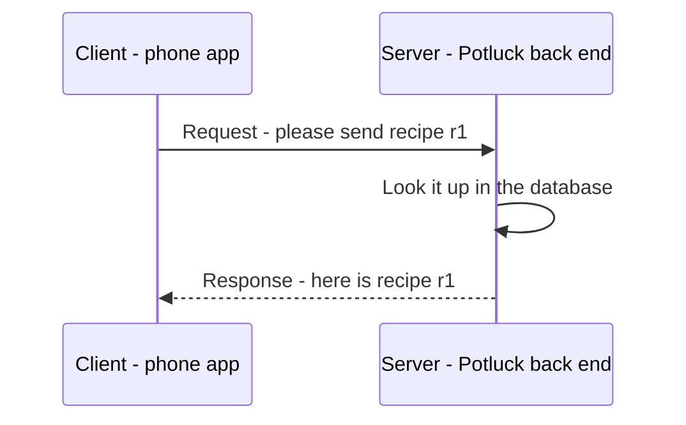

# What an API is: HTTP and JSON from zero

> **Before this lesson:** you should be able to read a few lines of JavaScript (variables, functions, objects, arrays). If objects such as `{ name: "Amara" }` are new, read [Objects and arrays](#/lesson/javascript/objects-arrays) first. No knowledge of servers, networks or GraphQL is assumed. This is the first lesson of the track.

## In plain words

When you open a food-delivery app, the list of restaurants is not stored inside the app. It lives on a computer owned by the company, somewhere far away. The app has to *ask* that computer for the list, and the computer has to *answer* in a form the app can read.

An **API** (Application Programming Interface) is the agreed way for one program to ask another program for something. The word "interface" means "the surface where two things meet". A wall socket is an interface: you do not need to know how the power station works, only the shape of the plug and what comes out of it.

A good everyday picture is a restaurant:

- You (the **client**: the program that asks) sit at a table. You are not allowed in the kitchen.
- The kitchen (the **server**: the program that answers) has the food, but does not come to your table to guess what you want.
- The **menu** is the API. It lists exactly what you may ask for and how to ask.
- The waiter carrying your order to the kitchen and your plate back is the network.

Why it matters for a job: almost every piece of software you will be paid to write either *calls* an API (a web page loading data, a mobile app, a script that reads the weather) or *is* one (the back end those apps talk to). GraphQL, the subject of this track, is one particular style of menu. To understand why it was invented you first need to see the plain version underneath it: HTTP and JSON.

## Clients, servers, requests and responses

Four words carry this whole track, so here they are once more, slowly.

- A **server** is a program that waits for questions and answers them. (The word is also used for the machine it runs on.)
- A **client** is a program that sends questions. Your browser is a client. So is a phone app.
- A **request** is one question sent from client to server.
- A **response** is the one answer sent back.

The pattern is always the same: the client speaks first, the server replies once, and the conversation is over. The server never starts talking by itself. (Lesson 18 shows the one exception, subscriptions.)



Throughout this track we will build up one example product: **Potluck**, a small recipe-sharing app. Cooks publish recipes, other cooks review them and save them into collections. It is small enough to hold in your head and rich enough to show every GraphQL feature.

## HTTP: the envelope

Programs on different machines need a shared set of rules for how a request and a response are written down. Such a set of rules is called a **protocol**. The protocol of the web is **HTTP** (HyperText Transfer Protocol). Every time you load a page, your browser sends an HTTP request and receives an HTTP response. HTTP is text, so we can read it.

### The request

Here is a complete HTTP request asking Potluck for one recipe:

```http
GET /recipes/r1 HTTP/1.1
Host: api.potluck.example
Accept: application/json
```

Line by line:

1. `GET /recipes/r1 HTTP/1.1` is the **request line**. It has three parts separated by spaces.
   - `GET` is the **method** (also called the verb): what kind of action the client wants. `GET` means "give me a copy; change nothing".
   - `/recipes/r1` is the **path**: which thing on the server the request is about.
   - `HTTP/1.1` is the version of the protocol.
2. `Host: api.potluck.example` is a **header**. A header is one line of extra information in the form `Name: value`. This one names the server, because one machine can host many sites.
3. `Accept: application/json` is another header. It says "please answer in JSON" (defined below).

A request can also carry a **body**: a block of data after the headers. A `GET` has none. A request that creates something does:

```http
POST /recipes HTTP/1.1
Host: api.potluck.example
Content-Type: application/json

{"title": "Flatbread", "minutes": 20}
```

`POST` means "here is something new, please process it". The header `Content-Type: application/json` tells the server what language the body is written in. The blank line marks where headers end and the body begins.

The methods you will meet most often:

| Method | Plain meaning | Changes data on the server? |
|---|---|---|
| `GET` | read something | no |
| `POST` | create something, or "do this action" | yes |
| `PUT` | replace something completely | yes |
| `PATCH` | change part of something | yes |
| `DELETE` | remove something | yes |

### The response

The server's answer to the first request:

```http
HTTP/1.1 200 OK
Content-Type: application/json
Content-Length: 78

{"id": "r1", "title": "Lentil soup", "minutes": 35, "authorId": "c1"}
```

1. `HTTP/1.1 200 OK` is the **status line**. `200` is the **status code**, a three-digit number that summarises what happened. `OK` is a human-readable label for it.
2. `Content-Type` says the body is JSON. `Content-Length` says the body is 78 bytes long.
3. After the blank line comes the body: the data that was asked for.

Status codes are grouped by their first digit. You do not need to memorise all of them; learn the families and a handful of members.

| Family | Meaning | Ones worth knowing |
|---|---|---|
| 2xx | it worked | `200 OK`, `201 Created`, `204 No Content` |
| 3xx | look somewhere else | `301 Moved Permanently`, `304 Not Modified` |
| 4xx | the client made a mistake | `400 Bad Request`, `401 Unauthorized` (not signed in), `403 Forbidden` (signed in, not allowed), `404 Not Found`, `429 Too Many Requests` |
| 5xx | the server failed | `500 Internal Server Error`, `503 Service Unavailable` |

> [!TIP]
> A quick way to remember the split between 4xx and 5xx: with a 4xx, sending the same request again will fail again until *you* change something. With a 5xx, the same request might work later, because the fault was on the server's side.

### URLs

The address you type in a browser bundles several of these pieces into one line, called a **URL** (Uniform Resource Locator):

```
https://api.potluck.example/recipes?category=SOUP&limit=2
\___/   \_________________/\______/ \___________________/
scheme         host          path        query string
```

- The **scheme** `https` means "HTTP, but encrypted so nobody on the way can read it".
- The **host** is the server's name.
- The **path** picks the thing on the server.
- The **query string** starts after `?` and holds extra options as `name=value` pairs joined by `&`. Here: only soups, and at most two of them.

An address on a server that accepts requests is called an **endpoint**. `GET /recipes` and `GET /recipes/r1` are two endpoints. Remember this word: the number of endpoints an API has is one of the main differences between REST and GraphQL.

## JSON: the letter inside the envelope

HTTP is the envelope. The letter inside needs a format too, and nearly every modern API uses **JSON** (JavaScript Object Notation): a way of writing structured data as plain text. It looks like JavaScript object syntax because it was borrowed from it, but every language can read and write it.

JSON has exactly six kinds of value:

| Kind | Example | Notes |
|---|---|---|
| string | `"Lentil soup"` | always double quotes |
| number | `35`, `4.5`, `-2` | no quotes |
| boolean | `true`, `false` | lowercase |
| null | `null` | "no value here" |
| array | `["vegan", "soup"]` | an ordered list of values |
| object | `{"id": "r1", "minutes": 35}` | named values; names are strings in double quotes |

Arrays and objects can contain each other to any depth, which is how JSON describes real things:

```json
{
  "id": "r1",
  "title": "Lentil soup",
  "minutes": 35,
  "vegan": true,
  "photo": null,
  "tags": ["soup", "winter"],
  "author": { "id": "c1", "name": "Amara" }
}
```

Read it as: a recipe whose id is the string `r1`, which takes 35 minutes, is vegan, has no photo, carries two tags, and whose author is another object with its own id and name. An object placed inside another object is called a **nested** object.

Two functions convert between JSON text and live JavaScript values. Run this and change it:

```js-run
// A JavaScript object (lives in memory; has no quotes around the keys).
const recipe = { id: "r1", title: "Lentil soup", minutes: 35, tags: ["soup", "winter"] };

// 1. Object -> JSON text. This is what gets sent over the network.
const text = JSON.stringify(recipe);
console.log(typeof text, text);

// 2. JSON text -> object. This is what the receiver does.
const back = JSON.parse(text);
console.log(back.title, "takes", back.minutes, "minutes");
console.log("First tag:", back.tags[0]);

// 3. Badly formed JSON is rejected with an error.
try {
  JSON.parse("{title: 'Soup'}");          // keys and strings need double quotes
} catch (err) {
  console.log("Parse failed:", err.name);
}
```

What each step shows:

1. `JSON.stringify` turns a value into a **string**. The first `console.log` prints `string` followed by the text. Turning live data into text for sending is called **serialising**.
2. `JSON.parse` does the reverse and gives back an object whose properties you can read with a dot. Reading text back into live data is called **parsing** (or deserialising).
3. JSON is stricter than JavaScript. Keys must be in double quotes and strings must use double quotes, so the third call throws a `SyntaxError`.

> [!WARNING]
> JSON has no comments, no trailing commas, no `undefined`, and no date type. A date is normally sent as a string such as `"2026-03-14T09:30:00Z"`, and both sides must agree on how to read it. Keep this in mind: lesson 15 shows how GraphQL's *custom scalars* make that agreement explicit.

## A whole round trip, modelled in the page

The lesson runtime has no network, so we cannot call a real server. Instead, here is a tiny model: a function plays the server, and a second function plays the client. The model is honest about the important part, which is that the two sides exchange **only text**.

```js-run
// ---------- the "server" ----------
const database = {
  r1: { id: "r1", title: "Lentil soup", minutes: 35, authorId: "c1" },
  r2: { id: "r2", title: "Flatbread", minutes: 20, authorId: "c2" },
};

// Takes request text, returns response text. That is all a server is.
function server(requestText) {
  const [requestLine] = requestText.split("\n");       // first line only
  const [method, path] = requestLine.split(" ");       // "GET", "/recipes/r1"
  const match = path.match(/^\/recipes\/(\w+)$/);       // does the path look like /recipes/<id>?

  if (method !== "GET") return "HTTP/1.1 405 Method Not Allowed\n\n";
  if (!match) return "HTTP/1.1 404 Not Found\n\n" + JSON.stringify({ error: "No such endpoint" });

  const recipe = database[match[1]];                   // match[1] is the id captured from the path
  if (!recipe) return "HTTP/1.1 404 Not Found\n\n" + JSON.stringify({ error: "No such recipe" });

  return "HTTP/1.1 200 OK\nContent-Type: application/json\n\n" + JSON.stringify(recipe);
}

// ---------- the "client" ----------
function getRecipe(id) {
  const responseText = server("GET /recipes/" + id + " HTTP/1.1\nAccept: application/json");
  const [head, body] = responseText.split("\n\n");     // blank line separates headers from body
  const status = Number(head.split(" ")[1]);           // "HTTP/1.1 200 OK" -> 200
  return { status, data: body ? JSON.parse(body) : null };
}

console.log(getRecipe("r1"));
console.log(getRecipe("r9"));
```

Walk through one call, `getRecipe("r1")`:

1. The client builds the text `GET /recipes/r1 HTTP/1.1` plus a header and hands it to `server`.
2. The server splits off the first line, then splits that line on spaces to get the method and the path.
3. The regular expression checks the path's shape and captures the id `r1`.
4. The id is found in `database`, so the server builds a response: a status line, a header, a blank line, and the recipe turned into JSON text.
5. Back in the client, the text is split at the blank line. The status code is pulled out of the first line and the body is parsed into an object.

The second call asks for `r9`, which does not exist. The output shows status `404` and an error object. Nothing crashed: a missing item is a normal answer with its own status code.

Try changing `"GET /recipes/"` to `"DELETE /recipes/"` in `getRecipe` and run again. You get `405`: the endpoint exists but does not accept that method.

## Why an API is a contract

Notice what the client had to know in advance to make that call:

- the path pattern (`/recipes/<id>`),
- the method (`GET`),
- that the answer is JSON,
- and the names inside that JSON (`title`, `minutes`, `authorId`).

None of this is discoverable from the request itself. It has to be written down somewhere, usually in documentation, and both sides must stick to it. That is why people call an API a **contract**: if the server team renames `minutes` to `cookTime`, every client that reads `minutes` breaks, even though the server "works".

Keeping this contract precise, discoverable and safe to change is the central problem of API design. Each style of API solves it differently:

| Style | Where the contract lives |
|---|---|
| Plain HTTP + JSON ("REST-like") | prose documentation, or an OpenAPI file if the team writes one |
| GraphQL | a **schema**: a typed description that the server itself enforces and can be asked for |
| gRPC | `.proto` files compiled into code for both sides |

You will meet all three by the end of the track. The next lesson looks closely at the first, because GraphQL makes the most sense as a reaction to it.

> [!INTERVIEW]
> **"What happens when a client calls an API?"** A solid short answer: the client serialises its request (method, path, headers, optional JSON body) and sends it over HTTP; the server routes it by method and path to a handler, which reads or changes data and serialises a response with a status code, headers and a body; the client checks the status code first and then parses the body. Mention that HTTP is **stateless**: each request must carry everything the server needs (for example a token proving who you are), because the server does not remember earlier requests by default.

## Pitfalls

- **Treating the body as an object before parsing it.** What arrives is text. `response.title` on a string is `undefined`. Parse first.
- **Ignoring the status code.** A `404` or `500` often still has a JSON body (an error message). Code that reads `data.title` without checking the status shows `undefined` to the user.
- **Confusing 401 and 403.** `401` means "I do not know who you are" (sign in). `403` means "I know who you are, and you may not do this".
- **Using `GET` for changes.** Browsers, caches and crawlers assume a `GET` is safe to repeat. A link such as `GET /recipes/r1/delete` will be followed by a crawler one day.
- **Putting secrets in the URL.** URLs are logged by servers and saved in browser history. Tokens belong in headers.
- **Assuming JSON keeps your types.** Dates become strings, `undefined` disappears, and very large integers lose precision. Agree on formats explicitly.

## Cheat sheet

| Term | One-line meaning |
|---|---|
| API | the agreed way one program asks another for something |
| client / server | the program that asks / the program that answers |
| request / response | one question / its one answer |
| HTTP | the text protocol of the web |
| method | the verb of a request: `GET`, `POST`, `PUT`, `PATCH`, `DELETE` |
| path | which thing the request is about: `/recipes/r1` |
| header | one `Name: value` line of extra information |
| body | the data carried after the headers |
| status code | three digits summarising the outcome: 2xx ok, 4xx client mistake, 5xx server fault |
| endpoint | one address (method + path) the server answers on |
| JSON | text format for data: strings, numbers, booleans, null, arrays, objects |
| serialise / parse | live data → text / text → live data |

## Summary

- An API is a contract between a client that asks and a server that answers.
- On the web, the question and the answer travel as HTTP: a method and a path going out, a status code coming back, headers on both, and an optional body.
- The body is almost always JSON, a strict text format with six kinds of value that nest inside each other.
- Both sides exchange only text. The client must know the shape of that text in advance, so the hard part of API design is keeping the contract clear and safe to change.
- GraphQL is one answer to that problem. Before meeting it, the next lesson looks at the most common style it competes with: REST.

## Glossary

- **API (Application Programming Interface):** the set of requests a program accepts and the answers it gives.
- **Client:** the program that sends a request.
- **Server:** the program that waits for requests and sends responses.
- **Protocol:** a shared set of rules for how messages are written and exchanged.
- **HTTP (HyperText Transfer Protocol):** the request/response protocol used by the web.
- **Method:** the action word at the start of an HTTP request, such as `GET` or `POST`.
- **Path:** the part of a URL after the host that identifies a thing on the server.
- **Header:** a named piece of extra information on a request or response.
- **Body:** the data part of a request or response.
- **Status code:** a three-digit number in the response describing the outcome.
- **URL (Uniform Resource Locator):** a full address: scheme, host, path and optional query string.
- **Query string:** the `?name=value&...` options at the end of a URL.
- **Endpoint:** one method-and-path combination that a server responds to.
- **JSON (JavaScript Object Notation):** a text format for structured data.
- **Serialise / parse:** convert live data to text / convert text back to live data.
- **Stateless:** the server keeps no memory of earlier requests; each request stands alone.

## Check yourself

```quiz
[
  {"q": "In the restaurant picture of an API, what does the menu stand for?",
   "options": ["The database", "The API: the list of things you may ask for and how", "The client", "The network cable"],
   "answer": 1,
   "explain": "The menu is the contract. It tells the customer (client) what the kitchen (server) will accept, without revealing how the kitchen works."},
  {"q": "A client sends `GET /recipes/r1`. Which part is the path?",
   "options": ["`GET`", "`/recipes/r1`", "`HTTP/1.1`", "`Accept: application/json`"],
   "answer": 1,
   "explain": "`GET` is the method, `/recipes/r1` is the path that picks the thing on the server, and `Accept` is a header."},
  {"q": "The server answers with status 404. Whose mistake does the code family point to?",
   "options": ["The server crashed", "The network dropped the request", "The client asked for something that is not there", "Nobody: 404 means success"],
   "answer": 2,
   "explain": "4xx codes say the request itself was the problem. 404 means the path does not match anything. Server-side failures are 5xx."},
  {"q": "What does `JSON.parse('{\"minutes\": 35}').minutes + 5` evaluate to?",
   "options": ["`\"355\"`", "`40`", "`undefined`", "It throws a SyntaxError"],
   "answer": 1,
   "explain": "The text is valid JSON. Parsing gives an object whose `minutes` is the number 35 (no quotes around it in the JSON), so adding 5 gives 40."},
  {"q": "Which of these is NOT valid JSON?",
   "options": ["`{\"tags\": []}`", "`{\"photo\": null}`", "`{'title': 'Soup'}`", "`[1, 2, 3]`"],
   "answer": 2,
   "explain": "JSON requires double quotes around both keys and strings. Single quotes are JavaScript syntax, not JSON."},
  {"q": "A user is signed in but tries to delete another cook's recipe. Which status code fits best?",
   "options": ["401 Unauthorized", "403 Forbidden", "404 Not Found", "500 Internal Server Error"],
   "answer": 1,
   "explain": "401 means the server does not know who you are. Here it does know, and the answer is no: that is 403."},
  {"q": "Why is an API called a contract?",
   "options": ["Because it must be signed by a lawyer", "Because clients depend on its exact paths and field names, so changing them breaks clients", "Because it only works over encrypted connections", "Because it limits how many requests a client may send"],
   "answer": 1,
   "explain": "Clients are written against the shape of the requests and responses. Renaming a field keeps the server running but silently breaks every client that reads the old name."}
]
```

> **Source:** Porcello & Banks, *Learning GraphQL*, ch. 1 (history of data transport). Also: MDN, "An overview of HTTP" (https://developer.mozilla.org/en-US/docs/Web/HTTP/Overview) and json.org (https://www.json.org/).
