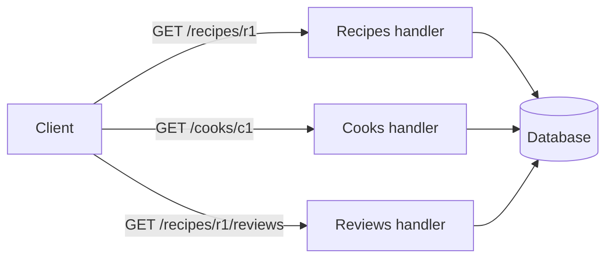

# REST in plain words

> **Before this lesson:** you need the vocabulary from [What an API is: HTTP and JSON from zero](#/lesson/graphql/what-is-an-api): client, server, request, response, method, path, status code, endpoint and JSON. Nothing else is assumed.

## In plain words

**REST** is the most common style for designing web APIs. The idea fits in one sentence: *give every thing its own address, and use the standard HTTP verbs to say what you want done to it.*

Think of a public library.

- Every book has a shelf mark, for example `Cookery / Soups / 641.813`. That is its address. In REST the "things" are called **resources** and the addresses are URLs.
- There are only a few things you can do at the desk: look at a book, add a new book, replace a damaged copy, remove a book. Those are the HTTP methods `GET`, `POST`, `PUT`/`PATCH` and `DELETE`.
- The librarian does not remember you between visits. Each time, you show your card. That is **statelessness**.

Why it matters for a job: most public APIs you will call (payment providers, maps, weather, social networks) are REST or close to it, and most back-end interviews include "design a REST API for X". You also cannot judge when GraphQL is the better tool unless you know what it is being compared with.

REST stands for **Representational State Transfer**. The name comes from Roy Fielding's 2000 doctoral dissertation, which described the architectural principles behind the web itself. You do not need the theory to use REST well; you need five habits, covered one at a time below.

## Habit 1: resources are nouns with addresses

A **resource** is any thing the API lets you talk about: a recipe, a cook, a review. Each gets a URL. By convention:

- a **collection** (all the things of one kind) has a plural-noun path: `/recipes`
- one **item** in it adds its identifier: `/recipes/r1`
- things that belong to an item nest under it: `/recipes/r1/reviews`

The paths contain nouns, not actions. Compare:

| Not REST-style (verbs in the path) | REST-style (nouns; the method is the verb) |
|---|---|
| `POST /getRecipe?id=r1` | `GET /recipes/r1` |
| `POST /createRecipe` | `POST /recipes` |
| `POST /deleteRecipe?id=r1` | `DELETE /recipes/r1` |

The left column is an older style called **RPC** (Remote Procedure Call): the client names a *function* on the server to run. It works, but every API invents its own function names, so nothing learned from one API helps with the next. REST's promise is uniformity: if you know the nouns, you can guess the rest.

## Habit 2: the HTTP method says what to do

The four basic things anyone does with stored data are **C**reate, **R**ead, **U**pdate and **D**elete, shortened to **CRUD**. REST maps them onto HTTP methods:

| You want to | Method and path | Typical success status | Body of the response |
|---|---|---|---|
| list recipes | `GET /recipes` | 200 OK | array of recipes |
| read one recipe | `GET /recipes/r1` | 200 OK | the recipe |
| create a recipe | `POST /recipes` | 201 Created | the new recipe, with its id |
| replace a recipe | `PUT /recipes/r1` | 200 OK | the recipe after the change |
| change part of a recipe | `PATCH /recipes/r1` | 200 OK | the recipe after the change |
| delete a recipe | `DELETE /recipes/r1` | 204 No Content | empty |

Two properties of methods come up constantly in interviews.

A method is **safe** if it only reads. `GET` is safe. This is what lets browsers preload links and lets caches store answers.

A method is **idempotent** (say "eye-dem-POH-tent") if doing it twice leaves the server in the same state as doing it once. `DELETE /recipes/r1` twice: the recipe is gone either way. `PUT` with the same body twice: same final state. But `POST /recipes` twice creates *two* recipes, so `POST` is not idempotent. This matters when a network hiccup makes a client unsure whether its request arrived: idempotent requests can be retried without fear.

| Method | Safe | Idempotent |
|---|---|---|
| GET | yes | yes |
| PUT | no | yes |
| DELETE | no | yes |
| PATCH | no | not guaranteed |
| POST | no | no |

## Habit 3: status codes carry the outcome

A REST API reports what happened through the status code, not through a field hidden in the body. `201` for a creation, `404` when the id does not exist, `400` when the JSON body is invalid, `401`/`403` for sign-in and permission problems. A client can react to the number alone, before reading anything else.

Hold on to this point. GraphQL treats status codes very differently (almost every answer is `200`), and that surprises people who arrive from REST. Lesson 23 compares the two conventions.

## Habit 4: every request stands alone

The server keeps no memory of a client between requests. If Amara must be signed in to publish, then *each* publishing request carries proof of who she is, normally a **token** (a long random-looking string issued at sign-in) in a header:

```http
POST /recipes HTTP/1.1
Host: api.potluck.example
Authorization: Bearer eyJhbGciOi...
Content-Type: application/json

{"title": "Flatbread", "minutes": 20}
```

Because no request depends on an earlier one, any of a hundred identical server machines can handle it. That is the reason statelessness is valued: it is what makes an API easy to scale.

## Habit 5: the response is a representation

What comes back is not the database row itself but a **representation** of the resource: a JSON document describing its current state. The server decides what goes into it. For Potluck, `GET /recipes/r1` might return:

```json
{
  "id": "r1",
  "title": "Lentil soup",
  "minutes": 35,
  "category": "SOUP",
  "description": "A thick red-lentil soup with cumin and lemon...",
  "steps": ["Rinse the lentils.", "Soften the onion.", "Simmer 25 minutes."],
  "photoUrl": "https://img.potluck.example/r1.jpg",
  "createdAt": "2026-01-12T18:04:00Z",
  "authorId": "c1"
}
```

Look at the last line. The recipe does not contain its author; it contains the author's **id**. To show the author's name, the client must make a second request, `GET /cooks/c1`. An id that points at another resource is called a **foreign key** (a term borrowed from databases). Remember this detail: it is the seed of the problems the next module is about.

> [!NOTE]
> Fielding's original REST also asks that responses contain *links* to related resources, so a client can navigate the API the way a person clicks through web pages. This idea has the unwieldy name **HATEOAS** (Hypermedia As The Engine Of Application State). Few real APIs do it fully. In everyday speech "REST API" means "resources, HTTP methods, status codes, JSON", and that is the meaning used in this track.

## The Potluck REST API

Putting the habits together gives a typical endpoint list:

| Endpoint | Purpose |
|---|---|
| `GET /recipes?category=SOUP&limit=20&offset=0` | list recipes, with filters and paging in the query string |
| `POST /recipes` | publish a recipe |
| `GET /recipes/{id}` | one recipe |
| `PATCH /recipes/{id}` | edit a recipe |
| `DELETE /recipes/{id}` | remove a recipe |
| `GET /recipes/{id}/reviews` | reviews of a recipe |
| `POST /recipes/{id}/reviews` | add a review |
| `GET /cooks/{id}` | one cook's profile |
| `GET /cooks/{id}/recipes` | recipes by a cook |
| `GET /cooks/{id}/collections` | a cook's saved collections |

Ten endpoints for three kinds of thing. The `{id}` in braces is a placeholder for a real id.



Each endpoint has its own **handler**: the function on the server that runs when that method and path arrive. The part of the server that matches an incoming request to a handler is the **router**.

## A REST server you can run

Here is a working model of a router and three handlers. It has no network; `request` plays the role of the wire. Run it, then read the walkthrough.

```js-run
const db = {
  recipes: {
    r1: { id: "r1", title: "Lentil soup", minutes: 35, category: "SOUP", authorId: "c1" },
    r2: { id: "r2", title: "Flatbread", minutes: 20, category: "BREAD", authorId: "c2" },
  },
  cooks: {
    c1: { id: "c1", name: "Amara", city: "Leeds" },
    c2: { id: "c2", name: "Bo", city: "Oslo" },
  },
  nextId: 3,
};

// The route table: method + path pattern -> handler function.
const routes = [
  ["GET", /^\/recipes$/, () => [200, Object.values(db.recipes)]],
  ["GET", /^\/recipes\/(\w+)$/, (id) => (db.recipes[id] ? [200, db.recipes[id]] : [404, { error: "Recipe not found" }])],
  ["GET", /^\/cooks\/(\w+)$/, (id) => (db.cooks[id] ? [200, db.cooks[id]] : [404, { error: "Cook not found" }])],
  ["POST", /^\/recipes$/, (body) => {
    if (!body || !body.title) return [400, { error: "title is required" }];
    const recipe = { id: "r" + db.nextId++, ...body };
    db.recipes[recipe.id] = recipe;
    return [201, recipe];
  }],
  ["DELETE", /^\/recipes\/(\w+)$/, (id) => {
    delete db.recipes[id];
    return [204, null];
  }],
];

// The router: find the first route whose method and pattern both match.
function request(method, path, body) {
  for (const [m, pattern, handler] of routes) {
    const match = path.match(pattern);
    if (m === method && match) {
      const [status, data] = handler(match[1] ?? body, body);
      return { status, data };
    }
  }
  return { status: 404, data: { error: "No such endpoint" } };
}

console.log(request("GET", "/recipes/r1"));
console.log(request("POST", "/recipes", { title: "Plum cake", minutes: 70 }));
console.log(request("POST", "/recipes", { minutes: 5 }));
console.log(request("DELETE", "/recipes/r2").status, request("DELETE", "/recipes/r2").status);
console.log(request("GET", "/recipes").data.map((r) => r.title));
```

What to notice in the output:

1. `GET /recipes/r1` returns status `200` and the whole recipe object.
2. The first `POST` returns `201` and a recipe with a fresh id `r3`. The server chose the id; the client did not send one.
3. The second `POST` has no title, so the handler answers `400` with an explanation. Validation mistakes are the client's fault: 4xx.
4. Deleting `r2` twice prints `204 204`. The second delete changed nothing and still succeeded. That is idempotency made visible.
5. The final list shows two titles: `r2` is gone and `r3` was added.

Try it: add a route for `GET /cooks/:id/recipes` that returns the recipes whose `authorId` matches. You will find you need a new pattern, a new handler, and a new line in the documentation. Hold that thought too.

## Showing one screen with REST

Suppose the Potluck app has a recipe screen showing the title, the cooking time, the author's name, and the stars of the first two reviews. With the REST API above, the client code looks like this:

```javascript
const recipe  = await getJSON("/recipes/r1");                      // request 1
const author  = await getJSON("/cooks/" + recipe.authorId);        // request 2 (needs the id from request 1)
const reviews = await getJSON("/recipes/r1/reviews?limit=2");      // request 3
```

Three requests for one screen, and the second cannot start until the first has finished because it needs `authorId`. Meanwhile the first response delivered `description`, `steps`, `photoUrl` and `createdAt`, none of which this screen shows.

REST designers have answers to both annoyances, and you should know them:

- **Sparse fieldsets**: let the client list the fields it wants, `GET /recipes/r1?fields=title,minutes`.
- **Embedding** (also called expansion): let the client ask for related resources inline, `GET /recipes/r1?include=author,reviews`.

Both work. But look at what they are: a small query language squeezed into the query string, invented separately by each API, with no standard for nesting ("the reviews' authors' names, please"). GraphQL starts from the opposite end: make *asking for exactly the fields you want, to any depth* the main feature, and give it a real syntax.

Here is that idea in a dozen lines. A **selection** says which fields to keep; `true` means "this field", a nested object means "go inside".

```js-run
function select(data, selection) {
  if (data === null || data === undefined) return null;
  const out = {};
  for (const [name, sub] of Object.entries(selection)) {
    const value = data[name] ?? null;                       // missing field -> null
    out[name] = sub === true || value === null ? value : select(value, sub);
  }
  return out;
}

const fullRecipe = {
  id: "r1", title: "Lentil soup", minutes: 35, category: "SOUP",
  description: "A thick red-lentil soup with cumin and lemon...",
  steps: ["Rinse the lentils.", "Soften the onion.", "Simmer 25 minutes."],
  author: { id: "c1", name: "Amara", city: "Leeds", bio: "Home cook, spice hoarder." },
};

const wanted = { title: true, minutes: true, author: { name: true } };
const result = select(fullRecipe, wanted);

console.log(result);
console.log("Full size:", JSON.stringify(fullRecipe).length, "characters");
console.log("Selected :", JSON.stringify(result).length, "characters");
```

Line by line:

- `select` loops over the **selection**, not over the data. The client's wish list decides which keys appear.
- For a `true` entry it copies the value. For a nested selection it calls itself on the nested object. A function calling itself is **recursion**; it is how code follows data of any depth.
- The result has the same shape as `wanted`, with values filled in. The size comparison shows how much was left out.

The first practice problem of this track, *Return only the fields that were asked for*, has you write this function in Python. Everything GraphQL does at runtime is an elaboration of it.

> [!TIP]
> When you design a REST API, sketch the *screens* first and count requests per screen. If a common screen needs four or more sequential calls, add an embedding option or a purpose-built endpoint before clients start working around you.

> [!WARNING]
> "REST" on a job advert rarely means Fielding's full architecture. Do not correct an interviewer with a lecture on hypermedia. Do show that you know the conventions: plural nouns, correct methods, correct status codes, statelessness, and idempotency.

> [!INTERVIEW]
> **"What makes an API RESTful?"** Name the constraints in practical words: (1) resources identified by URLs; (2) a uniform interface, meaning the standard HTTP methods with their standard meanings; (3) stateless requests; (4) responses that say whether they can be cached; (5) representations (usually JSON) transferred instead of server internals. Then give an example: `POST /recipes` returns `201` with the new resource and its id; `GET /recipes/r1` is safe and cacheable; `DELETE /recipes/r1` is idempotent.
>
> **Follow-up: "PUT vs PATCH?"** `PUT` replaces the whole resource with the body you send (omitted fields are cleared) and is idempotent. `PATCH` changes only the fields you send.

## Pitfalls

- **Verbs in paths** (`/getRecipes`, `/recipes/delete/r1`). Let the method be the verb.
- **`200 OK` with `{"error": ...}` in the body.** Clients and monitoring tools that trust status codes will count failures as successes.
- **Using `POST` for everything.** You lose caching, safe retries, and the reader's ability to guess what an endpoint does.
- **Deep nesting** such as `/cooks/c1/recipes/r1/reviews/v3/author`. One level of nesting is plenty; beyond that, address the item directly (`/reviews/v3`).
- **Returning unbounded lists.** `GET /recipes` on a table with a million rows must be paged from day one (`limit`/`offset`, or cursors: see lesson 12).
- **Breaking the contract silently.** Renaming or removing a field in a representation breaks clients. REST APIs usually handle this with versions in the path (`/v2/recipes`); lesson 23 compares that with GraphQL's approach.

## Cheat sheet

| Idea | REST convention |
|---|---|
| a kind of thing | plural noun collection: `/recipes` |
| one thing | `/recipes/{id}` |
| things inside a thing | `/recipes/{id}/reviews` |
| read | `GET` → 200 |
| create | `POST` to the collection → 201 + new resource |
| replace / partial edit | `PUT` / `PATCH` → 200 |
| delete | `DELETE` → 204 |
| filters, sorting, paging | query string: `?category=SOUP&sort=-rating&limit=20` |
| who is calling | `Authorization` header on every request |
| safe | reads only (`GET`) |
| idempotent | repeat = same final state (`GET`, `PUT`, `DELETE`) |
| related data | foreign-key ids, or `?include=` embedding |

## Summary

- REST gives every resource a URL and uses HTTP methods as the verbs: `GET` reads, `POST` creates, `PUT`/`PATCH` update, `DELETE` removes.
- Status codes report the outcome; each request carries its own credentials; responses are JSON representations chosen by the server.
- `GET`, `PUT` and `DELETE` are idempotent, which makes them safe to retry. `POST` is not.
- Because the server fixes the shape of each response and related data sits behind ids, one screen often needs several requests and receives fields it never shows.
- Letting the client state exactly which fields it wants, as a nested selection, removes both problems. That selection idea is the core of GraphQL.

## Glossary

- **REST (Representational State Transfer):** an API style built on resources, URLs, HTTP methods and stateless requests.
- **Resource:** a thing the API exposes, such as a recipe or a cook.
- **Collection:** the set of all resources of one kind, such as `/recipes`.
- **CRUD:** Create, Read, Update, Delete: the four basic data operations.
- **RPC (Remote Procedure Call):** an API style in which the client names a function for the server to run.
- **Safe method:** one that only reads and changes nothing.
- **Idempotent:** repeating the request leaves the server in the same state as sending it once.
- **Token:** a string issued at sign-in that proves who the caller is on later requests.
- **Stateless:** the server keeps no per-client memory between requests.
- **Representation:** the document (usually JSON) that describes a resource's current state.
- **Foreign key:** an id stored in one resource that points to another resource.
- **Handler:** the server function that runs for one endpoint.
- **Router:** the part of a server that picks the handler for an incoming request.
- **Sparse fieldset:** a request option listing which fields to return.
- **Embedding / expansion:** a request option asking for related resources inside the response.
- **HATEOAS:** the REST idea that responses should contain links to related actions and resources.
- **Recursion:** a function that calls itself to handle nested data.

## Check yourself

```quiz
[
  {"q": "Which request follows REST conventions for removing review v3?",
   "options": ["`POST /deleteReview?id=v3`", "`GET /reviews/v3/delete`", "`DELETE /reviews/v3`", "`PUT /reviews/remove`"],
   "answer": 2,
   "explain": "The resource is addressed by a noun path and the HTTP method `DELETE` is the verb. A `GET` must never change data."},
  {"q": "A client sends `POST /recipes` and the connection drops before the response arrives. Why is blindly retrying risky?",
   "options": ["POST requests cannot be sent twice", "POST is not idempotent, so a retry may create a second recipe", "The server will answer 304", "POST is a safe method"],
   "answer": 1,
   "explain": "If the first request did arrive, the retry creates a duplicate. Idempotent methods such as PUT and DELETE do not have this problem."},
  {"q": "What does 'stateless' mean for a REST server?",
   "options": ["It has no database", "It never returns status codes", "It does not remember clients between requests, so each request carries what is needed, such as a token", "It cannot be cached"],
   "answer": 2,
   "explain": "State about the *conversation* is not kept on the server. Data in the database is still stored, of course."},
  {"q": "`GET /recipes/r1` returns `{\"id\": \"r1\", \"title\": \"Lentil soup\", \"authorId\": \"c1\"}`. What must a client do to display the author's name?",
   "options": ["Nothing: the name is in the response", "Send a second request such as `GET /cooks/c1`", "Send `DELETE /cooks/c1`", "Parse the id to extract the name"],
   "answer": 1,
   "explain": "The response holds only a foreign key. The name lives in the cook resource, which needs its own request (unless the API offers embedding)."},
  {"q": "Using the `select` function from this lesson, what does `select({title: \"Soup\", minutes: 35, author: {name: \"Amara\", city: \"Leeds\"}}, {author: {name: true}})` return?",
   "options": ["`{author: {name: \"Amara\", city: \"Leeds\"}}`", "`{name: \"Amara\"}`", "`{author: {name: \"Amara\"}}`", "`{title: \"Soup\", author: {name: \"Amara\"}}`"],
   "answer": 2,
   "explain": "The result mirrors the selection exactly: only `author`, and inside it only `name`. Nothing that was not asked for appears."},
  {"q": "Which status code should `POST /recipes` return when the recipe was created?",
   "options": ["200 OK", "201 Created", "204 No Content", "302 Found"],
   "answer": 1,
   "explain": "201 signals that a new resource now exists. The body normally contains it, including the id the server assigned."},
  {"q": "What is the weakness of `?fields=` and `?include=` options in REST APIs?",
   "options": ["They are forbidden by HTTP", "They make responses larger", "Each API invents its own syntax and nesting rules, so there is no standard", "They only work with XML"],
   "answer": 2,
   "explain": "They solve real problems, but as ad-hoc mini query languages. GraphQL standardises the idea with a proper syntax and a schema."}
]
```

> **Source:** Porcello & Banks, *Learning GraphQL*, ch. 1 (REST and the history of data transport). Also: Fielding, "Architectural Styles and the Design of Network-based Software Architectures", ch. 5 (https://ics.uci.edu/~fielding/pubs/dissertation/rest_arch_style.htm); MDN, "HTTP request methods" (https://developer.mozilla.org/en-US/docs/Web/HTTP/Methods).
