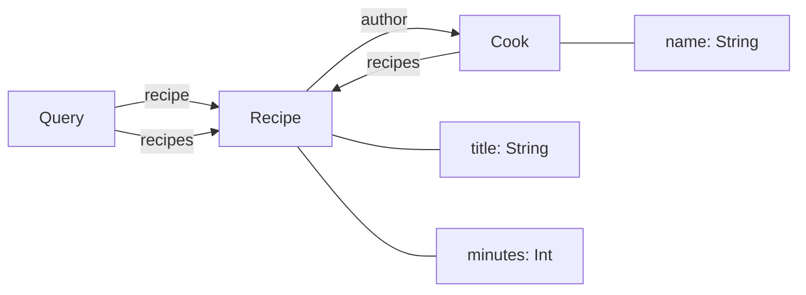
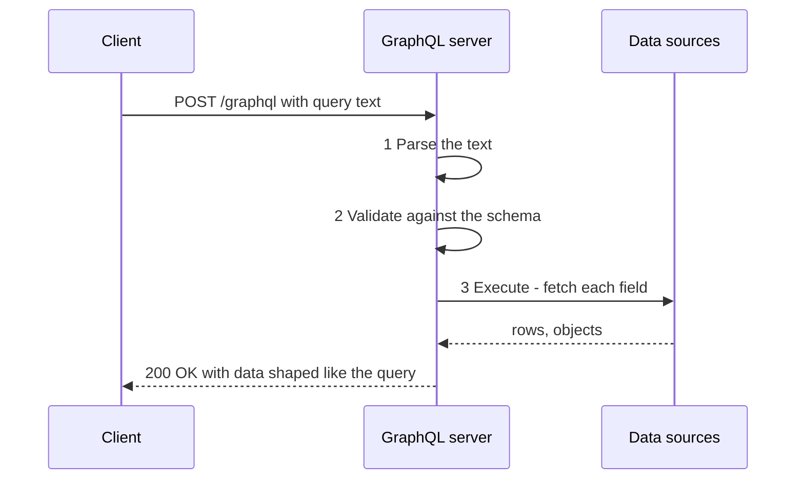

# What GraphQL is: history and design principles

> **Before this lesson:** you should know what a client, a server, an endpoint, an HTTP `POST` and JSON are ([What an API is](#/lesson/graphql/what-is-an-api)), and how a REST API is laid out ([REST in plain words](#/lesson/graphql/rest-in-plain-words)). No GraphQL knowledge is assumed.

## In plain words

**GraphQL** is a language for asking a server for data, together with a set of rules for how the server must answer. The "QL" stands for *query language*; "query" is another word for a question put to a data system.

With REST the server decides what each response contains. With GraphQL the **client** writes down the exact shape of the data it wants, and the server fills that shape in.

An everyday picture: ordering a sandwich.

- A REST API is a shop with fixed menu items. Order "number 4" and you get everything that comes with number 4, wanted or not. If you also want a drink, that is a second order at a second counter.
- A GraphQL API is a shop where you fill in an order slip: *this bread, these two fillings, no sauce, and a drink*. One slip, one tray, exactly what you ticked.

The slip is only useful because the shop publishes the list of everything that can be ticked. In GraphQL that list is called the **schema**, and the server refuses any slip that asks for something not on it.

Why it matters for a job: GraphQL is used in production by GitHub, Shopify, Meta, Netflix, Airbnb and many others, mostly for apps with many screens and many kinds of client. Front-end roles expect you to write queries; back-end roles expect you to design schemas and avoid the performance traps covered later in this track.

## Your first query and its response

Here is a GraphQL query for the Potluck recipe app:

```graphql
{
  recipe(id: "r1") {
    title
    minutes
    author {
      name
    }
  }
}
```

Read it from the outside in:

1. The outer braces `{ }` open a **selection set**: the list of things being asked for.
2. `recipe(id: "r1")` asks for the **field** called `recipe`. A field is one named piece of data. The part in parentheses is an **argument**: extra information that narrows the request, here "the one whose id is r1".
3. Because a recipe is an object with many properties, a second pair of braces says which of *its* fields are wanted: `title`, `minutes` and `author`.
4. `author` is itself an object (a cook), so it gets its own braces and one field, `name`.

And the server's answer:

```json
{
  "data": {
    "recipe": {
      "title": "Lentil soup",
      "minutes": 35,
      "author": {
        "name": "Amara"
      }
    }
  }
}
```

Lay the two side by side. The response has **the same shape as the query**: same names, same nesting, same order, with values where the query had bare names. Nothing extra came back: no `description`, no `steps`, no `authorId`. And the author's name arrived in the same response, with no second request. Those two properties answer the two annoyances at the end of the last lesson.

Everything the server returns sits under a top-level `"data"` key. If something goes wrong, a second top-level key `"errors"` appears beside it. You will see that later in this lesson.

## Where the query came from: the schema

The client could not have written that query without knowing that `recipe`, `title`, `minutes`, `author` and `name` exist. That knowledge comes from the **schema**: a description of every type of object the server offers and every field on it. A schema is written in the **Schema Definition Language** (SDL):

```graphql
type Recipe {
  id: ID!
  title: String!
  minutes: Int
  author: Cook!
}

type Cook {
  id: ID!
  name: String!
  recipes: [Recipe!]!
}

type Query {
  recipe(id: ID!): Recipe
  recipes: [Recipe!]!
}
```

For now, read it loosely (module 5 covers every symbol):

- `type Recipe { ... }` declares a kind of object and lists its fields. After each colon is the field's type.
- `String`, `Int` and `ID` are built-in basic types. `Cook` after `author:` means "this field is a whole Cook object".
- `!` means "never null". `[Recipe!]!` means "a list of recipes".
- `type Query` is special: its fields are the **entry points**, the things a query may start with.

The schema is a contract that the server itself enforces. Ask for `recipe { calories }` and you get an error *before* any data is fetched, because `Recipe` has no field `calories`.



The diagram shows why the word "graph" is in the name. Types are points; fields that lead to other types are arrows. A query is a path walked through this picture starting from `Query`. The next module is devoted to this idea.

## Three kinds of operation

GraphQL has exactly three **operation types**. An operation is one complete request.

| Operation | Purpose | REST cousin |
|---|---|---|
| `query` | read data | `GET` |
| `mutation` | change data, then read the result | `POST`, `PUT`, `PATCH`, `DELETE` |
| `subscription` | be told when something changes, over a long-lived connection | (none; REST uses polling or separate tools) |

The query above used a shorthand: when an operation starts with a bare `{`, it is a `query`. The full form names the kind and, optionally, gives the operation a name:

```graphql
query RecipeScreen {
  recipe(id: "r1") {
    title
  }
}
```

A mutation looks the same with a different keyword:

```graphql
mutation {
  addReview(recipeId: "r1", stars: 5) {
    id
    stars
  }
}
```

```json
{ "data": { "addReview": { "id": "v7", "stars": 5 } } }
```

The server created a review and, in the same round trip, returned the two fields of it the client asked for.

## How it travels: one endpoint

GraphQL does not replace HTTP. In nearly all deployments a GraphQL request is an ordinary HTTP `POST` to a **single endpoint**, by convention `/graphql`. The body is JSON with the query as a string:

```http
POST /graphql HTTP/1.1
Host: api.potluck.example
Content-Type: application/json

{"query": "{ recipe(id: \"r1\") { title minutes } }"}
```

```http
HTTP/1.1 200 OK
Content-Type: application/json

{"data": {"recipe": {"title": "Lentil soup", "minutes": 35}}}
```

Compare with REST's ten endpoints for Potluck. Here there is one address, and the *body* says what is wanted. The request body may carry two more keys you will meet in lesson 8: `variables` (values plugged into the query) and `operationName`.



The server's three steps, in order:

1. **Parse**: turn the query text into a tree structure (lesson 9).
2. **Validate**: check every field and argument against the schema. Failures stop here.
3. **Execute**: for each field, call a small function called a **resolver** that fetches its value (lesson 14).

## A GraphQL engine in forty lines

No GraphQL server is available in this page, so here is a small hand-written model of step 3. A query is written as a JavaScript structure instead of text (parsing comes later). Each field has a resolver; the engine walks the query and calls them.

```js-run
// ----- the data, shaped like a database: recipes hold an authorId, not an author -----
const recipes = { r1: { id: "r1", title: "Lentil soup", minutes: 35, authorId: "c1" } };
const cooks = { c1: { id: "c1", name: "Amara", city: "Leeds" } };

// ----- resolvers: one small function per field that needs real work -----
const resolvers = {
  Query: {
    recipe: (parent, args) => recipes[args.id] ?? null,
  },
  Recipe: {
    author: (recipe) => cooks[recipe.authorId],      // turns a foreign key into an object
  },
};

// Which type does each object field lead to? (A real server reads this from the schema.)
const fieldTypes = { "Query.recipe": "Recipe", "Recipe.author": "Cook" };

// ----- the engine -----
function execute(typeName, parent, selection) {
  const result = {};
  for (const field of selection) {
    const resolver = resolvers[typeName]?.[field.name];
    // If no resolver was written, read the property with the same name.
    const value = resolver ? resolver(parent, field.args ?? {}) : parent[field.name];
    const childType = fieldTypes[typeName + "." + field.name];
    result[field.name] =
      field.selection && value != null ? execute(childType, value, field.selection) : value ?? null;
  }
  return result;
}

// { recipe(id: "r1") { title minutes author { name } } }
const query = [
  { name: "recipe", args: { id: "r1" }, selection: [
    { name: "title" },
    { name: "minutes" },
    { name: "author", selection: [{ name: "name" }] },
  ] },
];

console.log(JSON.stringify({ data: execute("Query", {}, query) }, null, 2));
```

Follow one pass through `execute`:

1. It starts on the type `Query` with the selection `[recipe]`.
2. For `recipe` there is a resolver. It receives the arguments `{ id: "r1" }` and returns the stored recipe.
3. `recipe` has its own selection, so `execute` calls itself on type `Recipe` with that recipe as the `parent`.
4. `title` and `minutes` have no resolver, so the engine reads `parent.title` and `parent.minutes`.
5. `author` has a resolver. It looks at `recipe.authorId` and returns the cook. The stored data has no `author` property at all; the resolver creates the connection.
6. `author` has a selection, so `execute` runs again on type `Cook` and reads `name`.

The printed result matches the JSON response shown at the top of this lesson. Try adding `{ name: "city" }` to the author's selection, or changing the id to `"r9"` (the result becomes `recipe: null`).

## Where it came from

In 2012 Facebook was rebuilding its mobile apps. The news feed is a deeply nested structure: stories, each with an author, comments, each comment with its own author and likes. Fetching it through resource-style endpoints meant many round trips on slow mobile networks and a lot of code to stitch the answers together. A small group of engineers, among them Lee Byron, Nick Schrock and Dan Schafer, designed a language in which the app could describe the nested data a screen needed and get it in one response. It shipped inside the iOS app that year.

In 2015 Facebook published two things: a **specification** (a precise written description of the language and of how a server must behave) and a reference implementation in JavaScript called GraphQL.js. The split matters. GraphQL is the specification, not a product. Anyone can write an implementation in any language, and many have: there are mature servers for JavaScript, Java, Kotlin, C#, Python, Go, Ruby, Rust, PHP, Elixir and more.

Since 2018–2019 the specification has been looked after by the vendor-neutral **GraphQL Foundation** under the Linux Foundation. It evolves slowly and deliberately, in dated editions (for example October 2021 and September 2025), so a query written years ago still works today.

## The five design principles

The specification states the ideas the language was built around. They are worth knowing by name, because they explain almost every design choice you will meet.

| Principle | What it means | What you saw above |
|---|---|---|
| **Product-centric** | driven by what the screens of a product need, not by how data is stored | the query reads like the recipe screen |
| **Hierarchical** | a query is nested the way the data on a screen is nested, and the response mirrors it | braces inside braces; response same shape |
| **Strongly typed** | every field has a declared type, so a query can be checked before it runs | the schema; `calories` rejected up front |
| **Client-specified response** | the server publishes what is possible; the client picks exactly what it gets | no `description`, no `steps` |
| **Introspective** | the server can be asked about its own schema using GraphQL itself | tools that autocomplete your queries (lesson 9) |

> [!INTERVIEW]
> **"What is GraphQL?"** A strong answer in three sentences: "GraphQL is a query language for APIs and a specification for the server runtime that executes those queries against a typed schema. The client describes the shape of the data it needs, and gets back JSON in that shape from a single endpoint. It was created at Facebook in 2012 for mobile news feed, open-sourced in 2015, and is now governed by the GraphQL Foundation." Then add one trade-off, to show judgement: "It moves complexity to the server: caching, rate limiting and N+1 queries need deliberate handling."

## What GraphQL is not

Beginners often arrive with one of these misunderstandings.

- **It is not a database.** GraphQL stores nothing. Resolvers fetch from wherever the data lives: SQL, MongoDB, a REST API, a file, another GraphQL server.
- **It is not a graph database query language.** Neo4j's Cypher and similar languages query graph *storage*. GraphQL describes an API whose types happen to form a graph.
- **It is not tied to JavaScript, React or Apollo.** Those are popular choices, not requirements.
- **It is not "REST, but faster".** A GraphQL server still has to fetch the data. It saves round trips and bytes; it can also make a careless server slower (lesson 20).
- **It does not require dropping REST.** Many teams put a GraphQL layer in front of existing REST services and migrate gradually (lesson 18).

> [!WARNING]
> Because the body carries the operation, a GraphQL server normally answers `200 OK` even when part of the request failed. The failure is reported in the body:
>
> ```json
> { "data": { "recipe": null },
>   "errors": [ { "message": "Recipe r9 not found", "path": ["recipe"] } ] }
> ```
>
> Client code and monitoring must look at `errors`, not only at the HTTP status. This is the single biggest habit change for people arriving from REST.

## The ecosystem at a glance

You will hear these names; here is what each one is.

| Kind | Examples | Role |
|---|---|---|
| Reference implementation | GraphQL.js | parse, validate and execute; most JavaScript servers build on it |
| Server libraries | Apollo Server, GraphQL Yoga, Mercurius (JS); graphql-java, Netflix DGS (Java); Hot Chocolate (.NET); Strawberry, Graphene (Python); gqlgen (Go) | connect a schema and resolvers to HTTP |
| Client libraries | Apollo Client, Relay, urql | send operations, cache results, update the UI |
| Explorers | GraphiQL, Apollo Sandbox | in-browser editors with autocomplete and docs, driven by introspection |
| Composition | Apollo Federation, schema stitching | combine several teams' schemas into one graph (lesson 21) |

> [!TIP]
> To try real queries against a live API without installing anything, open GitHub's GraphQL Explorer or any public GraphQL endpoint in GraphiQL. Press Ctrl+Space inside the braces: the editor lists every field you may ask for, read live from the server's schema.

## Pitfalls

- **Expecting extra fields.** If you did not select it, it is not in the response. `data.recipe.id` is `undefined` unless the query asked for `id`.
- **Forgetting the braces on object fields.** `{ recipe(id: "r1") }` is invalid: `recipe` is an object, so you must say which of its fields you want.
- **Putting braces on basic fields.** `{ recipe(id: "r1") { title { length } } }` is invalid: `title` is a `String` and has nothing inside.
- **Checking only the HTTP status.** Look for `errors` in the body.
- **Thinking one endpoint means one giant function.** The single endpoint hands the query to the engine; the work is still split into small resolvers, one per field.

## Cheat sheet

| Concept | In one line |
|---|---|
| GraphQL | a query language for APIs plus a spec for executing it |
| schema | the typed list of everything that can be asked for |
| SDL | the language schemas are written in |
| field | one named piece of data on a type |
| argument | a value passed to a field: `recipe(id: "r1")` |
| selection set | the `{ ... }` list of fields wanted from an object |
| operation | one request: `query`, `mutation` or `subscription` |
| resolver | the server function that produces one field's value |
| endpoint | usually one: `POST /graphql` |
| request body | `{"query": "...", "variables": {...}, "operationName": "..."}` |
| response body | `{"data": {...}, "errors": [...]}` |

## Summary

- GraphQL lets the client describe the exact, nested shape of the data it wants; the response has that same shape.
- A typed schema lists everything that can be asked for, and the server checks every request against it before running it.
- There are three operations: `query` reads, `mutation` writes, `subscription` listens.
- Requests normally go as HTTP `POST` to one endpoint, and the response is JSON with `data` and, when needed, `errors`.
- GraphQL is a specification born at Facebook in 2012 and public since 2015, with implementations in most languages. It is not a database and does not replace HTTP.
- Its five principles (product-centric, hierarchical, strongly typed, client-specified response, introspective) explain why it looks the way it does.

## Glossary

- **GraphQL:** a query language for APIs and the specification of a runtime that answers those queries.
- **Query (general sense):** a question put to a data system. **`query` (GraphQL):** the read operation.
- **Schema:** the full, typed description of what a GraphQL server offers.
- **SDL (Schema Definition Language):** the syntax used to write a schema.
- **Type:** a named kind of data, such as `Recipe` or `String`.
- **Field:** a named piece of data that can be requested on a type.
- **Argument:** a named value passed to a field to affect its result.
- **Selection set:** the braces-enclosed list of fields requested from an object.
- **Operation:** one request to a GraphQL server; one of query, mutation or subscription.
- **Mutation:** an operation that changes data.
- **Subscription:** an operation that keeps a connection open and receives updates.
- **Resolver:** a function on the server that returns the value of one field.
- **Specification:** a precise written description of how a language or system must behave.
- **Reference implementation:** an official example implementation of a specification (GraphQL.js).
- **Introspection:** asking a GraphQL server to describe its own schema.

## Check yourself

```quiz
[
  {"q": "What does this query return?\n\n`{ recipe(id: \"r1\") { minutes } }`\n\n(The recipe r1 is titled Lentil soup and takes 35 minutes.)",
   "options": ["`{\"data\": {\"recipe\": {\"id\": \"r1\", \"title\": \"Lentil soup\", \"minutes\": 35}}}`", "`{\"data\": {\"recipe\": {\"minutes\": 35}}}`", "`{\"recipe\": {\"minutes\": 35}}`", "`{\"data\": {\"minutes\": 35}}`"],
   "answer": 1,
   "explain": "The response mirrors the query under a top-level `data` key: `recipe`, and inside it only `minutes`. Fields that were not selected are not returned."},
  {"q": "Which statement about GraphQL is true?",
   "options": ["It is a database made by Facebook", "It is a specification that can be implemented in any language", "It only works with React", "It replaces HTTP"],
   "answer": 1,
   "explain": "GraphQL is a spec with many implementations. It stores no data and normally travels over ordinary HTTP."},
  {"q": "Which operation type would you use to post a new review?",
   "options": ["query", "mutation", "subscription", "fragment"],
   "answer": 1,
   "explain": "Mutations are for writes. Queries read, subscriptions listen for changes, and a fragment is not an operation at all."},
  {"q": "A client sends `{ recipe(id: \"r1\") { calories } }` but `Recipe` has no `calories` field. What happens?",
   "options": ["The server returns `calories: null`", "The server returns the whole recipe", "The request is rejected during validation, before any data is fetched", "The server adds the field to the schema"],
   "answer": 2,
   "explain": "Strong typing lets the server check a query against the schema first. Unknown fields are validation errors."},
  {"q": "A GraphQL response has HTTP status 200 and the body `{\"data\": {\"recipe\": null}, \"errors\": [{\"message\": \"Not found\"}]}`. How should the client treat it?",
   "options": ["As a complete success, because the status is 200", "As a failure for the `recipe` field: it must inspect `errors`", "As a network error", "As invalid JSON"],
   "answer": 1,
   "explain": "GraphQL reports field-level problems in the body. The status code alone does not tell you whether the data you wanted arrived."},
  {"q": "Which design principle is described by: 'the server publishes what is possible and the client picks exactly what it receives'?",
   "options": ["Introspective", "Hierarchical", "Client-specified response", "Strongly typed"],
   "answer": 2,
   "explain": "Client-specified response is the principle behind selection sets: no more and no less than what was asked for."},
  {"q": "In the model engine, `Recipe.author` has a resolver but `Recipe.title` does not. How is `title` produced?",
   "options": ["It is skipped", "The engine reads the property named `title` from the parent object", "The engine calls the `author` resolver again", "It throws an error"],
   "answer": 1,
   "explain": "When no resolver is written, the default behaviour is to read the same-named property of the parent. Real servers do the same."},
  {"q": "How many HTTP endpoints does a typical GraphQL API expose?",
   "options": ["One per type", "One per field", "One, usually `/graphql`", "One per client"],
   "answer": 2,
   "explain": "All operations go to a single endpoint; the request body says what is wanted."}
]
```

> **Source:** Porcello & Banks, *Learning GraphQL*, ch. 1 (what GraphQL is, the specification, design principles, origins). Also: https://graphql.org/learn/ ; GraphQL specification, "Overview" (https://spec.graphql.org/); "Serving over HTTP" (https://graphql.org/learn/serving-over-http/).
