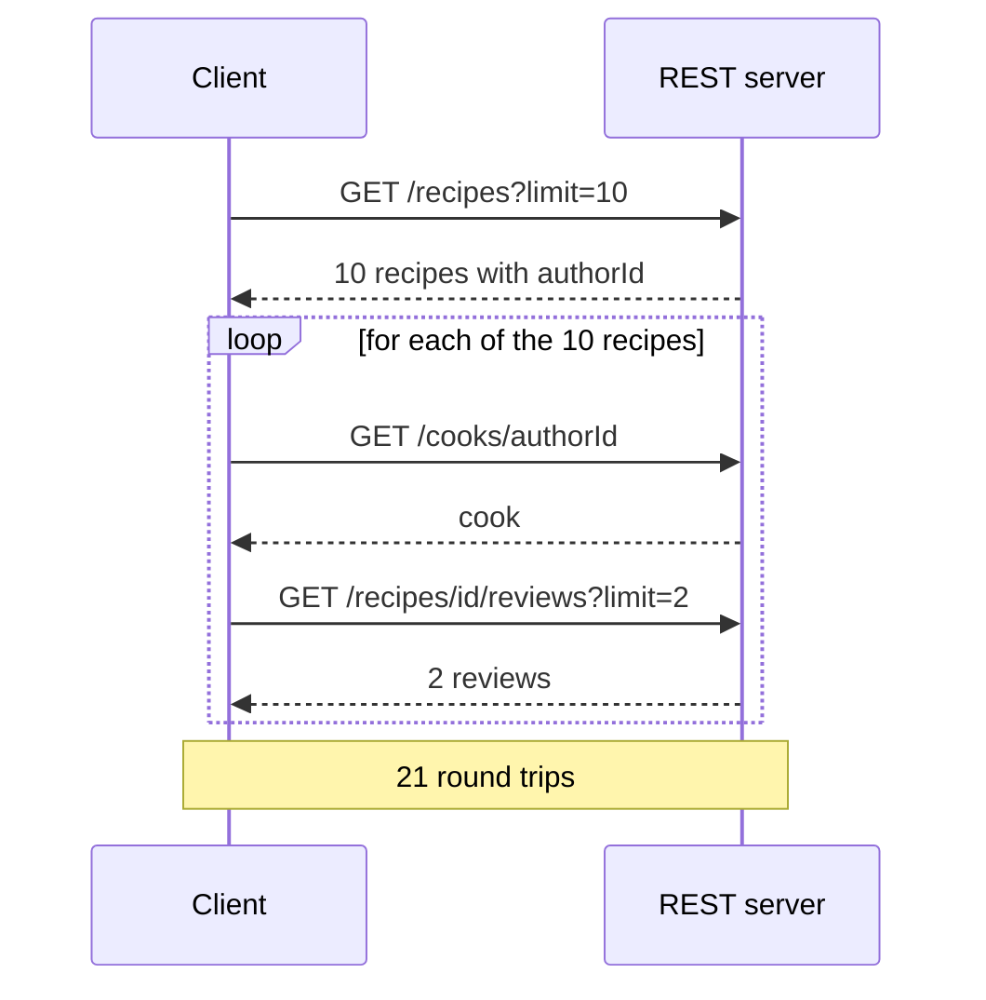

# Over-fetching, under-fetching and endpoint sprawl

> **Before this lesson:** you should have read [REST in plain words](#/lesson/graphql/rest-in-plain-words) (resources, endpoints, foreign keys) and [What GraphQL is](#/lesson/graphql/what-is-graphql) (a query's shape, the single endpoint). You should be comfortable reading short JavaScript.

## In plain words

REST is a good design, and most of the web runs on it. But when one API has to feed many different screens (a phone app, a web app, a watch, a partner's integration) three recurring pains show up. GraphQL was designed as the cure for exactly these three, so knowing them tells you when GraphQL is worth its cost and when it is not.

Picture a supermarket that only sells pre-packed hampers.

- You need one lemon. The smallest hamper with a lemon also holds a pineapple, six apples and a coconut. You carry it all home and throw most of it away. That is **over-fetching**: receiving more data than you need.
- You need a lemon, a loaf and some butter. No single hamper has all three, so you queue three times, and you only learn which bread hamper to buy after opening the first one. That is **under-fetching**: one request does not bring enough, so you make more.
- Customers complain, so the shop adds a "lemon-and-loaf" hamper, then a "student breakfast" hamper, then a "student breakfast, no butter" hamper. Soon there are 300 hampers and nobody knows which are still bought. That is **endpoint sprawl**.

A shop where you pick items off the shelf into one basket has none of these problems. It has other problems (the till has to cope with any basket), and this lesson is honest about those as well.

Why it matters for a job: "Why would you choose GraphQL over REST?" is one of the most common API interview questions. A good answer names these three pains, gives numbers, and admits the trade-offs.

## The screen we are building

The Potluck app's home feed shows, for each of the latest recipes, a small card:

```
┌──────────────────────────────┐
│ Lentil soup            35 min│
│ by Amara                     │
│ ★ 5  ★ 4                     │
└──────────────────────────────┘
```

Each card needs four things: the recipe's `title` and `minutes`, the author's `name`, and the `stars` of its two newest reviews. The REST API from lesson 2 offers:

| Endpoint | Returns |
|---|---|
| `GET /recipes?limit=N` | recipes, each with `id`, `title`, `minutes`, `category`, `description`, `steps`, `photoUrl`, `createdAt`, `authorId` |
| `GET /cooks/{id}` | `id`, `name`, `city`, `bio`, `avatarUrl`, `joinedAt` |
| `GET /recipes/{id}/reviews?limit=2` | reviews, each with `id`, `stars`, `text`, `createdAt`, `reviewerId` |

## Pain 1: over-fetching

**Over-fetching** means the response contains fields the client does not use.

The feed card uses 2 of a recipe's 9 fields, 1 of a cook's 6, and 1 of a review's 5. Everything else travels over the network, is parsed by the phone, sits in memory, and is discarded.

Why is that a problem, when "it works anyway"?

- **Bytes cost time and money.** On a slow mobile connection the extra kilobytes are the difference between a feed that appears at once and one that visibly loads. Mobile data is not free for users either.
- **Parsing costs battery and CPU**, especially on cheap phones.
- **Hidden server work.** Some fields are expensive to produce (`steps` may need a second table; a `rating` may need an average over thousands of rows). The server computes them for every caller, including the many that ignore them.
- **Accidental exposure.** Fields that go out to everyone are fields somebody will start depending on, or should never have seen.

The server cannot fix this by trimming the response, because *another* screen (the full recipe page) really does need `steps` and `description`. One fixed representation cannot be right for every screen.

## Pain 2: under-fetching

**Under-fetching** means one request does not return everything the screen needs, so the client must make follow-up requests.

Count the calls for a feed of 10 recipes:

1. `GET /recipes?limit=10` → 10 recipes, each with an `authorId`.
2. For each recipe, `GET /cooks/{authorId}` → up to 10 requests.
3. For each recipe, `GET /recipes/{id}/reviews?limit=2` → 10 requests.

That is **1 + 10 + 10 = 21 requests** to draw one screen. The pattern "one request for a list, then N more for each item" has a name you will hear for the rest of your career: the **N+1 problem**. Here it happens between client and server. (Lesson 20 shows the same pattern between a server and its database.)



Two things make this worse than the raw count suggests.

- **A waterfall.** The cook requests cannot start until the recipe list has arrived, because the ids are inside it. Steps that must wait for each other are called a *waterfall*; the delays add up instead of overlapping.
- **Latency dominates.** **Latency** is the time a message takes to cross the network. On mobile networks a round trip commonly costs 100–300 milliseconds before the server does any work. Twenty-one of them, even partly in parallel, is felt by the user.

## Pain 3: endpoint sprawl

The server team sees the 21 requests and adds a purpose-built endpoint:

```
GET /feed-cards?limit=10      → title, minutes, authorName, latestStars
```

One request, no waste. Problem solved for this screen. Then:

- The tablet layout also shows the author's avatar → `GET /feed-cards-tablet`.
- The watch app wants titles only → `GET /feed-cards-compact`.
- Version 2.3 of the phone app adds the category badge. Old app versions are still installed on millions of phones, so the old endpoint must keep its old shape → `GET /v2/feed-cards`.

Each endpoint is code to write, test, document, secure and monitor. Each change to a screen needs a server change and a coordinated release. And nobody dares delete an endpoint, because nobody knows which old clients still call it. This steady multiplication is **endpoint sprawl**. Its real cost is not disk space; it is that front-end work is constantly blocked waiting for back-end work.

## Measuring it

Numbers persuade better than adjectives. This model builds the feed three ways and counts requests and bytes. Read the code, run it, then change `FEED_SIZE`.

```js-run
const FEED_SIZE = 10;

// ---------- fake database ----------
const cooks = {};
for (let i = 1; i <= 4; i++) {
  cooks["c" + i] = { id: "c" + i, name: ["Amara", "Bo", "Chidi", "Dee"][i - 1], city: "Leeds",
    bio: "Home cook who writes far too much about spices. ".repeat(3), avatarUrl: "https://img.example/c" + i + ".jpg", joinedAt: "2025-02-01" };
}
const recipes = [];
const reviews = {};
for (let i = 1; i <= FEED_SIZE; i++) {
  const id = "r" + i;
  recipes.push({ id, title: "Recipe " + i, minutes: 10 + i, category: "SOUP",
    description: "A long and loving description of the dish. ".repeat(6),
    steps: Array.from({ length: 8 }, (_, s) => "Step " + (s + 1) + ": do the next careful thing."),
    photoUrl: "https://img.example/" + id + ".jpg", createdAt: "2026-01-12T18:04:00Z", authorId: "c" + ((i % 4) + 1) });
  reviews[id] = [5, 4].map((stars, n) => ({ id: id + "v" + n, stars, text: "Made this twice already, lovely. ".repeat(2), createdAt: "2026-02-01", reviewerId: "c1" }));
}

// ---------- a meter that counts every "network call" ----------
let requests = 0, bytes = 0;
function send(payload) { requests++; bytes += JSON.stringify(payload).length; return payload; }
function report(label) { console.log(label.padEnd(26), String(requests).padStart(3), "requests", String(bytes).padStart(7), "bytes"); requests = 0; bytes = 0; }

// ---------- 1. plain REST ----------
const list = send(recipes);                                   // GET /recipes?limit=N
for (const r of list) {
  send(cooks[r.authorId]);                                    // GET /cooks/{id}
  send(reviews[r.id]);                                        // GET /recipes/{id}/reviews?limit=2
}
report("REST, resource endpoints");

// ---------- 2. a custom endpoint for this one screen ----------
send(recipes.map((r) => ({ title: r.title, minutes: r.minutes, authorName: cooks[r.authorId].name, latestStars: reviews[r.id].map((v) => v.stars) })));
report("REST, custom /feed-cards");

// ---------- 3. GraphQL: the client states the shape ----------
// { recipes(first: N) { title minutes author { name } reviews(first: 2) { stars } } }
send({ data: { recipes: recipes.map((r) => ({ title: r.title, minutes: r.minutes, author: { name: cooks[r.authorId].name }, reviews: reviews[r.id].map((v) => ({ stars: v.stars })) })) } });
report("GraphQL, one query");
```

How to read the code:

- `send` stands for one HTTP round trip. It adds one to the request counter and adds the JSON length of the payload to the byte counter.
- Section 1 does what a client of the resource endpoints must do: one list call, then two calls per recipe.
- Section 2 simulates the hand-made endpoint.
- Section 3 simulates the response to the GraphQL query in the comment. No server-side code was written for this screen; the query was enough.

With ten recipes you should see 21 requests and tens of thousands of bytes for plain REST, and one request with a few hundred bytes for both the custom endpoint and GraphQL. The custom endpoint and GraphQL tie on the wire. The difference between them is **who had to do work to get there**: for the custom endpoint, a back-end developer; for GraphQL, nobody beyond the person writing the screen.

## The GraphQL version

The query for the feed card:

```graphql
query Feed {
  recipes(first: 10) {
    title
    minutes
    author {
      name
    }
    reviews(first: 2) {
      stars
    }
  }
}
```

And the response (first two recipes shown):

```json
{
  "data": {
    "recipes": [
      {
        "title": "Lentil soup",
        "minutes": 35,
        "author": { "name": "Amara" },
        "reviews": [ { "stars": 5 }, { "stars": 4 } ]
      },
      {
        "title": "Flatbread",
        "minutes": 20,
        "author": { "name": "Bo" },
        "reviews": [ { "stars": 4 } ]
      }
    ]
  }
}
```

Map each pain to what changed:

| Pain | What the query does about it |
|---|---|
| Over-fetching | only `title`, `minutes`, `name` and `stars` were selected, so only those are sent |
| Under-fetching | `author` and `reviews` are nested inside `recipes`: related data arrives in the same response |
| Endpoint sprawl | the tablet adds `avatarUrl` to *its own query*; the watch removes fields from *its own query*; the server does not change |

And when an old phone app keeps sending last year's query, it keeps getting last year's shape, because the shape lives in the query. That is why GraphQL APIs usually have no `/v2`.

> [!TIP]
> The same query also works as documentation of what a screen needs. Many teams keep each screen's query in the same file as the screen's code, so deleting a field from the UI and deleting it from the request are one edit.

## What REST can do about it without GraphQL

It would be unfair to stop here. Experienced REST designers have several tools, and an interviewer will expect you to know them.

| Technique | How it helps | Limit |
|---|---|---|
| Sparse fieldsets: `?fields=title,minutes` | removes over-fetching | syntax differs per API; nesting is awkward |
| Embedding: `?include=author,reviews` | removes many follow-up calls | depth and per-relation options are hard to express |
| The JSON:API and OData standards | standardise both of the above | heavier conventions; smaller ecosystems |
| A **BFF** (Backend For Frontend): a thin server per client type that calls the REST APIs and returns screen-shaped responses | client makes one call | it is endpoint sprawl moved to a different team |
| HTTP/2 and HTTP/3 | many requests share one connection cheaply | the waterfall remains: you still need the first answer before asking the second question |

GraphQL can be seen as a standardised, typed version of "fieldsets plus embedding, to any depth", with the BFF generated from a schema instead of written by hand.

## What you give up

GraphQL does not delete the complexity; it moves it to the server.

- **HTTP caching gets harder.** Every REST `GET` has a URL that browsers and content-delivery networks can cache. A GraphQL `POST` to one URL with a different body each time cannot be cached that way. (Lessons 17 and 21 cover the replacements.)
- **Any query can arrive.** A REST endpoint does a known amount of work. A GraphQL endpoint must defend against deep or enormous queries (lesson 19).
- **The N+1 problem moves, it does not vanish.** The client makes one request, but a naive server may make 21 database calls to answer it (lesson 20).
- **More machinery.** A schema, resolvers, a client library and tooling are overhead that a three-endpoint service does not need.
- **File uploads, simple downloads and public cacheable content** are often simpler over plain HTTP.

> [!WARNING]
> "GraphQL is faster than REST" is not a safe sentence. GraphQL reduces round trips and payload size *for clients whose needs vary*. For a single client with a stable, simple data need, a well-designed REST endpoint is as fast, simpler to cache, and simpler to operate.

> [!INTERVIEW]
> **"What problems does GraphQL solve compared with REST?"** Structure the answer as three pains, one sentence each, then the trade-off:
> 1. *Over-fetching*: fixed representations send unused fields; GraphQL returns only selected fields.
> 2. *Under-fetching*: related resources need extra round trips and create client-side N+1 waterfalls; GraphQL nests related data in one request.
> 3. *Endpoint sprawl and versioning*: screen-specific endpoints multiply; with GraphQL each client's query defines its own shape against one evolving schema.
>
> Trade-offs: HTTP caching is harder, the server must guard against expensive queries, and N+1 moves to the resolver layer and needs batching.

## Pitfalls

- **Using GraphQL and still over-fetching.** Copy-pasting one giant query into every screen brings the old problem back. Select what the screen shows.
- **Using GraphQL and still under-fetching.** Sending one query per list item from the client recreates the 21 requests. Nest the selection instead.
- **Assuming one request means one unit of server work.** A single query can trigger hundreds of resolver calls.
- **Blaming REST for a design problem.** If one screen needs 20 calls, an `include` option or a BFF may be a cheaper fix than a new API technology.
- **Forgetting old clients.** In both styles, a mobile app released a year ago is still in use. Removing a field breaks it either way.

## Cheat sheet

| Term | Meaning | REST symptom | GraphQL answer |
|---|---|---|---|
| over-fetching | more fields than needed | 9 fields sent, 2 used | selection sets |
| under-fetching | not enough in one response | follow-up calls by id | nested fields |
| client-side N+1 | 1 list call + N item calls | 21 round trips for 10 cards | one query |
| waterfall | calls that must wait for earlier calls | ids arrive before details | the server follows the ids |
| endpoint sprawl | endpoints multiply per screen and version | `/feed-cards-tablet`, `/v2/...` | one endpoint, many queries |
| BFF | per-client server that reshapes data | sprawl moved elsewhere | the schema plays this role |

## Summary

- Fixed REST representations cause **over-fetching**: unused fields cost bytes, battery and server work.
- Related data behind ids causes **under-fetching**: extra round trips arranged in a waterfall, often as a client-side N+1.
- Fixing both with custom endpoints causes **endpoint sprawl**, and ties front-end changes to back-end releases.
- A GraphQL query states the exact nested shape wanted, which addresses all three with one request and no new server code per screen.
- REST has partial remedies (fieldsets, embedding, BFFs), and GraphQL has real costs (caching, query abuse, server-side N+1). Choosing between them is a trade-off, not a verdict.

## Glossary

- **Over-fetching:** receiving data the client does not use.
- **Under-fetching:** a response that lacks needed data, forcing more requests.
- **N+1 problem:** one request for a list followed by one request for each of its N items.
- **Round trip:** one request and its response.
- **Latency:** the time a message takes to travel across the network.
- **Waterfall:** a chain of requests in which each must wait for the one before.
- **Endpoint sprawl:** uncontrolled growth in the number of endpoints.
- **BFF (Backend For Frontend):** a server layer dedicated to shaping data for one kind of client.
- **Payload:** the data carried in the body of a request or response.
- **CDN (content-delivery network):** servers around the world that cache responses close to users.

## Check yourself

```quiz
[
  {"q": "A profile screen shows only a cook's name, but `GET /cooks/c1` returns name, city, bio, avatarUrl and joinedAt. What is this called?",
   "options": ["Under-fetching", "Over-fetching", "Endpoint sprawl", "A waterfall"],
   "answer": 1,
   "explain": "The response carries more than the screen uses. That is over-fetching."},
  {"q": "A REST client loads 25 recipes with one call and then calls `GET /cooks/{id}` once per recipe. How many requests are made in total?",
   "options": ["25", "26", "50", "1"],
   "answer": 1,
   "explain": "One list request plus one per item: 1 + 25 = 26. This is the N+1 pattern."},
  {"q": "Why can the client not send the cook requests at the same time as the recipe list request?",
   "options": ["HTTP forbids parallel requests", "The cook ids are only known after the recipe list arrives", "Cooks are stored on another continent", "GET requests must be sent in alphabetical order"],
   "answer": 1,
   "explain": "The second request depends on data in the first response. That dependency is what makes it a waterfall."},
  {"q": "What does this query return for a recipe with two reviews of 5 and 4 stars?\n\n`{ recipe(id: \"r1\") { reviews(first: 2) { stars } } }`",
   "options": ["`{\"data\": {\"recipe\": {\"reviews\": [5, 4]}}}`", "`{\"data\": {\"recipe\": {\"reviews\": [{\"stars\": 5}, {\"stars\": 4}]}}}`", "`{\"data\": {\"reviews\": [{\"stars\": 5}, {\"stars\": 4}]}}`", "`{\"data\": {\"recipe\": {\"reviews\": [{\"id\": \"v1\", \"stars\": 5}, {\"id\": \"v2\", \"stars\": 4}]}}}`"],
   "answer": 1,
   "explain": "`reviews` is a list of objects; each object contains exactly the selected field `stars`. The nesting `recipe` → `reviews` is preserved and no unselected field such as `id` appears."},
  {"q": "The tablet app needs the author's avatar on the feed card. With GraphQL, what has to change?",
   "options": ["A new endpoint `/feed-tablet` on the server", "A new API version `/v2/graphql`", "Only the tablet's query: add `avatarUrl` under `author`", "The database schema"],
   "answer": 2,
   "explain": "If the schema already has the field, the client adds it to its selection. No server release is needed."},
  {"q": "Which is a genuine cost of choosing GraphQL?",
   "options": ["Responses cannot be JSON", "Standard URL-based HTTP caching no longer applies directly", "Clients must make more round trips", "It cannot return nested data"],
   "answer": 1,
   "explain": "Because queries are usually POSTed to one URL, browser and CDN caching by URL does not work out of the box and must be replaced by other techniques."},
  {"q": "What is a BFF?",
   "options": ["A database index", "A server layer that calls back-end APIs and returns responses shaped for one kind of client", "A GraphQL operation type", "A status code family"],
   "answer": 1,
   "explain": "Backend For Frontend: a per-client aggregation layer. It hides the many calls from the device but must be hand-written and maintained."}
]
```

> **Source:** Porcello & Banks, *Learning GraphQL*, ch. 1 (REST drawbacks: overfetching, underfetching, managing REST endpoints). Also: https://graphql.org/learn/ ; https://jsonapi.org/format/ (sparse fieldsets and compound documents).
