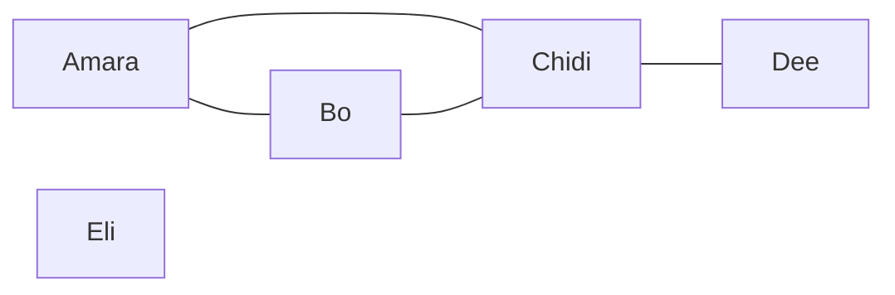
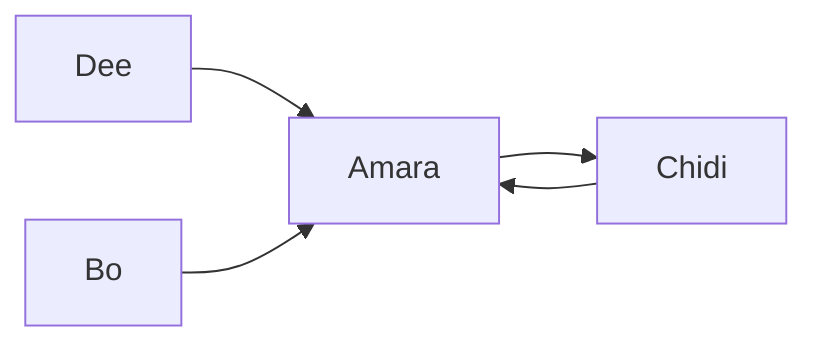
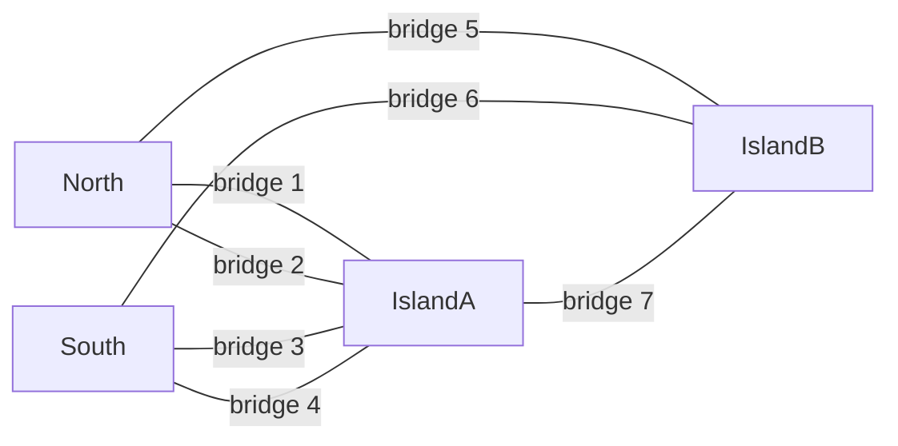
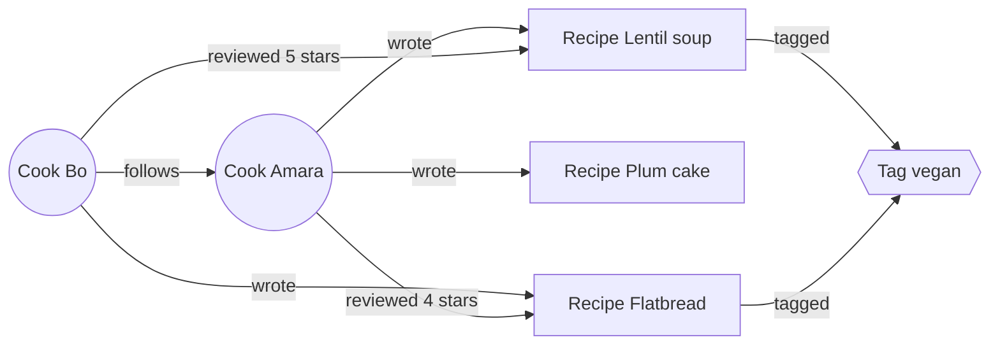
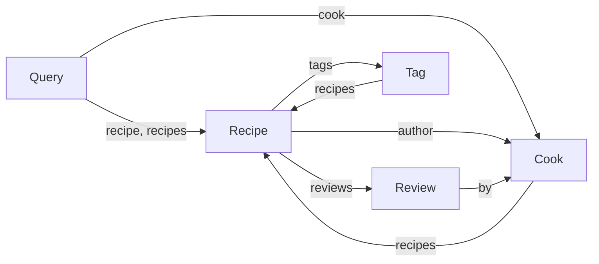

# Graph vocabulary: nodes, edges and paths

> **Before this lesson:** you should know what a GraphQL query and schema look like from [What GraphQL is](#/lesson/graphql/what-is-graphql), and be able to read JavaScript objects, arrays and loops ([Objects and arrays](#/lesson/javascript/objects-arrays)). No mathematics beyond counting is needed.

## In plain words

The "Graph" in GraphQL does not mean a chart with bars or lines. In computer science a **graph** is a set of things together with the connections between them.

You already use graphs every day:

- A **metro map** is a graph. The stations are the things; the track between two stations is a connection.
- Your **family** is a graph. People are the things; "is a parent of" is the connection.
- A **group of friends** is a graph. People again, connected by friendship.

That is the whole idea: dots, and lines between dots. The rest of this lesson gives names to the parts so that we can talk precisely.

Why it matters for a job: GraphQL documentation, error messages and interview questions use this vocabulary constantly ("node", "edge", "connection", "depth", "cycle"). The Relay pagination standard in lesson 12 literally has fields called `edges` and `node`. And graph questions (shortest path, cycle detection, reachability) are a staple of coding interviews in general.

## Nodes and edges

A graph has two ingredients.

- A **node** is one of the things. Another name for the same idea is **vertex** (plural *vertices*). This track says node, as GraphQL does.
- An **edge** is a connection between two nodes.

Here is a small friendship graph from the Potluck app: who follows whose recipes.



It has five nodes (Amara, Bo, Chidi, Dee, Eli) and four edges. Eli has no edges at all; a node is allowed to be alone.

Two nodes joined by an edge are called **neighbours** (or *adjacent*). Amara's neighbours are Bo and Chidi.

The number of edges touching a node is its **degree**. Chidi has degree 3, Dee has degree 1, Eli has degree 0.

## Directed and undirected

In the picture above the lines have no arrowheads: if Amara is Bo's friend then Bo is Amara's friend. A graph whose edges work in both directions is **undirected**.

Many relationships are one-way. "Follows" on a social app is one: Dee can follow Amara without Amara following Dee. A graph whose edges have a direction is **directed**, and the edges are drawn as arrows.



In a directed graph the degree splits in two: **in-degree** (arrows arriving) and **out-degree** (arrows leaving). Amara has in-degree 3 and out-degree 1.

This distinction is central to GraphQL. The schema graph is directed: the field `Recipe.author` is an arrow from `Recipe` to `Cook`. You can only travel back from a cook to their recipes if someone also defined the opposite arrow, `Cook.recipes`.

## Paths and cycles

A **path** is a route through the graph: a sequence of nodes where each is joined to the next by an edge. In the friendship graph, `Amara → Chidi → Dee` is a path of length 2 (length counts edges, not nodes).

Two nodes are **connected** if some path joins them. Amara and Dee are connected. Eli is connected to nobody.

A **cycle** is a path that returns to where it started without reusing an edge: `Amara → Bo → Chidi → Amara`. Cycles are what make graphs different from simple hierarchies, and they matter in GraphQL for a concrete reason: a schema with the cycle `Recipe → Cook → Recipe` lets a client write a query that nests as deep as it likes:

```graphql
{
  recipe(id: "r1") {
    author {
      recipes {
        author {
          recipes {
            title
          }
        }
      }
    }
  }
}
```

That is legal, occasionally useful, and a security risk that lesson 19 deals with (depth limits).

## Storing a graph in code

Pictures are for people. A program needs a data structure. The most common one is the **adjacency list**: for each node, the list of its neighbours.

```js-run
// An undirected graph as an adjacency list: node -> array of neighbours.
const friends = {
  Amara: ["Bo", "Chidi"],
  Bo: ["Amara", "Chidi"],
  Chidi: ["Amara", "Bo", "Dee"],
  Dee: ["Chidi"],
  Eli: [],
};

// Count nodes and edges.
const nodes = Object.keys(friends);
let endpoints = 0;
for (const name of nodes) endpoints += friends[name].length;
console.log("nodes:", nodes.length);
console.log("edges:", endpoints / 2);            // each edge was listed from both of its ends

// Degree of every node.
for (const name of nodes) console.log(name.padEnd(6), "degree", friends[name].length);

// Are two people neighbours?
const areFriends = (a, b) => friends[a].includes(b);
console.log("Amara-Dee neighbours?", areFriends("Amara", "Dee"));
```

Line by line:

- `friends` maps each name to an array. Because the graph is undirected, every edge appears twice: Bo is in Amara's list and Amara is in Bo's.
- Adding up the lengths of all the lists counts each edge twice, once from each end, so the number of edges is that total divided by two. This fact (the degrees of all nodes sum to twice the number of edges) is the oldest theorem in graph theory and is sometimes called the *handshake lemma*: at a party, the total number of hands shaken is twice the number of handshakes.
- The degree of a node is the length of its list.

For a *directed* graph you list only the outgoing edges: `Dee: ["Amara"]` without adding Dee to Amara's list.

## Walking a graph: reachability and shortest paths

The most common question asked of a graph is "can I get from here to there, and how far is it?". The standard method is **breadth-first search** (BFS): visit the start node, then all its neighbours, then all *their* unvisited neighbours, and so on, like ripples spreading from a stone dropped in water. Because it explores in rings of increasing distance, the first time it reaches a node is by a shortest path.

```js-run
const friends = {
  Amara: ["Bo", "Chidi"],
  Bo: ["Amara", "Chidi"],
  Chidi: ["Amara", "Bo", "Dee"],
  Dee: ["Chidi", "Femi"],
  Eli: [],
  Femi: ["Dee"],
};

// Returns the shortest path from start to goal as an array of names, or null.
function shortestPath(graph, start, goal) {
  const cameFrom = { [start]: null };     // also serves as the "visited" set
  const queue = [start];                  // nodes waiting to be explored, oldest first
  while (queue.length > 0) {
    const current = queue.shift();        // take from the front
    if (current === goal) {
      const path = [];
      for (let n = goal; n !== null; n = cameFrom[n]) path.unshift(n);   // walk backwards
      return path;
    }
    for (const next of graph[current]) {
      if (!(next in cameFrom)) {          // not seen before
        cameFrom[next] = current;
        queue.push(next);                 // add to the back
      }
    }
  }
  return null;                            // queue emptied without reaching the goal
}

console.log(shortestPath(friends, "Amara", "Femi"));
console.log(shortestPath(friends, "Amara", "Eli"));
console.log("Reachable from Amara:", Object.keys(friends).filter((n) => shortestPath(friends, "Amara", n)));
```

What the code does:

1. `cameFrom` remembers, for every node discovered, which node we arrived from. A node being present in it means "already seen", which is what stops the search going round a cycle for ever.
2. `queue` holds discovered nodes that have not been explored yet. Taking from the front and adding to the back gives the ring-by-ring order.
3. When the goal comes off the queue, the path is rebuilt by following `cameFrom` backwards.
4. If the queue runs dry, no path exists. That is the case for Eli, so the second line prints `null`.

The first output is `["Amara", "Chidi", "Dee", "Femi"]`: three edges. Friend-suggestion features ("people you may know") are built on exactly this: nodes at distance 2 from you are friends of friends.

> [!TIP]
> Any time you walk a graph that might contain cycles, keep a record of visited nodes. Forgetting it is the classic graph bug: the program loops for ever on `A → B → A → B …`.

The practice problem for this module, *Find types unreachable from the roots*, is this same walk applied to a GraphQL schema.

## A two-minute history: the seven bridges

Graph theory has a known birthday. In the 1730s the Prussian city of Königsberg (now Kaliningrad) was built across a river with two islands, joined to the banks and to each other by seven bridges. People wondered: can you take a walk that crosses every bridge exactly once?

The mathematician Leonhard Euler settled the question in 1736, and the way he did it mattered more than the answer. He threw away everything about the city except what was connected to what: four land areas became four nodes, seven bridges became seven edges.



Then he reasoned about degrees. Every time a walk passes *through* a land area it uses two bridges: one to arrive, one to leave. So every area except possibly the start and the end must have an **even** degree. A walk that uses every edge exactly once (today called an *Eulerian path*) can therefore exist only if **zero or two** nodes have odd degree.

Check Königsberg: Island A has degree 5, and North, South and Island B each have degree 3. Four odd nodes. The walk is impossible.

```js-run
// Each bridge is an edge between two land areas.
const bridges = [
  ["North", "IslandA"], ["North", "IslandA"], ["South", "IslandA"], ["South", "IslandA"],
  ["North", "IslandB"], ["South", "IslandB"], ["IslandA", "IslandB"],
];

function degrees(edges) {
  const d = {};
  for (const [a, b] of edges) {
    d[a] = (d[a] ?? 0) + 1;
    d[b] = (d[b] ?? 0) + 1;
  }
  return d;
}

function eulerWalkPossible(edges) {
  const odd = Object.values(degrees(edges)).filter((n) => n % 2 === 1).length;
  return odd === 0 || odd === 2;      // (assuming the graph is connected)
}

console.log(degrees(bridges));
console.log("Königsberg walk possible?", eulerWalkPossible(bridges));
console.log("With one more North-South bridge?", eulerWalkPossible([...bridges, ["North", "South"]]));
```

The first line prints the four degrees; the second prints `false`. Adding an eighth bridge between the banks makes North and South even, leaving two odd nodes, and the walk becomes possible: the third line prints `true`.

The lesson for programmers is the method, not the bridges: **strip a problem down to nodes and edges, and general tools start to apply**. That is the move GraphQL makes with an application's data.

## Your application's data is a graph

Look at Potluck's data as dots and arrows.



- The nodes are of different kinds: cooks, recipes, tags.
- The edges are of different kinds too: *wrote*, *reviewed*, *follows*, *tagged*.
- Some edges carry information of their own. "Bo reviewed Lentil soup" has a star rating attached. Lesson 11 calls the type that holds such information a *through type*.

A REST API slices this picture into separate resources and leaves the client to follow ids from one to the next. A GraphQL API exposes the picture as it is and lets a query walk the arrows.

There are really **two graphs** in a GraphQL system, and keeping them apart avoids confusion:

| | Schema graph | Data graph |
|---|---|---|
| nodes | types: `Recipe`, `Cook`, `Tag` | actual objects: Lentil soup, Amara |
| edges | fields that return another type: `Recipe.author` | actual links: Lentil soup → Amara |
| size | dozens to hundreds of nodes | millions of nodes |
| written by | the API designers, in SDL | users of the app, in the database |

The schema graph is the *map legend*: it says what kinds of place and road exist. The data graph is the territory. A query is written against the schema graph and is executed over the data graph.

Here is the Potluck schema graph for the types we have met:



Count the cycles: `Recipe → Cook → Recipe`, `Recipe → Tag → Recipe`, `Recipe → Review → Cook → Recipe`. A well-connected schema is full of them, and that is a feature. It means a client can start anywhere and reach related data in one request.

> [!WARNING]
> The same words mean slightly different things in different parts of GraphQL. In graph theory a *node* is any dot. In the Relay conventions (lesson 12), `Node` is specifically an object with a globally unique `id`, and an `edge` is a small wrapper object in a paginated list. When you read documentation, check which sense is meant.

> [!INTERVIEW]
> **"Why is it called GraphQL?"** Because the API models application data as a graph: types are nodes, and fields that return other types are directed edges. A query selects a tree-shaped set of paths through that graph starting from a root type. It is not a graph database and needs no graph storage; the data can live in SQL tables.
>
> **"How would you detect a cycle in a directed graph?"** Depth-first search while keeping the set of nodes on the current path; meeting a node that is already on the path means a cycle. (You will implement this idea for fragment cycles in the problem *Query depth and depth limiting*.)

## Pitfalls

- **Confusing a graph with a chart.** Bar charts and line charts are "graphs" in everyday English only.
- **Counting edges twice.** In an undirected adjacency list every edge appears in two lists.
- **Forgetting direction.** `Recipe.author` existing does not mean `Cook.recipes` exists. Each direction is a separate field that someone must add.
- **Walking without a visited set.** Any cycle will trap the walk.
- **Measuring a path by nodes instead of edges.** `Amara → Chidi → Dee` has length 2.
- **Mixing up the schema graph and the data graph.** "How many nodes?" has very different answers for each.

## Cheat sheet

| Term | Meaning | Potluck example |
|---|---|---|
| graph | nodes plus edges | cooks, recipes and their relationships |
| node (vertex) | one thing | the cook Amara; the type `Cook` |
| edge | a connection between two nodes | "Amara wrote Lentil soup"; the field `Recipe.author` |
| neighbour | a node one edge away | Bo is a neighbour of Amara |
| degree | number of edges at a node | Chidi: 3 |
| directed | edges have a direction | follows; every schema field |
| undirected | edges go both ways | friendship |
| path | a route along edges | Amara → Chidi → Dee |
| path length | number of edges on it | 2 |
| connected | joined by some path | Amara and Dee: yes; Eli: no |
| cycle | a path back to its start | Recipe → Cook → Recipe |
| adjacency list | node → list of neighbours | `{Amara: ["Bo", "Chidi"]}` |
| BFS | explore ring by ring; finds shortest paths | friend-of-friend suggestions |

## Summary

- A graph is a set of nodes and the edges that connect them. Edges may be directed (arrows) or undirected.
- Degree counts the edges at a node; a path is a route along edges; a cycle is a path that returns to its start.
- An adjacency list stores a graph as "node → neighbours", and breadth-first search with a visited set answers reachability and shortest-path questions.
- Euler's solution to the Königsberg bridges in 1736 began graph theory by reducing a real problem to nodes and edges.
- An application's data is naturally a graph. GraphQL exposes it as one: the schema graph has types as nodes and fields as directed edges, and queries walk it.

## Glossary

- **Graph:** a collection of nodes and edges.
- **Node / vertex:** one item in a graph.
- **Edge:** a connection between two nodes.
- **Neighbour / adjacent:** nodes joined by an edge.
- **Degree:** the number of edges touching a node. **In-degree / out-degree:** the incoming and outgoing counts in a directed graph.
- **Directed / undirected graph:** edges have / do not have a direction.
- **Path:** a sequence of nodes each joined to the next by an edge.
- **Connected:** linked by at least one path.
- **Cycle:** a path that starts and ends at the same node.
- **Adjacency list:** a data structure mapping each node to its neighbours.
- **Breadth-first search (BFS):** a walk that visits nodes in order of distance from the start.
- **Eulerian path:** a walk that uses every edge exactly once.
- **Schema graph:** the graph of types and fields. **Data graph:** the graph of actual objects and links.

## Check yourself

```quiz
[
  {"q": "In graph vocabulary, what is an edge?",
   "options": ["One of the things in the graph", "A connection between two nodes", "The longest path in the graph", "A node with no neighbours"],
   "answer": 1,
   "explain": "Nodes are the things; edges are the connections between pairs of nodes."},
  {"q": "An undirected graph has nodes with degrees 3, 2, 2 and 1. How many edges does it have?",
   "options": ["8", "4", "3", "It cannot be determined"],
   "answer": 1,
   "explain": "The degrees sum to 8, and every edge contributes 2 to that sum (one at each end), so there are 8 / 2 = 4 edges."},
  {"q": "The schema has `Recipe.author: Cook` but no field on `Cook` that returns recipes. Which query is possible?",
   "options": ["Start at a cook and list their recipes", "Start at a recipe and read its author's name", "Both directions", "Neither"],
   "answer": 1,
   "explain": "Schema edges are directed. `Recipe.author` is an arrow from Recipe to Cook only; the opposite arrow would have to be defined as its own field."},
  {"q": "Why does breadth-first search keep a set of visited nodes?",
   "options": ["To sort the nodes alphabetically", "So that cycles do not make it loop for ever and nodes are not processed twice", "To count the edges", "It is optional and only saves memory"],
   "answer": 1,
   "explain": "Without it, a cycle such as A → B → A would be followed endlessly."},
  {"q": "Euler showed a walk crossing every bridge exactly once needs how many odd-degree nodes?",
   "options": ["Exactly one", "Zero or two", "Any even number", "At least four"],
   "answer": 1,
   "explain": "Every pass through a node uses two edges, so all nodes except possibly the start and end must have even degree. Königsberg had four odd nodes, so no such walk existed."},
  {"q": "In a GraphQL *schema graph*, what are the nodes and the edges?",
   "options": ["Nodes are database rows; edges are foreign keys", "Nodes are types; edges are fields that return another type", "Nodes are queries; edges are responses", "Nodes are servers; edges are HTTP requests"],
   "answer": 1,
   "explain": "The schema graph is the map legend: types such as Recipe and Cook, joined by fields such as `Recipe.author`. Rows and links between them form the separate *data* graph."},
  {"q": "With `friends = {A: [\"B\"], B: [\"A\", \"C\"], C: [\"B\"], D: []}`, what does `shortestPath(friends, \"A\", \"C\")` from this lesson return?",
   "options": ["`[\"A\", \"C\"]`", "`[\"A\", \"B\", \"C\"]`", "`null`", "`[\"C\", \"B\", \"A\"]`"],
   "answer": 1,
   "explain": "A is not directly joined to C. BFS reaches B first, then C, and rebuilds the path from start to goal: A, B, C."}
]
```

> **Source:** Porcello & Banks, *Learning GraphQL*, ch. 2 (graph theory vocabulary, history of graph theory). Also: https://graphql.org/learn/thinking-in-graphs/ ; Euler, "Solutio problematis ad geometriam situs pertinentis" (1736), summarised at https://en.wikipedia.org/wiki/Seven_Bridges_of_K%C3%B6nigsberg.
