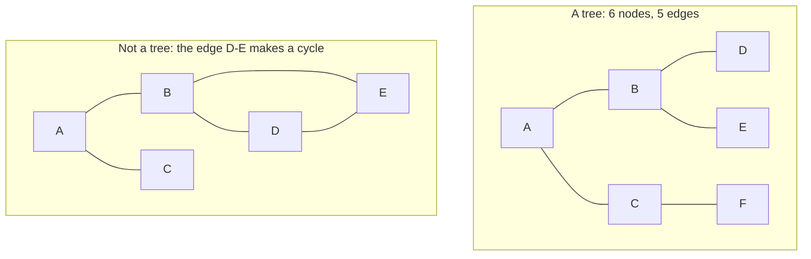
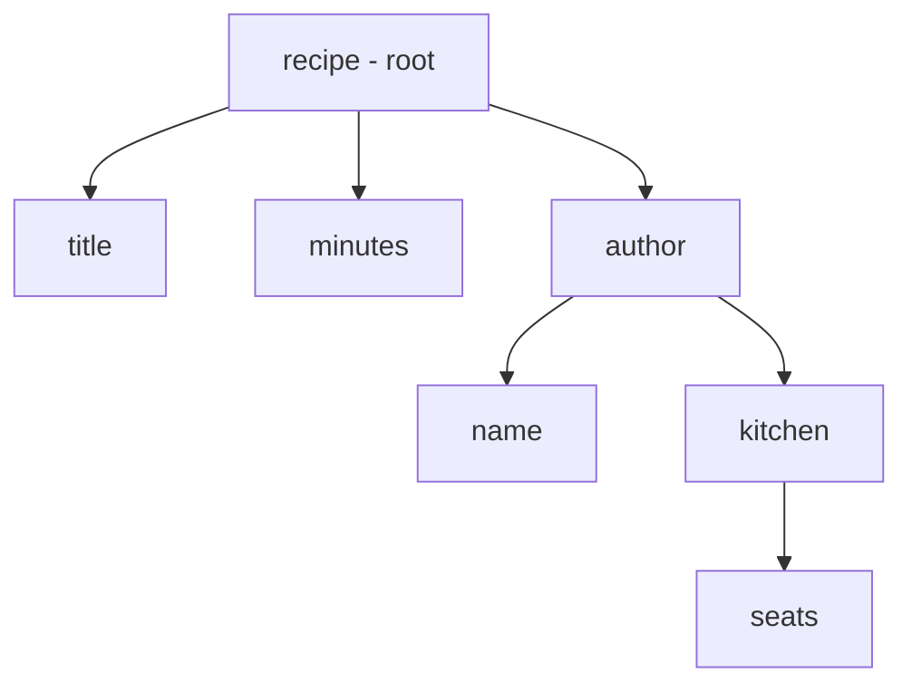
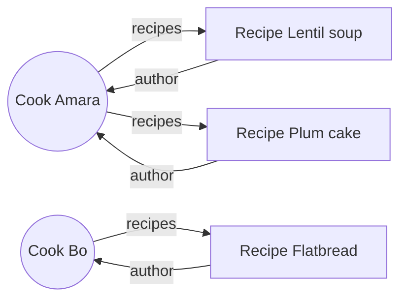

# Trees as graphs, and graphs in the real world

> **Before this lesson:** you need the words node, edge, path, cycle and directed from [Graph vocabulary](#/lesson/graphql/graph-vocabulary), and you should be able to read a recursive JavaScript function ([Closures and recursion](#/lesson/javascript/closures-recursion)).

## In plain words

A **tree** is a graph with a strict rule: there is exactly one route between any two nodes. No loops, no alternative ways round. That rule makes trees much easier to work with than general graphs, and it is why they are everywhere in computing.

Everyday trees:

- The **folders on your computer**. `Documents` contains `Recipes`, which contains `soup.txt`. Every file has exactly one folder it sits in.
- A **company organisation chart**. One chief executive at the top; everyone else has exactly one manager.
- A **family tree of descendants**: one ancestor, their children, their children's children.

Here is the point of the lesson in one sentence: **your data is a graph, but every GraphQL query and every GraphQL response is a tree.** A query picks a starting point in the graph and says which branches to follow; the result is a tree cut out of the graph. Once you see that, terms such as "query depth", "leaf field" and "nested selection" stop being jargon.

Why it matters for a job: JSON is a tree. The HTML page in a browser is a tree. A parsed program is a tree. Being fluent with trees (walking them, measuring them, building them recursively) is one of the most reusable skills a developer has, and tree questions are among the most common in coding interviews.

## What makes a graph a tree

A tree is a graph that is

1. **connected**: every node can be reached from every other node, and
2. **acyclic**: it contains no cycles.

Two consequences follow, and either can be used as a quick test:

- Between any two nodes there is **exactly one path**.
- A tree with $n$ nodes has **exactly $n - 1$ edges**. Each node except one has a single edge linking it to the rest; add one more edge anywhere and you create a cycle; remove one and the tree falls into two pieces.



## Rooted trees and their vocabulary

In programming we nearly always pick one node as the starting point and hang the rest of the tree from it. That node is the **root**, and the tree is then called a *rooted tree*. Trees in computing are drawn upside down, with the root at the top.



Once there is a root, every edge has a natural direction (away from the root) and we borrow family words:

| Term | Meaning | In the picture |
|---|---|---|
| **root** | the top node; it has no parent | `recipe` |
| **parent** | the node directly above | `author` is the parent of `name` |
| **child** | a node directly below | `title`, `minutes`, `author` are children of `recipe` |
| **siblings** | children of the same parent | `name` and `kitchen` |
| **leaf** | a node with no children | `title`, `minutes`, `name`, `seats` |
| **internal node** | a node with at least one child | `recipe`, `author`, `kitchen` |
| **ancestor / descendant** | anything above / below on the path to the root | `recipe` is an ancestor of `seats` |
| **subtree** | a node together with everything below it | `author`, `name`, `kitchen`, `seats` |
| **depth** of a node | number of edges from the root to it | `seats` has depth 3 |
| **height** of a tree | the largest depth of any node | 3 |

> [!NOTE]
> You may also meet the **binary tree**, a rooted tree in which every node has at most two children, usually called left and right. Binary trees power fast searching and sorting. GraphQL's trees are not binary: a selection can have any number of children.

The picture above was not chosen at random. It is the shape of this query:

```graphql
{
  recipe(id: "r1") {
    title
    minutes
    author {
      name
      kitchen {
        seats
      }
    }
  }
}
```

Each field is a node. Each pair of braces says "the fields inside are the children of the field before the brace". The leaves are the fields with no braces after them, and they are exactly the fields that return plain values.

## JSON is a tree

Any JSON document is a tree: objects and arrays are internal nodes, and strings, numbers, booleans and null are leaves. The response to the query above is the same tree as the query, with values at the leaves:

```json
{
  "data": {
    "recipe": {
      "title": "Lentil soup",
      "minutes": 35,
      "author": {
        "name": "Amara",
        "kitchen": { "seats": 12 }
      }
    }
  }
}
```

This is the "hierarchical" design principle from lesson 3 in graph-theory words: **the query is a tree, and the response is the same tree with its leaves filled in.**

## Walking a tree with recursion

Because every subtree is itself a tree, tree code is naturally recursive: do something with the current node, then repeat on each child. Visiting a node before its children, and finishing each branch before starting the next, is called **depth-first traversal** (in *pre-order*).

```js-run
// A query written as a tree: each node has a name and (maybe) children.
const query = {
  name: "recipe",
  children: [
    { name: "title" },
    { name: "minutes" },
    { name: "author", children: [
      { name: "name" },
      { name: "kitchen", children: [{ name: "seats" }] },
    ] },
  ],
};

// 1. Print the tree, indented by depth.
function print(node, depth = 0) {
  console.log("  ".repeat(depth) + node.name);
  for (const child of node.children ?? []) print(child, depth + 1);
}
print(query);

// 2. Height: 0 for a leaf, otherwise 1 + the tallest child.
function height(node) {
  const kids = node.children ?? [];
  if (kids.length === 0) return 0;
  return 1 + Math.max(...kids.map(height));
}
console.log("height:", height(query));

// 3. Collect the leaves.
function leaves(node) {
  const kids = node.children ?? [];
  return kids.length === 0 ? [node.name] : kids.flatMap(leaves);
}
console.log("leaves:", leaves(query));

// 4. Count nodes and edges: a tree always has nodes - 1 edges.
const count = (node) => 1 + (node.children ?? []).reduce((sum, c) => sum + count(c), 0);
console.log("nodes:", count(query), "edges:", count(query) - 1);
```

Reading the four functions:

1. `print` handles one node (prints its name with indentation) and then calls itself for each child with `depth + 1`. The indentation in the output shows the depth of every node.
2. `height` has a **base case**, the simplest input that needs no further recursion: a leaf has height 0. Every other node is one more than its tallest child. The result is 3.
3. `leaves` returns the node itself if it has no children, and otherwise gathers the leaves of all its children into one flat array.
4. `count` is one (for the node) plus the counts of its children. Seven nodes, six edges: the $n - 1$ rule holds.

> [!TIP]
> Nearly every tree function has the same skeleton: *base case for a leaf, combine the results of the children otherwise*. When a tree problem looks hard, write the answer for a single leaf first, then ask how a parent would combine its children's answers.

GraphQL servers that limit **query depth** (lesson 19) compute exactly this `height`. Convention differs on whether the root counts as depth 0 or 1; the practice problem *Query depth and depth limiting* counts the top-level field as depth 1.

## A query cuts a tree out of the graph

Now put the two lessons of this module together. The data is a graph with cycles:



Run this query against it:

```graphql
{
  cook(id: "c1") {
    name
    recipes {
      title
      author {
        name
      }
    }
  }
}
```

```json
{
  "data": {
    "cook": {
      "name": "Amara",
      "recipes": [
        { "title": "Lentil soup", "author": { "name": "Amara" } },
        { "title": "Plum cake",   "author": { "name": "Amara" } }
      ]
    }
  }
}
```

Count how often Amara appears: three times. In the graph there is **one** Amara node. In the response tree she is copied once for every path that reaches her. Turning a graph into a tree by following chosen paths from a root is sometimes called **unfolding** the graph.

The following model does that unfolding. The data is stored as a graph (objects that refer to each other by id), and the function follows only the edges the query names.

```js-run
// ----- the data graph: nodes refer to each other by id, so cycles are no problem -----
const graph = {
  c1: { type: "Cook", name: "Amara", recipes: ["r1", "r3"] },
  c2: { type: "Cook", name: "Bo", recipes: ["r2"] },
  r1: { type: "Recipe", title: "Lentil soup", author: "c1" },
  r2: { type: "Recipe", title: "Flatbread", author: "c2" },
  r3: { type: "Recipe", title: "Plum cake", author: "c1" },
};
const edges = new Set(["recipes", "author"]);        // which properties are edges to other nodes

let visits = 0;
// Follow only the paths named in the selection. true = leaf; object = go deeper.
function unfold(id, selection) {
  visits++;
  const node = graph[id];
  const out = {};
  for (const [field, sub] of Object.entries(selection)) {
    const value = node[field];
    if (!edges.has(field)) out[field] = value;                                 // plain value: a leaf
    else if (Array.isArray(value)) out[field] = value.map((v) => unfold(v, sub)); // many edges
    else out[field] = unfold(value, sub);                                      // one edge
  }
  return out;
}

const selection = { name: true, recipes: { title: true, author: { name: true } } };
console.log(JSON.stringify(unfold("c1", selection), null, 2));
console.log("distinct nodes touched: 3 (c1, r1, r3); node visits:", visits);
```

What to take from it:

- The stored graph has a cycle (`c1 → r1 → c1`), yet the function always stops, because the **selection** is a finite tree and the function only goes as deep as the selection does. The query, not the data, decides where the walk ends.
- `visits` prints 5 although only three distinct nodes exist. Amara was visited three times. In a real server each visit may be a database call, which is the root of the performance problem solved in lesson 20. In a real client, the three copies of Amara are merged back into one by the normalised cache in lesson 17.

> [!WARNING]
> A response tree can be far bigger than the data it was cut from. In a cyclic schema, a query nested ten levels deep through a popular cook's recipes can repeat the same few nodes millions of times. That is why public GraphQL servers limit depth and complexity.

## Graphs in the real world

Graph thinking pays off well outside API design. Whenever a problem is about *things and relationships*, it is probably a graph problem with a known solution.

| System | Nodes | Edges | Typical question |
|---|---|---|---|
| Social network | people, pages, posts | friend, follow, like, comment | whom might you know? (nodes at distance 2) |
| Maps and navigation | junctions | roads, weighted by travel time | fastest route (shortest path) |
| The web | pages | hyperlinks (directed) | which pages are important? (many incoming links) |
| Online shop | customers, products | bought, viewed | "people who bought this also bought" |
| Package manager (npm, pip) | packages | "depends on" (directed) | install order; is there a circular dependency? |
| Airline network | airports | flights | fewest changes between two cities |
| Knowledge graph | people, places, works | "born in", "directed", "capital of" | answer factual questions by walking edges |
| File system | folders and files | "contains" | a tree: every item has one parent |
| A web page (the DOM) | elements | "contains" | a tree: find all buttons inside a form |

The first row is where GraphQL comes from. A social network's data is one enormous, densely linked graph: a post has an author, comments and likers; each comment has an author, who has friends, who have posts. A news-feed screen needs a small tree cut out of that graph, several levels deep, different for every screen and every user. A language for saying "start here, follow these edges, bring back these leaves" was the natural tool, and that is what the engineers at Facebook built.

A graph can also carry **weights** on its edges (numbers such as a road's travel time). GraphQL schemas do not use weights, but the complexity scoring in lesson 19 does something similar by attaching a cost to each field.

> [!INTERVIEW]
> **"Is a tree a graph?"** Yes: a tree is a connected graph with no cycles, so it has exactly $n-1$ edges for $n$ nodes and exactly one path between any two nodes.
>
> **"If the schema is a graph, why is a query result a tree?"** A query starts at a root type and names a finite set of paths to follow. Following paths outward from one root, never merging them again, produces a tree. The same underlying node can therefore appear in several places in the result, which is why clients normalise responses by id.
>
> **"How do you find the depth of a tree?"** Recursively: a leaf has depth 0 (or 1, depending on convention), and any other node is 1 plus the maximum over its children. Time is linear in the number of nodes.

## Pitfalls

- **Assuming every hierarchy is a tree.** If an item can have two parents (a recipe in two collections), the structure is a graph. Code that assumes one parent will lose or duplicate data.
- **Off-by-one in depth.** Decide whether the root is depth 0 or 1 and say so. Depth-limit bugs are usually this.
- **Recursion without a base case.** A tree function must stop at leaves. On a *graph*, it also needs a visited set, unless (as in `unfold`) something else bounds the walk.
- **Treating repeated nodes in a response as different objects.** Three copies of Amara are one cook. Compare by `id`, not by position in the response.
- **Expecting a query to return a graph.** JSON cannot express "this is the same object as that one over there". Shared identity must be reconstructed from ids.

## Cheat sheet

| Fact | Detail |
|---|---|
| tree | connected graph with no cycles |
| edges in a tree | nodes − 1 |
| paths between two nodes | exactly one |
| root | top node; depth 0 |
| leaf | node without children; in a query, a field returning a plain value |
| height | longest root-to-leaf path, in edges |
| depth-first traversal | handle a node, then recurse into each child |
| recursive skeleton | base case for a leaf; combine children otherwise |
| query | a tree of fields |
| response | the same tree with values at the leaves |
| data | a graph, usually with cycles |
| unfolding | following chosen paths from a root; may copy a node many times |

## Summary

- A tree is a connected, cycle-free graph: $n$ nodes, $n - 1$ edges, one path between any pair.
- Rooted trees give us the vocabulary of root, parent, child, leaf, subtree, depth and height.
- JSON documents, folders, web pages, queries and responses are all trees, and recursive functions handle them with one pattern: a base case for leaves, a combination step for parents.
- Application data is a graph with cycles. A GraphQL query selects a finite tree of paths through it, so the walk always ends, but the same node may appear many times in the result.
- Recognising a problem as "nodes and edges" unlocks standard solutions, from route planning to friend suggestions to dependency ordering.

## Glossary

- **Tree:** a connected graph without cycles.
- **Acyclic:** containing no cycles.
- **Root:** the node chosen as the top of a tree.
- **Parent / child:** the node directly above / directly below another.
- **Siblings:** nodes with the same parent.
- **Leaf:** a node with no children.
- **Internal node:** a node with at least one child.
- **Subtree:** a node and all of its descendants.
- **Depth:** the number of edges from the root to a node.
- **Height:** the greatest depth in the tree.
- **Binary tree:** a tree whose nodes have at most two children.
- **Depth-first traversal:** visiting a node and then fully exploring each child in turn.
- **Base case:** the input for which a recursive function answers directly.
- **Unfolding:** producing a tree by following paths through a graph from a root.
- **Weighted graph:** a graph whose edges carry numbers such as cost or distance.
- **DOM (Document Object Model):** the tree of elements a browser builds from an HTML page.

## Check yourself

```quiz
[
  {"q": "A connected graph has 8 nodes and 7 edges. What can you say about it?",
   "options": ["It must contain a cycle", "It is a tree", "It is disconnected", "Nothing can be said"],
   "answer": 1,
   "explain": "A connected graph with exactly n − 1 edges has no spare edge to form a cycle, so it is a tree."},
  {"q": "In the query `{ recipe(id: \"r1\") { title author { name } } }`, which fields are leaves?",
   "options": ["`recipe` and `author`", "`title` and `name`", "Only `recipe`", "All four fields"],
   "answer": 1,
   "explain": "Leaves are the fields with no selection set after them: `title` and `name`. `recipe` and `author` have children."},
  {"q": "Using `height` from this lesson, what is the height of `{name: \"a\", children: [{name: \"b\"}, {name: \"c\", children: [{name: \"d\"}]}]}`?",
   "options": ["1", "2", "3", "4"],
   "answer": 1,
   "explain": "`d` is a leaf (0), `c` is 1, `b` is 0, and `a` is 1 + max(0, 1) = 2."},
  {"q": "Cook Amara wrote two recipes. What does `{ cook(id: \"c1\") { recipes { author { name } } } }` return?",
   "options": ["`{\"data\": {\"cook\": {\"recipes\": [{\"author\": {\"name\": \"Amara\"}}]}}}`", "`{\"data\": {\"cook\": {\"recipes\": [{\"author\": {\"name\": \"Amara\"}}, {\"author\": {\"name\": \"Amara\"}}]}}}`", "An error, because the query contains a cycle", "`{\"data\": {\"cook\": {\"name\": \"Amara\"}}}`"],
   "answer": 1,
   "explain": "The response is a tree: one entry per recipe, and under each the author is written out again. The single Amara node in the graph appears once per path that reaches her."},
  {"q": "Why does the `unfold` function terminate even though the data graph has a cycle?",
   "options": ["It keeps a visited set", "The selection is a finite tree, and the walk goes only as deep as the selection", "JavaScript limits recursion to three levels", "Cycles are removed from the data first"],
   "answer": 1,
   "explain": "The query bounds the walk. Each recursive call consumes one level of the selection, and the selection has finite depth."},
  {"q": "Which of these structures is NOT necessarily a tree?",
   "options": ["A JSON document", "The folders on a disk", "A social network's friendships", "The DOM of a web page"],
   "answer": 2,
   "explain": "Friendships form cycles (A–B–C–A) and people have many connections, so the structure is a general graph."},
  {"q": "A recipe can belong to several collections. A developer models collections as a tree with recipes as leaves. What goes wrong?",
   "options": ["Nothing", "A tree node has exactly one parent, so a recipe in two collections must be duplicated or dropped", "Trees cannot hold strings", "The tree will have too few edges to be valid JSON"],
   "answer": 1,
   "explain": "Multiple parents make the structure a graph. Forcing it into a tree means copying the recipe, after which the copies can drift apart."}
]
```

> **Source:** Porcello & Banks, *Learning GraphQL*, ch. 2 (trees are graphs; graphs in the real world). Also: https://graphql.org/learn/thinking-in-graphs/ ; https://graphql.org/learn/execution/.
