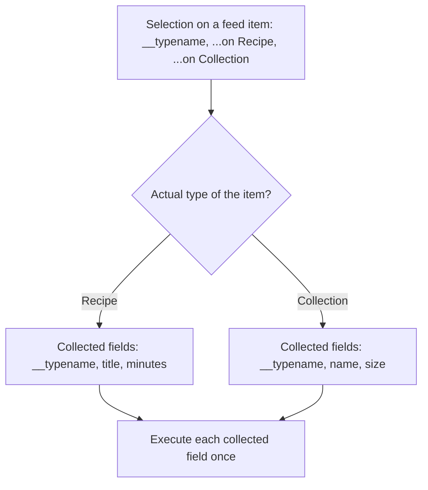

# Fields, arguments, aliases and fragments

> **Before this lesson:** you should have seen a first query and its response in [What GraphQL is](#/lesson/graphql/what-is-graphql) and know that a query is a tree of fields ([Trees as graphs](#/lesson/graphql/trees-and-real-graphs)). You should be able to read JSON and short JavaScript.

## In plain words

The GraphQL **query language** is what a client writes to say what it wants. It is small. This lesson covers the four building blocks used for reading data:

- **fields**: the names of the things you want;
- **arguments**: options you pass to a field, like the options you tell a barista ("large, oat milk");
- **aliases**: your own label for a result, so that two similar requests do not collide;
- **fragments**: a named, reusable group of fields, like a rubber stamp you press wherever the same lines are needed.

A helpful picture: a query is a shopping list written as an outline.

```
recipe number r1
    its title
    its author
        the author's name
```

Indentation in the outline becomes braces in GraphQL. That is nearly all the syntax there is.

Why it matters for a job: if you work on a front end that talks to a GraphQL API, writing queries *is* the daily work. If you work on the back end, you need to read the queries clients send in order to debug and optimise them. Interviewers often show a query and ask "what does this return?"

## Where you write queries

You will normally try queries in an **explorer**: a web page with an editor on the left and the response on the right. The standard one is **GraphiQL** (pronounced "graphical"), maintained by the GraphQL Foundation; Apollo's servers ship a similar tool called **Apollo Sandbox**. Both read the server's schema, so they autocomplete field names, underline mistakes as you type, and show documentation for every field. (Older tutorials mention *GraphQL Playground*; that project has been retired in favour of GraphiQL.)

This page has no server to connect to, so each example below shows the query and the exact JSON it would return from the Potluck API, and a runnable model near the end lets you experiment.

For reference, here is the part of the Potluck schema these examples use. You do not need to understand every symbol yet; read `name: Type` as "this field returns that type".

```graphql
type Query {
  recipe(id: ID!): Recipe
  recipes(first: Int = 10, category: Category): [Recipe!]!
  feed: [FeedItem!]!
}

type Recipe {
  id: ID!
  title: String!
  minutes: Int
  category: Category!
  photo(width: Int = 400): String
  author: Cook!
  reviews(first: Int): [Review!]!
}

type Cook    { id: ID!  name: String!  city: String  recipes(first: Int): [Recipe!]! }
type Review  { id: ID!  stars: Int!    text: String  by: Cook! }
type Collection { id: ID!  name: String!  size: Int! }

enum Category { SOUP  BREAD  MAIN  DESSERT }
union FeedItem = Recipe | Collection
```

## Fields

A **field** asks for one named piece of data. A query is a set of fields inside braces, called a **selection set**.

```graphql
{
  recipes {
    title
    minutes
  }
}
```

```json
{
  "data": {
    "recipes": [
      { "title": "Lentil soup", "minutes": 35 },
      { "title": "Flatbread", "minutes": 20 },
      { "title": "Plum cake", "minutes": 70 }
    ]
  }
}
```

Four rules explain every query you will ever read.

1. **The response mirrors the query.** Same field names, same order, same nesting.
2. **A field that returns an object needs a selection set.** `recipes` returns recipe objects, so braces must follow, saying which of their fields you want. Writing `{ recipes }` alone is an error.
3. **A field that returns a plain value must not have one.** `title` is text. Plain values are called **scalars**; they are the leaves of the query tree.
4. **Lists need no special syntax.** The query does not say whether `recipes` is one recipe or many. The schema knows it is a list, and the selection is applied to every item. You find out from the square brackets in the response (or from the schema).

Fields nest as deep as the schema's connections go:

```graphql
{
  recipes {
    title
    author {
      name
      city
    }
  }
}
```

```json
{
  "data": {
    "recipes": [
      { "title": "Lentil soup", "author": { "name": "Amara", "city": "Leeds" } },
      { "title": "Flatbread",   "author": { "name": "Bo",    "city": "Oslo" } },
      { "title": "Plum cake",   "author": { "name": "Amara", "city": "Leeds" } }
    ]
  }
}
```

Small syntax notes: commas between fields are optional and usually left out; line breaks and indentation are for humans only; a `#` starts a comment that runs to the end of the line.

## Arguments

An **argument** is a named value passed to a field in parentheses. It lets one field give different answers.

```graphql
{
  recipe(id: "r2") {
    title
  }
}
```

```json
{ "data": { "recipe": { "title": "Flatbread" } } }
```

Points that surprise people coming from REST:

- **Arguments are always named.** `recipe("r2")` is invalid. Order therefore does not matter: `recipes(first: 2, category: SOUP)` equals `recipes(category: SOUP, first: 2)`.
- **Any field can take arguments, at any depth**, not only the top-level ones. In REST, options live in one query string for the whole request. In GraphQL every field has its own:

```graphql
{
  recipes(first: 2, category: SOUP) {
    title
    photo(width: 120)
    reviews(first: 1) {
      stars
    }
  }
}
```

```json
{
  "data": {
    "recipes": [
      { "title": "Lentil soup", "photo": "https://img.potluck.example/r1?w=120", "reviews": [ { "stars": 5 } ] },
      { "title": "Miso soup",   "photo": "https://img.potluck.example/r7?w=120", "reviews": [] }
    ]
  }
}
```

- **Arguments can have defaults.** The schema says `photo(width: Int = 400)`, so `photo` without arguments behaves like `photo(width: 400)`.
- **Arguments are typed.** `first: "two"` is rejected before the query runs, because `first` is declared as `Int`.

The kinds of value you can write for an argument:

| Kind | Example | Notes |
|---|---|---|
| Int | `first: 2` | whole number |
| Float | `minRating: 4.5` | decimal number |
| String | `id: "r2"` | double quotes only |
| Boolean | `published: true` | `true` / `false` |
| null | `category: null` | explicitly "no value" |
| Enum | `category: SOUP` | one of a fixed set of names; **no quotes** |
| List | `tags: ["vegan", "quick"]` | square brackets |
| Object | `filter: { maxMinutes: 30, category: SOUP }` | braces; keys are not quoted |
| Variable | `id: $recipeId` | filled in from outside the query (next lesson) |

> [!WARNING]
> An enum value is written bare: `category: SOUP`. Writing `category: "SOUP"` passes a string and fails validation with a message such as *Enum "Category" cannot represent non-enum value: "SOUP"*. This is one of the most common first-week mistakes.

## Aliases

Suppose a screen compares two recipes side by side. The obvious query does not work:

```graphql
{
  recipe(id: "r1") { title }
  recipe(id: "r2") { title }
}
```

Both results would have to be stored under the key `"recipe"`, and a JSON object cannot hold the same key twice. The server rejects the query with an error saying the two fields conflict.

An **alias** gives a field a different name in the response. You write `alias: field`.

```graphql
{
  left: recipe(id: "r1") { title minutes }
  right: recipe(id: "r2") { title minutes }
}
```

```json
{
  "data": {
    "left":  { "title": "Lentil soup", "minutes": 35 },
    "right": { "title": "Flatbread", "minutes": 20 }
  }
}
```

Aliases work on any field. They are also handy for making the response fit the names your code already uses:

```graphql
{
  recipe(id: "r1") {
    name: title
    thumb: photo(width: 120)
    hero: photo(width: 1200)
  }
}
```

```json
{
  "data": {
    "recipe": {
      "name": "Lentil soup",
      "thumb": "https://img.potluck.example/r1?w=120",
      "hero": "https://img.potluck.example/r1?w=1200"
    }
  }
}
```

The alias changes only the key in the response. On the server, the same `photo` field ran twice with different arguments.

## Fragments

The comparison query repeated `title minutes` twice. With ten fields and four places to use them, repetition becomes a maintenance problem: add a field in one place, forget it in another. A **fragment** is a named selection set that can be reused.

```graphql
fragment RecipeCard on Recipe {
  title
  minutes
  author {
    name
  }
}

{
  left: recipe(id: "r1") { ...RecipeCard }
  right: recipe(id: "r2") { ...RecipeCard }
}
```

```json
{
  "data": {
    "left":  { "title": "Lentil soup", "minutes": 35, "author": { "name": "Amara" } },
    "right": { "title": "Flatbread", "minutes": 20, "author": { "name": "Bo" } }
  }
}
```

Reading the definition:

- `fragment RecipeCard` gives the fragment a name.
- `on Recipe` is the **type condition**: this fragment may only be used where a `Recipe` is being selected, and may only contain fields of `Recipe`.
- The braces hold an ordinary selection set, which may itself nest and use arguments.

The three dots `...RecipeCard` are a **fragment spread**: "paste the fragment's fields here". The response shows no trace of the fragment; it is a writing aid only. You can mix a spread with ordinary fields, and fragments can spread other fragments (but never themselves, directly or indirectly, since that would never end).

> [!TIP]
> In component-based front ends (React, Vue and others), a common practice is for each UI component to declare a fragment listing the fields *it* renders, and for the page to build its query by spreading those fragments. When a component needs a new field, only its own fragment changes. Relay enforces this pattern; Apollo Client supports it.

## Inline fragments and `__typename`

Some fields can return more than one type of object. The Potluck `feed` returns a mix of recipes and collections: the schema declares `union FeedItem = Recipe | Collection`, where a **union** means "one of these types". (An **interface**, covered in lesson 11, is similar.)

What may you select on `feed`? Not `title`, because a `Collection` has none. You must say which fields apply to which type, using an **inline fragment**: a fragment written in place, without a name.

```graphql
{
  feed {
    __typename
    ... on Recipe {
      title
      minutes
    }
    ... on Collection {
      name
      size
    }
  }
}
```

```json
{
  "data": {
    "feed": [
      { "__typename": "Recipe", "title": "Lentil soup", "minutes": 35 },
      { "__typename": "Collection", "name": "Weeknight dinners", "size": 4 },
      { "__typename": "Recipe", "title": "Flatbread", "minutes": 20 }
    ]
  }
}
```

Each item received only the fields from the fragment matching its own type. `... on Recipe` reads as "if this item is a Recipe, also select…".

`__typename` is a **meta field**: a field that exists on every object type without being declared in the schema, and that returns the name of the object's type as a string. (Names beginning with two underscores are reserved for GraphQL itself.) Client code uses it to decide how to draw each item, and client caches rely on it to tell objects apart (lesson 17).

## How the server reads fragments: collect, then execute

Before a server fetches anything for an object, it first works out the final list of fields for it. This step is called **collecting fields**:

1. Walk the selection set in order.
2. A plain field is added to the list.
3. A fragment spread or inline fragment is opened **only if its type condition matches the object's actual type**, and its fields are added in place.
4. If the same response key shows up twice, the two are merged into one entry and their sub-selections are combined.



Rule 4 means repeating a field is harmless:

```graphql
{
  recipe(id: "r1") {
    title
    author { name }
    author { city }
    title
  }
}
```

```json
{ "data": { "recipe": { "title": "Lentil soup", "author": { "name": "Amara", "city": "Leeds" } } } }
```

`title` appears once; the two `author` selections were merged. This is what makes it safe for two fragments written by different people to ask for overlapping fields.

## A model you can run

This model implements aliases, arguments, fragments, lists and field merging over plain objects. The query is written as a data structure because the page has no GraphQL parser; the comment above each one shows the query text it stands for.

```js-run
// ---------- data: every object knows its type; "photo" takes an argument, so it is a function ----------
const amara = { __typename: "Cook", name: "Amara", city: "Leeds" };
const soup = { __typename: "Recipe", title: "Lentil soup", minutes: 35, author: amara,
               photo: (args) => "https://img.potluck.example/r1?w=" + (args.width ?? 400) };
const weeknight = { __typename: "Collection", name: "Weeknight dinners", size: 4 };
const root = { __typename: "Query", recipe: (args) => (args.id === "r1" ? soup : null), feed: [soup, weeknight] };

// ---------- step 1: collect fields (open matching fragments, merge duplicates) ----------
function collect(object, selection, fragments, fields = new Map()) {
  for (const item of selection) {
    if (item.spread || item.on) {                                   // named spread or inline fragment
      const frag = item.spread ? fragments[item.spread] : item;
      if (frag.on === object.__typename) collect(object, frag.selection, fragments, fields);
    } else {
      const key = item.alias ?? item.name;                          // response key
      if (!fields.has(key)) fields.set(key, { ...item, selection: [] });
      fields.get(key).selection.push(...(item.selection ?? []));    // merge sub-selections
    }
  }
  return fields;
}

// ---------- step 2: execute each collected field ----------
function execute(object, selection, fragments = {}) {
  const result = {};
  for (const [key, field] of collect(object, selection, fragments)) {
    let value = object[field.name];
    if (typeof value === "function") value = value(field.args ?? {});   // a field with arguments
    result[key] = complete(value, field.selection, fragments);
  }
  return result;
}
function complete(value, selection, fragments) {
  if (value === null || value === undefined) return null;
  if (Array.isArray(value)) return value.map((v) => complete(v, selection, fragments));
  if (typeof value === "object") return execute(value, selection, fragments);
  return value;                                                         // a scalar: a leaf
}

// { recipe(id: "r1") { name: title  thumb: photo(width: 120)  hero: photo(width: 1200)  ...Byline } }
const fragments = { Byline: { on: "Recipe", selection: [{ name: "author", selection: [{ name: "name" }] }] } };
const q1 = [{ name: "recipe", args: { id: "r1" }, selection: [
  { name: "title", alias: "name" },
  { name: "photo", alias: "thumb", args: { width: 120 } },
  { name: "photo", alias: "hero", args: { width: 1200 } },
  { spread: "Byline" },
] }];
console.log(JSON.stringify(execute(root, q1, fragments), null, 2));

// { feed { __typename ... on Recipe { title } ... on Collection { name size } } }
const q2 = [{ name: "feed", selection: [
  { name: "__typename" },
  { on: "Recipe", selection: [{ name: "title" }] },
  { on: "Collection", selection: [{ name: "name" }, { name: "size" }] },
] }];
console.log(JSON.stringify(execute(root, q2), null, 2));
```

What to check in the output:

- In the first result the keys are `name`, `thumb`, `hero` and `author`: aliases decided the keys, and the two `photo` calls received different `width` arguments.
- `author` came from the fragment `Byline`, yet nothing in the output mentions the fragment.
- In the second result the recipe item has `title` and no `size`; the collection item has `name` and `size` and no `title`. The type condition did that.

Things to try: add `{ name: "author", selection: [{ name: "city" }] }` to `q1` next to the spread and watch `author` gain a second field (merging); change `id` to `"r9"` and watch `recipe` become `null`.

> [!INTERVIEW]
> **"What are fragments for, and what is the difference between a named and an inline fragment?"** A fragment is a reusable selection set with a type condition. Named fragments (`fragment X on T { ... }` used as `...X`) remove repetition and let UI components declare their own data needs. Inline fragments (`... on T { ... }`) are used in place, mainly to select type-specific fields on a union or interface. Neither appears in the response.
>
> **"Why do aliases exist?"** Response keys must be unique within an object. Requesting the same field twice with different arguments would collide, so an alias renames one of them. Aliases are also used to shape the response to match client-side names.

## Pitfalls

- **Quoting enum values**, or forgetting quotes on strings and ids. `category: SOUP`, but `id: "r1"`.
- **Positional arguments.** There are none; always `name: value`.
- **Same field, different arguments, no alias.** The server refuses to merge `photo(width: 120)` with `photo(width: 1200)`.
- **Selecting a type-specific field directly on a union.** `feed { title }` fails; wrap it in `... on Recipe { }`.
- **Forgetting `__typename` on unions.** Without it the client cannot tell which kind of item each entry is.
- **Fragments on the wrong type.** `...RecipeCard` inside `author { }` is rejected, because a `Cook` is never a `Recipe`.
- **One huge shared fragment used everywhere.** That brings over-fetching straight back. Keep fragments as small as the component that owns them.

## Cheat sheet

| Feature | Syntax | Effect on the response |
|---|---|---|
| field | `title` | key `title` with its value |
| nested field | `author { name }` | nested object |
| argument | `recipes(first: 2)` | changes what the field returns |
| default argument | declared in the schema: `width: Int = 400` | used when the argument is omitted |
| enum value | `category: SOUP` | (no quotes) |
| alias | `thumb: photo(width: 120)` | key becomes `thumb` |
| named fragment | `fragment F on Recipe { title }` then `...F` | fields pasted in; fragment invisible |
| inline fragment | `... on Collection { size }` | fields only for objects of that type |
| type name | `__typename` | the object's type as a string |
| comment | `# text` | ignored |

## Summary

- A query is nested selection sets of fields; the response has the same shape.
- Object fields require a selection set, scalar fields forbid one, and lists need no special syntax.
- Arguments are named, typed, may have defaults, and can be given to any field at any depth.
- Aliases rename response keys, which makes it possible to request one field several times with different arguments.
- Fragments are reusable selection sets with a type condition. Named ones remove repetition; inline ones select per-type fields on unions and interfaces.
- The server first collects fields (opening matching fragments and merging duplicates) and then executes each one once.

## Glossary

- **Selection set:** the fields listed inside one pair of braces.
- **Field:** a named piece of data requested from an object.
- **Scalar:** a plain value (text, number, boolean, id) that has no fields of its own.
- **Argument:** a named, typed value passed to a field.
- **Enum:** a type whose values are a fixed list of names.
- **Alias:** a client-chosen name for a field's result.
- **Response key:** the key a field's result is stored under: the alias if present, otherwise the field name.
- **Fragment:** a named, reusable selection set tied to a type.
- **Type condition:** the `on TypeName` part that says where a fragment applies.
- **Fragment spread:** `...Name`, which inserts a fragment's fields.
- **Inline fragment:** an unnamed fragment written where it is used.
- **Union:** a type meaning "one of several object types".
- **Meta field:** a built-in field such as `__typename` that exists without being declared.
- **GraphiQL:** the standard in-browser editor for exploring a GraphQL API.

## Check yourself

```quiz
[
  {"q": "What does this query return?\n\n`{ a: recipe(id: \"r1\") { title } b: recipe(id: \"r2\") { minutes } }`\n\n(r1 is Lentil soup, 35 minutes; r2 is Flatbread, 20 minutes.)",
   "options": ["`{\"data\": {\"recipe\": {\"title\": \"Lentil soup\", \"minutes\": 20}}}`", "`{\"data\": {\"a\": {\"title\": \"Lentil soup\"}, \"b\": {\"minutes\": 20}}}`", "`{\"data\": {\"a\": {\"title\": \"Lentil soup\", \"minutes\": 35}, \"b\": {\"title\": \"Flatbread\", \"minutes\": 20}}}`", "An error: `recipe` is requested twice"],
   "answer": 1,
   "explain": "Aliases `a` and `b` become the response keys, and each result contains only the field selected for it."},
  {"q": "Which argument is written correctly for `recipes(first: Int, category: Category)` where `Category` is an enum?",
   "options": ["`recipes(2, SOUP)`", "`recipes(first: 2, category: \"SOUP\")`", "`recipes(first: 2, category: SOUP)`", "`recipes(first: \"2\", category: SOUP)`"],
   "answer": 2,
   "explain": "Arguments are named, `Int` values are unquoted numbers, and enum values are bare names without quotes."},
  {"q": "Why is `{ recipes }` invalid when `recipes` returns `[Recipe!]!`?",
   "options": ["Lists cannot be queried", "A field returning objects must have a selection set saying which of their fields to return", "The field needs an alias", "`recipes` requires the `first` argument"],
   "answer": 1,
   "explain": "GraphQL never returns 'the whole object'. You must select at least one field of an object type."},
  {"q": "Given `fragment F on Recipe { title }`, what does `{ recipe(id: \"r1\") { ...F minutes } }` return for Lentil soup (35 minutes)?",
   "options": ["`{\"data\": {\"recipe\": {\"F\": {\"title\": \"Lentil soup\"}, \"minutes\": 35}}}`", "`{\"data\": {\"recipe\": {\"title\": \"Lentil soup\", \"minutes\": 35}}}`", "`{\"data\": {\"recipe\": {\"minutes\": 35}}}`", "`{\"data\": {\"F\": {\"title\": \"Lentil soup\"}}}`"],
   "answer": 1,
   "explain": "A spread pastes the fragment's fields in place. The fragment's name never appears in the response."},
  {"q": "The `feed` holds one Recipe (Lentil soup) and one Collection (Weeknight dinners, size 4). What does `{ feed { ... on Collection { size } } }` return?",
   "options": ["`{\"data\": {\"feed\": [{\"size\": 4}]}}`", "`{\"data\": {\"feed\": [{}, {\"size\": 4}]}}`", "`{\"data\": {\"feed\": [{\"size\": null}, {\"size\": 4}]}}`", "An error, because recipes have no `size`"],
   "answer": 1,
   "explain": "Every item in the list is returned. The inline fragment applies only to the Collection, so the Recipe item is an empty object."},
  {"q": "What does the meta field `__typename` return?",
   "options": ["The name of the query", "The name of the object's type, as a string", "The alias of the field", "The schema version"],
   "answer": 1,
   "explain": "It is available on every object type and reports the concrete type, for example `\"Recipe\"`."},
  {"q": "A query selects `author { name }` and later, in the same selection set, `author { city }`. What happens?",
   "options": ["A validation error for duplicate fields", "Only the second selection is used", "The two are merged: `author` appears once with both `name` and `city`", "`author` appears twice in the response"],
   "answer": 2,
   "explain": "During field collection, identical fields with the same arguments are merged and their sub-selections combined."},
  {"q": "Which query needs aliases to be valid?",
   "options": ["`{ recipe(id: \"r1\") { title title } }`", "`{ recipe(id: \"r1\") { photo(width: 100) photo(width: 800) } }`", "`{ recipes { title author { name } } }`", "`{ recipe(id: \"r1\") { author { name } author { city } } }`"],
   "answer": 1,
   "explain": "The same field with *different arguments* cannot be merged under one key. One of the two `photo` fields must be given an alias."}
]
```

> **Source:** Porcello & Banks, *Learning GraphQL*, ch. 3 (API tools, the GraphQL query, edges and connections, fragments). Also: https://graphql.org/learn/queries/ ; GraphQL specification, "Execution: CollectFields" (https://spec.graphql.org/October2021/#sec-Field-Collection).
