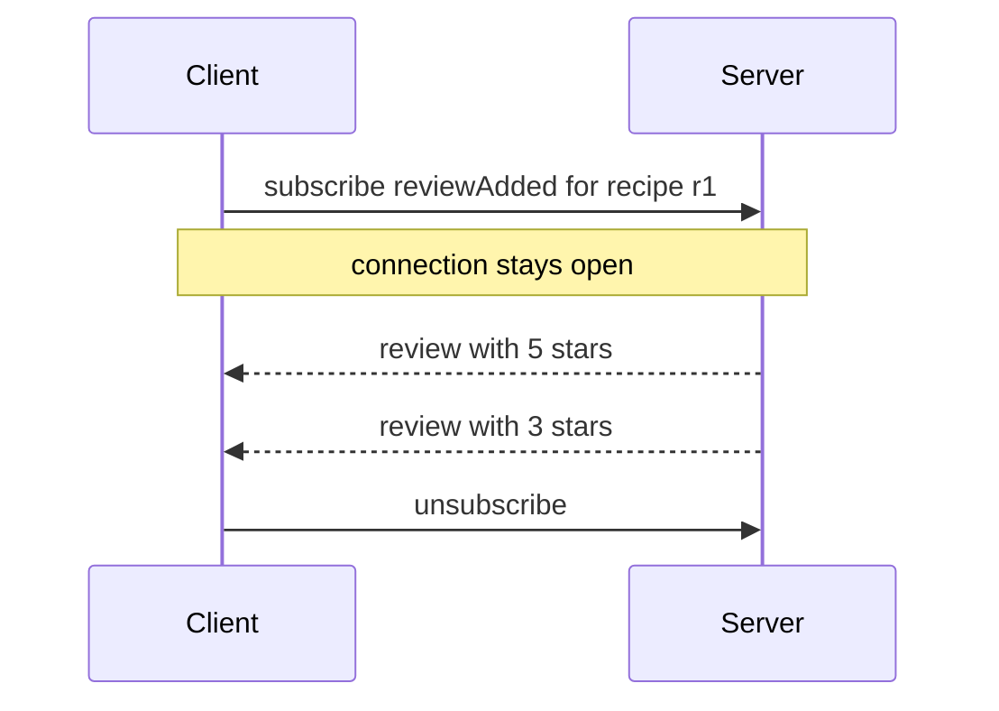

# Variables, mutations and subscriptions

> **Before this lesson:** you should be able to read queries with arguments, aliases and fragments ([Fields, arguments, aliases and fragments](#/lesson/graphql/fields-args-fragments)) and know how a GraphQL request travels as an HTTP `POST` ([What GraphQL is](#/lesson/graphql/what-is-graphql)).

## In plain words

So far every query had its values typed straight into it: `recipe(id: "r1")`. Real apps do not know the id in advance; the user taps a recipe and the app must ask for *that one*. This lesson adds three things that turn hand-written examples into real application traffic.

- **Variables** are blanks in a query that are filled in when it is sent. Think of a printed form: the form (the query) is designed once, and each person writes their own details in the boxes (the variables).
- **Mutations** are operations that change data: publish a recipe, add a review, delete a comment. If a query is *reading* the noticeboard, a mutation is *pinning something to it*.
- **Subscriptions** are operations that stay open and deliver news as it happens. A query is checking the letterbox; a subscription is asking the postman to ring the bell whenever something arrives.

Why it matters for a job: every production GraphQL request uses variables, for safety as much as convenience. Mutations are where the bugs with real consequences live. Subscriptions are what make chat, notifications and live dashboards work.

## Operation names

First, a habit. An operation can be given a name after its keyword:

```graphql
query RecipeScreen {
  recipe(id: "r1") { title }
}
```

The name changes nothing in the response. It is there for people and tools: server logs show `RecipeScreen` instead of "anonymous query", and error reports and performance dashboards group by it. Name every operation you write in an application.

## Variables

### The problem

A beginner's first instinct is to build the query text by gluing strings together:

```javascript
const query = '{ recipe(id: "' + userInput + '") { title } }';   // do not do this
```

This is fragile and dangerous. If `userInput` contains a quote character, the query breaks or, worse, says something different from what you intended. The same class of mistake against databases is called *SQL injection*. It also makes every request a different piece of text, which defeats caching and the security technique of allow-listing queries (lesson 19).

### The solution

Write the query once, with named blanks, and send the values separately.

```graphql
query RecipeScreen($id: ID!, $reviewCount: Int = 3) {
  recipe(id: $id) {
    title
    reviews(first: $reviewCount) {
      stars
    }
  }
}
```

Three steps make a variable:

1. **Declare** it in parentheses after the operation name: `$id: ID!`. Variable names start with a dollar sign. After the colon comes its type; the `!` means the value is required. `$reviewCount: Int = 3` has a default value, used when the client sends nothing for it.
2. **Use** it wherever a value could be written: `recipe(id: $id)`.
3. **Send** the values in a separate JSON object alongside the query.

The HTTP body now has two keys:

```json
{
  "query": "query RecipeScreen($id: ID!, $reviewCount: Int = 3) { recipe(id: $id) { title reviews(first: $reviewCount) { stars } } }",
  "variables": { "id": "r1" }
}
```

```json
{
  "data": {
    "recipe": {
      "title": "Lentil soup",
      "reviews": [ { "stars": 5 }, { "stars": 4 }, { "stars": 5 } ]
    }
  }
}
```

`id` was supplied; `reviewCount` was not, so its default of 3 applied. Note that inside the `variables` JSON the names have **no** dollar sign.

The rules the server follows when it receives variables are worth knowing exactly, because they produce the errors you will see:

| The client sent | Declared type | Result |
|---|---|---|
| a value | any | that value is used (after a type check) |
| nothing | has a default | the default is used |
| nothing | `ID!` (required), no default | error: variable was not provided |
| nothing | `Int` (optional), no default | the variable is *unset*; the argument is treated as not given |
| `null` explicitly | `Int` (optional) | the value is `null`, even if a default exists |
| `null` explicitly | `ID!` (required) | error: must not be null |

The fourth and fifth rows are different on purpose. "I did not mention it" and "I am telling you it is empty" are two separate messages. That difference matters for updates: leaving `bio` out of an edit means "do not touch it"; sending `bio: null` means "clear it".

> [!WARNING]
> Variables can stand in for **values only**. They cannot replace a field name, a type name or a piece of query structure. `{ recipe(id: "r1") { $fieldName } }` is not valid GraphQL. To include or leave out a field based on a variable, use a directive, shown next.

### Directives: `@include` and `@skip`

A **directive** is an annotation starting with `@` that changes how part of a query is handled. Two are built into every GraphQL server:

- `@include(if: $flag)` keeps the field only when the flag is true;
- `@skip(if: $flag)` drops the field when the flag is true.

```graphql
query RecipeScreen($id: ID!, $withReviews: Boolean!) {
  recipe(id: $id) {
    title
    reviews(first: 2) @include(if: $withReviews) {
      stars
    }
  }
}
```

With `{"id": "r1", "withReviews": false}` the response is:

```json
{ "data": { "recipe": { "title": "Lentil soup" } } }
```

The `reviews` key is absent, not null: the field was removed from the query before execution, so the server did not fetch any reviews.

### Binding variables in a model

The function below does what a server does between receiving a request and executing it: check the variables against their declarations, apply defaults, and substitute them into the arguments.

```js-run
// Declarations from: query ($id: ID!, $reviewCount: Int = 3, $category: Category)
const declarations = [
  { name: "id", type: "ID!" },
  { name: "reviewCount", type: "Int", default: 3 },
  { name: "category", type: "Category" },
];

function coerce(declarations, provided) {
  const values = {}, errors = [];
  for (const d of declarations) {
    const required = d.type.endsWith("!");
    if (d.name in provided) {                                   // the client mentioned it
      if (provided[d.name] === null && required) errors.push(`$${d.name} must not be null`);
      else values[d.name] = provided[d.name];
    } else if ("default" in d) values[d.name] = d.default;      // not mentioned: use the default
    else if (required) errors.push(`$${d.name} of type ${d.type} was not provided`);
    // otherwise: optional, no default -> stays unset (not even a key in `values`)
  }
  return { values, errors };
}

// Arguments as written in the query: { id: $id, first: $reviewCount, category: $category }
function substitute(args, values) {
  const out = {};
  for (const [name, v] of Object.entries(args)) {
    if (v && v.$var) { if (v.$var in values) out[name] = values[v.$var]; }   // unset -> argument omitted
    else out[name] = v;
  }
  return out;
}

const args = { id: { $var: "id" }, first: { $var: "reviewCount" }, category: { $var: "category" } };

for (const provided of [{ id: "r1" }, { id: "r1", reviewCount: null, category: "SOUP" }, { reviewCount: 5 }]) {
  const { values, errors } = coerce(declarations, provided);
  console.log(JSON.stringify(provided), "->", errors.length ? "ERROR: " + errors.join("; ") : JSON.stringify(substitute(args, values)));
}
```

Read the three outputs against the table:

1. `{"id":"r1"}` gives `{"id":"r1","first":3}`. The default filled `first`, and `category` is missing altogether because it was unset.
2. An explicit `reviewCount: null` gives `"first":null`. The default did **not** apply.
3. Leaving out the required `id` produces an error and nothing is executed.

The check `d.name in provided` is the important line: it tells "absent" apart from "present but null". The practice problem *Bind variables with defaults* asks you to write this logic in full.

## Mutations

A **mutation** is an operation that changes data on the server. Syntactically it is a query with a different keyword; the fields you may start with come from the schema's `Mutation` type instead of `Query`.

```graphql
type Mutation {
  addReview(recipeId: ID!, stars: Int!, text: String): Review!
  deleteReview(id: ID!): Boolean!
}
```

```graphql
mutation AddReview($recipeId: ID!, $stars: Int!, $text: String) {
  addReview(recipeId: $recipeId, stars: $stars, text: $text) {
    id
    stars
    by {
      name
    }
  }
}
```

Variables: `{"recipeId": "r1", "stars": 5, "text": "Made it twice this week."}`

```json
{
  "data": {
    "addReview": {
      "id": "v8",
      "stars": 5,
      "by": { "name": "Bo" }
    }
  }
}
```

Three things to notice.

**A mutation returns data, and you select from it.** `addReview` returns the new `Review`, so the braces after it are an ordinary selection set. The client asked for the id the server generated and for the reviewer's name, all in the same round trip. In REST you would often need a `POST` followed by a `GET`. Always select the fields your screen needs to update itself, especially `id`.

**Root mutation fields run one after another.** A query's top-level fields may be resolved in parallel, since reading has no side effects. A mutation's top-level fields are guaranteed to run **in series**, in the order written, each finishing before the next starts:

```graphql
mutation {
  first: addReview(recipeId: "r1", stars: 5) { id }
  second: deleteReview(id: "v3")
}
```

`second` starts only after `first` has completed. This guarantee applies to the top level only; the nested selections under each mutation field behave like a query.

**The convention is enforced by you, not by GraphQL.** Nothing stops a badly written `Query` field from changing data. Do not do it: clients, caches and tools all assume queries are safe to repeat.

> [!TIP]
> If the second field of a multi-field mutation fails, the first is **not** undone. GraphQL gives ordering, not transactions. When several changes must succeed or fail together, design one mutation field that does them all (for example `publishRecipeWithSteps`), and make it atomic inside the server.

### Serial execution, modelled

```js-run
const reviews = [{ id: "v1", recipeId: "r1", stars: 4 }];
let nextId = 2;
const log = [];

// Each mutation resolver takes a little time, like a real database write.
const wait = (ms) => new Promise((resolve) => setTimeout(resolve, ms));
const Mutation = {
  async addReview(args) {
    log.push("start addReview");
    await wait(30);
    const review = { id: "v" + nextId++, recipeId: args.recipeId, stars: args.stars };
    reviews.push(review);
    log.push("end addReview");
    return review;
  },
  async deleteReview(args) {
    log.push("start deleteReview");
    await wait(10);
    const index = reviews.findIndex((r) => r.id === args.id);
    if (index >= 0) reviews.splice(index, 1);
    log.push("end deleteReview");
    return index >= 0;
  },
};

// Top-level mutation fields: awaited one at a time, in order.
async function executeMutation(fields) {
  const data = {};
  for (const f of fields) data[f.alias ?? f.name] = await Mutation[f.name](f.args);
  return { data };
}

const result = await executeMutation([
  { name: "addReview", alias: "added", args: { recipeId: "r1", stars: 5 } },
  { name: "deleteReview", alias: "removed", args: { id: "v2" } },      // deletes what the first field created
]);
console.log(JSON.stringify(result));
console.log(log.join(" -> "));
console.log("reviews left:", reviews.map((r) => r.id));
```

The `for` loop with `await` inside is the whole trick: the second resolver is not even called until the first has returned. That is why the log reads start, end, start, end, and why `deleteReview` could find `v2`, which only existed after `addReview` finished. Had the two run in parallel, the faster delete would have looked for `v2` before it existed and returned `false`.

## Subscriptions

A **subscription** asks the server to keep the conversation open and send a new result every time a particular event happens.

```graphql
type Subscription {
  reviewAdded(recipeId: ID!): Review!
}
```

```graphql
subscription OnReview($recipeId: ID!) {
  reviewAdded(recipeId: $recipeId) {
    stars
    text
    by { name }
  }
}
```

There is no single response. Each time someone reviews recipe `r1`, the client receives one message shaped like the selection:

```json
{ "data": { "reviewAdded": { "stars": 5, "text": "Perfect for winter.", "by": { "name": "Bo" } } } }
```

and later, perhaps minutes afterwards:

```json
{ "data": { "reviewAdded": { "stars": 3, "text": "Needed more salt.", "by": { "name": "Chidi" } } } }
```

How this differs from the other two operations:

| | query | mutation | subscription |
|---|---|---|---|
| Purpose | read | write | be notified |
| Responses | one | one | many, over time |
| Usual transport | HTTP POST | HTTP POST | WebSocket, or Server-Sent Events |
| Top-level fields | any number, may run in parallel | any number, run in series | exactly **one** |
| Ends when | the response is sent | the response is sent | the client or the server closes it |

A normal HTTP exchange ends after one response, so subscriptions need a transport that stays open. The usual choice is a **WebSocket**: a two-way connection between browser and server that remains open until one side closes it. Lesson 18 covers the server side in detail.



In JavaScript, a stream of values arriving over time is modelled by an **async iterator**: an object you can loop over with `for await`, where each turn of the loop waits for the next value. That is the shape GraphQL servers use internally for subscriptions.

```js-run
const wait = (ms) => new Promise((resolve) => setTimeout(resolve, ms));

// The "event source": yields a new review every so often.
async function* reviewEvents() {
  const incoming = [
    { recipeId: "r1", stars: 5, text: "Perfect for winter.", by: { name: "Bo", city: "Oslo" } },
    { recipeId: "r2", stars: 4, text: "Crisp!", by: { name: "Dee", city: "Cork" } },
    { recipeId: "r1", stars: 3, text: "Needed more salt.", by: { name: "Chidi", city: "Lagos" } },
  ];
  for (const review of incoming) { await wait(40); yield review; }
}

// subscription { reviewAdded(recipeId: $recipeId) { stars by { name } } }
async function* subscribeReviewAdded(variables) {
  for await (const review of reviewEvents()) {
    if (review.recipeId !== variables.recipeId) continue;             // the argument filters events
    yield { data: { reviewAdded: { stars: review.stars, by: { name: review.by.name } } } };   // selection applied per event
  }
}

for await (const message of subscribeReviewAdded({ recipeId: "r1" })) {
  console.log("received:", JSON.stringify(message));
}
console.log("stream closed");
```

`async function*` declares a generator that can both wait (`await`) and hand out values one at a time (`yield`). Three reviews are published, but only two messages are received: the argument `recipeId: "r1"` filtered out the review of `r2`. Each message contains only the selected fields, so `text` and `city` never leave the server.

> [!WARNING]
> Do not reach for subscriptions by default. Each one holds a connection open on the server, which costs memory and complicates scaling. If data changes rarely, or a delay of a few seconds is acceptable, **polling** (re-sending a query on a timer) is simpler and often good enough. Use subscriptions for small, frequent, time-critical updates such as chat messages, typing indicators and live scores.

> [!INTERVIEW]
> **"Why use variables instead of string interpolation?"** (1) Safety: values are sent as data and can never change the structure of the query, which rules out injection. (2) Type checking: the server validates each variable against its declared type. (3) A stable query string, which allows caching, persisted queries and meaningful metrics per operation. (4) Convenience: no escaping.
>
> **"How do mutations differ from queries at execution time?"** Top-level mutation fields run serially in document order; top-level query fields may run in parallel. Everything below the top level behaves the same.
>
> **"Query, mutation, subscription over what transports?"** Queries and mutations: one HTTP request and response (POST; GET is allowed for queries). Subscriptions: a long-lived channel, typically WebSocket with the `graphql-ws` protocol, or Server-Sent Events.

## Pitfalls

- **Dollar signs in the variables JSON.** Write `{"id": "r1"}`, not `{"$id": "r1"}`.
- **Declared type does not match the argument's type.** If the field wants `ID!` and you declare `$id: ID`, validation fails: a possibly-null variable cannot feed a non-null argument (unless the variable has a default).
- **Declared but unused variables**, or used but undeclared. Both are validation errors.
- **Not selecting `id` from a mutation result.** The client cache then cannot match the result to the object it already holds (lesson 17).
- **Assuming a multi-field mutation is a transaction.** It is ordered, not atomic.
- **Several top-level fields in a subscription.** Only one is allowed.
- **Expecting `@include(if: false)` to return null.** The field is absent from the response.

## Cheat sheet

| Feature | Syntax | Remember |
|---|---|---|
| operation name | `query RecipeScreen { ... }` | for logs, metrics and tools |
| declare a variable | `($id: ID!, $n: Int = 3)` | `$` prefix, type, optional default |
| use a variable | `recipe(id: $id)` | values only |
| send variables | `{"query": "...", "variables": {"id": "r1"}}` | no `$` in the JSON |
| absent vs null | absent → default or unset; `null` → null | different meanings |
| conditional field | `@include(if: $x)` / `@skip(if: $x)` | field is removed, not nulled |
| mutation | `mutation Name { addReview(...) { id } }` | select from the result |
| mutation order | top-level fields run in series | not a transaction |
| subscription | `subscription Name { reviewAdded(...) { stars } }` | one top-level field; many responses |

## Summary

- Variables are typed blanks declared on the operation and supplied in a separate JSON object. They keep values out of the query text.
- An absent variable takes its default or stays unset; an explicit `null` is a value of its own.
- `@include` and `@skip` add or remove parts of a query based on boolean variables.
- Mutations change data and return a selection of the result. Their top-level fields execute strictly one after another, without transactional rollback.
- Subscriptions keep a connection open and deliver one response per event, shaped by the selection set and filtered by arguments.

## Glossary

- **Operation name:** an optional label after `query`, `mutation` or `subscription`.
- **Variable:** a named placeholder (`$name`) in an operation whose value is sent separately.
- **Variable declaration:** the `($name: Type = default)` list after the operation name.
- **Coercion:** checking a supplied value against its declared type and converting it to the internal form.
- **Default value:** the value used when a variable or argument is not supplied.
- **Directive:** an `@`-prefixed annotation that changes how a part of a document is processed.
- **Mutation:** an operation that changes server-side data.
- **Serial execution:** running steps one at a time, each waiting for the previous one.
- **Atomic:** all-or-nothing; either every part of a change happens or none does.
- **Subscription:** an operation that delivers a stream of results over a long-lived connection.
- **WebSocket:** a protocol for a persistent two-way connection between client and server.
- **Polling:** repeating a request on a timer to look for changes.
- **Async iterator:** a JavaScript object that yields values over time, consumed with `for await`.
- **Injection:** an attack in which user input is interpreted as part of a command or query.

## Check yourself

```quiz
[
  {"q": "A query declares `($id: ID!, $n: Int = 3)` and the request sends `\"variables\": {\"id\": \"r1\"}`. What value does `$n` have?",
   "options": ["`null`", "`3`", "`0`", "The request is rejected"],
   "answer": 1,
   "explain": "`$n` was not provided and has a default, so the default 3 is used."},
  {"q": "Same declaration, but the request sends `{\"id\": \"r1\", \"n\": null}`. What value does `$n` have?",
   "options": ["`3`", "`null`", "It is unset", "The request is rejected"],
   "answer": 1,
   "explain": "An explicit null is a value. Defaults only apply when the variable is absent. `Int` is nullable, so null is accepted."},
  {"q": "What does this operation return when sent with `{\"id\": \"r1\", \"full\": false}`?\n\n`query($id: ID!, $full: Boolean!) { recipe(id: $id) { title minutes @include(if: $full) } }`",
   "options": ["`{\"data\": {\"recipe\": {\"title\": \"Lentil soup\", \"minutes\": null}}}`", "`{\"data\": {\"recipe\": {\"title\": \"Lentil soup\"}}}`", "`{\"data\": {\"recipe\": {\"title\": \"Lentil soup\", \"minutes\": 35}}}`", "A validation error"],
   "answer": 1,
   "explain": "`@include(if: false)` removes the field from the selection, so the key `minutes` does not appear at all."},
  {"q": "A mutation has two top-level fields, `a: addReview(...)` and `b: deleteReview(...)`. How are they executed?",
   "options": ["In parallel, in any order", "`a` completes, then `b` starts", "`b` first, because deletes have priority", "Inside one database transaction that rolls back on failure"],
   "answer": 1,
   "explain": "Top-level mutation fields run serially in document order. GraphQL does not provide transactions: if `b` fails, `a` stays done."},
  {"q": "Why is building a query by concatenating user input into the query string a bad idea?",
   "options": ["It is slower to type", "User input could change the structure of the query, and every request becomes a different string", "GraphQL servers reject all strings", "Variables are required by HTTP"],
   "answer": 1,
   "explain": "Interpolated input can break or alter the query (injection). Variables are sent as data and are type-checked, and the query text stays constant."},
  {"q": "The subscription `subscription { reviewAdded(recipeId: \"r1\") { stars } }` is active. Reviews arrive for r1 (5 stars), r2 (4 stars) and r1 (3 stars). What does the client receive?",
   "options": ["One message containing all three reviews", "Two messages: `{\"data\": {\"reviewAdded\": {\"stars\": 5}}}` then `{\"data\": {\"reviewAdded\": {\"stars\": 3}}}`", "Three messages, one per review", "Nothing until it sends the subscription again"],
   "answer": 1,
   "explain": "A subscription delivers one result per matching event. The `recipeId` argument filters out the r2 review, and each message contains only the selected field."},
  {"q": "Which of these is NOT a valid use of a variable?",
   "options": ["`recipe(id: $id)`", "`reviews(first: $count)`", "`recipe(id: \"r1\") { $field }`", "`@include(if: $show)`"],
   "answer": 2,
   "explain": "Variables stand for values (argument values, including directive arguments). They cannot stand for a field name or any other part of the query's structure."},
  {"q": "A mutation creates a review. Why should the client select `id` in the result?",
   "options": ["The server refuses mutations that do not select `id`", "So the client can identify the new object, for example to add it to its cache or delete it later", "It makes the mutation run faster", "IDs are returned automatically, so it is unnecessary"],
   "answer": 1,
   "explain": "Only selected fields come back. The server-generated id is the handle the client needs for caching and for any later operation on that object."}
]
```

> **Source:** Porcello & Banks, *Learning GraphQL*, ch. 3 (mutations, using query variables, subscriptions). Also: https://graphql.org/learn/queries/#variables ; https://graphql.org/learn/mutations/ ; https://graphql.org/learn/subscriptions/ ; GraphQL specification, "Coercing Variable Values" (https://spec.graphql.org/October2021/#sec-Coercing-Variable-Values).
