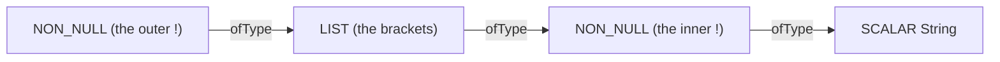
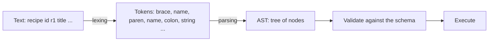
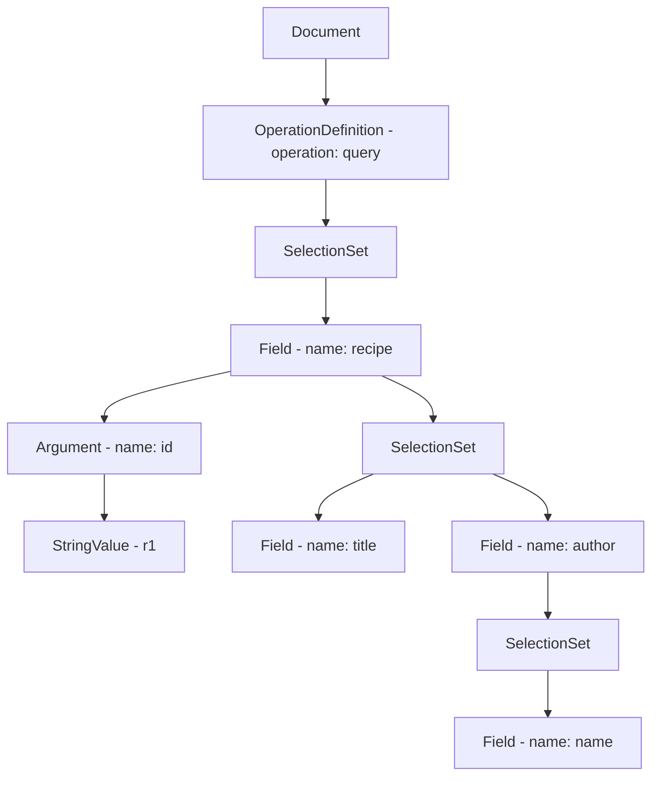

# Introspection and abstract syntax trees

> **Before this lesson:** you should be comfortable reading queries ([Fields, arguments, aliases and fragments](#/lesson/graphql/fields-args-fragments)), know the tree vocabulary of root, child and leaf ([Trees as graphs](#/lesson/graphql/trees-and-real-graphs)), and be able to follow a JavaScript loop over the characters of a string.

## In plain words

This lesson answers two "how does it know?" questions.

**How does an editor know which fields exist?** When you type a query in GraphiQL, it autocompletes field names and underlines mistakes. It can do that because a GraphQL server will describe itself if asked. Asking a server about its own schema is called **introspection** (the word means "looking inward"). Picture a restaurant where you can ask the waiter not only for food but also "what is on the menu, and what comes with each dish?", and get a complete, accurate answer every time.

**How does the server understand the text I send?** A query arrives as a string of characters. Before the server can do anything with it, the string is converted into a tree of labelled parts called an **abstract syntax tree**, or **AST**. Think of a sentence diagram from a grammar class: "the cook *(subject)* stirs *(verb)* the soup *(object)*". The diagram has the same meaning as the sentence, but its structure is explicit, so a program can work with it.

Why it matters for a job: introspection powers the tools you will use every day (editors, documentation sites, code generators), and whether to leave it switched on in production is a standard security question. ASTs are how linters, code formatters, compilers and GraphQL servers all work; once you have built a tiny parser, none of those tools feel like magic.

## Introspection: asking the schema about itself

Lesson 7 introduced `__typename`, a field that exists on every object without being declared. Two more built-in fields exist on the root `Query` type:

- `__schema` describes the whole schema;
- `__type(name: "...")` describes one type.

They are queried with ordinary GraphQL. Nothing new to learn: introspection results are objects with fields, like everything else.

### Listing the types

```graphql
{
  __schema {
    queryType { name }
    types {
      name
      kind
    }
  }
}
```

```json
{
  "data": {
    "__schema": {
      "queryType": { "name": "Query" },
      "types": [
        { "name": "Query", "kind": "OBJECT" },
        { "name": "Recipe", "kind": "OBJECT" },
        { "name": "Cook", "kind": "OBJECT" },
        { "name": "Category", "kind": "ENUM" },
        { "name": "ID", "kind": "SCALAR" },
        { "name": "String", "kind": "SCALAR" },
        { "name": "Int", "kind": "SCALAR" },
        { "name": "Boolean", "kind": "SCALAR" },
        { "name": "__Schema", "kind": "OBJECT" },
        { "name": "__Type", "kind": "OBJECT" }
      ]
    }
  }
}
```

Every type has a **kind**, which says what sort of type it is. There are eight:

| Kind | Meaning | Example |
|---|---|---|
| `SCALAR` | a plain value | `String`, `Int`, `ID` |
| `OBJECT` | a type with fields | `Recipe` |
| `ENUM` | one of a fixed list of names | `Category` |
| `INTERFACE` | a set of fields several object types share | `Node` |
| `UNION` | one of several object types | `FeedItem` |
| `INPUT_OBJECT` | a bundle of values passed as an argument | `CreateRecipeInput` |
| `LIST` | a wrapper: "a list of…" | `[Recipe]` |
| `NON_NULL` | a wrapper: "never null" | `String!` |

The list also contains the built-in scalars and types whose names begin with two underscores. Those are the introspection system's own types: the schema describes the thing that describes it.

### Looking at one type

```graphql
{
  __type(name: "Recipe") {
    name
    description
    fields {
      name
      type {
        kind
        name
        ofType { kind name }
      }
    }
  }
}
```

```json
{
  "data": {
    "__type": {
      "name": "Recipe",
      "description": "A dish that a cook has published.",
      "fields": [
        { "name": "id",      "type": { "kind": "NON_NULL", "name": null, "ofType": { "kind": "SCALAR", "name": "ID" } } },
        { "name": "title",   "type": { "kind": "NON_NULL", "name": null, "ofType": { "kind": "SCALAR", "name": "String" } } },
        { "name": "minutes", "type": { "kind": "SCALAR",   "name": "Int", "ofType": null } },
        { "name": "author",  "type": { "kind": "NON_NULL", "name": null, "ofType": { "kind": "OBJECT", "name": "Cook" } } }
      ]
    }
  }
}
```

The interesting part is how a field's type is reported. `minutes: Int` is direct: kind `SCALAR`, name `Int`. But `title: String!` is reported as a **wrapper** of kind `NON_NULL` with no name of its own, and the wrapped type sits inside `ofType`.

Wrappers stack. A field declared `tags: [String!]!` unwraps in four steps, from the outside in:



To see all four layers the query must nest `ofType` four deep. Tools send one standard, very long **introspection query** that nests `ofType` many levels and asks for every type, field, argument, enum value and description at once. The JSON that comes back is everything needed to rebuild the schema.

The following function produces that nested description from a type written in SDL notation. It is the core of the practice problem *Answer an introspection query*.

```js-run
const SCALARS = new Set(["Int", "Float", "String", "Boolean", "ID"]);
const schemaKinds = { Recipe: "OBJECT", Cook: "OBJECT", Category: "ENUM" };

// Peel one wrapper per call, outermost first.
function typeRef(t) {
  if (t.endsWith("!")) return { kind: "NON_NULL", name: null, ofType: typeRef(t.slice(0, -1)) };
  if (t.startsWith("[")) return { kind: "LIST", name: null, ofType: typeRef(t.slice(1, -1)) };
  return { kind: SCALARS.has(t) ? "SCALAR" : schemaKinds[t], name: t, ofType: null };
}

// The reverse: what GraphiQL does to print a type in its docs panel.
function print(ref) {
  if (ref.kind === "NON_NULL") return print(ref.ofType) + "!";
  if (ref.kind === "LIST") return "[" + print(ref.ofType) + "]";
  return ref.name;
}

for (const t of ["Int", "String!", "[String!]!", "[Recipe]", "Category!"]) {
  const ref = typeRef(t);
  console.log(t.padEnd(12), JSON.stringify(ref));
  console.log(" ".repeat(12), "printed back:", print(ref));
}
```

`typeRef` checks the last character first. If it is `!`, the outermost layer is `NON_NULL` and the function calls itself on the rest. Otherwise, if the string starts with `[`, the outer layer is `LIST`. Otherwise it is a bare name. Checking `!` before `[` matters: for `[String]!` the outermost wrapper is the `!`.

### What introspection makes possible

| Tool | What it does with the introspection result |
|---|---|
| GraphiQL, Apollo Sandbox | autocomplete, inline error squiggles, a browsable documentation panel |
| Editor plugins | the same, inside VS Code or JetBrains editors |
| Code generators (GraphQL Code Generator and others) | produce TypeScript, Swift or Kotlin types for every query, so a typo in a field name fails at compile time |
| Schema registries and diff tools | detect breaking changes between two versions of a schema (lesson 23) |
| Documentation sites | generated reference pages that cannot go out of date |
| Mock servers | return fake data of the right types before the real back end exists |

This is the "introspective" design principle from lesson 3 paying off: the schema is not a document someone must remember to update. It is the running server's own description of itself.

> [!WARNING]
> Introspection hands a complete map of your API to anyone who can reach it, including fields you forgot were there. For a **public** API that is the point: GitHub wants developers to explore. For a **private** API serving only your own apps, common practice is to disable introspection in production and expose the schema through a registry or a checked-in file instead. Treat this as tidiness, not as protection: hiding the map does not lock any doors, and every field still needs its own authorisation check (lesson 15). Apollo Server turns introspection off automatically when `NODE_ENV` is `production`.

## From text to tree

Now the second question. The server receives this string:

```graphql
{ recipe(id: "r1") { title author { name } } }
```

To a computer that is 46 characters. Turning it into something meaningful takes two steps.



### Step 1: lexing

**Lexing** (or *tokenising*) chops the text into **tokens**: the smallest meaningful pieces, like words and punctuation marks in a sentence. Spaces, line breaks, commas and comments are thrown away.

| Token kind | Examples |
|---|---|
| punctuator | `{` `}` `(` `)` `:` `$` `!` `[` `]` `=` `@` `...` |
| name | `recipe`, `id`, `title`, `query`, `SOUP` |
| string | `"r1"` |
| number | `2`, `4.5` |

The lexer does not know that `recipe` is a field or that `id` is an argument. It only knows both are names.

### Step 2: parsing

**Parsing** reads the tokens in order and builds a tree according to the grammar of the language. The grammar is a set of rules such as "a selection set is `{`, then one or more fields, then `}`" and "a field is a name, optionally followed by arguments, optionally followed by a selection set". The tree is the **abstract syntax tree**. It is "abstract" because it keeps the meaning (this is a field, it has these arguments) and drops details that do not matter, such as how many spaces you typed.

In the reference implementation every node of the tree has a `kind`. The query above becomes:



Reading from the top:

- A **Document** is the whole text. It contains a list of **definitions**: operations (query, mutation, subscription) and fragments.
- An **OperationDefinition** has an operation type, an optional name, optional variable definitions, and a **SelectionSet**.
- A SelectionSet contains **selections**: `Field`, `FragmentSpread` or `InlineFragment` nodes.
- A **Field** has a name, an optional alias, a list of `Argument` nodes, and (for object fields) its own SelectionSet. That last part is what makes the structure a tree of any depth.

Schemas written in SDL are parsed into ASTs in exactly the same way, with node kinds such as `ObjectTypeDefinition` and `FieldDefinition`.

## A parser you can run

Fifty lines are enough for a parser covering fields, aliases, arguments and nesting. Read it in three parts: `tokenize`, `parse`, and the code that uses them.

```js-run
// ---------- 1. lexer: text -> tokens ----------
function tokenize(text) {
  const tokens = [];
  const pattern = /\s+|,|#[^\n]*|([{}():])|([A-Za-z_]\w*)|"([^"]*)"|(-?\d+)/gy;   // tried at each position in turn
  let m;
  while (pattern.lastIndex < text.length) {
    const at = pattern.lastIndex;
    m = pattern.exec(text);
    if (!m) throw new Error("Syntax Error: unexpected character " + JSON.stringify(text[at]) + " at position " + at);
    if (m[1]) tokens.push({ kind: "punct", value: m[1] });
    else if (m[2]) tokens.push({ kind: "name", value: m[2] });
    else if (m[3] !== undefined) tokens.push({ kind: "string", value: m[3] });
    else if (m[4]) tokens.push({ kind: "int", value: Number(m[4]) });
    // whitespace, commas and comments match the first three alternatives and are ignored
  }
  return tokens;
}

// ---------- 2. parser: tokens -> AST ----------
function parse(text) {
  const tokens = tokenize(text);
  let pos = 0;
  const peek = () => tokens[pos] ?? { kind: "end" };
  const is = (value) => peek().kind === "punct" && peek().value === value;
  function expect(kind, value) {
    const t = peek();
    if (t.kind !== kind || (value && t.value !== value)) throw new Error(`Syntax Error: expected ${value ?? kind} but found ${t.value ?? t.kind}`);
    pos++;
    return t.value;
  }

  function parseSelectionSet() {                 // '{' field+ '}'
    expect("punct", "{");
    const selections = [];
    do selections.push(parseField()); while (!is("}"));
    expect("punct", "}");
    return { kind: "SelectionSet", selections };
  }
  function parseField() {                        // [alias ':'] name [arguments] [selectionSet]
    let name = expect("name"), alias = null;
    if (is(":")) { pos++; alias = name; name = expect("name"); }
    const args = [];
    if (is("(")) {
      pos++;
      do { const argName = expect("name"); expect("punct", ":"); args.push({ kind: "Argument", name: argName, value: parseValue() }); } while (!is(")"));
      pos++;
    }
    const selectionSet = is("{") ? parseSelectionSet() : null;
    return { kind: "Field", alias, name, arguments: args, selectionSet };
  }
  function parseValue() {
    const t = peek(); pos++;
    if (t.kind === "string") return { kind: "StringValue", value: t.value };
    if (t.kind === "int") return { kind: "IntValue", value: t.value };
    if (t.kind === "name") return { kind: t.value === "true" || t.value === "false" ? "BooleanValue" : "EnumValue", value: t.value };
    throw new Error("Syntax Error: expected a value");
  }

  const selectionSet = parseSelectionSet();
  if (peek().kind !== "end") throw new Error("Syntax Error: unexpected text after the query");
  return { kind: "Document", definitions: [{ kind: "OperationDefinition", operation: "query", selectionSet }] };
}

// ---------- 3. use it ----------
const source = `{
  top: recipes(first: 2, category: SOUP) {   # two soups
    title
    author { name }
  }
}`;
console.log(tokenize(source).map((t) => t.value).join(" "));

const ast = parse(source);
function show(node, depth = 0) {                                   // pretty-print the tree
  const pad = "  ".repeat(depth);
  if (node.kind === "Field") {
    const args = node.arguments.map((a) => `${a.name}: ${a.value.kind}(${a.value.value})`).join(", ");
    console.log(pad + "Field " + (node.alias ? node.alias + ": " : "") + node.name + (args ? " (" + args + ")" : ""));
    if (node.selectionSet) node.selectionSet.selections.forEach((s) => show(s, depth + 1));
  }
}
ast.definitions[0].selectionSet.selections.forEach((s) => show(s));

for (const bad of ["{ recipe { title }", "{ recipe(id: ) }", "{ title? }"]) {
  try { parse(bad); } catch (e) { console.log(JSON.stringify(bad), "->", e.message); }
}
```

How it works:

1. **`tokenize`** uses one regular expression with alternatives, tried at the current position (the `y` flag means "match exactly here"). Whitespace, commas and `#` comments match but produce no token. The first printed line shows the token stream: braces, names and values, with the comment and the layout gone.
2. **`parse`** keeps a position `pos` in the token list. Each grammar rule is one function. `parseField` calls `parseSelectionSet` when it sees `{`, and `parseSelectionSet` calls `parseField` for each field inside. Two functions calling each other like this is called *mutual recursion*, and it is exactly how nesting of any depth is handled. This style of parser, with one function per grammar rule, is called **recursive descent**; GraphQL.js is written the same way.
3. **`show`** walks the finished tree. Notice that `category: SOUP` was recognised as an `EnumValue` and `first: 2` as an `IntValue`: the tree records the *kind* of each value, which is how the server can later complain that an enum was expected where a string was given.
4. The last three lines feed in broken queries. Each produces a **syntax error**: the text is not valid GraphQL at all, so no tree can be built. This is the first of three places a request can fail (syntax, then validation, then execution).

Try adding a field with a typo'd brace, or extend `parseValue` to accept a `$variable`.

## What the tree is used for

Once the AST exists, everything else the server does is a walk over it.

- **Validation** walks the tree alongside the schema: does `Query` have a field `recipe`? Does it take an argument `id`? Is a string acceptable there? Does `title` (a scalar) wrongly have a selection set? The practice problem *Validate a query against a schema* is this walk.
- **Execution** walks the tree calling resolvers (lesson 14).
- **Security checks** measure the tree: its depth, and a cost estimate (lesson 19).
- **Printing** turns a tree back into text. Parsing and re-printing normalises whitespace, which gives every query one canonical form: useful for caching and for persisted queries.

Clients use ASTs too. The `gql` tag you will see in Apollo Client code parses the query string into an AST once, when the module loads:

```javascript
import { gql } from "@apollo/client";

const RECIPE_QUERY = gql`
  query Recipe($id: ID!) {
    recipe(id: $id) { title }
  }
`;
// RECIPE_QUERY is not a string. It is a Document AST:
// { kind: "Document", definitions: [ { kind: "OperationDefinition", operation: "query", ... } ] }
```

Build tools go further and do the parsing at compile time, so the browser never has to. Linters (`graphql-eslint`) walk the AST to flag deprecated fields or unnamed operations, and code generators combine the query AST with the schema to emit exact types for each operation's result.

> [!TIP]
> To see real ASTs without writing code, paste a query into **AST Explorer** (astexplorer.net) and choose the GraphQL language. Click a node in the tree and the matching text is highlighted.

> [!INTERVIEW]
> **"What happens between a GraphQL request arriving and the response leaving?"** (1) *Parse*: lex the query string into tokens and build a Document AST; a failure is a syntax error. (2) *Validate*: check the AST against the schema's rules (fields exist, arguments and variables have the right types, fragments apply to possible types); failures are returned without running anything. (3) *Execute*: coerce variables, then walk the selection sets calling resolvers and assembling the result tree. Mention that servers cache the parse and validation results per query string, since the same queries arrive again and again.
>
> **"Should introspection be enabled in production?"** For a public API, yes: it is the documentation. For a private API, disable it to reduce the exposed surface, but do not count it as a security control; authorisation and query limits are the real protections.

## Pitfalls

- **Thinking introspection needs special access or syntax.** It is ordinary GraphQL on fields that start with `__`.
- **Not nesting `ofType` deeply enough.** Asking for only one level leaves `[String!]!` looking like an unnamed `NON_NULL` with nothing inside.
- **Assuming disabled introspection hides your schema.** Field-name suggestions in error messages ("Did you mean `title`?") and your own shipped app code reveal a great deal. Secure the fields.
- **Confusing the three failure stages.** A missing brace is a *syntax* error. An unknown field is a *validation* error. A database failure is an *execution* error. Only the last can produce partial data.
- **Treating the query as a string on the client.** After `gql` it is an AST object; logging it prints a tree, and comparing two with `===` compares object identity, not text.

## Cheat sheet

| Item | What to remember |
|---|---|
| `__typename` | on every object: its type name |
| `__schema` | on `Query`: all types, the root types, directives |
| `__type(name:)` | on `Query`: one type with its fields, kinds, descriptions |
| type kinds | SCALAR, OBJECT, ENUM, INTERFACE, UNION, INPUT_OBJECT, LIST, NON_NULL |
| wrappers | LIST and NON_NULL have `name: null` and an `ofType` |
| `[String!]!` | NON_NULL → LIST → NON_NULL → String |
| lexing | text → tokens; drops whitespace, commas, comments |
| parsing | tokens → AST, following the grammar |
| AST root | `Document` with `definitions` |
| main node kinds | OperationDefinition, FragmentDefinition, SelectionSet, Field, Argument, value nodes |
| pipeline | parse → validate → execute |
| error stages | syntax, validation, execution |

## Summary

- A GraphQL server can describe its own schema through the `__schema` and `__type` fields, queried with ordinary GraphQL.
- Each type has one of eight kinds; list and non-null are wrapper kinds reported through nested `ofType`.
- Editors, documentation, code generation and schema diffing are all built on introspection. Private APIs commonly disable it in production, as hygiene and not as their defence.
- A query string is lexed into tokens and parsed into an abstract syntax tree: a `Document` of definitions, selection sets and fields.
- Validation, execution, security analysis, printing, linting and code generation are all walks over that tree.

## Glossary

- **Introspection:** querying a GraphQL server for a description of its own schema.
- **Kind:** the category of a type (`OBJECT`, `SCALAR`, `LIST` and so on) or of an AST node (`Field`, `Argument`).
- **Wrapper type:** `LIST` or `NON_NULL`, which modify another type found in `ofType`.
- **Introspection query:** the standard large query that tools send to fetch a whole schema.
- **Lexing / tokenising:** splitting source text into tokens.
- **Token:** the smallest meaningful unit of source text, such as a name or a brace.
- **Parsing:** building a tree from tokens according to a grammar.
- **Grammar:** the rules that define which sequences of tokens are valid.
- **AST (abstract syntax tree):** a tree representation of source text that records its structure.
- **Document:** the root AST node, holding operation and fragment definitions.
- **Recursive descent:** a parsing technique with one function per grammar rule.
- **Syntax error:** the text does not follow the grammar. **Validation error:** it follows the grammar but does not fit the schema.
- **Code generation:** producing source code (for example type definitions) from a schema and queries.
- **Linter:** a tool that inspects code for mistakes and style problems without running it.

## Check yourself

```quiz
[
  {"q": "What does this query return on the Potluck API?\n\n`{ __type(name: \"Category\") { name kind } }`\n\n(`Category` is declared as `enum Category { SOUP BREAD MAIN DESSERT }`.)",
   "options": ["`{\"data\": {\"__type\": {\"name\": \"Category\", \"kind\": \"ENUM\"}}}`", "`{\"data\": {\"__type\": {\"name\": \"Category\", \"kind\": \"OBJECT\"}}}`", "`{\"data\": {\"Category\": [\"SOUP\", \"BREAD\", \"MAIN\", \"DESSERT\"]}}`", "A validation error, because `__type` is not in the schema"],
   "answer": 0,
   "explain": "`__type` is a built-in field on the query root. The response mirrors the selection: the type's name and its kind, which for an enum is `ENUM`."},
  {"q": "A field is declared `tags: [String!]!`. In introspection, what is the kind of the OUTERMOST type object?",
   "options": ["`LIST`", "`SCALAR`", "`NON_NULL`", "`OBJECT`"],
   "answer": 2,
   "explain": "The last character is `!`, which wraps everything else. Unwrapping goes NON_NULL → LIST → NON_NULL → SCALAR String."},
  {"q": "Which tool feature does NOT depend on introspection (or an equivalent copy of the schema)?",
   "options": ["Autocomplete of field names in GraphiQL", "Generating TypeScript types for query results", "Sending a query with `fetch`", "A browsable documentation panel"],
   "answer": 2,
   "explain": "Sending a request needs only HTTP. The other three need to know what the schema contains."},
  {"q": "What does the lexer produce from `{ title, minutes }`?",
   "options": ["An AST with two Field nodes", "The tokens `{`, `title`, `minutes`, `}`", "The tokens `{`, `title`, `,`, `minutes`, `}`", "A validation error"],
   "answer": 1,
   "explain": "Lexing only splits text into tokens. Commas are insignificant in GraphQL and are discarded along with whitespace."},
  {"q": "The server receives `{ recipe(id: \"r1\") { titel } }` (note the typo). At which stage does it fail?",
   "options": ["Lexing", "Parsing: a syntax error", "Validation: `titel` is not a field of `Recipe`", "Execution: the resolver throws"],
   "answer": 2,
   "explain": "The text is grammatically valid, so it parses. It fails when the AST is checked against the schema, before any resolver runs."},
  {"q": "In the AST of `{ a: recipe(id: \"r1\") { title } }`, what does the Field node for `recipe` contain?",
   "options": ["Only the name `recipe`", "An alias `a`, the name `recipe`, one Argument node, and a SelectionSet with one Field", "The JSON response for the recipe", "The resolver function"],
   "answer": 1,
   "explain": "The AST records structure: alias, name, arguments and nested selection set. It contains no data and no code."},
  {"q": "A private company API disables introspection in production. What is the most accurate description of what this achieves?",
   "options": ["Unauthorised users can no longer read any data", "It reduces what is advertised about the API, but every field still needs its own access checks", "Queries run faster", "The schema can no longer change"],
   "answer": 1,
   "explain": "Disabling introspection hides the map; it does not lock doors. Real protection comes from authorisation and query limits."}
]
```

> **Source:** Porcello & Banks, *Learning GraphQL*, ch. 3 (introspection, abstract syntax trees). Also: https://graphql.org/learn/introspection/ ; GraphQL specification, "Introspection" and "Language" (https://spec.graphql.org/October2021/#sec-Introspection) ; https://www.apollographql.com/docs/apollo-server/api/apollo-server (the `introspection` option).
