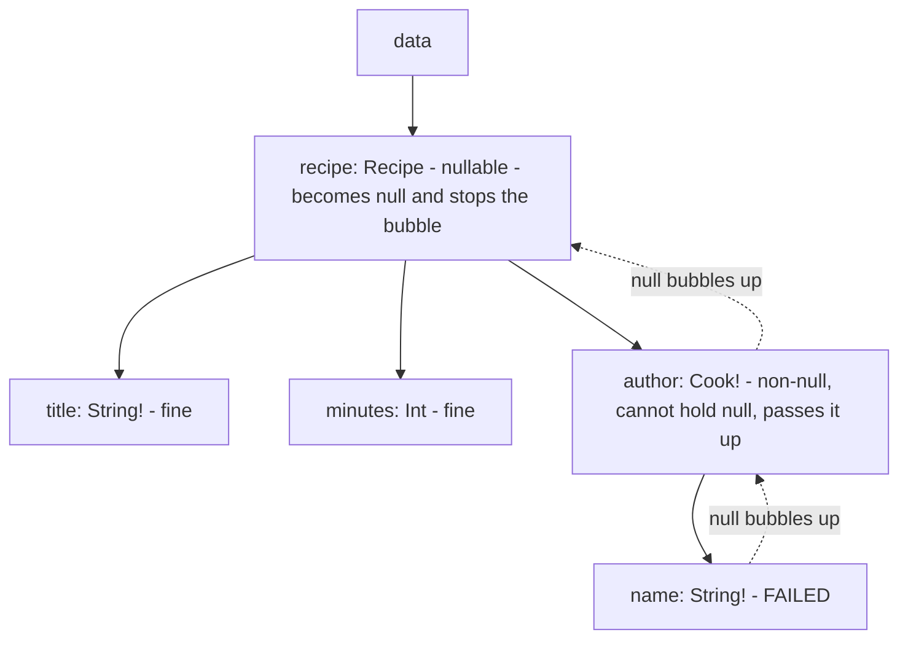

# Types, scalars, enums, lists and non-null

> **Before this lesson:** you should be able to read queries ([Fields, arguments, aliases and fragments](#/lesson/graphql/fields-args-fragments)) and have seen a schema in passing ([What GraphQL is](#/lesson/graphql/what-is-graphql)). The vocabulary of nodes and edges from [Graph vocabulary](#/lesson/graphql/graph-vocabulary) helps.

## In plain words

Until now we have been *using* a schema that somebody else wrote. From this module on, you are the designer. A **schema** is the complete list of what your API can do, written in a small language called the **Schema Definition Language (SDL)**.

Think of a schema as the blank form a hospital uses to admit patients. The form does not contain any patient's details. It says which boxes exist, what may be written in each ("date of birth: a date", "blood group: one of A, B, AB, O"), and which boxes must not be left empty. Anyone filling it in, and anyone reading it later, knows exactly what to expect.

A schema is built from **types**. A type is a named kind of data: "a recipe", "a whole number", "one of these four categories". Every field in the schema is labelled with the type of value it gives back.

Why it matters for a job: in a GraphQL team, the schema is the agreement between front end and back end. Many teams work **schema-first**: they agree on the SDL before either side writes code, and then both sides build against it in parallel. Schema design is also the most common hands-on GraphQL interview task ("design the schema for a recipe app"), and the small symbols `!` and `[]` are where most of the discussion happens.

## Object types and fields

The main building block is the **object type**: a named group of fields.

```graphql
type Recipe {
  id: ID!
  title: String!
  minutes: Int
  rating: Float
  published: Boolean!
}
```

Line by line:

- `type Recipe {` starts the definition of an object type called `Recipe`. Type names are written in `PascalCase` (each word capitalised) by convention.
- Each line inside is a **field definition**: a field name in `camelCase`, a colon, and the type of value the field returns.
- `ID`, `String`, `Int`, `Float` and `Boolean` are built-in types, explained next.
- `!` after a type means the field never returns null. Without it, the field is allowed to be null. More on this below, because it is the most important symbol in the language.

A client can now write `recipe { title minutes }`, and the server promises that `title` is text and `minutes` is a whole number or null.

## The five built-in scalars

A **scalar** is a type with no fields of its own: a single plain value. Scalars are the leaves of every query. GraphQL has five built in.

| Scalar | Holds | In JSON | Notes |
|---|---|---|---|
| `Int` | a whole number | `35` | signed 32-bit: from −2,147,483,648 to 2,147,483,647 |
| `Float` | a decimal number | `4.5` | double precision |
| `String` | text | `"Lentil soup"` | UTF-8 |
| `Boolean` | true or false | `true` | |
| `ID` | a unique identifier | `"r1"` | always sent as a string; not meant to be read by humans or used in arithmetic |

Two details that catch people out:

- **`Int` is only 32 bits.** A number such as a count of bytes or a timestamp in milliseconds does not fit. Use `Float`, a `String`, or a custom scalar.
- **`ID` is a string in the response even if your database uses numbers.** `id: 42` in the database becomes `"42"` in JSON. The type says "treat this as an opaque label". An `ID` argument accepts either `"42"` or `42` from the client.

There is no built-in type for dates, e-mail addresses or money. For those you define a **custom scalar** (`scalar DateTime`), covered in lesson 15.

## Enums

An **enumeration type**, or **enum**, is a scalar restricted to a fixed list of allowed names.

```graphql
enum Category {
  SOUP
  BREAD
  MAIN
  DESSERT
}

type Recipe {
  id: ID!
  title: String!
  category: Category!
}
```

Enum values are written in `ALL_CAPS` by convention. In a query they appear without quotes (`recipes(category: SOUP)`); in the JSON response they arrive as strings (`"category": "SOUP"`).

Why not use `String`? Because a string accepts anything, including `"soup"`, `"Soups"` and `"Suop"`. With an enum:

- the server rejects any value not on the list, during validation;
- tools autocomplete the options;
- the list of possibilities is documented in the schema itself;
- generated client code can use a real enum or union type, so a typo fails at compile time.

Use an enum whenever a field has a small, known set of values that changes rarely: status, category, role, sort direction.

## Lists

Square brackets around a type mean **a list of that type**.

```graphql
type Recipe {
  tags: [String]
  steps: [String!]!
}
```

`tags` is a list of strings. In JSON a list is an array: `"tags": ["vegan", "winter"]`. Any type can go inside the brackets, including object types (`[Review]`) and other lists (`[[Int]]`, a grid).

## Non-null: the exclamation mark

By default **every field in GraphQL can be null**. A trailing `!` removes that possibility.

| Declaration | Meaning |
|---|---|
| `title: String` | text, or null |
| `title: String!` | always text; never null |

"Nullable by default" is a deliberate choice, and understanding why will make you a better schema designer. A GraphQL response is assembled from many independent pieces, often from different databases and services. If one piece fails, the server would like to return everything else and mark the failed part as null, instead of failing the whole page. A nullable field is a place where that is allowed to happen.

With lists there are two places an exclamation mark can go, and they mean different things:

| Declaration | The list itself | Each item | Valid | Invalid |
|---|---|---|---|---|
| `[String]` | may be null | may be null | `null`, `[]`, `["a", null]` | |
| `[String!]` | may be null | never null | `null`, `[]`, `["a"]` | `["a", null]` |
| `[String]!` | never null | may be null | `[]`, `["a", null]` | `null` |
| `[String!]!` | never null | never null | `[]`, `["a"]` | `null`, `["a", null]` |

Read a type from the **outside in**. In `[String!]!` the last `!` applies to the list as a whole; the inner `!` applies to each element.

> [!TIP]
> `[Thing!]!` is the right choice for nearly every list of objects. It tells clients "you always get an array (possibly empty), and nothing in it is null", so they can loop over it without two layers of null checks. Note that non-null does **not** mean non-empty: `[]` satisfies `[Thing!]!`.

### What the server does when a non-null promise breaks

Suppose `title` is declared `String!` and, for one recipe, the database row has no title or the resolver throws an error. The server may not put `null` there: it promised. The specification says what happens instead:

> The null **propagates** to the nearest parent field that is allowed to be null, and an entry is added to `errors`.

```graphql
type Query { recipe(id: ID!): Recipe }        # nullable
type Recipe {
  title: String!                               # non-null
  minutes: Int                                 # nullable
  author: Cook!                                # non-null
}
type Cook { name: String! }                    # non-null
```

Query: `{ recipe(id: "r1") { title minutes author { name } } }`

Case A: `minutes` is missing. It is nullable, so only that field is null.

```json
{ "data": { "recipe": { "title": "Lentil soup", "minutes": null, "author": { "name": "Amara" } } } }
```

Case B: the author's `name` cannot be loaded. `name` is non-null, so the `author` object cannot exist. `author` is non-null too, so the `recipe` object cannot exist. `recipe` is nullable, and the propagation stops there.

```json
{
  "data": { "recipe": null },
  "errors": [
    { "message": "Cannot return null for non-nullable field Cook.name.", "path": ["recipe", "author", "name"] }
  ]
}
```



One failed field deleted the whole recipe from the response, including the title that loaded perfectly well. That is the cost of `!`. The benefit is that client code never has to check for a missing name.

This model implements the rule so you can experiment. Each field is described by whether it is non-null and what is inside it.

```js-run
class NullBubble extends Error {}

// shape node: { nonNull?: boolean, fields?: {...}, items?: node }
function complete(value, node, path, errors) {
  if (value === null || value === undefined) {
    if (!node.nonNull) return null;                               // a nullable position: null is fine
    errors.push({ message: "Cannot return null for non-nullable field.", path });
    throw new NullBubble();                                       // start bubbling
  }
  try {
    if (node.fields) {
      const out = {};
      for (const [name, child] of Object.entries(node.fields)) out[name] = complete(value[name], child, [...path, name], errors);
      return out;
    }
    if (node.items) return value.map((v, i) => complete(v, node.items, [...path, i], errors));
    return value;
  } catch (e) {
    if (!(e instanceof NullBubble) || node.nonNull) throw e;      // this position cannot be null either: pass it up
    return null;                                                  // nullable: absorb the bubble here
  }
}

function respond(data, shape) {
  const errors = [];
  const result = complete(data, { fields: shape }, [], errors);
  return errors.length ? { data: result, errors } : { data: result };
}

const shape = {
  recipe: { fields: {                                             // recipe: Recipe   (nullable)
    title: { nonNull: true },                                     //   title: String!
    minutes: {},                                                  //   minutes: Int
    author: { nonNull: true, fields: { name: { nonNull: true } } }, // author: Cook!  { name: String! }
    tags: { nonNull: true, items: { nonNull: true } },            //   tags: [String!]!
  } },
  version: { nonNull: true },                                     // version: String!
};

const good = { recipe: { title: "Lentil soup", minutes: null, author: { name: "Amara" }, tags: ["vegan"] }, version: "1.4" };
console.log("A", JSON.stringify(respond(good, shape)));

const noName = { recipe: { title: "Lentil soup", minutes: 35, author: { name: null }, tags: [] }, version: "1.4" };
console.log("B", JSON.stringify(respond(noName, shape)));

const badTag = { recipe: { title: "Lentil soup", minutes: 35, author: { name: "Amara" }, tags: ["vegan", null] }, version: "1.4" };
console.log("C", JSON.stringify(respond(badTag, shape)));

console.log("D", JSON.stringify(respond({ recipe: null, version: null }, shape)));
```

Read the four results:

- **A**: `minutes` is null in the output and there is no `errors` key. Nullable fields may be null without complaint.
- **B**: the failed `name` wiped out `author` and then `recipe`. `version` survived, because the bubble was absorbed at `recipe`.
- **C**: one null *item* in `[String!]!` nulls the whole list; the list is non-null, so the recipe goes too.
- **D**: `version` is a non-null field directly on the root. Nothing above it can absorb the null except `data` itself, so the entire response is `"data": null`.

In the code, throwing an exception models the bubble rising, and each `catch` models a parent deciding whether it is allowed to become null. The practice problem *Null propagation for non-null fields* asks you to write this yourself.

### Choosing nullability

A workable rule set for design discussions:

| Situation | Choice | Why |
|---|---|---|
| ids, and fields that exist on every row and come from the same record (`title`) | non-null | they cannot be missing if the object exists |
| lists | `[T!]!` | "nothing" is an empty list |
| a field fetched from another service, or expensive, or permission-dependent (`author`, `email`) | nullable | a failure should cost one field, not the whole parent |
| top-level `Query` fields that look something up (`recipe(id:)`) | nullable | "not found" is naturally null, and errors stop here |
| **arguments** and **input fields** that are required | non-null | the request is rejected early when they are missing |

> [!WARNING]
> Nullability is part of the contract, and it changes in only one safe direction. Making an output field non-null later (`String` → `String!`) is safe for clients. Making a non-null field nullable (`String!` → `String`) breaks every client that skipped the null check. When unsure, start nullable. For *arguments* the safe direction is the opposite: an optional argument can never safely become required.

## Root types: where operations begin

Three type names are special. Their fields are the entry points for the three kinds of operation.

```graphql
type Query {
  recipe(id: ID!): Recipe
  recipes: [Recipe!]!
}

type Mutation {
  addReview(recipeId: ID!, stars: Int!): Review!
}

type Subscription {
  reviewAdded(recipeId: ID!): Review!
}
```

Apart from the name, these are ordinary object types. Field definitions can declare **arguments** in parentheses, each with a type and optionally a default (`first: Int = 10`). Every schema must have `Query`; the other two are optional.

## Checking a value against a type

To make the notation concrete, here is the check a server performs on every value going out: does it fit the declared type?

```js-run
function fits(value, type) {
  if (type.endsWith("!")) return value !== null && fits(value, type.slice(0, -1));   // non-null wrapper
  if (value === null) return true;                                                    // nullable: null is fine
  if (type.startsWith("[")) return Array.isArray(value) && value.every((v) => fits(v, type.slice(1, -1)));
  switch (type) {
    case "Int": return Number.isInteger(value) && value >= -(2 ** 31) && value <= 2 ** 31 - 1;
    case "Float": return typeof value === "number" && Number.isFinite(value);
    case "String": return typeof value === "string";
    case "Boolean": return typeof value === "boolean";
    case "ID": return typeof value === "string" || Number.isInteger(value);
    case "Category": return ["SOUP", "BREAD", "MAIN", "DESSERT"].includes(value);       // an enum
    default: return false;
  }
}

const checks = [
  [35, "Int"], [3000000000, "Int"], ["35", "Int"], [null, "Int"], [null, "Int!"],
  [["vegan", null], "[String]!"], [["vegan", null], "[String!]!"], [[], "[String!]!"], [null, "[String!]"],
  ["SOUP", "Category!"], ["soup", "Category!"], [[[1, 2], [3]], "[[Int!]!]!"],
];
for (const [value, type] of checks) console.log(JSON.stringify(value).padEnd(16), type.padEnd(12), fits(value, type));
```

The function peels the type from the outside in, the same way you read it: first the trailing `!`, then the brackets, then the named type. Look at the output for `3000000000` against `Int` (false: too large for 32 bits), for `[]` against `[String!]!` (true: empty is not null), and for `"soup"` against the enum (false: enum values are case-sensitive).

## The Potluck schema so far

```graphql
enum Category { SOUP BREAD MAIN DESSERT }

type Recipe {
  id: ID!
  title: String!
  category: Category!
  minutes: Int
  rating: Float
  tags: [String!]!
  steps: [String!]!
}

type Cook {
  id: ID!
  name: String!
  city: String
}

type Query {
  recipe(id: ID!): Recipe
  recipes: [Recipe!]!
  cook(id: ID!): Cook
}
```

Notice what is missing: nothing links a `Recipe` to a `Cook`. The types are islands. The next lesson adds the edges that turn this list of types into a graph.

> [!INTERVIEW]
> **"What is the difference between `[Recipe]!`, `[Recipe!]` and `[Recipe!]!`?"** `[Recipe]!`: the list is always present but may contain nulls. `[Recipe!]`: the list may be null, but if present it holds no nulls. `[Recipe!]!`: always a list, never containing null (it may be empty). Then explain the consequence: a null item in a `[Recipe!]` list nulls the whole list; in `[Recipe!]!` it bubbles further to the parent.
>
> **"Why are GraphQL fields nullable by default?"** So that a failure in one field can be reported as null plus an error while the rest of the response is still delivered. Non-null is a guarantee the server must be sure it can keep, because breaking it removes the parent object from the response.

## Pitfalls

- **Marking everything `!` "to be safe".** One flaky field then blanks out large parts of the page.
- **Marking nothing `!`.** Clients drown in null checks, and generated types are full of optionals.
- **Reading `[String!]` as "non-null list".** The `!` inside the brackets is about the items.
- **Believing `!` means non-empty.** `""` and `[]` satisfy `String!` and `[String!]!`.
- **Using `Int` for large numbers**, or for ids. Ids are `ID`.
- **Using `String` where an enum fits.** You lose validation and documentation.
- **Lower-case enum values or quoted enum values in queries.** `category: SOUP`, exactly as declared.
- **Loosening nullability later** without checking who relies on it.

## Cheat sheet

| SDL | Meaning |
|---|---|
| `type Recipe { ... }` | object type |
| `title: String` | nullable field |
| `title: String!` | non-null field |
| `Int` `Float` `String` `Boolean` `ID` | built-in scalars |
| `enum Category { SOUP BREAD }` | fixed set of values |
| `[String]` | list; list and items nullable |
| `[String!]!` | list never null, items never null (may be empty) |
| `recipe(id: ID!): Recipe` | field with a required argument |
| `recipes(first: Int = 10)` | argument with a default |
| `type Query` / `Mutation` / `Subscription` | entry points |
| null in a non-null position | bubbles to the nearest nullable parent, plus an entry in `errors` |

## Summary

- A schema is written in SDL and is made of types; object types group fields, and every field declares the type it returns.
- The built-in scalars are `Int` (32-bit), `Float`, `String`, `Boolean` and `ID` (serialised as a string). Enums restrict a value to a fixed list of names.
- Square brackets make a list. An exclamation mark makes a position non-null; with lists, the mark inside is about items and the mark outside is about the list.
- Fields are nullable by default so that partial failures can be reported without losing the whole response. A null in a non-null position propagates to the nearest nullable ancestor.
- Choose non-null for what is guaranteed, nullable for what can fail independently, and remember that only tightening output nullability is a safe change.

## Glossary

- **SDL (Schema Definition Language):** the syntax for writing GraphQL schemas.
- **Type:** a named kind of data in a schema.
- **Object type:** a type made of named fields.
- **Field definition:** a field's name, arguments and return type inside a type.
- **Scalar:** a type holding a single plain value; a leaf.
- **Enum:** a scalar-like type limited to a listed set of names.
- **List type:** `[T]`, an ordered collection of values of type `T`.
- **Non-null type:** `T!`, a type that never produces null.
- **Nullable:** allowed to be null.
- **Null propagation (bubbling):** a null in a non-null position moves up to the nearest nullable parent.
- **Root types:** `Query`, `Mutation` and `Subscription`, whose fields are operation entry points.
- **Schema-first:** agreeing on the SDL before writing resolvers or clients.
- **32-bit integer:** a whole number stored in 32 binary digits, which limits its range to about ±2.1 billion.

## Check yourself

```quiz
[
  {"q": "Which value is NOT valid for a field declared `tags: [String!]!`?",
   "options": ["`[]`", "`[\"vegan\"]`", "`[\"vegan\", null]`", "`[\"a\", \"b\", \"c\"]`"],
   "answer": 2,
   "explain": "The inner `!` forbids null items. An empty list is fine: non-null does not mean non-empty."},
  {"q": "A database stores a recipe's id as the number 42 and the schema says `id: ID!`. What appears in the JSON response?",
   "options": ["`42`", "`\"42\"`", "`null`", "An error"],
   "answer": 1,
   "explain": "`ID` values are always serialised as strings, whatever the underlying storage uses."},
  {"q": "Schema: `type Query { recipe(id: ID!): Recipe }` and `type Recipe { title: String! minutes: Int }`. The `title` resolver fails for r1. What does `{ recipe(id: \"r1\") { title minutes } }` return?",
   "options": ["`{\"data\": {\"recipe\": {\"title\": null, \"minutes\": 35}}}` plus an error", "`{\"data\": {\"recipe\": null}}` plus an error", "`{\"data\": null}` plus an error", "`{\"data\": {\"recipe\": {\"minutes\": 35}}}`"],
   "answer": 1,
   "explain": "`title` is non-null, so null cannot be placed there. It bubbles to the nearest nullable parent, the `recipe` field, which becomes null. `minutes` is lost with it."},
  {"q": "Same schema, but now the nullable `minutes` resolver fails instead. What is returned?",
   "options": ["`{\"data\": {\"recipe\": {\"title\": \"Lentil soup\", \"minutes\": null}}}` plus an error", "`{\"data\": {\"recipe\": null}}` plus an error", "`{\"data\": null}`", "The request fails with HTTP 500"],
   "answer": 0,
   "explain": "A nullable field absorbs its own failure: it becomes null, an error is listed, and everything else is delivered."},
  {"q": "Why might `Int` be the wrong type for a file size in bytes?",
   "options": ["`Int` cannot be zero", "GraphQL `Int` is a signed 32-bit number, so values above about 2.1 billion do not fit", "`Int` values are serialised as strings", "`Int` cannot be used as a field type"],
   "answer": 1,
   "explain": "Files larger than about 2 GB exceed the 32-bit range. Use `Float`, a string, or a custom scalar."},
  {"q": "Which change to an OUTPUT field is safe for existing clients?",
   "options": ["`name: String!` → `name: String`", "`name: String` → `name: String!`", "Removing `name`", "`name: String` → `name: Int`"],
   "answer": 1,
   "explain": "Promising more (never null) cannot break a client. Promising less forces every client to handle a null it never expected."},
  {"q": "What is the main advantage of `category: Category!` (an enum) over `category: String!`?",
   "options": ["Enums are sent as numbers, saving bytes", "Only the listed values are accepted, and tools can show and check them", "Enums can hold several values at once", "Strings cannot be non-null"],
   "answer": 1,
   "explain": "An enum makes the set of valid values part of the schema: validated by the server, autocompleted by tools, documented for free."},
  {"q": "A top-level field is declared `version: String!` and its resolver throws. What is the value of `data` in the response?",
   "options": ["`{\"version\": null}`", "`{}`", "`null`", "`{\"version\": \"\"}`"],
   "answer": 2,
   "explain": "There is no nullable parent between the field and the root, so the null propagates all the way: the whole `data` is null."}
]
```

> **Source:** Porcello & Banks, *Learning GraphQL*, ch. 4 (defining types, scalar types, enums, lists). Also: https://graphql.org/learn/schema/ ; GraphQL specification, "Handling Field Errors" (https://spec.graphql.org/October2021/#sec-Handling-Field-Errors) ; https://www.apollographql.com/docs/graphos/schema-design/guides/nullability.
