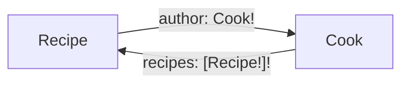
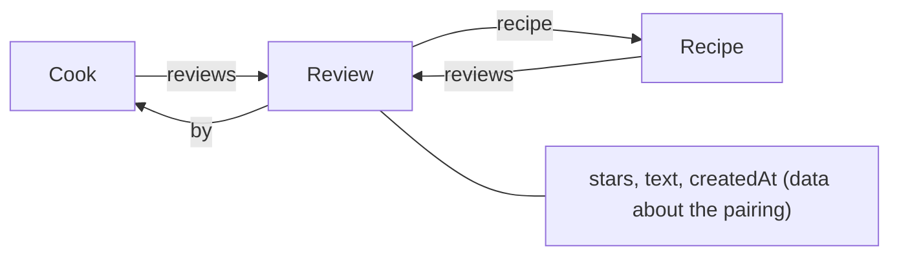

# Connections: one-to-one, one-to-many, many-to-many

> **Before this lesson:** you need object types, scalars, lists and `!` from [Types, scalars, enums, lists and non-null](#/lesson/graphql/types-scalars-nonnull), and the idea of nodes and directed edges from [Graph vocabulary](#/lesson/graphql/graph-vocabulary).

## In plain words

At the end of the last lesson the Potluck schema had a `Recipe` type and a `Cook` type with nothing joining them. A schema of unconnected types is a filing cabinet. This lesson adds the **connections** between types that turn it into a graph a client can walk.

A connection is a field on one type whose value is *another object type* (or a list of them). `Recipe.author` returning a `Cook` is a connection. In graph words, it is an edge.

There are only three shapes a relationship between two kinds of thing can have, and you already know them from ordinary life:

- **One-to-one:** each passport belongs to one person, and a person has one passport.
- **One-to-many:** a mother has many children; each child has one birth mother.
- **Many-to-many:** a student takes many courses; a course has many students.

Sometimes the relationship itself has facts attached to it. A student is not merely "on" a course: they have a *grade* in it. That grade belongs to neither the student nor the course alone, but to the pairing. GraphQL handles this with a **through type**, the last idea in this lesson.

Why it matters for a job: when asked to "design a schema" in an interview or a planning meeting, most of the work is deciding which connections exist, in which directions, and where the facts about a relationship should live. Getting this right is what makes an API pleasant to query.

## One-to-one

A recipe has exactly one author. Add a field whose type is `Cook`:

```graphql
type Recipe {
  id: ID!
  title: String!
  author: Cook!
}

type Cook {
  id: ID!
  name: String!
}
```

```graphql
{ recipe(id: "r1") { title author { name } } }
```

```json
{ "data": { "recipe": { "title": "Lentil soup", "author": { "name": "Amara" } } } }
```

Compare with REST, where the recipe carried `"authorId": "c1"` and the client made a second request. Here the schema exposes the *object*, not the key. As a rule, **do not expose foreign keys such as `authorId` in a GraphQL schema; expose the connection**. The client can always ask for `author { id }` if it wants the id.

The edge is directed. This schema lets you go from a recipe to its cook, but not from a cook to their recipes. Each direction is its own field, and you add only the directions that clients need.

## One-to-many

A cook has written many recipes. The field's type is a list:

```graphql
type Cook {
  id: ID!
  name: String!
  recipes: [Recipe!]!
}
```

```graphql
{ cook(id: "c1") { name recipes { title } } }
```

```json
{
  "data": {
    "cook": {
      "name": "Amara",
      "recipes": [ { "title": "Lentil soup" }, { "title": "Plum cake" } ]
    }
  }
}
```

With both `Recipe.author` and `Cook.recipes` defined, the relationship can be walked in either direction. The schema graph now has a cycle between the two types, which is normal and useful.



The same idea applies at the root: `Query.recipes: [Recipe!]!` is a one-to-many edge from the root to every recipe.

> [!WARNING]
> A list field with no limit is a trap. A cook with 5,000 recipes makes `recipes` return 5,000 objects every time. Any list that can grow without bound needs pagination arguments, which the next lesson covers. The plain `[Recipe!]!` form is fine for short, naturally bounded lists such as the steps of a recipe.

## Many-to-many

A recipe can carry many tags ("vegan", "quick"), and each tag is on many recipes. Give each side a list of the other:

```graphql
type Tag {
  id: ID!
  label: String!
  recipes: [Recipe!]!
}

type Recipe {
  id: ID!
  title: String!
  tags: [Tag!]!
}
```

```graphql
{
  recipe(id: "r1") {
    title
    tags {
      label
      recipes { title }
    }
  }
}
```

```json
{
  "data": {
    "recipe": {
      "title": "Lentil soup",
      "tags": [
        { "label": "vegan", "recipes": [ { "title": "Lentil soup" }, { "title": "Flatbread" } ] },
        { "label": "winter", "recipes": [ { "title": "Lentil soup" } ] }
      ]
    }
  }
}
```

One query walked recipe → tags → recipes: "other recipes that share a tag with this one". That two-hop walk is the basis of every "related items" feature.

A many-to-many relationship between a type and *itself* is common too. "Cooks follow other cooks" is:

```graphql
type Cook {
  following: [Cook!]!
  followers: [Cook!]!
}
```

## How connections are stored, and why the schema hides it

If you have used a relational database, these shapes are familiar, and it helps to see what the schema is abstracting. If you have not, here is the short version: a **table** is a grid of rows, like a spreadsheet; a **foreign key** is a column holding the id of a row in another table.

| Relationship | Typical storage | GraphQL field |
|---|---|---|
| recipe → one author | `recipes.author_id` column (foreign key) | `Recipe.author: Cook!` |
| cook → many recipes | the same column, read from the other side: all recipes where `author_id` is this cook | `Cook.recipes: [Recipe!]!` |
| recipes ↔ tags | a separate **join table** `recipe_tags(recipe_id, tag_id)` with one row per pairing | `Recipe.tags` and `Tag.recipes` |

The client sees none of this. Whether tags are stored in a join table, an array column or a different service is the server's business. That freedom to reorganise storage without changing the API is a large part of the value of a schema.

The model below stores Potluck data in "tables" exactly as a database would and writes one small function per connection. These functions are the first real **resolvers** of this track; lesson 14 studies them in depth.

```js-run
// ---------- tables ----------
const cooks = [{ id: "c1", name: "Amara" }, { id: "c2", name: "Bo" }];
const recipes = [
  { id: "r1", title: "Lentil soup", author_id: "c1" },
  { id: "r2", title: "Flatbread", author_id: "c2" },
  { id: "r3", title: "Plum cake", author_id: "c1" },
];
const tags = [{ id: "t1", label: "vegan" }, { id: "t2", label: "winter" }];
const recipe_tags = [                                      // the join table: one row per pairing
  { recipe_id: "r1", tag_id: "t1" }, { recipe_id: "r1", tag_id: "t2" }, { recipe_id: "r2", tag_id: "t1" },
];

// ---------- one function per edge of the schema graph ----------
const edges = {
  Recipe: {
    author: (recipe) => cooks.find((c) => c.id === recipe.author_id),                       // one-to-one: follow the key
    tags: (recipe) => recipe_tags.filter((rt) => rt.recipe_id === recipe.id)               // many-to-many: via the join table
                                 .map((rt) => tags.find((t) => t.id === rt.tag_id)),
  },
  Cook: {
    recipes: (cook) => recipes.filter((r) => r.author_id === cook.id),                      // one-to-many: the key, reversed
  },
  Tag: {
    recipes: (tag) => recipe_tags.filter((rt) => rt.tag_id === tag.id)
                                 .map((rt) => recipes.find((r) => r.id === rt.recipe_id)),
  },
};
const returns = { "Recipe.author": "Cook", "Recipe.tags": "Tag", "Cook.recipes": "Recipe", "Tag.recipes": "Recipe" };

// ---------- walk a selection: true = scalar leaf, object = follow the edge ----------
function walk(type, object, selection) {
  const out = {};
  for (const [field, sub] of Object.entries(selection)) {
    if (sub === true) { out[field] = object[field]; continue; }
    const target = edges[type][field](object);
    const next = returns[type + "." + field];
    out[field] = Array.isArray(target) ? target.map((t) => walk(next, t, sub)) : walk(next, target, sub);
  }
  return out;
}

// { recipe(id: "r1") { title author { name recipes { title } } tags { label recipes { title } } } }
const selection = { title: true, author: { name: true, recipes: { title: true } }, tags: { label: true, recipes: { title: true } } };
console.log(JSON.stringify(walk("Recipe", recipes[0], selection), null, 2));
```

Things to notice:

- `author_id` exists in the table but never reaches the output. The `author` function turns the key into an object.
- `Recipe.author` and `Cook.recipes` read the *same* column from opposite ends. One stored fact, two edges.
- The tag functions go through `recipe_tags`. The join table is invisible in the result: the client sees a recipe with tags, and a tag with recipes.

## Through types: when the connection has data of its own

Now the harder case. Cooks review recipes. That is many-to-many: a cook reviews many recipes; a recipe is reviewed by many cooks. Following the pattern above:

```graphql
type Recipe { reviewers: [Cook!]! }     # who reviewed it
type Cook   { reviewed: [Recipe!]! }    # what they reviewed
```

But where do the **stars** go? Not on `Cook` (Bo gives different stars to different recipes). Not on `Recipe` (it receives different stars from different cooks). The rating is a fact about the *pair* (Bo, Lentil soup). It lives on the edge.

A plain list field has nowhere to put edge data. The solution is to promote the edge to a type of its own, called a **through type**: you reach the other side by going *through* it.

```graphql
type Review {
  id: ID!
  stars: Int!
  text: String
  createdAt: String!
  recipe: Recipe!
  by: Cook!
}

type Recipe {
  reviews: [Review!]!
}

type Cook {
  reviews: [Review!]!
}
```



```graphql
{
  recipe(id: "r1") {
    title
    reviews {
      stars
      by { name }
    }
  }
}
```

```json
{
  "data": {
    "recipe": {
      "title": "Lentil soup",
      "reviews": [
        { "stars": 5, "by": { "name": "Bo" } },
        { "stars": 3, "by": { "name": "Chidi" } }
      ]
    }
  }
}
```

A second through type in Potluck is the ingredient line. "200 g of red lentils" connects a recipe to an ingredient, and the quantity belongs to the connection:

```graphql
type Ingredient {
  id: ID!
  name: String!
  usedIn: [RecipeIngredient!]!
}

type RecipeIngredient {
  ingredient: Ingredient!
  recipe: Recipe!
  quantity: Float!
  unit: Unit!
}

enum Unit { GRAM MILLILITRE PIECE TEASPOON }

type Recipe {
  ingredients: [RecipeIngredient!]!
}
```

```graphql
{ recipe(id: "r1") { ingredients { quantity unit ingredient { name } } } }
```

```json
{
  "data": {
    "recipe": {
      "ingredients": [
        { "quantity": 200, "unit": "GRAM", "ingredient": { "name": "red lentils" } },
        { "quantity": 1, "unit": "PIECE", "ingredient": { "name": "onion" } }
      ]
    }
  }
}
```

How to recognise that you need a through type. Ask of the relationship:

| Question | If yes |
|---|---|
| Does the pairing have attributes (a rating, a quantity, a role, a price paid)? | through type |
| Does it have a time (followed since, purchased on)? | through type |
| Might it gain attributes later? | lean towards a through type now: adding one later changes the field's type, which breaks clients |
| Is it a bare yes/no link (tagged or not)? | a plain list is enough |

> [!TIP]
> The paginated **connection** pattern in the next lesson is a standardised through type. Its `edge` objects sit between a parent and each item and exist precisely so that data about the relationship (a cursor, a role, a date) has a home.

## Lists of different types: unions and interfaces

So far every list held one type. Potluck's home feed mixes recipes and collections. There are two tools for "a field that can return more than one type".

A **union** says "one of these object types", with nothing assumed in common:

```graphql
union FeedItem = Recipe | Collection

type Query {
  feed: [FeedItem!]!
}
```

An **interface** names a set of fields that several types all have. A type declares that it `implements` the interface and must then include every one of those fields:

```graphql
interface Node {
  id: ID!
}

interface Publication {
  id: ID!
  title: String!
  author: Cook!
}

type Recipe implements Node & Publication {
  id: ID!
  title: String!
  author: Cook!
  minutes: Int
}

type Article implements Node & Publication {
  id: ID!
  title: String!
  author: Cook!
  body: String!
}

type Query {
  latest: [Publication!]!
}
```

The difference shows up in queries. On an interface, the shared fields can be selected directly; type-specific fields need an inline fragment. On a union, everything except `__typename` needs an inline fragment.

```graphql
{
  latest {
    __typename
    title
    author { name }
    ... on Recipe { minutes }
    ... on Article { body }
  }
}
```

```json
{
  "data": {
    "latest": [
      { "__typename": "Recipe", "title": "Lentil soup", "author": { "name": "Amara" }, "minutes": 35 },
      { "__typename": "Article", "title": "Knife skills", "author": { "name": "Bo" }, "body": "Start with the claw grip..." }
    ]
  }
}
```

| | Union | Interface |
|---|---|---|
| Members share fields? | not required | yes, the interface's fields |
| Select common fields without a fragment? | no | yes |
| Typical use | search results, feeds, "result or error" return types | things of one family: publications, media, anything with an `id` |
| Can scalars be members? | no, object types only | no, object types only |

An interface is the better choice when the members are variations on one idea and clients often treat them alike. A union is for members that have little in common.

> [!INTERVIEW]
> **"How do you model a many-to-many relationship in GraphQL?"** Put a list field on each side (`Recipe.tags: [Tag!]!`, `Tag.recipes: [Recipe!]!`). If the relationship carries data of its own, such as a rating, quantity, role or timestamp, introduce a through type that holds that data and points to both sides, and connect each side to the through type instead. The join table in the database stays an implementation detail.
>
> **"Union or interface?"** Interface when the types share fields that clients will query uniformly; union when they do not. Both need `__typename` and inline fragments on the client to handle the differences.

## Pitfalls

- **Exposing `authorId` instead of `author`.** That pushes the join back onto the client and recreates under-fetching.
- **Putting edge data on a node.** A `stars` field on `Cook` or a `quantity` field on `Ingredient` has no single correct value.
- **Mirroring database tables one-for-one.** A join table with no extra data (`recipe_tags`) should not become a type. Design from what clients need to ask, not from how rows are stored.
- **Adding every reverse edge "for completeness".** Each field is something you must implement, secure and keep fast. Add directions when a screen needs them.
- **Unbounded lists** on high-volume connections (`Cook.recipes`, `Recipe.reviews`). Paginate.
- **Changing `[Cook!]!` to `[Review!]!` later.** Introducing a through type after clients exist is a breaking change; think about edge data up front.
- **Forgetting that an implementing type must repeat the interface's fields** in its own definition.

## Cheat sheet

| Relationship | SDL pattern | Example |
|---|---|---|
| one-to-one | `a: B!` | `Recipe.author: Cook!` |
| one-to-many | `bs: [B!]!` | `Cook.recipes: [Recipe!]!` |
| many-to-many | a list on each side | `Recipe.tags: [Tag!]!` and `Tag.recipes: [Recipe!]!` |
| self-referencing | a type's field returns its own type | `Cook.following: [Cook!]!` |
| relationship with data | through type pointing at both sides | `Review { stars, recipe, by }` |
| mixed list, nothing shared | `union U = A \| B` | `FeedItem = Recipe \| Collection` |
| mixed list, shared fields | `interface I { ... }` and `type A implements I` | `Publication` |
| storage detail | foreign key or join table | hidden behind the fields |

## Summary

- A connection is a field that returns another object type; it is a directed edge in the schema graph.
- One-to-one is a single object field, one-to-many is a list field, and many-to-many is a list field on each side.
- Each direction is a separate field; expose objects, not foreign keys, and let storage details stay on the server.
- When a relationship has attributes of its own, model it as a through type that holds the attributes and links to both ends.
- Unions and interfaces let one field return several types: interfaces when the types share fields, unions when they do not.

## Glossary

- **Connection (general sense):** a field linking one type to another; an edge in the schema graph.
- **One-to-one / one-to-many / many-to-many:** the three possible cardinalities of a relationship.
- **Cardinality:** how many items on each side of a relationship can be linked to one item on the other.
- **Table:** a grid of rows in a relational database.
- **Foreign key:** a stored id that refers to a row in another table.
- **Join table:** a table whose rows pair up ids from two other tables to record a many-to-many relationship.
- **Through type:** an object type that represents a relationship and carries data about it.
- **Edge data:** information that belongs to a relationship and not to either end.
- **Union:** a type that is one of several listed object types.
- **Interface:** a named set of fields that implementing object types must provide.
- **Implements:** the keyword by which an object type declares that it satisfies an interface.
- **Self-referencing relationship:** a connection from a type to itself.

## Check yourself

```quiz
[
  {"q": "The schema has `type Recipe { author: Cook! }` and `type Cook { name: String! }` and nothing else linking them. Which query is valid?",
   "options": ["`{ cook(id: \"c1\") { recipes { title } } }`", "`{ recipe(id: \"r1\") { author { name } } }`", "`{ recipe(id: \"r1\") { authorId } }`", "`{ cook(id: \"c1\") { recipe { title } } }`"],
   "answer": 1,
   "explain": "Only the edge from Recipe to Cook was defined. Edges are directed; the reverse needs its own field such as `Cook.recipes`."},
  {"q": "A cook can save a recipe with a personal note and the date saved. Where should `note` and `savedAt` live?",
   "options": ["On `Cook`", "On `Recipe`", "On a through type such as `SavedRecipe` that links a cook and a recipe", "In an enum"],
   "answer": 2,
   "explain": "The note and date describe the pairing of one cook with one recipe, so they belong on a type representing that pairing."},
  {"q": "Tags are stored in a join table `recipe_tags(recipe_id, tag_id)` with no other columns. How should this appear in the schema?",
   "options": ["As a type `RecipeTag { recipeId: ID! tagId: ID! }`", "As `Recipe.tags: [Tag!]!` and `Tag.recipes: [Recipe!]!`; the join table stays hidden", "As `Recipe.tagIds: [ID!]!`", "It cannot be expressed in GraphQL"],
   "answer": 1,
   "explain": "A join table without data of its own is a storage detail. Expose the relationship as list fields on each side."},
  {"q": "Recipe r1 has two reviews: 5 stars by Bo and 3 stars by Chidi. What does `{ recipe(id: \"r1\") { reviews { stars by { name } } } }` return?",
   "options": ["`{\"data\": {\"recipe\": {\"reviews\": [{\"stars\": 5, \"by\": {\"name\": \"Bo\"}}, {\"stars\": 3, \"by\": {\"name\": \"Chidi\"}}]}}}`", "`{\"data\": {\"recipe\": {\"reviews\": [{\"name\": \"Bo\", \"stars\": 5}, {\"name\": \"Chidi\", \"stars\": 3}]}}}`", "`{\"data\": {\"recipe\": {\"stars\": [5, 3], \"by\": [\"Bo\", \"Chidi\"]}}}`", "`{\"data\": {\"reviews\": [{\"stars\": 5}, {\"stars\": 3}]}}`"],
   "answer": 0,
   "explain": "Each review object (the through type) carries its own `stars` and a nested `by` object for the cook, mirroring the query's nesting."},
  {"q": "`interface Publication { title: String! }` is implemented by `Recipe` and `Article`. In `{ latest { title ... on Recipe { minutes } } }`, why does `title` need no fragment?",
   "options": ["`title` is a scalar", "It is declared on the interface, so every possible type is guaranteed to have it", "Fragments are optional everywhere", "Because `latest` is a list"],
   "answer": 1,
   "explain": "Fields of the interface can be selected directly. Fields that exist only on one implementing type, like `minutes`, need a type condition."},
  {"q": "When is a union a better fit than an interface?",
   "options": ["When the types share many fields", "When the possible types have little or nothing in common, such as mixed search results", "When the field returns a scalar", "When the list must be paginated"],
   "answer": 1,
   "explain": "A union only says 'one of these types'. An interface additionally requires shared fields."},
  {"q": "Why is exposing `authorId: ID!` on `Recipe` instead of `author: Cook!` considered poor GraphQL design?",
   "options": ["IDs are not allowed in schemas", "The client must make another request to turn the id into data, recreating under-fetching", "It makes the schema invalid", "`ID` cannot be non-null"],
   "answer": 1,
   "explain": "A graph API should expose the edge itself. With `author`, the client can get the cook's data in the same query, or `author { id }` if it only wants the id."}
]
```

> **Source:** Porcello & Banks, *Learning GraphQL*, ch. 4 (connections and lists: one-to-one, one-to-many, many-to-many, through types, lists of different types). Also: https://graphql.org/learn/schema/#interface-types ; https://graphql.org/learn/schema/#union-types ; https://graphql.org/learn/thinking-in-graphs/.
