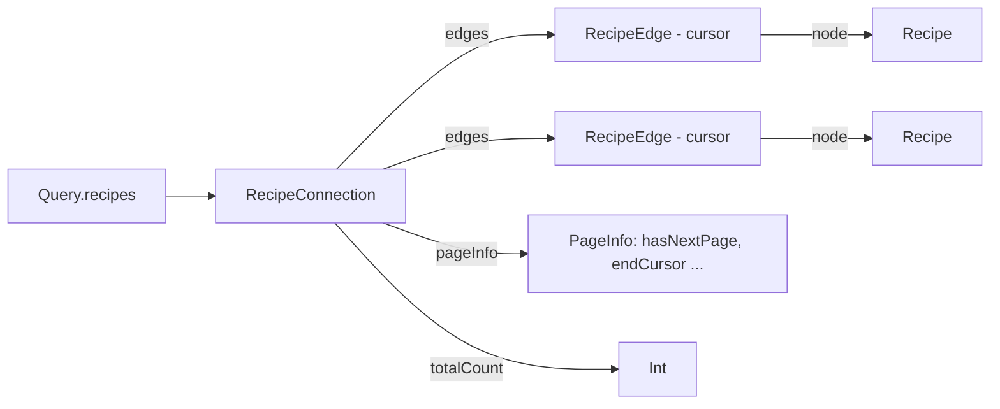

# Arguments, filtering, pagination and sorting

> **Before this lesson:** you should know how arguments look in a query ([Fields, arguments, aliases and fragments](#/lesson/graphql/fields-args-fragments)), how lists and `!` work ([Types, scalars, enums, lists and non-null](#/lesson/graphql/types-scalars-nonnull)), and what a through type is ([Connections](#/lesson/graphql/connections-through-types)).

## In plain words

A field such as `recipes: [Recipe!]!` hands back *every* recipe. With a dozen recipes that is fine. With two million it would take the server down and freeze the phone that receives them. Real list fields need three kinds of control, all supplied as **arguments**:

- **Filtering**: "only soups that take under 30 minutes". A sieve.
- **Sorting**: "best rated first". Putting the pile in order.
- **Pagination**: "20 at a time". Reading a long book one page at a time instead of having the whole thing read to you at once.

A library search screen shows all three: you type a subject (filter), choose "newest first" (sort), and see results 1–20 with a "next" button (pagination).

Why it matters for a job: almost every screen that shows a list uses these three arguments, and pagination design, especially **offset versus cursor**, is a favourite interview topic because a wrong choice produces visible bugs: duplicated or skipped items in an infinite-scrolling feed.

## Declaring arguments in the schema

Arguments are declared in parentheses after a field name. Each has a name and a type, and may have a default value.

```graphql
type Query {
  recipe(id: ID!): Recipe
  recipes(category: Category, first: Int = 20): [Recipe!]!
}
```

- `id: ID!` is **required**: a query that leaves it out fails validation.
- `category: Category` is **optional**: leaving it out means "no restriction".
- `first: Int = 20` is optional with a **default**: leaving it out means 20.

Any field can take arguments, not only root fields: `Recipe.reviews(first: 3)`, `Recipe.photo(width: 400)`.

## Filtering

The simplest filter is one argument per condition:

```graphql
type Query {
  recipes(category: Category, maxMinutes: Int, tag: String): [Recipe!]!
}
```

```graphql
{ recipes(category: SOUP, maxMinutes: 30) { title minutes } }
```

```json
{
  "data": {
    "recipes": [
      { "title": "Tomato soup", "minutes": 20 },
      { "title": "Miso soup", "minutes": 10 }
    ]
  }
}
```

Conditions that are given are combined with AND: a soup *and* at most 30 minutes. As filters multiply, the argument list gets unwieldy and mixes with paging and sorting arguments. The common remedy is to group the conditions in an **input type**: an object type that is used only as an argument. It is declared with the keyword `input`.

```graphql
input RecipeFilter {
  category: Category
  maxMinutes: Int
  titleContains: String
  tagsAny: [String!]
}

type Query {
  recipes(filter: RecipeFilter, first: Int = 20): [Recipe!]!
}
```

```graphql
{
  recipes(filter: { category: SOUP, titleContains: "miso" }) {
    title
  }
}
```

```json
{ "data": { "recipes": [ { "title": "Miso soup" } ] } }
```

Benefits: the filter can be passed as a single variable (`$filter: RecipeFilter`), new conditions can be added without touching the field's signature, and the same input type can be reused by other fields.

> [!WARNING]
> Resist building a general query language into your filter (`where: { AND: [...], OR: [...], rating: { gt: 4 } }`) unless you truly need it. Every combination a client can express is a database query you must make fast and safe. Start with the specific filters your screens use.

## Sorting

Sorting needs two decisions: by which field, and in which direction. Both are closed sets of choices, so both are enums.

```graphql
enum RecipeSortField { TITLE MINUTES RATING CREATED_AT }
enum SortDirection { ASC DESC }

input RecipeSort {
  field: RecipeSortField!
  direction: SortDirection = ASC
}

type Query {
  recipes(filter: RecipeFilter, sort: RecipeSort, first: Int = 20): [Recipe!]!
}
```

```graphql
{ recipes(sort: { field: RATING, direction: DESC }, first: 3) { title rating } }
```

```json
{
  "data": {
    "recipes": [
      { "title": "Plum cake", "rating": 4.9 },
      { "title": "Sourdough", "rating": 4.7 },
      { "title": "Lentil soup", "rating": 4.5 }
    ]
  }
}
```

`ASC` (ascending) means smallest first; `DESC` (descending) means largest first. Using an enum instead of a free string (`sort: "rating"`) means clients cannot ask to sort by a column you have no index for, or by one that does not exist.

One rule prevents a whole class of bugs: **a sort order used for pagination must be total**, meaning no two items may tie. Three recipes rated 4.5 can come back in any order, and that order may differ between two requests, so items jump between pages. Always add a unique tie-breaker, normally the id: "by rating descending, then by id ascending".

## Pagination, style 1: limit and offset

**Pagination** means returning a long list in chunks ("pages"). The oldest scheme uses two numbers:

- `limit`: how many items to return;
- `offset`: how many items to skip first.

```graphql
type RecipePage {
  items: [Recipe!]!
  total: Int!
  hasMore: Boolean!
}

type Query {
  recipePage(limit: Int = 20, offset: Int = 0): RecipePage!
}
```

```graphql
{ recipePage(limit: 2, offset: 2) { items { title } total hasMore } }
```

```json
{
  "data": {
    "recipePage": {
      "items": [ { "title": "Plum cake" }, { "title": "Tomato soup" } ],
      "total": 7,
      "hasMore": true
    }
  }
}
```

Page 1 is `offset: 0`, page 2 is `offset: 2`, page $n$ is `offset: (n − 1) × limit`. It maps directly onto SQL's `LIMIT 2 OFFSET 2`, and it lets a user jump straight to page 37. For a table in an admin screen, it is a reasonable choice.

It has two weaknesses.

**It breaks when the list changes between requests.** An offset is a position, and positions shift. If a new recipe is published at the top while a user is scrolling, everything moves down one place, and the next page begins with an item the user has already seen. If an item is deleted, one is skipped.

**It gets slow deep into the list.** To serve `OFFSET 100000` a database must walk past 100,000 rows before returning the first one.

## Pagination, style 2: cursors

A **cursor** is a bookmark: an opaque string that marks one item's place in the ordering. Instead of "skip 20", the client says "give me the 20 items **after this bookmark**". A bookmark stays attached to its item however the list around it changes.

Run this comparison. A feed is read two items at a time while someone publishes a new recipe between the first and second page.

```js-run
let feed = ["Plum cake", "Sourdough", "Lentil soup", "Flatbread", "Miso soup"];      // newest first

const byOffset = (limit, offset) => feed.slice(offset, offset + limit);
const byCursor = (first, after) => {
  const start = after === null ? 0 : feed.indexOf(after) + 1;                        // the cursor here is the title itself
  return feed.slice(start, start + first);
};

// ---- page 1 for both clients ----
const offsetPage1 = byOffset(2, 0);
const cursorPage1 = byCursor(2, null);
console.log("page 1:", offsetPage1);

// ---- meanwhile, a new recipe is published at the top ----
feed = ["Apple crumble", ...feed];

// ---- page 2 ----
console.log("page 2 by offset:", byOffset(2, 2), "  <- 'Sourdough' again: a duplicate");
console.log("page 2 by cursor:", byCursor(2, cursorPage1[cursorPage1.length - 1]), "  <- continues correctly");
```

With offset, "skip 2" now skips *Apple crumble* and *Plum cake*, so page 2 starts at *Sourdough*, which the user already saw. With a cursor, "after Sourdough" still means after Sourdough.

| | Offset | Cursor |
|---|---|---|
| Client sends | `limit`, `offset` | `first`, `after` |
| Jump to page N | yes | no (only next / previous) |
| Stable while items are inserted or deleted | no: duplicates and gaps | yes |
| Cost deep in a large list | grows with the offset | constant, with an index |
| Fits | admin tables, small or static lists | feeds, infinite scroll, large or fast-changing lists |

In a database, the cursor version becomes "rows where the sort key is beyond the bookmark's key", for example `WHERE id > 'r42' ORDER BY id LIMIT 20`. The database jumps to the bookmark through an index instead of counting rows. This technique is also called **keyset pagination**.

## The Relay connection pattern

GraphQL itself does not prescribe how to paginate, but one convention has become the de facto standard: the **Relay Cursor Connections Specification**, named after Meta's Relay client, which requires it. GitHub, Shopify and many other public APIs follow it, and client libraries have built-in support. You will be expected to recognise it.

Instead of returning `[Recipe!]!`, the field returns a **connection** object.

```graphql
type Query {
  recipes(first: Int, after: String, last: Int, before: String): RecipeConnection!
}

type RecipeConnection {
  edges: [RecipeEdge!]!
  pageInfo: PageInfo!
  totalCount: Int!
}

type RecipeEdge {
  cursor: String!
  node: Recipe!
}

type PageInfo {
  hasNextPage: Boolean!
  hasPreviousPage: Boolean!
  startCursor: String
  endCursor: String
}
```



The vocabulary comes straight from graph theory:

- A **node** is the item itself (a `Recipe`).
- An **edge** is the link between the list's owner and one item. It is a through type: it holds the item's `cursor`, and can hold other facts about the relationship.
- The **connection** is the page as a whole: its edges, plus `pageInfo` describing where the page sits in the full list.
- `first` / `after` page forwards; `last` / `before` page backwards.
- `totalCount` is not part of the specification but is a widespread extra.

First page:

```graphql
query Feed($after: String) {
  recipes(first: 2, after: $after) {
    edges {
      cursor
      node { title }
    }
    pageInfo { hasNextPage endCursor }
    totalCount
  }
}
```

With variables `{}`:

```json
{
  "data": {
    "recipes": {
      "edges": [
        { "cursor": "Y3VyOnIx", "node": { "title": "Lentil soup" } },
        { "cursor": "Y3VyOnIy", "node": { "title": "Flatbread" } }
      ],
      "pageInfo": { "hasNextPage": true, "endCursor": "Y3VyOnIy" },
      "totalCount": 7
    }
  }
}
```

For the next page the client sends the same query with `{"after": "Y3VyOnIy"}`: it copies `endCursor` into `after`. It repeats until `hasNextPage` is `false`. The client never needs to understand what is inside a cursor.

The cursors above are **opaque**: deliberately unreadable. `Y3VyOnIx` is the text `cur:r1` in Base64 (a way of writing arbitrary bytes using letters and digits). Encoding is not for secrecy. It signals "do not build or parse this yourself", which leaves the server free to change what a cursor contains.

A connection resolver in miniature:

```js-run
const recipes = ["r1", "r2", "r3", "r4", "r5", "r6", "r7"].map((id, i) => ({ id, title: "Recipe " + (i + 1) }));

const encode = (id) => btoa("cur:" + id);                 // opaque cursor: Base64 of "cur:<id>"
const decode = (cursor) => atob(cursor).slice(4);

function recipesConnection({ first = 20, after = null }) {
  first = Math.max(0, Math.min(first, 50));               // server-side cap on page size
  let start = 0;
  if (after !== null) {
    const index = recipes.findIndex((r) => r.id === decode(after));
    if (index >= 0) start = index + 1;                    // begin AFTER the bookmarked item
  }
  const slice = recipes.slice(start, start + first);
  const edges = slice.map((node) => ({ cursor: encode(node.id), node }));
  return {
    edges,
    pageInfo: {
      hasNextPage: start + slice.length < recipes.length,
      hasPreviousPage: start > 0,
      startCursor: edges.length ? edges[0].cursor : null,
      endCursor: edges.length ? edges[edges.length - 1].cursor : null,
    },
    totalCount: recipes.length,
  };
}

// A client loading every page, three at a time.
let after = null, pageNumber = 1;
while (true) {
  const page = recipesConnection({ first: 3, after });
  console.log("page", pageNumber++, page.edges.map((e) => e.node.id), "hasNextPage:", page.pageInfo.hasNextPage, "endCursor:", page.pageInfo.endCursor);
  if (!page.pageInfo.hasNextPage) break;
  after = page.pageInfo.endCursor;                        // copy endCursor into the next request
}
```

Walk through the function:

1. `first` is clamped to at most 50. **A server must enforce a maximum page size**, whatever the client asks for.
2. `after` is decoded to an id and located; the page starts at the following position. An unknown cursor falls back to the beginning.
3. Each item is wrapped in an edge with its own cursor.
4. `hasNextPage` is computed from where the page actually ended, not from whether the page is full. (A full last page still has no next page.)

The loop underneath is the standard client pattern for "load more". The practice problems *Offset pagination* and *Relay-style cursor connection* have you build both styles.

> [!TIP]
> If the edges carry no extra data and you do not need the Relay client, a slimmer shape is acceptable and common: `type RecipePage { nodes: [Recipe!]! pageInfo: PageInfo! }`. GitHub's API offers both `edges` and a `nodes` shortcut on its connections. What matters is that the *field returns an object*, so you can add information about the page later without a breaking change. A bare list leaves you no room.

## Putting it together

The mature shape of a list field combines all three controls:

```graphql
type Query {
  recipes(
    filter: RecipeFilter
    sort: RecipeSort = { field: CREATED_AT, direction: DESC }
    first: Int = 20
    after: String
  ): RecipeConnection!
}
```

The server applies them in a fixed order: **filter, then sort, then paginate**. Paging before filtering would return pages with fewer matches than requested, or none.

```graphql
{
  recipes(filter: { category: SOUP }, sort: { field: MINUTES, direction: ASC }, first: 2) {
    edges { node { title minutes } }
    pageInfo { hasNextPage }
  }
}
```

```json
{
  "data": {
    "recipes": {
      "edges": [
        { "node": { "title": "Miso soup", "minutes": 10 } },
        { "node": { "title": "Tomato soup", "minutes": 20 } }
      ],
      "pageInfo": { "hasNextPage": true }
    }
  }
}
```

A cursor is only meaningful for the filter and sort it was issued under. If the user changes the filter, the client must start again without `after`.

> [!INTERVIEW]
> **"Offset or cursor pagination?"** Offset is simple and supports jumping to an arbitrary page, but shows duplicates or gaps when the data changes during paging and slows down at large offsets. Cursor pagination is stable under inserts and deletes and stays fast with an index on the sort key, but only supports next and previous. Use cursors for feeds and anything large or frequently changing; offset is acceptable for small, slow-changing, back-office lists.
>
> **"Describe the Relay connection shape."** `field(first, after, last, before): XConnection`; a connection has `edges { cursor node }` and `pageInfo { hasNextPage hasPreviousPage startCursor endCursor }`. Cursors are opaque; the client passes `endCursor` back as `after`. The edge is a place for relationship data.

## Pitfalls

- **No maximum page size.** `first: 1000000` should be clamped or rejected.
- **Sorting without a unique tie-breaker.** Ties make page boundaries unstable.
- **Starting the page *at* the cursor** instead of after it, which repeats one item per page.
- **Deriving `hasNextPage` from "the page is full".** Wrong when the list ends exactly on a boundary.
- **Clients constructing or decoding cursors.** They are opaque for a reason.
- **Reusing a cursor after changing the filter or sort.**
- **Paginating before filtering.**
- **Returning a bare list from a field that will grow.** Changing `[Recipe!]!` to a connection later breaks clients.
- **Computing `totalCount` on every request** for huge tables. Counting can be expensive; make it lazy (only when selected) or approximate.

## Cheat sheet

| Need | Pattern |
|---|---|
| required argument | `recipe(id: ID!)` |
| optional with default | `first: Int = 20` |
| group of filters | `input RecipeFilter { ... }` → `recipes(filter: RecipeFilter)` |
| sort | `input RecipeSort { field: RecipeSortField!, direction: SortDirection = ASC }` |
| stable order | always end the sort with a unique key such as `id` |
| offset paging | `limit`, `offset` → `{ items, total, hasMore }` |
| cursor paging | `first`, `after` (and `last`, `before`) |
| connection | `{ edges { cursor node } pageInfo { hasNextPage endCursor } totalCount }` |
| next page | send `after: <previous endCursor>` |
| order of work | filter → sort → paginate |
| safety | clamp `first` to a maximum |

## Summary

- Arguments are declared per field with a type, and may be required, optional or defaulted.
- Group filter conditions into an input type and express sort choices with enums; always make the sort order unambiguous with a unique tie-breaker.
- Offset pagination is simple and supports page numbers, but misbehaves when data changes and slows down at depth.
- Cursor pagination bookmarks an item, so it is stable and fast; the Relay connection pattern (`edges`, `node`, `cursor`, `pageInfo`) is its standard GraphQL form.
- Apply filter, sort and pagination in that order, cap the page size on the server, and return an object (not a bare list) from any list field that can grow.

## Glossary

- **Argument:** a named, typed value a field accepts.
- **Default value:** the value an argument takes when the client omits it.
- **Input type:** an object type, declared with `input`, used only for arguments.
- **Filter:** a condition that restricts which items are returned.
- **Ascending / descending:** smallest-first / largest-first order.
- **Total order:** an ordering in which no two items tie.
- **Tie-breaker:** an extra sort key (usually the id) that decides the order of otherwise equal items.
- **Pagination:** returning a long list in chunks.
- **Limit / offset:** how many items to return / how many to skip.
- **Cursor:** an opaque marker for an item's position in an ordering.
- **Keyset pagination:** paging by "items beyond this key" instead of by counting rows.
- **Connection (Relay sense):** an object representing one page of a list, with edges and page information.
- **Edge (Relay sense):** an object holding one item (`node`) and its `cursor`.
- **PageInfo:** an object reporting whether more pages exist and the cursors at the page's ends.
- **Opaque:** not meant to be interpreted by the client.
- **Base64:** an encoding that represents bytes using 64 printable characters.
- **Index (database):** a lookup structure that lets a database find rows by a key without scanning the table.

## Check yourself

```quiz
[
  {"q": "A list holds A, B, C, D, E (newest first). A client loads `limit: 2, offset: 0` and gets A, B. Then a new item Z is added at the front. What does `limit: 2, offset: 2` return?",
   "options": ["C, D", "B, C", "Z, A", "D, E"],
   "answer": 1,
   "explain": "The list is now Z, A, B, C, D, E. Skipping two (Z and A) lands on B, which the client already saw: the duplicate problem of offset pagination."},
  {"q": "Same situation, but the client uses a cursor and asks for `first: 2, after: <cursor of B>`. What comes back?",
   "options": ["B, C", "C, D", "Z, A", "A, B"],
   "answer": 1,
   "explain": "The cursor is attached to B, wherever B now sits. The two items after B are C and D."},
  {"q": "What does this query return when exactly 3 soups exist and the first two (by the default order) are Miso soup and Tomato soup?\n\n`{ recipes(filter: {category: SOUP}, first: 2) { edges { node { title } } pageInfo { hasNextPage } } }`",
   "options": ["`{\"data\": {\"recipes\": [{\"title\": \"Miso soup\"}, {\"title\": \"Tomato soup\"}]}}`", "`{\"data\": {\"recipes\": {\"edges\": [{\"node\": {\"title\": \"Miso soup\"}}, {\"node\": {\"title\": \"Tomato soup\"}}], \"pageInfo\": {\"hasNextPage\": true}}}}`", "`{\"data\": {\"recipes\": {\"edges\": [{\"node\": {\"title\": \"Miso soup\"}}, {\"node\": {\"title\": \"Tomato soup\"}}], \"pageInfo\": {\"hasNextPage\": false}}}}`", "`{\"data\": {\"recipes\": {\"nodes\": [\"Miso soup\", \"Tomato soup\"]}}}`"],
   "answer": 1,
   "explain": "A connection returns `edges`, each wrapping a `node`. A third soup remains after this page, so `hasNextPage` is true."},
  {"q": "In the Relay connection pattern, where is the `cursor` for each item found?",
   "options": ["On the node itself", "On the edge that wraps the node", "Only in `pageInfo`", "In the HTTP headers"],
   "answer": 1,
   "explain": "Each edge has `cursor` and `node`. `pageInfo` additionally repeats the first and last cursors of the page for convenience."},
  {"q": "Recipes are sorted by rating only, and five recipes share a rating of 4.5. What can go wrong when paginating?",
   "options": ["Nothing", "The tied recipes may be returned in a different order on different requests, so items can repeat or be skipped across pages", "The server will reject the query", "Cursors stop working for all recipes"],
   "answer": 1,
   "explain": "Without a unique tie-breaker the order among equals is undefined. Add the id as a final sort key."},
  {"q": "Why are sort fields usually modelled as an enum such as `RecipeSortField` instead of a `String`?",
   "options": ["Enums sort faster", "Only supported, indexed fields can be requested, and invalid values are rejected during validation", "Strings cannot be used as arguments", "It reduces the response size"],
   "answer": 1,
   "explain": "The enum is a closed list the server controls. A free string would let clients name any column, including ones that are slow or do not exist."},
  {"q": "A client asks for `recipes(first: 100000)`. What should a well-built server do?",
   "options": ["Return all 100,000 recipes", "Clamp the page size to its maximum (or reject the request)", "Switch to offset pagination", "Return an empty list"],
   "answer": 1,
   "explain": "Page size must be bounded on the server. Otherwise one request can exhaust the database and the network."},
  {"q": "In which order should a list resolver apply its three controls?",
   "options": ["Paginate, sort, filter", "Sort, paginate, filter", "Filter, sort, paginate", "The order does not matter"],
   "answer": 2,
   "explain": "Filter to the matching set, put it in a definite order, then cut a page from it. Paging first would produce short or empty pages of matches."}
]
```

> **Source:** Porcello & Banks, *Learning GraphQL*, ch. 4 (arguments, filtering data, data paging, sorting). Also: https://graphql.org/learn/pagination/ ; Relay Cursor Connections Specification (https://relay.dev/graphql/connections.htm) ; https://docs.github.com/en/graphql/guides/using-pagination-in-the-graphql-api.
