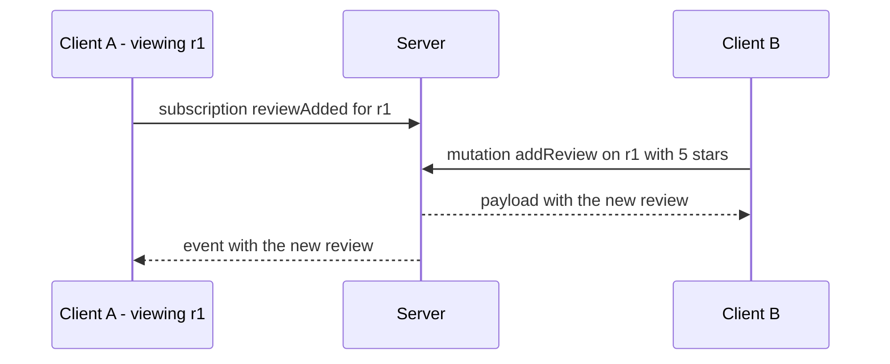

# Mutations, input types, return types and subscriptions

> **Before this lesson:** you should know how a mutation and a subscription look from the client's side ([Variables, mutations and subscriptions](#/lesson/graphql/variables-mutations-subscriptions)), and be able to write object types, enums and `!` in SDL ([Types, scalars, enums, lists and non-null](#/lesson/graphql/types-scalars-nonnull)). Input types were introduced for filters in [Arguments, filtering, pagination and sorting](#/lesson/graphql/arguments-pagination).

## In plain words

The last three lessons designed the *reading* side of the schema. This one designs everything else: how clients **change** data, what they get back, how they **listen** for changes, and how the schema explains itself to the people using it.

Think about posting a parcel.

- You fill in a **form** with the details: recipient, address, weight. In GraphQL the form is an **input type**.
- You hand it over at the counter. That act is the **mutation**.
- You get a **receipt**: a tracking number, the price, or a note saying "postcode missing, please correct". The receipt is the mutation's **return type**, often called a *payload*.
- You can sign up for **text alerts** when the parcel moves. That is a **subscription**.
- The small print on the form that explains each box is the **schema documentation**.

Why it matters for a job: mutations are where real-world consequences happen (orders, payments, deletions), so their design gets the most scrutiny in code review. "How do you report validation errors from a mutation?" is a standard interview question with a well-known good answer, covered below.

## Designing a mutation

Mutations are fields on the root `Mutation` type. The first version most people write looks like this:

```graphql
type Mutation {
  createRecipe(title: String!, minutes: Int!, category: Category!, tags: [String!]): Recipe!
}
```

It works. Experience with APIs that grow has produced four conventions that work better.

### 1. Name mutations as verb + noun, and make them specific

`createRecipe`, `publishRecipe`, `addReview`, `followCook`, `deleteReview`. A mutation should describe something a user *does*, not "change a row".

Prefer several specific mutations to one generic `updateRecipe` that can change anything. `publishRecipe(id)` and `renameRecipe(id, title)` each have clear permissions, clear validation and a clear entry in the logs. A catch-all update makes every one of those harder.

### 2. Take a single argument called `input`

Gather the arguments into one **input type**:

```graphql
input CreateRecipeInput {
  title: String!
  minutes: Int!
  category: Category!
  tags: [String!] = []
  servings: Int = 4
}

type Mutation {
  createRecipe(input: CreateRecipeInput!): CreateRecipePayload!
}
```

The client sends the whole form as one variable:

```graphql
mutation CreateRecipe($input: CreateRecipeInput!) {
  createRecipe(input: $input) {
    recipe { id title }
  }
}
```

```json
{ "input": { "title": "Flatbread", "minutes": 20, "category": "BREAD" } }
```

One variable instead of five, and new optional fields can be added to the input later without changing the mutation's signature or any existing client.

### 3. Return a payload type, not the bare object

`CreateRecipePayload` above is a type made only for this mutation's answer:

```graphql
type CreateRecipePayload {
  recipe: Recipe
  errors: [UserError!]!
}

type UserError {
  field: String
  message: String!
}
```

A dedicated payload gives room to return *several* things (the new recipe, the updated author, validation messages) and to add more later. Returning `Recipe!` directly leaves no room to grow.

### 4. Each mutation gets its own input and payload types

`CreateRecipeInput` / `CreateRecipePayload`, `AddReviewInput` / `AddReviewPayload`. Sharing types between mutations feels tidy at first and then couples them: a field needed by one becomes visible in the other.

## Input types in detail

Why can a mutation not take the ordinary `Recipe` type as its argument? Because object types and input types follow different rules, and GraphQL keeps them strictly apart.

| | Object type (`type`) | Input type (`input`) |
|---|---|---|
| Used for | results | arguments |
| Fields may have arguments | yes | no |
| Field types allowed | scalars, enums, objects, interfaces, unions | scalars, enums, **other input types** only |
| Fields may have default values | no | yes |
| Can contain cycles of data | yes (`Recipe.author.recipes…`) | must be finite when written out |

An output `Recipe` has fields such as `author: Cook!` and `reviews(first: Int)`, computed by resolvers. None of that makes sense as something a client types in. The create form needs different fields from the output anyway: the client does not supply `id`, `createdAt` or `rating`.

Input types nest:

```graphql
input IngredientLineInput {
  ingredientId: ID!
  quantity: Float!
  unit: Unit!
}

input CreateRecipeInput {
  title: String!
  minutes: Int!
  category: Category!
  ingredients: [IngredientLineInput!]! = []
}
```

Here ids *are* the right thing to accept. On output you expose `ingredient: Ingredient!`; on input the client refers to an existing ingredient by its `ID`.

### Updates: absent is not the same as null

An update form has every field optional, because the client sends only what changed:

```graphql
input UpdateRecipeInput {
  id: ID!
  title: String
  minutes: Int
  photoUrl: String
}
```

Lesson 8 showed that GraphQL distinguishes a field that was **left out** from one sent as **null**. Update mutations rely on that:

| The client sends | Meaning |
|---|---|
| `{ id: "r1", title: "Red lentil soup" }` | change the title; leave `minutes` and `photoUrl` alone |
| `{ id: "r1", photoUrl: null }` | remove the photo |
| `{ id: "r1" }` | change nothing |

In a JavaScript resolver the test is `"photoUrl" in input` (was the key present?), not `input.photoUrl == null`.

## Reporting failures: two kinds of error

A mutation can fail in two very different ways, and good schemas treat them differently.

**Unexpected failures**: the database is down, there is a bug, the request is malformed. These are exceptional. They go in the top-level `errors` array that every GraphQL response can carry.

**Expected, user-fixable outcomes**: the title is too long, the name is taken, the recipe was already published. These are part of the business rules. The user interface needs to show them next to the right form field. They are *data*, and the modern consensus is to model them **in the schema**, inside the payload.

Why not use the top-level `errors` for everything? Because that array is untyped: its entries are free-form messages, clients must match on strings or on ad-hoc codes, and tools cannot check that the client handles each case. Putting expected outcomes in the payload makes them typed, documented and selectable like any other data.

A successful call:

```json
{
  "data": {
    "createRecipe": {
      "recipe": { "id": "r8", "title": "Flatbread" },
      "errors": []
    }
  }
}
```

A rejected call. The HTTP status is still 200 and there is no top-level `errors` key, because nothing unexpected happened:

```json
{
  "data": {
    "createRecipe": {
      "recipe": null,
      "errors": [
        { "field": "title", "message": "Title is already taken." },
        { "field": "minutes", "message": "Minutes must be between 1 and 1440." }
      ]
    }
  }
}
```

Both problems are reported at once, so the form can highlight both fields in one go.

A stricter variation uses a union, so that each failure is its own type and clients are forced by `__typename` to decide what to do with each:

```graphql
union CreateRecipeResult = Recipe | ValidationFailed | NotAuthorised

type ValidationFailed { errors: [UserError!]! }
type NotAuthorised { message: String! }
```

```graphql
mutation($input: CreateRecipeInput!) {
  createRecipe(input: $input) {
    __typename
    ... on Recipe { id title }
    ... on ValidationFailed { errors { field message } }
    ... on NotAuthorised { message }
  }
}
```

The payload-with-`errors` style is simpler; the union style is more precise. Pick one per API and use it consistently.

## A mutation resolver you can run

```js-run
const CATEGORIES = ["SOUP", "BREAD", "MAIN", "DESSERT"];
let state = { recipes: [{ id: "r1", title: "Lentil soup", minutes: 35, category: "SOUP", servings: 4 }], nextId: 2 };

// createRecipe(input: CreateRecipeInput!): CreateRecipePayload!
function createRecipe(input) {
  const errors = [];
  const title = typeof input.title === "string" ? input.title.trim() : "";

  if (!title) errors.push({ field: "title", message: "Title is required." });
  else if (title.length > 60) errors.push({ field: "title", message: "Title must be at most 60 characters." });
  else if (state.recipes.some((r) => r.title.toLowerCase() === title.toLowerCase()))
    errors.push({ field: "title", message: "Title is already taken." });

  if (!Number.isInteger(input.minutes) || input.minutes < 1 || input.minutes > 1440)
    errors.push({ field: "minutes", message: "Minutes must be between 1 and 1440." });

  if (!CATEGORIES.includes(input.category))
    errors.push({ field: "category", message: "Unknown category." });

  if (errors.length > 0) return { recipe: null, errors };            // nothing was changed

  const recipe = { id: "r" + state.nextId, title, minutes: input.minutes, category: input.category, servings: input.servings ?? 4 };
  state = { recipes: [...state.recipes, recipe], nextId: state.nextId + 1 };   // build new state; do not edit in place
  return { recipe, errors: [] };
}

console.log(JSON.stringify(createRecipe({ title: "  Flatbread ", minutes: 20, category: "BREAD" })));
console.log(JSON.stringify(createRecipe({ title: "lentil SOUP", minutes: 0, category: "SOUP" })));
console.log(JSON.stringify(createRecipe({ title: "Flatbread", minutes: 15, category: "BREAD" })));
console.log("stored:", state.recipes.map((r) => r.id + " " + r.title));
```

Read it in three stages, which every mutation resolver has:

1. **Validate everything**, collecting problems in a list instead of stopping at the first. The second call reports both the duplicate title and the bad minutes.
2. **Return early if anything failed.** No partial change is made.
3. **Apply the change and return the result**, including the server-generated `id` and the defaulted `servings`.

The third call fails because the first one succeeded: "Flatbread" now exists. Notice that the title was trimmed before being stored and compared. The practice problem *A mutation with an input object and validation errors* asks for this resolver in full.

> [!TIP]
> Have the payload return **everything that the mutation changed**, not only the new object. If `addReview` changes the recipe's average rating, return the `recipe` (or the fields that changed) in the payload. The client's cache then updates the rating on screen automatically, with no extra query (lesson 17).

> [!WARNING]
> A network retry can run a mutation twice. `addReview` twice is two reviews; a duplicated payment is worse. For mutations where duplicates matter, accept a client-generated unique key in the input (often named `clientMutationId` or `idempotencyKey`), store it with the result, and return the stored result when the same key arrives again.

## Return types for special cases

Some mutations naturally return something that is not an entity of your domain. Signing in returns a token and the user together:

```graphql
type AuthPayload {
  token: String!
  cook: Cook!
}

type Mutation {
  signIn(code: String!): AuthPayload!
}
```

A delete has no object left to return, so give back what the client needs to clean up its own state:

```graphql
type DeleteReviewPayload {
  deletedReviewId: ID
  recipe: Recipe        # so the client can refresh the review count
  errors: [UserError!]!
}
```

Returning only `Boolean!` from a mutation is legal and nearly always regretted, for the same reason as returning a bare list: there is nowhere to add information later.

## Subscriptions in the schema

Subscriptions are fields on the root `Subscription` type. Each field is an *event* a client can listen for; its return type is the data delivered with each event.

```graphql
type Subscription {
  reviewAdded(recipeId: ID!): Review!
  recipePublished(category: Category): Recipe!
}
```

Design guidance:

- **Name events in the past tense**: `reviewAdded`, `recipePublished`. They report things that have happened.
- **Use arguments to narrow the stream**, so each client receives only what it needs. `recipeId` is required here; without it, one client would receive every review on the site.
- **Pair them with mutations.** Events are usually published by the mutation that causes them: `addReview` publishes `reviewAdded`.
- **Keep payloads small.** The client can select further fields through the returned type.



When several kinds of change can happen to one thing, a single event with a small payload type is tidier than many separate fields:

```graphql
enum ChangeKind { CREATED UPDATED DELETED }

type RecipeChange {
  kind: ChangeKind!
  recipe: Recipe
  deletedId: ID
}

type Subscription {
  recipeChanged(id: ID): RecipeChange!
}
```

Lesson 18 shows how the server delivers these events over a WebSocket.

## Schema documentation

A schema is read far more often than it is written: by front-end developers, by partner companies, and by you in six months. SDL has documentation built in, and it shows up automatically in GraphiQL, in generated reference sites and in editor tooltips.

A **description** is a string placed directly before the thing it documents. Use triple quotes for multi-line text; Markdown is conventionally supported.

```graphql
"""
A dish that a cook has published on Potluck.
Recipes are visible to everyone once `published` is true.
"""
type Recipe {
  "Unique identifier. Stable for the life of the recipe."
  id: ID!

  "The display name, at most 60 characters."
  title: String!

  "Total time from start to table, in minutes."
  minutes: Int

  cookTime: Int @deprecated(reason: "Use `minutes`. Will be removed after 2027-01-01.")

  """
  Reviews of this recipe, newest first.
  """
  reviews(
    "How many reviews to return. Maximum 50."
    first: Int = 10
    "Return reviews after this cursor."
    after: String
  ): ReviewConnection!
}

"How demanding a recipe is to cook."
enum Difficulty {
  "No special technique or equipment."
  EASY
  MEDIUM
  "Needs practice, timing or unusual equipment."
  HARD
}
```

Types, fields, arguments, enum values and input fields can all carry descriptions.

Descriptions are different from comments. A line starting with `#` is a comment for people editing the schema file; it is thrown away by the parser. A description is part of the schema and is served through introspection as the `description` field.

The `@deprecated` directive marks a field or enum value as on its way out without removing it. Old clients keep working; tools strike the field through and show the reason; and usage of deprecated fields can be measured until it reaches zero and the field can be deleted. This is the backbone of how GraphQL APIs evolve without version numbers (lesson 23).

What to write in a description:

| Write | Example |
|---|---|
| units and formats | "in minutes", "ISO 8601 timestamp in UTC" |
| limits | "at most 60 characters", "maximum 50 per page" |
| null meaning | "Null if the cook has not set a city." |
| ordering | "Newest first." |
| permissions | "Only visible to the recipe's author." |
| what to use instead (for deprecations) | "Use `minutes`." |

Do not restate the name ("title: the title"). Say what the name cannot.

> [!INTERVIEW]
> **"How should a GraphQL mutation report validation errors?"** Separate expected business outcomes from exceptional failures. Exceptional ones (bugs, outages, malformed requests) use the top-level `errors` array. Expected ones (invalid input, conflicts, permission rules the UI should explain) are modelled as data: a payload type with an `errors: [UserError!]!` list, or a union of success and failure types. That makes them typed, discoverable and selectable, and allows returning several field-level messages at once.
>
> **"Why separate input types from object types?"** Output types can have arguments, resolvers, interfaces, unions and cyclic references; none of those are meaningful for values a client sends. Input types are restricted to scalars, enums and other inputs, and may declare defaults. In practice the fields also differ: no `id` or computed fields on a create input.

## Pitfalls

- **A long list of loose arguments.** Use one `input`.
- **Reusing the output type's shape as the input**, or one input type for both create and update. Their required fields differ.
- **Returning the bare entity or a Boolean.** No room for errors or for other changed objects.
- **Throwing an exception for a validation failure.** The client then has to parse a message string.
- **Stopping at the first validation error.** Report them all.
- **Treating null and absent the same in updates.** You will be unable either to clear a field or to leave it alone.
- **A giant `updateEverything` mutation.** Hard to authorise, validate and audit.
- **Subscriptions without narrowing arguments**, which flood every client.
- **`#` comments where descriptions were intended.** Comments never reach the tools.
- **Deleting a field without a deprecation period.**

## Cheat sheet

| Topic | Convention |
|---|---|
| mutation name | verb + noun, specific: `publishRecipe` |
| arguments | one: `input: PublishRecipeInput!` |
| return | `PublishRecipePayload!` with the changed objects and `errors` |
| input type | `input X { ... }`; scalars, enums and other inputs only; defaults allowed |
| create vs update inputs | separate types; update fields are optional |
| absent vs null | absent = leave alone; null = clear |
| expected failures | in the payload (`errors: [UserError!]!`) or as union members |
| unexpected failures | top-level `errors` |
| safe retries | idempotency key in the input |
| subscription name | past tense event: `reviewAdded` |
| description | `"text"` or `"""text"""` before the item |
| comment | `# text` (not in introspection) |
| phase out | `@deprecated(reason: "...")` |

## Summary

- Design mutations as specific user actions, each taking a single `input` object and returning its own payload type.
- Input types are a separate family from object types: restricted to scalars, enums and other inputs, with default values allowed. Update inputs depend on the difference between an absent field and a null one.
- Report expected, user-fixable outcomes as typed data in the payload and keep the top-level `errors` array for exceptional failures.
- Subscription fields are named events, narrowed by arguments and normally published by the mutations that cause them.
- Descriptions and `@deprecated` are part of the schema and flow through introspection into every tool, which makes documentation a design task and not an afterthought.

## Glossary

- **Input type:** a type declared with `input`, usable only for arguments and input fields.
- **Payload type:** an object type created to be the return value of one mutation.
- **User error:** an expected, user-fixable problem returned as data.
- **Top-level errors:** the `errors` array beside `data` in a GraphQL response, for failures of the request or of resolvers.
- **Validation (business sense):** checking that input satisfies the application's rules. (Different from GraphQL *query validation*, which checks a query against the schema.)
- **Idempotency key:** a client-generated unique value that lets a server recognise a repeated request.
- **Event:** something that has happened, delivered to subscribers.
- **Publish:** to announce an event so that matching subscriptions receive it.
- **Description:** documentation text attached to a schema element and available through introspection.
- **Comment:** `#` text ignored by the parser.
- **`@deprecated`:** a built-in directive marking a field or enum value as discouraged, with a reason.
- **Markdown:** a plain-text formatting syntax commonly rendered in descriptions.

## Check yourself

```quiz
[
  {"q": "Which field type is NOT allowed inside an `input` type?",
   "options": ["`String!`", "An enum such as `Category`", "An object type such as `Cook`", "Another input type"],
   "answer": 2,
   "explain": "Input types may contain only scalars, enums and other input types. Object types (with resolvers, arguments and possible cycles) cannot be sent by a client."},
  {"q": "A client sends `updateRecipe(input: {id: \"r1\", photoUrl: null})`. By convention, what should happen to the recipe's `title`?",
   "options": ["It is set to null", "It is left unchanged, because it was not included", "It is set to an empty string", "The mutation fails"],
   "answer": 1,
   "explain": "Absent means 'do not touch'. Only `photoUrl` was mentioned, and its explicit null means 'clear it'."},
  {"q": "`createRecipe` is called with an empty title and minutes of 0. With the payload pattern from this lesson, what is returned?",
   "options": ["HTTP 400 with no body", "`{\"data\": {\"createRecipe\": {\"recipe\": null, \"errors\": [{\"field\": \"title\", ...}, {\"field\": \"minutes\", ...}]}}}`", "`{\"data\": null, \"errors\": [{\"message\": \"Validation failed\"}]}`", "`{\"data\": {\"createRecipe\": {\"recipe\": null, \"errors\": [{\"field\": \"title\", ...}]}}}` (first error only)"],
   "answer": 1,
   "explain": "Expected validation problems are returned as data in the payload, all of them at once, with `recipe` null. The top-level `errors` array is not used."},
  {"q": "Why is a dedicated payload type preferred to returning `Recipe!` directly from a mutation?",
   "options": ["Payload types execute faster", "It leaves room to return errors and other changed objects now or later without breaking clients", "GraphQL forbids returning object types from mutations", "It avoids the need for input types"],
   "answer": 1,
   "explain": "A wrapper object can grow. A bare `Recipe!` can never also carry validation messages or the updated author."},
  {"q": "What is the difference between `# total time` and `\"Total time in minutes.\"` placed before a field in SDL?",
   "options": ["None", "The `#` line is a comment discarded by the parser; the quoted string is a description served through introspection", "The quoted string is only allowed on types", "The `#` line appears in GraphiQL, the string does not"],
   "answer": 1,
   "explain": "Descriptions are part of the schema and reach tools and documentation. Comments are for people reading the source file only."},
  {"q": "Which subscription field follows the naming and narrowing guidance?",
   "options": ["`getReviews: [Review!]!`", "`reviewAdded(recipeId: ID!): Review!`", "`addReview(input: AddReviewInput!): Review!`", "`reviews: Review!`"],
   "answer": 1,
   "explain": "It is named as a past-tense event and takes an argument so each client only receives events for the recipe it is watching."},
  {"q": "The team wants to replace `cookTime` with `minutes`. What is the right first step?",
   "options": ["Delete `cookTime` immediately", "Rename it in place", "Add `minutes`, mark `cookTime` with `@deprecated(reason: ...)`, and watch usage fall", "Create a `/v2/graphql` endpoint"],
   "answer": 2,
   "explain": "Adding a field is safe. Deprecation warns clients through their tools while old queries keep working; removal happens only once usage has stopped."},
  {"q": "A flaky connection causes a client to send `addReview` twice. What design prevents two reviews being created?",
   "options": ["Using a query instead of a mutation", "An idempotency key in the input that the server remembers", "Returning `Boolean!`", "Making `stars` non-null"],
   "answer": 1,
   "explain": "With a client-generated unique key, the server recognises the repeat and returns the original result instead of applying the change again."}
]
```

> **Source:** Porcello & Banks, *Learning GraphQL*, ch. 4 (mutations, input types, return types, subscriptions, schema documentation). Also: https://graphql.org/learn/mutations/ ; https://graphql.org/learn/schema/#input-object-types ; GraphQL specification, "Descriptions" and "@deprecated" (https://spec.graphql.org/October2021/#sec-Descriptions) ; https://www.apollographql.com/docs/graphos/schema-design/guides/errors-as-data-explained.
