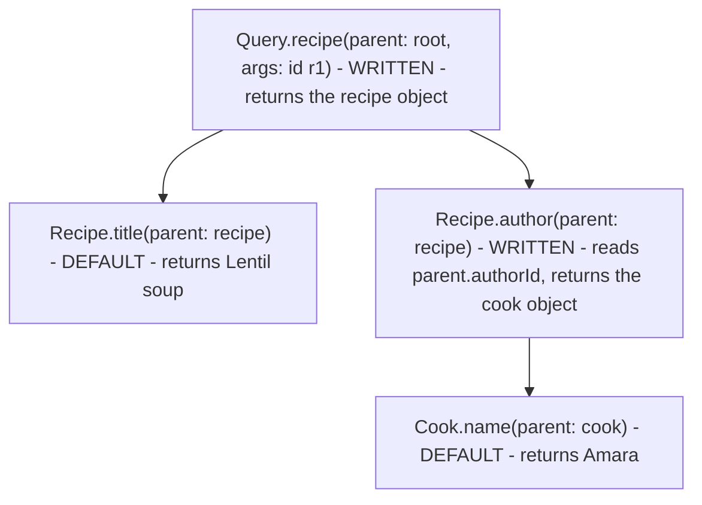

# Resolvers, the resolver chain and context

> **Before this lesson:** you should be able to write a small schema with connections ([Connections](#/lesson/graphql/connections-through-types)), know the parse → validate → execute pipeline ([Introspection and abstract syntax trees](#/lesson/graphql/introspection-ast)), and be comfortable with JavaScript functions, objects and `async`/`await` ([Async, await and generators](#/lesson/javascript/async-await-generators)).

## In plain words

A schema says *what* can be asked. It contains no instructions for getting the answers. The answers come from **resolvers**: small functions, one per field, that each know how to produce that single field's value.

Picture a relay team answering a questionnaire.

- The first runner is handed the question "recipe r1?" and fetches the recipe's record from the filing room.
- They pass the record to the next runners, one per sub-question. "Title?" The runner reads it straight off the record. "Author?" That runner sees `authorId: c1` on the record, goes to the *cooks* filing room, and comes back with Amara's record.
- Amara's record is passed on again to whoever answers "name?".

Each runner does one small job and hands the result to the next. That hand-over, where **the value one resolver returns becomes the input of the resolvers beneath it**, is called the **resolver chain**. It is the single most important idea for understanding a GraphQL server.

Every runner also carries the same clipboard with shared information: the keys to the filing rooms and the name of whoever asked. That clipboard is the **context**.

Why it matters for a job: writing resolvers *is* GraphQL back-end work. Debugging one ("why is `author` null?", "why did this query hit the database 200 times?") requires knowing exactly which function ran, with which arguments, in which order.

## Setting up a server

A complete GraphQL server using **Apollo Server**, the most widely used JavaScript server library, fits in one file. You cannot run this in the page (it needs Node.js and a network port), so read it as a tour. A runnable model of the engine follows later.

```bash
mkdir potluck-api && cd potluck-api
npm init -y
npm pkg set type=module
npm install @apollo/server graphql
```

- `npm init -y` creates `package.json`, the file that describes a Node.js project.
- `npm pkg set type=module` lets the project use modern `import` syntax.
- `@apollo/server` is the server library; `graphql` is the reference implementation (GraphQL.js) that it builds on.

```javascript
// index.js
import { ApolloServer } from "@apollo/server";
import { startStandaloneServer } from "@apollo/server/standalone";

// 1. The schema, as SDL text.
const typeDefs = `#graphql
  type Recipe {
    id: ID!
    title: String!
    minutes: Int
    author: Cook!
  }
  type Cook {
    id: ID!
    name: String!
    recipes: [Recipe!]!
  }
  type Query {
    recipe(id: ID!): Recipe
    recipes: [Recipe!]!
  }
`;

// 2. Some data. In a real server this is a database.
const recipes = [
  { id: "r1", title: "Lentil soup", minutes: 35, authorId: "c1" },
  { id: "r2", title: "Flatbread", minutes: 20, authorId: "c2" },
];
const cooks = [
  { id: "c1", name: "Amara" },
  { id: "c2", name: "Bo" },
];

// 3. The resolvers: an object shaped like the schema.
const resolvers = {
  Query: {
    recipes: () => recipes,
    recipe: (parent, args) => recipes.find((r) => r.id === args.id) ?? null,
  },
  Recipe: {
    author: (parent) => cooks.find((c) => c.id === parent.authorId),
  },
  Cook: {
    recipes: (parent) => recipes.filter((r) => r.authorId === parent.id),
  },
};

// 4. Put them together and listen for HTTP requests.
const server = new ApolloServer({ typeDefs, resolvers });
const { url } = await startStandaloneServer(server, { listen: { port: 4000 } });
console.log(`Server ready at ${url}`);
```

Run `node index.js`, open `http://localhost:4000`, and Apollo Sandbox appears with autocomplete for this schema.

The parts:

1. **`typeDefs`** is the schema in SDL. (The `#graphql` comment at the start only tells editors to colour the string as GraphQL.)
2. **The data** is two arrays. Note that a stored recipe has `authorId`, while the schema's `Recipe` has `author`. The stored shape and the API shape differ, and bridging that gap is what resolvers are for.
3. **`resolvers`** is called the **resolver map**. Its first level has one key per *type*; its second level has one key per *field* on that type; each value is a function.
4. **`ApolloServer`** combines schema and resolvers; `startStandaloneServer` starts an HTTP server with sensible defaults. (To add your own routes or middleware you would use `expressMiddleware` from `@as-integrations/express5` with the Express web framework instead.)

Look at what the resolver map does **not** contain: there is no `Recipe.id`, `Recipe.title`, `Recipe.minutes`, `Cook.id` or `Cook.name`. They still work. The reason is the default resolver, below.

## The four arguments of a resolver

Every resolver is called with the same four arguments, always in this order:

```javascript
fieldName: (parent, args, contextValue, info) => { ... }
```

| Argument | What it is | Example for `Recipe.author` |
|---|---|---|
| `parent` | the value returned by the resolver of the *enclosing* field (sometimes named `root` or `source`) | the recipe object `{ id: "r1", ..., authorId: "c1" }` |
| `args` | this field's arguments, already validated and with defaults applied | `{}` (for `Query.recipe` it would be `{ id: "r1" }`) |
| `contextValue` | an object shared by every resolver during one request | `{ db, currentUser }` |
| `info` | details about the execution: the field name, its path, the query's AST | rarely needed |

A resolver returns the field's value, or a **Promise** of it. A Promise is JavaScript's object for "a value that will be ready later", which is what you get from a database call; the engine waits for it. Returning `null` or `undefined` means the field is null. Throwing an error makes the field null and adds an entry to the response's `errors`.

## The default resolver

If you write no resolver for a field, GraphQL uses a built-in one that amounts to:

```javascript
(parent, args, contextValue, info) => parent[info.fieldName]
```

In words: "look for a property on the parent object with the same name as the field". (If that property is a function, it is called.) That is why `title` works without any code: the recipe object handed down by `Query.recipe` already has a `title` property.

You therefore write a resolver only when the default cannot work:

| Situation | Example |
|---|---|
| a root field (there is no parent data to read from) | `Query.recipe`, `Mutation.addReview` |
| a connection stored as a foreign key | `Recipe.author` from `authorId` |
| a different name in storage | `minutes` stored as `cook_time` |
| a computed value | `Recipe.averageStars` from its reviews |
| a field that takes arguments | `Recipe.photo(width:)` |

Resolvers on `Query`, `Mutation` and `Subscription` are often called **root resolvers**; those on your own types (`Recipe.author`) are called **type resolvers** or field resolvers. The mechanism is identical.

## The resolver chain

Follow this query through the server:

```graphql
{
  recipe(id: "r1") {
    title
    author {
      name
    }
  }
}
```



Step by step:

1. Execution starts at the root type `Query`. The engine calls `Query.recipe` with `args = { id: "r1" }`. It returns the stored recipe: `{ id: "r1", title: "Lentil soup", minutes: 35, authorId: "c1" }`.
2. The schema says `recipe` returns a `Recipe`, an object type, so the engine looks at the selection set under it and resolves each field **with that recipe object as `parent`**.
3. `Recipe.title` has no resolver: the default reads `parent.title`. It is a scalar, so this branch is finished.
4. `Recipe.author` has a resolver. It reads `parent.authorId` and returns the matching cook `{ id: "c1", name: "Amara" }`.
5. `author` returns a `Cook`, so the engine descends again with the cook as `parent`. `Cook.name` uses the default.
6. All leaves are scalars. The engine assembles the result in the shape of the query.

Three consequences are worth stating outright.

**Resolvers only run for fields that were asked for.** If the query does not select `author`, `Recipe.author` is never called and the cooks are never touched. This is how GraphQL avoids the hidden server work of over-fetching.

**A resolver does not know or care how it was reached.** `Recipe.author` works the same whether the recipe came from `Query.recipe`, `Query.recipes` or `Cook.recipes`. You write each edge once and every path through the graph can use it.

**The parent object may carry more than the schema exposes.** `authorId` is not a field of `Recipe`, so no client can select it, yet the `author` resolver can read it from `parent`. Passing internal keys down the chain this way is normal.

For a list field, the engine runs the child resolvers once **for each item**:

```graphql
{ recipes { title author { name } } }
```

`Query.recipes` runs once and returns 2 recipes; `Recipe.author` then runs 2 times, once with each recipe as `parent`. With 100 recipes it would run 100 times. Keep that multiplication in mind; lesson 20 is about taming it.

## Context

Resolvers need shared things: a database connection, and the identity of the user making the request. Passing them through `parent` would be clumsy, and global variables would mix up simultaneous requests from different users. The third argument solves this.

The **context** is an object built **once per request** and handed, unchanged, to every resolver that runs for that request.

```javascript
const { url } = await startStandaloneServer(server, {
  listen: { port: 4000 },
  // Called for every incoming request; whatever it returns is the contextValue.
  context: async ({ req }) => {
    const token = req.headers.authorization ?? "";
    const currentUser = await findUserByToken(token);     // null if not signed in
    return { db, currentUser };
  },
});
```

```javascript
const resolvers = {
  Query: {
    recipe: (parent, args, context) => context.db.recipes.findById(args.id),
    me: (parent, args, context) => context.currentUser,
  },
  Recipe: {
    author: (parent, args, context) => context.db.cooks.findById(parent.authorId),
  },
};
```

What belongs in the context:

| Put in context | Why |
|---|---|
| database handles, API clients ("data sources") | so resolvers do not import them directly, and tests can substitute fakes |
| the current user (or `null`) | worked out once from the request's token, used by any resolver that checks permissions |
| per-request caches and DataLoaders | they must not be shared between requests (lesson 20) |
| request metadata: a request id, the client's locale | for logging and localisation |

> [!WARNING]
> Build the context **per request**, inside the `context` function. A single object created at start-up and reused would leak one user's identity and cached data into another user's request. This is one of the most serious bugs a GraphQL server can have.

## A model of the engine

The following is a compact executor with the real engine's behaviour: resolver map, default resolver, the four arguments, promises, lists and context. A call log shows the chain as it happens.

```js-run
// ---------- "database" with slow async lookups ----------
const wait = (ms) => new Promise((r) => setTimeout(r, ms));
const db = {
  recipes: [
    { id: "r1", title: "Lentil soup", minutes: 35, authorId: "c1" },
    { id: "r2", title: "Flatbread", minutes: 20, authorId: "c2" },
  ],
  cooks: [{ id: "c1", name: "Amara" }, { id: "c2", name: "Bo" }],
};

// ---------- schema (return type of each field) and resolver map ----------
const schema = {
  Query: { recipes: "[Recipe!]!", recipe: "Recipe", me: "Cook" },
  Recipe: { id: "ID!", title: "String!", minutes: "Int", author: "Cook!" },
  Cook: { id: "ID!", name: "String!", recipes: "[Recipe!]!" },
};
const resolvers = {
  Query: {
    recipes: async (parent, args, ctx) => { await wait(5); return ctx.db.recipes; },
    recipe: async (parent, args, ctx) => { await wait(5); return ctx.db.recipes.find((r) => r.id === args.id) ?? null; },
    me: (parent, args, ctx) => ctx.currentUser,
  },
  Recipe: {
    author: async (parent, args, ctx) => { await wait(5); return ctx.db.cooks.find((c) => c.id === parent.authorId); },
  },
  Cook: {
    recipes: (parent, args, ctx) => ctx.db.recipes.filter((r) => r.authorId === parent.id),
  },
};

// ---------- the engine ----------
async function executeSelection(typeName, parent, selection, ctx) {
  const entries = await Promise.all(selection.map(async (field) => {       // sibling fields resolve concurrently
    const written = resolvers[typeName]?.[field.name];
    ctx.log.push(`${typeName}.${field.name} ${written ? "(written)" : "(default)"}`);
    const info = { fieldName: field.name, parentType: typeName };
    const value = written ? await written(parent, field.args ?? {}, ctx, info) : parent[field.name];
    return [field.name, await complete(value, schema[typeName][field.name], field.selection ?? [], ctx)];
  }));
  return Object.fromEntries(entries);
}
async function complete(value, type, selection, ctx) {
  if (value === null || value === undefined) return null;
  if (type.endsWith("!")) type = type.slice(0, -1);
  if (type.startsWith("[")) return Promise.all(value.map((v) => complete(v, type.slice(1, -1), selection, ctx)));
  if (schema[type]) return executeSelection(type, value, selection, ctx);   // object type: descend, value becomes parent
  return value;                                                             // scalar: leaf
}
async function run(query, currentUser = null) {
  const ctx = { db, currentUser, log: [] };                                 // a fresh context per request
  const data = await executeSelection("Query", {}, query, ctx);
  return { data, log: ctx.log };
}

// { recipes { title author { name } } me { name } }
const query = [
  { name: "recipes", selection: [{ name: "title" }, { name: "author", selection: [{ name: "name" }] }] },
  { name: "me", selection: [{ name: "name" }] },
];
const { data, log } = await run(query, db.cooks[1]);
console.log(JSON.stringify(data, null, 2));
console.log(log.join("\n"));
```

Compare the log with the query:

- `Query.recipes` appears once, marked *written*.
- `Recipe.title` appears twice, marked *default*: once per recipe.
- `Recipe.author` appears twice, *written*: once per recipe. Two recipes, two lookups.
- `Cook.name` appears three times: twice under the authors and once under `me`.
- `Query.me` read `ctx.currentUser`, which `run` placed in the context. Call `run(query)` with no user and `me` becomes `null`.

Two details of the code mirror real servers. `Promise.all` over the selection means sibling fields are resolved **concurrently**: the engine does not wait for `title` before starting `author`. And `complete` uses the field's declared type to decide what to do with a value: recurse into a list, descend into an object type, or stop at a scalar.

The practice problem *A resolver executor with the default resolver* asks you to write this engine in Python with lookup tables in place of functions.

## Resolver details you will need

**Enums with different internal values.** If the database stores `1`, `2`, `3` for categories, map them in the resolver map:

```javascript
const resolvers = {
  Category: { SOUP: 1, BREAD: 2, MAIN: 3, DESSERT: 4 },
};
```

Clients still send and receive `SOUP`; resolvers see and return `1`.

**Unions and interfaces need to be told the concrete type.** When a field returns `FeedItem` (a union), the engine must know whether each object is a `Recipe` or a `Collection` in order to apply the right inline fragment. You supply a `__resolveType` function:

```javascript
const resolvers = {
  FeedItem: {
    __resolveType(obj) {
      if ("minutes" in obj) return "Recipe";
      if ("size" in obj) return "Collection";
      return null;                       // unknown: an error is reported
    },
  },
};
```

**Keep resolvers thin.** A resolver should translate between GraphQL and your application: read arguments, call a function in a separate business-logic module, return the result. Validation rules, permission checks and database queries belong in that module, where REST endpoints, background jobs and tests can share them.

```javascript
// thin resolver
addReview: (parent, { input }, ctx) => reviewService.add(ctx.currentUser, input),
```

> [!TIP]
> A helpful trick while learning: add `console.log(info.parentType.name + "." + info.fieldName)` as the first line of your resolvers (or use a plugin that logs every resolver call) and run a nested query. Seeing the order and count of calls in your terminal makes the resolver chain concrete in a way no diagram does.

> [!INTERVIEW]
> **"What arguments does a resolver receive?"** `parent` (the result of the parent field's resolver), `args` (the field's arguments), `context` (per-request shared state such as the database handle and the authenticated user) and `info` (execution metadata including the field's AST and path).
>
> **"What is the resolver chain?"** Execution proceeds top-down from the root type. Each resolver's return value becomes the `parent` of its child fields' resolvers. Fields without an explicit resolver use the default, which reads the same-named property of `parent`. For list fields the children run once per item, which is the origin of the N+1 problem.
>
> **"What goes in context, and what is its lifetime?"** Data sources, the authenticated user, DataLoaders and request metadata. It is created once per request and must never be shared across requests.

## Pitfalls

- **Writing resolvers for every scalar field.** The default already does it; extra code is extra bugs.
- **Mixing up the argument order.** `(args, parent)` silently gives nonsense. Use `_` for the ones you skip: `(_, args, ctx)`.
- **Forgetting to return.** An arrow function with braces and no `return` yields `undefined`, so the field is null.
- **Not returning the Promise.** Calling an async function without `return` or `await` makes the field resolve before the data arrives.
- **Returning the API shape from a root resolver when the stored shape will do.** Let child resolvers build connections; do not pre-join everything "in case" (that reintroduces the over-fetching work on the server).
- **A shared, global context.** Per request, always.
- **Fat resolvers** full of SQL and business rules, impossible to reuse or test.
- **Missing `__resolveType`** on unions and interfaces, which produces "Abstract type must resolve to an Object type at runtime".

## Cheat sheet

| Item | Summary |
|---|---|
| resolver | function producing one field's value |
| signature | `(parent, args, contextValue, info)` |
| resolver map | `{ TypeName: { fieldName: fn } }` |
| default resolver | returns `parent[fieldName]` |
| root resolvers | on `Query`, `Mutation`, `Subscription`; `parent` is the root value |
| chain | a resolver's result is its children's `parent` |
| lists | children run once per item |
| async | return a Promise; the engine waits |
| null / throw | field is null / null plus an `errors` entry |
| context | built once per request: data sources, current user, loaders |
| enum mapping | `{ Category: { SOUP: 1 } }` |
| abstract types | `__resolveType(obj)` returns a type name |
| setup | `npm install @apollo/server graphql`; `new ApolloServer({ typeDefs, resolvers })` |

## Summary

- A resolver is a function that returns the value for one field; the resolver map mirrors the schema's types and fields.
- Each resolver receives `parent`, `args`, `contextValue` and `info`. Fields without a resolver fall back to reading the same-named property of `parent`.
- Execution runs from the root downward, passing each resolver's result to its children: the resolver chain. Only selected fields are resolved, and list fields multiply the calls beneath them.
- The context is created per request and carries shared resources such as the database and the current user.
- Keep resolvers thin, return promises for asynchronous work, map enums where storage differs, and provide `__resolveType` for unions and interfaces.

## Glossary

- **Resolver:** a function that produces the value of one field.
- **Resolver map:** the object of resolver functions organised by type and field.
- **Root resolver:** a resolver on `Query`, `Mutation` or `Subscription`.
- **Type (field) resolver:** a resolver on any other object type.
- **Default resolver:** the built-in resolver that reads a same-named property from the parent.
- **Parent:** the first resolver argument; the value returned for the enclosing field.
- **Resolver chain:** the passing of results from parent resolvers to child resolvers during execution.
- **Context:** a per-request object available to all resolvers.
- **Data source:** an object that gives resolvers access to a database or external API.
- **Promise:** a JavaScript object representing a value that will be available later.
- **Concurrent:** in progress at the same time, such as sibling fields awaiting separate database calls.
- **Apollo Server:** a popular open-source GraphQL server library for Node.js.
- **npm:** the package manager for Node.js.
- **Business logic:** the application's own rules, kept separate from the code that handles requests.

## Check yourself

```quiz
[
  {"q": "The stored recipe is `{id: \"r1\", title: \"Lentil soup\", authorId: \"c1\"}` and there is no resolver for `Recipe.title`. How is `title` resolved?",
   "options": ["It is null, because no resolver exists", "The default resolver returns `parent.title`", "The server throws at start-up", "`Query.recipe` is called again"],
   "answer": 1,
   "explain": "Fields without an explicit resolver use the default, which reads the property with the same name from the parent object."},
  {"q": "In `Recipe.author: (parent, args, context, info) => ...`, what is `parent` when the query is `{ recipe(id: \"r1\") { author { name } } }`?",
   "options": ["The cook object", "The object returned by `Query.recipe`", "The arguments `{id: \"r1\"}`", "The whole response so far"],
   "answer": 1,
   "explain": "`parent` is whatever the enclosing field's resolver returned: here, the recipe object, including its `authorId`."},
  {"q": "`Query.recipes` returns 50 recipes. For `{ recipes { title author { name } } }`, how many times does the `Recipe.author` resolver run?",
   "options": ["0", "1", "50", "51"],
   "answer": 2,
   "explain": "Child resolvers of a list field run once per item. Fifty recipes means fifty calls to `Recipe.author`."},
  {"q": "With the data and resolvers from this lesson, what does `{ recipe(id: \"r2\") { title author { name } } }` return?",
   "options": ["`{\"data\": {\"recipe\": {\"title\": \"Flatbread\", \"author\": {\"name\": \"Bo\"}}}}`", "`{\"data\": {\"recipe\": {\"title\": \"Flatbread\", \"authorId\": \"c2\"}}}`", "`{\"data\": {\"recipe\": {\"title\": \"Flatbread\", \"author\": null}}}`", "`{\"data\": {\"recipe\": null}}`"],
   "answer": 0,
   "explain": "`Query.recipe` finds r2; `title` is read by the default resolver; `Recipe.author` uses `parent.authorId` (c2) to find Bo; `Cook.name` is read by default."},
  {"q": "The query is `{ recipe(id: \"r1\") { title } }`. Is the `Recipe.author` resolver called?",
   "options": ["Yes, every resolver on the type runs", "No, resolvers run only for selected fields", "Yes, but its result is discarded", "Only if `author` is non-null"],
   "answer": 1,
   "explain": "Execution follows the selection set. Unselected fields cost nothing."},
  {"q": "Why must the context be created for each request?",
   "options": ["Because JavaScript objects cannot be reused", "So that one request's user identity and cached data cannot leak into another request", "Because Apollo Server deletes it after one field", "To make introspection work"],
   "answer": 1,
   "explain": "Context holds per-user state. Sharing it would let user A's request see user B's identity or cached results."},
  {"q": "A resolver is written as `recipe: (parent, args, ctx) => { ctx.db.recipes.findById(args.id); }`. What does the field return?",
   "options": ["The recipe", "A Promise of the recipe", "null, because the function returns `undefined`", "A validation error"],
   "answer": 2,
   "explain": "An arrow function with a braces body needs an explicit `return`. Without it the result is `undefined`, which GraphQL treats as null."},
  {"q": "A field returns the union `FeedItem = Recipe | Collection`. What extra piece must the server provide?",
   "options": ["A resolver for every scalar", "A `__resolveType` function that names the concrete type of each object", "A second schema", "Nothing"],
   "answer": 1,
   "explain": "For unions and interfaces the engine must learn each object's concrete type to apply type conditions and choose resolvers."}
]
```

> **Source:** Porcello & Banks, *Learning GraphQL*, ch. 5 (project setup, resolvers, root resolvers, type resolvers, context). Also: https://graphql.org/learn/execution/ ; https://www.apollographql.com/docs/apollo-server/getting-started ; https://www.apollographql.com/docs/apollo-server/data/resolvers ; https://www.apollographql.com/docs/apollo-server/data/context.
