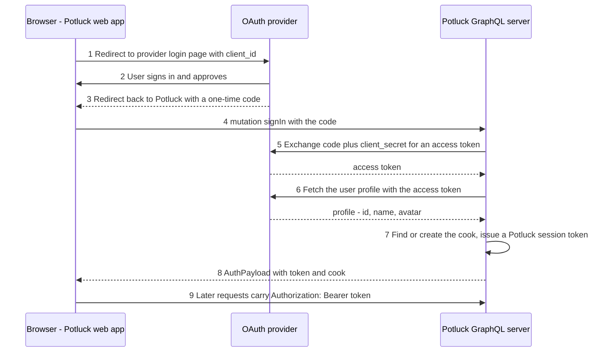

# Custom scalars, databases, authentication and authorisation

> **Before this lesson:** you need resolvers, the four resolver arguments and the per-request context from [Resolvers, the resolver chain and context](#/lesson/graphql/resolvers-context), plus HTTP headers and tokens from [REST in plain words](#/lesson/graphql/rest-in-plain-words).

## In plain words

The server from the last lesson kept its data in two arrays and trusted everyone. This lesson turns it into something you could deploy. Four upgrades:

1. **Custom scalars** teach the schema new kinds of leaf value, such as dates. The five built-in scalars are like a form that only has "text" and "number" boxes; a custom scalar adds a "date" box that refuses anything that is not a date.
2. **A database** replaces the arrays, so data survives a restart.
3. **Authentication** answers "who are you?". It is the bouncer checking your ticket at the door.
4. **Authorisation** answers "are you allowed to do *this*?". It is the staff checking, at each inner door, whether your ticket covers the VIP room.

For authentication we will use **OAuth**, the mechanism behind "Sign in with GitHub / Google" buttons. The idea in one line: instead of your app handling passwords, a trusted provider vouches for the user. It works like a hotel accepting a passport: the hotel does not verify your identity from scratch; it trusts the government that issued the document.

Why it matters for a job: security mistakes in an API are the expensive kind. Interviewers reliably ask for the difference between authentication and authorisation, where each belongs in a GraphQL server, and how an OAuth sign-in works.

## Custom scalars

GraphQL has no date type. If you declare `createdAt: String!`, nothing stops a resolver from returning `"yesterday"`, and nothing stops a client from sending `"32/13/2026"`. A **custom scalar** is a leaf type that you define, with your own rules for what counts as a valid value.

Declaring one takes a single line of SDL:

```graphql
scalar DateTime

type Recipe {
  id: ID!
  title: String!
  createdAt: DateTime!
}

type Query {
  recipes(publishedAfter: DateTime): [Recipe!]!
}
```

The line `scalar DateTime` only names the type. Its behaviour is supplied in code, as three functions that convert between the form used on the wire (JSON) and the form used inside your server:

| Function | Direction | Called when |
|---|---|---|
| `serialize` | server value → JSON | a resolver returns a value for a `DateTime` field |
| `parseValue` | JSON → server value | the client sends a `DateTime` in **variables** |
| `parseLiteral` | AST node → server value | the client writes a `DateTime` directly **in the query text** |

There are two input functions because input reaches the server in two ways. A variable arrives as an already-parsed JSON value. A value typed inline in the query (`publishedAfter: "2026-01-01T00:00:00Z"`) is part of the query's syntax tree and arrives as an AST node (lesson 9).

```javascript
import { GraphQLScalarType, GraphQLError, Kind } from "graphql";

function toDate(text) {
  const date = new Date(text);
  if (typeof text !== "string" || Number.isNaN(date.getTime())) {
    throw new GraphQLError("DateTime must be an ISO 8601 string, for example 2026-03-14T09:30:00Z");
  }
  return date;
}

const DateTime = new GraphQLScalarType({
  name: "DateTime",
  description: "A moment in time, as an ISO 8601 string in UTC.",
  serialize: (value) => value.toISOString(),            // Date object -> "2026-03-14T09:30:00.000Z"
  parseValue: (value) => toDate(value),                 // from variables
  parseLiteral: (ast) => {                              // from inline query text
    if (ast.kind !== Kind.STRING) throw new GraphQLError("DateTime must be written as a string");
    return toDate(ast.value);
  },
});

const resolvers = {
  DateTime,                                             // registered in the resolver map under its name
  Query: {
    recipes: (_, args, ctx) => ctx.db.recipes.listPublishedAfter(args.publishedAfter),  // a real Date object here
  },
};
```

**ISO 8601** is the international standard text format for dates and times: `2026-03-14T09:30:00Z` (the `Z` means UTC, the worldwide reference time zone).

The pay-off: every resolver now receives and returns real `Date` objects, an invalid date is rejected with a clear message before any resolver runs, and the conversion is written once instead of in every resolver.

This runnable version shows the three functions at work on good and bad input.

```js-run
function toDate(text) {
  const date = new Date(text);
  if (typeof text !== "string" || Number.isNaN(date.getTime())) throw new Error("DateTime must be an ISO 8601 string, got " + JSON.stringify(text));
  return date;
}
const DateTime = {
  serialize: (value) => value.toISOString(),
  parseValue: (value) => toDate(value),
  parseLiteral: (ast) => { if (ast.kind !== "StringValue") throw new Error("DateTime must be written as a string"); return toDate(ast.value); },
};

// 1. Output: a resolver returned a Date object.
const createdAt = new Date(Date.UTC(2026, 2, 14, 9, 30));
console.log("serialize    ->", JSON.stringify(DateTime.serialize(createdAt)));

// 2. Input through variables: {"after": "2026-01-01T00:00:00Z"}
const fromVariable = DateTime.parseValue("2026-01-01T00:00:00Z");
console.log("parseValue   ->", fromVariable instanceof Date, fromVariable.getUTCFullYear());

// 3. Input written in the query text: recipes(publishedAfter: "2026-01-01T00:00:00Z")
console.log("parseLiteral ->", DateTime.parseLiteral({ kind: "StringValue", value: "2026-01-01T00:00:00Z" }).toISOString());

// 4. Invalid input is refused before any resolver runs.
for (const attempt of [() => DateTime.parseValue("next Tuesday"), () => DateTime.parseValue(20260101), () => DateTime.parseLiteral({ kind: "IntValue", value: "5" })]) {
  try { attempt(); } catch (e) { console.log("rejected     ->", e.message); }
}
```

> [!TIP]
> Do not write common scalars yourself. The community package `graphql-scalars` provides tested implementations of `DateTime`, `Date`, `EmailAddress`, `URL`, `PositiveInt`, `JSON` and many more. Since 2021 the specification also has a `@specifiedBy(url: "...")` directive for pointing at the document that defines a custom scalar's format.

## Connecting a database

The arrays must go. The pattern is the same for any database: **connect once when the server starts, and hand the connection to resolvers through the context.**

```javascript
import pg from "pg";                                    // PostgreSQL driver; any database works the same way

const pool = new pg.Pool({ connectionString: process.env.DATABASE_URL });   // created once, at start-up

const { url } = await startStandaloneServer(server, {
  context: async ({ req }) => ({
    db: pool,
    currentUser: await userFromRequest(req, pool),      // explained below
  }),
});
```

```javascript
const resolvers = {
  Query: {
    recipe: async (_, { id }, { db }) => {
      const result = await db.query("SELECT * FROM recipes WHERE id = $1", [id]);
      return result.rows[0] ?? null;
    },
  },
  Recipe: {
    author: async (recipe, _, { db }) => {
      const result = await db.query("SELECT * FROM cooks WHERE id = $1", [recipe.author_id]);
      return result.rows[0];
    },
    minutes: (recipe) => recipe.cook_time,              // column name differs from the field name
  },
};
```

What to notice:

- `process.env.DATABASE_URL` reads the address and password of the database from an **environment variable**: a setting supplied to the program from outside. Secrets are never written into source code, where they would end up in version control.
- A **connection pool** keeps a handful of database connections open and lends one to each query. Opening a new connection for every resolver call would be far too slow.
- Resolvers became `async` and nothing else changed. The engine waits for the promise.
- `$1` is a **parameter placeholder**: the id is sent to the database separately from the SQL text, exactly as GraphQL variables are sent separately from the query. Never glue user input into SQL strings.
- `Recipe.minutes` exists only because the column is called `cook_time`. This is the storage shape and the API shape differing, as discussed in the last lesson.

GraphQL has no opinion about which database you use. With MongoDB you would call `db.collection("recipes").findOne({ _id: id })`; with an ORM such as Prisma, `prisma.recipe.findUnique({ where: { id } })`. A resolver may equally call a REST service or read a file.

> [!WARNING]
> The `Recipe.author` resolver above issues one SQL query per recipe. For a list of 50 recipes that is 50 queries plus the one that fetched the list. This is the server-side N+1 problem, and fixing it with DataLoader is the subject of lesson 20. Write the straightforward resolver first; add batching before you ship.

## Authentication with an OAuth provider

**Authentication** is establishing who is making a request. Handling passwords yourself means storing them safely, resetting them, and defending against people guessing them. Delegating sign-in to a provider such as GitHub or Google avoids all that. The protocol for this delegation is **OAuth 2.0**, and the variant used by web apps is the **authorization code flow**. (When the goal is identity, providers follow **OpenID Connect**, a thin layer on top of OAuth. The flow is the same.)

### One-time setup

You register your application with the provider and receive two values:

- a **client ID**: a public identifier for your app;
- a **client secret**: a password for your *server*, never sent to browsers.

You also tell the provider a **redirect URL** on your site to which users are sent back after signing in.

### The flow



In words:

1. The user clicks "Sign in". The browser is sent to the provider's own login page, with your client ID in the URL.
2. The user signs in **at the provider**. Your app never sees the password.
3. The provider sends the browser back to your redirect URL with a short-lived, single-use **code** in the address.
4. The web app passes that code to your GraphQL server in a mutation.
5. Your server sends the code, with its client secret, to the provider and receives an **access token**. Only your server can do this, because only it knows the secret. That is the point of the code: on its own it is useless to someone who intercepts it.
6. With the access token, the server asks the provider for the user's profile.
7. The server finds the matching cook in its own database (or creates one on first sign-in) and issues **its own token** for the session.
8. The mutation returns that token and the cook.
9. The client stores the token and sends it on every later request in the `Authorization` header.

### In the schema and resolvers

```graphql
type AuthPayload {
  token: String!
  cook: Cook!
}

type Mutation {
  signIn(code: String!): AuthPayload!
}

type Query {
  me: Cook
}
```

```javascript
import jwt from "jsonwebtoken";

const resolvers = {
  Mutation: {
    signIn: async (_, { code }, { db }) => {
      // steps 5 and 6: talk to the provider
      const accessToken = await provider.exchangeCode(code, process.env.OAUTH_CLIENT_ID, process.env.OAUTH_CLIENT_SECRET);
      const profile = await provider.fetchProfile(accessToken);
      // step 7: find or create our own record
      const cook = await db.cooks.upsertByProviderId(profile.id, { name: profile.name, avatarUrl: profile.avatar });
      const token = jwt.sign({ sub: cook.id }, process.env.SESSION_SECRET, { expiresIn: "7d" });
      return { token, cook };
    },
  },
  Query: {
    me: (_, __, { currentUser }) => currentUser,        // null when not signed in
  },
};
```

The session token here is a **JWT** (JSON Web Token): a small piece of JSON (`{"sub": "c1", "exp": ...}`) plus a signature computed with a secret only the server knows. The server can later verify the signature to be sure it issued the token and that nobody altered it. An alternative is a random string looked up in a sessions table.

### Identifying the user on every request

The token becomes a user **once per request, in the context function**:

```javascript
async function userFromRequest(req, db) {
  const header = req.headers.authorization ?? "";            // "Bearer eyJhbGciOi..."
  if (!header.startsWith("Bearer ")) return null;
  try {
    const { sub } = jwt.verify(header.slice(7), process.env.SESSION_SECRET);
    return await db.cooks.findById(sub);
  } catch {
    return null;                                             // expired or forged token: treat as signed out
  }
}
```

After that, any resolver can read `context.currentUser`. A missing or invalid token does **not** fail the request: public data is still readable. Whether a signed-out caller may see a particular field is the next topic.

The model below runs the whole flow with a fake provider.

```js-run
// ---------- a fake OAuth provider ----------
const provider = {
  codes: { "code-123": "gh-user-7" },                        // one-time codes issued after login
  profiles: { "gh-user-7": { id: "gh-user-7", name: "Amara" } },
  exchangeCode(code, clientId, clientSecret) {
    if (clientSecret !== "s3cret") throw new Error("bad client secret");
    const userId = this.codes[code];
    if (!userId) throw new Error("invalid or already used code");
    delete this.codes[code];                                 // codes are single-use
    return "access-for-" + userId;
  },
  fetchProfile(accessToken) { return this.profiles[accessToken.replace("access-for-", "")]; },
};

// ---------- our server ----------
const cooks = [];                                            // our own users table
const sessions = new Map();                                  // session token -> cook id (stands in for a signed JWT)

function signIn(code) {
  const accessToken = provider.exchangeCode(code, "potluck-web", "s3cret");
  const profile = provider.fetchProfile(accessToken);
  let cook = cooks.find((c) => c.providerId === profile.id);
  if (!cook) { cook = { id: "c" + (cooks.length + 1), providerId: profile.id, name: profile.name }; cooks.push(cook); }
  const token = "session-" + Math.random().toString(36).slice(2, 10);
  sessions.set(token, cook.id);
  return { token, cook };
}

// Runs once per request: turn the Authorization header into a user (or null).
function buildContext(headers) {
  const header = headers.authorization ?? "";
  const cookId = header.startsWith("Bearer ") ? sessions.get(header.slice(7)) : undefined;
  return { currentUser: cooks.find((c) => c.id === cookId) ?? null };
}
const me = (ctx) => (ctx.currentUser ? { name: ctx.currentUser.name } : null);

const payload = signIn("code-123");
console.log("signed in as:", payload.cook.name, "| token issued:", payload.token.startsWith("session-"));
console.log("me with token   :", me(buildContext({ authorization: "Bearer " + payload.token })));
console.log("me without token:", me(buildContext({})));
console.log("me, forged token:", me(buildContext({ authorization: "Bearer session-forged" })));
try { signIn("code-123"); } catch (e) { console.log("reusing the code:", e.message); }
```

The last line matters: the code worked once and is refused the second time. A stolen code is worthless after use, and useless without the client secret.

## Authorising users

**Authorisation** decides whether the identified user may perform a particular action or see a particular piece of data. It is a separate question from authentication, asked many times per request.

The basic tool is a check at the top of a resolver. Apollo Server reports failures with a `GraphQLError` carrying a machine-readable **code** in `extensions`:

```javascript
import { GraphQLError } from "graphql";

function requireUser(ctx) {
  if (!ctx.currentUser) {
    throw new GraphQLError("You must be signed in.", { extensions: { code: "UNAUTHENTICATED" } });
  }
  return ctx.currentUser;
}

const resolvers = {
  Mutation: {
    deleteRecipe: async (_, { id }, ctx) => {
      const user = requireUser(ctx);                                   // 1. authenticated?
      const recipe = await ctx.db.recipes.findById(id);
      if (!recipe) return { deletedRecipeId: null, errors: [{ message: "No such recipe." }] };
      if (recipe.authorId !== user.id && !user.roles.includes("ADMIN")) {   // 2. authorised?
        throw new GraphQLError("You can only delete your own recipes.", { extensions: { code: "FORBIDDEN" } });
      }
      await ctx.db.recipes.delete(id);
      return { deletedRecipeId: id, errors: [] };
    },
  },
  Cook: {
    // field-level rule: an e-mail address is visible to its owner and to admins
    email: (cook, _, ctx) =>
      ctx.currentUser && (ctx.currentUser.id === cook.id || ctx.currentUser.roles.includes("ADMIN")) ? cook.email : null,
  },
};
```

The response to an unauthorised delete (HTTP status still 200):

```json
{
  "data": { "deleteRecipe": null },
  "errors": [
    {
      "message": "You can only delete your own recipes.",
      "path": ["deleteRecipe"],
      "extensions": { "code": "FORBIDDEN" }
    }
  ]
}
```

Two families of rule appear in that code, and nearly every authorisation system is a mix of them:

| Kind | Question | Example |
|---|---|---|
| **Role-based** | does the user hold a role that permits this? | only `ADMIN` may see site statistics |
| **Ownership-based** | does this object belong to the user? | only the author may delete a recipe |

Because of the resolver chain, **field-level** rules come naturally. `Cook.email` is guarded once, in one resolver, and is then protected on every path through the graph that can reach a cook: `Query.cook`, `Recipe.author`, `Review.by` and any path added in future. That is a real advantage over endpoint-by-endpoint checks, where a new endpoint can forget the rule.

### Where the rules should live

The official GraphQL guidance is to keep authorisation in the **business logic layer** beneath the resolvers, not scattered through them:

```javascript
// resolver: thin
deleteRecipe: (_, { id }, ctx) => recipeService.delete(ctx.currentUser, id),

// recipeService.js: the single source of truth, shared with REST endpoints, jobs and tests
export async function deleteRecipe(user, id) {
  const recipe = await recipes.findById(id);
  if (!canDelete(user, recipe)) throw new ForbiddenError();
  ...
}
```

If the same rule were written separately in a GraphQL resolver, a REST handler and an admin script, the three copies would drift apart. Some teams also declare coarse rules in the schema with a custom directive such as `@auth(requires: ADMIN)`, which documents the rule where clients can read it; the fine-grained ownership checks still live in code.

> [!WARNING]
> Three things that are *not* authorisation: hiding a button in the user interface, disabling introspection, and not documenting a field. Anyone can send any query to your endpoint with a few lines of code. Every sensitive field and every mutation must check permissions on the server.

> [!INTERVIEW]
> **"Authentication versus authorisation?"** Authentication establishes identity ("who are you?") and happens once per request, typically by verifying a token from the `Authorization` header in the context function. Authorisation decides what that identity may do ("may you see this field or run this mutation?") and is checked wherever protected data is resolved, ideally in the business logic layer. Failed authentication corresponds to `UNAUTHENTICATED` (HTTP 401 in REST terms), failed authorisation to `FORBIDDEN` (403).
>
> **"Walk me through OAuth sign-in for a GraphQL API."** The client redirects the user to the provider; the provider redirects back with a one-time code; the client sends the code in a `signIn` mutation; the server exchanges the code plus its client secret for an access token, fetches the profile, upserts its own user and returns a session token; the client sends that token as a Bearer header on later requests, and the server resolves it to a user in context.

## Pitfalls

- **Dates as `String`.** Nothing validates them and every client parses them differently. Use a `DateTime` scalar.
- **Implementing only `serialize`.** Input through variables or inline literals then fails or slips through unchecked.
- **Connecting to the database inside a resolver.** Connect once at start-up and share a pool through the context.
- **Secrets in source code.** Client secrets, database URLs and signing keys belong in environment variables.
- **Sending the client secret to the browser**, or exchanging the code in the browser. The exchange is a server-side step.
- **Rejecting the whole request when no token is present.** Public fields should still work; let each protected resolver decide.
- **Authorising at the root only.** Guarding `Query.cook` does not protect `Recipe.author { email }`. Guard the field or the business function.
- **Revealing existence through errors.** "Forbidden" for a private recipe confirms that it exists; returning null as if it were not found is sometimes the safer choice.
- **Trusting ids from the client.** `deleteRecipe(id)` must check ownership, not assume the client only sends its own ids.

## Cheat sheet

| Topic | Key points |
|---|---|
| custom scalar | `scalar DateTime` in SDL + a `GraphQLScalarType` in the resolver map |
| `serialize` | internal value → JSON (output) |
| `parseValue` | JSON variable → internal value (input) |
| `parseLiteral` | inline AST literal → internal value (input) |
| ready-made scalars | the `graphql-scalars` package |
| database | connect once; pass through context; parameterised queries; secrets in env vars |
| authentication | who are you? Verify the token once per request, in `context` |
| OAuth code flow | redirect → code → server exchanges code + secret → access token → profile → own session token |
| session token | `Authorization: Bearer <token>`; a JWT or a random id |
| authorisation | may you do this? Role-based and ownership-based checks |
| error codes | `UNAUTHENTICATED`, `FORBIDDEN` in `extensions.code` |
| where rules live | business logic layer; resolvers stay thin |

## Summary

- A custom scalar adds a validated leaf type through three conversion functions: `serialize` for output, and `parseValue` and `parseLiteral` for the two forms of input.
- A database is connected once and reached through the context; resolvers become asynchronous and otherwise keep their shape.
- Authentication identifies the caller. With OAuth, the provider handles the login and your server exchanges a one-time code for the user's identity, then issues its own session token.
- The token is verified once per request in the context function, giving every resolver a `currentUser` that may be null.
- Authorisation is checked wherever protected data is produced, using role and ownership rules that are best kept in the business logic layer so that every access path shares them.

## Glossary

- **Custom scalar:** a user-defined leaf type with its own validation and conversion.
- **Serialize:** convert an internal value to its form in the response.
- **Parse (value / literal):** convert input from variables / from inline query text into an internal value.
- **ISO 8601:** the standard text format for dates and times.
- **UTC:** Coordinated Universal Time, the reference time zone.
- **Environment variable:** a configuration value supplied to a program from outside its code.
- **Connection pool:** a set of open database connections shared between queries.
- **ORM (object-relational mapper):** a library that lets code work with database rows as objects.
- **Authentication:** establishing who the caller is.
- **Authorisation:** deciding what the caller is allowed to do.
- **OAuth 2.0:** a standard protocol for delegated access, commonly used for "sign in with" flows.
- **OpenID Connect:** an identity layer on top of OAuth 2.0.
- **Client ID / client secret:** the public identifier and private password of an application registered with a provider.
- **Authorization code:** a short-lived, single-use value the provider returns after login.
- **Access token:** a credential for calling the provider's API on the user's behalf.
- **JWT (JSON Web Token):** a signed token carrying claims such as a user id and an expiry time.
- **Bearer token:** a token sent in the `Authorization` header; whoever holds it is treated as the user.
- **Role:** a named set of permissions assigned to users, such as `ADMIN`.
- **Upsert:** update a record if it exists, otherwise insert it.

## Check yourself

```quiz
[
  {"q": "A client sends `{\"query\": \"query($d: DateTime) { recipes(publishedAfter: $d) { title } }\", \"variables\": {\"d\": \"2026-01-01T00:00:00Z\"}}`. Which scalar function converts the date?",
   "options": ["`serialize`", "`parseValue`", "`parseLiteral`", "None; it stays a string"],
   "answer": 1,
   "explain": "Values arriving in the variables JSON go through `parseValue`. `parseLiteral` handles values written inline in the query text; `serialize` handles output."},
  {"q": "With the `DateTime` scalar from this lesson, a resolver returns the JavaScript Date for 14 March 2026, 09:30 UTC. What does the client see for `createdAt`?",
   "options": ["`1773480600000`", "`\"2026-03-14T09:30:00.000Z\"`", "`{\"year\": 2026, \"month\": 3, \"day\": 14}`", "`null`"],
   "answer": 1,
   "explain": "`serialize` calls `toISOString()`, producing an ISO 8601 string in UTC."},
  {"q": "In the OAuth authorization code flow, why does the provider return a code to the browser instead of the access token itself?",
   "options": ["Codes are shorter", "The code is useless without the client secret, which only the server holds, so intercepting it gains nothing", "Browsers cannot store tokens", "GraphQL cannot transport tokens"],
   "answer": 1,
   "explain": "The exchange of code for token happens server to server and requires the client secret. The code is also single-use and short-lived."},
  {"q": "Where should the session token be turned into a `currentUser`?",
   "options": ["In every resolver separately", "Once per request, in the context function", "In the schema file", "In the client"],
   "answer": 1,
   "explain": "Authentication happens once per request. The resulting user (or null) is then available to all resolvers through context."},
  {"q": "A signed-out visitor sends `{ recipes { title author { name email } } }`. `Cook.email` is guarded as in this lesson. What comes back for each author?",
   "options": ["The whole request fails with HTTP 401", "`{\"name\": \"Amara\", \"email\": null}`", "`{\"name\": \"Amara\"}` with `email` missing", "`{\"name\": null, \"email\": null}`"],
   "answer": 1,
   "explain": "Public fields resolve normally. The guarded field's resolver returns null for callers who are not the owner or an admin; the key is still present because it was selected."},
  {"q": "Why is guarding `Cook.email` in the field resolver (or business layer) better than guarding only `Query.cook`?",
   "options": ["It is faster", "The same cook can be reached through many paths, such as `Recipe.author` or `Review.by`, and a root-only check misses them", "Root resolvers cannot throw errors", "Fields cannot be queried without it"],
   "answer": 1,
   "explain": "In a graph there are many routes to the same object. A rule on the field, or in the shared business function, covers all of them, including routes added later."},
  {"q": "Amara (not an admin) calls `deleteRecipe` on a recipe written by Bo. Which error code fits?",
   "options": ["`UNAUTHENTICATED`", "`FORBIDDEN`", "`BAD_USER_INPUT`", "`INTERNAL_SERVER_ERROR`"],
   "answer": 1,
   "explain": "She is authenticated (the server knows who she is) but not authorised to delete someone else's recipe."},
  {"q": "Which of these actually protects a sensitive field?",
   "options": ["Hiding the button that queries it in the UI", "Disabling introspection", "Leaving it out of the documentation", "A permission check on the server when the field is resolved"],
   "answer": 3,
   "explain": "Anyone can send arbitrary queries to the endpoint. Only a server-side check controls what is returned."}
]
```

> **Source:** Porcello & Banks, *Learning GraphQL*, ch. 5 (custom scalars, context, adding a database to context, GitHub authorization, authenticating users). Also: https://www.apollographql.com/docs/apollo-server/schema/custom-scalars ; https://www.apollographql.com/docs/apollo-server/security/authentication ; https://graphql.org/learn/authorization/ ; https://docs.github.com/en/apps/oauth-apps/building-oauth-apps/authorizing-oauth-apps ; https://the-guild.dev/graphql/scalars.
