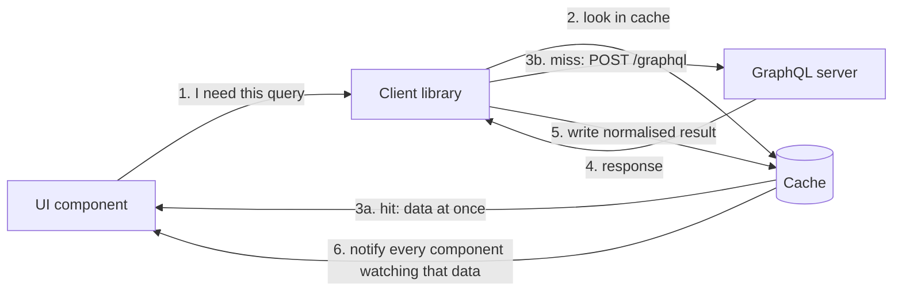

# Calling GraphQL: fetch and client libraries

> **Before this lesson:** you should know that a GraphQL request is an HTTP `POST` with a JSON body and that the response has `data` and `errors` ([What GraphQL is](#/lesson/graphql/what-is-graphql)), how variables are sent ([Variables, mutations and subscriptions](#/lesson/graphql/variables-mutations-subscriptions)), and how promises and `await` work in JavaScript ([Async, await and generators](#/lesson/javascript/async-await-generators)). The React examples assume the basics of components and hooks ([State with useState](#/lesson/react/usestate)).

## In plain words

So far we have looked at the server. Now we sit on the other side of the wire, in the app that *uses* the API. This side is called the **client**.

There are two ways to talk to a GraphQL server from a client.

- **By hand**, with the browser's built-in `fetch` function. This is like phoning a restaurant yourself: dial, say your order, listen to the answer, write it down. It always works and needs nothing installed.
- **With a client library** such as Apollo Client, urql or Relay. This is like having a personal assistant: the assistant places the calls, remembers what was ordered before so you are not kept waiting for things already known, tells you whether an order is still on its way, and keeps everything on your desk up to date.

For one or two requests, phone yourself. For an application with dozens of screens sharing the same data, the assistant pays for itself quickly.

Why it matters for a job: front-end developers on GraphQL projects spend their days writing queries and wiring them to components. Knowing what happens *under* the library, a plain HTTP `POST`, is what lets you debug it in the browser's network tab when something goes wrong.

## A request with fetch

`fetch` is the standard browser (and Node.js) function for making HTTP requests. A GraphQL call needs four things: the `POST` method, a JSON content type, a body with `query` and optionally `variables`, and the endpoint URL.

```javascript
const query = `
  query RecipeScreen($id: ID!) {
    recipe(id: $id) {
      title
      minutes
      author { name }
    }
  }
`;

const response = await fetch("https://api.potluck.example/graphql", {
  method: "POST",
  headers: { "Content-Type": "application/json" },
  body: JSON.stringify({ query, variables: { id: "r1" } }),
});
const result = await response.json();
console.log(result.data.recipe.title);       // "Lentil soup"
```

Line by line:

- `query` is an ordinary string. The backticks allow it to span several lines.
- `fetch(url, options)` sends the request and returns a promise of a `Response`.
- `method: "POST"` and the `Content-Type` header tell the server a JSON body is coming.
- `JSON.stringify({ query, variables })` builds that body: the query text and the variables as separate keys, exactly as described in lesson 8.
- `response.json()` reads the body and parses it. The result is the `{ data, errors }` object.

The same request from a terminal, to underline that nothing here is special to JavaScript:

```bash
curl -X POST https://api.potluck.example/graphql \
  -H "Content-Type: application/json" \
  -d '{"query": "{ recipe(id: \"r1\") { title } }"}'
```

### Handling the three kinds of failure

The snippet above ignores failure, and a GraphQL call can fail in three different places. Robust client code checks all three.

| Where it failed | How you see it | Example |
|---|---|---|
| The network | `fetch` rejects (throws) | offline, DNS failure, timeout |
| HTTP | `response.ok` is false | 500 from a crashed server, 401 from a gateway, 400 for an unparseable request |
| GraphQL | status 200, but the body has an `errors` array | unknown field, a resolver threw, not authorised |

The third row is the one newcomers miss. And it has a twist: a response can contain **both** `data` and `errors`. One field failed and became null; the rest of the data is good. This is called a **partial response**, and the client must decide whether to show what it has or treat the whole thing as failed.

Here is a small, complete helper. The page has no network, so `fetch` is replaced by a fake that behaves like a server; everything else is real client code you could reuse.

```js-run
// ---------- a stand-in for the network: behaves like fetch against a tiny GraphQL server ----------
async function fakeFetch(url, options) {
  const { query, variables = {} } = JSON.parse(options.body);
  const respond = (status, body) => ({ ok: status >= 200 && status < 300, status, json: async () => body });
  if (url.includes("offline")) throw new TypeError("Failed to fetch");
  if (!options.headers["Content-Type"]) return respond(400, { errors: [{ message: "Body must be JSON" }] });
  if (query.includes("calories")) return respond(200, { errors: [{ message: 'Cannot query field "calories" on type "Recipe".' }] });
  if (variables.id === "r404") return respond(200, { data: { recipe: null } });
  return respond(200, {
    data: { recipe: { title: "Lentil soup", author: query.includes("email") ? { name: "Amara", email: null } : { name: "Amara" } } },
    ...(query.includes("email") ? { errors: [{ message: "Not authorised", path: ["recipe", "author", "email"] }] } : {}),
  });
}

// ---------- the helper: one function for every GraphQL call ----------
async function graphqlRequest(url, query, variables = {}, token = null) {
  const headers = { "Content-Type": "application/json" };
  if (token) headers.Authorization = "Bearer " + token;                 // who is calling

  const response = await fakeFetch(url, { method: "POST", headers, body: JSON.stringify({ query, variables }) });  // may throw: network failure
  if (!response.ok) throw new Error("HTTP " + response.status);                                                    // HTTP failure

  const { data, errors } = await response.json();
  if (errors && !data) throw new Error("GraphQL: " + errors.map((e) => e.message).join("; "));                     // total GraphQL failure
  return { data, errors: errors ?? [] };                                                                           // success, possibly partial
}

const url = "https://api.potluck.example/graphql";
const RECIPE = "query($id: ID!) { recipe(id: $id) { title author { name } } }";

console.log("ok      ", JSON.stringify(await graphqlRequest(url, RECIPE, { id: "r1" })));
console.log("missing ", JSON.stringify(await graphqlRequest(url, RECIPE, { id: "r404" })));
console.log("partial ", JSON.stringify(await graphqlRequest(url, "query($id: ID!) { recipe(id: $id) { title author { name email } } }", { id: "r1" })));
for (const [label, badUrl, badQuery] of [["invalid ", url, "{ recipe(id: \"r1\") { calories } }"], ["offline ", "https://offline.example/graphql", RECIPE]]) {
  try { await graphqlRequest(badUrl, badQuery, { id: "r1" }); } catch (e) { console.log(label, "threw:", e.message); }
}
```

What each output line demonstrates:

1. **ok**: data, no errors.
2. **missing**: `recipe` is `null`. That is not an error; "nothing with that id" is a valid answer, and the UI should show "not found".
3. **partial**: `email` is null *and* an error explains why. The helper returns both and lets the caller decide.
4. **invalid**: a validation error has no `data` at all, so the helper throws.
5. **offline**: `fetch` itself threw before any response existed.

In `graphqlRequest`, the three checks appear in the same order as the three rows of the table. The `Authorization` header is where the session token from lesson 15 travels.

> [!WARNING]
> `if (!response.ok) throw ...` alone is not enough for GraphQL, and neither is `if (result.errors) throw ...`. The first misses every GraphQL-level error (they arrive with status 200). The second throws away good partial data. Check `ok`, then look at `data` and `errors` together.

### A lightweight step up: graphql-request

The helper you have read is, in essence, the popular small library **graphql-request**: a thin wrapper around `fetch` that sets the headers, sends query and variables, and throws on errors.

```javascript
import { request, gql } from "graphql-request";

const data = await request("https://api.potluck.example/graphql", gql`
  query RecipeScreen($id: ID!) { recipe(id: $id) { title } }
`, { id: "r1" });
```

It adds no cache. That makes it a good fit for scripts, server-to-server calls and tests, and for pairing with a general-purpose data-fetching library (such as TanStack Query) that provides caching itself.

## What a client library adds

Imagine the Potluck app built on the helper alone. The recipe list screen fetches recipes. The recipe page fetches one recipe. A profile page fetches a cook and their recipes. Soon you are writing the same supporting code on every screen:

| Recurring problem | Hand-written cost | What a client library does |
|---|---|---|
| Loading and error state | a `loading` flag, an `error` variable and a `try`/`catch` per screen | returns `{ loading, error, data }` for you |
| Fetching the same data twice | the profile and the feed both download Amara | a **cache**: the second screen is served from memory, instantly |
| Keeping screens consistent | after renaming a recipe, the list still shows the old title | normalised cache: one stored object, every screen re-renders (next lesson) |
| Simultaneous identical requests | two components mount and both fire the same query | **deduplication**: one network call, shared result |
| After a mutation | manually re-fetching or patching lists | automatic cache updates, refetch helpers |
| Pagination | merging page 2 into page 1 by hand | `fetchMore` and merge policies |
| Instant feedback | the UI waits for the server | optimistic responses (next lesson) |
| Live data | hand-rolled WebSocket code | built-in subscription support |



The diagram is the heart of every GraphQL client: a query goes to the cache first, to the network only if needed, and results flow back *through* the cache so that all interested components update together.

## Apollo Client with React

**Apollo Client** is the most widely used GraphQL client. It works with any UI framework; these examples use React, its most common partner.

```bash
npm install @apollo/client graphql
```

### Configure once

```jsx
// main.jsx
import { ApolloClient, InMemoryCache, HttpLink, ApolloProvider } from "@apollo/client";
import { createRoot } from "react-dom/client";
import App from "./App.jsx";

const client = new ApolloClient({
  link: new HttpLink({ uri: "https://api.potluck.example/graphql" }),   // where to send operations
  cache: new InMemoryCache(),                                           // where to keep results
});

createRoot(document.getElementById("root")).render(
  <ApolloProvider client={client}>
    <App />
  </ApolloProvider>
);
```

- A **link** is a step in the path every operation travels on its way out. `HttpLink` is the final step: the actual `fetch`.
- `InMemoryCache` is the store of results, kept in the browser's memory for as long as the page lives.
- `ApolloProvider` makes the client available to every component beneath it, using React context.

(In Apollo Client 4 the React pieces are imported from `@apollo/client/react`; in version 3 they come from `@apollo/client` as shown. The concepts are identical.)

### Reading data: `useQuery`

```jsx
import { gql, useQuery } from "@apollo/client";

const RECIPE_QUERY = gql`
  query RecipeScreen($id: ID!) {
    recipe(id: $id) {
      id
      title
      minutes
      author { id name }
    }
  }
`;

function RecipeScreen({ id }) {
  const { loading, error, data } = useQuery(RECIPE_QUERY, { variables: { id } });

  if (loading) return <p>Loading…</p>;
  if (error) return <p>Something went wrong: {error.message}</p>;
  if (!data.recipe) return <p>Recipe not found.</p>;

  return (
    <article>
      <h1>{data.recipe.title}</h1>
      <p>{data.recipe.minutes} minutes, by {data.recipe.author.name}</p>
    </article>
  );
}
```

Reading it:

- `gql` parses the query text into an AST once (lesson 9).
- `useQuery` is a React **hook**: a function that connects a component to some outside state. It starts the request when the component first appears and returns an object describing where things stand.
- On the first render `loading` is `true`. When the response arrives, the hook makes the component render again with `data` filled in. If the data is already in the cache, `data` is available on the very first render and no request is made.
- The three `if` lines handle, in order: still waiting, failed, and the valid "no such recipe" answer.
- The query selects `id` on every object. This is deliberate; the cache needs it, as the next lesson explains.

Compare this with the helper version: no `try`/`catch`, no state variables, no effect to trigger the fetch, and caching and deduplication for free.

> [!NOTE]
> Older tutorials and books show `<Query>` and `<Mutation>` *components* that take a function as their child (a pattern called render props). They were replaced by the `useQuery` and `useMutation` hooks in 2019 and have since been removed from the library. If you meet them in legacy code, the mental model is the same: the same `loading`, `error` and `data` values arrive as function arguments instead of as a hook's return value.

### Writing data: `useMutation`

```jsx
import { gql, useMutation } from "@apollo/client";

const ADD_REVIEW = gql`
  mutation AddReview($input: AddReviewInput!) {
    addReview(input: $input) {
      review { id stars text by { id name } }
      errors { field message }
    }
  }
`;

function ReviewForm({ recipeId }) {
  const [addReview, { loading, error, data }] = useMutation(ADD_REVIEW);

  async function handleSubmit(event) {
    event.preventDefault();
    const form = new FormData(event.target);
    await addReview({ variables: { input: { recipeId, stars: Number(form.get("stars")), text: form.get("text") } } });
    event.target.reset();
  }

  const userErrors = data?.addReview.errors ?? [];
  return (
    <form onSubmit={handleSubmit}>
      <input name="stars" type="number" min="1" max="5" required />
      <input name="text" placeholder="How was it?" />
      <button disabled={loading}>Post review</button>
      {userErrors.map((e) => <p key={e.field}>{e.message}</p>)}
      {error && <p>Could not reach the server.</p>}
    </form>
  );
}
```

`useMutation` does **not** run anything when the component renders. It returns a pair: a function (`addReview`) to call when the user acts, and an object with the same `loading`, `error` and `data` fields. Note the two different error channels from lesson 13: `data.addReview.errors` holds the user-fixable validation messages; `error` is for unexpected failures.

### Sending the sign-in token

Every request should carry the session token. Links compose into a chain, so a small link that adds the header sits in front of the HTTP link:

```javascript
import { ApolloClient, InMemoryCache, HttpLink, ApolloLink } from "@apollo/client";

const authLink = new ApolloLink((operation, forward) => {
  const token = localStorage.getItem("token");
  operation.setContext(({ headers = {} }) => ({
    headers: { ...headers, ...(token ? { authorization: "Bearer " + token } : {}) },
  }));
  return forward(operation);                       // pass the operation to the next link
});

const client = new ApolloClient({
  link: authLink.concat(new HttpLink({ uri: "/graphql" })),
  cache: new InMemoryCache(),
});
```

The link chain is the client-side equivalent of middleware: authentication, retries, logging and error reporting are each one link.

> [!WARNING]
> When the user signs out, clear the cache as well as the token (`client.clearStore()` or `client.resetStore()`). Otherwise the previous user's private data stays in memory and can appear for the next person who signs in on the same device.

## Choosing a client

| Client | Character | Good fit |
|---|---|---|
| plain `fetch` / graphql-request | no cache, a few lines | scripts, servers, simple pages, tests |
| graphql-request + TanStack Query | a general fetch-and-cache library; caches whole responses per query | teams already using TanStack Query; simple data that is rarely shared between queries |
| urql | small and modular; document cache by default, normalised cache as an add-on | apps wanting something lighter than Apollo |
| Apollo Client | full-featured, normalised cache, large ecosystem and developer tools | most product apps |
| Relay | strict conventions (fragments per component, connections, global ids), a compiler, very efficient at scale | large apps and teams willing to adopt its rules |

Whichever you choose, pair it with **code generation** if you use TypeScript: a tool such as GraphQL Code Generator reads your schema and your queries and produces exact types for each operation's variables and result. A typo in a field name then fails in the editor instead of in production.

> [!TIP]
> When a query misbehaves, open the browser's developer tools, go to the Network tab and filter by `graphql`. Every operation is a visible `POST` whose request payload shows the query and variables and whose response shows `data` and `errors`. Giving every operation a name makes them easy to find in that list.

> [!INTERVIEW]
> **"How do you call a GraphQL API without a library?"** `POST` to the endpoint with `Content-Type: application/json` and a body `{ query, variables, operationName }`; parse the JSON; check the HTTP status and then the `errors` array, remembering that a 200 response may carry errors and that `data` may be partial.
>
> **"Why use Apollo Client or Relay instead of fetch?"** For a normalised cache that removes repeat requests and keeps every view of an object consistent, declarative loading and error state, request deduplication, pagination helpers, optimistic updates and subscription support. The cost is bundle size and concepts to learn; for a handful of independent requests plain `fetch` is enough.

## Pitfalls

- **Using `GET` with a body, or forgetting `Content-Type`.** The server cannot read the request.
- **Sending variables inside the query string** by string concatenation. Use the `variables` key.
- **Reading `result.recipe`** instead of `result.data.recipe`.
- **Treating `null` data as an error**, or treating HTTP 200 as success without looking at `errors`.
- **Calling `useQuery` conditionally or inside loops.** Hooks must run in the same order on every render; use the `skip` option to avoid running a query.
- **Expecting `useMutation` to run on render.** It runs when you call the returned function.
- **Leaving `id` out of selections** when using a normalising cache. Objects without ids cannot be shared between queries.
- **Not clearing the cache on sign-out.**
- **Creating a new `ApolloClient` on every render.** Create it once, outside components.

## Cheat sheet

| Task | Code |
|---|---|
| raw request | `fetch(url, { method: "POST", headers: { "Content-Type": "application/json" }, body: JSON.stringify({ query, variables }) })` |
| read result | `const { data, errors } = await response.json()` |
| failures to check | network (throws) → HTTP (`response.ok`) → GraphQL (`errors`) |
| auth | header `Authorization: Bearer <token>` |
| tiny client | `request(url, query, variables)` from graphql-request |
| Apollo setup | `new ApolloClient({ link: new HttpLink({ uri }), cache: new InMemoryCache() })` + `<ApolloProvider client={client}>` |
| read in React | `const { loading, error, data } = useQuery(QUERY, { variables })` |
| write in React | `const [run, { loading, error, data }] = useMutation(MUTATION)`; then `run({ variables })` |
| add headers | an `ApolloLink` placed before the `HttpLink` |
| sign-out | remove the token and `client.clearStore()` |
| types | GraphQL Code Generator |

## Summary

- A GraphQL call is an HTTP `POST` with a JSON body holding `query` and `variables`; `fetch` is all you need to make one.
- Failures occur at three levels (network, HTTP, GraphQL), and a successful HTTP response may still contain errors or partial data.
- Client libraries add a cache, loading and error state, deduplication, pagination helpers, optimistic updates and subscriptions.
- With Apollo Client you configure a client with a link and a cache, read with `useQuery`, write with `useMutation`, and attach credentials with a link.
- Choose the lightest tool that meets the app's needs, and add code generation for type safety.

## Glossary

- **Client:** the application that sends operations to a GraphQL server.
- **`fetch`:** the standard JavaScript function for HTTP requests.
- **Partial response:** a response containing both usable `data` and `errors`.
- **Client library:** a package that manages GraphQL requests, caching and UI integration.
- **Cache:** a store of previously fetched results kept for reuse.
- **Deduplication:** combining identical simultaneous requests into one.
- **Apollo Client:** a full-featured GraphQL client library.
- **Link:** a composable step in Apollo Client's request pipeline.
- **`InMemoryCache`:** Apollo Client's normalised in-memory store.
- **Provider:** a component that makes a value (here, the client) available to all components beneath it.
- **Hook:** a React function, named `use…`, that connects a component to state or outside systems.
- **`useQuery` / `useMutation`:** Apollo's hooks for reading and writing.
- **Render props:** an older React pattern in which a component's child is a function; used by Apollo's retired `<Query>` component.
- **Middleware:** code that runs on every request before the main handler.
- **Code generation:** producing typed code from the schema and operations.

## Check yourself

```quiz
[
  {"q": "Which request body is correct for sending a query with a variable?",
   "options": ["`{\"query\": \"query($id: ID!) { recipe(id: $id) { title } }\", \"variables\": {\"id\": \"r1\"}}`", "`{\"query\": \"{ recipe(id: $id) { title } }\", \"$id\": \"r1\"}`", "`query($id: ID!) { recipe(id: $id) { title } } id=r1`", "`{\"recipe\": {\"id\": \"r1\", \"fields\": [\"title\"]}}`"],
   "answer": 0,
   "explain": "The body is JSON with a `query` string and a separate `variables` object whose keys have no dollar sign."},
  {"q": "The server answers with HTTP 200 and `{\"data\": {\"recipe\": {\"title\": \"Lentil soup\", \"author\": {\"name\": \"Amara\", \"email\": null}}}, \"errors\": [{\"message\": \"Not authorised\", \"path\": [\"recipe\", \"author\", \"email\"]}]}`. What is this?",
   "options": ["A total failure; discard everything", "A partial response: most data is valid, one field failed", "A network error", "An invalid response, since data and errors cannot appear together"],
   "answer": 1,
   "explain": "GraphQL can return usable data together with errors for the fields that failed. The client decides whether to render what it has."},
  {"q": "Using `graphqlRequest` from this lesson, what happens for `{ recipe(id: \"r1\") { calories } }` when `Recipe` has no `calories` field?",
   "options": ["It returns `{data: {recipe: {calories: null}}, errors: []}`", "It throws, because the response has `errors` and no `data`", "It returns `{data: null, errors: []}`", "`fetch` rejects with a TypeError"],
   "answer": 1,
   "explain": "A validation error means nothing was executed, so there is no `data`. The helper treats errors without data as a thrown failure."},
  {"q": "What does `useQuery` return on the very first render when the data is NOT in the cache?",
   "options": ["`{loading: false, data: {...}}`", "`{loading: true, data: undefined}`", "A Promise", "It throws until the data arrives"],
   "answer": 1,
   "explain": "The hook starts the request and reports `loading: true`. When the response arrives the component renders again with `data`."},
  {"q": "When does the mutation run in `const [addReview] = useMutation(ADD_REVIEW)`?",
   "options": ["Immediately, when the component renders", "When `addReview(...)` is called, for example in a submit handler", "Every time the cache changes", "Never; mutations need `fetch`"],
   "answer": 1,
   "explain": "`useMutation` returns a function. Nothing is sent until that function is called."},
  {"q": "Two components on one page both call `useQuery` with the same query and variables at the same time. What does Apollo Client send?",
   "options": ["Two identical requests", "One request, whose result both components receive", "Nothing until one component unmounts", "A subscription"],
   "answer": 1,
   "explain": "Identical in-flight queries are deduplicated, and both components read the result from the cache."},
  {"q": "Why should the cache be cleared when a user signs out?",
   "options": ["To free disk space", "The previous user's data would remain in memory and could be shown to the next user", "The server requires it", "Tokens are stored in the cache"],
   "answer": 1,
   "explain": "The cache holds whatever the signed-in user fetched, including private data. Removing only the token leaves that data behind."},
  {"q": "For a nightly script that makes one GraphQL call and exits, which tool is the most sensible?",
   "options": ["Relay", "Apollo Client with a normalised cache", "Plain `fetch` or graphql-request", "A WebSocket subscription"],
   "answer": 2,
   "explain": "A cache and UI integration add nothing to a single request. Use the lightest tool that does the job."}
]
```

> **Source:** Porcello & Banks, *Learning GraphQL*, ch. 6 (using a GraphQL API, fetch requests, graphql-request, Apollo Client, the Query and Mutation components, authorization). Also: https://graphql.org/learn/serving-over-http/ ; https://www.apollographql.com/docs/react/get-started ; https://www.apollographql.com/docs/react/data/queries ; https://www.apollographql.com/docs/react/data/mutations ; https://www.apollographql.com/docs/react/networking/authentication.
