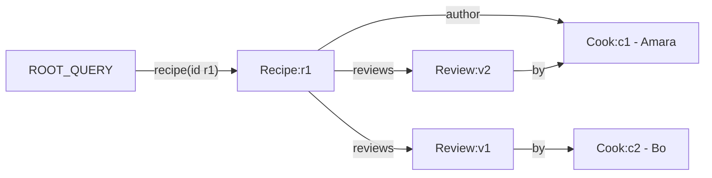
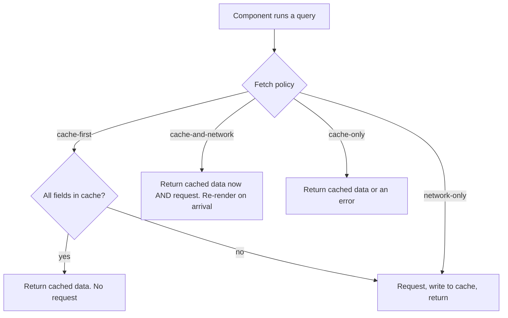

# The normalised cache, fetch policies, local state and optimistic UI

> **Before this lesson:** you should have read [Calling GraphQL: fetch and client libraries](#/lesson/graphql/fetch-and-clients) (Apollo Client, `useQuery`, `useMutation`) and remember from [Trees as graphs](#/lesson/graphql/trees-and-real-graphs) that one object can appear many times in a response tree.

## In plain words

A **cache** is a place where a program keeps answers it has already obtained, so that it does not have to ask again. Your browser caches images; your brain caches your own phone number.

A GraphQL client's cache does something cleverer than remembering whole answers. Suppose three different screens have each downloaded the cook Amara: once inside a recipe, once in a list of reviewers, once on her profile. If the cache kept three separate copies and she changed her name, two screens would show the old one. Instead the cache works like a **contacts app**: there is one entry per person. Every message thread *refers* to the contact; none keeps its own copy of the name. Edit the contact once and every thread shows the change.

Storing each object once, under its own identity, and replacing copies with references is called **normalisation**. This lesson explains how it works and three things built on it:

- **fetch policies**: when to trust the cache and when to ask the server;
- **local state**: keeping client-only data (dark mode, a draft) in the same system;
- **optimistic UI**: showing the result of an action *before* the server confirms it.

Why it matters for a job: "the screen did not update after my mutation" is the most common bug in GraphQL front ends, and every instance of it is explained by how the normalised cache works. Interviewers ask about normalisation, fetch policies and optimistic updates for the same reason.

## Why whole responses are not enough

The simplest cache stores each response under its query: "for `RecipeScreen(id: r1)` the answer was …". This is called a **document cache**. Run the model below to see its weakness.

```js-run
// Two queries were fetched earlier and their responses stored as-is.
const documentCache = {
  "RecipeScreen(r1)": { recipe: { id: "r1", title: "Lentil soup", author: { id: "c1", name: "Amara" } } },
  "CookProfile(c1)": { cook: { id: "c1", name: "Amara", city: "Leeds" } },
};

// A mutation renames the cook. The server replies with the updated object.
const mutationResult = { renameCook: { id: "c1", name: "Amara O." } };

// The profile screen applies the result to its own cached response...
documentCache["CookProfile(c1)"].cook.name = mutationResult.renameCook.name;

// ...but the recipe screen's copy knows nothing about it.
console.log("profile screen:", documentCache["CookProfile(c1)"].cook.name);
console.log("recipe screen :", documentCache["RecipeScreen(r1)"].recipe.author.name, " <- stale");
```

Two copies of the same cook, and only one was updated. With dozens of queries the copies cannot be kept in step by hand.

## How normalisation works

The fix has three steps, performed every time a response is written to the cache.

**1. Identify.** Every object that has an identity gets a **cache key**. By default Apollo Client builds it from two fields: `__typename` and `id`, joined with a colon. A recipe with id `r1` gets the key `Recipe:r1`. This is why Apollo adds `__typename` to every selection automatically, and why you should always select `id`.

**2. Flatten.** The nested response is split into a flat table with one entry per object.

**3. Link.** Wherever one object contained another, the inner object is replaced by a **reference**: a small pointer `{ "__ref": "Cook:c1" }`.

Take this response:

```json
{
  "recipe": {
    "__typename": "Recipe", "id": "r1", "title": "Lentil soup",
    "author": { "__typename": "Cook", "id": "c1", "name": "Amara" },
    "reviews": [
      { "__typename": "Review", "id": "v1", "stars": 5, "by": { "__typename": "Cook", "id": "c2", "name": "Bo" } },
      { "__typename": "Review", "id": "v2", "stars": 4, "by": { "__typename": "Cook", "id": "c1", "name": "Amara" } }
    ]
  }
}
```

After normalisation the cache contains:

```json
{
  "ROOT_QUERY": { "recipe({\"id\":\"r1\"})": { "__ref": "Recipe:r1" } },
  "Recipe:r1": {
    "__typename": "Recipe", "id": "r1", "title": "Lentil soup",
    "author": { "__ref": "Cook:c1" },
    "reviews": [ { "__ref": "Review:v1" }, { "__ref": "Review:v2" } ]
  },
  "Cook:c1": { "__typename": "Cook", "id": "c1", "name": "Amara" },
  "Cook:c2": { "__typename": "Cook", "id": "c2", "name": "Bo" },
  "Review:v1": { "__typename": "Review", "id": "v1", "stars": 5, "by": { "__ref": "Cook:c2" } },
  "Review:v2": { "__typename": "Review", "id": "v2", "stars": 4, "by": { "__ref": "Cook:c1" } }
}
```

Amara appeared twice in the response tree and exists **once** in the cache. The tree has been folded back into the graph it was cut from.



Three details:

- `ROOT_QUERY` is the entry for the root `Query` type. Its fields are keyed by name **and arguments**, so `recipe(id: "r1")` and `recipe(id: "r2")` are stored separately.
- When a later response mentions `Cook:c1` again, its fields are **merged** into the existing entry. One query can supply `name`, another `city`; the entry accumulates both.
- An object without an `id` cannot be identified. It is stored inline inside its parent and is not shared.

**Reading** is the reverse walk. To answer a query from the cache, the client starts at `ROOT_QUERY`, follows references and collects the selected fields. If any selected field is missing, the cache cannot fully answer, and (by default) the client goes to the network.

The whole mechanism in a runnable model:

```js-run
const store = { ROOT_QUERY: {} };

// ---------- write: flatten a response into the store ----------
function normalise(value) {
  if (Array.isArray(value)) return value.map(normalise);
  if (value === null || typeof value !== "object") return value;
  const fields = {};
  for (const [k, v] of Object.entries(value)) fields[k] = normalise(v);
  if (value.__typename && value.id != null) {
    const key = value.__typename + ":" + value.id;
    store[key] = { ...store[key], ...fields };                 // merge with what is already known
    return { __ref: key };
  }
  return fields;                                               // no identity: stays inline
}
function write(data) { Object.assign(store.ROOT_QUERY, normalise(data)); }

// ---------- read: follow refs; undefined means "cache miss" ----------
function read(value, selection) {
  if (value === null) return null;
  if (Array.isArray(value)) { const items = value.map((v) => read(v, selection)); return items.includes(undefined) ? undefined : items; }
  if (selection === true) return value;
  if (value.__ref) value = store[value.__ref];
  if (value === undefined) return undefined;
  const out = {};
  for (const [field, sub] of Object.entries(selection)) {
    if (!(field in value)) return undefined;                   // a requested field is unknown: miss
    const result = read(value[field], sub);
    if (result === undefined) return undefined;
    out[field] = result;
  }
  return out;
}
const query = (selection) => read(store.ROOT_QUERY, selection) ?? "MISS -> must ask the server";

// Response 1: the recipe screen.
write({ recipe: { __typename: "Recipe", id: "r1", title: "Lentil soup", author: { __typename: "Cook", id: "c1", name: "Amara" } } });
// Response 2: the profile screen (same cook, an extra field).
write({ cook: { __typename: "Cook", id: "c1", name: "Amara", city: "Leeds" } });

console.log(Object.keys(store));
console.log("recipe screen:", JSON.stringify(query({ recipe: { title: true, author: { name: true } } })));

// A mutation returns { id, name } for the cook. Writing it updates the ONE stored entry.
normalise({ __typename: "Cook", id: "c1", name: "Amara O." });
console.log("recipe screen:", JSON.stringify(query({ recipe: { title: true, author: { name: true } } })));
console.log("profile      :", JSON.stringify(query({ cook: { name: true, city: true } })));

// Data assembled from two different responses, with no network:
console.log("combined     :", JSON.stringify(query({ recipe: { author: { city: true } } })));
// A field nobody has fetched yet:
console.log("minutes?     :", query({ recipe: { minutes: true } }));
```

Check the output against the claims:

- The store has four keys: `ROOT_QUERY`, `Recipe:r1`, and one `Cook:c1` although two responses contained her.
- After the rename is written, **both** screens read the new name. No screen-specific code was needed.
- `recipe → author → city` is answered from the cache although no single response contained that path: the recipe response supplied the link to the cook, the profile response supplied her city.
- `minutes` was never fetched, so the read is a miss. The cache never invents or returns partial data.

The practice problem *A normalised client cache* has you implement these operations in full.

## What updates by itself, and what does not

This is the part that explains everyday bugs.

| After a mutation… | Does the UI update automatically? | Why |
|---|---|---|
| …that returns an **existing object** with its `id` and changed fields | **yes** | the result is merged into `Type:id`; every query watching it re-renders |
| …that **creates** a new object | the object is cached, but **lists do not grow** | no list in the cache holds a reference to the newcomer yet |
| …that **deletes** an object | **no** | the entry, and references to it, remain |

So renaming a recipe needs no extra code, provided the mutation's selection includes `id` and `title`. Adding a review needs a decision about how the `reviews` list should learn of it. There are three standard options, from least to most effort:

```javascript
// Option 1: ask the server again for the affected queries. Simple; costs a request.
const [addReview] = useMutation(ADD_REVIEW, { refetchQueries: ["RecipeScreen"] });

// Option 2: edit the cached list yourself. No extra request.
const [addReview] = useMutation(ADD_REVIEW, {
  update(cache, { data }) {
    const newReview = data.addReview.review;
    if (!newReview) return;                                   // validation failed; nothing to add
    cache.modify({
      id: cache.identify({ __typename: "Recipe", id: recipeId }),
      fields: {
        reviews(existingRefs = [], { toReference }) {
          return [toReference(newReview), ...existingRefs];   // put a reference at the front
        },
      },
    });
  },
});

// Option 3 (deletes): remove the entry and tidy dangling references.
cache.evict({ id: cache.identify({ __typename: "Review", id: deletedId }) });
cache.gc();
```

Start with `refetchQueries`. Move to a manual `update` when the extra request is noticeable.

> [!TIP]
> Design mutation payloads to make the cache's job easy (lesson 13): return every object the mutation changed, each with its `id`. If `addReview` also returns `recipe { id rating reviewCount }`, the rating on screen updates with no client code at all.

## Fetch policies

Whenever a component asks for a query there is a choice: use the cached answer, or go to the server? A **fetch policy** is the rule that decides. Each `useQuery` can set its own.

| Policy | Reads cache? | Uses network? | Behaviour | Use for |
|---|---|---|---|---|
| `cache-first` (default) | yes | only on a miss | fastest; may show old data | data that rarely changes |
| `cache-and-network` | yes | always | shows cached data at once, then updates when the server answers | feeds, dashboards: fast *and* fresh |
| `network-only` | no | always | always waits for the server; still writes the result to the cache | data that must be current: balances, stock |
| `cache-only` | yes | never | fails on a miss | offline screens; data known to be loaded |
| `no-cache` | no | always | result is not stored at all | sensitive one-off data |

```javascript
const { data, loading } = useQuery(FEED_QUERY, { fetchPolicy: "cache-and-network" });
```



Two further tools keep data fresh without changing policy: `pollInterval` re-runs a query on a timer, and the `refetch` function returned by `useQuery` re-runs it on demand, for example for a pull-to-refresh gesture.

By default the cache lives in memory and vanishes on page reload. For apps that should open instantly or work offline, the cache can be **persisted** (saved to `localStorage` or a similar store and restored at start-up) with a helper library such as `apollo3-cache-persist`.

> [!WARNING]
> The default, `cache-first`, never checks the server once it has an answer. If users say "I have to reload the page to see new data", the cause is usually this policy on a query whose data changes. Use `cache-and-network` for anything other users can alter.

## Local state

Some state never goes to the server: whether dark mode is on, which tab is selected, the unsent text of a draft review. Since the cache is already the app's store for remote data, Apollo Client lets local data live beside it, so components read both in the same way.

A **reactive variable** is a small container for a value; any query that depends on it re-renders when the value changes.

```javascript
import { makeVar, InMemoryCache, gql, useQuery } from "@apollo/client";

export const draftReviewVar = makeVar("");             // create: initial value ""

const cache = new InMemoryCache({
  typePolicies: {
    Query: {
      fields: {
        draftReview: { read: () => draftReviewVar() },   // a field computed on the client
      },
    },
  },
});

const SCREEN = gql`
  query RecipeWithDraft($id: ID!) {
    recipe(id: $id) { id title }        # from the server
    draftReview @client                 # from the client; never sent over the network
  }
`;

draftReviewVar("Loved it, but");         // write: components using draftReview re-render
```

The `@client` directive marks a field as local: the client strips it from the query before sending and fills it in from the cache or from the `read` function.

Use this sparingly. For state that only one component needs, React's own `useState` is simpler. Local fields earn their place when client-only state is combined with server data in one query, or shared across distant components.

## Optimistic UI

When a user taps the heart on a recipe, a round trip to the server takes perhaps 200 milliseconds. Waiting that long before filling in the heart makes an app feel sluggish. **Optimistic UI** means updating the screen immediately, on the assumption that the server will agree, and correcting it in the rare case that it does not.

With Apollo Client you supply the response you *expect*:

```javascript
const [likeRecipe] = useMutation(LIKE_RECIPE);

likeRecipe({
  variables: { id: recipe.id },
  optimisticResponse: {
    likeRecipe: {
      __typename: "Recipe",
      id: recipe.id,
      likedByMe: true,
      likeCount: recipe.likeCount + 1,
    },
  },
});
```

What happens next:

1. The optimistic response is written to the cache at once, as a separate **layer** on top of the real data. Components re-render: the heart fills and the count goes up.
2. The mutation travels to the server.
3. **Success:** the layer is discarded and the real response is written in its place. Usually nothing visibly changes.
4. **Failure:** the layer is discarded and nothing replaces it. The UI returns to the true state, and you show a message.

The word *layer* is the key to correctness. The optimistic data is never mixed into the confirmed data. It is kept apart, tagged with its mutation, so that removing it restores exactly the right state even when several mutations are in flight together.

```js-run
const confirmed = { likeCount: 10, likedByMe: false, title: "Lentil soup" };     // what the server has told us
let layers = [];                                                                // pending optimistic patches

const view = () => layers.reduce((data, layer) => ({ ...data, ...layer.patch }), { ...confirmed });
const show = (label) => console.log(label.padEnd(34), JSON.stringify(view()));

show("start");

// The user taps like, then renames the recipe, before either request has returned.
layers.push({ id: "m1", patch: { likeCount: 11, likedByMe: true } });
layers.push({ id: "m2", patch: { title: "Red lentil soup" } });
show("two optimistic layers");

// m1 FAILS on the server: remove only its layer.
layers = layers.filter((l) => l.id !== "m1");
show("m1 rolled back, m2 still pending");

// m2 SUCCEEDS: remove its layer and write the server's answer into the confirmed data.
layers = layers.filter((l) => l.id !== "m2");
Object.assign(confirmed, { title: "Red Lentil Soup" });                          // server normalised the capitals
show("m2 committed with server result");
```

Follow the four lines of output. After the rollback of `m1` the like has gone **but the optimistic title is still showing**: the two guesses were independent. A design that saved one snapshot of the whole cache before `m1` and restored it on failure would have wiped out `m2`'s change as well. The practice problem *Optimistic updates and rollback* asks for the layered version.

For a newly created object the client does not yet know the server's id, so the optimistic response uses a temporary one (`id: "temp-1"`); when the real response arrives, the temporary entry is replaced.

Use optimistic updates when the outcome is nearly certain and easy to predict (likes, toggles, renames, adding a comment). Avoid them when the server computes something you cannot guess, or when showing a result that is later withdrawn would be harmful (payments, bookings).

> [!INTERVIEW]
> **"What is a normalised cache?"** The client splits each response into individual objects, stores each once under a key derived from `__typename` and `id`, and replaces nested objects with references. Any query reading an object sees the latest version, so a mutation that returns an updated object refreshes every view of it. New and deleted list items still need a refetch or a manual cache update.
>
> **"Explain `cache-first` versus `cache-and-network`."** `cache-first` returns cached data when the whole query can be satisfied and only otherwise calls the server: fast, possibly stale. `cache-and-network` returns cached data immediately and also calls the server, updating the UI when the response arrives: fast and fresh, at the cost of a request each time.
>
> **"How do optimistic updates work, and what happens on failure?"** The expected result is written to a temporary layer over the cache so the UI updates at once; on success the layer is replaced by the server's response; on failure it is removed, which reverts the UI without affecting other pending mutations.

## Pitfalls

- **Not selecting `id`.** Objects cannot be normalised or shared, and mutation results cannot find their entry.
- **A mutation that does not return the changed fields.** Nothing to merge; the UI stays stale.
- **Expecting lists to grow or shrink by themselves** after create and delete mutations.
- **Different arguments, different cache entries.** `reviews(first: 5)` and `reviews(first: 10)` are stored separately unless a type policy merges them.
- **`cache-first` for volatile data.**
- **Objects whose identity is not `id`.** If a type is identified by `slug` or by a pair of fields, configure `keyFields` in its type policy.
- **Mutating objects read from the cache.** Treat them as read-only; write through the cache's methods.
- **Optimistic responses with the wrong shape or a missing `__typename` / `id`.** The layer cannot be matched to the entry.
- **Optimism for irreversible actions.**
- **Putting every bit of UI state in the cache** when component state would do.

## Cheat sheet

| Concept | Key facts |
|---|---|
| cache key | `__typename:id`, for example `Recipe:r1` (customise with `keyFields`) |
| reference | `{ "__ref": "Cook:c1" }` in place of a nested object |
| root entry | `ROOT_QUERY`, fields keyed by name and arguments |
| write | flatten, merge into existing entries |
| read | follow refs; any missing field → miss |
| auto-updates | changes to existing objects returned with `id` |
| needs help | additions and removals from lists: `refetchQueries`, `update` + `cache.modify`, `evict` |
| `cache-first` | default; network only on a miss |
| `cache-and-network` | cached now, fresh soon |
| `network-only` / `no-cache` | always the server; store / do not store |
| `cache-only` | never the server |
| local state | `makeVar`, `@client` fields |
| optimistic UI | `optimisticResponse` → temporary layer → replaced or removed |
| sign-out | `client.clearStore()` |

## Summary

- A normalised cache stores each identifiable object once, keyed by `__typename` and `id`, with references in place of nested copies.
- Because every query reads through the same entries, updating an object once updates every screen that shows it; lists need explicit help when items are added or removed.
- Fetch policies decide between speed and freshness for each query; `cache-first` is the default and `cache-and-network` is the usual choice for changeable data.
- Client-only state can live beside server data through reactive variables and `@client` fields.
- Optimistic UI applies the expected mutation result as a removable layer, giving instant feedback and a clean rollback on failure.

## Glossary

- **Cache:** a store of previously obtained results kept for reuse.
- **Document cache:** a cache keyed by whole query; each response is stored separately.
- **Normalisation:** splitting data so that each object is stored once and referred to elsewhere.
- **Cache key / cache id:** the identifier of an object in the cache, by default `__typename:id`.
- **Reference:** a pointer from one cache entry to another.
- **`ROOT_QUERY`:** the cache entry holding the results of root query fields.
- **Cache hit / miss:** the cache can / cannot fully answer a query.
- **Stale:** out of date compared with the server.
- **Fetch policy:** the rule for using cache and network when running a query.
- **Refetch:** to run a query against the server again.
- **Polling:** refetching on a timer.
- **Type policy:** per-type cache configuration, such as key fields and merge behaviour.
- **Evict:** remove an entry from the cache.
- **Persisting the cache:** saving it to durable storage so it survives a reload.
- **Local state:** data that exists only on the client.
- **Reactive variable:** an Apollo Client container for local state that triggers re-renders when changed.
- **Optimistic response:** the predicted result of a mutation, applied before the server replies.
- **Rollback:** undoing an optimistic change after a failure.

## Check yourself

```quiz
[
  {"q": "Under which key does Apollo Client store `{\"__typename\": \"Cook\", \"id\": \"c7\", \"name\": \"Dee\"}` by default?",
   "options": ["`c7`", "`Cook:c7`", "`Dee`", "`ROOT_QUERY.cook`"],
   "answer": 1,
   "explain": "The default cache key joins `__typename` and `id` with a colon."},
  {"q": "A response contains a recipe whose author is Amara (c1) and two reviews, one of them also by Amara. How many entries for Amara does the normalised cache hold?",
   "options": ["Three", "Two", "One: `Cook:c1`, referenced from two places", "None; nested objects are not cached"],
   "answer": 2,
   "explain": "Every occurrence normalises to the same key. The recipe's `author` and the review's `by` both hold `{__ref: \"Cook:c1\"}`."},
  {"q": "The cache holds `Recipe:r1` with `title` and `author`. A component runs `{ recipe(id: \"r1\") { title minutes } }` with the default fetch policy. What happens?",
   "options": ["The cache returns `{title: \"Lentil soup\", minutes: null}`", "The cache returns only `title`", "A cache miss: the query is sent to the server", "An error is thrown"],
   "answer": 2,
   "explain": "`minutes` was never fetched. A read with any missing field is a miss, and `cache-first` then goes to the network."},
  {"q": "A mutation `renameRecipe` returns `{ id title }` for an existing recipe. What must the developer do so that a list showing that recipe's title updates?",
   "options": ["Call `refetchQueries`", "Write a manual `update` function", "Nothing: the result is merged into `Recipe:<id>` and watching components re-render", "Reload the page"],
   "answer": 2,
   "explain": "Changes to an existing, identified object propagate automatically through the normalised cache."},
  {"q": "A mutation creates a brand-new review. Why does the recipe's review list on screen not show it automatically?",
   "options": ["Mutation results are never cached", "The new review is cached, but the list field holds references only to the reviews it knew about", "Lists cannot be cached", "The review has no `__typename`"],
   "answer": 1,
   "explain": "The cache cannot know which lists a new object belongs in. You refetch the query or add the reference to the list in an `update` function."},
  {"q": "Which fetch policy shows cached data immediately AND always asks the server for a fresh copy?",
   "options": ["`cache-first`", "`cache-only`", "`cache-and-network`", "`no-cache`"],
   "answer": 2,
   "explain": "`cache-and-network` gives a fast first paint from cache and then updates when the network response arrives."},
  {"q": "Confirmed data is `{likes: 10}`. Optimistic layers m1 `{likes: 11}` and m2 `{title: \"New\"}` are pending. m1 fails and is rolled back. What does the UI read?",
   "options": ["`{likes: 10}`", "`{likes: 10, title: \"New\"}`", "`{likes: 11, title: \"New\"}`", "`{likes: 11}`"],
   "answer": 1,
   "explain": "Only m1's layer is removed. m2 is still pending, so its optimistic title remains applied over the confirmed data."},
  {"q": "For which action is an optimistic update a poor choice?",
   "options": ["Toggling a like", "Renaming a collection", "Confirming a payment", "Marking a notification as read"],
   "answer": 2,
   "explain": "Showing 'paid' and then withdrawing it is harmful, and the outcome depends on checks the client cannot predict. Wait for the server."}
]
```

> **Source:** Porcello & Banks, *Learning GraphQL*, ch. 6 (working with the cache, fetch policies, persisting the cache, updating the cache). Also: https://www.apollographql.com/docs/react/caching/overview ; https://www.apollographql.com/docs/react/data/queries#setting-a-fetch-policy ; https://www.apollographql.com/docs/react/performance/optimistic-ui ; https://www.apollographql.com/docs/react/local-state/local-state-management ; https://graphql.org/learn/caching/.
