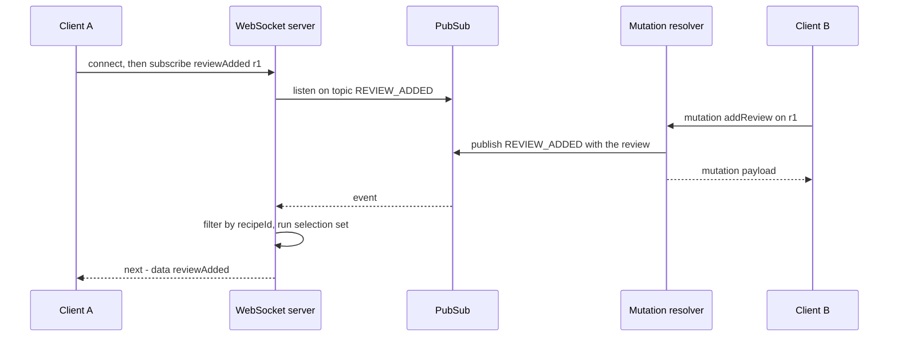
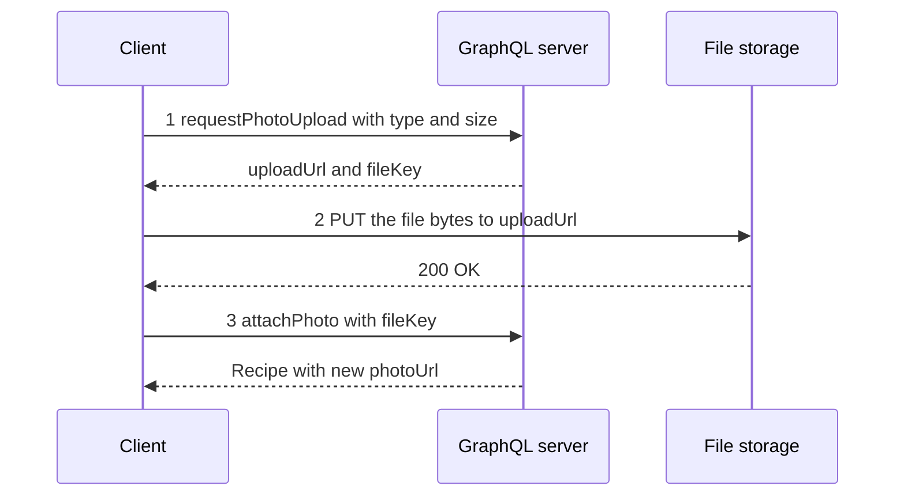
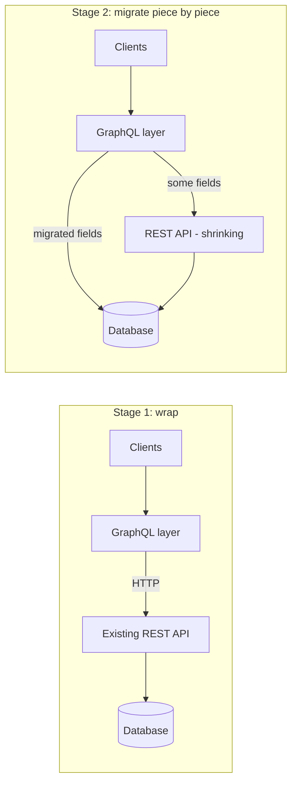

# Subscriptions, file uploads, migration and schema-first versus code-first

> **Before this lesson:** you should know what a subscription looks like to a client ([Variables, mutations and subscriptions](#/lesson/graphql/variables-mutations-subscriptions)), how resolvers and context work ([Resolvers, the resolver chain and context](#/lesson/graphql/resolvers-context)), and how a REST API is organised ([REST in plain words](#/lesson/graphql/rest-in-plain-words)).

## In plain words

Tutorials end where real projects begin. This lesson covers four questions that come up as soon as a GraphQL API meets real users and an existing codebase.

1. **How does the server push live updates?** Ordinary HTTP is a letter and a reply. Live updates need a telephone line that stays open: a **WebSocket**.
2. **How do I upload a photo?** GraphQL speaks JSON, and JSON is poor at carrying large binary files. The usual answer is to send the file somewhere else and tell GraphQL only *where it went*, the way you would drop a parcel at a depot and text the tracking number.
3. **We already have a REST API. Do we rewrite everything?** No. You put GraphQL in front of it, like a new reception desk in an old building, and renovate one room at a time.
4. **Do we write the schema first, or generate it from code?** Two workflows, each with real advantages.

Why it matters for a job: very few developers get to build a GraphQL API on an empty field. Most are asked to add real-time features, handle media, and migrate from what already exists, and to justify the approach in a design review.

## Subscriptions over WebSocket

### Why HTTP is not enough

In ordinary HTTP the client asks and the server answers once. The server cannot speak first. A subscription needs the opposite: the server sends a message whenever something happens, possibly minutes apart, for as long as the client is listening.

A **WebSocket** is a connection that starts life as an HTTP request and is then *upgraded* into a two-way channel that stays open. Either side can send a message at any time. Its addresses begin with `ws://` or, encrypted, `wss://`.

### The two halves of a subscription server

A subscription needs two pieces of machinery.

**Publish/subscribe (pub/sub).** A noticeboard system inside the server. Code that knows something happened *publishes* an event under a named **topic**; code that is interested *subscribes* to that topic and receives each event. The publisher does not know who is listening.

**A transport.** The WebSocket server that carries each subscriber's results to its client, using an agreed message protocol. The current standard for JavaScript is the **graphql-ws** library and its protocol. (An older library, `subscriptions-transport-ws`, appears in many tutorials; it is no longer maintained and should not be used for new work.)



### The server code

```javascript
import { PubSub, withFilter } from "graphql-subscriptions";

const pubsub = new PubSub();                       // in-memory: for development only

const resolvers = {
  Mutation: {
    addReview: async (_, { input }, ctx) => {
      const review = await ctx.db.reviews.insert({ ...input, byId: ctx.currentUser.id });
      await pubsub.publish("REVIEW_ADDED", { reviewAdded: review });     // announce it
      return { review, errors: [] };
    },
  },
  Subscription: {
    reviewAdded: {
      // Not `resolve` but `subscribe`: it returns a stream of events, not a single value.
      subscribe: withFilter(
        () => pubsub.asyncIterableIterator(["REVIEW_ADDED"]),
        (payload, variables) => payload.reviewAdded.recipeId === variables.recipeId,
      ),
    },
  },
};
```

Read it in three parts:

- The **mutation** saves the review and then publishes an event on the topic `REVIEW_ADDED`. The event's payload is an object whose key matches the subscription field's name.
- A **subscription field has a `subscribe` function** instead of an ordinary resolver. It must return an *async iterator*: the JavaScript object for a stream of values arriving over time (lesson 8).
- **`withFilter`** wraps that stream with a test. Each event is checked against the subscriber's own arguments, so a client watching recipe `r1` is not sent reviews of `r2`.

For each event that passes the filter, the server runs the subscription's selection set against the payload, with the normal resolver chain, and sends the result down that client's socket.

Wiring up the transport means running a WebSocket server next to the HTTP one, both using the same schema:

```javascript
import { createServer } from "http";
import { WebSocketServer } from "ws";
import { useServer } from "graphql-ws/use/ws";       // "graphql-ws/lib/use/ws" in versions before 6
import { makeExecutableSchema } from "@graphql-tools/schema";

const schema = makeExecutableSchema({ typeDefs, resolvers });
const httpServer = createServer(app);                // `app` is the Express app serving /graphql
const wsServer = new WebSocketServer({ server: httpServer, path: "/graphql" });

useServer({
  schema,
  context: async (ctx) => {
    // There are no HTTP headers per message; the token arrives once, in the connection parameters.
    const token = ctx.connectionParams?.authToken;
    return { db, currentUser: await userFromToken(token) };
  },
}, wsServer);
```

Note the comment in `context`. A WebSocket does not send headers with each message, so the client supplies its token once, when it connects, as **connection parameters**.

### The client side

Queries and mutations keep using HTTP. Subscriptions go over the WebSocket. Apollo Client routes each operation with `split`:

```javascript
import { split, HttpLink } from "@apollo/client";
import { GraphQLWsLink } from "@apollo/client/link/subscriptions";
import { getMainDefinition } from "@apollo/client/utilities";
import { createClient } from "graphql-ws";

const httpLink = new HttpLink({ uri: "https://api.potluck.example/graphql" });
const wsLink = new GraphQLWsLink(createClient({
  url: "wss://api.potluck.example/graphql",
  connectionParams: () => ({ authToken: localStorage.getItem("token") }),
}));

const link = split(
  ({ query }) => {
    const def = getMainDefinition(query);
    return def.kind === "OperationDefinition" && def.operation === "subscription";
  },
  wsLink,       // if the test is true
  httpLink,     // otherwise
);
```

In a component, `useSubscription(REVIEW_ADDED, { variables: { recipeId } })` then delivers each event as it arrives.

### A pub/sub system you can run

```js-run
// ---------- a tiny PubSub ----------
class PubSub {
  constructor() { this.listeners = new Map(); }                 // topic -> set of callbacks
  publish(topic, payload) { for (const fn of this.listeners.get(topic) ?? []) fn(payload); }
  subscribe(topic, fn) {
    if (!this.listeners.has(topic)) this.listeners.set(topic, new Set());
    this.listeners.get(topic).add(fn);
    return () => this.listeners.get(topic).delete(fn);          // returns an "unsubscribe" function
  }
}
const pubsub = new PubSub();

// ---------- subscription server: one entry per connected client ----------
const received = { A: [], B: [], C: [] };
function subscribeReviewAdded(clientName, variables) {
  return pubsub.subscribe("REVIEW_ADDED", (payload) => {
    const review = payload.reviewAdded;
    if (variables.recipeId && review.recipeId !== variables.recipeId) return;        // withFilter
    received[clientName].push({ data: { reviewAdded: { stars: review.stars } } });   // selection: { stars }
  });
}

// ---------- mutation resolver ----------
function addReview(input) {
  const review = { id: "v" + Math.floor(Math.random() * 1000), ...input };
  pubsub.publish("REVIEW_ADDED", { reviewAdded: review });
  return review;
}

const unsubscribeA = subscribeReviewAdded("A", { recipeId: "r1" });
subscribeReviewAdded("B", { recipeId: "r2" });
subscribeReviewAdded("C", {});                                    // no argument: every review

addReview({ recipeId: "r1", stars: 5, text: "Perfect." });
addReview({ recipeId: "r2", stars: 3, text: "Too salty." });
unsubscribeA();                                                   // client A closes the tab
addReview({ recipeId: "r1", stars: 4, text: "Solid." });

for (const [name, messages] of Object.entries(received)) console.log(name, JSON.stringify(messages));
```

Client A watched `r1` and received one event: the first review. It had unsubscribed before the third. Client B received only the `r2` review. Client C, with no filter, received all three. Each message contains only `stars`, because that is what the selection asked for.

### Scaling, and when not to use subscriptions

> [!WARNING]
> The in-memory `PubSub` works only while there is exactly **one** server process. In production you run several instances behind a load balancer. A mutation handled by instance 1 publishes to instance 1's memory, while the subscriber's socket may be held by instance 2, which hears nothing. Production systems publish through a shared **message broker** (Redis pub/sub, Kafka, a cloud message service) that every instance listens to. The `graphql-subscriptions` documentation lists ready-made adapters.

Every open subscription also holds a connection and some memory on a server, so costs grow with the number of users online, not with the number of requests.

| Technique | How it works | Choose when |
|---|---|---|
| **Polling** | the client re-runs a query every N seconds | updates are infrequent, or a few seconds' delay is fine; simplest to run |
| **Subscriptions over WebSocket** | persistent two-way connection | frequent, small, low-latency updates: chat, presence, live scores, collaborative editing |
| **Subscriptions over Server-Sent Events (SSE)** | a long-lived one-way HTTP response | server-to-client streams where plain HTTP infrastructure is preferred |

A common, sensible combination: a subscription that says only "something changed", upon which the client refetches a query.

## File uploads

GraphQL requests and responses are JSON, and JSON has no efficient way to carry megabytes of binary data. There are three approaches, in order of preference for production.

### 1. Upload straight to storage with a signed URL (recommended)

File storage services (Amazon S3, Google Cloud Storage, Cloudflare R2 and others) can issue a **pre-signed URL**: a temporary web address that grants permission to upload one specific file, for a few minutes, with no further credentials. GraphQL handles only the paperwork.

```graphql
type UploadTicket {
  uploadUrl: String!      # where the client should PUT the bytes
  fileKey: String!        # how to refer to the stored file afterwards
}

type Mutation {
  requestPhotoUpload(recipeId: ID!, contentType: String!, sizeBytes: Int!): UploadTicket!
  attachPhoto(recipeId: ID!, fileKey: String!): Recipe!
}
```



1. The client asks for permission. The server checks that the user may add a photo and that the type and size are acceptable, then returns a signed URL.
2. The client sends the bytes **directly to storage** with a plain HTTP `PUT`. They never pass through the GraphQL server.
3. The client tells GraphQL the upload is complete, and the server records the file against the recipe.

The GraphQL server stays small and fast, large files do not tie up its memory or connections, and the storage service handles resumable uploads and global delivery.

### 2. A separate REST endpoint

A plain `POST /uploads` endpoint that accepts the file and returns an id, which is then passed to a mutation. Unglamorous and perfectly reasonable: nothing requires every byte to travel through GraphQL.

### 3. Multipart requests through GraphQL

A community specification (the *GraphQL multipart request spec*, implemented by the `graphql-upload` package) lets a mutation accept a file through an `Upload` scalar, by sending the HTTP request as `multipart/form-data`, the same encoding HTML forms use for files.

```graphql
scalar Upload

type Mutation {
  uploadRecipePhoto(recipeId: ID!, file: Upload!): Recipe!
}
```

It is convenient for small projects and appears in many tutorials. Know its costs: the bytes pass through your API server, and accepting `multipart/form-data` exposes the server to **cross-site request forgery** (CSRF: a malicious site causing a visitor's browser to send requests to your server) unless you add protection. Apollo Server removed its built-in upload support for these reasons and enables a CSRF safeguard by default.

> [!TIP]
> Whichever route you choose, validate uploads on the server: maximum size, allowed content types, and who may upload. Never trust the file name or the type claimed by the client.

## Incremental migration from REST

Rewriting a working API in one go is slow and risky, and unnecessary. Remember that a resolver is only a function that returns data. It can get that data from anywhere, **including your existing REST API**. So the first GraphQL server in most companies is a thin layer in front of what already exists.



```javascript
import { RESTDataSource } from "@apollo/datasource-rest";

class PotluckREST extends RESTDataSource {
  baseURL = "https://legacy.potluck.example/";
  getRecipe(id) { return this.get(`recipes/${encodeURIComponent(id)}`); }
  getCook(id) { return this.get(`cooks/${encodeURIComponent(id)}`); }
  getReviews(recipeId) { return this.get(`recipes/${encodeURIComponent(recipeId)}/reviews`); }
}

const resolvers = {
  Query: {
    recipe: (_, { id }, { rest }) => rest.getRecipe(id),
  },
  Recipe: {
    author: (recipe, _, { rest }) => rest.getCook(recipe.authorId),       // the REST foreign key becomes an edge
    reviews: (recipe, _, { rest }) => rest.getReviews(recipe.id),
    minutes: (recipe) => recipe.cook_time_minutes,                        // rename on the way through
  },
};
```

The steps of a migration that works:

1. **Design the schema for the clients, not for the old endpoints.** Use good names and real connections (`author`, not `authorId`). This is the one part that is expensive to change later.
2. **Implement resolvers by calling REST.** Clients at once get one request per screen and no over-fetching; the many REST calls now happen inside your data centre, where they are fast.
3. **Move clients over screen by screen.** REST keeps working for everything not yet moved.
4. **Replace resolver internals one at a time.** When the `reviews` resolver is slow because of the extra hop, point it straight at the database or a new service. No client notices: the schema did not change.
5. **Retire REST endpoints when their traffic reaches zero.**

Replacing an old system gradually by routing more and more of its work through a new façade is known as the **strangler fig pattern**, after a vine that grows around a tree until it stands by itself.

The model below is a resolver layer over a "REST API" that counts calls.

```js-run
// ---------- the legacy REST API (unchanged) ----------
let restCalls = 0;
const rest = {
  "GET /recipes/r1": { id: "r1", title: "Lentil soup", cook_time_minutes: 35, authorId: "c1", description: "…long text…", steps: ["…"] },
  "GET /cooks/c1": { id: "c1", name: "Amara", bio: "…long text…" },
  "GET /recipes/r1/reviews": [{ id: "v1", stars: 5, text: "…" }, { id: "v2", stars: 4, text: "…" }],
};
const get = async (path) => { restCalls++; return rest["GET " + path]; };

// ---------- the new GraphQL layer: resolvers that call REST ----------
const resolvers = {
  Query: { recipe: (_, args) => get("/recipes/" + args.id) },
  Recipe: {
    minutes: (recipe) => recipe.cook_time_minutes,
    author: (recipe) => get("/cooks/" + recipe.authorId),
    reviews: (recipe) => get("/recipes/" + recipe.id + "/reviews"),
  },
};
const types = { "Query.recipe": "Recipe", "Recipe.author": "Cook", "Recipe.reviews": "Review" };

async function execute(type, parent, selection) {
  const out = {};
  for (const [field, sub] of Object.entries(selection)) {
    const resolver = resolvers[type]?.[field.split("(")[0]];
    const value = resolver ? await resolver(parent, { id: "r1" }) : parent[field];
    const child = types[type + "." + field];
    out[field] = sub === true ? value : Array.isArray(value) ? await Promise.all(value.map((v) => execute(child, v, sub))) : await execute(child, value, sub);
  }
  return out;
}

// One request from the phone: { recipe(id: "r1") { title minutes author { name } reviews { stars } } }
const data = await execute("Query", {}, { recipe: { title: true, minutes: true, author: { name: true }, reviews: { stars: true } } });
console.log(JSON.stringify({ data }));
console.log("requests from the phone: 1 | REST calls made inside the data centre:", restCalls);

restCalls = 0;
await execute("Query", {}, { recipe: { title: true } });
console.log("title only -> REST calls:", restCalls);
```

The phone made one request and received exactly the selected fields; `description`, `steps` and `bio` stayed on the server. Three REST calls still happened, but between machines sitting next to each other. The second run shows resolvers being lazy: asking only for `title` costs one REST call, because `author` and `reviews` were not selected.

## Schema-first versus code-first

Two workflows exist for producing a schema. Both end with the same thing, an executable schema; they differ in which artefact is the **source of truth**.

**Schema-first (SDL-first).** You write the SDL by hand, then write resolvers to match. Every server example in this track is schema-first.

```javascript
const typeDefs = `
  type Recipe { id: ID!  title: String!  minutes: Int }
  type Query  { recipe(id: ID!): Recipe }
`;
const resolvers = { Query: { recipe: (_, { id }, ctx) => ctx.db.recipes.findById(id) } };
```

**Code-first.** You define types and resolvers together in your programming language, and the SDL is *generated*. This example uses Pothos, a TypeScript library:

```typescript
builder.objectType(Recipe, {
  name: "Recipe",
  fields: (t) => ({
    id: t.exposeID("id"),
    title: t.exposeString("title"),
    minutes: t.exposeInt("minutes", { nullable: true }),
  }),
});

builder.queryField("recipe", (t) =>
  t.field({
    type: Recipe,
    nullable: true,
    args: { id: t.arg.id({ required: true }) },
    resolve: (_, { id }, ctx) => ctx.db.recipes.findById(id),
  }),
);
```

| | Schema-first | Code-first |
|---|---|---|
| Source of truth | the `.graphql` SDL | code in the host language |
| Readable by non-back-end people | yes; a shared design document | they read the generated SDL |
| Schema and resolvers can drift apart | yes, unless types are generated from the SDL and checked | no; one definition produces both |
| Type safety | add a code generator | built in |
| Reuse (shared field sets, generated CRUD) | limited; SDL has no functions | full power of the language |
| Typical tools | Apollo Server + `typeDefs`, graphql-tools, gqlgen (Go), Netflix DGS (Java) | Pothos, Nexus, TypeGraphQL, NestJS (TypeScript); Strawberry, Graphene (Python); Hot Chocolate (.NET) |

A point of vocabulary. "Schema-first" is also used for a **design practice**: agreeing on the schema with its consumers *before* building anything, so that front-end and back-end teams can work in parallel against the agreed contract (with a mock server standing in for the real one). That practice is valuable whichever implementation style you use. A code-first team should still review schema changes as SDL diffs before merging.

> [!INTERVIEW]
> **"How do GraphQL subscriptions work end to end?"** The client opens a WebSocket (commonly the graphql-ws protocol) and sends a subscription operation. The server calls the field's `subscribe` function, which returns an async iterator fed by a pub/sub system. Mutations publish events to topics; each event is filtered against the subscriber's arguments, the selection set is executed on the payload, and the result is pushed down the socket. With several server instances, events must go through a shared broker such as Redis.
>
> **"How would you handle file uploads?"** Prefer pre-signed URLs: a mutation authorises the upload and returns a short-lived URL; the client uploads directly to object storage; a second mutation attaches the stored file. Multipart uploads through GraphQL are possible but put large payloads through the API server and need CSRF protection.
>
> **"How would you migrate a REST API to GraphQL?"** Incrementally: design a client-oriented schema, implement resolvers as calls to the existing REST endpoints, move clients over gradually, then replace resolver internals with direct data access where it pays. The schema shields clients from the changes behind it.

## Pitfalls

- **In-memory pub/sub in production** with more than one server instance: events silently go missing.
- **No filtering on subscriptions**, so every client receives every event.
- **Forgetting authentication on the WebSocket.** Check the token in the connection parameters, and authorise each event's data as you would for a query.
- **Subscriptions where polling would do.** Persistent connections have a real operating cost.
- **Using the unmaintained `subscriptions-transport-ws`** because an old tutorial did.
- **Streaming large files through the GraphQL server**, or enabling multipart uploads without CSRF protection.
- **Mirroring REST in the schema** (`authorId`, endpoint-shaped types) during migration. You carry the old design's flaws into the new API.
- **A big-bang rewrite.** Migrate behind a stable schema instead.
- **Schema and resolvers drifting apart** in schema-first projects without generated types.

## Cheat sheet

| Topic | Essentials |
|---|---|
| subscription transport | WebSocket with the graphql-ws protocol; SSE as an alternative |
| server pieces | pub/sub + a `subscribe` function returning an async iterator |
| publish | `pubsub.publish("TOPIC", { fieldName: payload })`, usually from a mutation |
| filter | `withFilter(iteratorFn, (payload, variables) => boolean)` |
| auth over WebSocket | token in `connectionParams`, read in the WS `context` |
| scaling | shared broker (Redis, Kafka) instead of in-memory pub/sub |
| client routing | `split`: subscriptions → `GraphQLWsLink`, everything else → `HttpLink` |
| alternatives | polling; subscription as a "refetch now" signal |
| uploads, best | pre-signed URL: request ticket → PUT to storage → attach by key |
| uploads, other | separate REST endpoint; multipart `Upload` scalar (mind CSRF) |
| migration | wrap REST in resolvers → move clients → replace internals → retire endpoints |
| schema-first | SDL is the source; resolvers follow |
| code-first | code is the source; SDL is generated |

## Summary

- Subscriptions need a persistent connection, normally a WebSocket using the graphql-ws protocol, and a pub/sub system that mutations publish to; events are filtered per subscriber and shaped by the selection set.
- In-memory pub/sub suits development only; several server instances require a shared message broker. Polling is often the simpler answer.
- Upload files directly to object storage through pre-signed URLs and let GraphQL handle authorisation and bookkeeping; multipart uploads through GraphQL carry performance and security costs.
- Migrate from REST incrementally by putting a well-designed schema in front of the existing endpoints and replacing the internals of resolvers over time.
- Schema-first makes the SDL the source of truth and code-first makes the code so; either way, agree on schema changes with consumers before building.

## Glossary

- **WebSocket:** a protocol providing a persistent, two-way connection between client and server.
- **Publish/subscribe (pub/sub):** a messaging pattern in which publishers send events to topics and subscribers receive them.
- **Topic:** a named channel for events.
- **graphql-ws:** the current standard library and protocol for GraphQL over WebSocket.
- **Connection parameters:** data, such as a token, sent once when a WebSocket connection is opened.
- **Message broker:** a service that relays messages between processes, such as Redis or Kafka.
- **Load balancer:** a component that spreads incoming requests across several server instances.
- **Server-Sent Events (SSE):** a one-way stream from server to client over HTTP.
- **Polling:** repeating a query on a timer.
- **Pre-signed URL:** a temporary URL that authorises one specific upload or download.
- **Object storage:** a service for storing files, such as Amazon S3.
- **Multipart request:** an HTTP request body divided into parts, used for file uploads from forms.
- **CSRF (cross-site request forgery):** an attack in which another site makes a user's browser send unwanted requests.
- **Data source:** a class that wraps access to a backing service for use in resolvers.
- **Strangler fig pattern:** gradually replacing a system by routing its functions through a new layer.
- **Schema-first / SDL-first:** writing the schema by hand as the source of truth.
- **Code-first:** defining the schema in program code and generating the SDL.

## Check yourself

```quiz
[
  {"q": "Why can a subscription not be served by an ordinary single HTTP request and response?",
   "options": ["HTTP cannot carry JSON", "The server must send several messages over time, without the client asking each time", "Subscriptions do not use a schema", "HTTP is not encrypted"],
   "answer": 1,
   "explain": "A normal HTTP exchange ends after one response. Subscriptions need a channel that stays open, such as a WebSocket."},
  {"q": "In the pub/sub model from this lesson, client A subscribes with `{recipeId: \"r1\"}` and client C with `{}`. Reviews are published for r1, then r2. What does each receive?",
   "options": ["A: both; C: both", "A: the r1 review only; C: both", "A: the r1 review only; C: nothing", "A: nothing; C: both"],
   "answer": 1,
   "explain": "The filter compares each event with the subscriber's argument. A's argument matches only r1; C supplied no restriction and receives everything."},
  {"q": "A team runs three server instances with the in-memory `PubSub`. Some subscribers miss events. Why?",
   "options": ["WebSockets drop messages at random", "An event published in one instance's memory never reaches subscribers whose sockets are held by other instances", "Subscriptions support only one client", "The schema is missing a field"],
   "answer": 1,
   "explain": "In-memory pub/sub is per process. A shared broker such as Redis is needed so that every instance hears every event."},
  {"q": "In the pre-signed URL upload flow, through which component do the file's bytes travel?",
   "options": ["The GraphQL server, inside a mutation variable", "Directly from the client to the storage service", "The WebSocket", "The client cache"],
   "answer": 1,
   "explain": "GraphQL only authorises the upload and later records the file key. The bytes go straight to object storage."},
  {"q": "During migration, a resolver is written as `author: (recipe, _, { rest }) => rest.getCook(recipe.authorId)`. What has the schema gained compared with the REST response?",
   "options": ["Nothing", "The foreign key `authorId` has become a real `author` connection that clients can select through", "The REST API has been deleted", "File uploads"],
   "answer": 1,
   "explain": "The resolver follows the id on the client's behalf, so a query can nest `author { name }` in the same request."},
  {"q": "With the wrapping layer from this lesson, a client sends `{ recipe(id: \"r1\") { title } }`. How many REST calls does the GraphQL server make?",
   "options": ["0", "1", "3", "It depends on the number of reviews"],
   "answer": 1,
   "explain": "Only `Query.recipe` runs, which calls `GET /recipes/r1`. `author` and `reviews` were not selected, so their resolvers never run."},
  {"q": "What is the defining difference between schema-first and code-first development?",
   "options": ["Schema-first is for queries and code-first for mutations", "Which artefact is the source of truth: hand-written SDL, or code from which the SDL is generated", "Code-first servers cannot be introspected", "Schema-first requires TypeScript"],
   "answer": 1,
   "explain": "Both produce the same kind of executable schema. They differ in where the schema is authored."},
  {"q": "A dashboard figure changes about once an hour and need not be instant. What is the most sensible way to keep it updated?",
   "options": ["A WebSocket subscription", "Polling the query at a modest interval", "A multipart upload", "Server-side rendering only"],
   "answer": 1,
   "explain": "Infrequent, non-urgent updates do not justify persistent connections. Polling is simpler to build and operate."}
]
```

> **Source:** Porcello & Banks, *Learning GraphQL*, ch. 7 (subscriptions, uploading files, incremental migration, schema-first development). Also: https://www.apollographql.com/docs/apollo-server/data/subscriptions ; https://the-guild.dev/graphql/ws ; https://www.apollographql.com/docs/react/data/subscriptions ; https://www.apollographql.com/docs/apollo-server/v3/data/file-uploads ; https://github.com/jaydenseric/graphql-multipart-request-spec ; https://www.apollographql.com/docs/apollo-server/data/fetching-rest.
