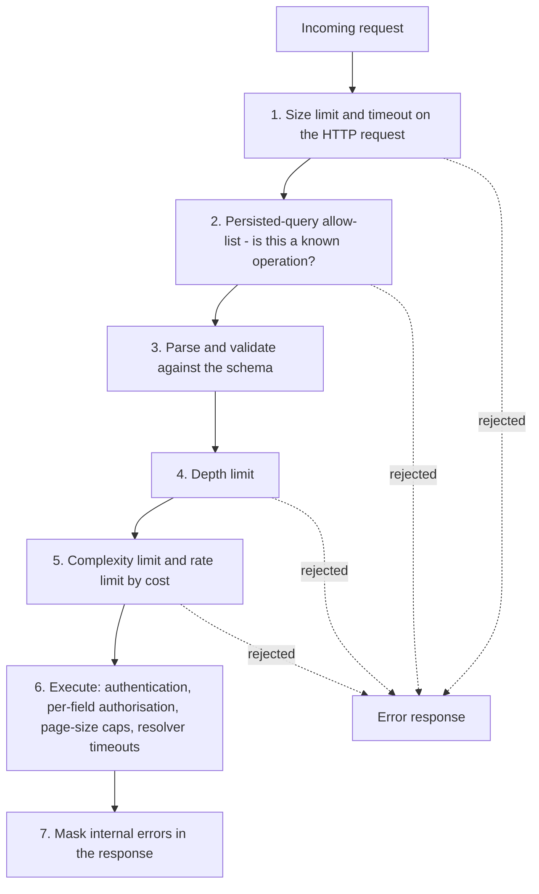

# Security and monitoring

> **Before this lesson:** you should understand that a schema is a graph with cycles ([Graph vocabulary](#/lesson/graphql/graph-vocabulary)), that a query is a tree with a depth ([Trees as graphs](#/lesson/graphql/trees-and-real-graphs)), how pagination arguments work ([Arguments, filtering, pagination and sorting](#/lesson/graphql/arguments-pagination)), and how authentication and authorisation fit into a server ([Custom scalars, databases, authentication and authorisation](#/lesson/graphql/scalars-db-auth)).

## In plain words

GraphQL's great strength is that the client decides what to ask for. Its great risk is exactly the same sentence.

Think of an all-you-can-eat buffet. Customers love choosing their own plate. But the restaurant needs house rules, or one person will stack forty plates, another will order every dish on the menu at once, and the kitchen will stop serving anyone. The rules do not spoil the meal for ordinary customers. They stop the few who would ruin it for everybody.

A REST endpoint does a fixed, known amount of work. A GraphQL endpoint will attempt **whatever valid query arrives**, including one written, by accident or on purpose, to be enormously expensive. **Security** in this lesson means putting limits around that freedom. **Monitoring** means watching what the server is actually doing, so that you notice problems before your users report them.

Why it matters for a job: "How do you protect a GraphQL API from abusive queries?" is close to a guaranteed interview question for back-end roles. The expected answer is a short list of layered defences, which this lesson gives you along with working code for the main ones.

## What can go wrong

The Potluck schema has a cycle: `Recipe.author` returns a `Cook`, and `Cook.recipes` returns recipes. That is good design, and it permits this:

```graphql
query Bomb {
  recipes(first: 100) {
    author {
      recipes(first: 100) {
        author {
          recipes(first: 100) {
            author {
              recipes(first: 100) { title }
            }
          }
        }
      }
    }
  }
}
```

It is a perfectly valid query of about 200 characters. Count what it asks for: 100 recipes, each with an author who has 100 recipes, each with an author who has 100 recipes, each with 100 more: $100^4$ = **100,000,000** titles. The server will run out of memory or time long before finishing, and while it struggles, it serves nobody else. An attack that makes a service unavailable by exhausting its resources is called **denial of service** (DoS). Here the "attacker" may be a well-meaning developer who forgot a limit.

The threats particular to GraphQL:

| Threat | Example |
|---|---|
| deep queries | nesting through a cycle, as above |
| wide queries | `recipes(first: 1000000)`, or thousands of fields |
| alias flooding | the same expensive field repeated 1,000 times under different aliases in one request |
| batching abuse | 1,000 login attempts in a single HTTP request, hiding from a per-request rate limiter |
| slow resolvers | one field that calls a slow service and holds a connection for a minute |
| information leakage | introspection, "Did you mean…?" suggestions, stack traces in error messages |
| missing authorisation | a private field reachable by a path nobody thought to guard |

No single measure handles all of these. The approach is **defence in depth**: several independent layers, each of which stops what the others miss.



Layers 1 to 5 all act **before execution**. Rejecting a query from its text alone costs almost nothing; discovering it is too expensive half-way through running it has already cost what you wanted to avoid.

## Request timeouts

The first and simplest defence: no request may run for ever. A **timeout** is a maximum duration, after which the server stops waiting and returns an error.

Set one at several levels:

- on the **HTTP server**: the whole request must finish in, say, 5 seconds;
- on **each outgoing call** a resolver makes: a database query or a call to another service must answer in, say, 2 seconds;
- on the **database** itself (a statement timeout), so that an abandoned query does not keep running.

```js-run
const wait = (ms, value) => new Promise((resolve) => setTimeout(() => resolve(value), ms));

// Give any promise a deadline.
function withTimeout(promise, ms, label) {
  const deadline = new Promise((_, reject) => setTimeout(() => reject(new Error(label + " timed out after " + ms + " ms")), ms));
  return Promise.race([promise, deadline]);          // whichever settles first wins
}

const fastResolver = () => wait(20, { title: "Lentil soup" });
const slowResolver = () => wait(300, { title: "never seen" });

for (const [name, resolver] of [["fast", fastResolver], ["slow", slowResolver]]) {
  try {
    console.log(name, "->", JSON.stringify(await withTimeout(resolver(), 100, "recipe resolver")));
  } catch (e) {
    console.log(name, "->", JSON.stringify({ data: { recipe: null }, errors: [{ message: e.message }] }));
  }
}
```

`Promise.race` returns the result of whichever promise finishes first. The fast resolver beats the 100 ms deadline. The slow one loses, and the client receives an error instead of waiting indefinitely.

A timeout is a safety net and not a full defence. It stops the bleeding, but the server has already spent the time. The remaining layers prevent the work from starting.

## Data limits

Lesson 12 established the rule: **every list field that can grow must be paginated, and the page size must have a server-side maximum.**

```javascript
const MAX_PAGE = 50;
const resolvers = {
  Query: {
    recipes: (_, { first = 20, after }, ctx) => {
      if (first > MAX_PAGE) throw new GraphQLError(`first may not exceed ${MAX_PAGE}`, { extensions: { code: "BAD_USER_INPUT" } });
      return ctx.db.recipes.page({ first, after });
    },
  },
};
```

With every page capped at 50, the bomb above is limited to $50^4$ = 6,250,000 titles. That is far better and still far too many. Page limits bound each level; they do not bound the *product* of the levels. Hence the next two layers.

Also limit the size of the request body at the HTTP layer (queries are small; 100 kB is generous), and limit or disable **query batching** (several operations sent as one JSON array) if your server supports it.

## Limiting query depth

The **depth** of a query is the number of levels of nested fields: the height of the query tree (lesson 6). Legitimate screens rarely need more than six or seven levels. A depth limit rejects anything deeper during validation.

```graphql
{                         # depth
  recipes(first: 10) {    # 1
    title                 # 2
    author {              # 2
      name                # 3
      recipes {           # 3
        title             # 4
      }
    }
  }
}
```

This query has depth 4. With a maximum of 3 the server would refuse it and run nothing:

```json
{ "errors": [ { "message": "Query depth 4 exceeds the maximum allowed depth of 3." } ] }
```

In a real server this is a **validation rule**: a function that inspects the AST, plugged in beside the standard rules.

```javascript
import depthLimit from "graphql-depth-limit";

const server = new ApolloServer({ typeDefs, resolvers, validationRules: [depthLimit(7)] });
```

Depth alone is not enough. `{ recipes(first: 1000000) { title } }` has a depth of 2.

## Limiting query complexity

**Query complexity** is an estimate, computed *before* execution, of how much work a query will cause. The usual method:

- every field has a **cost**, 1 by default, more for fields known to be expensive (a search, a computed statistic);
- a list field **multiplies** the cost of everything beneath it by the number of items requested (`first` or `last`).

$$\text{cost}(\text{field}) = \text{own cost} + \text{page size} \times \sum \text{cost}(\text{children})$$

Work it by hand once, on `recipes(first: 10) { title author { name } reviews(first: 5) { stars } }`:

| Field | Own cost | Multiplier for children | Children's total | Field total |
|---|---|---|---|---|
| `title` | 1 | | | 1 |
| `name` | 1 | | | 1 |
| `author` | 1 | 1 | 1 | 2 |
| `stars` | 1 | | | 1 |
| `reviews(first: 5)` | 1 | 5 | 1 | 6 |
| `recipes(first: 10)` | 1 | 10 | 1 + 2 + 6 = 9 | **91** |

The query costs 91 points. The server sets a budget, say 1,000 points per query, and rejects anything above it. The four-level bomb with `first: 100` scores over a hundred million and is refused instantly.

Both analyses in one runnable piece:

```js-run
// A query as a tree of field nodes: { name, args, selection }.
function depth(selection) {
  let deepest = 0;
  for (const field of selection ?? []) deepest = Math.max(deepest, 1 + depth(field.selection));
  return deepest;
}

function cost(selection, fieldCosts = {}) {
  let total = 0;
  for (const field of selection ?? []) {
    const pageSize = field.args?.first ?? field.args?.last ?? 1;
    total += (fieldCosts[field.name] ?? 1) + pageSize * cost(field.selection, fieldCosts);
  }
  return total;
}

function guard(name, query, { maxDepth, maxCost, fieldCosts }) {
  const d = depth(query), c = cost(query, fieldCosts);
  const verdict = d > maxDepth ? "REJECTED: too deep" : c > maxCost ? "REJECTED: too expensive" : "allowed";
  console.log(name.padEnd(14), "depth", String(d).padStart(2), " cost", String(c).padStart(12), " ", verdict);
}

const leaf = (name) => ({ name });
const feed = [{ name: "recipes", args: { first: 10 }, selection: [leaf("title"), { name: "author", selection: [leaf("name")] }, { name: "reviews", args: { first: 5 }, selection: [leaf("stars")] }] }];
const wide = [{ name: "recipes", args: { first: 1000000 }, selection: [leaf("title")] }];
let bomb = [leaf("title")];
for (let i = 0; i < 4; i++) bomb = [{ name: "recipes", args: { first: 100 }, selection: i === 0 ? bomb : [{ name: "author", selection: bomb }] }];
const search = [{ name: "search", args: { first: 20 }, selection: [leaf("title")] }];

const limits = { maxDepth: 6, maxCost: 1000, fieldCosts: { search: 50 } };
guard("feed screen", feed, limits);
guard("wide", wide, limits);
guard("bomb", bomb, limits);
guard("search", search, limits);
```

Reading the results:

- The **feed** query has depth 3 and cost 91: allowed.
- The **wide** query has depth 2, so the depth limit says nothing, but a cost of a million: rejected by the complexity limit.
- The **bomb** is rejected for depth before its cost is even considered.
- **search** has a declared cost of 50 for the field itself, reflecting that a search is heavier than a lookup; its total is 70.

The practice problems *Query depth and depth limiting* and *Query complexity with list multipliers* have you build both, including fragments.

Libraries (`graphql-query-complexity`, `graphql-armor`, and features built into several servers) implement this, often letting you declare costs in the schema with a directive such as `@cost(weight: 50)`. GitHub's public API publishes its scoring rules and returns each query's cost in the response, which is a good model for a public API.

> [!TIP]
> Complexity scores are also the fairest basis for **rate limiting**. Limiting "100 requests per minute" treats a query for one title the same as one for 5,000 objects. Limiting "10,000 cost points per minute" charges each client for what it actually uses. Lesson 21 returns to this.

## Persisted queries

Everything above tries to judge unknown queries. For an API whose only clients are your own apps there is a much stronger position: **accept only the queries your own apps contain.**

At build time, every query in the app's source is extracted and registered with the server, each under an identifier: a **hash** of its text. (A hash function turns any text into a short, fixed-length fingerprint; the same text always gives the same hash. SHA-256 is the usual choice.) In production the app sends the hash in place of the text:

```json
{ "extensions": { "persistedQuery": { "version": 1, "sha256Hash": "8f3b0c1d…" } }, "variables": { "id": "r1" } }
```

The server looks the hash up. If it is registered, the stored query runs. If not, the request is refused. An attacker with full knowledge of your schema cannot run a query of their own, because the server does not accept query text at all. This arrangement is called a **persisted-query allow-list**, or *trusted documents*.

There are two modes, often confused:

| | Automatic persisted queries (APQ) | Allow-list (trusted documents) |
|---|---|---|
| Who registers queries | any client, at runtime: unknown hash → client resends with full text → server stores it | only the build pipeline, ahead of time |
| Arbitrary queries accepted? | **yes** | **no** |
| Benefit | smaller requests; enables GET and CDN caching | all of that, plus a real security boundary |
| Security value | none | high |

```js-run
// A toy hash for demonstration only; real systems use SHA-256.
function hash(text) {
  let h = 5381;
  for (let i = 0; i < text.length; i++) h = (h * 33 + text.charCodeAt(i)) % 4294967296;
  return h.toString(16).padStart(8, "0");
}

// ----- build time: register every query that the app's source code contains -----
const appQueries = [
  "query RecipeScreen($id: ID!) { recipe(id: $id) { id title minutes } }",
  "query Feed { recipes(first: 20) { id title } }",
];
const registry = new Map(appQueries.map((q) => [hash(q), q]));
console.log("registered:", [...registry.keys()]);

// ----- run time: locked mode, hashes only -----
function handle(request) {
  if (request.query) return { errors: [{ message: "Arbitrary queries are not accepted." }] };
  const query = registry.get(request.hash);
  if (!query) return { errors: [{ message: "PersistedQueryNotFound" }] };
  return { executing: query.slice(0, query.indexOf("{")).trim() };
}

console.log(handle({ hash: hash(appQueries[0]), variables: { id: "r1" } }));
console.log(handle({ hash: "deadbeef" }));
console.log(handle({ query: "{ recipes(first: 1000000) { author { recipes { title } } } }" }));
```

The first request names a registered operation and runs. The second uses an unknown hash; the third tries to send query text. Both are refused without any parsing or analysis. The practice problem *Persisted query lookup by hash* implements both modes.

An allow-list is unsuitable for a **public** API, where third parties must be able to write their own queries. That is where depth limits, complexity limits and cost-based rate limits carry the load.

## Hiding what should not be shown

**Introspection.** As discussed in lesson 9, switch it off in production for private APIs. Apollo Server does so automatically when `NODE_ENV` is `production`.

**Error details.** A raw database error ("relation \"cooks\" does not exist at character 15…") or a stack trace tells an attacker about your internals. In production, send clients a generic message and a stable code, and keep the detail in your logs:

```javascript
const server = new ApolloServer({
  typeDefs, resolvers,
  formatError: (formattedError) => {
    const code = formattedError.extensions?.code;
    if (code === "INTERNAL_SERVER_ERROR") return { message: "Internal server error", extensions: { code } };   // mask the unexpected
    return formattedError;                                    // errors you threw on purpose pass through
  },
});
```

**Field suggestions.** Messages such as `Did you mean "email"?` reveal field names even with introspection off; hardening libraries can disable them.

> [!WARNING]
> None of this replaces **authorisation**. Hiding the schema, limiting depth and allow-listing queries reduce what an attacker can try. They do not decide who may see a cook's e-mail address. Every protected field and mutation still needs its own server-side check (lesson 15). Likewise, resolvers must treat arguments as untrusted input: use parameterised database queries, never string concatenation.

## Monitoring

**Monitoring** is collecting measurements from a running system so you can see its health and find problems. GraphQL makes two standard tools much less useful.

- **One URL.** A REST dashboard shows latency per endpoint. For GraphQL every request is `POST /graphql`, so that view is a single meaningless line.
- **Always 200.** A REST dashboard counts 5xx responses. GraphQL reports most failures inside a 200 response, so an HTTP-level error rate can read zero while every user sees an error.

GraphQL monitoring therefore works at the level of **operations** and **fields**.

| What to measure | Why | How |
|---|---|---|
| requests, error rate and latency **per operation name** | find the slow or failing screen | name every operation; record its name with each request |
| **per-resolver** timing (tracing) | find the slow field inside a slow operation | tracing plugins; OpenTelemetry instrumentation |
| count of responses with a non-empty `errors` array, by error code | the real error rate | inspect the response body in a server plugin |
| **field usage**: which fields are requested, by which client and version | know when a deprecated field is safe to delete (lesson 23) | a schema registry or usage reporting |
| query cost and depth | spot abuse; tune limits | log the numbers your limiters compute |
| database queries per request | catch N+1 regressions (lesson 20) | count them in context |

Two terms. A **trace** is a timed record of everything one request did: which resolvers ran and how long each took. **OpenTelemetry** is the vendor-neutral standard for producing traces and metrics; most GraphQL servers can emit it, and most monitoring products can read it.

Server libraries offer a plugin system for hooking into the request life cycle. A minimal Apollo Server plugin that logs each operation:

```javascript
const operationLogger = {
  async requestDidStart() {
    const started = Date.now();
    return {
      async willSendResponse({ request, response, operationName }) {
        const errors = response.body.kind === "single" ? response.body.singleResult.errors ?? [] : [];
        console.log(JSON.stringify({
          operation: operationName ?? "anonymous",
          ms: Date.now() - started,
          errorCodes: errors.map((e) => e.extensions?.code ?? "UNKNOWN"),
          client: request.http?.headers.get("apollographql-client-name") ?? "unknown",
        }));
      },
    };
  },
};
const server = new ApolloServer({ typeDefs, resolvers, plugins: [operationLogger] });
```

Each request then produces a line such as `{"operation":"RecipeScreen","ms":42,"errorCodes":[],"client":"potluck-ios"}`, which a log system can aggregate into per-operation charts.

Hosted products built for this combine a schema registry, usage reports and tracing: Apollo GraphOS (which grew out of the earlier Apollo Engine and Apollo Studio), GraphQL Hive, and the GraphQL integrations of general monitoring platforms.

> [!TIP]
> Have every client send its name and version in request headers (Apollo Client does this through the `name` and `version` options). When an error spike appears, the first question is always "which app, which version?", and with those headers the answer is one filter away.

> [!INTERVIEW]
> **"How do you protect a GraphQL API against expensive or malicious queries?"** Layered defences: (1) request size limits and timeouts at the HTTP, resolver and database levels; (2) enforced pagination with a maximum page size; (3) a query depth limit; (4) query complexity analysis with per-field costs and list multipliers, also used for cost-based rate limiting; (5) for first-party APIs, a persisted-query allow-list so that only known operations run; (6) introspection disabled and internal errors masked in production; (7) authorisation on every field regardless. Note that automatic persisted queries on their own are a performance feature, not a security one.
>
> **"Why is monitoring GraphQL different from REST?"** There is a single endpoint and most errors return HTTP 200, so URL- and status-based dashboards are blind. You monitor per named operation and per field: latency, error rate from the `errors` array, resolver traces and field usage.

## Pitfalls

- **Relying on one defence.** Depth limits miss wide queries; page caps miss deep ones; timeouts act only after the damage.
- **Unpaginated list fields**, or pagination with no maximum.
- **Treating APQ as an allow-list.** In automatic mode any client can register any query.
- **Leaving introspection and detailed errors on in production** for a private API.
- **Rate limiting by request count** while allowing batching and aliases, which pack many operations into one request.
- **Anonymous operations.** They cannot be grouped in dashboards or allow-listed sensibly.
- **Alerting on HTTP status only.** Count GraphQL errors.
- **Assuming a hidden schema is a protected schema.**
- **Setting limits by guesswork.** Measure the depth and cost of your real operations first, then set limits comfortably above them.

## Cheat sheet

| Defence | Stops | Acts |
|---|---|---|
| body size limit | huge documents | before parsing |
| timeouts (HTTP, resolver, database) | runaway requests | during execution |
| max page size | huge single lists | in resolvers |
| depth limit | deep nesting through cycles | validation |
| complexity limit | wide and multiplied queries | validation |
| cost-based rate limit | sustained heavy use | before execution |
| persisted-query allow-list | every unknown query | before parsing |
| introspection off, masked errors | information leakage | response |
| per-field authorisation | unauthorised data access | execution |

| Monitor | By |
|---|---|
| latency, error rate | operation name |
| slow fields | resolver traces (OpenTelemetry) |
| true errors | `errors` array and `extensions.code` |
| deprecated field usage | field, client name, client version |

## Summary

- Because clients choose the query, a GraphQL server must limit how much work any one request can demand.
- Timeouts and body limits are the safety net; enforced pagination bounds each list; depth and complexity limits reject expensive queries from their text alone, before execution.
- A persisted-query allow-list is the strongest protection for first-party APIs, and should not be confused with automatic persisted queries.
- Disable introspection and mask internal errors in production, and keep authorisation on every protected field regardless of the other layers.
- Monitor by operation name and by field, counting GraphQL errors and not HTTP statuses, with traces to locate slow resolvers and usage data to guide schema evolution.

## Glossary

- **Denial of service (DoS):** making a service unavailable by exhausting its resources.
- **Defence in depth:** several independent protective layers.
- **Timeout:** a maximum time to wait before giving up.
- **Query depth:** the number of nested field levels in a query.
- **Query complexity:** an estimate of the work a query will cause, computed from field costs and list sizes.
- **Validation rule:** a check applied to a query's AST before execution.
- **Rate limiting:** restricting how much a client may use in a period.
- **Hash:** a fixed-length fingerprint computed from text.
- **Persisted query:** a query stored on the server and invoked by its hash.
- **Automatic persisted queries (APQ):** a protocol in which clients register queries at runtime to save bandwidth.
- **Allow-list / trusted documents:** accepting only operations registered ahead of time.
- **Batching:** sending several operations in one HTTP request.
- **Error masking:** replacing internal error details with a generic message for clients.
- **Monitoring:** collecting and watching measurements of a running system.
- **Trace:** a timed record of the steps taken to handle one request.
- **OpenTelemetry:** an open standard for traces, metrics and logs.
- **Schema registry:** a service that stores schema versions and usage data.

## Check yourself

```quiz
[
  {"q": "What is the depth of this query, counting the top-level field as 1?\n\n`{ cook(id: \"c1\") { name recipes { title reviews { stars } } } }`",
   "options": ["2", "3", "4", "5"],
   "answer": 2,
   "explain": "cook (1) → recipes (2) → reviews (3) → stars (4). The deepest path has four fields."},
  {"q": "Each field costs 1 and a list multiplies its children by `first`. What is the cost of `{ recipes(first: 20) { title author { name } } }`?",
   "options": ["4", "23", "61", "80"],
   "answer": 2,
   "explain": "Children of `recipes`: title (1) + author (1 + 1×1 = 2) = 3. Total = 1 + 20 × 3 = 61."},
  {"q": "The server has only a depth limit of 5. Which query gets through even though it is dangerous?",
   "options": ["A query nested 12 levels deep", "`{ recipes(first: 5000000) { title } }`", "A query with a syntax error", "A query for an unknown field"],
   "answer": 1,
   "explain": "It is only two levels deep. Depth limits do nothing about width; a page-size cap or complexity limit is needed."},
  {"q": "In locked (allow-list) mode, a request arrives with a correct hash of a query that was never registered, together with the full query text. What does the server do?",
   "options": ["Stores the query and runs it", "Rejects it: only pre-registered operations are accepted", "Runs it once without storing", "Returns the schema"],
   "answer": 1,
   "explain": "Registering at runtime is what the automatic mode does. An allow-list accepts only operations registered ahead of time by the build."},
  {"q": "Why is 'HTTP 5xx rate' a poor health signal for a GraphQL API?",
   "options": ["GraphQL servers cannot return 5xx", "Most failures are reported in the `errors` array of a 200 response", "5xx responses are cached", "It counts subscriptions twice"],
   "answer": 1,
   "explain": "Field and resolver failures arrive with status 200. The real error rate comes from inspecting response bodies."},
  {"q": "A resolver throws a database error containing table names and SQL. What should a production client receive?",
   "options": ["The full error, to help debugging", "A generic message with a stable code; the detail goes to server logs", "Nothing; the connection should be dropped", "The stack trace only"],
   "answer": 1,
   "explain": "Internal details help attackers. Mask unexpected errors for clients and log them in full on the server."},
  {"q": "Which measure lets you decide that a deprecated field can finally be removed?",
   "options": ["CPU usage", "Field usage by client and version, showing no requests over a suitable period", "The depth limit", "The number of types in the schema"],
   "answer": 1,
   "explain": "Usage reporting tells you whether any client still selects the field. Zero use across your supported client versions means it is safe to delete."},
  {"q": "A team disables introspection and adds a depth limit, and concludes that a cook's e-mail field no longer needs a permission check. What is wrong?",
   "options": ["Nothing", "Those measures limit discovery and cost; they do not control who may read a field. Anyone who knows or guesses the field name can still query it", "Depth limits disable e-mail fields", "Introspection is required for authorisation"],
   "answer": 1,
   "explain": "Authorisation is a separate layer and must be enforced on the server for every protected field."}
]
```

> **Source:** Porcello & Banks, *Learning GraphQL*, ch. 7 (security: request timeouts, data limitations, limiting query depth, limiting query complexity; Apollo Engine). Also: https://graphql.org/learn/security/ ; https://www.apollographql.com/docs/apollo-server/security/terminating-ssl ; https://www.apollographql.com/docs/graphos/platform/security/persisted-queries ; https://docs.github.com/en/graphql/overview/rate-limits-and-query-limits-for-the-graphql-api ; https://cheatsheetseries.owasp.org/cheatsheets/GraphQL_Cheat_Sheet.html.
