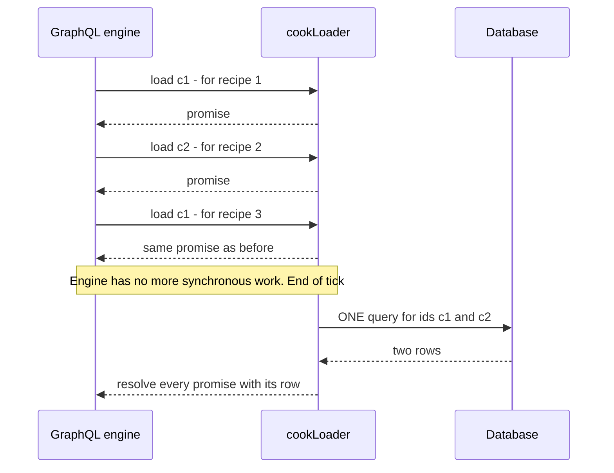

# The N+1 problem and DataLoader

> **Before this lesson:** you must be comfortable with the resolver chain, in particular that a child resolver runs once per item of a parent list ([Resolvers, the resolver chain and context](#/lesson/graphql/resolvers-context)). You should also know promises and `await` ([Async, await and generators](#/lesson/javascript/async-await-generators)); the section on the event loop is explained from scratch here.

## In plain words

Lesson 4 praised GraphQL for replacing 21 client requests with one. There is a catch. A carelessly written server answers that one request by making 21 **database** calls. The waste has not gone away; it has moved to where the client cannot see it.

Picture a waiter serving a table of ten. A poor waiter takes the first guest's order, walks to the kitchen, walks back, takes the second guest's order, walks to the kitchen again… ten trips. A good waiter listens to the whole table, writes every order on one slip, and makes **one** trip. If two guests order the same soup, it is written once. And if a guest asks later what the soup of the day was, the waiter remembers instead of walking back to ask.

**DataLoader** is the good waiter. It is a small utility that sits between your resolvers and your database and does two things:

- **batching**: it collects all the individual requests made at about the same moment and fetches them together in one call;
- **caching**: within one request, it never fetches the same item twice.

Why it matters for a job: the N+1 problem is the best-known GraphQL performance problem, and "what is N+1 and how do you fix it?" is asked in nearly every GraphQL interview. The expected answer includes the word DataLoader and a correct description of how batching works.

## Seeing the problem

Take the feed query:

```graphql
{
  recipes(first: 3) {
    title
    author {
      name
    }
  }
}
```

and the straightforward resolvers from lesson 15:

```javascript
const resolvers = {
  Query: {
    recipes: (_, { first }, { db }) => db.query("SELECT * FROM recipes LIMIT $1", [first]),
  },
  Recipe: {
    author: (recipe, _, { db }) => db.query("SELECT * FROM cooks WHERE id = $1", [recipe.author_id]),
  },
};
```

Each resolver is correct and reads well. Now follow the resolver chain and write down the SQL that runs:

```sql
SELECT * FROM recipes LIMIT 3;            -- Query.recipes, once
SELECT * FROM cooks WHERE id = 'c1';      -- Recipe.author for recipe 1
SELECT * FROM cooks WHERE id = 'c2';      -- Recipe.author for recipe 2
SELECT * FROM cooks WHERE id = 'c1';      -- Recipe.author for recipe 3 (the same cook again!)
```

One query for the list, then one more per item: **1 + N**. With `first: 50` that is 51 queries. Add `reviews { by { name } }` under each recipe and it becomes 1 + 50 + 50 + (50 × reviews per recipe): hundreds of queries for one screen.

Each query is fast in isolation, perhaps a millisecond or two. The cost is the **round trips**: every query crosses the network to the database and back, and each trip has a fixed overhead that dwarfs the work itself. Fifty quick trips are far slower than one slightly bigger one.

Why does this happen so naturally in GraphQL? Because of the very property that makes resolvers pleasant to write: **each resolver is independent**. `Recipe.author` is handed one recipe and knows nothing about its 49 siblings. It cannot say "fetch all fifty authors together", because it never sees more than one.

The model below counts database calls for the naive server.

```js-run
// ---------- a database that counts and logs every call ----------
const cooksTable = { c1: { id: "c1", name: "Amara" }, c2: { id: "c2", name: "Bo" }, c3: { id: "c3", name: "Chidi" } };
const recipesTable = [
  { id: "r1", title: "Lentil soup", authorId: "c1" }, { id: "r2", title: "Flatbread", authorId: "c2" },
  { id: "r3", title: "Plum cake", authorId: "c1" }, { id: "r4", title: "Miso soup", authorId: "c3" },
  { id: "r5", title: "Sourdough", authorId: "c2" }, { id: "r6", title: "Apple crumble", authorId: "c1" },
];
const log = [];
const db = {
  async listRecipes(n) { log.push(`SELECT * FROM recipes LIMIT ${n}`); return recipesTable.slice(0, n); },
  async cookById(id) { log.push(`SELECT * FROM cooks WHERE id = '${id}'`); return cooksTable[id]; },
};

// ---------- naive resolvers ----------
const resolvers = {
  Query: { recipes: (_, args) => db.listRecipes(args.first) },
  Recipe: { author: (recipe) => db.cookById(recipe.authorId) },
};

// { recipes(first: 6) { title author { name } } }
const recipes = await resolvers.Query.recipes({}, { first: 6 });
const data = await Promise.all(recipes.map(async (recipe) => ({
  title: recipe.title,
  author: { name: (await resolvers.Recipe.author(recipe)).name },
})));

console.log(data.map((r) => r.title + " by " + r.author.name).join(" | "));
console.log(log.join("\n"));
console.log("database calls:", log.length);
```

Seven calls for six recipes, and only three distinct cooks among them. Amara was fetched three times.

## What we want instead

Two queries, however long the list:

```sql
SELECT * FROM recipes LIMIT 6;
SELECT * FROM cooks WHERE id IN ('c1', 'c2', 'c3');
```

The `IN (...)` form asks for many rows by id in one round trip. The obstacle is purely organisational: no single resolver has the full list of ids. Something must stand between the resolvers and the database, **collect** the ids as each resolver asks, and then issue one combined query. That something is DataLoader.

## How DataLoader works

DataLoader is a small library, originally written at Facebook, with implementations in most languages. You create a **loader** by giving it one function, the **batch function**:

```javascript
import DataLoader from "dataloader";

const cookLoader = new DataLoader(async (ids) => {
  // `ids` is an array of every id requested during this tick, without duplicates.
  const rows = await db.query("SELECT * FROM cooks WHERE id = ANY($1)", [ids]);
  const byId = new Map(rows.map((row) => [row.id, row]));
  return ids.map((id) => byId.get(id) ?? null);          // same length and SAME ORDER as `ids`
});
```

and resolvers call `load` with a single key:

```javascript
const resolvers = {
  Recipe: {
    author: (recipe, _, { loaders }) => loaders.cook.load(recipe.author_id),
  },
};
```

The resolver still thinks in terms of one item. It looks hardly different from before. What `load` does behind that simple call:

1. It does **not** fetch anything. It adds the key to a waiting list and returns a **promise**: an IOU for the value.
2. It schedules the batch function to run a moment later: after all the code that is currently running has finished, but before the program does anything else.
3. Meanwhile the GraphQL engine carries on calling `Recipe.author` for the other recipes. Each call adds its key to the same waiting list.
4. When the engine has nothing more it can do without data, the scheduled moment arrives. DataLoader calls the batch function **once**, with all the collected keys.
5. When the batch function's result arrives, DataLoader hands each caller its own value by position, fulfilling every IOU.



### "A moment later": one tick of the event loop

JavaScript runs one piece of code at a time. It keeps a queue of things to do next, and works through it in a cycle called the **event loop**. One turn of that cycle is informally called a **tick**. Code that says "run this as soon as the current work is finished" is placed on a short priority queue, the *microtask* queue, which is emptied before the program moves on to anything else, such as handling a network reply.

When GraphQL executes a list, it calls the child resolver for every item one after another, in the same uninterrupted stretch of code. Each call reaches `loader.load(...)`, which records the key and returns at once. Only when that stretch ends does the queued batch job run. That is why all the keys of one level of the query land in one batch.

### The three rules of a batch function

A batch function has a strict contract. Most DataLoader bugs are violations of it.

| Rule | Why |
|---|---|
| It receives an array of keys and returns a promise of an array of **the same length** | DataLoader matches results to callers by position |
| Result `i` must correspond to key `i` | `WHERE id IN (...)` returns rows in whatever order the database likes, so you must re-order them |
| A key with no result gets `null` (or an `Error`) in its slot, not a gap | otherwise every later result shifts to the wrong caller |

The lines `const byId = new Map(...)` and `ids.map((id) => byId.get(id) ?? null)` in the example exist to satisfy the second and third rules. Leave them out and cooks get attached to the wrong recipes, silently, whenever the database returns rows in a different order.

## Build one yourself

The whole mechanism is about twenty lines. Read it carefully; then the library will hold no mystery.

```js-run
class MiniLoader {
  constructor(batchFn) {
    this.batchFn = batchFn;
    this.cache = new Map();      // key -> promise (lives as long as this loader: one request)
    this.queue = [];             // keys waiting for the next batch
  }
  load(key) {
    if (this.cache.has(key)) return this.cache.get(key);                 // caching: same key, same promise
    const promise = new Promise((resolve, reject) => {
      this.queue.push({ key, resolve, reject });
      if (this.queue.length === 1) queueMicrotask(() => this.dispatch()); // first key of this tick: schedule one flush
    });
    this.cache.set(key, promise);
    return promise;
  }
  async dispatch() {
    const batch = this.queue;                                            // take everything collected so far
    this.queue = [];
    try {
      const values = await this.batchFn(batch.map((item) => item.key));
      batch.forEach((item, i) => item.resolve(values[i]));               // hand each caller its value by position
    } catch (error) {
      batch.forEach((item) => item.reject(error));
    }
  }
}

// ---------- the same data and counting database as before, plus a batch method ----------
const cooksTable = { c1: { id: "c1", name: "Amara" }, c2: { id: "c2", name: "Bo" }, c3: { id: "c3", name: "Chidi" } };
const recipesTable = [
  { id: "r1", title: "Lentil soup", authorId: "c1" }, { id: "r2", title: "Flatbread", authorId: "c2" },
  { id: "r3", title: "Plum cake", authorId: "c1" }, { id: "r4", title: "Miso soup", authorId: "c3" },
  { id: "r5", title: "Sourdough", authorId: "c2" }, { id: "r6", title: "Apple crumble", authorId: "c1" },
];
const log = [];
const db = {
  async listRecipes(n) { log.push(`SELECT * FROM recipes LIMIT ${n}`); return recipesTable.slice(0, n); },
  async cooksByIds(ids) {
    log.push(`SELECT * FROM cooks WHERE id IN (${ids.map((i) => `'${i}'`).join(", ")})`);
    return Object.values(cooksTable).filter((c) => ids.includes(c.id)).reverse();       // rows come back in ANOTHER order
  },
};

// ---------- per-request context: a fresh loader for each request ----------
function createContext() {
  return {
    loaders: {
      cook: new MiniLoader(async (ids) => {
        const rows = await db.cooksByIds(ids);
        const byId = new Map(rows.map((row) => [row.id, row]));
        return ids.map((id) => byId.get(id) ?? null);                    // re-order to match the keys
      }),
    },
  };
}

const resolvers = {
  Query: { recipes: (_, args) => db.listRecipes(args.first) },
  Recipe: { author: (recipe, _, ctx) => ctx.loaders.cook.load(recipe.authorId) },   // still "one at a time"
};

const ctx = createContext();
const recipes = await resolvers.Query.recipes({}, { first: 6 });
const data = await Promise.all(recipes.map(async (recipe) => ({
  title: recipe.title,
  author: { name: (await resolvers.Recipe.author(recipe, {}, ctx)).name },
})));

console.log(data.map((r) => r.title + " by " + r.author.name).join(" | "));
console.log(log.join("\n"));
console.log("database calls:", log.length);
```

Compare the output with the naive version: the same data, and **two** database calls instead of seven. The second query lists three ids, not six: duplicates were removed by the cache. Although `cooksByIds` deliberately returns rows in reverse order, every recipe has the right author, thanks to the `byId` re-ordering.

Trace `load` for the first three recipes:

| Call | Cache has key? | Action |
|---|---|---|
| `load("c1")` | no | create promise P1, queue `c1`, schedule one flush |
| `load("c2")` | no | create promise P2, queue `c2` (a flush is already scheduled) |
| `load("c1")` | yes | return P1 again; nothing is queued |

`queueMicrotask` is the "run this once the current code has finished" instruction described above. Try replacing the `ids.map(...)` line in the batch function with `return rows;` and run again: the authors come out attached to the wrong recipes, which demonstrates the ordering rule better than any warning.

The two practice problems for this lesson follow the same split: *Count resolver calls: naive versus batched* predicts the numbers for any query shape, and *Batch and cache like DataLoader* implements the batching and caching rules.

## Using DataLoader properly

### One set of loaders per request

Loaders are created in the context function, so each request gets its own.

```javascript
const server = new ApolloServer({ typeDefs, resolvers });
await startStandaloneServer(server, {
  context: async ({ req }) => ({
    currentUser: await userFromRequest(req),
    loaders: {
      cook: new DataLoader((ids) => batchCooks(ids)),
      reviewsByRecipe: new DataLoader((recipeIds) => batchReviewsByRecipe(recipeIds)),
    },
  }),
});
```

> [!WARNING]
> Never create a DataLoader once at start-up and share it across requests. Its cache has no expiry and no notion of users. Shared, it would serve stale data for ever and, far worse, hand one user's permission-filtered results to another user. The cache is meant to live for a single request: long enough to avoid duplicate fetches, short enough never to be stale.

### One-to-many relations

`Recipe.author` loads one object per key. `Recipe.reviews` needs a *list* per key. The batch function then groups rows by the foreign key:

```javascript
async function batchReviewsByRecipe(recipeIds) {
  const rows = await db.query("SELECT * FROM reviews WHERE recipe_id = ANY($1) ORDER BY created_at DESC", [recipeIds]);
  const grouped = new Map(recipeIds.map((id) => [id, []]));         // every key starts with an empty list
  for (const row of rows) grouped.get(row.recipe_id).push(row);
  return recipeIds.map((id) => grouped.get(id));                     // one array per key, in key order
}

const resolvers = {
  Recipe: { reviews: (recipe, _, { loaders }) => loaders.reviewsByRecipe.load(recipe.id) },
};
```

A recipe with no reviews gets `[]`, satisfying the "same length" rule.

### Batching happens level by level

For `recipes { reviews { by { name } } }` the engine resolves in waves: all recipes, then all their reviews (one batch), then all the reviewers (one batch). The number of database calls equals the **number of levels with a loader**, not the number of objects:

| Query | Naive calls (20 recipes, 5 reviews each) | With loaders |
|---|---|---|
| `recipes { title }` | 1 | 1 |
| `recipes { author { name } }` | 1 + 20 = 21 | 2 |
| `recipes { author { name } reviews { stars } }` | 1 + 20 + 20 = 41 | 3 |
| `recipes { reviews { by { name } } }` | 1 + 20 + 100 = 121 | 3 |

### Other ways to attack N+1

DataLoader is the standard answer, not the only one.

| Technique | Idea | Trade-off |
|---|---|---|
| **DataLoader** | batch and cache per request | works for any data source; a little set-up per relation |
| **Look-ahead** | the parent resolver inspects the `info` argument to see which child fields were selected, and fetches them in the same query with a SQL `JOIN` | fewest queries; couples the parent resolver to its children |
| **Query-planning tools** (PostGraphile, Hasura, Prisma's built-in batching) | compile the GraphQL query into a small number of efficient SQL statements | very fast; ties you to that tool's way of working |
| **Response caching** | do not execute at all for repeated identical queries (next lesson) | only helps for cacheable data |

> [!TIP]
> Make N+1 visible before it reaches production. Count database queries per request (increment a counter held in the context) and log a warning, or fail a test, when an operation exceeds a budget such as 10. An N+1 introduced by a new field is then caught the day it is written, not when the database starts struggling.

> [!INTERVIEW]
> **"What is the N+1 problem in GraphQL?"** When a list field returns N items and a child field's resolver makes its own data-source call, executing the query costs 1 call for the list plus N for the children. It arises because resolvers are independent and run once per parent object.
>
> **"How does DataLoader solve it?"** `load(key)` queues the key and returns a promise. All keys requested in the same tick of the event loop are passed together to a batch function, which fetches them in one call (for SQL, `WHERE id IN (...)`) and must return results in the same order as the keys. It also memoises by key for the life of the loader, so duplicates are fetched once. Loaders are created per request so that the cache never leaks between users or goes stale.
>
> **Follow-up: "What must a batch function guarantee?"** An output array of the same length as the input keys, in the same order, with `null` or an `Error` for missing keys.

## Pitfalls

- **Returning rows in database order.** Always re-map to the order of the keys.
- **Dropping missing keys**, which shifts every later result to the wrong caller.
- **A global loader.** Create loaders per request.
- **Using `await` in a way that splits the batch.** Loads issued in *separate* ticks go in separate batches. Calling `await loader.load(a)` and only afterwards `loader.load(b)` produces two batches; use `loader.loadMany([a, b])` or `Promise.all`.
- **One loader for two different questions.** "Cook by id" and "cook by e-mail" need two loaders (or priming one from the other's results).
- **Stale data after a mutation in the same request.** After updating a cook, call `loader.clear(id)` or `loader.prime(id, updated)`.
- **Assuming DataLoader is a cross-request cache.** It is not; that is a different tool (next lesson).
- **Adding loaders only where you noticed slowness.** Every resolver that fetches by a parent's key in a list context needs one.

## Cheat sheet

| Item | Summary |
|---|---|
| N+1 | 1 call for a list + 1 call per item for a related field |
| cause | resolvers are independent and run once per parent |
| cure | batch per level; cache per request |
| create | `new DataLoader(async (keys) => [...])` |
| use | `loaders.cook.load(recipe.author_id)` in the resolver |
| batch window | one tick of the event loop |
| contract | same length, same order, `null` or `Error` for missing |
| SQL shape | `WHERE id IN (...)` / `= ANY($1)`, then re-order by key |
| one-to-many | group rows by the foreign key; `[]` for no matches |
| lifetime | per request, built in the context function |
| several keys at once | `loadMany(keys)` or `Promise.all` |
| after writes | `clear(key)` / `prime(key, value)` |
| result | calls ≈ number of query levels, not number of objects |

## Summary

- A GraphQL server resolves fields independently, so a child field under a list of N items naturally triggers N separate fetches: the N+1 problem.
- DataLoader inserts a per-request layer that queues the keys requested during one tick of the event loop, fetches them with a single batch call, and caches each key's promise.
- The batch function must return results aligned with its keys in length and order, with explicit `null` for missing ones.
- Loaders belong in the per-request context; shared loaders cause stale data and data leaks between users.
- With loaders in place, the number of data-source calls grows with the depth of the query and not with the number of objects returned.

## Glossary

- **N+1 problem:** one query for a list followed by one query for each of its items.
- **Round trip:** one request to a data source and its response.
- **Batching:** combining many individual lookups into one request.
- **DataLoader:** a utility that batches and caches lookups by key within a request.
- **Loader:** one DataLoader instance, responsible for one kind of lookup.
- **Batch function:** the function a loader calls with all collected keys.
- **Key:** the value identifying what to load, usually an id.
- **Promise:** an object standing for a value that will arrive later.
- **Event loop:** the cycle by which JavaScript runs queued pieces of work one at a time.
- **Tick:** one turn of the event loop.
- **Microtask:** a small job scheduled to run as soon as the current code finishes.
- **Memoisation:** remembering the result for an input so that it is computed only once.
- **Look-ahead:** inspecting the selected child fields in a resolver in order to fetch related data in advance.
- **Prime:** to put a known value into a loader's cache.

## Check yourself

```quiz
[
  {"q": "With naive resolvers, how many database calls does `{ recipes(first: 25) { title author { name } } }` make?",
   "options": ["1", "2", "25", "26"],
   "answer": 3,
   "explain": "One call for the list plus one `Recipe.author` call for each of the 25 recipes: 1 + 25 = 26."},
  {"q": "The same query with a DataLoader for cooks, where the 25 recipes were written by 4 different cooks. How many database calls, and how many ids in the batch?",
   "options": ["26 calls", "2 calls; the batch contains 25 ids", "2 calls; the batch contains 4 ids", "5 calls"],
   "answer": 2,
   "explain": "One call for the recipes and one batched call for the cooks. Duplicate keys are removed, so only the 4 distinct ids are requested."},
  {"q": "A batch function receives the keys `[\"c3\", \"c1\", \"c9\"]`. The database returns rows for c1 and c3 (c9 does not exist). What must the function return?",
   "options": ["`[c1row, c3row]`", "`[c3row, c1row]`", "`[c3row, c1row, null]`", "`{c1: c1row, c3: c3row}`"],
   "answer": 2,
   "explain": "The result must have the same length and order as the keys, with null (or an Error) for a key that was not found."},
  {"q": "Why can the `Recipe.author` resolver not fetch all the authors in one query without help?",
   "options": ["SQL cannot fetch several rows", "The resolver is called separately for each recipe and never sees the other recipes", "GraphQL forbids IN queries", "Authors are scalars"],
   "answer": 1,
   "explain": "Resolvers are independent. Something outside them must collect the keys across calls, which is DataLoader's job."},
  {"q": "What does `loader.load(\"c1\")` do at the moment it is called?",
   "options": ["Queries the database immediately and blocks until it answers", "Records the key, schedules a batch for the end of the current tick, and returns a promise", "Returns the cached row synchronously", "Sends a GraphQL subscription"],
   "answer": 1,
   "explain": "Nothing is fetched yet. The promise is fulfilled after the batch function runs with all the keys collected in that tick."},
  {"q": "Why must loaders be created per request and not once for the whole server?",
   "options": ["DataLoader instances expire after one second", "Their cache has no expiry or user awareness, so sharing it serves stale data and can leak one user's data to another", "Node.js forbids global objects", "Batching only works on the first request"],
   "answer": 1,
   "explain": "The cache is designed to live for one request. Across requests it would never refresh and would ignore who is asking."},
  {"q": "For `{ recipes(first: 20) { reviews { by { name } } } }` with 5 reviews per recipe and loaders on `reviews` and `by`, roughly how many database calls are made?",
   "options": ["121", "41", "3", "1"],
   "answer": 2,
   "explain": "One per level: the recipes, one batch for all their reviews, and one batch for all the reviewers. Naively it would be 1 + 20 + 100 = 121."},
  {"q": "A resolver does `const a = await loader.load(1); const b = await loader.load(2);`. How many batches result from these two lines?",
   "options": ["One, containing both keys", "Two, because the second load happens in a later tick after the first has been awaited", "Zero", "It throws"],
   "answer": 1,
   "explain": "Awaiting the first load lets the batch be dispatched before the second key is requested. Use `loadMany` or `Promise.all` to keep them in one batch."}
]
```

> **Source:** this module goes beyond Porcello & Banks, *Learning GraphQL*; ch. 5 (resolvers) and ch. 7 (performance in the real world) provide the background. URLs: https://github.com/graphql/dataloader ; https://graphql.org/learn/performance/ ; https://www.apollographql.com/docs/apollo-server/data/fetching-data#batching-and-caching ; https://developer.mozilla.org/en-US/docs/Web/API/HTML_DOM_API/Microtask_guide.
